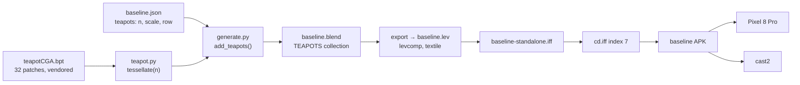
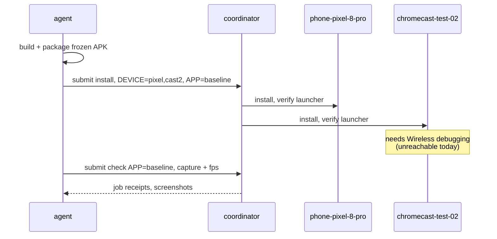
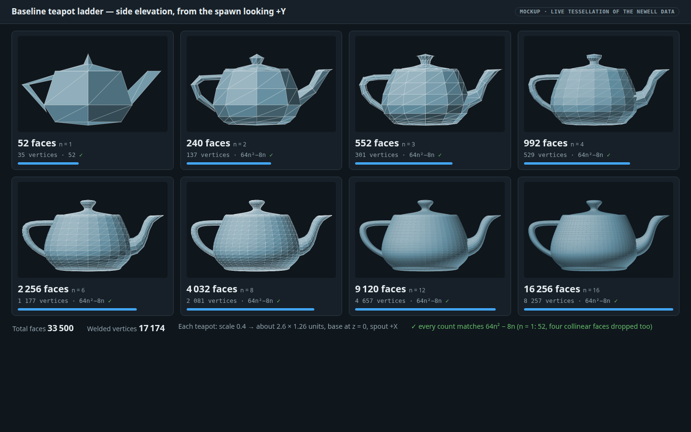
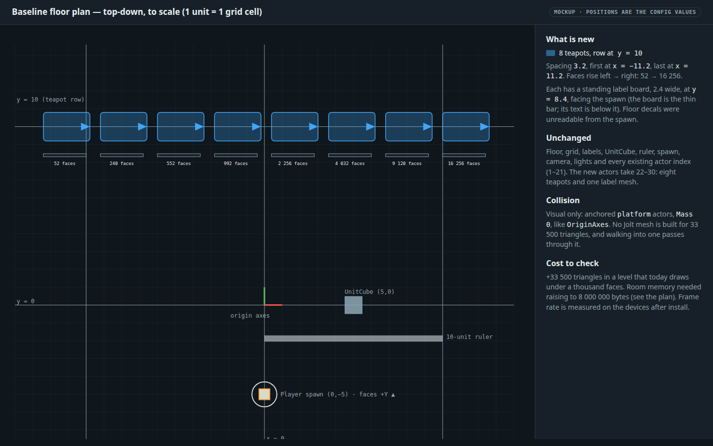
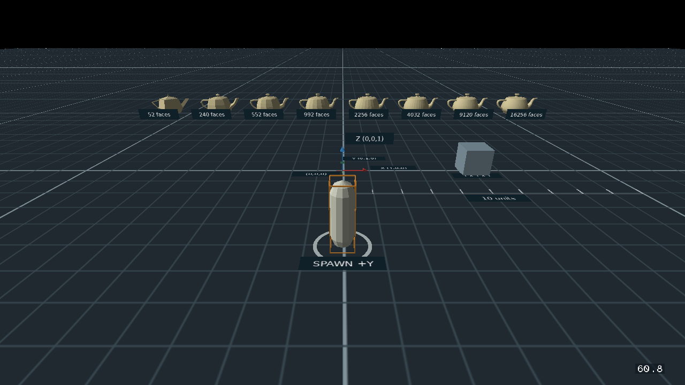

# Baseline: a ladder of Utah teapots with rising face counts

**Status:** Implemented 2026‑10‑31; verification steps 1–7 pass on the desktop. The device install (step 8): the Pixel is installed, cast2 is unreachable. Rank **T3**. Land it **before** [the settings cleanup](2026-10-31-baseline-settings-cleanup.md): both change actor indices, and this one only appends.

## Context

Will asked (2026‑10‑31): "baseline level needs a variety of utah teapots of varying number of faces".

The [baseline](../../wflevels/baseline/README.md) is the reusable empty scene every new level starts from. Today it has **no curved, many-face mesh**. Its largest mesh is the 400-tile floor, and the whole level draws under a thousand faces. That leaves nothing known to measure renderer, memory and load-time cost against. The teapot is the standard graphics test object, and a ladder of the same shape at 8 tessellation levels gives a controlled series. Face count is the only thing that changes from one teapot to the next.

Things that are true today and shape the design:

- `generate.py` builds the scene from an empty Blender file. The reviewed [baseline.blend](../../wflevels/baseline/baseline.blend) is exported from it and is **never regenerated over** (`README.md`: "It never regenerates `baseline.blend`").
- `Geometry.face()` writes one polygon at a time. There is no patch or subdivision helper.
- Existing actor indices 1–21 are consumed by the settings validators through `actor-map.json`. Anything new must append after them.
- Nothing ships the teapot. No copy exists on this machine (checked 2026‑10‑31: no `*teapot*` file anywhere on disk).

## The reference model

Searched the internet for the source rather than recalling the numbers. Three independent sources agree:

| Source | What it is | Used for |
|---|---|---|
| [University of Utah, official Utah Teapot page](https://graphics.cs.utah.edu/teapot/) | The reference. Version history: 1975 Newell (**28** patches), 1976 Blinn (scaled), **1987 Crow adds the round bottom → 32 patches**, later interior fixes (Fish 2006, Yuksel 2026). | Provenance and version choice |
| [holmes3d.net `teapotCGA.bpt`](http://www.holmes3d.net/graphics/teapot/teapotCGA.bpt) | The 32-patch Bézier data as plain text, 16 control points per patch (545 lines). `teapotCGAtall.bpt` is the same with z × 4/3. | **Vendored verbatim** as the source of truth |
| [three.js `TeapotGeometry`](https://raw.githubusercontent.com/mrdoob/three.js/r160/examples/jsm/geometries/TeapotGeometry.js) (MIT) | An indexed table of the same patches | Independent cross-check only; no code is copied |

**Cross-check, run 2026‑10‑31:** the three.js table expands to control points **identical** to `teapotCGA.bpt` for all 32 patches, in the same order (a first run reported 24 mismatches; the cause was my regex dropping three.js's `- 0.784` signs, not the data). `tall` / `CGA` has a z ratio of exactly 1.3333 and equal x, y. Bounds are x −3.000…3.525, y −2.000…2.000, z 0.000…3.150, with the base at z = 0 already.

We use the **1987 / Blinn-scaled 32-patch** version, the one every library calls "the Utah teapot". The 1975 original has no bottom and would be open underneath.

**Licence:** the Utah page states none. The dataset is a 1975 mathematical description circulated unchanged for fifty years. The plan vendors it with a provenance note (URL, retrieval date, SHA‑256). *If you want a licence review first, say so and I will hold the vendoring step.*

## Approach

1. **Vendor the data.** `wflevels/baseline/data/teapotCGA.bpt` (verbatim) and `data/README.md` with the sources above.
2. **`wflevels/baseline/teapot.py`**, pure Python with no `bpy`, so it is unit-testable. `load_patches()` parses the `.bpt`. `tessellate(n)` evaluates each bicubic Bézier patch on an (n+1)² grid, welds shared edge vertices, and splits each cell into two triangles, **dropping the degenerate triangles** at the lid and bottom cusps. Result: **64n² − 8n faces** at every level.
3. **Ladder** (`baseline.json` → `teapots`): `n = 1, 2, 3, 4, 6, 8, 12, 16` →

   | n | 1 | 2 | 3 | 4 | 6 | 8 | 12 | 16 |
   |---|---:|---:|---:|---:|---:|---:|---:|---:|
   | faces | 52 | 240 | 552 | 992 | 2 256 | 4 032 | 9 120 | 16 256 |
   | welded vertices | 35 | 137 | 301 | 529 | 1 177 | 2 081 | 4 657 | 8 257 |

   Total **33 500 faces, 17 174 vertices**. Every level is **64n² − 8n**, except n = 1: four more triangles are collinear (a flat strip across the spout tip, patches 18 and 19) and have no area, so they are dropped too and the first rung has **52** faces, not 56. The counts are reproduced live in the [lineup mockup](#mockups) and asserted by the tests.
4. **Placement.** Scale 0.4 (height 1.26, width 2.61), base at local z = 0, spout toward +X, a row at `y = 10`, spacing 3.2, first at `x = −11.2`. Each has a **standing label board** ("240 faces"), 2.4 wide at `y = 8.4`, facing the spawn. They are boards, not floor decals like `SPAWN +Y`, because a decal was unreadable from the spawn at this distance and angle (first build, seen in the desktop capture). The labels use a **new small atlas** `teapot-labels.tga` so the shared `labels.tga` and every existing label UV stay untouched.
5. **Actors.** Eight teapot `platform` actors plus one `TeapotLabels` mesh, `Mass 0`, `Model Type Mesh`, in a new `TEAPOTS` collection, **created last** so existing indices 1–21 do not move; they take 22–30. Because every preset is built from the same scene, the gallery and diagnostics presets carry the teapots too. Properties `wf_teapot_segments` and `wf_teapot_faces` flow into `scene-inventory.json`. They are **visual only**, like `OriginAxes`: no collision, because building a triangle-mesh body for 33 500 faces is not what this fixture is for.
6. **Getting it into the reviewed blend.** `generate.py` gains `add_teapots()`, called at the end of `build()` for fresh generations, and a `--add-teapots <blend>` mode that opens the reviewed file, appends the collection and saves. It **refuses if `TEAPOTS` already exists**, so it is idempotent and preserves manual edits, which is why I am not regenerating over `baseline.blend`.
7. **Winding needs no correction.** The engine culls back faces. A first prototype suggested the patches disagreed, so I wrote an orientation pass; it flipped **zero** triangles at every level and I removed it. Splitting each cell as (a, b, c), (a, c, d) already gives one consistent, outward-facing winding on every shell. The tests check that per shell, and a mutation test proves the check fails when winding is broken.
8. **Memory.** The first full run died loading Room 0: `Lmalloc … out of memory, request size = 198168` against the authored `room_asset_bytes` of 4 000 000. Bisecting showed the level needs at least about 6.7 MB per room slot (6 000 000 still fails; 8 000 000 loads). `memory-settings.json` now sets **8 000 000**, about 19 % headroom, which is what that authored setting is for. Total asset arenas are 2 000 000 + 3 × 8 000 000.

Rejected: tessellating at runtime in Forth. It would put the teapot's cost into every level load and make the face count a script result and not a property of the asset.

## Diagrams

How the data becomes a running level:



Install and check, in order (the coordinator is the arbiter of whether a device is free):



The teapots have no modes, so there is no state diagram.

## Mockups

**Teapot ladder.** The page tessellates the vendored data in the browser and checks every count against 64n² − 8n.

[](2026-10-31-baseline-utah-teapots/lineup.html)

[Open the interactive lineup](2026-10-31-baseline-utah-teapots/lineup.html).

**Floor plan.** Positions are the config values, drawn to scale against the existing fixtures.

[](2026-10-31-baseline-utah-teapots/floor-plan.html)

[Open the interactive floor plan](2026-10-31-baseline-utah-teapots/floor-plan.html).

**In the engine.** The desktop session's capture from the spawn (1280 × 720, FPS counter 60.0): the eight teapots get smoother left to right, lit and facing the right way, with their label boards underneath.

[](2026-10-31-baseline-utah-teapots/in-engine-spawn.png)

The change adds no screen text beyond the label boards. The empty, error and narrow states do not apply to a 3D fixture; the fps cost is the state to check, in step 8.

## Risks and gates

| Risk | Why it matters | Gate |
|---|---|---|
| **Frame cost.** +33 500 faces in a level of under 1 000 | The baseline is every new level's template. The Chromecast HD is the weak device | Measured on both devices in step 8 before this is called done. If the top rungs do not hold frame rate, the config drops them (a one-line change); the ladder is data, not code |
| **Memory budget** | `memory-settings.json` authored 4 000 000 B per room slot | **Hit and resolved**: needed about 6.7 MB, now 8 000 000 (approach item 8). A device `check` still has to confirm the Chromecast loads it |
| **cast2 is unreachable** | `chromecast-test-02`: "Coordinator control unavailable", configured `192.168.4.29:33803` (2026‑10‑31 16:23 and 16:41 +07). Several older install jobs from other sessions have waited on it for more than 110 h | Job `J‑842a6d03570a` is submitted and reports `needs-local-setup`. **I need the "IP address & Port" line from cast2's Wireless debugging screen** before it can run. I did not touch the other sessions' jobs |
| **Coordinator maintenance** | An update started at 16:35 and new jobs wait for it | Pixel job `J‑7431f689137f` is queued (batch `B-c1387a030d36`) and starts by itself when grants resume; I did not bypass the pause |
| **Main `cd.iff` was stale** | Index 7 held the old baseline, the qbert entry had drifted, and `verify.py --bundle` expected 9 TOC entries against the bundle's 10 | **Resolved** by formalizing the bundle: `wflevels/main-cd.manifest` is now the one level list, and the build, the checker and the tests read it (see step 7) |
| **Backface culling** | Mixed patch orientation would show holes | **Not a problem**: the raw winding is already consistent and outward; inside-spout and inside-handle faces stay single-sided, as expected |
| **Actor indices** | The settings cleanup removes `SampleSettings3` and shifts these ids | Land this first; ids come from `actor-map.json`, never hard-coded |

## Out of scope

- **Run the baseline build in the Blender container**, like the `aquarium_*` levels (`scripts/level-build.sh`). `build.py` is host-only today, so this work ran on the host as the Taskfile defines.
- Distance-based level of detail at runtime. The ladder is for measuring, not for swapping meshes.
- Collision for teapots, and textures or UV mapping beyond a flat colour.
- The rest of the Newell tea set (teacup, teaspoon), which ships in the same dataset and is a natural follow-up.
- The 2026 curvature-continuous revision by Yuksel, Blinn and Newell, and the 1992 and 2006 solid variants.
- Making the teapots optional per preset. Every preset (default, diagnostics, settings-gallery) includes them today.

## Verification

1. `python3 -m pytest tests/test_baseline_teapots.py -q` passes. It covers 32 patches, bounds −3…3.525 × ±2 × 0…3.15, the face count for every rung, no zero-area faces, consistent outward winding on every shell (plus a mutation test that the checks fail on broken winding), and deterministic output.

```
..............................                                           [100%]
30 passed in 2.14s
```

**PASS** — 30 tests.

2. Fetch [teapotCGA.bpt](http://www.holmes3d.net/graphics/teapot/teapotCGA.bpt) again and compare with the vendored copy: byte-identical. (The original is `curl -s <url> | cmp - wflevels/baseline/data/teapotCGA.bpt`; this session's hook blocks `curl`, so the same URL was fetched with Python's `urllib` and compared by SHA‑256.)

```
remote sha256 83c3cf09ff33cff17b8de714836c4c6758fccfc4288cef8671bacf0b7c294953
local  sha256 83c3cf09ff33cff17b8de714836c4c6758fccfc4288cef8671bacf0b7c294953
byte-identical: True
```

**PASS** — identical to the source.

3. `blender --background --python wflevels/baseline/generate.py -- --add-teapots wflevels/baseline/baseline.blend` adds the collection; running it a second time refuses. The first run printed `Added TEAPOTS to …baseline.blend`; this is the second run:

```
raise RuntimeError('TEAPOTS already exists; refusing to add the teapots twice')
RuntimeError: TEAPOTS already exists; refusing to add the teapots twice
blender exit code (second run): 1
```

**PASS** — refuses and exits 1.

4. `task baseline:build` succeeds and `build/scene-inventory.json` lists the `Teapot_*` actors with the faces above.

```
Built: /home/will/WorldFoundry-wbniv/wflevels/baseline/build/default-standalone.iff sha256 a03cfa7897198d19212b82e9b57dc4f4186b39960a71fc5185bfdb6c751c42ad
Teapot_52      collection=TEAPOTS faces=52 segments=1
Teapot_240     collection=TEAPOTS faces=240 segments=2
Teapot_552     collection=TEAPOTS faces=552 segments=3
Teapot_992     collection=TEAPOTS faces=992 segments=4
Teapot_2256    collection=TEAPOTS faces=2256 segments=6
Teapot_4032    collection=TEAPOTS faces=4032 segments=8
Teapot_9120    collection=TEAPOTS faces=9120 segments=12
Teapot_16256   collection=TEAPOTS faces=16256 segments=16
TeapotLabels   collection=TEAPOTS faces=None segments=None
```

**PASS** — eight teapots and the label mesh, counts as designed.

5. The existing actor indices are unmoved: `Level`, `Player` and `SampleSettings3` are still 1, 4 and 21.

```
[1, 4, 21] teapots: [22, 23, 24, 25, 26, 27, 28, 29, 30]
```

**PASS** — existing ids unmoved; new actors are 22–30.

6. `task baseline:verify` and `task baseline:check` pass (structural checks plus the desktop movement, collision and camera session), with the teapots in view in `build/desktop/spawn.png` (copied into this plan as `in-engine-spawn.png`). Tail of `task baseline:check`:

```
teapot actor ids are appended after every existing actor True
every declared descriptor type accounted for True
all presentation codes accounted for True
complete OAD framing True
catalog contains three object instances True
standalone L4 and sector-aligned asset True
native script compilation succeeds True
native player grounded at spawn True
native held Up moves +Y True
native release settles movement True
B resets native player True
native Up with zero heading moves +X True
camera switches to first-person True
camera switches back to follow True
unit cube blocks native movement True
quadrant floor support (-90, -90) True
quadrant floor support (90, -90) True
quadrant floor support (-90, 90) True
quadrant floor support (90, 90) True
fall reset restores spawn True
remote Up+OK resets without jumping True
runtime still running True
compiled descriptor checks passed: 118
```

**PASS** — 118 compiled-descriptor checks and every structural and native check, including the four new teapot checks. This needed `room_asset_bytes` raised to 8 000 000 (approach item 8); at 4 000 000 the engine aborted loading Room 0. The run used the host display, as `task baseline:check` is written to.

7. `task build-cd-iff` then `python3 wflevels/baseline/verify.py --desktop --bundle wfsource/source/game/cd.iff`.

```
main cd.iff: 8 levels from wflevels/main-cd.manifest
  L7: 1335296 bytes at sector 676 (baseline-standalone.iff)
  UIFT: 2770440 bytes at sector 1328 (…/wfsource/source/game/ui-font.wfga)
main CD GAME and TOC framing True
main CD has the shell, every manifest level and the UI font True
main CD preserves shell entry True
main CD level 0 is smb_w1_1 True
…
main CD level 6 is marble-madness-3d-astra True
main CD level 7 is baseline True
main CD ends with the UI font True
native script compilation succeeds True
native player grounded at spawn True
runtime still running True
162 passed of 162 (desktop session loaded the baseline from the bundle as level 7)
```

**PASS**: the baseline loads and plays from the main bundle. This step was first blocked by drift that predates this work: the qbert entry was stale (its level was committed 2026‑10‑27, `cd.iff` on 2026‑10‑17) and the checker expected 9 TOC entries against the bundle's 10 (the `UIFT` font). Fixing it meant formalizing how a level joins the bundle: `wflevels/main-cd.manifest` is the single, ordered level list (position = TOC index); `scripts/build-main-cd.py` packs it for `task build-cd-iff`; `verify.py` and `tests/level_menu_harness.py` read it instead of carrying copies; `tests/test_main_cd_manifest.py` fails on a stale bundle or a hand-written list; the procedure is in `docs/level-building.md`. The rebuilt bundle is byte-identical to the one the old hand-written command produced (SHA‑256 `797a5bf12b43…`); the refactor changed no bytes.

8. `task chromecast:submit WORKFLOW=install DEVICE=phone-pixel-8-pro,chromecast-test-02 APP=baseline APK=<frozen baseline apk> ASYNC=true`, then `task chromecast:watch BATCH=<id> STAGE=install`: both installed and launcher-verified, then a `check` on each device with a screenshot and the frame rate with all eight teapots in view.

```
Accepted B-c1387a030d36: pending; install
phone-pixel-8-pro: J-7431f689137f — waiting: maintenance: grants paused
chromecast-test-02: J-842a6d03570a — needs-local-setup: Coordinator control unavailable for chromecast-test-02; check the connection before retrying
```

**PENDING** — APK `baseline-0b4a87b65dd71e08.apk` (SHA‑256 `0b4a87b65dd7…`, signed with the baseline dev key, arm64-v8a and armeabi-v7a; its `assets/cd.iff` matches the receipt and contains the teapot meshes). The Pixel job runs when the coordinator update finishes; cast2 needs its Wireless debugging address. Frame rate on the devices is still unmeasured.
