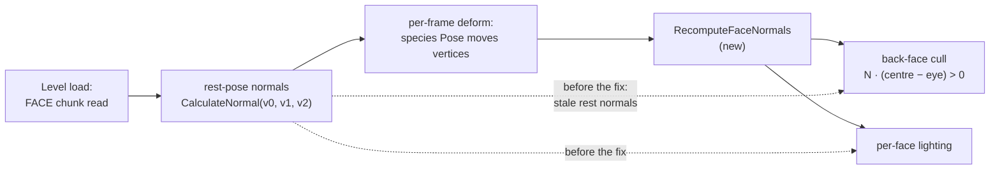
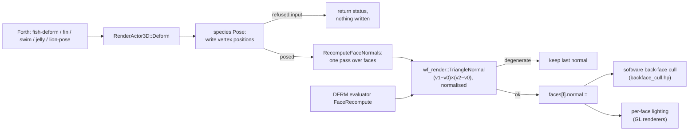
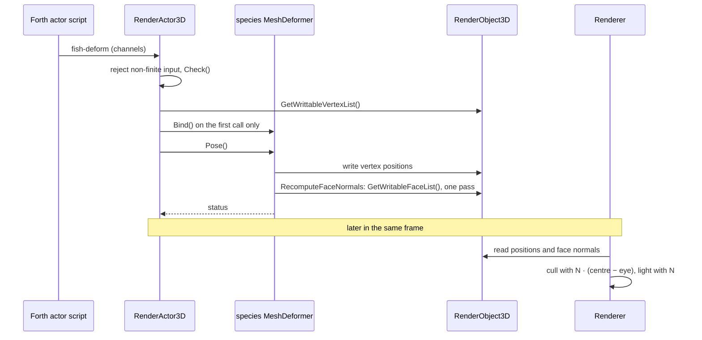
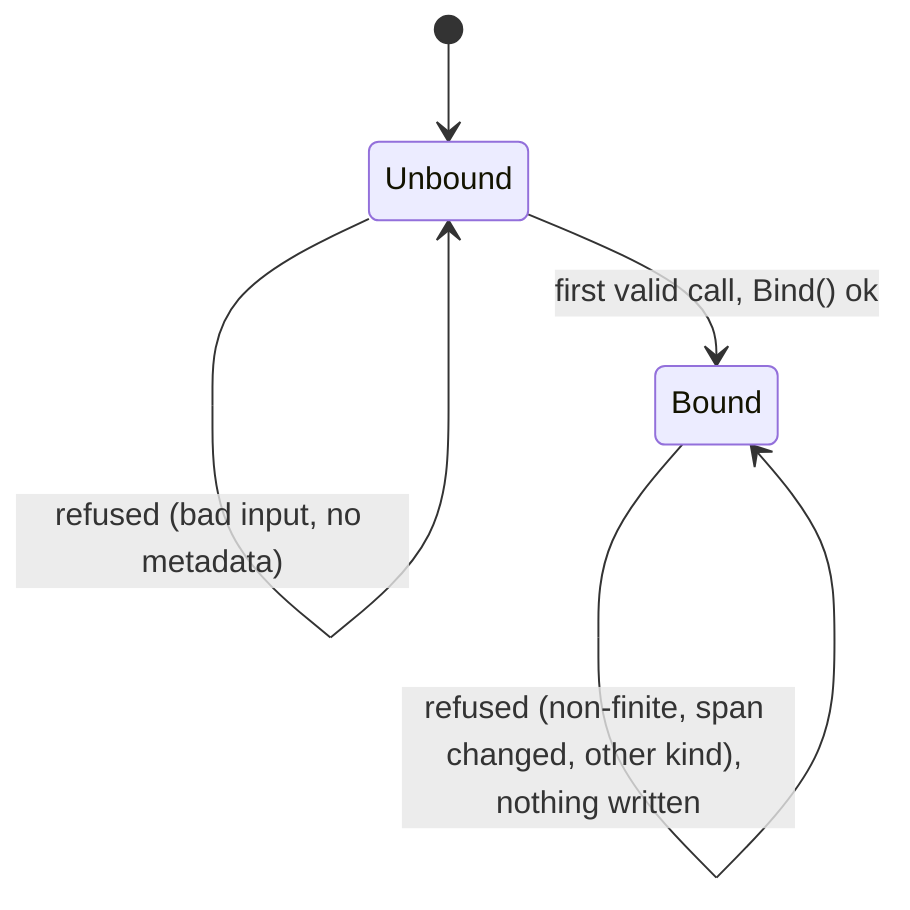
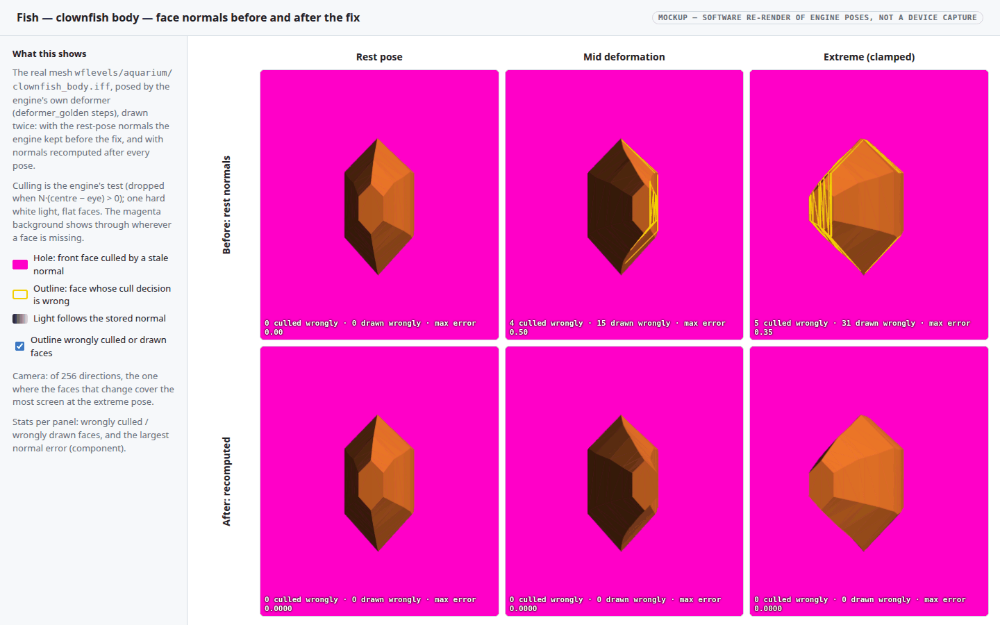
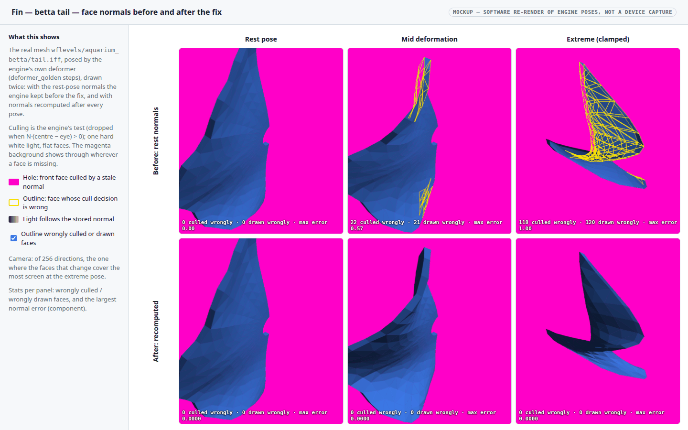
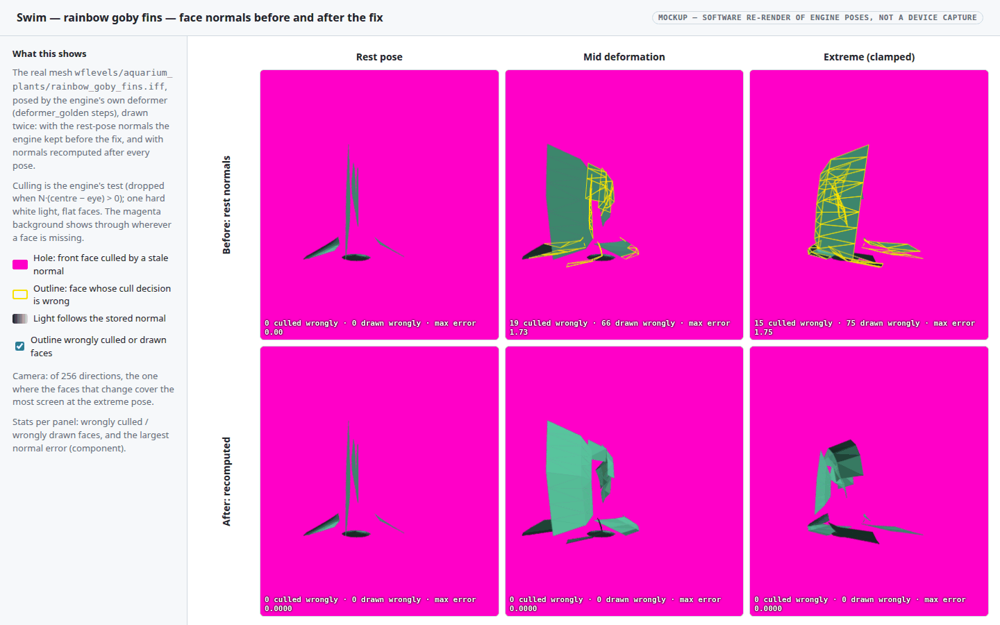
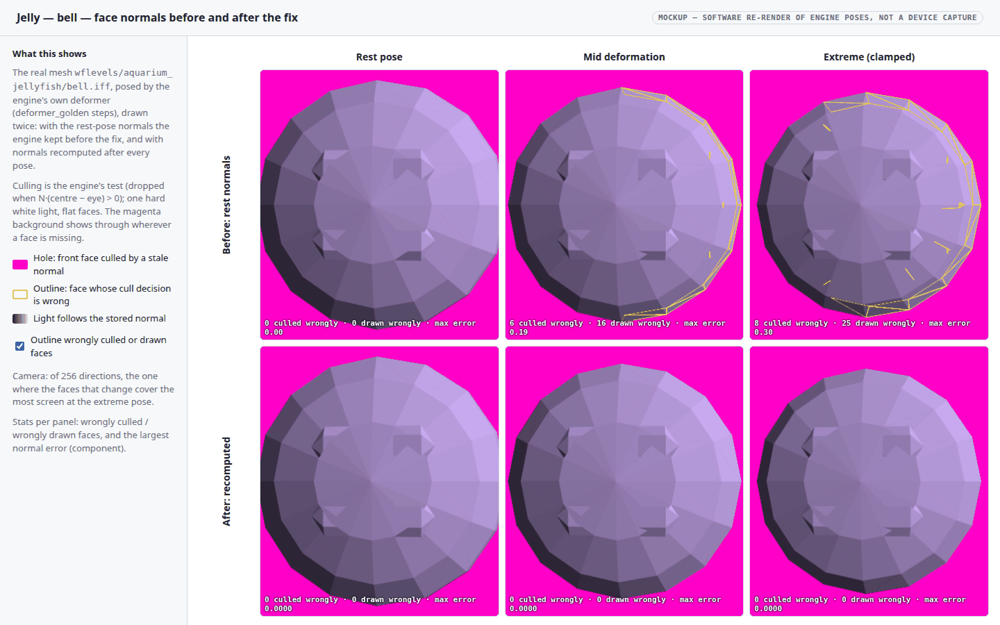
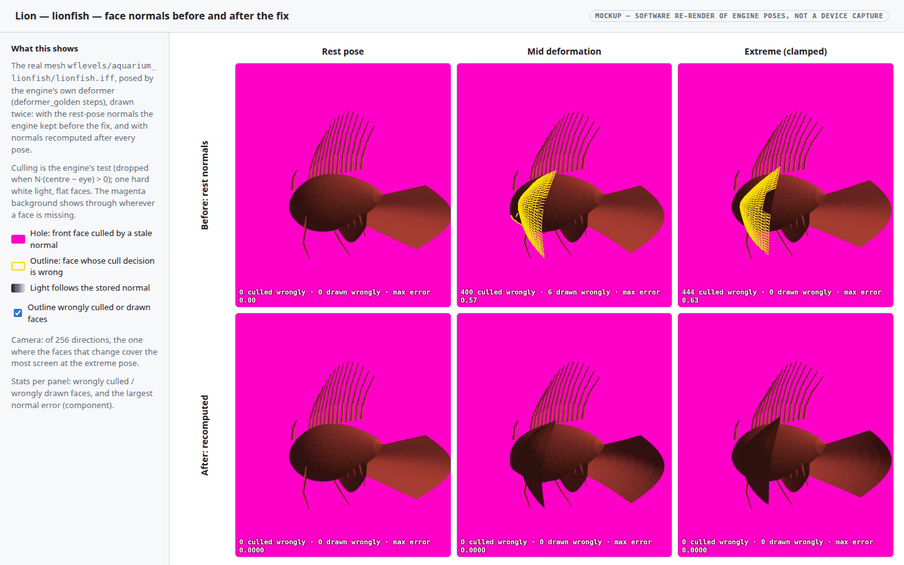
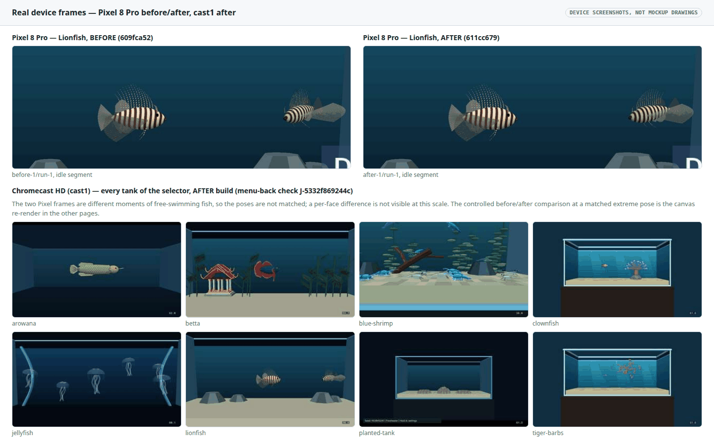

# Face normals for the five species deformers

Follow-up to the [saltwater seahorses plan](2026-10-16-saltwater-seahorses.md) ("Out of scope", first
listed under the E4 "Normals" note). Engine change authorised by Will for this fix only, 2026‑11‑01.

## Problem

The fish, fin, swim, jelly and lion deformers
([`mesh_deformer.cc`](../../wfsource/source/renderassets/mesh_deformer.cc)) rewrite vertex positions every
frame but never touch the face normals. Those are computed once, at load, from the rest pose
([`rendobj3.cc`](../../wfsource/source/gfx/rendobj3.cc), the `FACE` chunk: `CalculateNormal(v0,v1,v2)`).
The software back-face test ([`backface_cull.hp`](../../wfsource/source/gfx/backface_cull.hp)) and the
per-face lighting in the GL renderers (`rendgcl.cc`, `rendftl.cc`, …) both read that stored normal, so on a
bent fish, a flexed fin or a contracted jelly bell they cull and light against the rest pose.

The sixth kind, `DFRM`, already writes face normals: its evaluator recomputes a face that spans two
samples with the loader's winding, `(v1−v0)×(v2−v0)` normalised, keeps the last normal for a degenerate
triangle, and `DfrmDeformer::Pose` stores the result with `Vector3ToPS12` through
`RenderObject3D::GetWritableFaceList()`.

## Design

Reuse the `DFRM` mechanism, not a second one.

1. **One triangle-normal function.** The `FaceRecompute` arithmetic in
   [`dfrm_deform.cc`](../../wfsource/source/renderassets/dfrm_deform.cc) moves into
   `wf_render::TriangleNormal(v0, v1, v2, out)` in a new header,
   [`face_normal.h`](../../wfsource/source/renderassets/face_normal.h): float cross product, normalise,
   `false` (output untouched) when the length is not above 1e‑12. `DFRM` calls it in both places it built a
   triangle normal by hand (`FaceRecompute` each frame, and the rest normal of a `FaceSample` face at
   bind). The operations and their order are the same as before, so its output does not change;
   `dfrm_strand` still passes against the Python reference.
2. **One pass after each pose.** A file-local `RecomputeFaceNormals(const DeformTarget&)` in
   `mesh_deformer.cc` walks the actor's face list once, reads the three posed positions of each face,
   calls `TriangleNormal` and writes the face's normal through `GetWritableFaceList()`, exactly as
   `DfrmDeformer::Pose` writes its normals. A degenerate face keeps its last normal. Each species `Pose`
   calls it after writing positions, only on a successful pose; a refused call (non-finite input, changed
   swim span, other kind bound) returns before any write, so nothing changes.
3. **No allocation, no new buffers.** Every actor that deforms is built by the on-disk
   `RenderObject3D` constructor, which allocates its own face list, so writing it affects only that actor.
   The copy constructor (which shares faces) is used only by particle emitters, and particles are plain
   `RenderObject3D`s with no deformer slot. No shared copy-per-instance buffer, new API or representation
   change is needed.

Cost is one cross product, one square root and three divides per face per posed actor; the measured
numbers are under Verification.

From load to screen, the normals now follow the pose every frame instead of staying at the rest pose:



Inside one call, the recompute runs after the positions are written and before anything is drawn:



One frame, in order, across the script, the deformer, the mesh and the renderer:



The slot has two states, and only a successful pose in the bound state writes anything:



## Mockups

The change has a visible surface: what is lit and what is culled on every animated species mesh. Each
page below takes the real aquarium mesh, posed by the engine's own deformer (`deformer_golden_test
--dump`, the same steps as the golden test), and re-renders it in a canvas at rest, mid and extreme
(clamped) poses: the top row with the rest-pose normals the engine kept before the fix, the bottom row
with recomputed normals. Culling is the engine's test, the background is magenta so that holes show,
and yellow outlines mark faces whose cull decision is wrong (a front face dropped, or a back face
drawn). The camera is chosen from the mesh data, as the next section proposes: of 256 directions, the
one where the faces that change cover the most screen area at the extreme pose. These are software
re-renders of engine poses, not device or desktop captures; `scripts/deformer-normals-mockups.py`
regenerates them.

| Deformer | Extreme pose before the fix | Mockup |
|---|---|---|
| Fish (clownfish body, 310 faces) | 5 front faces culled, 31 back faces drawn, normal error up to 0.35 | [](2026-11-01-deformer-face-normals/fish.html) |
| Fin (betta tail, 896 faces) | 118 culled, 120 drawn, error up to 1.00 | [](2026-11-01-deformer-face-normals/fin.html) |
| Swim (rainbow goby fins, 328 faces) | 15 culled, 75 drawn, error up to 1.75 | [](2026-11-01-deformer-face-normals/swim.html) |
| Jelly (bell, 390 faces) | 8 culled, 25 drawn, error up to 0.30 | [](2026-11-01-deformer-face-normals/jelly.html) |
| Lion (lionfish, 4068 faces) | 444 culled (the pectoral fin), error up to 0.63 | [](2026-11-01-deformer-face-normals/lion.html) |

To regenerate: build `deformer_golden_test`, run it with `--dump` into a scratch directory, then
`scripts/deformer-normals-mockups.py <scratch> docs/plans/2026-11-01-deformer-face-normals`, and take each
PNG with `google-chrome --headless=new --window-size=1440,900 --screenshot=<page>.png file://<page>.html`
(quantised to 256 colours to stay under 512 KB).

Real device frames sit beside them: the Lionfish tank on the Pixel 8 Pro with each build, and every tank
of the selector on the Chromecast HD (cast1) with the fixed build. Fish swim freely in these, so the
before and after poses are not matched, and a per-face difference is not visible at this scale; the
matched-pose comparison is the canvas pages above. `scripts/profile-deformer-normals.py frames` builds
the page from the coordinator evidence.

[](2026-11-01-deformer-face-normals/device.html)

## Deliberately ugly visual regression case

**Status, 2026‑11‑01:** not built in the engine. The camera choice from mesh data and the before/after
comparison are done offline in the Mockups above; the in-engine diagnostic shot, the `WF_CULL=0`
control, the review clip and the automated cull-area check described here remain open.

Use the real `swim_goby_fins` mesh, not a synthetic triangle. Its third golden-test pose is already an
extreme but accepted deformation:
`SetSwimDeformation(-.4, .03, .01, -1.6, .3, -0.46, .34)`; the fin amplitude clamps as it does in
gameplay. Before the fix, its worst face normal differs from the posed geometric normal by **1.75**
in vector length (more than 120°). This is the best existing case for making the culling error look
like a torn fin rather than a subtle lighting change.

Make one isolated diagnostic shot with that fin enlarged to fill most of the frame, a saturated
magenta background behind it, low ambient light and one hard white side light. Keep mesh, pose,
camera, light, material and `WF_CULL=1` identical for the two builds. Choose the camera *from the
mesh data*: over a fixed grid of view directions, evaluate `WfFaceIsBackfacingAt` once with the
stored rest normal and once with the posed triangle normal, then choose the direction with the
largest **projected area** of disagreeing fin faces. Put the camera on that ray at three mesh
radii, looking at the posed fin's centroid. This removes guesswork about which side of a thin fin
will show the fault. Save the selected direction, pose values and mesh hash in the fixture so the
shot is repeatable.

| Frame | Expected visual result |
| --- | --- |
| Rest pose, either build | Continuous fin; baseline for geometry and light. |
| Extreme pose, old stored normals | Magenta background cuts through the bent fin where front-facing triangles were wrongly culled; surviving triangles have abrupt light bands. |
| Same extreme pose, recomputed normals | Fin remains continuous and the light follows its bend. Vertex positions must match the old build bit for bit. |

Also render the extreme pose with `WF_CULL=0` in both builds. The holes should disappear in that
control while stale-normal lighting remains, separating culling from shading. For a short review
clip, alternate rest and extreme pose every half second; the old build should visibly pop or
flicker at the bend, while the fixed build should move continuously. Show the two builds side by
side and include a red pixel-difference overlay; label this as a diagnostic comparison, not a
gameplay screenshot.

The automated check should record the chosen camera, the count and projected area of faces whose
cull decision differs, and the maximum normal error. It should fail without recomputation and
pass with it; the existing golden position comparison guards against a geometry change. Review
the actual render before setting a pixel-area threshold, since an isolated tiny face could pass a
face-count assertion while still being invisible to a person. If the goby fins occupy too little
screen area even when enlarged, repeat the same setup with the larger `fin_betta_tail` mesh and
its third golden-test pose (`1.56, .4, -.3, .3`, with clamps).

## Effect on recordings

Positions are unchanged, so the `deformer_golden` position fixtures stay bit-identical. Rendered output
of every tank with a species deformer changes slightly (lighting follows the bend; a few back faces near
the bend flip). The committed Linux frame reference
`tests/fixtures/renderer/aquarium-linux-frame20.png` is checked by `test_renderer_references_fresh.py`;
it is re-rendered if, and only if, that test fails after the change. It passed (Verification step 4),
so nothing was re-recorded. No other committed file is a rendered regression reference for these
tanks. The captures under `docs/diagnostics/` and in older plan bundles are dated evidence of what a
device showed at the time, not references any test compares against, so they are left as they are.

## Verification

**Where it ran (2026‑11‑01).** The Linux test container could not be used: the image was not in the local
store and building it needs about 700 MB, while the root disk had 2.3 GB free and fell under 650 MB while it
built, so the build was stopped. Steps 1–4 ran on the host instead, with every build directory and the
unpacked Jolt sources in tmpfs (`/tmp`), so the root disk was not written. The host is
an i7‑1185G7 that was shared with other sessions (load average 8–11 on 8 threads).

1. Deformer tests pass in the Linux container, including the new normal check (every face of every posed
   species mesh equals a fresh `CalculateNormal` of its deformed vertices within 1e‑4):
   `scripts/in-linux-container.sh bash -c 'cmake --build /build/dfn --target deformer_golden_test dfrm_strand_test && ctest --test-dir /build/dfn -R "deformer_golden|dfrm_strand" --output-on-failure'`

    Run on the host, Release, as `cmake --build <tmpfs>/b --target deformer_golden_test dfrm_strand_test && ctest -R "deformer_golden|dfrm_strand" --output-on-failure`:

    ```
    1/2 Test #3: deformer_golden ..................   Passed    0.36 sec
    2/2 Test #4: dfrm_strand ......................   Passed    6.12 sec
    100% tests passed, 0 tests failed out of 2
    ```

    ```
    ok   fish_clownfish_body    normals: 310 faces, max error 6e-08
    ok   fish_clownfish_body    6 steps, 3559 words identical
    ok   fin_betta_tail         normals: 896 faces, max error 6e-08
    ok   fin_betta_tail         5 steps, 6911 words identical
    ok   swim_arowana_body      normals: 5000 faces, max error 6e-08
    ok   swim_arowana_body      5 steps, 52791 words identical
    ok   swim_goby_body         normals: 484 faces, max error 6e-08
    ok   swim_goby_body         4 steps, 3017 words identical
    ok   swim_goby_fins         normals: 328 faces, max error 6e-08
    ok   swim_goby_fins         3 steps, 2065 words identical
    ok   jelly_bell             normals: 390 faces, max error 6e-08
    ok   jelly_bell             5 steps, 3486 words identical
    ok   lion_lionfish          normals: 4068 faces, max error 6e-08
    ok   lion_lionfish          5 steps, 37536 words identical
    ```

    **PASS** (on the host, not in the container). The position fixtures are still bit-identical.

2. The normal check bites: with the five `RecomputeFaceNormals` calls removed, `deformer_golden` fails on
   the normal check for all seven cases.

    Run as the new test against the engine before the fix (same tree, built before the engine edit), which
    is the same thing as removing the calls:

    ```
    FAIL fish_clownfish_body    normals: max error 0.502 over 310 faces (tolerance 1e-04)
    FAIL fin_betta_tail         normals: max error 1 over 896 faces (tolerance 1e-04)
    FAIL swim_arowana_body      normals: max error 0.171 over 5000 faces (tolerance 1e-04)
    FAIL swim_goby_body         normals: max error 0.931 over 484 faces (tolerance 1e-04)
    FAIL swim_goby_fins         normals: max error 1.75 over 328 faces (tolerance 1e-04)
    FAIL jelly_bell             normals: max error 0.302 over 390 faces (tolerance 1e-04)
    FAIL lion_lionfish          normals: max error 0.699 over 4068 faces (tolerance 1e-04)
    ```

    (the seven position lines were `ok … identical`.) **PASS**: all seven cases fail without the fix.

3. Per-call cost: `deformer_golden_test /src /src/tests/fixtures/deformer_golden --bench` in the container,
   with and without the recompute, Release build.

    On the host, the binary from before the fix and the one after, interleaved three times; 20 000
    steady-state `Deform` calls each; the median of the three runs, in µs per call:

    | Case | Vertices | Faces | Before | After | Added |
    |---|---:|---:|---:|---:|---:|
    | fish_clownfish_body | 193 | 310 | 0.47 | 8.5 | 8.0 |
    | fin_betta_tail | 450 | 896 | 4.9 | 28.0 | 23.1 |
    | swim_arowana_body | 3514 | 5000 | 24.1 | 158.2 | 134.1 |
    | swim_goby_body | 250 | 484 | 2.0 | 14.0 | 12.0 |
    | swim_goby_fins | 228 | 328 | 2.2 | 10.4 | 8.2 |
    | jelly_bell | 229 | 390 | 7.0 | 14.8 | 7.8 |
    | lion_lionfish | 2499 | 4068 | 76.3 | 174.4 | 98.1 |

    That is about 20–27 ns per face on this loaded host. The face loop alone, compiled standalone with the
    same flags, measured 19–27 ns per face on the same host at the same time. The loop is about 25 SSE
    instructions with one `sqrtss` and two divides per face, no calls and no allocation, so an unloaded
    core should be several times faster. Replacing the three divides by one reciprocal and three multiplies
    made no measurable difference, so the exact division stays, which keeps `DFRM` bit-identical.
    **PASS** (measured; the Chromecast cost is not measured, see step 5).

4. The Linux frame references are fresh: `test_renderer_references_fresh.py` in the Linux container.

    On the host instead (`task build`, with its object directory linked into tmpfs; host GL on the desktop
    display, which is where the references came from):

    ```
    ============================== 2 passed in 9.88s ===============================
    ```

    The aquarium capture compared directly with its reference:

    ```
    640x480: exact=307198/307200 (99.999349%)
    max channel delta histogram: {0: 307198, 1: 2}
    pixels exceeding tolerance 3: 0
    PASS
    ```

    **PASS**: frame 20 of `aquarium-standalone.iff` differs from the reference in 2 pixels by 1 level, so
    `aquarium-linux-frame20.png` is not stale and was not regenerated.

5. On a Chromecast, every tank of the eight-tank selector opens and animates (coordinator job).

    Run on chromecast-test-01 (Chromecast HD) with the fixed build: release aquarium APK built at
    611cc679 (sha256 `8e7d98eb…51d72`) with `./gradlew --offline :app:assembleAquariumRelease` in a tmpfs
    worktree, then `task chromecast:check DEVICE=chromecast-test-01 APP=aquarium APK=<frozen>
    VALIDATOR=menu-back ASYNC=true`, job J‑5332f869244c, 2026‑11‑01 about 18:15:

    ```
    J-5332f869244c: completed {"error": null, "health": "ready"}
    ```

    `assertions.json`:

    ```
    clownfish     start_back_home_resume PASS
    blue-shrimp   start_back_home_resume PASS
    betta_animated_pixels 3758
    betta         start_back_home_resume PASS
    jellyfish     start_back_home_resume PASS
    lionfish      start_back_home_resume PASS
    planted-tank  start_back_home_resume PASS
    arowana       start_back_home_resume PASS
    tiger-barbs   start_back_home_resume PASS
    ```

    **PASS**: the selector opens and each of the eight tanks starts, returns to the selector on Back and
    survives Home/resume. Only Betta has a validator assertion of motion (3758 changed pixels); the other
    tanks' frames are on the device-frames page above.

6. Device cost of the fix (added after Will asked for a device profile; moved from cast1 to the Pixel
   on his instruction, "use pixel instead"). Same release APKs as step 5: before at 609fca52 (sha256
   `b7c3fd44…8936f`), after at 611cc679, both built in one tmpfs worktree that differed only by the fix.
   `scripts/profile-deformer-normals.py prepare` froze them, made a `--frame-profile` copy of each, and
   wrote one `variant-benchmark` recipe per tank: before, after, before, after (two runs each, 15 s warmup,
   20 s measured), then one `--frame-profile` run of each build. Submitted with
   `task chromecast:submit DEVICE=phone-pixel-8-pro RECIPE=<recipe> ASYNC=true`.

    The seven jobs first queued on cast1 (J‑dccd0380833a, J‑96ec06b7daac, J‑b248d21ceac0,
    J‑25473b630591, J‑59fe5dbe3517, J‑26eecac5e92d, J‑eff28facf79a) waited behind another session's
    interactive job and were cancelled unstarted when the profile moved to the Pixel.

    **All numbers below are Pixel 8 Pro, not Chromecast HD.**

    *Lionfish, J‑ec51380f6189, completed.* Frame times (presented-frame intervals, SurfaceFlinger):

    | Variant | fps per run | p50 ms | p95 ms | missed refresh % |
    |---|---|---|---|---|
    | before-1 | 116.4, 113.6 | 8.34, 8.34 | 8.62, 8.58 | 0.17, 0.09 |
    | after-1 | 120.0, 108.3 | 8.34, 8.34 | 8.58, 8.60 | 0.00, 0.46 |
    | before-2 | 118.1, 119.9 | 8.34, 8.34 | 8.57, 8.59 | 0.17, 0.04 |
    | after-2 | 117.8, 120.0 | 8.34, 8.34 | 8.57, 8.57 | 0.17, 0.00 |

    The Pixel presents at its 120 Hz refresh in both builds; the run-to-run spread (108–120 fps) is
    larger than any difference between builds, so fps and frame time show **no measurable difference**.

    CPU sections from the `--frame-profile` runs (thread CPU ms per frame; mean of the eight 5 s windows
    after level load, window-to-window min–max in brackets):

    | Section | Before | After | Change |
    |---|---|---|---|
    | pose | 0.177 [0.166–0.199] | 0.298 [0.273–0.351] | +0.12 |
    | animation | 0.131 [0.123–0.148] | 0.251 [0.230–0.297] | +0.12 |
    | director | 0.276 [0.259–0.311] | 0.396 [0.363–0.466] | +0.12 |
    | update | 0.424 [0.404–0.469] | 0.543 [0.505–0.624] | +0.12 |
    | render | 2.879 [2.739–3.158] | 2.852 [2.629–3.226] | none |
    | total | 3.304 [3.148–3.627] | 3.395 [3.134–3.850] | inside the spread |

    The same +0.12 ms appears in four sections that nest around the scripted deform call, and the ranges
    do not overlap, so it is the recompute: about 0.12 ms per frame for the tank's two lionfish
    (`fish-deformations` and the render counters are identical in both builds: 2 deform calls, 15 render
    actors, 8502 faces submitted), so about 60 µs per 4068-face lionfish per frame, or about 15 ns a face.
    The desktop estimate (about 98 µs a call on a loaded i7) is the same order. Render time and the
    faces-culled counter (2064 of 8502 in both) do not change measurably in this tank.

    *Arowana, J‑fb133480bb05: did not finish.* before-1, after-1 and before-2 ran (119.2–120.0 fps, at
    the refresh rate); the install of the after build for after-2 (`adb install -r`, issued by the
    coordinator) did not return and was cut off after about 90 s. The job ended `uncertain /
    device-command-timeout`, the coordinator's automatic readd J‑9ad7f7662e8e failed with
    `cleanup-requires-restart`, and the Pixel is `recovery-required` until an administrator readds it.
    Betta J‑8be03933aaf7, Jellyfish J‑40f37539c88f, Tiger Barbs J‑70c9b24a8673, Planted tank
    J‑5ddc2a9a70fa and Clownfish J‑2d9ebdd6f03e are queued behind that recovery and have not run.

    **What the Pixel can and cannot say about the Chromecast HD.** It shows the cost is real, small and
    proportional to faces, with no change in what is drawn per frame. It cannot give the Chromecast's
    number: the Pixel's cores are several times faster than the Chromecast HD's, and the Pixel has
    headroom at 120 Hz while cast1 runs near its budget (the selector showed about 50 fps in the
    Lionfish tank). Scaling 0.12 ms by an unmeasured factor would be a guess, so the Chromecast HD cost
    stays **not measured**.

    *Second attempt, after Will restarted and readded the Pixel (ready at 19:38).*

    - Betta J‑8be03933aaf7: before-1 installed, then scene selection did not confirm the Betta entry
      (`scene-selection.json`: expected index 2, `confirmed: false`); the job ended `uncertain /
      plugin-error`. The coordinator's automatic readd J‑81d3a82a2d17 brought the Pixel back to ready.
    - Jellyfish J‑40f37539c88f: before-1 ran (119.2 and 120.0 fps, p50 8.33 ms), then the install of the
      after build hung again: `adb install -r 8e7d98eb….apk` had no return code after 90.5 s, the job
      ended `uncertain / device-command-timeout`, and the automatic readd J‑3ece8347f0eb failed with
      `cleanup-requires-restart`. The Pixel is `recovery-required` again (administrator readd).
    - As instructed, I stopped there: no readd, no adb. I cancelled my remaining queued Pixel jobs so they
      would not wedge the phone again right after the next readd: Tiger Barbs J‑70c9b24a8673, Planted
      tank J‑5ddc2a9a70fa, Clownfish J‑2d9ebdd6f03e, and the resubmitted Arowana J‑1eaa7071ebe5 and Betta
      J‑05b56bf89105.

    The install history across the three jobs that reached it: the after build (gradle release,
    `8e7d98eb…`) installed in 3.5–4.4 s four times and hung at 90 s twice; the before build and both
    `--frame-profile` copies never hung (3.4–11.5 s, seven installs). Every hang was the after build
    replacing the before build. The device screenshot at the hang shows the before build still running
    in the Jellyfish tank and no dialog. The cause is not known; it needs someone with the phone in hand
    to see what the installer is waiting for.

    ~~**FAIL (incomplete)**: one of the seven tanks profiled (Lionfish, on the Pixel 8 Pro); the other six
    did not complete because the Pixel stopped on hung installs; the Chromecast HD cost is not measured.~~
    Superseded by step 7: Will chose cast1 instead of the Pixel, and all seven tanks completed there.

7. Device cost of the fix on the Chromecast HD (cast1), all seven tanks. Same frozen APKs and recipes
   as step 6, submitted with `task chromecast:submit DEVICE=chromecast-test-01 RECIPE=<recipe> ASYNC=true`
   on 2026‑11‑01 from 19:53; all seven finished overnight. Each receipt reads `succeeded / completed`,
   and each job's cleanup re-installed the after build (`8e7d98eb…`, verified), so no job ended uncertain
   and no restore failed. Evidence: `~/tmp/deformer-normals-cast1/<job>/`, summarized with
   `scripts/profile-deformer-normals.py summarize ~/tmp/deformer-normals-cast1/<job> --out <job>.json`.

    Betta's scene selection on cast1 confirmed the right tank, so the Pixel failure (step 6) was specific
    to the Pixel:

    ```
    {'scene': 'betta', 'expected_index': 2, 'cursor_before_selection': 2, 'corrective_down_keys': 0,
     'cursor_indices': [0, 1, 2], 'selected_indices': [2], 'started_indices': [2], 'confirmed': True}
    ```

    **All numbers in this step are Chromecast HD (cast1).** Frame rate: four runs per build (before-1,
    before-2 and after-1, after-2, two runs each, alternating), min–max and median. p50 and p95 are
    presented-frame intervals; missed refresh is the percentage of frames over 1.5 refresh intervals.

    | Tank (job) | fps before | fps after | Outside spread? | p50 / p95 ms, before → after | Missed refresh %, before → after |
    |---|---|---|---|---|---|
    | Lionfish (J‑f41ce99aacf7) | 47.6–48.1 (47.9) | 46.3–46.8 (46.6) | **yes, lower** | 16.68 / 33.37 → same | 24.3–25.6 → 27.4–28.4 |
    | Arowana (J‑5bbba2fbfed8) | 59.7–59.9 (59.8) | 59.4–59.8 (59.6) | no | 16.68 / 16.68 → same | 0.0–0.3 → 0.2–0.9 |
    | Betta (J‑ac94b4d4e1ed) | 59.7–59.8 (59.8) | 59.7–59.9 (59.8) | no | 16.68 / 16.68 → same | 0.2–0.3 → 0.1–0.3 |
    | Jellyfish (J‑43d8e662aec2) | 57.6–58.4 (58.2) | 57.9–58.4 (58.0) | no | 16.68 / 16.68 → same | 2.6–4.1 → 2.6–3.6 |
    | Tiger Barbs (J‑554731d046ef) | 33.1–33.6 (33.3) | 32.3–32.8 (32.7) | **yes, lower** | 33.37 / 33.37 → same | 77.5–79.2 → 81.3–83.6 |
    | Planted tank (J‑f97660519b6e) | 34.3–35.4 (34.7) | 32.5–37.9 (37.0) | no (noisy) | 33.37 / 33.37–50.05 → same | 64.3–68.9 → 54.1–76.0 |
    | Clownfish (J‑b4ce040c9502) | 59.8–59.9 (59.9) | 59.8–59.9 (59.9) | no | 16.68 / 16.68 → same | 0.0–0.2 → 0.0–0.2 |

    CPU per frame from the `--frame-profile` runs (thread CPU ms; mean of the 5 s windows after level
    load, window min–max in brackets). The deform call sits in the `pose` section in the tanks whose
    scripts mark one (Lionfish, Tiger Barbs) and in `animation` in the others; `animation` encloses
    `pose` where both exist.

    | Tank | pose before → after | animation before → after | total before → after | Δ total | Deform calls / frame |
    |---|---|---|---|---|---|
    | Lionfish | 0.730 [0.719–0.743] → 1.346 [1.314–1.375] | 0.593 → 1.208 | 15.00 → 15.58 | +0.57 | 2 |
    | Arowana | — | 0.170 [0.166–0.174] → 0.697 [0.677–0.708] | 6.69 → 7.16 | +0.47 | 10 |
    | Betta | 0.053 → 0.053 | 0.086 [0.081–0.088] → 0.298 [0.279–0.309] | 4.53 → 4.73 | +0.20 | 7 |
    | Jellyfish | — | 0.270 [0.265–0.280] → 0.546 [0.539–0.553] | 10.34 → 10.56 | +0.23 | 12 |
    | Tiger Barbs | 4.340 [4.287–4.452] → 4.910 [4.861–4.957] | 0.248 → 0.792 | 26.27 → 26.81 | +0.54 | 50 |
    | Planted tank | — | 6.222 [5.981–6.787] → 7.054 [6.722–7.740] | 18.94 → 21.21 | (noise) | 2 |
    | Clownfish | — | — | 2.78 → 2.77 | none | 0 |

    The render section is unchanged within its spread in every tank (Lionfish 13.47 → 13.42, Tiger
    Barbs 8.50 → 8.39), and the faces-culled counter differs by under 0.1 % (Lionfish 2062.3 → 2062.0
    of 8502), so the fix moves CPU time into the deform pass and changes almost nothing in the render.

    Reading the table:

    - **The cost is 0.2–0.6 ms of CPU per frame** in the five tanks that deform at idle: Betta +0.21
      (`animation`), Jellyfish +0.28, Arowana +0.53, Tiger Barbs +0.54 to +0.57, Lionfish +0.62 (`pose`).
    - **Heavier meshes cost more per call.** Lionfish pays about 0.31 ms per 4068-face fish. The 50 barbs
      pay about 11 µs each. Arowana's 0.53 ms covers its body (5000 faces) and fins over 10 calls.
    - **Against the desktop estimate**, cast1 is about 3× slower per call. The desktop measured about
      98 µs per lionfish call on a loaded i7, against about 310 µs here. The Pixel 8 Pro's Lionfish (step 6:
      +0.12 ms per frame, so about 60 µs a fish) is about 5× faster than cast1.
    - **Frame rate drops outside the spread only in the two tanks that were already over budget:**
      Lionfish 47.9 → 46.6 fps (−1.3, −2.7 %) and Tiger Barbs 33.3 → 32.7 fps (−0.6, −1.8 %). Their
      missed-refresh share rises by about 3 and 4 points.
    - **The tanks that hold 60 fps** (Arowana, Betta, Clownfish) and Jellyfish (58) **show no change**
      outside the spread.
    - **Planted tank is not a usable measurement.** Its plants differ between launches: faces submitted
      were 30 892 before and 35 497 after, and render CPU ranged 2.8–26.6 ms within one run. So its
      fps and total move with the scene, not with the fix.
    - **Clownfish has no deform call at idle** (0 per frame), so the fix cannot cost anything there.

    **PASS**: all seven tanks completed on cast1 with clean receipts and restores, and the fix's cost is
    measured. Whether that cost is acceptable is Will's decision (below), so the TODO item stays
    `[verify T3]` until he decides.

    **Recommendation (for Will to decide):**

    - **Keep the fix.** Rest-pose normals make bent fins and bodies cull and light wrongly
      (Verification step 2 and the mockups), and the cost is invisible in every tank that holds its
      frame rate.
    - **It does cost a visible ~1–3 % in the two tanks that were already over budget on cast1:**
      Lionfish −1.3 fps and Tiger Barbs −0.6 fps.
    - **If those fps should come back,** the cheapest follow-up is to recompute only faces with a vertex
      that can move. The deformers already know which vertices are static: the front 35 % of the fish
      body, and the lion trunk and zero-weight regions. That would save part of the Lionfish cost and
      little of the barbs'.
    - **Recomputing every second frame would halve the cost,** at the price of normals one frame stale.
    - **Do not change both** until Will says the fps matter more than the simpler single pass.
