# Field presentations: a distinct control for every case

**Status:** Built and verified on the host and desktop (2026‑11‑01): steps 1 to 5 pass. The APK `baseline-5b47e27b5516e543.apk` is on a refreshed runtime. Step 6 (cast1) is the coordinator's to run. Choice-row keys follow Will's option 6 (see Decision). Rank **T4**: it changes the engine form, both settings renderers (TV and phone touch), the OAD normalizer and engine validation, then refreshes the baseline's frozen native runtime. TODO: the `[wip T4]` item "Field presentations" in `TODO.md`.

## Context

Will (2026‑11‑01), on the eleven `proposed` cases of the [touch settings plan](2026-10-29-touch-settings-phone-tablet.md): "i don't understand why they're separate. all need to be addressed. let's deal with them now". The touch settings work and the [baseline cleanup](2026-10-31-baseline-settings-cleanup.md) are one piece of work from here on.

cast1 drew the baseline's Field types owner (APK `eebab09d285f2939`; table under step 7 of the cleanup plan). Two of the eleven already draw a distinct control (23 `enum-many`: a chip grid; 25 `int-help`: group heading and help line). Nine draw as a plain "Label: value" row. The contract is the **Phone control** column of the touch plan's table, held in [2026-10-29-touch-settings-examples.json](2026-10-29-touch-settings-examples.json).

What each surface draws today, read from the code (2026‑11‑01):

| # | Case | Contract | TV (`runtime_property_ui.cc`) today | Phone touch (`runtime_property_touch.cc`) today |
|---|---|---|---|---|
| 4 | `int-mailbox` | Numeric editor with bounds | "Label: value" | Value; tap opens the native editor, no bounds |
| 8 | `enum-default` | Open choice list | "Label: value"; Left / Right cycle | Value "v"; tap opens a choice sheet |
| 9 | `enum-number` | Choice list with numeric id | Name only | Choice sheet, names only |
| 10 | `enum-dropdown` | Open choice list | As 8 | As 8 |
| 13 | `enum-toggle` | Tap either segment | "Label: value" | Two segments (only when there are exactly two options) |
| 14 | `enum-combo` | Open choice list | As 8 | As 8 |
| 16 | `bool-toggle` | Tap switch | "Sway: 1": the field compiles to **Int** | Number row (the compiled field is Int) |
| 20 | `str-filename` | Native text editor; validate path | "Label: value"; any text accepted | Native editor; any text accepted |
| 23 | `enum-many` | Scrollable choice sheet | Twelve chips | Scrollable choice sheet |
| 24 | `enum-long` | Wrapping choice sheet | One line, cut | Sheet buttons end in "..." |
| 25 | `int-help` | Group heading and help below row | Heading, help line | Group label in the card; help above the footer |

## Approach

1. **One presentation function.** `engine/runtime_property_presentation.hpp` maps a catalog field (kind, `show`, rule, read-only flag, choices) to a `Control`: Number, NumberWithBounds, Slider, Colour, ChoiceList, NumberedChoiceList, Segments, Chips, SteppedSlider, Checkbox, Switch, Text, Digits, Multiline, Path, Reference, Action, Spacer. The TV renderer, the touch renderer and the form's key handling all call it. A control comes from the `showAs` code the exporter compiled, never from a field name or key and never from a type scan at runtime.
2. **Fix `bool-toggle` at export.** The OAD normalizer (`wftools/wf_attr_schema`, shared with Blender) classifies an integer with no choices as Bool when it shows as CHECKBOX. It will do the same for TOGGLE. The only TOGGLE in the shipped OADs (`test.oas`) has choices and stays an Enum. The cooker already maps Bool to kind 4, so the level needs no new bytes beyond the recompiled catalog.
3. **TV form.**
   - **ChoiceList / NumberedChoiceList** (cases 8, 9, 10, 14, 24): a value box with a down-arrow, whatever the number of options (drawing follows the authored `showAs`). Keys follow Will's option 6 (2026‑11‑01) and depend only on the option count:
     - **2 to 4 options** (`kCycleChoicesMax` = 4): Left / Right cycle, clamped with no wrap, and Left on the first option goes to the section rail. A also opens the list, so a long label can be picked directly.
     - **5 or more:** no cycling. A opens the list, and Left on the closed row goes to the rail.
     - **In the open list:** Up / Down move, A selects into the draft, and Back or Left closes it with no change.
     - The numbered list shows each option's id beside its name. An option or value too wide for one line wraps to two lines.
   - **Segments** (13): two segments, drawn like Habitat's. Left / Right choose; Left on the first segment goes to the rail.
   - **Switch** (16): a pill switch. Left / Right set Off / On and A flips it, exactly as on the checkbox; Left at Off goes to the rail.
   - **NumberWithBounds** (4): the bounds are printed beside the value, and the native editor's title carries them.
   - **Path** (20): a file mark, with the folder dimmed and the file name bright.
   - Chips (23) and the group heading with its help line (25) are unchanged.
4. **Phone touch form.**
   - The choice sheet shows ids for NumberedChoiceList and wraps long options to two lines.
   - The row shows the numeric id and the bounds. Checkbox and Switch draw differently (a ticked square against a pill). Path draws the file mark.
   - Segments draw for up to four options.
   - The scrollable sheet (23) and the group label with help (25) are unchanged.
5. **Path validation in the engine.** `wfprops::validate` refuses a FILENAME text value that is empty, absolute, uses `\`, contains `.` or `..` segments or empty segments, or contains control characters. New message: "Enter a relative path: names separated by /". The TV, touch, phone browser and launch overrides all go through it.
6. **Controller navigation unchanged** for every control that is not one of the new ones: number, slider, colour, chips, stepped slider, checkbox, text, read-only and action rows keep today's Left / Right / A / Back.
7. **Ship.**
   - Rebuild the Field types catalog and level (`task baseline:build`), and `wfsource/source/game/cd.iff` (`task build-cd-iff`).
   - Rebuild the condo diagnostic runtime, which the frozen `runtime.apk` is byte-identical to, from a clean worktree at this commit, so no uncommitted work from other sessions is compiled in.
   - Refresh the frozen runtime (`build.py --package-only --refresh-runtime`) and repackage the APK.

Rejected alternatives for the choice rows (Will chose option 6 on 2026‑11‑01):
- Plain cycling with no exit traps focus.
- "A opens, Left leaves" for every count (option 1) makes a two-option box slower than segments.
- Up on the first row (3) and a two-level Back (4) hide the way out.

## Decision: choice-row navigation (Will, 2026‑11‑01)

**Option 6, chosen by Will.** Choice rows with 2 to 4 options cycle with Left / Right (clamped) and leave to the rail by Left on the first option; A also opens the list. Rows with 5 or more options only open the list. Segments and the switch keep their edge exit, and all other controls keep today's keys. The phone touch form is unaffected.

The rule lives in one place:
- `wfprops::keys(const Field&)` in `engine/runtime_property_presentation.hpp`, with the threshold as `kCycleChoicesMax`.
- `Form::input` and the footer hint read only that function.
- `policy()` in `tests/test_runtime_property_presentation.py` mirrors it. The key tests derive what Left, Right and A must do from the rule the engine reports, and cover 2, 4, 5 and 12 options.

## Diagrams

From the exported `showAs` to the control each surface draws:

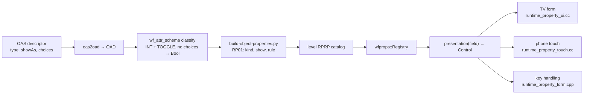

A choice list on the TV, open and closed:

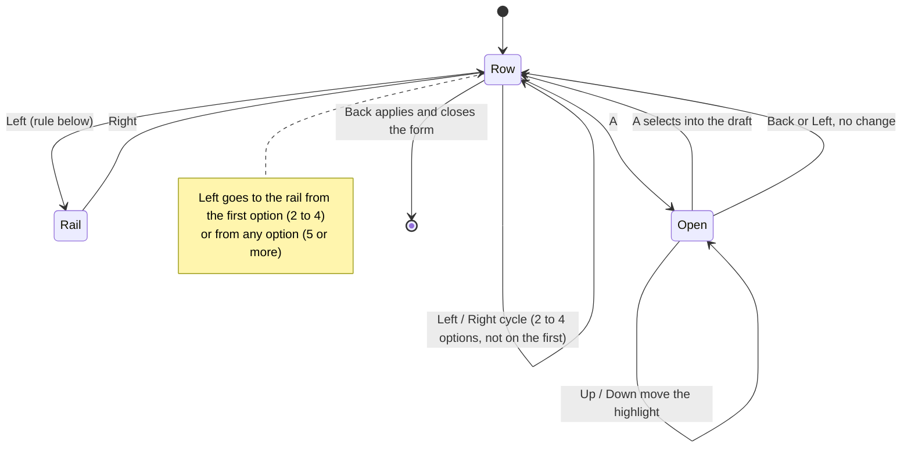

Keys on the TV, by control (unchanged rows in grey text in the table below):

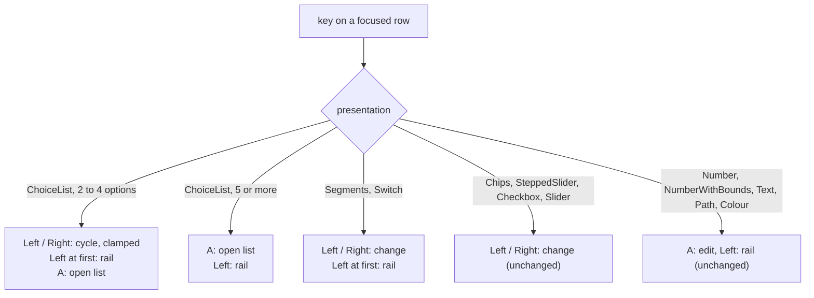

## Mockups

Every mockup is a self-contained page drawn at 1440 × 900 by `build_mockups.py` in the bundle; the TV ones scale the 1920 × 1080 form by 0.7 and use the renderer's colours.

| TV, Choices (closed) | TV, numbered list open | TV, wrapping list open |
|---|---|---|
| [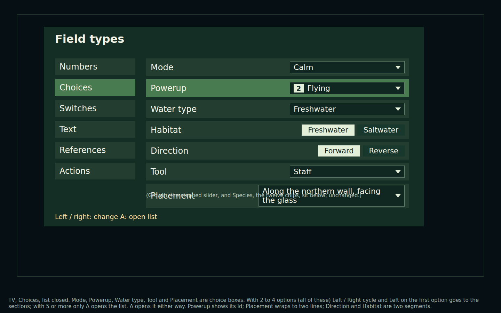](2026-11-01-field-presentations/tv-choices.html) | [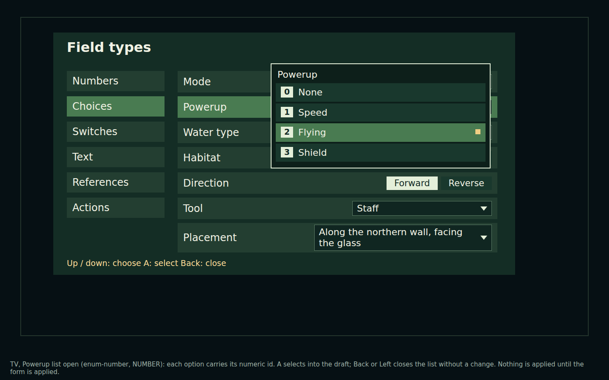](2026-11-01-field-presentations/tv-list-numbered.html) | [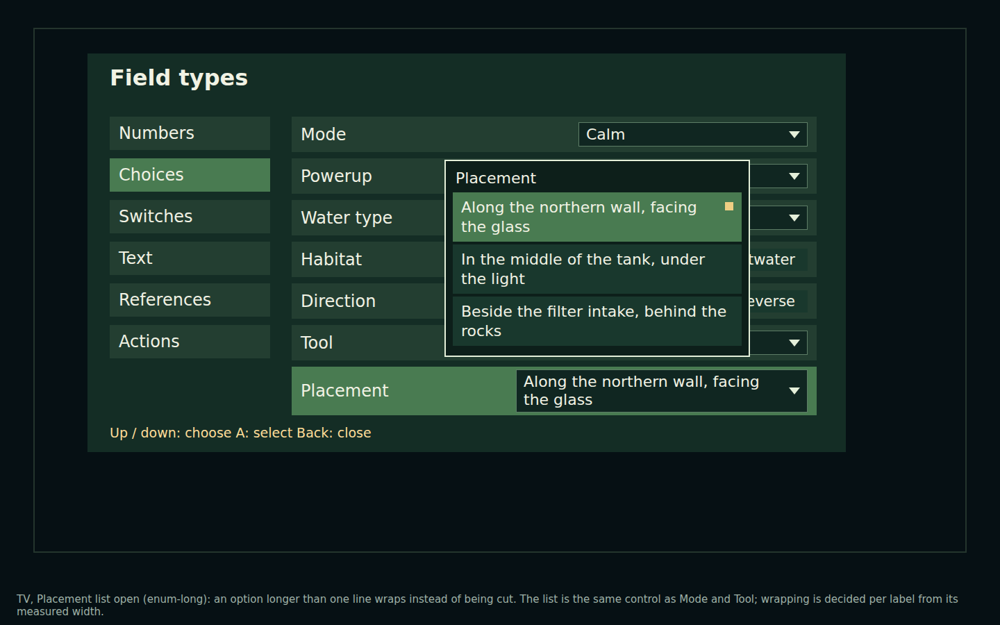](2026-11-01-field-presentations/tv-list-wrapping.html) |

| TV, Numbers (bounds; kept group and help) | TV, Switches | TV, Text with a path error |
|---|---|---|
| [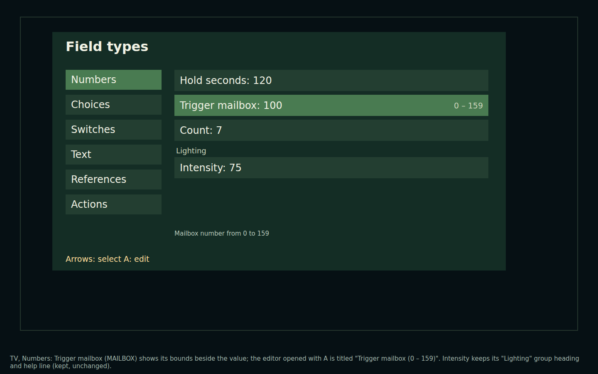](2026-11-01-field-presentations/tv-numbers.html) | [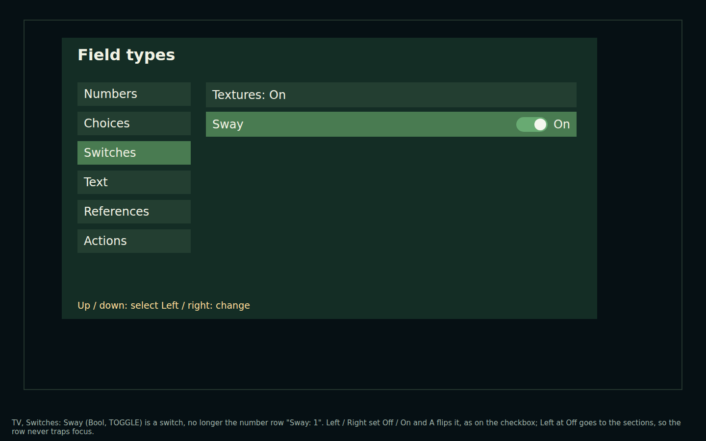](2026-11-01-field-presentations/tv-switches.html) | [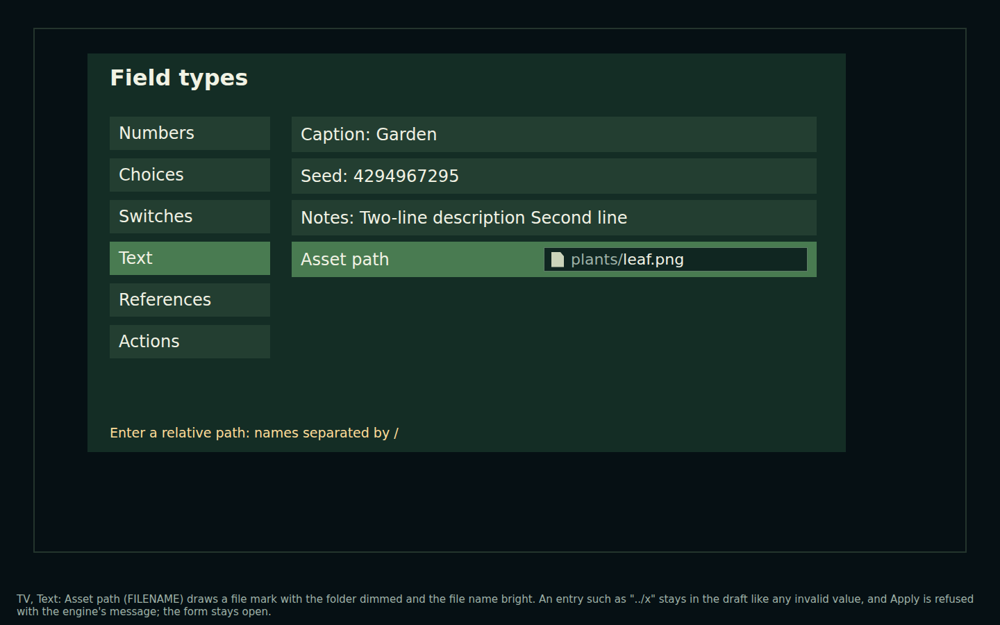](2026-11-01-field-presentations/tv-path-error.html) |

| Phone: Choices, numbered sheet, wrapping sheet | Phone: bounds and help, checkbox and switch, path error |
|---|---|
| [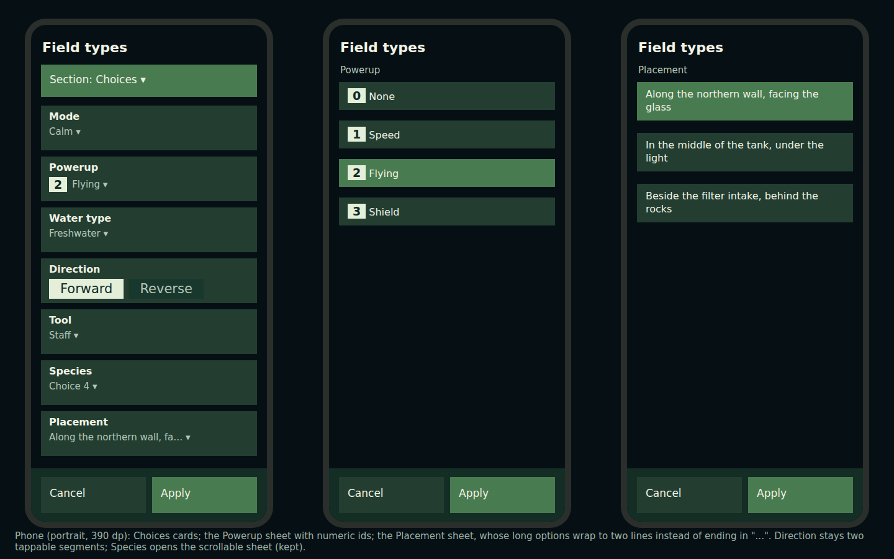](2026-11-01-field-presentations/phone-choices.html) | [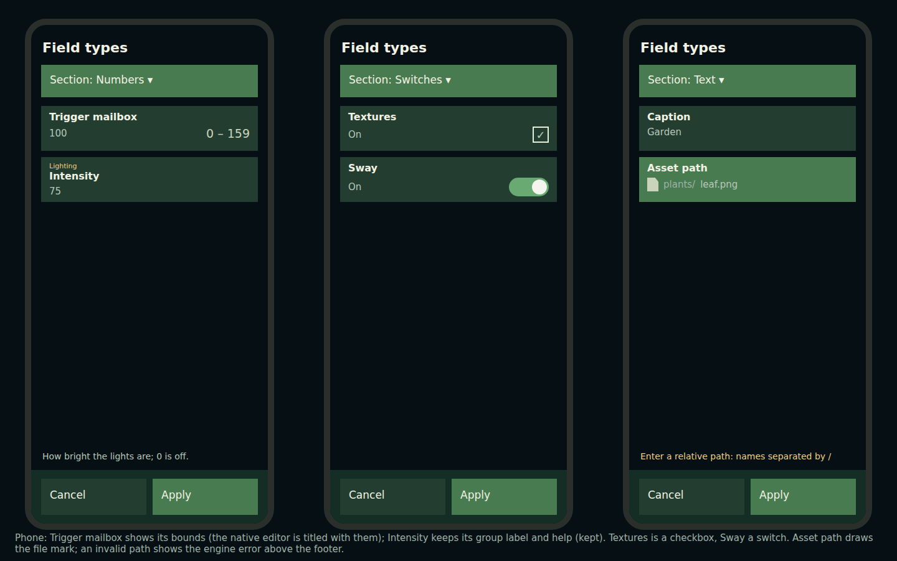](2026-11-01-field-presentations/phone-numbers-switches-text.html) |

## Risks and gates

| Risk | Why it matters | Gate |
|---|---|---|
| The APK's native runtime is frozen | Engine changes reach the device only through a refreshed `runtime.apk` | Build `assembleCondoDiagnostic` from a clean worktree at this commit, then `--refresh-runtime`; the previous runtime stays in `build/` by hash |
| Uncommitted work by other sessions in this tree (`wfsource/source/game/level.cc`) | A runtime built here would ship it | The Android runtime is built in that worktree. The desktop `wf_game` built here includes it; that hunk only touches levels with a `LevelRenderSettings` schema, not baseline |
| Path validation refuses a value an existing catalog authored | `Registry::load` validates every initial value and drops a whole catalog on one failure | A test loads every committed RPRP catalog and level through the registry |
| The normalizer change is shared with Blender | TOGGLE integers without choices now edit as checkboxes in the add-on | Only the gallery fixture and Field types use one; covered by a normalizer unit test |
| Touch layouts on a real phone | The coordinator cannot drive a phone's touch input | Host layout tests only; the Pixel walkthrough stays with the touch plan's step 3 |

## Out of scope

- The other observations from cast1, unless a control built here fixes them as a side effect: the "(read only)" label without a padlock, six-decimal slider end labels, and the flattened multi-line Notes.
- Making runtime options editable.
- The connected-phone browser form (`controller.html`), apart from path validation, which it gets from the engine.

## Verification

Run 2026‑11‑01 in the shared tree. The desktop engine is the Release build in `build-docker/jelly-engine` (`cmake --build build-docker/jelly-engine --target wf_game`). `task build` makes a debug build that cannot run this level: it stops on the 16 256-face teapot's "polygon which is too small" assertion and has no fallback path to the source tree's UI font.

1. `python3 -m pytest tests/test_baseline_field_types.py tests/test_touch_settings_plan_examples.py tests/test_runtime_property_presentation.py -q` passes. Each of the 27 cases asserts its control kind from the cooked level, the touch fixture asserts each case's touch control and action, and the TV render test asserts each of the nine new controls draws its own geometry.

    ```
    $ python3 -m pytest tests/test_baseline_field_types.py tests/test_touch_settings_plan_examples.py tests/test_runtime_property_presentation.py -q
    ...................................................                      [100%]
    51 passed in 67.70s (0:01:07)
    ```

    **PASS.** The key tests read the engine's rule table back (`wfprops::keys`), and cover choice rows with 2, 4, 5 and 12 options. Before Will chose option 6, a mutation proved the tests follow that one place: changing the choice rows in the table failed only `test_key_table_is_the_policy` (`1 failed, 6 passed`) while the behaviour tests followed the table, and the table was then restored. Wider regression, 14 suites over the settings host, form, catalogs, seahorse and planted settings: `1 failed, 176 passed`. The one failure is `test_object_properties.py::test_catalog_replacement_on_flag_only_baseline_ram` (`assert 56 == 48`), which failed the same way before this work.

2. `cargo test --manifest-path wftools/wf_attr_schema/Cargo.toml` passes, including TOGGLE without choices → Bool.

    ```
    test tests::int_toggle_with_items_stays_enum ... ok
    test tests::int_toggle_without_items_maps_to_bool ... ok
    test result: FAILED. 15 passed; 3 failed; 0 ignored; 0 measured; 0 filtered out; finished in 0.10s
    ```

    **PASS for the two new tests; the suite is FAIL on three tests that fail without this change too.** `player_schema_name_and_field_count` (`left: 129, right: 93`), `player_schema_has_int_field` and `group_tracking_sets_group_on_fields` read `player.oad`, which has grown since the tests were written. The same three failed with this change stashed (`13 passed; 3 failed`).

3. `task baseline:build`, then `task baseline:fresh` reports fresh; `task build-cd-iff` if the bundle changes.

    ```
    $ task baseline:build
    Built: …/wflevels/baseline/build/default-standalone.iff sha256 56dd3459e37983ba444b8c80dd7225ce9f5e62866e4f20db1deab5190470a6ee
    $ task baseline:fresh
    baseline outputs fresh: all 14 committed files rebuild identically
    ```

    **PASS.** The first `baseline:fresh` after the catalog change reported `changed wfsource/source/game/cd.iff` and rebuilt it; a later one found `settings-coverage.json` stale after the examples' `status` changed. Both are committed rebuilt.

4. `task baseline:check` passes on the desktop, and desktop screenshots of the Choices list open, the switch and the path error are saved beside this plan.

    ```
    $ task baseline:check
    exit=0
    155 True, 0 False
    ```

    **PASS** (engine SHA‑256 begins `14c3f6609f6a7775`; option 6 keys). The desktop frames are from `capture_desktop.py`, using the TV path (hold OK, Down, OK):

    | | |
    |---|---|
    | [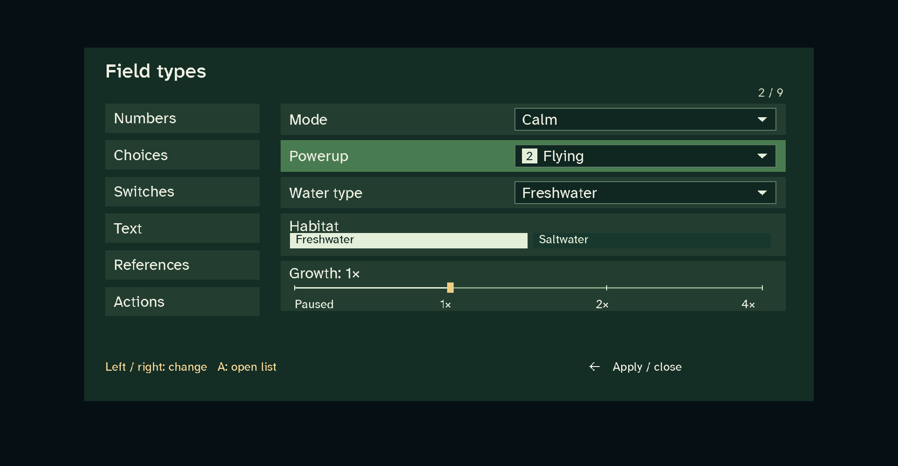](2026-11-01-field-presentations/desktop-choices.png) | [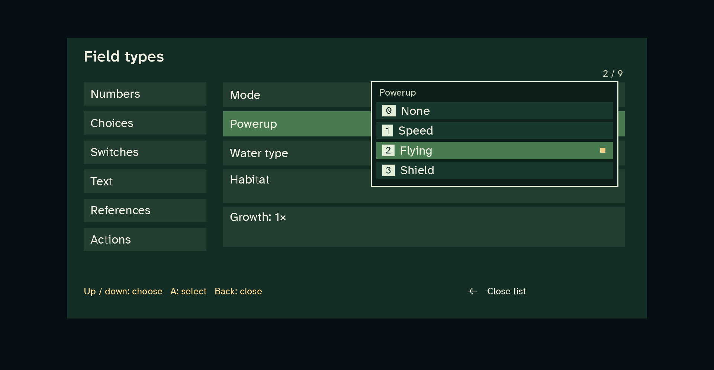](2026-11-01-field-presentations/desktop-list-numbered.png) |
    | [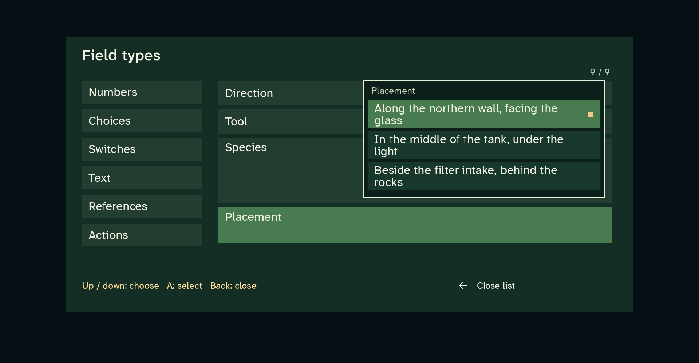](2026-11-01-field-presentations/desktop-list-wrapping.png) | [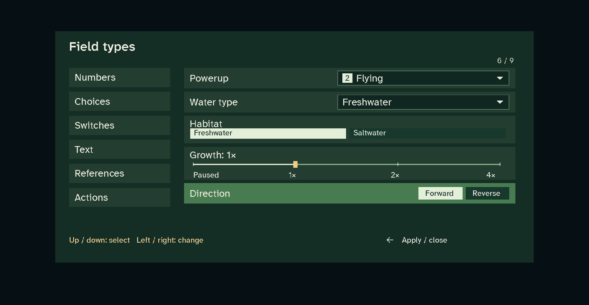](2026-11-01-field-presentations/desktop-segments.png) |
    | [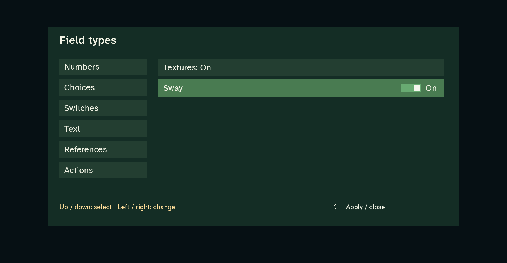](2026-11-01-field-presentations/desktop-switch.png) | [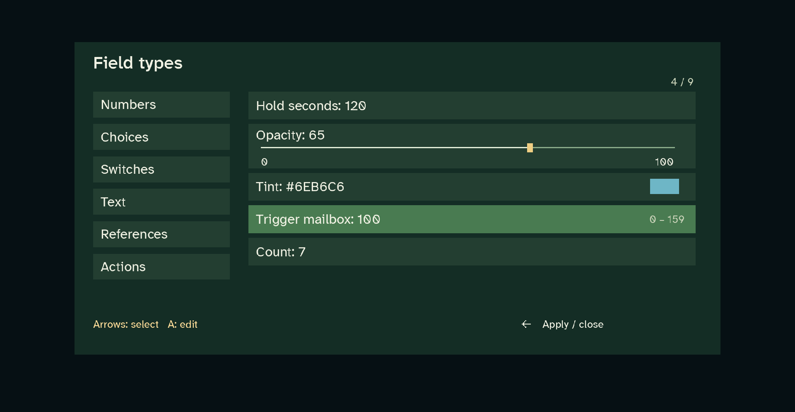](2026-11-01-field-presentations/desktop-numbers-mailbox.png) |
    | [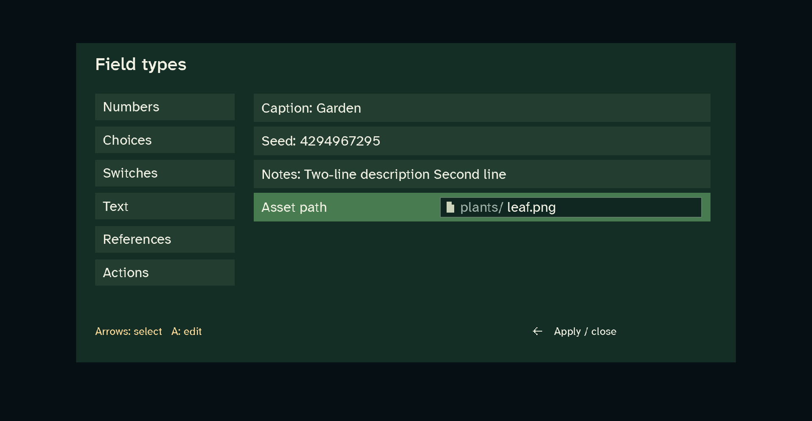](2026-11-01-field-presentations/desktop-path.png) | |

    The path *error* state has no desktop frame: the desktop has no text editor host, so a value cannot be typed there. The refusal is tested on the host (`path-refused 1 Asset path: Enter a relative path: names separated by /`, and the touch fixture's Apply is refused). The touch form has no desktop frames: the desktop engine never draws it. Its layout is asserted by the fixture's drawn-row records, for example segments, a numbered sheet, three wrapped options, the switch and the bounds.

    The first capture found a defect, now fixed: glyphs are drawn after every rectangle, so the open list could not cover the row text under it. While the list is open, rows now draw only short labels.

5. The APK is rebuilt on a refreshed runtime; its path and SHA‑256 are recorded here.

    ```
    $ ./gradlew :app:assembleCondoDiagnostic --offline     # clean worktree at 0ff49194 (origin/2026-new-level)
    APK page alignment: PASS (…/worldfoundry-condo-diagnostic.apk)
    BUILD SUCCESSFUL in 6m 39s
    $ python3 wflevels/baseline/build.py --package-only --runtime …/worldfoundry-condo-diagnostic.apk --refresh-runtime
    Frozen APK: …/wflevels/baseline/build/baseline-5b47e27b5516e543.apk
    $ sha256sum wflevels/baseline/build/baseline-5b47e27b5516e543.apk
    5b47e27b5516e543830d1885e9e134b299402378f1125608a0e1966f7ab81f47
    ```

    **PASS.** The runtime is `worldfoundry-condo-diagnostic.apk`, SHA‑256 `205b4ede4ab25d10716f4100b457fa6fbe3dc084aa297df385c17063ebf7f617`. It was built from a clean worktree at the pushed commit, so no uncommitted work from other sessions is compiled in. Both ABIs carry the new code: each `libwf_game.so` contains "Enter a relative path: names separated by /" and "Close list".
    - The APK's native libraries are byte-identical to the runtime's.
    - Its `assets/cd.iff` matches `build/cd.iff`, built from level `56dd3459…6ee`.
    - The previous runtime stays in `build/` as `runtime-dd81405c…a815c.apk`.

    The pushed engine also includes an upstream change that came in with the rebase (`engine/stubs/scripting_zforth.cc`, 14 lines).

6. On cast1 (the coordinator runs this): the eleven cases draw as in the mockups.

    **NOT RUN:** the coordinator runs it after the APK.
