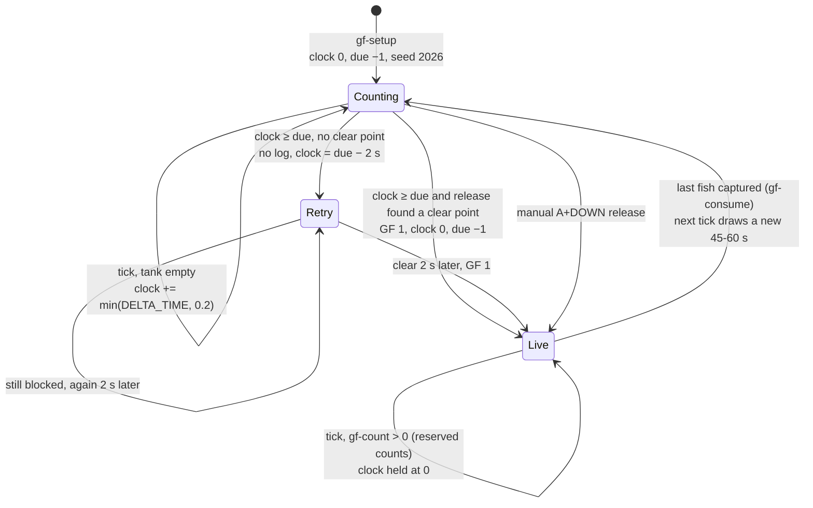
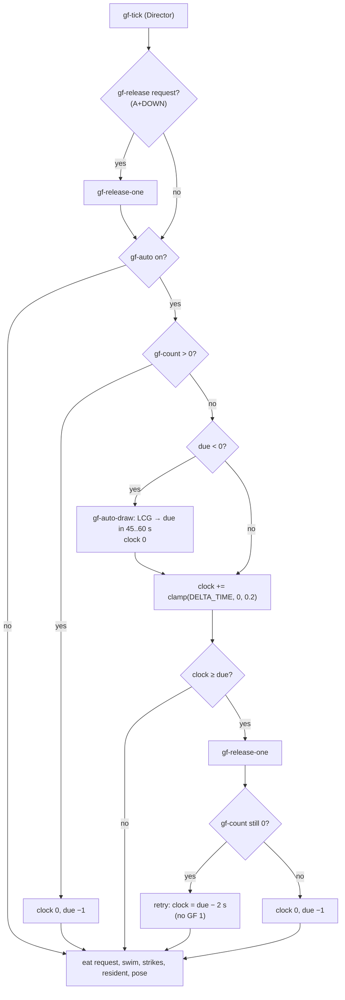
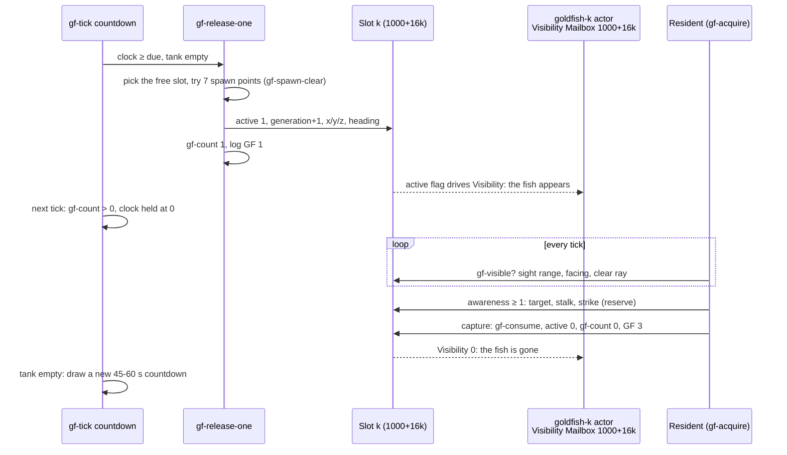
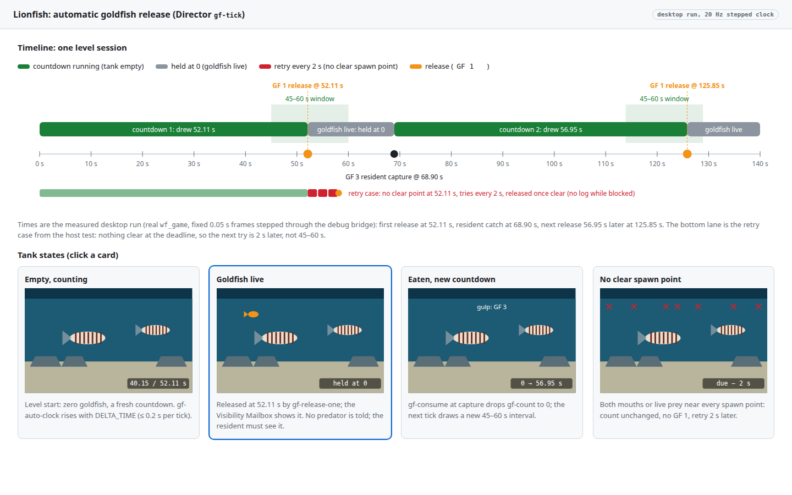
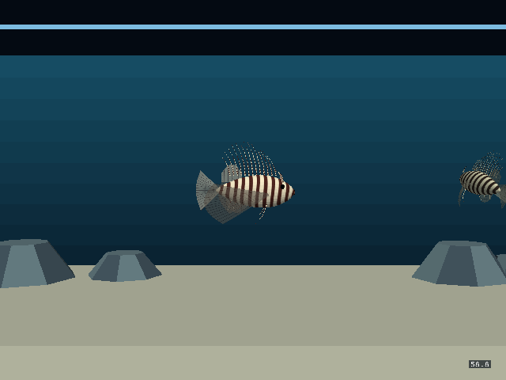
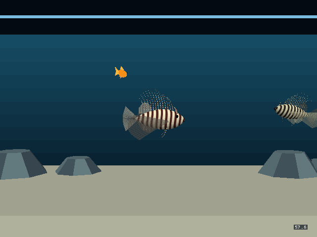
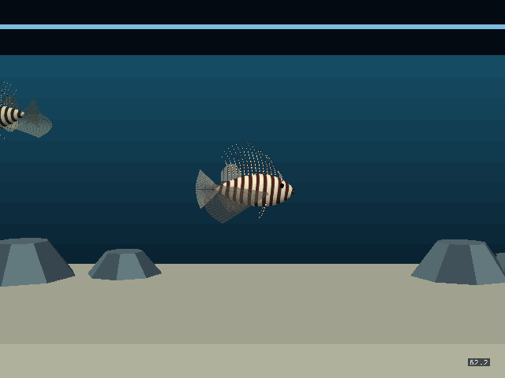

# Lionfish: automatic goldfish release

## Context

Will, 2026‑11‑01: "update lionfish level to emit a goldfish approximately every 45‑60 seconds, if there isn't already one in the tank", and then "add to director script".

Today a goldfish appears only when the player asks for one: hold DOWN, then newly press A. That sets mailbox `gf-release` (930), and the Director's `gf-tick` then calls `gf-release-one` ([`lionfish_feeding.fth`](../../wflevels/aquarium_tanks/lionfish_feeding.fth)). A viewer who never presses the chord, or the screensaver variant that has no player, sees two lionfish and no prey. The [feeding plan](2026-10-02-lionfish-goldfish-feeding.md) already has everything a release needs: three reusable slots, a clear spawn point search, a `GF 1` log event, and a resident that finds prey by sight. Only the trigger is missing.

**Where the code runs (checked in the generator).** [`generate.py`](../../wflevels/aquarium_tanks/generate.py) reads `lionfish_suction.fth` + `lionfish_feeding.fth` into `feeding` (lines 421‑433), takes only `tk-input` out of it for the player controller, and writes `header+core+pose+setup+feeding+tick` into `bpy.data.objects['Director']['wf_Script']` (line 587). `tk-director-tick` calls `gf-setup` once at `tk-init` (line 501) and `gf-tick` every frame (line 515). So `gf-setup` and `gf-tick` run in the **Director's** script, and the ownership statement of the feeding plan holds. The countdown therefore goes in `gf-setup`/`gf-tick`, not in `controller.fth` or `tk-input`, and no script or actor is added.

## Approach

A countdown owned by the Director, inside `gf-tick`, right after the manual-release request is served:

- It runs only while `gf-count` is 0. While any goldfish is live it is held at 0, and a strike reservation still counts as live: `gf-count` falls only in `gf-consume` (capture), never in `gf-strike-start` or `gf-hide`.
- Each countdown draws a new interval in [`gf-auto-min`, `gf-auto-max`) = [45, 60) s. When the clock reaches it, the Director calls `gf-release-one`, which picks a clear point and logs `GF 1`. The release notifies no predator: the resident has to see the fish.
- If `gf-release-one` finds no clear point (`gf-count` still 0), the clock is set to `due − gf-auto-retry`, so the next try is 2&nbsp;s later, and nothing is logged.
- Time is `INDEXOF_DELTA_TIME` clamped to `gf-auto-stall` (0.2&nbsp;s) per tick, the stall threshold `tk-input` already uses, so a pause or hitch cannot fire a release. There is no frame counting.
- Level start and restart: `gf-setup` sets clock 0, due −1 (draw on the first empty tick) and reseeds. With `gf-initial` 0 the tank starts empty with a fresh countdown.
- A manual A+DOWN release is served first in the same tick, so `gf-count` becomes 1 and the countdown is held. When that fish is eaten, a fresh interval is drawn: the pre-empted countdown does not carry over.
- Opt-out: env `LIONFISH_AUTO_GOLDFISH=0` at generation time (default 1, the same pattern as `LIONFISH_AUTOEAT`) makes the constant `gf-auto` 0, and `gf-tick` skips the countdown.

**Random source.** The engine offers `random`/`seed-random` (syscalls 153/154 in `engine/stubs/scripting_zforth.cc`), but they share one global xorshift state across every script, and `seed-random` would reseed it for everyone. Instead the Director keeps its own 15‑bit LCG, `s ← (389·s + 13849) mod 32768`, in mailbox `gf-auto-seed`, seeded with `gf-auto-seed0` = 2026. All products stay below 2²⁴, so they are exact in zForth's float cells, and the state fits a 16.16 fixed-point mailbox. The same seed gives the same sequence, which keeps the tests deterministic: 52.11, 56.95, 48.26, 57.95, 49.65, 46.78&nbsp;s …

**Constants and mailboxes** (all in [`goldfish.py`](../../wflevels/aquarium_tanks/goldfish.py), so tuning is one place):

| Name | Value | Kind |
|---|---|---|
| `gf-auto-clock` | 980 | mailbox: seconds counted in this countdown |
| `gf-auto-due` | 981 | mailbox: this countdown's interval, −1 = draw on the next empty tick |
| `gf-auto-seed` | 982 | mailbox: LCG state |
| `gf-auto-min` / `gf-auto-max` | 45 / 60 | seconds |
| `gf-auto-retry` | 2 | seconds after a release with no clear point |
| `gf-auto-stall` | 0.2 | most seconds counted per tick |
| `gf-auto-seed0` | 2026 | LCG seed |
| `gf-auto` | 1 | on; `LIONFISH_AUTO_GOLDFISH=0` → 0 |

980‑982 lie in the free gap between the `gf-*` scratch (930‑979) and the prey slots (1000‑1047). `check_auto_mailboxes()` asserts at generation time that they are disjoint from every other generated `gf-*` mailbox and from the controller (600‑627), posing (650‑655), resident route (800‑811), slots, sensory memories (1050‑1073), resident (1100‑1111), strikes (1200‑1231) and suction flow (1300‑1347) ranges, and below the 1900 user-mailbox ceiling. `actor-map.json` records them under `feeding.auto_release`. The actor count is unchanged (31).

**Files.** [`lionfish_feeding.fth`](../../wflevels/aquarium_tanks/lionfish_feeding.fth) (`gf-setup`, `gf-auto-draw`, `gf-auto-tick`, `gf-tick`), [`goldfish.py`](../../wflevels/aquarium_tanks/goldfish.py) (constants and the disjointness check), [`generate.py`](../../wflevels/aquarium_tanks/generate.py) (env switch, actor map), [`tests/test_lionfish_feeding.py`](../../tests/test_lionfish_feeding.py), and the regenerated `wflevels/aquarium_lionfish*` outputs plus `wflevels/aquarium-menu-cd.iff`. No engine (C++) change.

**Screensaver.** `wflevels/aquarium_lionfish_screensaver` is built by `scripts/build-aquarium-screensaver-levels.py` from the exported `aquarium_lionfish.lev`. It swaps only the Player's script and keeps the Director's, so the screensaver gets the automatic release as soon as its bundle is rebuilt from the new `.lev`. Its outputs are untracked build products, so nothing in this change edits or commits them; that script and its tests carry another session's uncommitted edits and are left alone. In the screensaver, where no one presses the chord, this is the only way a goldfish appears.

## Diagrams

The countdown has three modes. "Retry" is a short wait inside the empty-tank mode.

One `gf-tick`, from the top. The countdown runs after the manual request, so a manual release in the same tick pre-empts it.

What a release touches, in order. The resident is not told; it finds the fish through its own sight test on a later tick.

## Mockups

The timeline uses the measured desktop run: countdown, release at 52.11&nbsp;s, goldfish live, resident capture at 68.90&nbsp;s, the next countdown, the next release 56.95&nbsp;s later. The cards show the four tank states: empty and counting, fish live, fish eaten with the countdown restarted, and no clear spawn point. [Open the interactive mockup](2026-11-01-lionfish-auto-goldfish/timeline.html).

Real desktop captures from the same run (`wf_game`, the standalone level, 640&nbsp;×&nbsp;480):

| 40&nbsp;s: empty, counting (40.15 of 52.11&nbsp;s) | 53&nbsp;s: released at 52.11&nbsp;s | 68.90&nbsp;s: eaten, new countdown |
|---|---|---|
|  |  |  |

## Out of scope

- Rebuilding the screensaver bundle (`aquarium-screensaver-cd.iff`) and its screensaver APK: `scripts/build-aquarium-screensaver-levels.py` has another session's uncommitted edits. The next rebuild of that bundle carries this change without edits.
- Making the interval a runtime setting (a Settings catalog field): Will asked for a fixed 45‑60&nbsp;s; the constants are in one place if that changes.

## Verification

Ran in the worktree `.worktrees/lionfish-auto-goldfish` (based on `origin/2026-new-level`). The Blender and Linux test images (`wf-blender:local`, `wf-linux-test:local`) are not in the local Docker store, and with about 7&nbsp;GB free on the root disk they were not built. The level was regenerated by the host route `WF_LEVEL_BUILD_HOST=1`, which `scripts/level-build.sh` keeps "for the byte-identical comparison", after step 3 proved it reproduces the committed outputs byte for byte.

1. **Host Forth tests: the shipped Director script, run in the zForth host, covers (a) to (g) and the opt-out.**

    `python3 -m pytest -v -p no:cacheprovider tests/test_lionfish_feeding.py`

2. **Neighbouring lionfish and selector tests still pass.**

    `python3 -m pytest -q -p no:cacheprovider tests/test_lionfish_suction.py tests/test_lionfish_rig.py tests/test_lionfish_realism_asset.py tests/test_aquarium_menu.py`

3. **The host route reproduces the committed outputs: unchanged inputs give no diff, and the final inputs give exactly the committed files.**

    `WF_LEVEL_BUILD_HOST=1 bash wflevels/aquarium_lionfish/build.sh && wftools/cdpack-rs/target/release/cdpack wfsource/source/game/shell-menu.fth --manifest wflevels/aquarium-menu.manifest -o wflevels/aquarium-menu-cd.iff && git status --short -- wflevels`

4. **`task aquarium-check` passes.**

5. **Selector bundle payload parity: the Lionfish standalone inside `aquarium-menu-cd.iff` is byte-identical to `wflevels/aquarium_lionfish-standalone.iff`; the manifest has no payload hash to update.**

6. **Desktop: the real runtime releases the first goldfish between 45 and 60&nbsp;s, and again 45‑60&nbsp;s after the resident eats it.** `wf_game -rate20` (fixed 0.05&nbsp;s frames) stepped frame by frame through the debug bridge, watching Director mailboxes 933/980/981 and the `GF` log lines.

7. **Device: cast2 (`chromecast-test-02`, the older, slower Chromecast, Android 12) shows the first automatic release 45‑60&nbsp;s after the Lionfish tank starts.** `task chromecast:check DEVICE=chromecast-test-02 APP=aquarium SCENE=lionfish DURATION=75 APK=<frozen APK with the new bundle>`, run through the coordinator (no raw ADB, no reservations).
