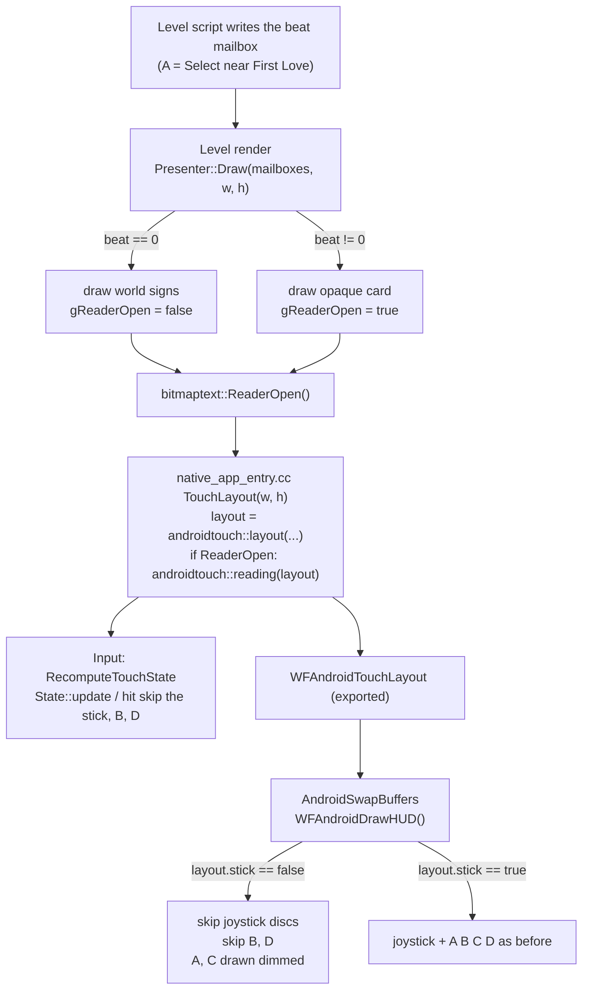
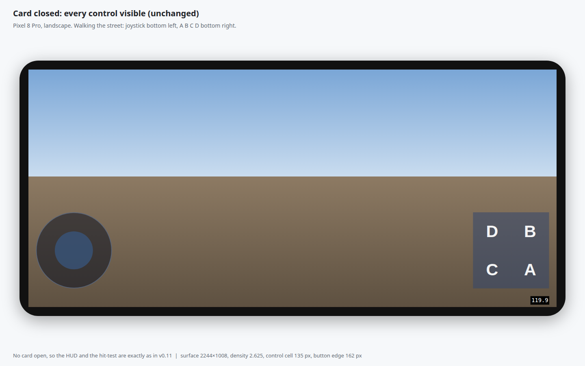
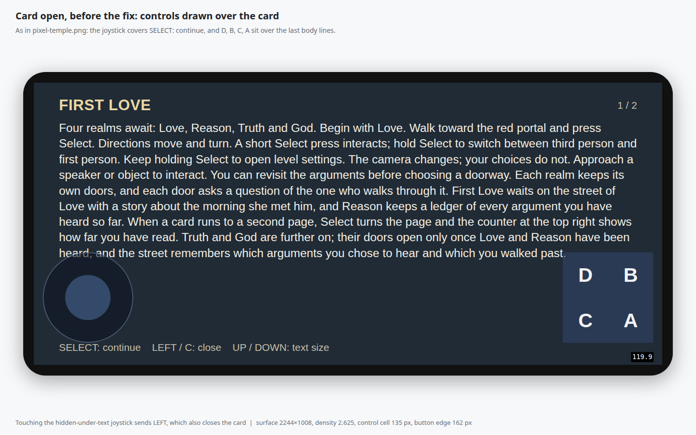
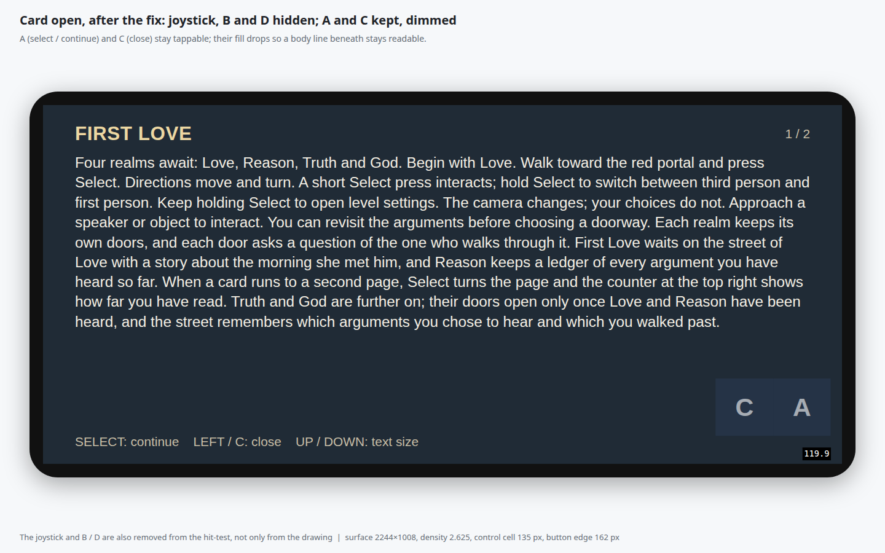
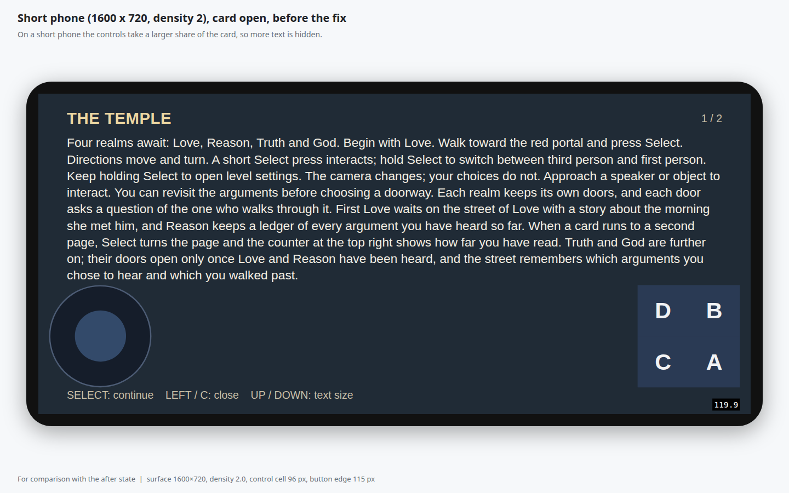
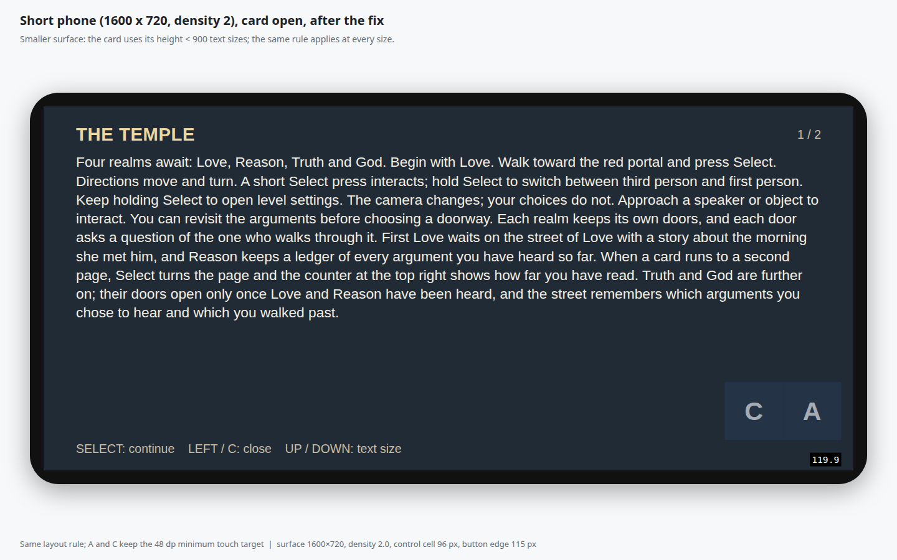

# Touch controls over story cards (Android phones)

**Status:** implemented on `fix/touch-controls-over-cards`; on-device confirmation pending.
**Asked by:** Will, 2026‑11‑01.
**Evidence:** finding-your-way `docs/diagnostics/v0.11-arm64-pixel-2026-10-31/README.md` and its `pixel-temple.png` (Pixel 8 Pro, v0.11, landscape surface 2244×1008). With a card open, the touch joystick covers `SELECT: continue` and the D, B, C, A block sits over the bottom-right of the card.

## Problem

A story card (the bitmap-text reader in `game/bitmap_presenter.cc`) is a full-screen opaque backdrop with a heading, a paged body and a controls line. On a phone, `AndroidSwapBuffers()` then draws the touch HUD (`WFAndroidDrawHUD()` in `gfx/gl/android_window.cc`) on top of every frame, card or not. The HUD's joystick and its A to D block therefore cover card text. The body is paged to fill the space down to the controls line, so on a full page the last body lines run under the button block as well.

There is a second, input-side defect: the joystick stays live under the card, and `LEFT` closes the card, so a thumb resting where the (covered) joystick is can close the card the player is reading.

## How the engine knows a card is open

`bitmaptext::Presenter::Draw()` reads the reader's beat mailbox (`_catalog.Binding(0)`) every frame. A beat of 0 means no card: it draws only the world signs and returns. Any other beat draws the opaque card. That branch is the one reliable "card open" signal; nothing else in the engine draws or knows about the card. It is level-owned (the presenter lives as long as the level), so the destructor must clear the signal when the level goes away.

Input and drawing both go through the one `TouchLayout()`, so what is hit-testable is always exactly what is drawn.

## Options weighed

| Option | Clears the text | Keeps select and close by touch | Cost |
| --- | --- | --- | --- |
| **Hide joystick, B, D; keep A, C (recommended)** | joystick and B/D area fully; A/C still sit over the bottom-right corner of a full page | yes | small: one flag, one layout filter |
| Hide every control | fully | **no**: a card could only be closed with hardware keys | small, but loses the brief's hard requirement |
| Dim every control | no: text shows through but glyphs still collide | yes | trivial |
| Wrap the card body clear of the controls | fully | yes | crosses `game/` into the hal touch geometry, changes pagination per platform and per inset; a design change to the reader |
| **Recommended + dim A and C while a card is open (chosen)** | as recommended, and a body line under A/C stays readable through the lighter fill | yes | one alpha choice in the HUD |

**Chosen:** hide the joystick, B and D (drawing *and* hit-test) while a card is open; keep A and C visible and working, and draw them with a lighter fill (0.30 instead of 0.55) and a lighter label so the corner of a full page reads through them. Wrapping the body clear of the controls is the only option that clears the text completely; it is left as a follow-up because it would make the reader depend on phone-control geometry.

Consequences, stated so they are visible:

- While a card is open, `UP / DOWN: text size` and `LEFT: close` are not available by touch (the joystick is hidden). `C` still closes and `A` still continues; hardware keys and the TV remote are unchanged.
- A finger already holding the joystick, B or D when a card opens is released on the next touch event (its owner is dropped), so a resting thumb cannot keep sending `LEFT`. A finger on A or C keeps it.
- Nothing changes when no card is open, on TV (the HUD is already off there), or for the settings modal (it already hides the HUD).

## Mockups

Real states on a 1440×900 canvas; each thumbnail links to the live HTML.

| State | Mockup |
| --- | --- |
| Card closed, every control visible (unchanged) |  |
| Card open, **before**: joystick over `SELECT: continue`, D B C A over the last lines |  |
| Card open, **after**: joystick, B, D gone; A and C kept, dimmed |  |
| Short phone 1600×720, card open, before |  |
| Short phone 1600×720, card open, after |  |

## Changes

1. `wfsource/source/hal/android/touch_controls.h`: `Layout` gains `stick` (joystick shown and live) and `shown` (mask of shown buttons), both defaulting to everything. `reading(Layout)` returns the card-open layout (`stick=false`, `shown=A|C`). `inStick`, `hit` and `State::update` honour them; `update` drops the owner of any control that is hidden.
2. `wfsource/source/game/bitmap_presenter.{hp,cc}`: `bitmaptext::ReaderOpen()`, set by `Presenter::Draw()` from the beat, cleared by the destructor.
3. `wfsource/source/hal/android/native_app_entry.cc`: `TouchLayout()` applies `androidtouch::reading()` while `bitmaptext::ReaderOpen()`.
4. `wfsource/source/gfx/gl/android_window.cc`: `WFAndroidDrawHUD()` skips the joystick when `!layout.stick`, skips buttons not in `layout.shown`, and dims A and C while reading.
5. `tests/android_touch_controls_test.cc` gains the card-open checks, and `CMakeLists.txt` registers it as the CTest `android_touch_controls` (it was not built by anything before).

## Verification

1. Build and run the touch-control test through CTest: `cmake --build <build> --target android_touch_controls_test && ctest --test-dir <build> -R android_touch_controls --output-on-failure`
2. The new checks fail without the fix: revert only `touch_controls.h` to `origin/2026-new-level`, rebuild; the test must fail to compile or fail its assertions.
3. Full engine CTest suite passes: `ctest --test-dir <build> --output-on-failure`
4. Android libraries compile and link for `arm64-v8a` and `armeabi-v7a`.
5. On a phone (not done here; Will's Pixel is off limits): open a card, see the joystick, B and D gone and A, C dimmed; A continues, C closes; close the card and the full HUD returns.
