# Gulf of Thailand Reef: one reef in two visual styles (ultra-realistic and anime), and an A3 poster

2 November 2026 · **Plan — all ten decisions made** (Will, 2026‑11‑02: "D1-D10: i accept your recommendations"). The reef ships as **two tanks in the selector**: an ultra-realistic one and a cartoon/anime/cel-shaded one. **Engine permission is granted for exactly E1–E7 (multi-curve `DFRM`) and S1–S3 (style shading) as specified here**; any engine edit beyond them still needs its own permission ([`AGENTS.md:9-14`](../../AGENTS.md)).

## Gameplay verification update, 2026-11-08

On both Pixel and Lenovo, real joystick input brought the fish to the cleaner
station and recordings showed the shrimp climb onto it and return. A Lenovo
close-camera recording and half-second telemetry verified the crab's proximity
timer activates inside its 1.0 radius and clears about two seconds after the
fish leaves; the normal wide view does not resolve its individual claws. Both
reef styles have been selected and seen on the Lenovo. The full Aquarium APK
was restored there and its hash verified after an initially delayed install.
These findings supersede older incomplete observations below; the remaining
reaction, motion, longer performance and acceptance checks are still open.
Evidence and limitations are in the [gameplay verification notes](../diagnostics/reef-gameplay-verification-2026-11-05/README.md).

Subsequent Lenovo close-camera recordings show leather-coral posture changes
and flowerpot stalk movement in both styles. These views do not yet establish
the complete deflation/current timing or readability from the normal wide view.
The production anime actor map records 21,562 outline triangles against its
24,000 budget. A later scratch diagnostic's 27,570 count came from omitting
the standard rock-union option; it did not measure the shipped geometry.
Lenovo wide-idle profiles of both styles measured approximately 60.9 presented
FPS over 120 seconds after selection, with continuous samples and one
verification screenshot in each window. These are tablet measurements; the
specified Chromecast acceptance remains open.
Cast1's first wide-idle samples measured 24.31 FPS realistic and 22.30 FPS
anime over 120 seconds, both above the 20 FPS target. Further runs are in
progress to establish the referenced three-run medians; see the
[verification notes](../diagnostics/reef-gameplay-verification-2026-11-05/README.md).

**In TODO.md** since 2026‑11‑02, all under Level / Gameplay:

- the two-style tank (T4);
- the `DFRM` v2 engine change (T4, blocked on D7);
- the style-shading engine change (T4, blocked on D10);
- a later idea Will asked to keep: **two Gulf habitats**, an inner-Gulf turbid reef and a clear island reef (T4).

## Context

Will asked (2026‑11‑02) for a new aquarium tank in the selector:

> i want a saltwater reef tank. it should be incredibly ornate and populated with live rocks. it should mostly be about the non-vertebrate reef life but it should include 3 fish (2 of 1 type, 1 of another type). the habitat represented is the bay of thailand. also generate an A3 poster about the habitat, non-vertebrate life in the tank, and the 2 types of fish

Will added five things while the plan was being written:

1. **"don't base new tank contents on existing tanks."** This is the **content rule** below.
2. **"add a (small) crab, native to gulf of thailand."** That is the coral guard crab, *Trapezia cymodoce*.
3. **"probably an engine update. provide lots of details about the proposed change, including scope/cost/etc."** This is the reply to the finding that `DFRM` poses only one curve per mesh. See [Engine proposal: DFRM v2](#engine-proposal-dfrm-v2-several-curves-in-one-mesh).
4. **"i'd like you to make 2 versions of this tank"**, then, asked which kind: **"2 different visual style: 1) ultra-realistic 2) cartoon/anime/cell-shading"**. See [Two visual styles](#two-visual-styles).
5. **"save #1 suggestion in TODO"**: the two-habitats idea (inner Gulf and island reef) is a TODO item, not part of this plan.

**"Bay of Thailand"** is the **Gulf of Thailand**. Its Thai name, อ่าวไทย (*Ao Thai*), means "Thai bay". The plan uses the English chart name, and D5 confirms the label.

### The content rule (Will, 2026‑11‑02)

**No species already in a tank** (Will, 2026‑11‑02, correcting a wider reading: “only ‘no species already in a tank’”). Meshes, rigs, textures, Forth controllers, helpers and tank shells from the other tanks **may be reused** wherever they fit.

The species already taken are:

- the clownfish and its bubble-tip anemone, *Entacmaea quadricolor* (Clownfish & Sea Anemone);
- the long-spined urchin *Diadema setosum*, the longsnout seahorse *Hippocampus reidi* and the rainbow goby (Planted Tank);
- the blue shrimp, the betta, the jellyfish, the lionfish and its goldfish, the Asian arowana and the tiger barbs (their own tanks).

Another species of a taken group (a different anemone, clownfish or goby) is allowed by the rule. The roster here doesn't use one: D1 and D2 are decided.

`tests/test_aquarium_thai_reef.py` enforces it: no roster species may appear in another tank's species list (verification step 5).

### What exists today

- **Eight tanks** share the Android selector, [`wflevels/aquarium-menu.manifest`](../../wflevels/aquarium-menu.manifest) (8 `level` lines). The engine menu shows 6 rows and scrolls ([`level_menu.cc:40`](../../wfsource/source/game/level_menu.cc)).
- **The screensaver Dream** has its own list, [`TankChoice.java`](../../android/screensaver/src/main/java/org/worldfoundry/screensaver/TankChoice.java): 8 `IDS` and 8 `LABELS`. [`TankSettingsProvider`](../../android/screensaver/src/main/java/org/worldfoundry/screensaver/TankSettingsProvider.java) sends that list to the phone.
- **Registration points for a tank:**
    - `scripts/aquarium-levels.sh` (`TANKS`), `scripts/compare-level-build-routes.sh`;
    - `scripts/build-aquarium-screensaver-levels.py` (`TANKS`, the driver script, the player entry), `scripts/build-aquarium-variant.py`;
    - `Taskfile.yml` (`build-cd-iff-aquarium-menu` deps);
    - `tests/test_aquarium_menu.py` (8 titles, an 11-chunk TOC), `tests/test_aquarium_screensaver_input.py`, `tests/test_species_movement.py`.
- **Performance is the binding constraint on Chromecast HD (cast1).**
    - The Planted Tank holds 66,048 static triangles in eight static groups. It runs at **47.14 ms (21.22 FPS)** wide idle with no seahorses, and **69.26 ms (14.44 FPS)** with six pairs ([comparison](2026-10-16-saltwater-seahorses/comparison.md)).
    - Its baseline already streams 5.12 MiB of vertices per frame. Six pairs added 52 draws, 46 vertex uploads and **21.54 ms of main-thread CPU** per frame (+9.24 ms update, +12.30 ms render).
    - **Every animated actor is expensive.**
- **`DFRM` v1 poses one curve per mesh.** [`ParseDfrm`](../../wfsource/source/renderassets/dfrm_deform.cc) refuses any other count ("v1 needs exactly one curve", `dfrm_deform.cc:81`), and so does `Bind` (`:177`). A mesh also has at most three weighted transforms (`DfrmMaxTransforms`, `dfrm_deform.h:48`).
    - The zForth bridge reads at most 40 control cells (`scripting_zforth.cc:1412-1413`).
    - So a 10-armed feather star, a crab's ten legs and a reef of worm crowns each need one actor per moving part: the expensive thing above.
- **The poster pipeline** is settled; the [seahorse poster](../reference/seahorse-biomechanics-poster/README.md) shows it:
    - a research document comes first;
    - `make_poster.py` and `export_poster.py` (Playwright Chromium), an A3 PDF (297 × 420 mm), a 300 DPI PNG and `layout-review.json`;
    - a pytest guard;
    - a chip on every claim, and nothing unverified printed ([2026‑10‑06 audit rule](../reference/2026-10-06-aquarium-poster-reference-verification.md)).

## Decisions (all made 2026‑11‑02)

Will accepted every recommendation in the third column (2026‑11‑02). The fourth column stays as the record of what was weighed.

| # | Decision | Decided (the recommendation) | Alternatives weighed |
|---|---|---|---|
| D1 | The pair of fish | **Decided.** **2 × humbug damselfish, *Dascyllus aruanus*.** A pair that lives in one cauliflower-coral head and dives into it when threatened, so the fish show off the coral as habitat. Reef-safe and small (≈ 8 cm). **No Gulf of Thailand record found yet** ([Reef Life Survey](https://reeflifesurvey.com/species/dascyllus-aruanus/) gives the range only); Phase 0 must find one or swap | **Copperband butterflyfish *Chelmon rostratus*:** a Gulf fish usually seen in pairs, but it eats tube worms and feather dusters, the stars of this tank. **Pink anemonefish *Amphiprion perideraion*:** photographed at Ko Nang Yuan ([snorkeling-report](https://www.snorkeling-report.com/species/amphiprion-perideraion/)), a different species, so the content rule allows it; but an anemonefish in its anemone repeats tank 1's subject |
| D2 | The single fish | **Decided.** **1 × juvenile yellow boxfish, *Ostracion cubicus*.** Bright yellow with black spots below about 4 cm ([CIESM atlas](https://ciesm.org/atlas/fishes_2nd_edition/Ostracion_cubicus.pdf)). Its rigid box body, rowed by its fins, is unlike any fish in the other tanks. A Ko Tao dive operator reports juveniles on shallow coral heads at 3–12 m ([Big Blue Diving](https://www.bigbluediving.com/koh-tao-marine-life/yellow-boxfish/)); that is not a scientific record, so Phase 0 needs one | **Blue-ringed angelfish *Pomacanthus annularis*:** a Gulf fish, but it grows to about 45 cm and nips sponges and corals. **Pajama cardinalfish:** its range is Java to Fiji; no Gulf record ([FishBase](https://nrm-fishbaselinux01.nrm.se/summary/5778)) |
| D3 | What the remote drives | **Decided.** **The boxfish.** It is slow, can hover and turn on the spot, and the whole reef reacts to it: crowns snap shut, the humbugs dive, the crab threatens, shrimp clean it. The humbugs are AI | A humbug (it can't leave its coral head without looking wrong). No player (viewer only); the reef would then need an auto-driver anyway, which the screensaver variant provides |
| D4 | Tank shell | **Decided.** **A new rimless reef tank, 120 × 60 × 55 cm** (about 400 L). 60 cm front to back leaves room for two rock masses, an arch and a cave with water in front of them | Reuse the existing 48 × 13 × 21 in shell: cheaper, because its colliders and cameras exist, and the content rule allows it (a shell is not contents). But 13 in (33 cm) front to back fits only a flat rock wall, not an arch and a cave |
| D5 | Names | **Decided.** **Menu: "Gulf of Thailand Reef" and "Gulf of Thailand Reef — Anime". Dream: "Thai Reef" and "Thai Reef Anime". Level ids `aquarium_thai_reef` and `aquarium_thai_reef_anime`.** The longer label measures ≈ 860 px of the 1,154 px row, so neither is truncated | "… — Realistic" on the first as well (longer, and the realistic tank is the canonical one); "Bay of Thailand Reef" (Will's words; not the sea's English name) |
| D6 | Frame-rate gate on cast1, wide idle | **Decided.** **≥ 20 FPS** (≤ 50 ms), about the Planted Tank without seahorses | **≥ 14.4 FPS**, what the Planted Tank ships at with six pairs. That allows more ornament but is visibly slower |
| D7 | **Engine change: multi-curve `DFRM` (v2)** | **Decided.** **Yes: allow E1–E7.** It cuts the reef's animated actors from 33 to 16. It also gives the crab, shrimp and boxfish real articulated legs, antennae and fins, and gives worm crowns a cheap retract. All of it is backward-compatible: v1 chunks parse and pose exactly as today | **No engine change:** 33 actors, rigid crab and shrimp legs, a feather star made of five 2-arm actors. **Smaller engine change:** raise only `DfrmMaxTransforms` 3 → 16. That gives legs as rigid hinges, but no curling arms and no retract. Comparison under the proposal |
| D8 | Screensaver Dream entries | **Decided.** **Yes, both**, in Phase 4: "Thai Reef" and "Thai Reef Anime" are added to `TankChoice`, and Random draws from ten | Only the realistic one; or selector only, and the Dream list stays at eight |
| D9 | How the two styles ship | **Decided.** **Two levels, two selector rows**, built from one scene description. Each style has its own assets, lighting fields and budgets, and is loaded alone, so neither pays for the other's memory | One level with a Style setting that swaps assets at load: one row, but both atlases resident or a reload path that doesn't exist today |
| D10 | **Engine change: style shading (S1–S3)** | **Decided.** **Yes: allow S1 (water absorption) and S3 (toon bands); S2 (caustics) behind a cast1 cost gate.** All three are off by default, so every existing level renders identically | **No engine change:** realistic uses the existing linear fog and baked light only; anime bakes its bands into vertex colours, so moving actors stay smoothly lit and clash with the banded reef. Outlines need no engine change in any option |

## Visual polish update, 2026‑11‑07

The flowerpot base and stalks have finer geometry and face-oriented texture mapping; the closed clam has a dedicated striped shell texture; and the anime hard-coral outline hull was narrowed. Matching Pixel views in both styles show a legible flowerpot pattern and shell striping, and the anime branching coral shows substantially fewer black artifacts. Both reef builds and 34 reef tests pass, and the full APK was restored on the Pixel. Before-and-after source and game views are in the [catalogue](../diagnostics/reef-refinement-catalogue-2026-11-04/reef-refinement-catalogue.pdf); see the [audit](../diagnostics/reef-triangle-normal-2026-11-06/catalogue-survival-audit.md) for evidence and remaining acceptance work. The Lenovo was unavailable.

## The tank

[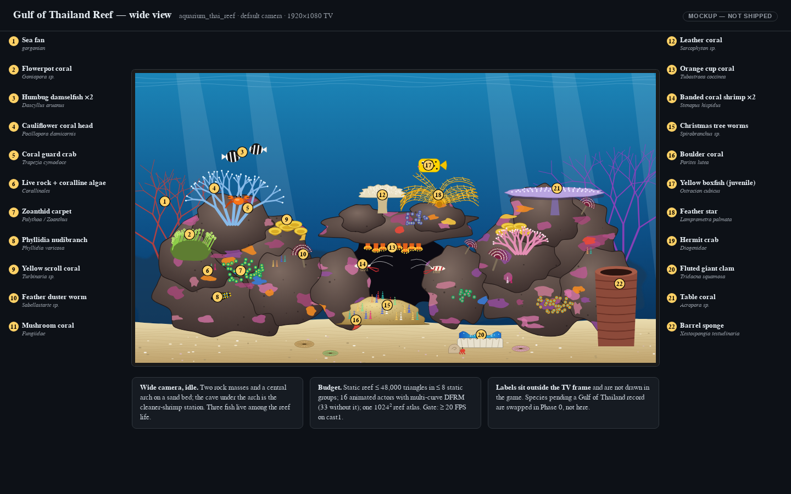](2026-11-02-gulf-of-thailand-reef-tank/tank-wide.html)

*The layout and behaviour mockups are drawn style-neutral; [Two visual styles](#two-visual-styles) shows the two looks.*

**Layout.** The tank sits at ×10 world scale, as the other tanks do.

- **Two masses of live rock and a central arch** stand on a rippled sand bed.
- The **cave** under the arch is the cleaner-shrimp station, with orange cup corals hanging from its roof.
- The rock is the reef's substrate, not a backdrop: every surface carries crustose coralline algae (pink and purple), encrusting sponges (orange, blue, red), zoanthid carpets or a coral colony.
- Light shafts from the surface and a blue-to-teal water gradient. Far-rock silhouettes and two sea fans give depth.
- Cameras: a wide default and a close view on the arch and the boulder. Fish-follow works as in the other tanks.

**Where the ornament comes from.** It is procedural and seeded, so a rebuild is byte-identical:

- **Rockscape.** Noise-displaced blobs are unioned into masses, then decimated. Coralline and sponge patches are painted into a **1024² reef atlas**: coralline crust, polyp fields, sponge pores, clam mantle and fish skins. The atlas uses the aquarium app's permanent page, which already grew to 1024² for the seahorses (seahorse plan D5).
- **Corals.** Each kind has its own generator:
    - *Porites* boulder: a lumpy dome with polyp texture;
    - table *Acropora*: a stalked plate with rows of tips;
    - *Pocillopora damicornis*: recursive branching with fat tips;
    - *Turbinaria*: stacked scroll cups;
    - *Goniopora*: a dome with polyp tufts;
    - *Sarcophyton*: a mushroom capitulum;
    - *Tubastraea*: cups with tentacle rings;
    - mushroom corals: radial discs;
    - gorgonians: fractal fans;
    - barrel sponge: a ridged trapezoid;
    - sea squirts.
- **Static budget.** At most **48,000 triangles in at most 8 static groups**: rock 16k, hard corals 18k, soft corals, sponges and fans 9k, sand, rubble and shell 5k. That is below the Planted Tank's 66,048, to leave frame time for the animated life.

## Two visual styles

[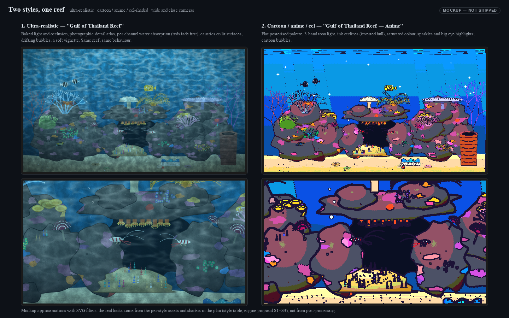](2026-11-02-gulf-of-thailand-reef-tank/styles.html)

The two styles share the reef and differ only in how it looks:

- **Shared:** the rock skeleton, every placement, the species roster, the reef director, the fish controllers and the cameras.
- **Per style:** surfaces, light, water and outlines.

One scene description (`reef/scene.py`, seeded) is written out twice by the generator, `--style realistic` and `--style anime`. That gives two levels with identical anchor points, so one director script and one set of timing tests serve both. *The mockup approximates both looks with SVG filters; the real looks come from the assets and shaders below, not from post-processing.*

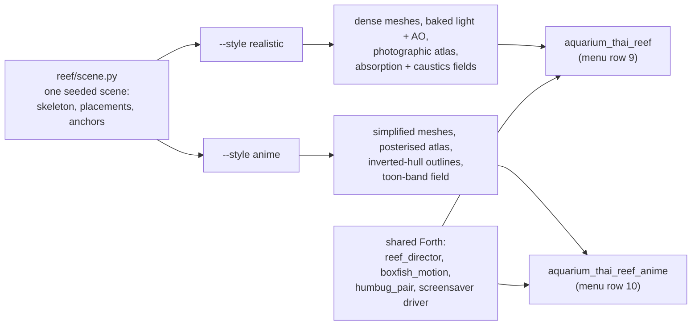

| Aspect | 1 · Ultra-realistic | 2 · Cartoon / anime / cel |
|---|---|---|
| Rock and coral surfaces | dense meshes; a 1024² **photographic-detail atlas** (coralline crust, polyp fields, sponge pores, sand grain) generated from layered noise at texel scale | simplified silhouettes, fewer triangles; a 512² **posterised atlas**: 3 tones per hue family, hand-picked saturated palette |
| Light on the static reef | **baked** in the Blender container (Cycles: sun through the surface plus sky, ambient occlusion in crevices and the cave) into vertex colours | baked, then **quantised to 3 bands** (lit, mid, shadow) in the vertex colours |
| Light on moving actors | engine per-vertex lights (three directional plus ambient), matched to the bake | **S3** toon bands in the fragment shader, so actors band like the reef |
| Water | **S1**: per-channel absorption with distance (red goes first, then green), toward a deep teal | flat gradient bands, no fog, crisp far rock |
| Light from above | **S2**: moving caustic web on upward faces; god-ray shafts are geometry (translucent once the texture-alpha TODO lands, opaque-faint until then) | static painted light shafts in two flat tones |
| Outlines | none | **inverted hull**: an outward-pushed, winding-flipped dark shell on rocks, corals, fish, crab and shrimp, drawn by the existing engine-wide back-face culling ([plan](2026-06-13-planetarium-dome-view-engine-wide-backface-culling.md)). No engine change |
| Fish faces | anatomical eyes, small | larger eyes with two white highlights; humbugs and boxfish get readable expressions (calm, alarmed when the reef flinches) |
| Particles | small, sparse, translucent-looking bubbles | big outlined bubbles with highlights; sparkle stars near the surface |
| Motion | as in the behaviour section | the same timings, with 15 % more amplitude on fins and claws, and a squash on the boxfish's burst |
| Static budget | ≤ 48,000 triangles, ≤ 8 groups | ≤ 30,000 triangles plus ≤ 16,000 hull triangles, ≤ 8 groups |
| Frame gate (D6) | ≥ 20 FPS cast1, wide idle | ≥ 20 FPS cast1, wide idle |

**Outlines on deformed actors.** A hull is part of the same mesh, and its vertices carry the same `DFRM` or `swim-deform` bindings, pushed outward. So the outline bends with the fin or claw it surrounds; hull faces follow the same face-normal rules as the body. Tiny crowns and polyps get no hull: at TV distance their outline would be a solid dark blob.

## Engine proposal: style shading (S1–S3)

All three features live in the shared vertex and fragment shaders: GL ([`backend_modern.cc:70-164`](../../wfsource/source/gfx/glpipeline/backend_modern.cc)) and Metal (`backend_metal.mm`). They are switched by new fields on the **Camera** object, the object that already carries `FoggingColor`, `FoggingStartDistance` and `FoggingCompleteDistance` ([`camera.oas`](../../wfsource/source/oas/camera.oas), read in [`camera.cc:67`](../../wfsource/source/game/camera.cc)). **Every new field defaults to off**, so every existing level renders exactly as today.

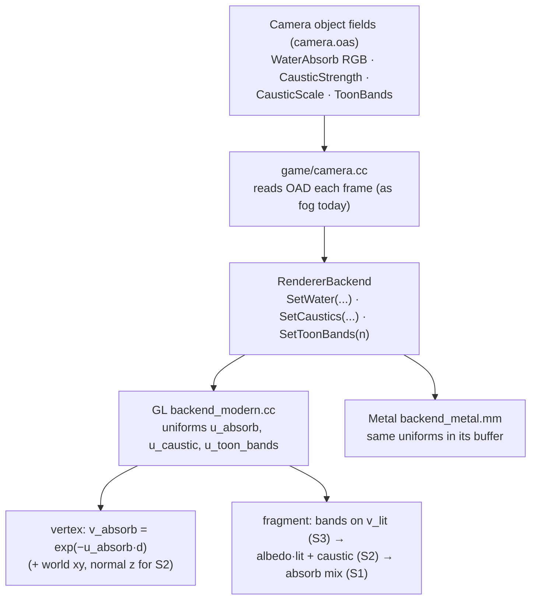

| | **S1 — water absorption** (realistic) | **S2 — caustics** (realistic) | **S3 — toon bands** (anime) |
|---|---|---|---|
| What it does | replaces the single-colour linear fog with **per-channel** exponential absorption toward the fog colour: `c = mix(fog, c, exp(−k_rgb·d))`. Red fades by a few metres (×10 world units), blue last | adds a moving web of light on upward-facing surfaces: a procedural pattern of world x/y and level time, weighted by the normal's z and by S1's green absorption | quantises lighting brightness into *n* bands while keeping hue: `l *= q(y)/y`, with `y = max(l.r, l.g, l.b)` |
| Shader cost | vertex: 1 `exp` on a vec3 and 1 new vec3 varying; fragment: unchanged (a `mix` either way) | fragment: about 4 `sin` and 1 `pow` per pixel, plus 2 varyings (world xy, normal z). **The one feature with a real fill-rate risk** on cast1 | fragment: 1 `max`, 1 `floor`, 1 divide |
| Camera fields | `WaterAbsorbR/G/B` (FX32, 0 = off) | `CausticStrength` (FX32, 0 = off), `CausticScale` | `ToonBands` (I32, 0 = off; the anime level uses 3) |
| Gate | none needed | **cast1: ≤ 2 ms frame time with it on vs off.** If it misses, use S2b: the same pattern evaluated per vertex (coarser, a fraction of the cost), or drop caustics | none needed |

**Scope and cost.**

| | |
|---|---|
| **Files changed** | `gfx/glpipeline/backend_modern.cc` (shaders and uniform plumbing), `gfx/metal/backend_metal.mm`, `gfx/renderer_backend.hp`, `gfx/glpipeline/backend_factory.cc` (state forwarding, as fog does at `:87-88`), `game/camera.cc`, `oas/camera.oas` |
| **Size, estimated** | shaders about +25 lines per backend; plumbing about +80 lines; the OAD adds 6 fields |
| **Effort** | one T4 agent session plus a cast1 session for S2's gate. Rank T4: every level draws through these shaders |
| **Memory** | none beyond a few uniforms; no new textures (S2 is procedural) |
| **Risk 1: existing levels change** | Off by default. **Regression guard:** a capture sweep of every level with all S fields at 0 must be **pixel-identical** to captures from before the change (the pattern of `tests/test_backface_cull_invariant.py`) |
| **Risk 2: GL and Metal disagree** | One shared shader test scene, rendered on Linux GL and on the macOS/iOS Metal build in CI. Band edges and absorption must match within 1/255 per channel |
| **Risk 3: old cooked levels** | New OAD fields need defaults in old `.lvl` files. Phase S confirms how levcomp treats a field a level doesn't carry; if it doesn't default it, the fields go at the end of the OAD with defaults, and every level is re-cooked in the same commit |
| **Not in scope** | Per-pixel lighting, normal maps, screen-space effects, a post-process pass, real translucency (the open texture-alpha TODO) |

### What lives here

25 kinds of life: 22 invertebrates (and coralline algae) plus 3 fish. Each kind is modelled in this tank's generator (`wflevels/aquarium_thai_reef/reef/`). Existing rigs, controllers and helpers from the other tanks are reused where they fit. The "Gulf record" column is what Phase 0 must establish. Until a source is read, nothing in it is a claim.

| # | Kind | Species | Role in the tank | How it moves | Actor (DFRM v2) | Gulf record |
|---|---|---|---|---|---|---|
| 1 | Christmas tree worms ×15 | *Spirobranchus* sp. | spiral crowns on the boulder and rock | snap shut (0.15 s) when the boxfish comes within 1.5 body lengths; reopen on their own 3–8 s timers | **1 actor, 15 curves** (scale retract) | to find |
| 2 | Feather duster worms ×4 | *Sabellastarte* sp. | banded fans on the rock | furl 0.2 s / unfurl 2.5 s clips | **1 actor, 4 curves** | to find |
| 3 | Feather star | Comatulida | 10 arms on the arch top | arm wave clip, per-arm phase | **1 actor, 10 curves** | to find |
| 4 | Fluted giant clam | *Tridacna squamosa* | blue mantle on the sand | mantle ripple; valves to 35 % when a shadow passes | 1 actor, transforms | to find |
| 5 | Skunk cleaner shrimp ×2 | *Lysmata amboinensis* | cave-mouth station | antennae wave; walks onto the boxfish and "cleans" for 4–6 s if it stops in reach for 2 s | 2 actors, 6 curves each | to find |
| 6 | **Coral guard crab** | ***Trapezia cymodoce*** | lives inside the cauliflower coral head, which it defends | clambers among the branches; claws-up threat at the coral edge when the boxfish's nose comes close; back inside after 2–3 s | **1 actor, 10 curves** (8 legs, 2 claws) | **likely: see below** |
| 7 | Hermit crab | Diogenidae | sand forager | slow walk with its shell | 1 actor, 6 curves | to find |
| 8 | Phyllidia nudibranch | *Phyllidia varicosa* | yellow-and-black slug on the rock | crawls an authored rock path at 2 cm/min (tank time ×20) | 1 rigid actor | to find |
| 9 | Blue sea star | *Linckia laevigata* | on the right rock face | glides, turns | 1 rigid actor | to find |
| 10 | Sea cucumber | *Holothuria* sp. | sand sifter, leaving a trail | slow sand crawl | 1 rigid actor | to find |
| 11 | Flowerpot coral | *Goniopora* sp. | long polyps on the left rock | polyp sway; sways faster in "current" | **1 actor, 12 curves** | to find |
| 12 | Sea fans ×2, leather coral | gorgonian; *Sarcophyton* sp. | the far edges; the arch top | slow sway; the leather coral "deflates" (scale 0.85) once per cycle | **1 actor, 3 curves** | to find |
| 13–22 | Static builders | *Porites lutea* boulder; table *Acropora*; *Pocillopora damicornis* (the crab's host); *Turbinaria* scrolls; *Tubastraea coccinea*; Fungiidae; *Xestospongia testudinaria*; *Polycarpa aurata*; *Palythoa*/*Zoanthus* carpets; coralline algae | the reef itself | static | static groups | to find |
| — | Humbug damselfish ×2 | *Dascyllus aruanus* (D1) | hover above their coral head | `swim-deform`; dive into the head when threatened | 2 actors | none found yet |
| — | Yellow boxfish, juvenile | *Ostracion cubicus* (D2) | the player | fins row and the box stays rigid (ostraciiform); 5 fins as 5 curves | 1 actor, 5 curves | dive-operator report only |

**The crab.** Search results point to a 2024 coral-crab survey of Mu Ko Tao, in the Gulf. It names ***Trapezia cymodoce*** among the most abundant species and reports that the crab did not stay in bleached *Pocillopora damicornis*. The likely source is the Burapha University science journal ([abstract](https://scijournal.buu.ac.th/index.php/sci/article/view/4852)). **Phase 0 must read the paper itself** and confirm the citation before the poster prints it.

The crab's real behaviour fits the tank exactly. *Trapezia* crabs defend their host *Pocillopora* against coral predators ([Science News](https://www.sciencenews.org/blog/wild-things/crabs-guard-coral-army-sea-stars)), so in the game the crab threatens the boxfish when it noses the coral. The carapace is about 1.5 cm across, 15 cm in world units at ×10.

**Swap rule.** If Phase 0 finds no Gulf of Thailand record for a species, it is replaced by a recorded congener with the same role, or dropped. Phase 0 records the swap in the research document and in this table, and never prints the unrecorded species.

### How the reef reacts

[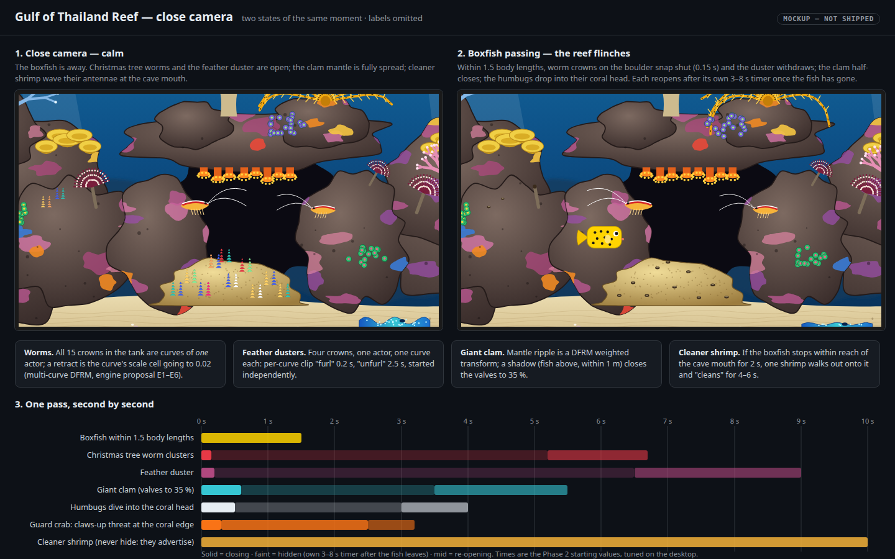](2026-11-02-gulf-of-thailand-reef-tank/tank-close.html)

One Forth **reef director** (`reef_director.fth`) runs the reactions:

- Each frame it reads the boxfish's position and tests distances against authored anchor points: crown roots, the clam, the coral head, the cave mouth. Anchor points are written by the generator at export; the director never scans objects at runtime.
- Each reacting thing has its own state machine and its own random timer, so the reef reopens raggedly, as a real one does.

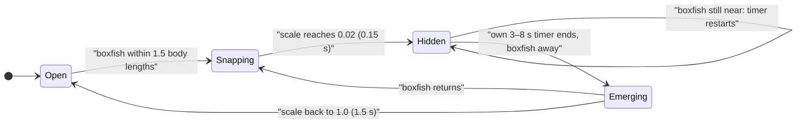

*One worm crown, which is one curve of the worm actor. Feather dusters have the same states, with "furl" and "unfurl" clips in place of scale.*

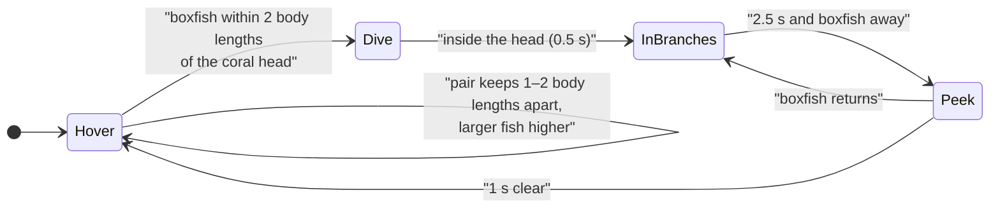

*The humbug pair. The coral head is their whole territory; they never leave it.*

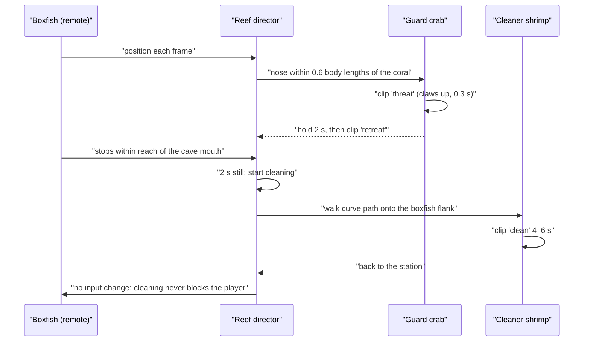

## Engine proposal: DFRM v2, several curves in one mesh

**What it is.** `DFRM` v1 binds a mesh's vertices to **one** rooted curve: a chain of rigid samples, posed by clips, an additive knot layer and an optional holdfast wrap. It also allows up to three weighted transforms. v2 lets **one mesh carry up to 16 curves**, each with its own root, its own chain of samples and its own small control record. Each curve's control record has four cells: scale, its own clip, that clip's start time, and a flex bias. Everything v1 does stays exactly as it is.

**Why.** The animated actors are the frame budget. On cast1 the six-pair seahorse population added 30 render actors, 52 draws, 46 vertex uploads and 21.54 ms of main-thread CPU per frame. That works out to **≈ 0.7 ms per added render actor**. This is an upper bound, because it also includes seahorse behaviour and 1,101-triangle meshes; the reef's small crowns and limbs cost less each. E7 measures the real figure; this plan does not assume it.

With v2, the reef's moving parts merge: 15 worm crowns into one actor, the feather star's 10 arms into one, the crab's 10 limbs into one. That takes the tank from **33 animated actors to 16**. At the upper-bound rate, the 17 fewer actors could save **up to ≈ 12 ms per frame**. Even a quarter of that, about 3 ms, is the margin between missing and meeting D6's 20 FPS. The same change gives articulated legs, antennae and fins, which three rigid transforms can't.

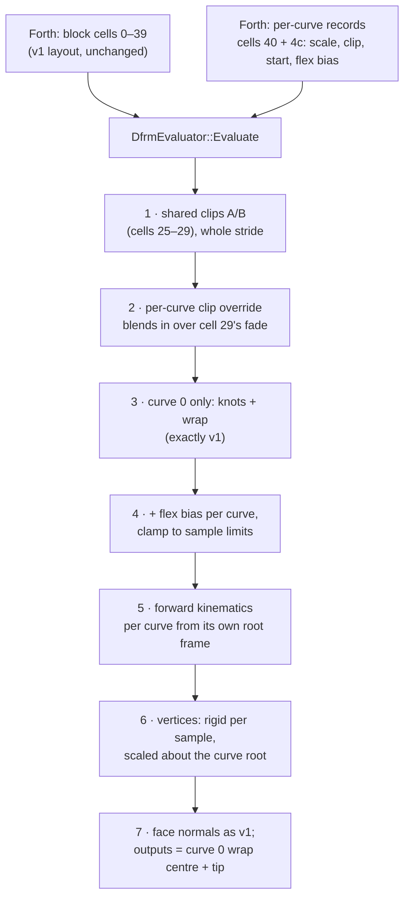

### E1 — Format: chunk version 2

| | v1 (today) | v2 |
|---|---|---|
| Byte layout | header 32 B, curves 52 B each, samples 16 B, transforms 28 B, influences 16 B, clips 16 B, frames `i16 × stride` | **identical**: no record changes size or meaning |
| `version` field | 1 | 2 |
| Curves | exactly 1 (`dfrm_deform.cc:81`, `:102`) | 1 to **16** (`DfrmMaxCurves`). Curves partition the samples **contiguously and in order**: curve *c*'s `firstSample` is the sum of the earlier `sampleCount`s. Gaps and overlaps are rejected |
| Samples | ≤ 64 (`DfrmMaxSamples`) | ≤ **256** (the feather star needs 10 × 12 = 120) |
| Knots | curve 0, 2–7 | each curve's record keeps its knot table; only curve 0's knots are driven (cells 0–20) |
| Influence `index` | global sample index (u16) | unchanged: still global; the sample's curve is implied |
| Clip frame stride | 3 × samples + transforms | unchanged: one clip row poses every curve |
| Transforms | ≤ 3 | ≤ 3 (unchanged; v2 limbs are curves) |

A **version 1 chunk** must still carry exactly one curve, and it is parsed and posed by the same code path as today. The writer emits version 1 whenever there is one curve, so every **seahorse mesh re-cooks byte-for-byte** (`task aquarium-check`).

### E2 — Control block v2

- **Cells 0–39 keep the v1 layout and meaning:**
    - knots (0–20) and wrap (21–24) drive curve 0;
    - the shared clips A/B (25–29) pose **all** curves;
    - transform angles 30–32;
    - outputs 33–39 report curve 0.
- **Cells 40 + 4*c*** (for *c* = 0 … *n* − 1) hold each curve's record:

| Cell | Meaning | Range | Default |
|---|---|---|---|
| 40 + 4*c* | **scale**: uniform scale of every vertex on this curve about the curve's root | 0.02–1 (clamped) | 1 |
| 41 + 4*c* | **clip id**: this curve's own clip (1-based); 0 = follow the shared pose | 0 … clips | 0 |
| 42 + 4*c* | **clip start**, level seconds | finite | 0 |
| 43 + 4*c* | **flex bias**, degrees added to every sample of the curve before the clamp | ± sample limits | 0 |

- A v2 block is 40 + 4*n* cells: at most **104**, for 16 curves.
- A v2 mesh posed with fewer cells returns `BadInput` (5) and keeps its previous pose (v1's E5 rule).
- A per-curve clip reads only its curve's slice of the clip row. So one authored "furl" clip serves every duster, each started at its own time.

### E3 — Evaluator (`renderassets/dfrm_deform.{h,cc}`)

- **`ParseDfrm`.** Accept version 2. Validate the partition and the new limits. Build a sample → curve table (`std::vector<uint8_t>`).
- **`Bind`.** Rest joints are computed per curve. A rigid face's normal coefficients use **its own curve's** rest frame, not curve 0's (today `:187-219` uses `curves[0]`). A face whose vertices span two curves becomes `FaceRecompute`; the existing "same index" test already catches that. The `curves.size() != 1` refusal (`:177`) goes.
- **`Evaluate`.**
    - Steps 1–4 as v1, plus the per-curve clip slice and the flex bias.
    - Forward kinematics loops per curve, from that curve's root frame, re-orthonormalising every 8 samples as now.
    - Vertex placement multiplies the sample offset and the joint by the curve's scale, about the curve root: three multiply-adds per vertex.
    - Normals are unchanged: uniform scale doesn't turn them.
    - **No allocation in `Evaluate`.** Per-curve buffers are sized in `Bind`, as v1's are (`dfrm_deform.h:110-113`).
- **Wrap and the outputs stay on curve 0.** Nothing in the reef wraps. The seahorse is a one-curve v1 mesh.

### E4 — Script bridge and slot

- `mesh_deformer.cc` `DfrmDeformer::MaxChannels()` becomes 40 + 4 × `DfrmMaxCurves` = 104, and `Check` requires 40 + 4*n* for a v2 mesh.
- `engine/stubs/scripting_zforth.cc:1412-1413`: `deform-block`'s `channels[40]` and `maxChannels 40` become 104. That is a 416-byte stack array, read from consecutive director mailboxes as today.
- A new word, `: dfrm-pose-curves ( block curves actor -- status ) >r 4 * 40 + 6 r> deform-block ;`, sits beside `dfrm-pose` (which still passes 33).
- **Mailbox budget.** The reef's v2 actors use 100 + 56 + 80 + 88 + 52 + 80 + 64 + 64 + 64 + 60 = **708** director mailboxes. The seahorse director already uses 12 × 40 = 480. Phase E checks the director's mailbox range before relying on it.

### E5 — Tools

- **`wftools/wf_blender/dfrm_chunk.py`.** `build_chunk(chain, …)` gains `build_chunk_curves(chains=[…], …)`, which writes version 2. `decode()` reads both versions. `build_chunk` with one chain stays byte-identical.
- **`wflevels/aquarium_tanks/dfrm_ref.py`**, the Python reference the C++ test compares against, gains a multi-curve `evaluate`. This is engine infrastructure, not tank content.
- **`wftools/wf_blender/export_level.py`** needs no change if it already passes the chunk bytes through; Phase E confirms it.

### E6 — Tests (regression guard in the same commit)

| Test | What it proves |
|---|---|
| `tests/dfrm_strand.cc`, existing cases | every v1 golden case passes **unchanged** |
| new: 3-curve golden | positions and normals within 1e‑4 of `dfrm_ref.py`, at rest and for 7 poses |
| new: per-curve clip | curve 1 starts its clip at *t* = 2 s while curves 0 and 2 stay on the shared pose; the timing is exact |
| new: scale | scale 1 is bit-identical to no record; scale 0.02 puts every vertex within 0.02 × rest offset of the root; a value outside the range clamps and reports `Clamped` |
| new: parse rejections | a gap, an overlap, 17 curves, 257 samples, version 1 with 2 curves, a v2 block shorter than 40 + 4*n* → `BadInput` with the previous pose kept |
| new: no allocation | `Evaluate` on a 16-curve mesh makes no heap allocation (counting allocator, as the deformer-normals work used) |
| `tests/test_dfrm_export.py` | v2 round-trip; the one-chain seahorse chunk is byte-identical to today's |
| `task aquarium-check` | all eight tanks' committed outputs are unchanged |

### E7 — Device evidence (cast1, through the coordinator)

1. **No regression.** Planted Tank with six seahorse pairs, wide idle, matched runs against the [17 October baseline](2026-10-16-saltwater-seahorses/comparison.md). The mean frame time must sit inside that baseline's run range.
2. **The merge pays.** A bench level with 15 worm crowns as **15 one-curve actors** against **one 15-curve actor**, same triangles. Report update, render, draws and uploads per frame. The per-actor overhead measured here replaces the ≈ 0.4 ms upper bound in this plan.

### Scope, cost and risk

| | |
|---|---|
| **Files changed (engine)** | `wfsource/source/renderassets/dfrm_deform.h`, `dfrm_deform.cc`, `mesh_deformer.cc`; `engine/stubs/scripting_zforth.cc` |
| **Files changed (tools and tests)** | `wftools/wf_blender/dfrm_chunk.py`, `wflevels/aquarium_tanks/dfrm_ref.py`, `tests/dfrm_strand.cc`, `tests/test_dfrm_export.py` |
| **Size, estimated** | C++ about +180 / −40 lines (the evaluator ~150, the slot ~5, the bridge ~10). Python about +150. Tests about +300 |
| **Effort** | One T4 agent session (design is settled here; the evaluator change is careful but local), plus one coordinator session for E7. Rank T4 because a wrong step regresses the seahorses |
| **CPU per frame** | A v1 mesh: unchanged path. A v2 mesh: the same per-vertex and per-sample work as v1 for the same totals, plus 3 multiply-adds per vertex for scale and up to 71 extra mailbox reads per call. Expected saving: 17 fewer actors in this tank, up to ≈ 12 ms at the seahorse-derived upper bound (E7 measures the real figure) |
| **Memory** | Chunk: 52 B per extra curve. Evaluator: buffers grow with samples (256 × 21 floats ≈ 21 KB worst case per actor). Block: 64 extra cells per 16-curve actor |
| **Risk 1: seahorses regress** | Mitigated: the v1 path is separate in validation and bit-identical in tests; seahorse chunks re-cook byte-for-byte; E7 step 1 on device |
| **Risk 2: a tank-wide actor is never culled** | The worm actor spans the reef, so its bounds always intersect the fixed tank camera. Culling saves nothing there anyway. Accepted |
| **Risk 3: mailbox range** | 708 cells; checked in Phase E before use. Fallback: split the worms into two 8-curve actors |
| **Not in scope** | GPU skinning (moving vertex placement to a shader; the [seahorse comparison](2026-10-16-saltwater-seahorses/comparison.md) names it). Wrap on curves other than 0. More than three transforms. Converting the five species deformers (that is Deformer phase 2, its own permission) |

### The three ways compared

| | **No engine change** | **Transforms only** (`DfrmMaxTransforms` 3 → 16) | **DFRM v2 (recommended)** |
|---|---|---|---|
| Animated actors in the reef | 33 | 21 | **16** |
| Worm crowns retract | 6 rigid cluster actors moved into the rock | same | each crown on its own timer, 1 actor |
| Feather star | 5 actors × 2 mirrored arms, identical motion | arms as 1-hinge rigid rods | 10 curling arms, per-arm phase, 1 actor |
| Crab and shrimp legs | rigid, no walk | hinged, but legs can't curl | 2–3-segment legs, walk clips |
| Boxfish fins | 3 of 5 fins move | 5 fins hinge | 5 fins row (curves), 1 actor |
| Engine edit | none | 1 constant plus the block size | E1–E7 above |
| Risk to existing tanks | none | low | low (v1 path untouched) |

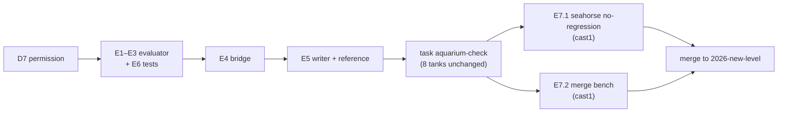

## The fish

- **Humbug pair (D1).** About 8 cm each, white with three black bars. Each is one actor with the generic `swim-deform` tail wave (a new mesh; the operator is shared infrastructure). Behaviour is the humbug state diagram above.
- **Boxfish (D2, D3).** About 4 cm juvenile, 40 cm at ×10. The body never bends: thrust comes from the pectoral, dorsal and anal fins, and the tail mostly steers (ostraciiform swimming; Phase 0 finds the source for the poster).
    - **Controls follow the tank convention:** directions steer, OK gives a brief tail-beat burst, Up+OK switches Side/Depth mode, and `TANK_PROFILE=touch|keyboard` work. A new `boxfish_motion.fth` holds the controller.
    - **Movement:** cruise 1.2 world units/s, hover and turn on the spot. Predictive braking keeps the box out of the rock using the tank's collider set.
    - **The screensaver variant** gets a new driver, `thai_reef_screensaver.fth`. It visits the coral head, the cave mouth and the boulder in turn, so a Dream shows every reaction.

## Phase 0 — research and the A3 poster

Research first, saved before the poster: `docs/reference/thai-reef-research.md` lists every source, locator, study species, region and access limit.

- **For every species in the roster**, it must find a **Gulf of Thailand record**: a checklist, a survey paper, or a park-authority record. A dive-shop page is a lead, not a record.
- **Habitat claims** to check: mean depth, reef type, monsoon turbidity, *Porites* dominance, bleaching years, substrate, water temperature.
- **The swap rule applies** to any species without a record.

[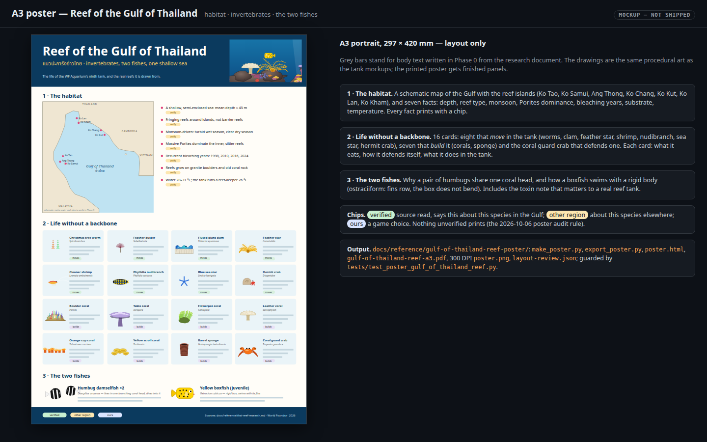](2026-11-02-gulf-of-thailand-reef-tank/poster.html)

**Poster.** A3 portrait, 297 × 420 mm, in `docs/reference/gulf-of-thailand-reef-poster/`:

- files: `make_poster.py`, `export_poster.py`, `poster.html`, `gulf-of-thailand-reef-a3.pdf` (one page), a 300 DPI `poster.png`, `layout-review.json` and editable SVG panels;
- guarded by `tests/test_poster_gulf_of_thailand_reef.py`: embedded fonts, type ≥ 8 pt, blank 5 mm edges, one link per source, no unverified wording;
- printed on matte A3 and copied to `~/Documents/TO PRINT/`.

| Panel | Content |
|---|---|
| Header | "Reef of the Gulf of Thailand", แนวปะการังอ่าวไทย, a strip of the tank |
| 1 · The habitat | schematic map (Ko Tao, Ko Samui, Ang Thong, Ko Chang, Ko Kut, Ko Lan, Ko Kham); 7 facts, each with a chip |
| 2 · Life without a backbone | 16 cards: 8 that **move** (worms, duster, clam, feather star, shrimp, nudibranch, sea star, hermit crab), 7 that **build** (corals, sponge) and the **coral guard crab** that defends one. Each card says what it eats, how it defends itself, and what it does in the tank |
| 3 · The two fishes | why a humbug pair shares one coral head; how a boxfish swims with a rigid body; the boxfish's toxin, which matters in a real reef tank |
| Footer | chip legend (verified · other region · ours) and the research document |

Claims to verify before print. **Nothing below is a claim yet.**

| Claim | Status | Lead |
|---|---|---|
| The Gulf is shallow and semi-enclosed, mean depth ≈ 45 m | pending | oceanographic reference, Phase 0 |
| Gulf reefs are fringing reefs around islands | pending | Thai DMCR reef reports |
| Inner-Gulf reefs are *Porites*-dominated | pending | survey literature |
| Mass bleaching in 1998, 2010, 2016, 2024 | pending (2016 may be Andaman-only) | DMCR, Reef Check Thailand |
| *T. cymodoce* among the most abundant coral crabs at Mu Ko Tao; avoids bleached *P. damicornis* | likely (abstract seen) | 2024 Mu Ko Tao survey, [abstract](https://scijournal.buu.ac.th/index.php/sci/article/view/4852) |
| *Trapezia* guard their host coral against predators | other region (Moorea) | [Science News](https://www.sciencenews.org/blog/wild-things/crabs-guard-coral-army-sea-stars), primary paper to cite |
| Juvenile *O. cubicus* on shallow coral heads at Ko Tao | lead only | [Big Blue Diving](https://www.bigbluediving.com/koh-tao-marine-life/yellow-boxfish/) |
| Every other roster species occurs in the Gulf | pending | checklists, Phase 0 |
| Behaviours, timings, colours and the reef director's rules | **ours** | this plan |

## Phases

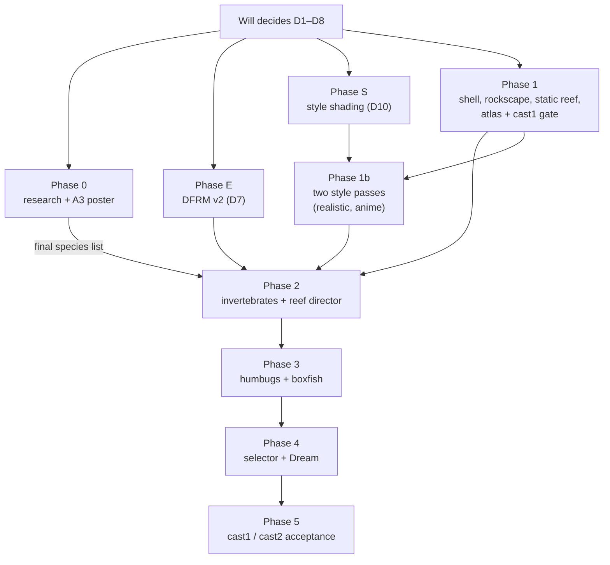

- **Phase 0 — research and poster** (T3). As above. It produces the **final species list**, which gates Phase 2's models.
- **Phase E — `DFRM` v2** (T4, after D7). E1–E7. It can run alongside Phases 0 and 1.
- **Phase S — style shading** (T4, after D10). S1–S3, the capture-sweep regression guard and S2's cast1 gate. It can run alongside Phases 0, 1 and E.
- **Phase 1 — the shell and the static reef** (T4).
    - New shell, colliders and cameras (D4).
    - Rockscape, coral, sponge and atlas generators, and `config.py` with the seed and the budgets.
    - Container build: `bash wflevels/aquarium_thai_reef/build.sh`, wrapped as `task aquarium-thai-reef-level`. `report_budget.py` prints triangles per static group.
    - **Early cast1 gate.** The static reef alone, with no actors and the default camera, must be **≤ 38 ms** (leaving at least 12 ms for life under D6's 50 ms). If it misses, thin the static groups before Phase 2 starts: sand and rubble first, then the far rock, then the coral tip rows.
- **Phase 1b — the two style passes** (T4).
    - **Realistic:** Cycles light and AO bake, the photographic atlas, Camera fields for S1 and S2.
    - **Anime:** simplified meshes, posterised atlas, banded bake, outline hulls, `ToonBands = 3`.
    - **Both:** desktop captures from the same camera, pose and seed, side by side, for Will's review before Phase 2 builds the moving life in both styles.
- **Phase 2 — invertebrates and the reef director** (T3, design settled here). Every model in both styles. The hulls and the posterised skins are generated from the same rig.
    - The models and rigs in the roster, the director and its state machines.
    - Desktop capture: `scripts/check-thai-reef.py --video` drives the boxfish past each reactor and asserts every reaction within its timing window.
- **Phase 3 — the fish** (T3). Humbug and boxfish models, `boxfish_motion.fth`, the humbug-pair controller, and the screensaver driver.
- **Phase 4 — selector and Dream** (T2).

[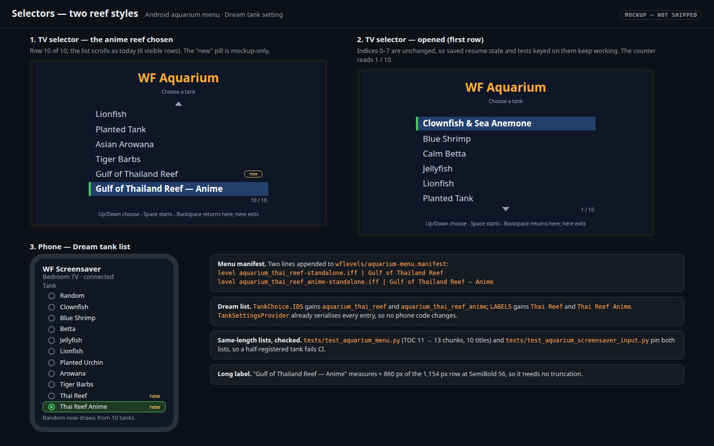](2026-11-02-gulf-of-thailand-reef-tank/selectors.html)

Phase 4 appends two lines to `aquarium-menu.manifest` and adds both tanks everywhere the eight are listed. Indices 0–7 don't move, so saved state and tests keyed on them still work.

`scripts/build-aquarium-screensaver-levels.py` currently carries **uncommitted edits from the Planted Tank screensaver work** (TODO "Planted Tank screensaver (third Dream)", `[verify T3]`), along with `scripts/build-object-properties.py` and `tests/test_aquarium_screensaver_catalog.py`. Phase 4 waits for that item to commit them, or merges on top; it never commits them.

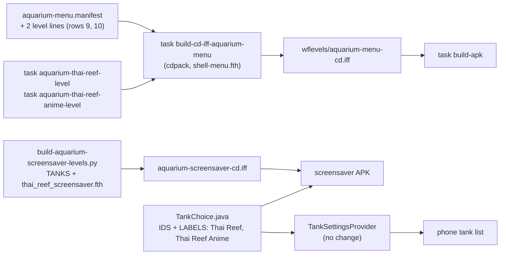

- **Phase 5 — acceptance** (T3). Install on cast1 (cast2 if it's available) through the coordinator. For **both** levels: selector and Back, the D6 frame-rate gate over 120 s wide idle, and a Dream run. Then restore the device's original settings.

## Pipeline: from generator to TV

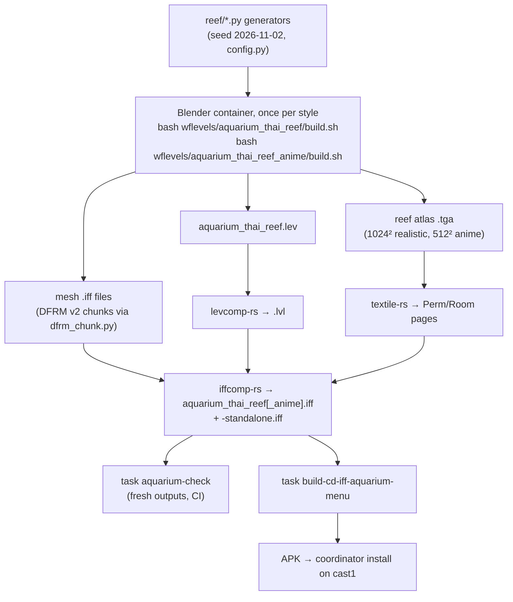

## New and changed files

| Path | New / changed | What |
|---|---|---|
| `wflevels/aquarium_thai_reef/` | new | `config.py`, `build.sh`, `run.sh`, `README.md`, `generate.py`, `reef/{scene,rockscape,corals,sponges,invertebrates,fishes,atlas,style_realistic,style_anime,hull}.py`, `report_budget.py`, Forth: `reef_director.fth`, `boxfish_motion.fth`, `humbug_pair.fth`, `thai_reef_screensaver.fth` |
| `wflevels/aquarium_thai_reef_anime/` | new | `build.sh` and `run.sh` that call the shared generator with `--style anime`; the cooked anime level |
| `scripts/check-thai-reef.py` | new | desktop reaction and motion capture |
| `tests/test_aquarium_thai_reef.py` | new | budgets, the content rule, director timing tables |
| `docs/reference/thai-reef-research.md`, `docs/reference/gulf-of-thailand-reef-poster/` | new | research, poster, test |
| `wflevels/aquarium-menu.manifest`, `Taskfile.yml`, `scripts/aquarium-levels.sh`, `scripts/compare-level-build-routes.sh`, `scripts/build-aquarium-screensaver-levels.py`, `scripts/build-aquarium-variant.py`, `android/screensaver/…/TankChoice.java` | changed | registration (Phase 4) |
| `tests/test_aquarium_menu.py`, `tests/test_aquarium_screensaver_input.py`, `tests/test_species_movement.py` | changed | 10 tanks, a 13-chunk TOC |
| Engine and `DFRM` tooling | changed | Phase E only, after D7 (list under the proposal) |
| Shaders, renderer backend, Camera OAD | changed | Phase S only, after D10 (list under the proposal) |

## Out of scope

- A day/night light cycle (for example, *Tubastraea* polyps opening at night). Worth its own plan.
- Water-flow simulation; corals sway on authored clips.
- Coral growth, spawning, or any reef state carried between sessions.
- Settings sheets (population counts, reaction radius). The tank ships with fixed values; the runtime-object-editing work can expose them later.
- GPU skinning; Deformer phase 2.

## Verification

1. Research document complete: every roster species has a Gulf of Thailand record or has been swapped, and the poster refuses to build otherwise.
    ```sh
    python3 docs/reference/gulf-of-thailand-reef-poster/make_poster.py
    python3 -m pytest -q tests/test_poster_gulf_of_thailand_reef.py
    ```
2. Poster exports to one A3 page with no overflow.
    ```sh
    python3 docs/reference/gulf-of-thailand-reef-poster/export_poster.py
    pdfinfo docs/reference/gulf-of-thailand-reef-poster/gulf-of-thailand-reef-a3.pdf | grep -E 'Pages|Page size'
    ```
    Expect `Pages: 1` and `841.89 x 1190.55 pts (A3)`.
3. `DFRM` v2 (Phase E): engine tests and the export round trip pass, and all eight existing tanks are unchanged.
    ```sh
    ctest --test-dir build -R dfrm_strand --output-on-failure
    python3 -m pytest -q tests/test_dfrm_export.py tests/test_seahorse_tail.py tests/test_seahorse_behaviour.py
    task aquarium-check
    ```
4. Both levels build in the container, their outputs are fresh, and their anchor tables are identical.
    ```sh
    task aquarium-thai-reef-level
    task aquarium-thai-reef-anime-level
    task aquarium-check
    python3 -m pytest -q tests/test_aquarium_thai_reef.py -k same_anchors
    ```
5. Budgets and the content rule. `report_budget.py` reports, per style: realistic ≤ 48,000 static triangles; anime ≤ 30,000 plus ≤ 16,000 hull triangles; ≤ 8 groups and ≤ 16 animated actors each. The test fails if any roster species appears in another tank's species list.
    ```sh
    python3 wflevels/aquarium_thai_reef/report_budget.py
    python3 -m pytest -q tests/test_aquarium_thai_reef.py
    ```
6. Reactions on the desktop. Each reactor closes within its window after the boxfish enters its radius. Each reopens 3–8 s after the boxfish leaves (2.5 s for the humbugs, 2 s for the crab). Cleaning starts after 2 s still at the cave mouth. No reactor blocks input.
    ```sh
    bash wflevels/aquarium_thai_reef/run.sh
    python3 scripts/check-thai-reef.py --video
    ```
7. The selector lists ten tanks; indices 0–7 are unchanged.
    ```sh
    python3 -m pytest -q tests/test_aquarium_menu.py
    task build-cd-iff-aquarium-menu
    ```
8. The screensaver variants and the Dream list include both tanks.
    ```sh
    python3 -m pytest -q tests/test_aquarium_screensaver_input.py tests/test_aquarium_screensaver_catalog.py
    ```
9. On cast1: rows 9 and 10 start the realistic and the anime reef, Back returns to the menu from each, and rows 1–8 still start their tanks.
10. On cast1: each style, wide idle for 120 s at the default population, meets D6, measured with the protocol of the [seahorse comparison](2026-10-16-saltwater-seahorses/comparison.md).
11. On cast1: E7.1, Planted Tank with six pairs inside its 17 October run range; E7.2, the merge bench reported.
12. On cast1: Dream with "Thai Reef", then with "Thai Reef Anime", selected shows that tank and runs the screensaver driver for 5 minutes each; the original Dream selection is restored afterwards.
13. The poster PDF is copied to `~/Documents/TO PRINT/`.
14. Style shading (Phase S): with every new Camera field at 0, a capture sweep of all levels is pixel-identical to the pre-change captures, on GL and on Metal. The shared shader test scene matches across the two backends within 1/255 per channel. On cast1, S2 costs ≤ 2 ms against S2 off.
    ```sh
    python3 -m pytest -q tests/test_style_shading_invariant.py
    ```
15. Style review: desktop captures of both levels from the same camera, pose and seed are attached to the plan, and Will approves both looks before Phase 2.

## Mockups

All five are self-contained, 1440 × 900, rebuilt by `python3 docs/plans/2026-11-02-gulf-of-thailand-reef-tank/build_mockups.py --png` from one seed. They are design intent, not game assets.

- [Wide view](2026-11-02-gulf-of-thailand-reef-tank/tank-wide.html): every species numbered, with the labels outside the TV frame.
- [Close camera](2026-11-02-gulf-of-thailand-reef-tank/tank-close.html): calm against flinching, and one pass second by second.
- [Two styles](2026-11-02-gulf-of-thailand-reef-tank/styles.html): ultra-realistic beside anime/cel, wide and close.
- [Selectors](2026-11-02-gulf-of-thailand-reef-tank/selectors.html): TV menu at 10 / 10 and 1 / 10, and the phone's Dream list.
- [Poster](2026-11-02-gulf-of-thailand-reef-tank/poster.html): the A3 layout.
