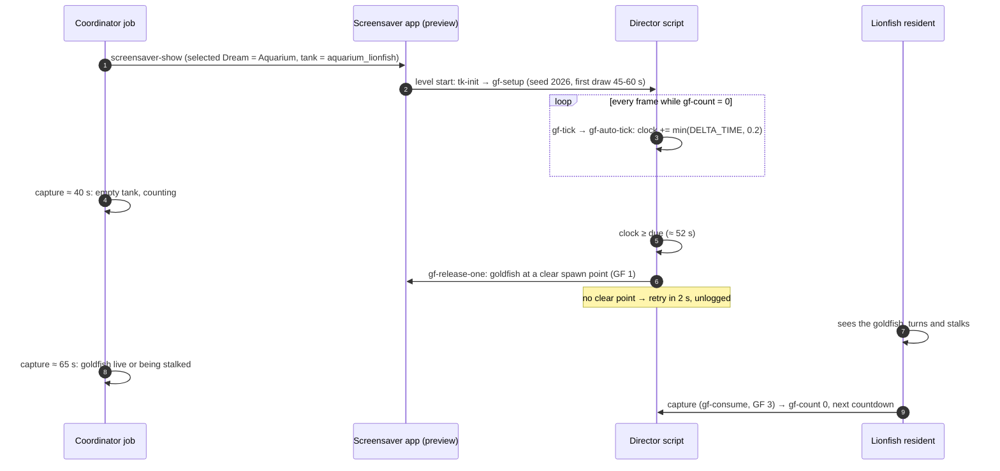
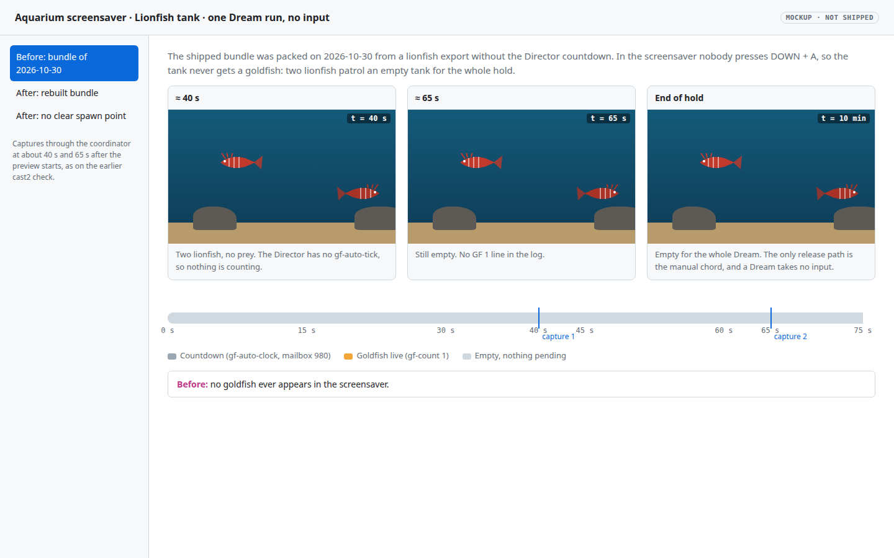
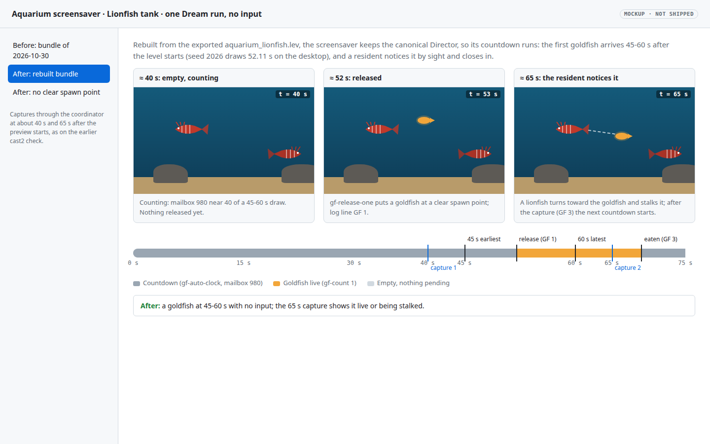
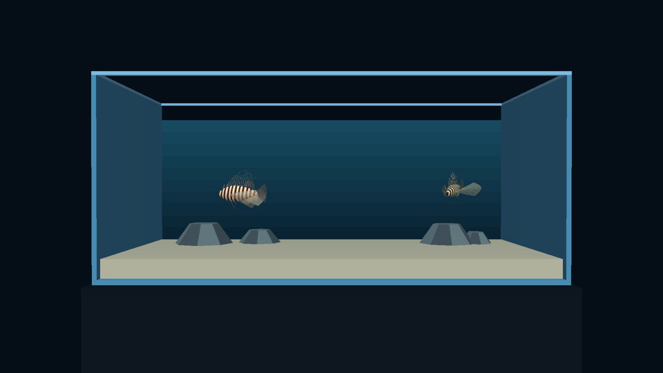
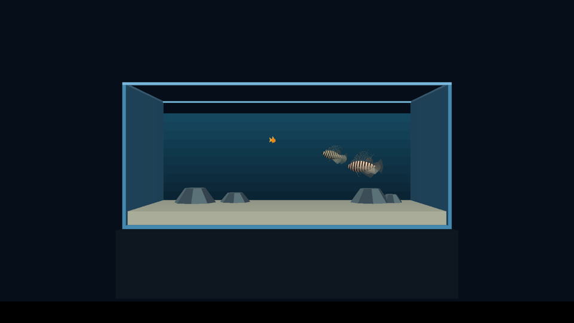
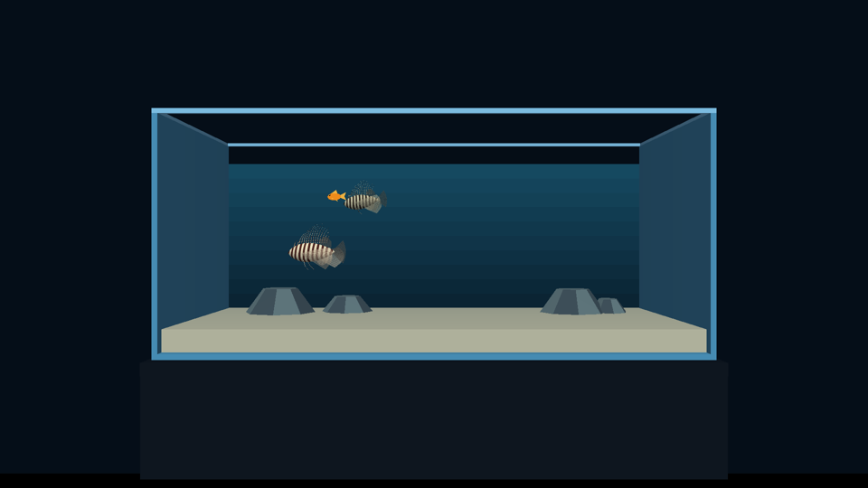
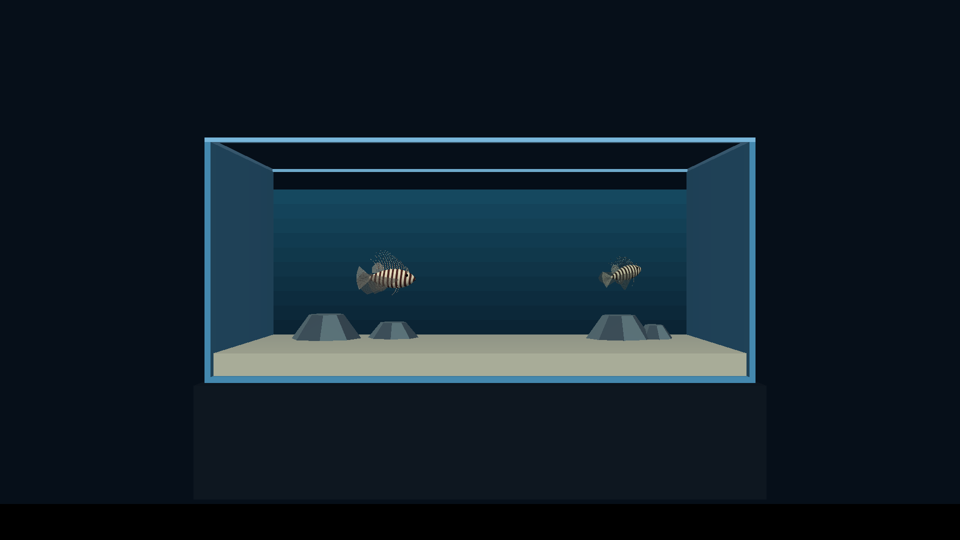
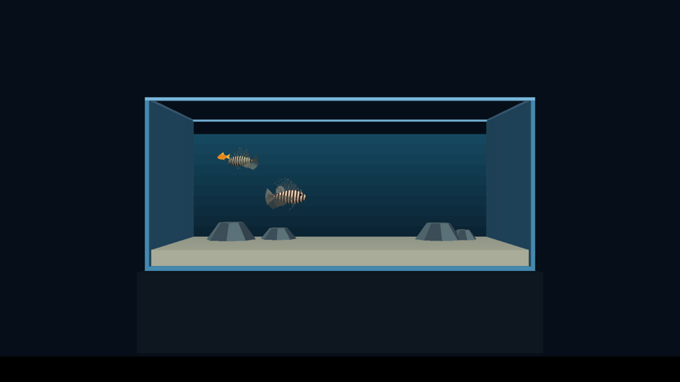

# Lionfish screensaver picks up the automatic goldfish

**Status:** done (2026‑11‑02); all seven verification steps pass, device check on cast2. **Tier:** T3. **Approved:** Will, 2026‑11‑02.
**Follows:** [lionfish auto goldfish](2026-11-01-lionfish-auto-goldfish.md) (`7a68013f`, `d47951da`, `e37509ba`).

## Goal

The Director in the Lionfish tank now releases a goldfish 45‑60&nbsp;s after the tank empties. The Aquarium screensaver (`org.worldfoundry.screensaver`, flavor `aquarium`) has a Lionfish choice, `aquarium_lionfish_screensaver`, and a Dream takes no input, so the automatic release is the only way a goldfish can ever appear there. This change rebuilds the screensaver bundle so the Lionfish Dream carries that release, adds a regression test that fails if the shipped bundle's lionfish Director lacks it, and shows on a Chromecast that a goldfish arrives 45‑60&nbsp;s into a Lionfish screensaver run with no input.

No engine (C++) change, no Blender export, no level-script change: the `.lev` that already carries the countdown is tracked.

## How the shipped bundle is produced (checked)

- `scripts/build-aquarium-screensaver-levels.py` with no arguments builds all eight variants in `TANKS` order. For each it reads the tracked exported `wflevels/<tank>/<tank>.lev`, swaps only the Player's script (`player_script()`: the screensaver driver plus `ss-drive`; the Director keeps its own script), writes `wflevels/<tank>_screensaver/`, and runs `wftools/wf_blender/build_level_binary.sh` (iffcomp, levcomp, textile, iffcomp). It then attaches settings catalogs, builds `seahorse_grid`, and packs two bundles with `cdpack`: `wflevels/aquarium-screensaver-cd.iff` (the eight variants, in `TankChoice.IDS` order, plus `UIFT`) and `wflevels/seahorse-screensaver-cd.iff`.
- **The tracked `android/screensaver/src/aquarium/assets/cd.iff` is a symlink**, git mode `120000`, target `../../../../../wflevels/aquarium-screensaver-cd.iff`. The builder recreates that same symlink each run. The bundle it points at is gitignored (`.gitignore:105`). So the "shipped artifact" is not tracked content: a rebuild changes **no** tracked file, and the bytes reach a device only inside an APK built from the local bundle. The commit "Split Android screensavers into flavor APKs" (`d4b4070a`, 2026‑10‑23) introduced the symlink.
- There is no Taskfile task for the Aquarium flavor; the [screensaver README](../../android/screensaver/README.md) gives the commands: `python3 scripts/build-aquarium-screensaver-levels.py`, then `./gradlew :screensaver:assembleAquariumDebug --offline` (arm64‑v8a and armeabi‑v7a, `abiFilters` in `android/screensaver/build.gradle.kts`).
- The screensaver build needs no Blender: it starts from the exported `.lev`. `WF_LEVEL_BUILD_HOST=1` selects the host route only for the Blender step (`scripts/level-build.sh`), which this path never runs. The Rust tools run on the host, as they always have for `build_level_binary.sh`. Parity on unchanged inputs is shown in step 2.

```mermaid
flowchart LR
    A["wflevels/aquarium_lionfish/<br/>aquarium_lionfish.lev<br/>(tracked, has gf-auto-tick)"] --> B["build-aquarium-screensaver-levels.py<br/>player_script(): swap Player only"]
    D["screensaver_player.fth<br/>(tracked driver)"] --> B
    B --> C["wflevels/aquarium_lionfish_screensaver/<br/>…_screensaver.lev"]
    C --> E["build_level_binary.sh<br/>iffcomp → levcomp → textile → iffcomp"]
    E --> F["aquarium_lionfish_screensaver-standalone.iff"]
    F --> G["cdpack: 8 variants + UIFT<br/>wflevels/aquarium-screensaver-cd.iff<br/>(gitignored)"]
    G -. "symlink (tracked, unchanged)" .-> H["android/screensaver/src/aquarium/assets/cd.iff"]
    H --> I["gradlew :screensaver:assembleAquariumDebug --offline<br/>arm64-v8a + armeabi-v7a"]
    I --> J["screensaver-aquarium-debug.apk<br/>frozen copy → coordinator"]
```



## The other session's uncommitted edits (checked, not needed)

The shared tree holds uncommitted edits to `scripts/build-aquarium-screensaver-levels.py` and `tests/test_aquarium_screensaver_catalog.py` from the Planted Tank session. They (1) give the screensaver's Planted choice a saltwater default by writing a variant `settings-bindings.json` with `Water type` initial `1`, and (2) update the catalog test for the Jellyfish catalog that origin gained in `967a7346` (2026‑10‑30) and for that saltwater value. Neither touches `player_script()`, the Director, the lionfish tank or the bundle order. **This change does not need them**, and does not copy or edit them: the rebuild here is from `origin/2026-new-level` as is.

Consequences, stated so nobody is surprised:

- The bundle built here gives the Planted choice origin's freshwater default; the saltwater default arrives when that session lands its edits.
- Origin's `tests/test_aquarium_screensaver_catalog.py` already fails three tests on origin's own build (it predates the Jellyfish catalog of `967a7346`). The failure is not caused by this change; the fix is part of that session's uncommitted edit (step 4 shows the output). The new regression test lives in its own file so neither file conflicts.

## Approach

1. Work in a sparse worktree of `origin/2026-new-level` in tmpfs (root disk had about 6.9&nbsp;GB free); link the already built host tool binaries from the main checkout (each newer than the last commit to its crate), unpack the tracked Jolt tarball for the NDK build.
2. Run the builder with no arguments (the only way to pack the bundle), check the lionfish variant's Director, and restore the one tracked file the full run rewrites as a side effect (step 3).
3. Add `tests/test_aquarium_screensaver_lionfish_goldfish.py`: source checks (the variant's Director is the canonical Director and carries the countdown; the Player runs none of it) and bundle checks (the lionfish level inside the shipped `cd.iff`, found by `TankChoice.IDS` order in the cdpack TOC, carries `gf-auto-tick` and constants 980‑982, no other tank does, and it is byte-identical to the built variant).
4. Build the Aquarium debug APK offline, freeze it, and show the Lionfish Dream on a Chromecast through the coordinator with no input; capture at about 40&nbsp;s and 65&nbsp;s.



## Mockups

The screensaver tank over one run, before the rebuild (empty for the whole hold) and after (a goldfish at 45‑60&nbsp;s, a resident noticing it), with the two capture points. The interactive version also has the "no clear spawn point" state.

| Before | After |
|---|---|
| [](2026-11-02-lionfish-screensaver-auto-goldfish/timeline.html) | [](2026-11-02-lionfish-screensaver-auto-goldfish/timeline-after.html) |

The real cast2 frames are under step 6 of **Verification**.

## Device use

The device check uses only coordinator workflows (no raw ADB, no reservations). `screensaver-show` needs the Aquarium Dream to be the selected Dream and shows the saved `tank` choice, so the run temporarily selects the Aquarium Dream and saves `tank = aquarium_lionfish`, then restores the device's recorded selection and tank value. Anything installed or replaced is recorded in step 6: on cast2 nothing was replaced (no Aquarium screensaver was installed), and the Aquarium screensaver from this APK stays installed.

## Out of scope

- The Planted choice's saltwater default and the catalog-test update (the Planted Tank session's uncommitted edits).
- The Seahorse bundle: the full builder also repacks `wflevels/seahorse-screensaver-cd.iff` (untracked); it is not committed or installed here.
- A Taskfile task for the Aquarium flavor build (none exists; the README commands are used as written).

## Verification

Ran 2026‑11‑02 06:30‑07:10 (+0700) in a sparse worktree of `origin/2026-new-level` in tmpfs. Origin moved from `1669b750` to `37811af7` ("Retire generic Template actor and measure PERM pool") during the work; step 3b shows the bundle is byte-identical at both.

1. ~~**Worktree on origin; tools fresh.**~~

    ```
    $ git -C wt log --oneline -1 HEAD; git rev-parse origin/2026-new-level; git sparse-checkout list
    1669b750 docs: record Planted Tank cast1 soak evidence
    37811af775c92bd1442000af25dbc2bd40d7806a
    /*
    !/docs/diagnostics/
    !/docs/plans/*/
    /docs/plans/2026-11-02-lionfish-screensaver-auto-goldfish/
    $ (each linked tool: binary mtime vs last commit to its crate)
    wftools/iffcomp-rs/target/release/iffcomp bin=2026-10-21T16:50:01 src=2026-05-22T00:09:52 fresh
    wftools/levcomp-rs/target/release/levcomp bin=2026-10-21T16:50:29 src=2026-06-03T20:15:34 fresh
    wftools/textile-rs/target/release/textile bin=2026-10-21T16:51:22 src=2026-10-02T22:32:12 fresh
    wftools/oas2oad-rs/target/release/oas2oad bin=2026-10-06T02:42:01 src=2026-05-22T02:56:56 fresh
    wftools/prep/prep bin=2026-10-30T19:22:32 src=2026-05-27T20:53:31 fresh
    wftools/cdpack-rs/target/release/cdpack bin=2026-10-18T08:12:53 src=2026-10-17T14:50:28 fresh
    wftools/wf_attr_edit/target/release/catalog bin=2026-11-01T11:42:37 src=2026-10-06T10:03:22 fresh
    ```

    **PASS.** The worktree was created at `1669b750`; the fetched origin had already moved to `37811af7` when this was recorded (3b covers it). The binaries are symlinks to the main checkout's builds (`target/` is gitignored); none is older than its crate's last commit. `wf_attr_edit/…/catalog` was found missing on the first run (`FileNotFoundError` while attaching the Jellyfish catalog) and linked the same way.

2. ~~**Parity: the host route reproduces committed outputs on unchanged inputs.**~~

    ```
    $ bash wftools/wf_blender/build_level_binary.sh aquarium_lionfish && git status --short

    [5/5] iffcomp-rs  aquarium_lionfish-standalone.iff.txt  →  ../aquarium_lionfish-standalone.iff
    ✓ built …/wt/wflevels/aquarium_lionfish-standalone.iff (864256 bytes)
    (git status: no output)
    ```

    **PASS.** Rebuilding the canonical tank from its tracked `.lev` with the host tools leaves every tracked output (`.lvl`, `.iff.txt`, `.ini`, textures, `aquarium_lionfish.iff`, `-standalone.iff`) byte-identical. The screensaver path has no Blender step, so `WF_LEVEL_BUILD_HOST=1` (which only picks host Blender in `scripts/level-build.sh`) has nothing to select here; no container image was built or needed.

3. ~~**Rebuild: the lionfish screensaver level's Director carries the automatic release; tracked files.**~~

    ```
    $ python3 scripts/build-aquarium-screensaver-levels.py   (log: summary lines)
    Screensaver level: aquarium
    Screensaver level: aquarium_blue_shrimp
    Screensaver level: aquarium_betta
    Screensaver level: aquarium_jellyfish
    Screensaver level: aquarium_lionfish
    Screensaver level: aquarium_plants
    Screensaver level: aquarium_arowana
    Screensaver level: aquarium_tiger_barbs
    aquarium screensaver bundle: wflevels/aquarium-screensaver-cd.iff
    seahorse screensaver bundle: wflevels/seahorse-screensaver-cd.iff
    $ (Director script of wflevels/aquarium_lionfish_screensaver/aquarium_lionfish_screensaver.lev, via the builder's script_of())
    gf-auto-tick: 2
    gf-auto-due: 8
    gf-auto-seed: 6
    gf-auto-min: 4
    gf-auto-max: 2
    gf-release-one: 4
      | : gf-auto-clock 980 ;
      | : gf-auto-due 981 ;
      | : gf-auto-seed 982 ;
      | : gf-auto-min 45 ;
      | : gf-auto-max 60 ;
      | : gf-auto 1 ;
      | : gf-auto-tick
      | gf-auto if gf-auto-tick then
    builder output == player_script(tracked .lev): True
    OBJ blocks before/after: 31 31 | blocks that differ from a 7a68013f^ screensaver build: ['Director', 'Player']
    $ grep -a -o gf-auto-tick <file> | wc -l
    wflevels/aquarium_lionfish_screensaver-standalone.iff: 2
    wflevels/aquarium-screensaver-cd.iff: 2
    shared tree wflevels/aquarium-screensaver-cd.iff (2026-10-30 20:01): 0
    $ git status --short   (after the build, as observed before restoring the side effect)
     M wflevels/seahorse_grid/seahorse_grid.lev
    ?? wflevels/seahorse-screensaver-cd.iff
    $ git diff -w --stat -- wflevels/seahorse_grid/seahorse_grid.lev   (whitespace-only: no output)
    $ git ls-tree HEAD android/screensaver/src/aquarium/assets/cd.iff; readlink android/screensaver/src/aquarium/assets/cd.iff
    120000 blob 307ef008b97abe8c5f86c2092ccb2ad533a66579	android/screensaver/src/aquarium/assets/cd.iff
    ../../../../../wflevels/aquarium-screensaver-cd.iff
    ```

    **PASS.** The Director carries the countdown (constants 980‑982, 45/60, enabled). Against a screensaver built from the pre-change export (`7a68013f^`), only the Director and Player blocks differ; the Player's difference is the shared constants header (nine `: gf-auto-… ;` definitions, which `generate.py` prepends to both scripts); the Player never calls `gf-auto-tick` (step 4). **Tracked files:** none change. The tracked `cd.iff` is a symlink whose target is unchanged, so the expected "only `cd.iff` changes" does not happen: the refreshed bundle reaches devices only through the APK (step 5). The full builder also rewrites `wflevels/seahorse_grid/seahorse_grid.lev` with trailing spaces only (the committed copy has them stripped; `git diff -w` is empty), and writes `wflevels/seahorse-screensaver-cd.iff`, which is neither tracked nor ignored. The first was restored with `git checkout`, the second is left uncommitted; both are out of scope.

    3b. ~~**Same bundle at the new origin.**~~

    ```
    $ (worktree fast-forwarded to 37811af7, builder re-run) sha256 of wflevels/aquarium-screensaver-cd.iff
    at 1669b750: a03e3989a657f1c0ab75384d0ec7303c7444bca05741985e031df5dd338aef0c
    at 37811af7: a03e3989a657f1c0ab75384d0ec7303c7444bca05741985e031df5dd338aef0c
    ```

    **PASS.**

4. ~~**Tests: the new regression passes on the rebuilt bundle and fails on the old one; existing screensaver checks.**~~

    ```
    $ docker run --rm --ulimit core=0 -v "$PWD":/src:ro wf-coordinator-python-test:local bash -c 'set -euo pipefail; cd /src && python3 -m pytest -v -p no:cacheprovider tests/test_aquarium_screensaver_lionfish_goldfish.py'
    tests/test_aquarium_screensaver_lionfish_goldfish.py::test_screensaver_director_is_the_canonical_director PASSED [ 20%]
    tests/test_aquarium_screensaver_lionfish_goldfish.py::test_screensaver_director_has_the_auto_release PASSED [ 40%]
    tests/test_aquarium_screensaver_lionfish_goldfish.py::test_screensaver_player_runs_no_release PASSED [ 60%]
    tests/test_aquarium_screensaver_lionfish_goldfish.py::test_shipped_bundle_lionfish_level_has_the_auto_release PASSED [ 80%]
    tests/test_aquarium_screensaver_lionfish_goldfish.py::test_shipped_bundle_carries_the_built_lionfish_variant PASSED [100%]
    ============================== 5 passed in 0.39s ===============================

    $ (same, with the 2026-10-30 bundle from the shared tree mounted over wflevels/aquarium-screensaver-cd.iff)
    E           AssertionError: b': gf-auto-clock 980 ;'
    FAILED tests/test_aquarium_screensaver_lionfish_goldfish.py::test_shipped_bundle_lionfish_level_has_the_auto_release
    FAILED tests/test_aquarium_screensaver_lionfish_goldfish.py::test_shipped_bundle_carries_the_built_lionfish_variant
    2 failed, 3 passed in 0.54s

    $ docker run … bash -c 'cd /src && PYTHONPATH=scripts python3 -m pytest -q -p no:cacheprovider tests/test_aquarium_screensaver_catalog.py' (origin version, unchanged)
    E       AssertionError: assert ['aquarium_je...arium_plants'] == ['aquarium_plants']
    E       AssertionError: assert 4 == 2
    E               AssertionError: aquarium_jellyfish
    FAILED tests/test_aquarium_screensaver_catalog.py::test_only_the_planted_tank_has_a_catalog_source
    FAILED tests/test_aquarium_screensaver_catalog.py::test_bundle_has_exactly_the_planted_tanks_catalog
    FAILED tests/test_aquarium_screensaver_catalog.py::test_other_variants_carry_no_catalog
    3 failed, 5 passed in 0.47s

    $ (host; the container has no C compiler for the host-Forth fixture) PYTHONPATH=scripts python3 -m pytest -q -p no:cacheprovider tests/test_aquarium_screensaver_input.py tests/test_seahorse_grid_level.py tests/test_planted_screensaver.py
    .............................................ss................          [100%]
    61 passed, 2 skipped in 17.67s
    ```

    **PASS** for this change: the new regression passes on the rebuilt bundle and fails on the 2026‑10‑30 bundle, the one that lacks the release. The three failures in origin's `test_aquarium_screensaver_catalog.py` predate this change: they assert that only the Planted tank has a catalog, but origin gained the Jellyfish catalog in `967a7346` (2026‑10‑30), and the test was last changed in `b2064b67` (2026‑10‑21). The Planted Tank session's uncommitted edit to that file fixes exactly these three; it is left to them. `wf-linux-test:local` is not in the local Docker store, so the Python tests ran in `wf-coordinator-python-test:local` (Python 3.12, pytest 9) with the repo read-only, and the three files whose fixture compiles host Forth with `cc` ran on the host, as the auto-goldfish work's host Forth tests did.

5. ~~**APK: aquarium flavor, both ABIs, refreshed `cd.iff`, frozen.**~~

    ```
    $ cd android && ./gradlew :screensaver:assembleAquariumDebug --offline
    BUILD SUCCESSFUL in 12m 9s
    38 actionable tasks: 12 executed, 26 up-to-date
    $ sha256sum frozen APK; unzip -l | grep -E "cd.iff|\.so$"; packed cd.iff vs built bundle
    3409840620147c72f5fa2ef8fa5fe4ddc5ff6aa9e6684ae683f617f59d4ef653  frozen/screensaver-aquarium-lionfish-auto-goldfish.apk
      8607664  1981-01-01 01:01   lib/arm64-v8a/libwf_dream.so
      5897872  1981-01-01 01:01   lib/armeabi-v7a/libwf_dream.so
      6944768  1981-01-01 01:01   assets/cd.iff
    packed assets/cd.iff: a03e3989a657f1c0ab75384d0ec7303c7444bca05741985e031df5dd338aef0c
    wflevels/aquarium-screensaver-cd.iff: a03e3989a657f1c0ab75384d0ec7303c7444bca05741985e031df5dd338aef0c
    gf-auto-tick in packed cd.iff: 2
    ```

    **PASS.** The first attempt stopped at CMake configure because the sparse worktree had no unpacked `engine/vendor/jolt-physics-5.5.0/` (gitignored); unpacking the tracked `jolt-physics-5.5.0.tar.gz` gave a tree identical to the main checkout's (`diff -rq` empty). The APK's native library was built at `1669b750`; `37811af7` adds only an Android `PERM_POOL` log line in `level.cc`, and the bundle is identical (3b). The frozen copy is read-only in the session scratchpad.

6. ~~**Device: the Lionfish screensaver shows a goldfish 45‑60&nbsp;s into a run with no input (captures at about 40&nbsp;s and 65&nbsp;s).**~~

    ```
    Accepted J-9f65ba2d8de9: queued; install
    J-9f65ba2d8de9: completed {"error": null, "health": "ready"}
    Accepted J-c755bebb78b8: queued; screensaver-select
    J-c755bebb78b8: completed; verified 5 artifacts -> docs/diagnostics/chromecast-screensaver-select-J-c755bebb78b8
    Accepted J-ecad42b77921: queued; screensaver-setting-set
    J-ecad42b77921: completed {"error": null, "health": "ready"}

    run 1 (show, then captures submitted +33 s / +58 s after the show job completed)
    2026-11-01T23:57:31.920112427Z show submit
    2026-11-01T23:57:51.370186981Z show completed
    2026-11-01T23:58:24.410426911Z capture submit (+33 s after show completed)
    2026-11-01T23:58:31.41430164Z capture done (+33 s)
    2026-11-01T23:58:49.421741615Z capture submit (+58 s after show completed)
    2026-11-01T23:58:55.775233982Z capture done (+58 s)
    Accepted J-ef8766adcc13: queued; screensaver-show
    J-ef8766adcc13: completed; verified 6 artifacts -> docs/diagnostics/chromecast-screensaver-show-J-ef8766adcc13
    Accepted J-9ca5ea237dec: queued; capture
    J-9ca5ea237dec: completed; verified 6 artifacts -> docs/diagnostics/chromecast-capture-J-9ca5ea237dec
    Accepted J-31cab803a63b: queued; capture
    J-31cab803a63b: completed; verified 6 artifacts -> docs/diagnostics/chromecast-capture-J-31cab803a63b

    run 2 (+27 s / +43 s / +50 s)
    2026-11-01T23:59:59.110004839Z show submit
    2026-11-02T00:00:17.774130849Z show completed
    2026-11-02T00:00:44.820617477Z capture submit (+27 s after show completed)
    2026-11-02T00:00:51.380672239Z capture done (+27 s)
    2026-11-02T00:01:00.838703291Z capture submit (+43 s after show completed)
    2026-11-02T00:01:08.31802646Z capture done (+43 s)
    2026-11-02T00:01:08.95024295Z capture submit (+50 s after show completed)
    2026-11-02T00:01:15.316654762Z capture done (+50 s)
    Accepted J-73092ce355ca: queued; screensaver-show
    J-73092ce355ca: completed; verified 6 artifacts -> docs/diagnostics/chromecast-screensaver-show-J-73092ce355ca
    Accepted J-78d70f4b9d0d: queued; capture   (the +27 s capture)
    Accepted J-7274e5cfe428: queued; capture   (the +43 s capture)
    Accepted J-c23084e32158: queued; capture   (the +50 s capture)

    $ (screencap start from each capture's commands.json, minus the end of the show job's `am start -S -W`)
    run 1  J-9ca5ea237dec screencap +46.2 s after preview launch
    run 1  J-31cab803a63b screencap +70.8 s after preview launch
    run 2  J-78d70f4b9d0d screencap +40.0 s after preview launch
    run 2  J-7274e5cfe428 screencap +56.7 s after preview launch
    run 2  J-c23084e32158 screencap +64.1 s after preview launch

    restore
    Accepted J-efa3833b5c93: queued; screensaver-setting-set
    J-efa3833b5c93: completed; verified 5 artifacts -> docs/diagnostics/chromecast-screensaver-setting-set-J-efa3833b5c93
    Accepted J-a11dfbb36135: queued; screensaver-select
    J-a11dfbb36135: completed; verified 5 artifacts -> docs/diagnostics/chromecast-screensaver-select-J-a11dfbb36135
      "selected_component": "org.worldfoundry.seahorsegrid/org.worldfoundry.screensaver.SeahorseGridDreamService",
    ```

    **PASS.** cast2 (`chromecast-test-02`) was unowned with an empty queue at 06:38 and 06:55. The level has no input in a Dream, and the lionfish driver (`screensaver_player.fth`) never presses A, so the manual chord cannot fire. Both runs show an empty tank at about 40‑46&nbsp;s after the preview launched and a goldfish by 56.7&nbsp;s: the first release fell between 46.2&nbsp;s and 56.7&nbsp;s after launch, and the level clock starts after launch, so inside the 45‑60&nbsp;s window (the seed's first draw, 52.11&nbsp;s on the desktop, fits). At about 64‑71&nbsp;s a resident is at the goldfish's head, stalking it.

    | Run 2, +40.0&nbsp;s (J‑78d70f4b9d0d): empty, counting | +56.7&nbsp;s (J‑7274e5cfe428): released, both lionfish turn to it | +64.1&nbsp;s (J‑c23084e32158): the resident stalks it |
    |---|---|---|
    |  |  |  |

    | Run 1, +46.2&nbsp;s (J‑9ca5ea237dec): still empty | +70.8&nbsp;s (J‑31cab803a63b): a goldfish at a resident's mouth |
    |---|---|
    |  |  |

    **Device state.** Before: cast2 had no Aquarium screensaver installed (providers: Colors, Backdrop, Planted Tank, Seahorse Grid; status job J‑1f7f0816ab56), Seahorse Grid selected. So nothing installed was replaced. After: the Aquarium screensaver from this APK stays installed (no uninstall workflow exists), its `tank` setting is back to the fresh-install `random`, and the Seahorse Grid Dream is selected again. `screensaver-show` deliberately leaves the preview open ("it remains open until the user exits it"), and the coordinator's `press` workflow restores the foreground afterwards, so the Lionfish preview was still on cast2's screen at the last check (capture J‑5d17cb70e064); a remote key or the next app job ends it. cast1 was not used (status read only, J‑feeed08edb2e).

7. ~~**Rendered plan: every Mermaid diagram drew.**~~

    ```
    $ ~/python-tui-lib/scripts/md-to-html.sh docs/plans/2026-11-02-lionfish-screensaver-auto-goldfish.md > md.log 2>&1; grep -c -i warning md.log
    0
    $ grep -o 'aria-roledescription="[a-zA-Z-]*' ~/tmp/2026-11-02-lionfish-screensaver-auto-goldfish.html | sort | uniq -c
          1 aria-roledescription="flowchart-v2
          1 aria-roledescription="sequence
    ```

    **PASS.**

## Follow-up notes (2026‑11‑02)

- **No `GF 1` line from the Dream.** `screensaver-show` collects no app log, so the screensaver proof above is visual: frames at +46.2 s (empty) and +56.7 s (goldfish). The same Director script did log the release on cast2 in the plain aquarium run, [auto-goldfish plan](2026-11-01-lionfish-auto-goldfish.md) jobs `J‑cb97b6863d6d` (one `GF 1` by 59.5 s) and `J‑c85c256de8bd`. The Dream wrapper adds no logging of its own, so a `GF 1` line from the Dream itself would need an app change; none is planned.
- **cast2 state.** The aquarium screensaver from this APK stays installed on cast2 (no uninstall workflow). Its lionfish preview was still on screen at 07:53; a plain `check` job does not close it, because the job's cleanup restores the previous foreground, which is the preview. Closing it needs a remote Back key or the next screensaver selection.

