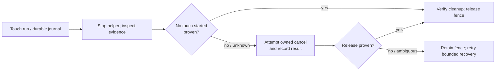

# Coordinator: touch cancellation and recovery without unnecessary reboot

**Status: verified on the Pixel 2026‑11‑14 (recording off; see Verification).** Implementation started 2026‑11‑06. First resolve the coordinator's touch cancellation problem. The reef triangle/normal fix is a separate plan and waits for discussion and explicit engine permission.

Coordinator commit `189025245ba5c6601aae4fe59ff4154fca37d680` adds a flushed pre-injection trace and automatic reconciliation when a stopped helper proves that it aborted before dispatching any touch. Additional changes require a complete, bounded trace and reject truncated or ambiguous evidence; otherwise recovery still attempts cancellation and retains the fence if release cannot be verified. The full rootless container suite passed (3,469 passed, 61 skipped), as did eight JVM helper tests. Live verification remains outstanding. In particular, the cause of the original cancellation failure and recovery of an interrupted active contact have not yet been proven on a device.

The Pixel's failed touch jobs J‑d44eab80d7a1 and J‑ca07ff217f24 aborted before verified input. The recovered timeline from the first includes `CANCEL,...,0` and the cancellation process exited 137. A verified reboot cleared the fence. The cause of the rejected cancel is not established: the recovery code reconstructs contacts from the score, including contacts that might never have gone down, and the existing helper does not preserve a detailed cancellation exception. Incomplete logs cannot prove no contact exists.



## Implementation

1. Reproduce the helper and coordinator failures using existing logs and fake transport, including failures before first down, after a successful down, after a verified up, during move, and with a truncated or conflicting timeline. Record error types safely without sensitive device data.
2. Define a durable, race-safe state transition for touch dispatch and release. A no-contact shortcut is allowed only when authoritative, complete evidence proves no input was dispatched; missing or partial logs and uncertain injection outcomes remain fenced. Prove the helper has stopped before using its evidence; protect against late input and races. No operator action should be required where the coordinator has sufficient proof to reconcile itself.
3. Correct helper cancellation and coordinator recovery so a real active stream is cancelled and verified, and already-released/no-contact states can reconcile safely. Preserve existing ownership, reservations, app state and crash recovery. Do not weaken fence validation merely to make tests pass. Fail closed on uncertainty and record why.
4. Add meaningful JVM and rootless-container coordinator regression tests covering valid multi-contact holds, explicit and implicit cancel, partial injection, late messages, exception, helper death, repeated idempotent recovery and new failures. Run the existing touch tests and the full required coordinator container suite.
5. Build the helper and coordinator candidate. Prepare a concrete reviewable deployment, preserve the coordinator database, keys, identities and reservations, and follow the coordinator AGENTS.md maintenance/deployment procedure. Verify on the Pixel through an owned session: a real down/move/up, normal cleanup, an interrupted active hold and automatic recovery **without reboot**, with device timeline, recordings, cleanup receipts and no surviving contact/helper. Do not claim live acceptance from JVM or fake-transport tests. The Lenovo is optional only after its own capability is available; Chromecasts remain out of scope until Will says otherwise.

If the Pixel's input state cannot be proven released, preserve the recovery fence and report the exact evidence and reason; never bypass ownership or use direct ADB. Only propose a reboot when truly unavoidable and explain why.

## Live verification attempt, 2026‑11‑14 (coordinator 0.1.156): not run

Step 5 was not exercised. No touch command reached the device, so nothing here supports or refutes recovery of an interrupted hold.

- Owned job J‑20c62f455e96: an interactive, recorded `record` of the `baseline` app with `touch_interactive`, on `phone-pixel-8-pro`. The APK (`6c245338…`) was already installed, so it was reused rather than reinstalled. The job queued as `device locked` for 20 minutes. Once the phone was unlocked it started at 10:18:06Z, replacing the foreground app the phone had been showing (`com.lazada.android/.pdp.module.detail.LazDetailActivity`). Recording began at 10:18:33Z.
- The verifier's wait loop matched the job ID in the effects table and never noticed that the job had started, so no touch command was sent. The job ended on its 300 s idle limit at 10:23:35Z. While it downloaded segment 001 (202,416,043 bytes; about 101 MB arrived), the transport stopped answering. The pull hung from 10:23:36Z to 10:30:38Z, a `wf-liveness` probe at 10:30:33Z got no reply, and automatic readd J‑a4b9828be733 ended `transport-unavailable`.
- Result: `uncertain / transport-unavailable`, Pixel `recovery-required` (device unreachable), connection incident INC‑17725486601265fc. Three effects stay journaled: the `foreground` restore back to the Lazada activity, and `recording-001` and `recording-002` on boot `9d2bdf59-…`. Why the phone became unreachable is not established; the evidence shows only that the adb transfer stopped making progress.
- Touch acceptance stays open. Next attempt: once the Pixel is back and `ready`, send the down/move/up command as soon as the job reaches `foreground, recording`. Then cancel a second job while a contact is held (score: down at 0.2 s, up at 14 s), and run a third ordinary touch job to show the Pixel is usable again on the same boot.

### Second attempt, 2026‑11‑14 (12:33Z–12:45Z): stopped before any device work

- J‑20c62f455e96 cleanup came first. Readd J‑92fa59039850 (10:49Z, `succeeded cleanup-only`, health `ready`, no survivors) removed both segment files, force-stopped baseline and returned the phone to the HOME launcher. The Lazada activity could not be restarted (`activity-not-exported`). The J‑20c62f455e96 status reads `recovery_resolution: resolved` with `unresolved_effects: []`.
- The wait loop was rewritten to read the job's own `state`/`phase` from `task chromecast:status JOB=…` instead of grepping the queue, and was checked against the finished J‑92fa59039850.
- A read-only capture, J‑adfc5fd31af1, was queued to test that detection live. It never started. The whole Android transport was `held by shared transport recovery` while cast1 sat in another session's recovery (automatic readd J‑3c8f67cb8540, origin J‑92e1e13969a3).
- Will then began using the Pixel, and the verifier was told to stop. J‑adfc5fd31af1 was cancelled while still queued (`cancelled`, `started: null`). No touch job was submitted and no contact was injected. No fence or held contact belongs to this verification. Pixel health afterwards: `ready`. The foreground was left as Will had it.
- **Step 5 is still unverified.** Down/move/up: NOT RUN. Interrupted active hold released without a reboot: NOT RUN. Evidence (timeline, recordings, receipts, no survivor): NOT RUN. The TODO item stays `[verify T3]`.

### Third attempt, 2026‑11‑14 (12:54Z–13:24Z): blocked by the shared Android transport

- Will cleared the Pixel for use again. Job A, J‑03d0ba7f54b2 (same session request), queued at 12:54Z and stayed `queued` for 29 minutes, according to the status-based wait loop. Every Android device showed `held by shared transport recovery`: cast1 was `recovery-required`, and its automatic readds kept failing with `device-not-found-on-network` (the latest being J‑831844b31006). The hold had lasted about 1 h 46 min. Other sessions' Pixel jobs were queued behind it as well (readd J‑ecb810a695e4, `screensaver-list` J‑e3be34504746 and J‑2c32ac409021).
- J‑03d0ba7f54b2 was cancelled while still queued (`cancelled`, `started: null`), so it could not start unattended and idle out over the phone's foreground. No touch was injected, and no fence or contact belongs to this verification. The Pixel remains `ready`.
- Step 5 remains NOT RUN. It needs cast1's transport hold cleared, or the Pixel separated from that hold, first.

### Fourth attempt, 2026‑11‑14 (13:26Z–13:29Z): transport lost again, stopped

- Cast1 was readded (J‑4692c8504959). The coordinator set the Pixel's screen-off timeout to 15 minutes for this run (J‑5f8399d6a0a0), and Will unlocked the phone.
- Job A (J‑8421feb80c52) was granted at 13:26:24Z. It reused the installed APK, started baseline at 13:26:27Z and started `screenrecord` at 13:26:49Z; `waitjob.py` saw `phase=recording` at 13:26:50Z.
- Its first command, an `input:frame` to check that baseline was in the foreground before any touch, was rejected with `Private ADB command exceeded its deadline`. The underlying `dumpsys activity activities` ran 13:26:57Z–13:27:32Z with no exit, and both `wf-liveness` probes (13:27:20Z, 13:27:27Z) went unanswered. The job ended `uncertain / transport-unavailable` and the Pixel went to `recovery-required`.
- Incident INC‑815e80774a77901b: `wireless-debugging-not-advertised`. adb `unavailable`, discovery `not-advertised`, the phone's network endpoint `unreachable`, host `healthy`. The boot ID was unchanged at `9d2bdf59-…`, the same boot as the first attempt at 10:18Z, so the phone did not restart.
- Automatic recovery J‑43aa0f8db84e and the one permitted readd J‑76731270e5a9 (13:29:08Z) both failed with `device-not-found-on-network`. The verifier then stopped.
- No touch was injected. Two effects remain journaled for the next successful readd: `foreground` (restore to `com.google.android.apps.nexuslauncher/.NexusLauncherActivity`) and `recording-001` (`/data/local/tmp/wf-J-8421feb80c52-segment-001.mp4`).
- Pattern, not a proven cause: both of today's drops on the Pixel happened while the job was running a 12 Mbit/s `screenrecord`. The first drop came about 5 minutes in, during the 202 MB pull; this one came within 8 s of the recorder starting. In both, the phone stopped being reachable on the network while the host stayed healthy. The evidence does not show whether the phone's Wi‑Fi, wireless debugging or sleep state changed.
- Step 5 remains NOT RUN. The TODO item stays `[verify T3]`.

## Verification (step 5), 2026‑11‑14, coordinator 0.1.156: PASS (no recording)

Fifth attempt, after the coordinator's readds J‑1722f61af34d (it ran J‑8421feb80c52's cleanup: HOME restored, segment removed) and J‑5f1fb8e65f3b (endpoint 192.168.4.35:39001). All three jobs used the same owned session request with **`record: false`**. This is a deliberate deviation from step 5's "recordings", requested by the coordinator after two transport drops that both happened during a 12 Mbit/s recording. Evidence is the device touch trace, the initial, named and final PNGs, `touch-evidence.json` and the cleanup receipts. There is no video. Score frame: 2244×1008, rotation 1, `content_rect` `[113,0,2244,1008]`, which the guard accepted for the baseline APK, so the reef-APK fallback was not needed. Before every edge the helper confirmed that the target package `org.worldfoundry.wf_game.baseline` owned the active window's root.

**The transport stayed up through all three jobs without recording** (13:48Z–13:56Z), all on boot `9d2bdf59-6cef-4a22-84ad-a5f6d40b32c4` (device uptime rises continuously: anchors 429344363 → 429526819 → 429595440). This is evidence, not proof, that the recorder triggers the drops.

1. ~~**Job A, J‑c969e78c3f7c: real down/move/up, normal cleanup.**~~ Command 2 `touch-script` applied, `touch_edges: 4`. Device trace:

    ```text
    TRACE,2
    ANCHOR,429344363,1794664226257
    INJECT,1
    1,200,429344600,0,0,1200,500,1
    INJECT,2
    2,600,429345001,0,1,1300,520,1
    INJECT,3
    3,1000,429345386,0,1,1400,540,1
    INJECT,4
    4,1400,429345809,0,2,1400,540,1
    COMPLETE,429345820
    ```

    Receipt:

    ```json
    {
     "status": "succeeded",
     "reason": "completed",
     "health": "ready",
     "survivors": [],
     "foreground": {
      "component": "com.google.android.apps.nexuslauncher/.NexusLauncherActivity"
     },
     "remote:/data/local/tmp/wf-J-c969e78c3f7c-step-0002-touch-log.csv": {
      "removed": "/data/local/tmp/wf-J-c969e78c3f7c-step-0002-touch-log.csv"
     },
     "remote:/data/local/tmp/wf-J-c969e78c3f7c-step-0002-touch.csv": {
      "removed": "/data/local/tmp/wf-J-c969e78c3f7c-step-0002-touch.csv"
     },
     "remote:/data/local/tmp/wf-J-c969e78c3f7c-step-0002-touch.jar": {
      "removed": "/data/local/tmp/wf-J-c969e78c3f7c-step-0002-touch.jar"
     }
    }
    ```

    **PASS.** One deviation: `input:finish` was refused with `Owned interactive job is not accepting input` (its phase stayed `touch-input` after the command applied), so the job ended on the 120 s idle limit and then ran its ordinary cleanup.

2. ~~**Job B, J‑8ba432e6360a: interrupted active hold released automatically, without a reboot.**~~ Score: down at 0.2 s, move at 1.0 s, up at 14.0 s. `task chromecast:cancel` was sent 8 s after the job entered `touch-input`. Recovered device trace (down and move accepted, no up, no `COMPLETE`; the anchor is 13:53:28.713Z, so the up was due at 13:53:42.7Z):

    ```text
    TRACE,2
    ANCHOR,429526819,1794664408713
    INJECT,1
    1,200,429527058,0,0,1200,500,1
    INJECT,2
    2,1000,429527860,0,1,1250,510,1
    ```

    Cleanup commands: `kill -2` on the helper's processes at 13:53:36.6Z, a `ps` check, the trace pulled, then `WfTouchScore --cancel` at 13:53:37.5Z, with its log read back at 13:53:38.1Z. The coordinator accepts `touch_cancelled` only when that log contains `CANCEL,…,1`. Then the owned files were removed, baseline was force-stopped and HOME was started. Job result: `cancelled: owner-cancelled`, health `ready`, no fence. Receipt:

    ```json
    {
     "status": "cancelled",
     "reason": "owner-cancelled",
     "health": "ready",
     "survivors": [],
     "foreground": {
      "component": "com.google.android.apps.nexuslauncher/.NexusLauncherActivity"
     },
     "remote:/data/local/tmp/wf-J-8ba432e6360a-step-0001-touch-log.csv": {
      "removed": "/data/local/tmp/wf-J-8ba432e6360a-step-0001-touch-log.csv"
     },
     "remote:/data/local/tmp/wf-J-8ba432e6360a-step-0001-touch.csv": {
      "removed": "/data/local/tmp/wf-J-8ba432e6360a-step-0001-touch.csv"
     },
     "remote:/data/local/tmp/wf-J-8ba432e6360a-step-0001-touch.jar": {
      "removed": "/data/local/tmp/wf-J-8ba432e6360a-step-0001-touch.jar"
     },
     "touch-score-step-0001": {
      "helper_stopped": true,
      "touch_cancelled": true
     }
    }
    ```

    **PASS.** As expected, the cancelled job has no recording. The client's own touch call returned `touch-script rejected: {'error': 'Owner cancelled execution'}`.

3. ~~**Job C, J‑14f864eb470c: ordinary touch on the same boot after recovery.**~~ `touch_edges: 4`. Device trace:

    ```text
    TRACE,2
    ANCHOR,429595440,1794664477334
    INJECT,1
    1,200,429595674,0,0,1200,500,1
    INJECT,2
    2,600,429596094,0,1,1300,520,1
    INJECT,3
    3,1000,429596474,0,1,1400,540,1
    INJECT,4
    4,1400,429596879,0,2,1400,540,1
    COMPLETE,429596886
    ```

    Receipt:

    ```json
    {
     "status": "succeeded",
     "reason": "completed",
     "health": "ready",
     "survivors": [],
     "foreground": {
      "component": "com.google.android.apps.nexuslauncher/.NexusLauncherActivity"
     },
     "remote:/data/local/tmp/wf-J-14f864eb470c-step-0001-touch-log.csv": {
      "removed": "/data/local/tmp/wf-J-14f864eb470c-step-0001-touch-log.csv"
     },
     "remote:/data/local/tmp/wf-J-14f864eb470c-step-0001-touch.csv": {
      "removed": "/data/local/tmp/wf-J-14f864eb470c-step-0001-touch.csv"
     },
     "remote:/data/local/tmp/wf-J-14f864eb470c-step-0001-touch.jar": {
      "removed": "/data/local/tmp/wf-J-14f864eb470c-step-0001-touch.jar"
     }
    }
    ```

    **PASS.** The same `input:finish` refusal as job A applied; the job ended on the idle limit with ordinary cleanup.

4. ~~**No surviving contact or helper; foreground restored.**~~ All three receipts show `survivors: []` and the owned touch files removed. Job B's journal entry `touch-score-step-0001` was restored with `helper_stopped: true, touch_cancelled: true`. Each job restored the HOME launcher (`com.google.android.apps.nexuslauncher/.NexusLauncherActivity`), which was in front when the run started. Afterwards the Pixel was `ready` with no pending cleanup. **PASS.**

Follow-ups, not part of this acceptance:
- After a touch command, `input:finish` is refused while the phase still reads `touch-input`, so interactive touch jobs end only on the idle limit.
- The two drops with recording on (J‑20c62f455e96, J‑8421feb80c52) still lack a concrete cause.

Private evidence (frames, logs) stays outside Git.

