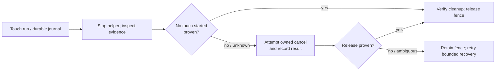

# Coordinator: touch cancellation and recovery without unnecessary reboot

**Status: implementation in progress, 2026‑11‑06.** First resolve the coordinator's touch cancellation problem. The reef triangle/normal fix is a separate plan and waits for discussion and explicit engine permission.

Coordinator commit `189025245ba5c6601aae4fe59ff4154fca37d680` adds a flushed pre-injection trace and automatic reconciliation when a stopped helper proves that it aborted before dispatching any touch. Additional changes require a complete, bounded trace and reject truncated or ambiguous evidence; otherwise recovery still attempts cancellation and retains the fence if release cannot be verified. The full rootless container suite passed (3,469 passed, 61 skipped), as did eight JVM helper tests. Live verification remains outstanding. In particular, the cause of the original cancellation failure and recovery of an interrupted active contact have not yet been proven on a device.

The Pixel's failed touch jobs J‑d44eab80d7a1 and J‑ca07ff217f24 aborted before verified input. The recovered timeline from the first includes `CANCEL,...,0` and the cancellation process exited 137. A verified reboot cleared the fence. The cause of the rejected cancel is not established: the recovery code reconstructs contacts from the score, including contacts that might never have gone down, and the existing helper does not preserve a detailed cancellation exception. Incomplete logs cannot prove no contact exists.

## Implementation

1. Reproduce the helper and coordinator failures using existing logs and fake transport, including failures before first down, after a successful down, after a verified up, during move, and with a truncated or conflicting timeline. Record error types safely without sensitive device data.
2. Define a durable, race-safe state transition for touch dispatch and release. A no-contact shortcut is allowed only when authoritative, complete evidence proves no input was dispatched; missing or partial logs and uncertain injection outcomes remain fenced. Prove the helper has stopped before using its evidence; protect against late input and races. No operator action should be required where the coordinator has sufficient proof to reconcile itself.
3. Correct helper cancellation and coordinator recovery so a real active stream is cancelled and verified, and already-released/no-contact states can reconcile safely. Preserve existing ownership, reservations, app state and crash recovery. Do not weaken fence validation merely to make tests pass. Fail closed on uncertainty and record why.
4. Add meaningful JVM and rootless-container coordinator regression tests covering valid multi-contact holds, explicit and implicit cancel, partial injection, late messages, exception, helper death, repeated idempotent recovery and new failures. Run the existing touch tests and the full required coordinator container suite.
5. Build the helper and coordinator candidate. Prepare a concrete reviewable deployment, preserve the coordinator database, keys, identities and reservations, and follow the coordinator AGENTS.md maintenance/deployment procedure. Verify on the Pixel through an owned session: a real down/move/up, normal cleanup, an interrupted active hold and automatic recovery **without reboot**, with device timeline, recordings, cleanup receipts and no surviving contact/helper. Do not claim live acceptance from JVM or fake-transport tests. The Lenovo is optional only after its own capability is available; Chromecasts remain out of scope until Will says otherwise.

If the Pixel's input state cannot be proven released, preserve the recovery fence and report the exact evidence and reason; never bypass ownership or use direct ADB. Only propose a reboot when truly unavoidable and explain why.

## Live verification attempt, 2026‑11‑14 (coordinator 0.1.156): not run

Step 5 was not exercised. No touch command reached the device, so nothing here supports or refutes recovery of an interrupted hold.

- Owned job J‑20c62f455e96: an interactive, recorded `record` of the `baseline` app with `touch_interactive`, on `phone-pixel-8-pro`. The APK (`6c245338…`) was already installed, so it was reused rather than reinstalled. The job queued as `device locked` for 20 minutes. Once the phone was unlocked it started at 10:18:06Z, replacing the foreground app the phone had been showing (`com.lazada.android/.pdp.module.detail.LazDetailActivity`). Recording began at 10:18:33Z.
- The verifier's wait loop matched the job ID in the effects table and never noticed that the job had started, so no touch command was sent. The job ended on its 300 s idle limit at 10:23:35Z. While it downloaded segment 001 (202,416,043 bytes; about 101 MB arrived), the transport stopped answering. The pull hung from 10:23:36Z to 10:30:38Z, a `wf-liveness` probe at 10:30:33Z got no reply, and automatic readd J‑a4b9828be733 ended `transport-unavailable`.
- Result: `uncertain / transport-unavailable`, Pixel `recovery-required` (device unreachable), connection incident INC‑17725486601265fc. Three effects stay journaled: the `foreground` restore back to the Lazada activity, and `recording-001` and `recording-002` on boot `9d2bdf59-…`. Why the phone became unreachable is not established; the evidence shows only that the adb transfer stopped making progress.
- Touch acceptance stays open. Next attempt: once the Pixel is back and `ready`, send the down/move/up command as soon as the job reaches `foreground, recording`. Then cancel a second job while a contact is held (score: down at 0.2 s, up at 14 s), and run a third ordinary touch job to show the Pixel is usable again on the same boot.

### Second attempt, 2026‑11‑14 (12:33Z–12:45Z): stopped before any device work

- J‑20c62f455e96 cleanup came first. Readd J‑92fa59039850 (10:49Z, `succeeded cleanup-only`, health `ready`, no survivors) removed both segment files, force-stopped baseline and returned the phone to the HOME launcher. The Lazada activity could not be restarted (`activity-not-exported`). The J‑20c62f455e96 status reads `recovery_resolution: resolved` with `unresolved_effects: []`.
- The wait loop was rewritten to read the job's own `state`/`phase` from `task chromecast:status JOB=…` instead of grepping the queue, and was checked against the finished J‑92fa59039850.
- A read-only capture, J‑adfc5fd31af1, was queued to test that detection live. It never started. The whole Android transport was `held by shared transport recovery` while cast1 sat in another session's recovery (automatic readd J‑3c8f67cb8540, origin J‑92e1e13969a3).
- Will then began using the Pixel, and the verifier was told to stop. J‑adfc5fd31af1 was cancelled while still queued (`cancelled`, `started: null`). No touch job was submitted and no contact was injected. No fence or held contact belongs to this verification. Pixel health afterwards: `ready`. The foreground was left as Will had it.
- **Step 5 is still unverified.** Down/move/up: NOT RUN. Interrupted active hold released without a reboot: NOT RUN. Evidence (timeline, recordings, receipts, no survivor): NOT RUN. The TODO item stays `[verify T3]`.
