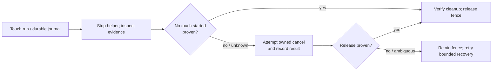

# Coordinator: touch cancellation and recovery without unnecessary reboot

**Status: implementation in progress, 2026‑11‑06.** First resolve the coordinator's touch cancellation problem. The reef triangle/normal fix is a separate plan and waits for discussion and explicit engine permission.

Coordinator commit `189025245ba5c6601aae4fe59ff4154fca37d680` adds a flushed pre-injection trace and automatic reconciliation when a stopped helper proves that it aborted before dispatching any touch. Additional changes require a complete, bounded trace and reject truncated or ambiguous evidence; otherwise recovery still attempts cancellation and retains the fence if release cannot be verified. The full rootless container suite passed (3,469 passed, 61 skipped), as did eight JVM helper tests. Live verification remains outstanding. In particular, the cause of the original cancellation failure and recovery of an interrupted active contact have not yet been proven on a device.

The Pixel's failed touch jobs J‑d44eab80d7a1 and J‑ca07ff217f24 aborted before verified input. The recovered timeline from the first includes `CANCEL,...,0` and the cancellation process exited 137. A verified reboot cleared the fence. The cause of the rejected cancel is not established: the recovery code reconstructs contacts from the score, including contacts that might never have gone down, and the existing helper does not preserve a detailed cancellation exception. Incomplete logs cannot prove no contact exists.

## Implementation

1. Reproduce the helper and coordinator failures using existing logs and fake transport, including failures before first down, after a successful down, after a verified up, during move, and with a truncated or conflicting timeline. Record error types safely without sensitive device data.
2. Define a durable, race-safe state transition for touch dispatch and release. A no-contact shortcut is allowed only when authoritative, complete evidence proves no input was dispatched; missing or partial logs and uncertain injection outcomes remain fenced. Prove the helper has stopped before using its evidence; protect against late input and races. No operator action should be required where the coordinator has sufficient proof to reconcile itself.
3. Correct helper cancellation and coordinator recovery so a real active stream is cancelled and verified, and already-released/no-contact states can reconcile safely. Preserve existing ownership, reservations, app state and crash recovery. Do not weaken fence validation merely to make tests pass. Fail closed on uncertainty and record why.
4. Add meaningful JVM and rootless-container coordinator regression tests covering valid multi-contact holds, explicit and implicit cancel, partial injection, late messages, exception, helper death, repeated idempotent recovery and new failures. Run the existing touch tests and the full required coordinator container suite.
5. Build the helper and coordinator candidate. Prepare a concrete reviewable deployment, preserve the coordinator database, keys, identities and reservations, and follow the coordinator AGENTS.md maintenance/deployment procedure. Verify on the Pixel through an owned session: a real down/move/up, normal cleanup, an interrupted active hold and automatic recovery **without reboot**, with device timeline, recordings, cleanup receipts and no surviving contact/helper. Do not claim live acceptance from JVM or fake-transport tests. The Lenovo is optional only after its own capability is available; Chromecasts remain out of scope until Will says otherwise.

If the Pixel's input state cannot be proven released, preserve the recovery fence and report the exact evidence and reason; never bypass ownership or use direct ADB. Only propose a reboot when truly unavoidable and explain why.
