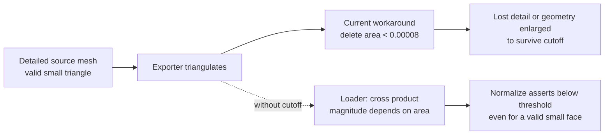
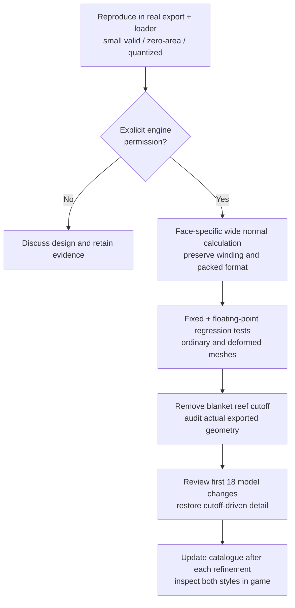

# Reef small triangles and touch recovery: investigation and proposal

**Status: investigation and candidate authorized, 2026‑11‑06.** Will approved reproducing the failure and modifying the engine as needed for an identical-geometry candidate comparison. The first 18 catalogue pages changed geometry to survive export; those changes were workarounds and their existence does not establish that their geometry was the right result.

## Decision requested

Implement and compare a **face-specific engine correction** for small, valid triangles, as described below. Will explicitly approved the engine changes for the candidate comparison. The exact fixed-point implementation and degenerate-face policy still need to be established and tested before accepting the correction.

## What went wrong

The reef is authored at ×10 world scale. That does not make the normal of a small triangle intrinsically invalid. The current reef generator triangulates meshes and discards faces whose Blender area is below `0.00008` in engine-unit squared. Earlier revisions thickened or reshaped details so they would survive that filter. The filter also removes faces silently from the finished scene apart from build-log counts.

The loader in [`rendobj3.cc`](../../wfsource/source/gfx/rendobj3.cc) calculates a normal per face. [`CalculateNormal`](../../wfsource/source/gfx/face.hpi) takes an unscaled cross product and calls [`Vector3::Normalize`](../../wfsource/source/math/vector3.hpi), which asserts that its input length exceeds `Scalar(0,4)` (4/65536). A cross product's length is **twice the triangle area**, so this threshold rejects sufficiently small valid faces based on size, even when their direction is well defined. In fixed-point arithmetic the cross product may also lose precision before normalization. Actual coordinate quantization and exactly degenerate triangles need separate treatment: not every sub-threshold triangle is automatically recoverable.

The cutoff and the model changes should have prompted investigation of the normal calculation before they became the basis for acceptance. The existing catalogue is useful evidence of what changed, but its first pages should not be interpreted as approval of those workarounds.

## Proposed correction

1. **Reproduce before changing the engine.** Export a known small non-degenerate triangle and a truly degenerate triangle using the same coordinate and normal formats as the reef. Run the actual loader in the supported floating-point and fixed-point configurations. Record input positions, quantized positions, expected cross product, current result and the assertion. Compare with ordinary-sized geometry and the DFRM normal path. Do not infer that every failure in prior logs has this cause.
2. **Correct face normals locally.** With explicit permission, calculate face normals using sufficiently wide intermediate precision and scale before normalization so magnitude does not determine validity. Preserve the existing vertex winding and packed normal format. Handle actual degeneracy with a deterministic, documented safe result. Do not loosen or globally alter `Vector3::Normalize`; its other callers may depend on its contract. Establish the fixed-point overflow and rounding bounds rather than assuming float behavior transfers to every backend.
3. **Remove the workaround only after the loader is proven.** Remove the reef generator's blanket area filter. Re-export the current models, count faces surviving conversion and identify truly degenerate or quantization-collapsed faces separately. A diagnostic must identify the object and face and must not silently discard valid detail. Check signed vertex-index and memory limits without lowering the user's approved polygon budget.
4. **Restore the models deliberately.** Audit the first 18 catalogue entries against their original source and classify each change as cutoff-driven, intentional appearance refinement, or mixed. Restore cutoff-driven detail when technically recoverable; retain independent improvements only when they are actually desirable. Compare before/after renderings after each refinement, update the PDF, and inspect actual textured, lit output in both styles. Do not claim the simple swatches prove in-game quality.
5. **Benchmark before accepting the correction.** Measure the existing loader and the proposed loader with the **same exported meshes**. Isolate any normal calculation on the frame path as well as load time; correctness alone does not establish that the fix is affordable. Record memory too, at lower priority than runtime performance. Profiling the cost of additional geometry enabled by the fix is outside this benchmark.

## Performance and memory benchmark

The real loader reproduction, fixed-point regression, and paired host measurements are recorded in [the measurement report](../diagnostics/reef-triangle-normal-2026-11-06/README.md). The candidate fixes the small valid face, preserves the ordinary control and returns zero for the degenerate control. Paired same-mesh host load timings show no median regression in either sampled style; the tail results are noisy. The candidate has not yet passed the planned Android gameplay and memory comparison; the Pixel attempts have not produced profile results.

Freeze the baseline engine, candidate engine and level inputs with hashes and record build type, compiler, platform, device, renderer and runtime settings. Use the same engine configuration, scene, camera, resolution and workload in each paired comparison. Do not compare a release build to a debug build or a scene with filtered faces to an unfiltered scene and attribute the whole difference to the algorithm.

| Comparison | Engine | Geometry | What it isolates |
|---|---|---|---|
| A → B | current → corrected | identical current filtered mesh | Cost of the correction itself |
| Control | current → corrected | identical ordinary-size representative meshes | Regressions outside the reef's small faces |

For A/B, measure per-level load time and, where practical, the normal-calculation portion separately; include both a small-face-heavy synthetic mesh that both versions can load and identical realistic and anime reef levels. Record cold and warm loads, warm-up policy, sample count, individual results, median and p95. Use multiple interleaved or alternated runs to reduce ordering and thermal bias. Also measure steady-state frame time and FPS during a fixed wide idle and representative animation/reaction workload, with median, p95, worst frame and missed-frame rate. Verify whether the modified calculation is load-only or is also called during animation; benchmark any affected deformation/update path explicitly. Do not infer frame cost from load timing. Keep geometry and all other inputs identical within every comparison; separately validate smaller triangles for correctness without presenting their added-geometry cost as an engine-fix result.

For memory, compare peak and steady process memory with identical assets using the same metric on the same device, plus temporary allocation sizes where tooling exposes them. Report both absolute values and deltas; distinguish permanent per-face growth caused by the implementation from transient load-time scratch. Include realistic and anime assets and note measurement noise or unavailable metrics. Do not profile the memory cost of additional geometry. Avoid adding persistent per-face storage merely for the benchmark.

Run the reproducible host benchmark for both fixed- and floating-point implementations where supported. Run the paired game workload on the Pixel through the coordinator, with the original APK and settings restored. Use the Lenovo only if available. Chromecast gates remain deferred until Will changes the current device restriction. Archive commands, environment, input hashes and raw samples alongside the summary, and state whether each run actually completed.

**Proposed performance gate for discussion:** with identical meshes, the corrected loader should not increase median load time by more than 5% or cause a reproducible regression in frame-time p95 beyond measurement noise; investigate and present a tradeoff before accepting any miss. This is a proposed criterion, not an existing measurement or a mandate to remove detail. Report memory deltas and investigate material growth; memory is secondary and no arbitrary hard memory cap is imposed here. The existing 120-second device performance gate remains separate and unverified.

## Acceptance and evidence

- A small **non-degenerate** exported triangle that failed before loads without an assertion and produces a finite, correctly oriented unit normal within the chosen packed-format tolerance. Cover different scales and orientations.
- Truly degenerate and quantization-collapsed examples follow the documented fallback without NaNs, crashes or invented surface detail. The tests distinguish these from merely small valid faces.
- Existing normal, rendering and deformation tests pass on relevant fixed- and floating-point configurations; ordinary-size winding, shading and packed normals remain compatible. Include cases crossing DFRM curve boundaries and both outline and non-outline meshes where applicable.
- Both reef levels build with the cutoff removed, report face counts and any true degeneracy, respect index limits and retain the approved budget. Audit feather star, crab, shrimp and the other affected models from actual exported files.
- Update the before/after catalogue for every restoration or visual revision. Capture the textured, lit in-game scene in realistic and anime styles on the Pixel, and perform the remaining reaction checks through an owned coordinator session. The Lenovo can be used if available. Chromecasts remain unplugged and outside the current authorized device set until Will changes that instruction.
- The identical-geometry A/B performance comparison and memory measurements above are recorded with raw evidence. Resolve or explicitly discuss a measured performance regression before calling the fix accepted; report memory changes separately. The cost of geometry enabled by the fix is not part of this profiling. No detail is reduced merely to pass an unmeasured budget.
