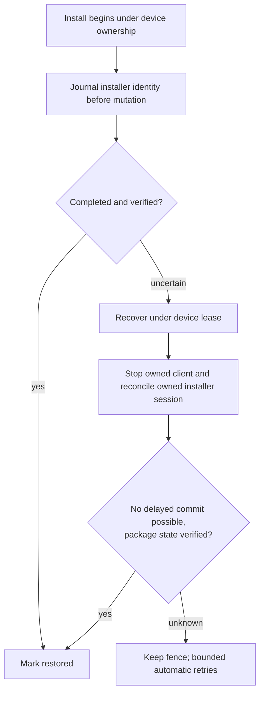

# Coordinator: reconcile interrupted installers without a routine reboot

**Status: proposed, 2026‑11‑07.** The Pixel load-profile restoration job J‑b4a59ff27812 reported an error, but its cleanup journal verified the requested original aquarium APK hash. An unnecessary follow-up install J‑31a4a398b1c0 then timed out in `adb install -r` after recording that the same APK hash was already installed. Automatic readd J‑61e6bdc8e060 could not clear the install journal and left a fence. At Will's request, reboot-and-readd J‑7f0fdd1debd8 verified the original hash and cleared that fence. The runner currently requires a boot change for every interrupted install because a delayed installer commit could still mutate the package. A matching hash by itself is not proof that no installer remains active.

The objective is automatic, bounded recovery **without an operator or reboot when the coordinator can prove the installer can no longer commit**. Preserve fencing when it cannot; do not clear other jobs' obligations or assume that a same-hash delayed commit is harmless to future installs.

1. Reproduce the no-op explicit reinstall timeout with fake transport and actual job evidence. Avoid an install when the operation's intended semantics permit a verified exact-hash no-op; distinguish this from an explicitly requested reinstall whose semantics require installation. This prevention does not resolve existing interrupted installs.
2. For new installs, journal a durable identity for the exact Android package-installer session before it can commit, along with package, user, requested frozen APK hash, boot identity and origin job. Define and test how to recover a crash at every point, including creation before the session identity can be persisted. Do not assume killing the host `adb` client cancels the device-side session.
3. Under the held device lease, inspect authoritative package-installer state. Reconcile or abandon only a session proven to belong to the origin; wait for and verify its terminal state and absence of any possible later commit. Re-read the installed package hash after reconciliation and revalidate the journal, boot and lease before releasing the origin fence. Unrelated sessions and fences remain untouched. Make repeated recovery idempotent and bounded.
4. Define a safe legacy path for journals without a session ID. An exact hash can contribute evidence but cannot on its own exclude an unknown delayed install. Automatically clear only if authoritative, race-safe evidence proves no relevant commit remains possible; if device APIs cannot establish that, retain the fence, retry boundedly and report the specific missing proof. Do not invent a session identity or use unrelated session abandonment.
5. Add tests for crash and timeout before/after creation, staging, commit and verification; late commits; unrelated installers and fences; identical-hash reinstalls; reboot during recovery; racing newer requests; repeated recovery; inaccessible or malformed session evidence. Run the coordinator rootless container suite and relevant JVM tests. Preserve existing data, settings and ownership.
6. Prepare a reviewed deployment through the documented maintenance process. In an owned device session, verify a normal install and an interrupted session recover without reboot, prove no delayed commit can overwrite a subsequent install, and record evidence. Only claim live recovery once verified.
