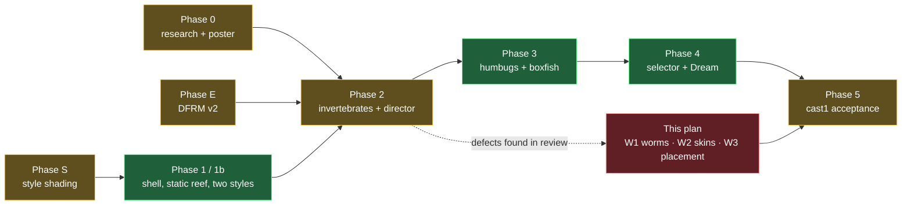
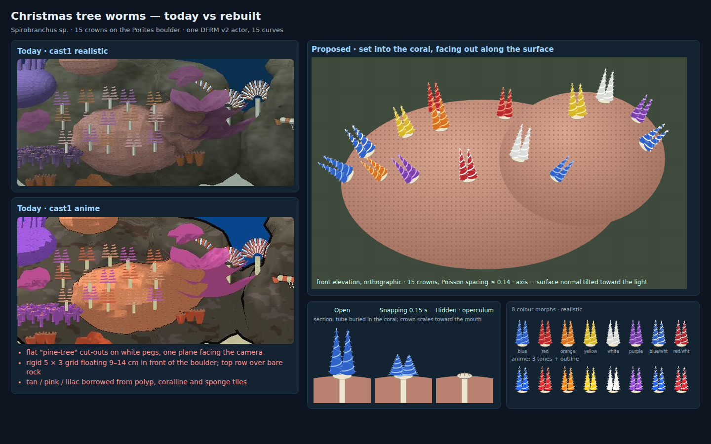
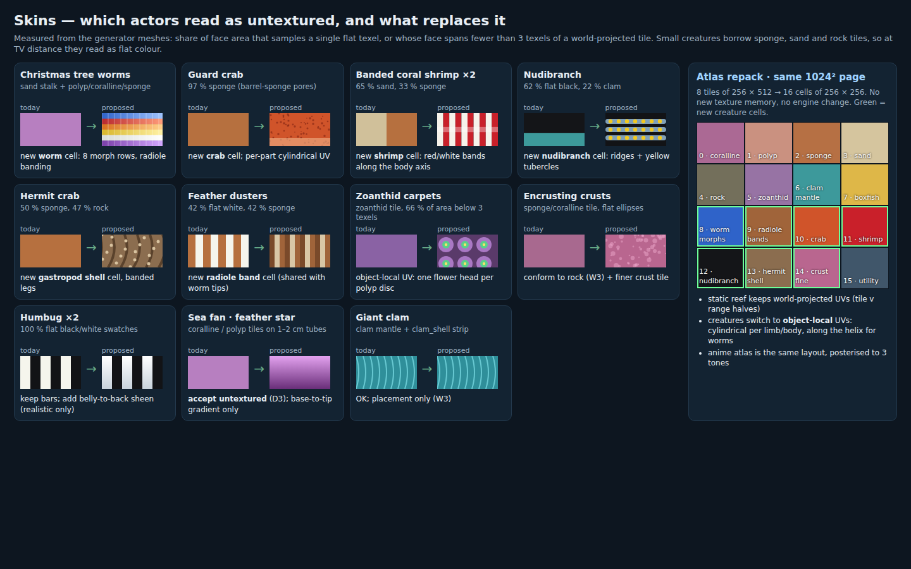
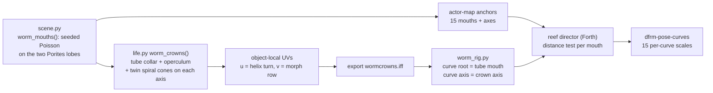
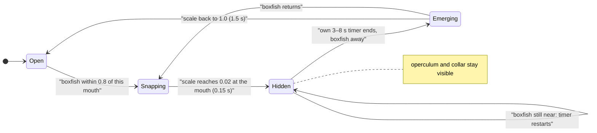
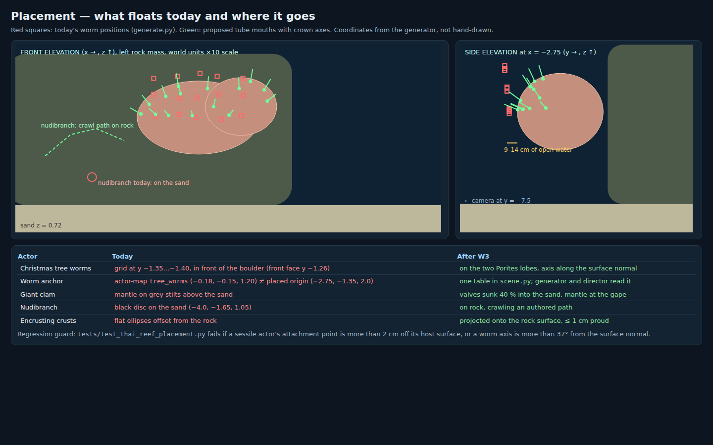
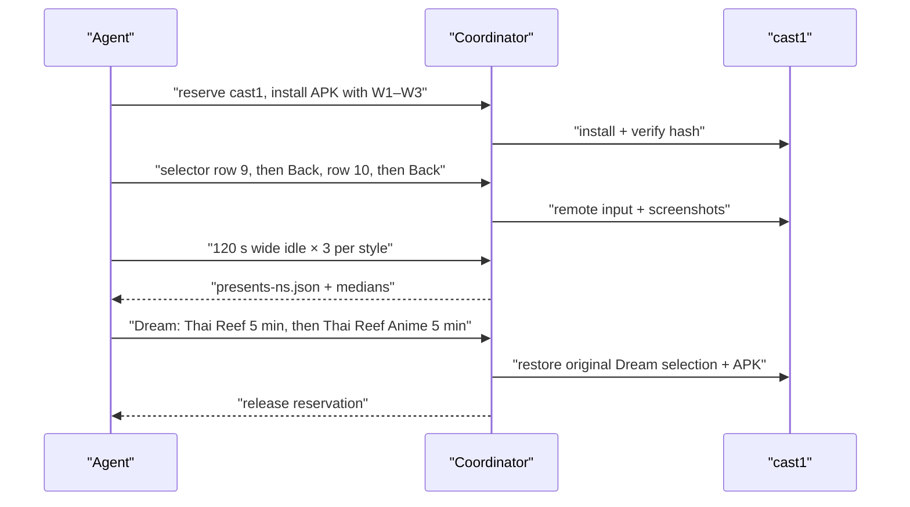
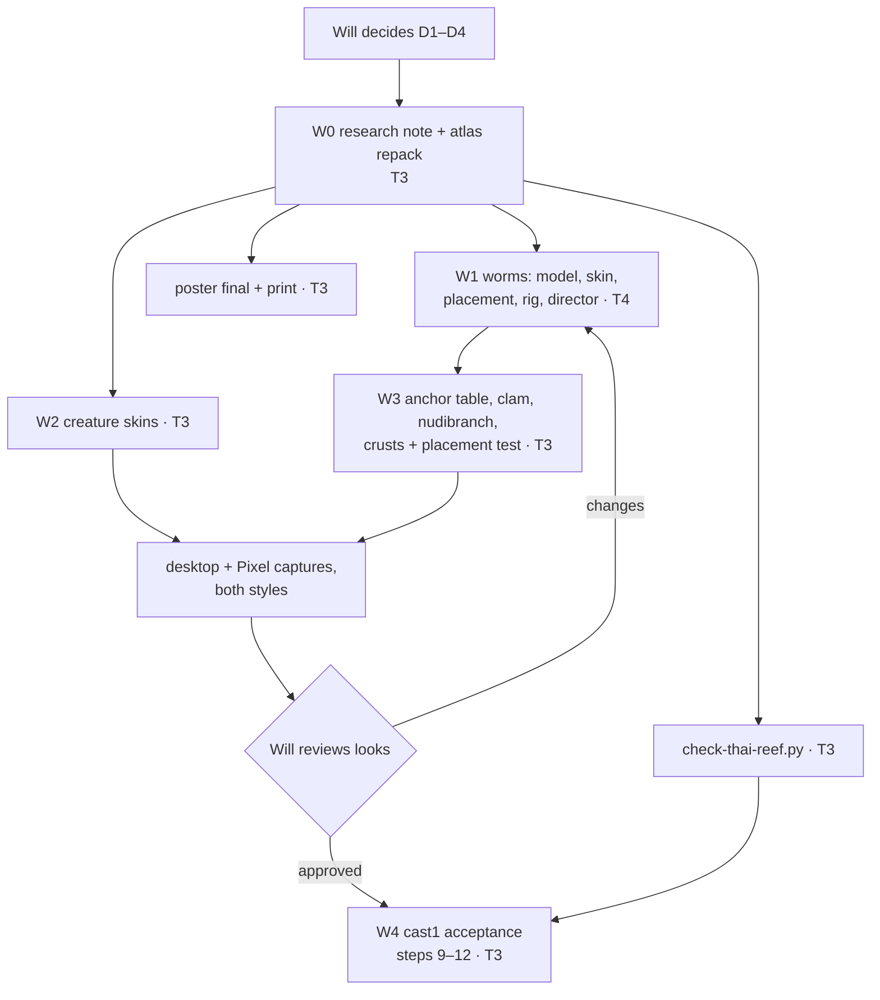

# Finishing the Gulf of Thailand reef tanks: worms, skins, placement and acceptance

8 November 2026 · **D1–D4 accepted** (Will, 2026‑11‑08: "D1-D4: all yes"). **W1 (the worms) is done and approved** (Will, 2026‑11‑08: "approved", after the [worm review](../diagnostics/reef-worms-2026-11-08/README.md)); **W2 (creature skins) is done and approved** (Will, 2026‑11‑08; the nudibranch after two rebuilds: "approved, go ahead with W3"; [skins review](../diagnostics/reef-skins-2026-11-08/README.md)). **W3 (placement) is in progress.** W3 and W4 have not started. The device checks of W1 and W2 in the real engine are part of W4. This plan follows on from the [original reef plan](2026-11-02-gulf-of-thailand-reef-tank.md) (2026‑11‑02, decisions D1–D10 accepted). It does not change any decision there. It lists what that plan still owes, and adds three work packages for the defects Will reported today. Engine permission stays as granted there (E1–E7, S1–S3 and the prelit Gouraud change); **nothing here needs a new engine change**.

## Context

Will, 2026‑11‑08:

> i need you to finish the reef tanks. compare original plan with what's still pending. only thing i can really tell you is that there are actors that don't have any textures (which might actually be ok for the things that look like fans, but there are others as well). also, the christmas tree worms need serious help, both in terms of model/texture/color, but also placement/orientation in the tank...

The evidence below comes from the committed cast1 captures of 2026‑11‑08 ([`reef-cast1-performance-2026-11-08`](../diagnostics/reef-cast1-performance-2026-11-08/)), from the generator source under [`wflevels/aquarium_thai_reef/`](../../wflevels/aquarium_thai_reef/), and from a texel-coverage measurement over the generator's meshes (method in [W2](#w2--skins-for-the-actors-that-read-as-untextured)).

## Where the original plan stands

The original plan's **verification steps are the spec**. This table records each one's state as of today. "Built" means the code or asset exists. It does not mean a PASS was recorded under the step.

| # | Original verification step | State | Evidence / gap |
|---|---|---|---|
| 1 | Research complete; every species has a Gulf record or was swapped | **Open** | [`thai-reef-research.md`](../reference/thai-reef-research.md) still says "research in progress, not a final species list". No Gulf record yet for the humbug (D1). The boxfish has only a dive-operator report (D2). |
| 2 | Poster exports to one A3 page | **Partial** | Only `review-draft-a3.pdf` exists. `gulf-of-thailand-reef-a3.pdf` has not been made. |
| 3 | `DFRM` v2 tests; eight tanks unchanged | **Built, not recorded** | The reef uses `dfrm-pose-curves` with 15-curve and 10-curve actors. The TODO item is still `[wip]` and no PASS is recorded. |
| 4 | Both levels build; anchor tables identical | **Built, not recorded** | Both `actor-map.json` files exist. **The anchor table no longer matches the placements** (see [W3](#w3--placement-nothing-floats-everything-attaches)). |
| 5 | Budgets and content rule | **Met on the numbers** | Realistic: 63,490 static triangles in 11 groups. Anime: 49,602 static plus 21,562 hull of 24,000. 15 animated actors (limit 16). The last recorded run had 34 reef tests passing (2026‑11‑07). |
| 6 | Desktop reaction test, `check-thai-reef.py --video` | **Open** | The script does not exist. Device footage covers the clam, dusters, crab timer and shrimp cleaning. The worms have no recorded reaction check. |
| 7 | Selector lists ten tanks; indices 0–7 unchanged | **Built, not recorded** | Rows 9 and 10 are in `aquarium-menu.manifest`. |
| 8 | Screensaver variants and Dream list | **Built, not recorded** | Both tanks are in `TankChoice.java` and `build-aquarium-screensaver-levels.py`. |
| 9 | cast1: rows 9/10 start, Back returns, rows 1–8 still work | **Open** | Checked on the Lenovo and Pixel only. |
| 10 | cast1: each style meets D6 (≥ 20 FPS) over 120 s wide idle | **PASS today; must be re-run** | Three-run medians recorded in `c1fd1d10`: realistic 24.38 FPS, anime 22.21 FPS. W1 and W2 change animated geometry, so this step is measured again after them. |
| 11 | cast1: E7.1 seahorse no-regression and E7.2 merge bench | **Open** | No record found. |
| 12 | cast1: Dream with each reef for 5 min; selection restored | **Open** | — |
| 13 | Poster PDF copied to `~/Documents/TO PRINT/` | **Open** | — |
| 14 | Pixel-identical sweep with S fields off; GL/Metal within 1/255; S2 ≤ 2 ms | **Partial** | `tests/test_style_shading_invariant.py` exists, but it has no Metal case. Caustics ship off (`CausticStrength 0`) until their gate is measured. |
| 15 | Will approves both looks | **Open** | Today's feedback is the first review. This plan answers it. |



*Green = built; amber = built or partly verified, with steps still open; red = new work. Phase 2 is amber because its models fail Will's review (W1–W3) and its desktop reaction test does not exist.*

## What is wrong today

[](2026-11-08-reef-tanks-finish/worms.html)

### The Christmas tree worms

Five separate defects, each traced to source:

1. **Shape.** Each worm is a white stalk with two flat stacks of five trapezoids, plus triangle "radioles" on them, all in one plane facing −Y ([`life.py:158-186`](../../wflevels/aquarium_thai_reef/reef/life.py)). At TV distance they read as paper pine trees on pegs. A real *Spirobranchus* shows **no stalk**: its calcareous tube is buried in the coral, and two **spiral cones** of radioles stand directly on the coral surface.
2. **Placement.** The 15 worms sit on a rigid 5 × 3 grid ([`worm_centers`, `life.py:146`](../../wflevels/aquarium_thai_reef/reef/life.py)) about `worm_crown_origin = (-2.75, -1.35, 2.0)` ([`generate.py:288`](../../wflevels/aquarium_thai_reef/generate.py)). The boulder's front face is at y = −1.26 ([`corals.py:22`](../../wflevels/aquarium_thai_reef/reef/corals.py)), so the grid floats **9–14 cm in front of the coral**. Its top row (z ≈ 2.24) is above the boulder's top (z = 2.18), in front of bare rock.
3. **Orientation.** Every crown points straight up (+Z), whatever surface is behind it.
4. **Colour and texture.** The crowns cycle through the `polyp`, `coralline` and `sponge` tiles (tan, pink and orange) and the stalk uses `sand`. Real worms are bright and polychromatic: blue, red, orange, yellow, white, purple and two-tone mixes.
5. **Retraction.** The rig roots each curve at `z − 0.15` ([`worm_rig.py:46,52`](../../wflevels/aquarium_thai_reef/reef/worm_rig.py)), which is 7 cm *below the stalk's bottom*. The "hidden" scale of 0.02 therefore pulls the whole worm, stalk included, toward a point inside the rock. It does not withdraw into a tube mouth. Separately, the sample split at `root_z + 0.32` binds only the tip vertices to the second sample, so the crown flexes as one rigid piece.

### Actors that read as untextured

Every mesh does carry the atlas: `blender_mesh` UV-maps all faces ([`generate.py:86-148`](../../wflevels/aquarium_thai_reef/generate.py)). The atlas has 8 tiles, so small creatures borrow tiles meant for other surfaces, and the UVs are **world-projected** at about 87 texels per unit. An object 10–15 cm across therefore covers a few texels of one tile, and it renders as a flat colour. Some parts also sample one flat texel by design (`fish_dark`, `fish_white`).

| Actor | Faces | Flat-swatch area | Area in faces spanning fewer than 3 texels | Tiles used | Verdict |
|---|---:|---:|---:|---|---|
| Guard crab | 470 | 3 % | **86 %** | 97 % `sponge` (barrel-sponge pores) | needs its own skin |
| Banded coral shrimp ×2 | 428 | 2 % | **86 %** | 65 % `sand`, 33 % `sponge` | needs its own skin |
| Christmas tree worms | 1,170 | 0 % | **43 %** | `sand`, `coralline`, `sponge`, `polyp` | rebuilt in W1 |
| Hermit crab | 294 | 0 % | 29 % | `sponge`, `rock` | needs its own skin |
| Nudibranch | 667 | **62 %** | 25 % | flat black, `clam` | needs its own skin |
| Feather dusters | 944 | **42 %** | 4 % | flat white, `sponge` | needs its own skin |
| Zoanthid carpets (static `reef_life`, `reef_life_1`; 94 % zoanthid) | 9,124 | 0 % | **66 %** | `zoanthid` | object-local UVs |
| Humbugs ×2 | 122 each | **100 %** | 0 % | flat black and white | bars are correct; add a sheen |
| Sea fan | 1,067 | 0 % | 16 % | `coralline` | **accept untextured** (D3) |
| Feather star | 4,512 | 0 % | 6 % | `polyp`, `coralline` | **accept untextured** (D3) |
| Flowerpot, leather coral, clam, boxfish, rock, hard corals | — | ≤ 4 % | ≤ 30 % | own tiles | OK |

*Measured by `docs/plans/2026-11-08-reef-tanks-finish/texcov.py` (see [Verification](#verification), step 1) on the generator's Python meshes, before Blender export.*

## Decisions for Will

| # | Decision | Recommendation | Alternatives weighed |
|---|---|---|---|
| D1 | Worm colours | **Eight morphs** (blue, red, orange, yellow, white, purple, blue/white, red/white), spread so no two neighbours match. W0 adds a sourced colour reference to the research document | Two or three morphs only (calmer, less true to life). All one colour (reads as a planted pattern) |
| D2 | Where the creature skins live | **Repack the existing 1024² atlas from 8 tiles of 256 × 512 into 16 cells of 256 × 256.** Eight new creature cells, no new texture memory, no engine change | A second texture page for creatures. W0 would first have to confirm the exporter, textile and the material path support two pages per level; the repack avoids that question |
| D3 | Sea fan and feather star | **Accept untextured** (Will: "might actually be ok for the things that look like fans"). Add only a base-to-tip colour gradient through the new utility cell | Give them their own cells; at 1–2 cm branch width no pattern survives at TV distance |
| D4 | Worm size | **True to life at ×10**: crowns 0.15–0.22 units tall, with a ±15 % random size per worm. The close camera shows them well | 1.3× for the wide view. That is more readable, but they would sit oversized next to the crab and shrimp |

## W0 — research note and atlas repack (T3)

- **Research.** Add a *Spirobranchus* colour-morph reference to [`thai-reef-research.md`](../reference/thai-reef-research.md). Also add colour references for *Trapezia cymodoce*, *Stenopus hispidus* and *Phyllidia varicosa*, so the W2 skins are not inferred from occurrence records (that document's own rule). The poster prints none of this; it is modelling guidance.
- **Atlas repack** ([`atlas.py`](../../wflevels/aquarium_thai_reef/reef/atlas.py)). Change the index from `(y//512)*4+(x//256)` to a 4 × 4 grid. Rescale every existing tile's `_detail` pattern to 256 rows; the clam mantle's centre `dy = y − 512` becomes `y − 128`. Move the flat fish swatches, the water bands and the clam-shell strip from their margin into utility cell 15. The UV writer changes `tile // 4 / 2` to `/ 4` in the same commit. The anime atlas keeps the same layout and posterises it to 3 tones.

[](2026-11-08-reef-tanks-finish/skins.html)

## W1 — Christmas tree worms, rebuilt (T4)

Rank T4: model, rig, director and placement all change together, and judging the look takes visual judgement against device captures.



### Model

- **Tube collar.** A short calcareous rim at each mouth: an 8-sided ring about 1 cm proud of the coral, using the `sand` cell. The tube itself is never modelled, because it is hidden in the coral.
- **Twin spiral cones.** Each worm has two near-parallel cones (splayed ±0.10) standing side by side on the crown axis. Each has a thin 4-sided core and a smooth helical ribbon of radioles, **4.5 turns** at 8 segments per turn. *As built:* a jagged edge and 3.5 turns first rendered as spiky horns, so the edge was smoothed and the whorls made denser.
- **Radioles are two-sided fins.** Each is two back-to-back triangles, because engine-wide back-face culling would drop a single-sided fin seen from behind ([culling plan](2026-06-13-planetarium-dome-view-engine-wide-backface-culling.md)).
- **Operculum.** A small spined cap beside the cones, hinged on the collar. It stays put when the crown retracts, so a "hidden" worm still reads as a worm.
- **Budget.** About 330 triangles per worm, so **≤ 5,000 for all 15** (1,500 before; 4,920 as built). The cast1 headroom from step 10 (anime median 22.21 FPS against a 20 FPS gate) is the reason this is affordable. Step 10 is re-measured, and the fallback is 3 turns per cone (about 3,800 triangles). Do not cut anything else to pay for it (Will, 2026‑11‑06: retain geometry, raise budgets).

### Texture and colour

- New **worm cell** (atlas cell 8). Its 8 rows of 32 px are the eight D1 morphs, each a gradient from base colour to a lighter tip, with a thin pale band per whorl.
- UVs are **object-local**: u runs along the helix (turn fraction) and v = morph row + root→tip position. The pattern therefore follows the spiral on every crown at any orientation.
- Morph per worm = `index % 8`, with indices assigned so that no two nearest neighbours share a morph.
- Anime: the same cell posterised to 3 tones. Crowns get no outline hull (original plan: tiny crowns would turn into dark blobs). The collar and operculum get the 0.006 hull the crab uses.

### Placement and orientation

The generator, not a hand-tuned grid, chooses the tube mouths. `worm_mouths(seed)` in `scene.py`:

1. Draw uniform points on the two Porites lobe ellipsoids, `(-2.75, -.78, 1.75)` radii `(.72, .48, .43)` and `(-2.25, -.72, 1.88)` radii `(.42, .40, .34)`, displaced by the same relief function as [`_massive_coral`](../../wflevels/aquarium_thai_reef/reef/corals.py).
2. Keep a point only if its outward normal faces the camera (`n.y ≤ −0.35`), faces up (`n.z ≥ 0.3`) and is not on a steep flank (`|n.x| ≤ 0.55`), and the point is not inside the other lobe. *As built:* the first renders used `n.z ≥ 0` and showed crowns jutting sideways off the flanks, so the rule was tightened.
3. Poisson rejection at ≥ 0.14 between mouths. Points to the right of x = −2.32 are rejected, because the scroll coral stands in front of the small lobe there. *As built, all 15 mouths land on the main lobe:* the small lobe's only clear, camera-facing surface is buried in the main lobe.
4. **Crown axis = normalize(n + 0.7·up)**: out of the surface, leaning toward the light, as real crowns do. *As built,* 0.7 rather than the 0.35 first planned; the axis stays within 37° of the normal.
5. Mouth = surface point + 0.005 along n, so the collar sits on the coral rather than inside it.

The [placement mockup](2026-11-08-reef-tanks-finish/placement.html) plots the first version of this rule against the old grid. The as-built result is in the [worm review](../diagnostics/reef-worms-2026-11-08/README.md).

### Rig and reaction

- **Curve root = tube mouth, curve axis = crown axis.** A 0.02 scale now collapses the cones *into the mouth*. *As built,* the collar and operculum are static geometry in the boulder's `reef_hard` group, not part of the worm actor. They never scale, they get the baked light, and the anime style gives them the boulder's outline.
- **Two samples per curve, each half the crown height.** The lower half binds to sample 0 and the upper half to sample 1, so the crown can sway as well as retract. Today only the tip vertices reach sample 1.
- **Director.** It reads the mouth positions from the generated constants, not from `worm_centers(worm_crown_origin)`. The existing reaction radius (0.8 units, `.64 <` squared, [`generate.py:415`](../../wflevels/aquarium_thai_reef/generate.py)) and timings do not change.



## W2 — skins for the actors that read as untextured (T3)

One rule for every creature: **object-local UVs into its own cell**, so texel density depends on the part rather than on world position. Limbs and bodies use cylindrical UVs along each part's axis; shells use a spiral; flat discs use planar UVs. The static reef keeps its world-projected UVs.

| Atlas cell | Used by | Content (realistic; anime posterises it) |
|---|---|---|
| 8 worm morphs | worms | W1 |
| 9 radiole bands | feather dusters; worm tips | brown, cream and tan bands across the radiole length |
| 10 crab | guard crab | carapace colour from W0's reference, fine darker speckle, paler underside; claw tips darker |
| 11 shrimp | banded shrimp ×2 | red/white bands along the body axis, white antennae |
| 12 nudibranch | nudibranch | black body, grey-blue longitudinal ridges, yellow tubercle tips (W0 reference) |
| 13 hermit shell | hermit crab | gastropod shell with spiral growth lines; banded legs |
| 14 crust fine | encrusting sponge and coralline crusts | fine crust mottle at the crusts' scale |
| 15 utility | humbugs, fans, water | flat swatches, water bands, clam shell, white-to-grey sheen, fan gradient |

- **Zoanthid carpets** keep tile 5. Each polyp disc gets planar UVs that span one flower-head cell, so every polyp shows an oral disc and a ring of tentacles instead of a sub-texel smear.
- **Humbugs** keep their bars. In the realistic style only, a belly-to-back sheen from cell 15 replaces flat white.
- **Sea fan and feather star** (D3): a base-to-tip gradient only. *As built,* the feather star's pinnules keep the tan polyp tile: with gradient pinnules it lost its two-tone, feathery look.
- *As built:* every face's UVs now come from one pure-Python module, `reef/uvmap.py`, which the generator, the texel audit and the review renders all use. Colour references are in [`thai-reef-skin-colours.md`](../reference/thai-reef-skin-colours.md); the shared research ledger was another session's uncommitted file, so W0 went into a separate file.

## W3 — placement: nothing floats, everything attaches (T3)

[](2026-11-08-reef-tanks-finish/placement.html)

- **One source of truth.** Every actor position moves into `scene.py`'s anchor table, and `generate.py` reads it. Today the two disagree: `tree_worms` is at (−0.18, −0.15, 1.20) in the table but placed at (−2.75, −1.35, 2.0); `nudibranch` is (−3.78, −0.25, 1.34) against (−4.0, −1.65, 1.05); the leather coral and others differ too. Original verification step 4 ("anchor tables identical") passes today only because both styles share the same wrong table.
- **Giant clam.** It is drawn on grey stilts above the sand. Sink the valves 40 % into the sand so the mantle shows at the gape.
- **Nudibranch.** Move it from the sand onto the left rock mass, and drive it along an authored rock path (original plan: "crawls an authored rock path at 2 cm/min, tank time ×20").
- **Encrusting crusts** ([`_encrusting_patch`](../../wflevels/aquarium_thai_reef/reef/life.py)): project their vertices onto the rock surface (ray along −n into the rock mesh), at most 1 cm proud. Today they are flat ellipses standing in front of it.
- **Regression guard**, `tests/test_thai_reef_placement.py`:
    - every sessile actor's attachment points lie within 2 cm of their host surface (Porites lobe, rock blob or sand plane);
    - every worm axis is within 37° of its surface normal (cos ≥ 0.8);
    - no two worm mouths are closer than 0.14;
    - every position in `generate.py` comes from the anchor table.

## W4 — the rest of the original plan (T3, coordinator for devices)

- **`scripts/check-thai-reef.py --video`** (original step 6). It drives the boxfish past each reactor on the desktop build and asserts each reaction's window: the worms now included, the clam, dusters, crab and shrimp. Each reactor reopens 3–8 s after the boxfish leaves (2.5 s for the humbugs, 2 s for the crab).
- **Research and poster** (steps 1, 2, 13). Close or swap the humbug and boxfish Gulf records, export `gulf-of-thailand-reef-a3.pdf`, and copy it to `~/Documents/TO PRINT/`.
- **Shader gates** (step 14). Add a Metal case to the invariant test, or record why the CI Metal build cannot render it. Measure S2 on cast1, then either enable caustics at ≤ 2 ms or record "dropped".
- **cast1 acceptance** (steps 9–12). After W1–W3 land, through the coordinator: selector rows 9 and 10 plus Back, 120 s wide-idle medians for both styles, E7.1 and E7.2, and Dream for 5 minutes with each reef. Restore the device afterwards.
- **Style review** (step 15). Matched realistic and anime captures from the wide and close cameras go to Will. The tank is not finished until he approves both looks.



## Phases and tiers



- **W0 and W2** can share one T3 agent: they touch the atlas and the UV writer.
- **W1** is a T4 agent. **W3** runs after it, because the anchor table includes the new worm mouths.
- **`check-thai-reef.py`** and the poster are independent and can run alongside.
- Builds and tests run in containers, as in this repository ([`build.sh`](../../wflevels/aquarium_thai_reef/build.sh)). Agent worktrees are sparse checkouts.

## New and changed files

| Path | New / changed | What |
|---|---|---|
| `wflevels/aquarium_thai_reef/reef/atlas.py` | changed | 16-cell layout; 8 creature cells |
| `wflevels/aquarium_thai_reef/reef/scene.py` | changed | `worm_mouths()`, every actor position in the anchor table |
| `wflevels/aquarium_thai_reef/reef/life.py` | changed | `worm_crowns` rebuilt; clam, nudibranch, crusts placement; object-local UV hints |
| `wflevels/aquarium_thai_reef/reef/invertebrates.py` | changed | crab, shrimp, hermit skin keys |
| `wflevels/aquarium_thai_reef/reef/worm_rig.py` | changed | root at the mouth, axis along the crown, fixed collar/operculum |
| `wflevels/aquarium_thai_reef/generate.py` | changed | positions from anchors; object-local UV writer; director reads mouths |
| `tests/test_thai_reef_placement.py` | new | W3 regression guard |
| `tests/test_aquarium_thai_reef.py` | changed | atlas cell map, worm budget ≤ 5,000, no flat-only creature |
| `scripts/check-thai-reef.py` | new | desktop reaction capture (original step 6) |
| `docs/reference/thai-reef-research.md` | changed | colour references (W0) |
| `docs/plans/2026-11-08-reef-tanks-finish/texcov.py` | new | the texel-coverage measurement above |

## Out of scope

- Any engine change. (Translucent radioles would need the texture-alpha TODO.)
- The two-habitat tanks (separate TODO item).
- Day/night polyp cycles, water-flow simulation (original plan's out-of-scope list).

## Verification

1. The texel-coverage audit passes. Every creature W2 reskins (worms, guard crab, shrimp, hermit crab, nudibranch, feather dusters and the zoanthid groups) has ≤ 20 % of its area flat or below 3 texels. Today this prints `FAIL` for all eight.
    ```sh
    python3 docs/plans/2026-11-08-reef-tanks-finish/texcov.py --check
    ```
2. The placement guard and the reef suite pass: worm mouths on the Porites surface, axes within 37° of the normal, spacing ≥ 0.14, anchors equal to placements, worm actor ≤ 5,000 triangles, 16 atlas cells.
    ```sh
    python3 -m pytest -q tests/test_thai_reef_placement.py tests/test_aquarium_thai_reef.py
    ```
3. Both levels rebuild in the container, and their anchor tables are identical and match the generator.
    ```sh
    task aquarium-thai-reef-level
    task aquarium-thai-reef-anime-level
    task aquarium-check
    ```
4. Desktop reactions, now including each worm snapping into its mouth and re-emerging on its own timer.
    ```sh
    python3 scripts/check-thai-reef.py --video
    ```
5. Matched desktop or Pixel captures of both styles, wide and close cameras, are attached here. Will approves the worms, skins and placement (original step 15).
6. Original steps 1, 2 and 13: research closed, poster exported to one A3 page, copied to `~/Documents/TO PRINT/`.
7. Original step 14: Metal case added or its absence explained; S2 measured on cast1 and enabled or dropped.
8. Original steps 9–12 on cast1, through the coordinator, with the W1–W3 build: selector and Back, three 120‑s wide-idle medians per style at ≥ 20 FPS, E7.1 and E7.2, and Dream for 5 minutes per reef. Device restored.

## Mockups

All three are self-contained, 1440 × 900, and rebuilt with `python3 docs/plans/2026-11-08-reef-tanks-finish/build_mockups.py --png`. "Today" panels embed crops of the committed cast1 captures. The proposed worm positions are computed from the boulder geometry by the W1 rule, so the drawing is the design. Everything else is design intent, not game assets.

- [Worms](2026-11-08-reef-tanks-finish/worms.html): today's crowns in both styles; the rebuilt crowns set into the boulder; open, snapping and hidden states; the eight morphs in both styles.
- [Placement](2026-11-08-reef-tanks-finish/placement.html): front and side elevations in world units, today against after; the actors that float.
- [Skins](2026-11-08-reef-tanks-finish/skins.html): per-actor today vs proposed skin; the repacked atlas.
