# Finishing the Gulf of Thailand reef tanks: worms, skins, placement and acceptance

8 November 2026 · **D1–D4 accepted** (Will, 2026‑11‑08: "D1-D4: all yes"). **W1 (the worms) is done and approved** (Will, 2026‑11‑08: "approved", after the [worm review](../diagnostics/reef-worms-2026-11-08/README.md)); **W2 (creature skins) is done and approved** (Will, 2026‑11‑08; the nudibranch after two rebuilds: "approved, go ahead with W3"; [skins review](../diagnostics/reef-skins-2026-11-08/README.md)). **W3 (placement) is done and approved** (Will, 2026‑11‑08: "placement looks great!") ([placement review](../diagnostics/reef-placement-2026-11-08/README.md)): the audit found far more floating than listed below (zoanthids, cup corals, crusts, most attached actors, the cauliflower and table corals, the shrimp station, and a hermit crab buried under the sand), and all of it now attaches. The nudibranch crawls on the sand at the rock's foot rather than on the lumpy rock top. W3 and W4 have not started. The device checks of W1 and W2 in the real engine are part of W4. This plan follows on from the [original reef plan](2026-11-02-gulf-of-thailand-reef-tank.md) (2026‑11‑02, decisions D1–D10 accepted). It does not change any decision there. It lists what that plan still owes, and adds three work packages for the defects Will reported today. Engine permission stays as granted there (E1–E7, S1–S3 and the prelit Gouraud change); **nothing here needs a new engine change**.

## Context

Will, 2026‑11‑08:

> i need you to finish the reef tanks. compare original plan with what's still pending. only thing i can really tell you is that there are actors that don't have any textures (which might actually be ok for the things that look like fans, but there are others as well). also, the christmas tree worms need serious help, both in terms of model/texture/color, but also placement/orientation in the tank...

The evidence below comes from the committed cast1 captures of 2026‑11‑08 ([`reef-cast1-performance-2026-11-08`](../diagnostics/reef-cast1-performance-2026-11-08/)), from the generator source under [`wflevels/aquarium_thai_reef/`](../../wflevels/aquarium_thai_reef/), and from a texel-coverage measurement over the generator's meshes (method in [W2](#w2--skins-for-the-actors-that-read-as-untextured)).

## Where the original plan stands

The original plan's **verification steps are the spec**. This table records each one's state as of today. "Built" means the code or asset exists. It does not mean a PASS was recorded under the step.

| # | Original verification step | State | Evidence / gap |
|---|---|---|---|
| ~~1~~ | ~~Research complete; every species has a Gulf record or was swapped~~ | **Done** (2026‑11‑09) | Every species has its Gulf record and source link in [`thai-reef-research.md`](../reference/thai-reef-research.md), now final. **Boxfish (D2):** Hin Khao, Ko Tao ([Sutthacheep et al. 2022](https://ph02.tci-thaijo.org/index.php/RIST/article/view/247959)) plus 11 research-grade GBIF occurrences on the Ko Tao and Chumphon pinnacles. **Humbug (D1):** no citable Gulf record, so Will swapped it for *Dascyllus reticulatus* ([D10](#decisions-for-will)), recorded by Satapoomin 2000, at Tho Chu ([Dat et al. 2023](https://bioflux.com.ro/docs/2023.3296-3315.pdf)), by a CAS specimen off Koh Samet ([GBIF 473068089](https://www.gbif.org/occurrence/473068089)) and in 45 research-grade iNaturalist Gulf observations. The in-game skin swap is still to do. |
| 2 | Poster exports to one A3 page | **Parked** (Will, 2026‑11‑09: "park poster") | Not exported. The pipeline and illustrations are committed under [`gulf-of-thailand-reef-poster/`](../reference/gulf-of-thailand-reef-poster/); `claims.py` already names *D. reticulatus*, but the humbug drawing has not been redrawn. `make_poster.py` still refuses until the ledger carries `Poster visual review: approved`. |
| 3 | `DFRM` v2 tests; eight tanks unchanged | **Built, not recorded** | The reef uses `dfrm-pose-curves` with 15-curve and 10-curve actors. The TODO item is still `[wip]` and no PASS is recorded. |
| 4 | Both levels build; anchor tables identical | **Built, not recorded** | Both `actor-map.json` files exist. **The anchor table no longer matches the placements** (see [W3](#w3--placement-nothing-floats-everything-attaches)). |
| 5 | Budgets and content rule | **Met on the numbers** | Realistic: 63,490 static triangles in 11 groups. Anime: 49,602 static plus 21,562 hull of 24,000. 15 animated actors (limit 16). The last recorded run had 34 reef tests passing (2026‑11‑07). |
| ~~6~~ | ~~Desktop reaction test, `check-thai-reef.py --video`~~ | **PASS** (2026‑11‑09) | [`scripts/check-thai-reef.py`](../../scripts/check-thai-reef.py) drives the boxfish to every reactor in the real engine (built and run in `wf-linux-test:local` under Xvfb; Layout = Fixed), in both styles. Every reaction is inside its window:<br>• Worms ×15: close in 0.15 s; reopen 3.05–7.95 s, each at its own timer.<br>• Dusters: close in 0.20 s; reopen at 3–6 s.<br>• Clam: closes in 0.35 s; reopens at 4 s.<br>• Crab: reopens at 2 s.<br>• Pair: dives in 0.5 s, and the actor drops 0.48; reopens at 2.5 s.<br>• Shrimp: cleaning starts after 2 s still and lasts 5 s.<br>A Random run (Seed 7, which moves the left hero 7 units) passes too. Video, stills and traces are in the [reactions review](../diagnostics/reef-reactions-2026-11-09/README.md). **Finding, fixed 2026‑11‑09:** a fish leaving mid-clean was chased about 3.7 units across the tank for the rest of the 5 s. Now the clean ends as the fish leaves reach (cell 742): the clean ends 0.00 s after the fish is seen gone, and the shrimp stay within 0.14 units of the cave mouth. The script asserts this window, and a species-VM regression test covers it. |
| 7 | Selector lists ten tanks; indices 0–7 unchanged | **Built, not recorded** | Rows 9 and 10 are in `aquarium-menu.manifest`. |
| 8 | Screensaver variants and Dream list | **Built, not recorded** | Both tanks are in `TankChoice.java` and `build-aquarium-screensaver-levels.py`. |
| ~~9~~ | ~~cast1: rows 9/10 start, Back returns, rows 1–8 still work~~ | **PASS** (2026‑11‑09) | J‑2b832eb7b454 with today's release APK `83efd2c6…`: all ten rows log `level N starts`, then `returning to selector`. Screenshots are in the [acceptance record](../diagnostics/reef-cast1-acceptance-2026-11-09/README.md#step-9-selector-and-back). |
| ~~10~~ | ~~cast1: each style meets D6 (≥ 20 FPS) over 120 s wide idle~~ | **PASS** (2026‑11‑09, after W5) | Three alternating runs per style, with the shipping Layout = Random and today's engine (includes `4ca61197`): **realistic 22.50 FPS, anime 20.69 FPS** (medians). Earlier: 24.38 / 22.21 (`c1fd1d10`); 22.95 / 21.19 (R0 P0, Fixed). [Record](../diagnostics/reef-cast1-acceptance-2026-11-09/README.md#step-10-wide-idle-frame-rate). |
| 11 | cast1: E7.1 seahorse no-regression and E7.2 merge bench | **E7.1 FAIL, E7.2 reported** (2026‑11‑09) | **E7.1:** six pairs measure 71.25 ms, 1.99 ms slower than the 17 October range (69.09–69.28 ms); the p95 is unchanged. It is an engine-wide drift since `9f97f5dd`, and a bisect is needed to find the commit. **E7.2:** both variants run at the 60 Hz cap. CPU per frame: single 1.615 ms (16 draws), merged 0.625 ms (2 draws). [Record](../diagnostics/reef-cast1-acceptance-2026-11-09/README.md#step-11-e71-and-e72). |
| ~~12~~ | ~~cast1: Dream with each reef for 5 min; selection restored~~ | **PASS** (2026‑11‑09) | The Dream host asserted on the reefs because it lacked `--vram-width=2048`. That is fixed in `dream_host.cc`, with `tests/test_dream_host_vram.py`. The realistic reef then ran 5 min 27 s, and the anime reef 5 min 29 s (rerun after cast1 came back), both with no assertion. Restored and verified: Seahorse Grid selected, `tank = random`, game APK `30554973…`. The Dream runs the reefs at about 3 FPS because it is a Debug native build; that is a separate TODO. [Record](../diagnostics/reef-cast1-acceptance-2026-11-09/README.md#step-12-dream-with-each-reef). |
| 13 | Poster PDF copied to `~/Documents/TO PRINT/` | **Parked** (Will, 2026‑11‑09: "park poster") | Waits on step 2. |
| ~~14~~ | ~~Pixel-identical sweep with S fields off; GL/Metal within 1/255; S2 ≤ 2 ms~~ | **PASS** (2026‑11‑09), strict gates as written | **Will, 2026‑11‑09:** "Keep strict, investigate", "Allow the probe", "Build it", "Fix the scene", "Run it". [Record](../diagnostics/reef-style-metal-2026-11-09/README.md#current-verdict).<br>• **GL sweep:** `fd9349c8` against `b03f5cb5` and against HEAD, using `DESIGNER_CHEATS` Debug engines. **All 34 levels pixel-identical.**<br>• **Metal sweep: all 34 identical after the fix.** The unused style work in `wf_vs` was moving 3 pixels by 1/255 under fast-math. `backend_metal.mm` now compiles a separate `WF_STYLE` program, like GL, guarded by `tests/test_metal_style_variants.py`.<br>• **Shared scene, GL against Metal, strict:** passes on the untextured scene (`scripts/build-style-flat-scene.py`, boxes lifted off the floor). S3 is byte-identical; S1 is within 1/255. The textured reef scenes differ only through bilinear sampling.<br>• `baseline` asserts on the pre-style engines (degenerate polygon).<br>**S2:** +0.55 ms per frame on cast1 (22.90 → 22.62 FPS) ([off](../diagnostics/reef-cast1-acceptance-2026-11-09/step14-s2-caustics-off.jpg), [on](../diagnostics/reef-cast1-acceptance-2026-11-09/step14-s2-caustics-on.jpg)). **Caustics stay off (`CausticStrength 0`).** Will: "Decide with style review", so that decision is part of step 15.<br>Codemagic: six runs; the month is at 226 of 400 Mac minutes. |
| 15 | Will approves both looks (now including whether caustics ship on; see row 14) | **Open**: captures ready for Will | Matched realistic and anime captures from cast1, wide and `cs_close`, with today's APK: the [style sheet](../diagnostics/reef-cast1-acceptance-2026-11-09/step15-style-sheet.jpg) and the [record](../diagnostics/reef-cast1-acceptance-2026-11-09/README.md#step-15-style-review-open-for-will). |

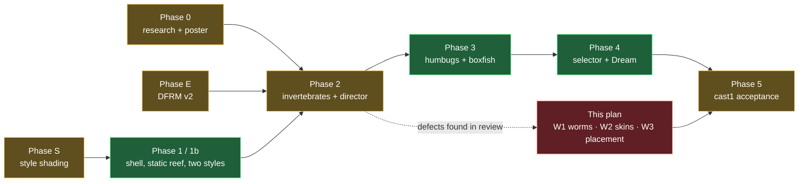

*Green = built; amber = built or partly verified, with steps still open; red = new work. Phase 2 is amber because its models fail Will's review (W1–W3) and its desktop reaction test does not exist.*

## What is wrong today

[](2026-11-08-reef-tanks-finish/worms.html)

### The Christmas tree worms

Five separate defects, each traced to source:

1. **Shape.** Each worm is a white stalk with two flat stacks of five trapezoids, plus triangle "radioles" on them, all in one plane facing −Y ([`life.py:158-186`](../../wflevels/aquarium_thai_reef/reef/life.py)). At TV distance they read as paper pine trees on pegs. A real *Spirobranchus* shows **no stalk**: its calcareous tube is buried in the coral, and two **spiral cones** of radioles stand directly on the coral surface.
2. **Placement.** The 15 worms sit on a rigid 5 × 3 grid ([`worm_centers`, `life.py:146`](../../wflevels/aquarium_thai_reef/reef/life.py)) about `worm_crown_origin = (-2.75, -1.35, 2.0)` ([`generate.py:288`](../../wflevels/aquarium_thai_reef/generate.py)). The boulder's front face is at y = −1.26 ([`corals.py:22`](../../wflevels/aquarium_thai_reef/reef/corals.py)), so the grid floats **9–14 cm in front of the coral**. Its top row (z ≈ 2.24) is above the boulder's top (z = 2.18), in front of bare rock.
3. **Orientation.** Every crown points straight up (+Z), whatever surface is behind it.
4. **Colour and texture.** The crowns cycle through the `polyp`, `coralline` and `sponge` tiles (tan, pink and orange) and the stalk uses `sand`. Real worms are bright and polychromatic: blue, red, orange, yellow, white, purple and two-tone mixes.
5. **Retraction.** The rig roots each curve at `z − 0.15` ([`worm_rig.py:46,52`](../../wflevels/aquarium_thai_reef/reef/worm_rig.py)), which is 7 cm *below the stalk's bottom*. The "hidden" scale of 0.02 therefore pulls the whole worm, stalk included, toward a point inside the rock. It does not withdraw into a tube mouth. Separately, the sample split at `root_z + 0.32` binds only the tip vertices to the second sample, so the crown flexes as one rigid piece.

### Actors that read as untextured

Every mesh does carry the atlas: `blender_mesh` UV-maps all faces ([`generate.py:86-148`](../../wflevels/aquarium_thai_reef/generate.py)). The atlas has 8 tiles, so small creatures borrow tiles meant for other surfaces, and the UVs are **world-projected** at about 87 texels per unit. An object 10–15 cm across therefore covers a few texels of one tile, and it renders as a flat colour. Some parts also sample one flat texel by design (`fish_dark`, `fish_white`).

| Actor | Faces | Flat-swatch area | Area in faces spanning fewer than 3 texels | Tiles used | Verdict |
|---|---:|---:|---:|---|---|
| Guard crab | 470 | 3 % | **86 %** | 97 % `sponge` (barrel-sponge pores) | needs its own skin |
| Banded coral shrimp ×2 | 428 | 2 % | **86 %** | 65 % `sand`, 33 % `sponge` | needs its own skin |
| Christmas tree worms | 1,170 | 0 % | **43 %** | `sand`, `coralline`, `sponge`, `polyp` | rebuilt in W1 |
| Hermit crab | 294 | 0 % | 29 % | `sponge`, `rock` | needs its own skin |
| Nudibranch | 667 | **62 %** | 25 % | flat black, `clam` | needs its own skin |
| Feather dusters | 944 | **42 %** | 4 % | flat white, `sponge` | needs its own skin |
| Zoanthid carpets (static `reef_life`, `reef_life_1`; 94 % zoanthid) | 9,124 | 0 % | **66 %** | `zoanthid` | object-local UVs |
| Humbugs ×2 | 122 each | **100 %** | 0 % | flat black and white | bars are correct; add a sheen. **Since 2026‑11‑09 (D10) the pair is *Dascyllus reticulatus*:** one black bar behind the head, a faint grey rear bar, a scale-net body ([review](../diagnostics/reef-humbug-swap-2026-11-09/README.md)) |
| Sea fan | 1,067 | 0 % | 16 % | `coralline` | **accept untextured** (D3) |
| Feather star | 4,512 | 0 % | 6 % | `polyp`, `coralline` | **accept untextured** (D3) |
| Flowerpot, leather coral, clam, boxfish, rock, hard corals | — | ≤ 4 % | ≤ 30 % | own tiles | OK |

*Measured by `docs/plans/2026-11-08-reef-tanks-finish/texcov.py` (see [Verification](#verification), step 1) on the generator's Python meshes, before Blender export.*

## Decisions for Will

| # | Decision | Recommendation | Alternatives weighed |
|---|---|---|---|
| D1 | Worm colours | **Eight morphs** (blue, red, orange, yellow, white, purple, blue/white, red/white), spread so no two neighbours match. W0 adds a sourced colour reference to the research document | Two or three morphs only (calmer, less true to life). All one colour (reads as a planted pattern) |
| D2 | Where the creature skins live | **Repack the existing 1024² atlas from 8 tiles of 256 × 512 into 16 cells of 256 × 256.** Eight new creature cells, no new texture memory, no engine change | A second texture page for creatures. W0 would first have to confirm the exporter, textile and the material path support two pages per level; the repack avoids that question |
| D3 | Sea fan and feather star | **Accept untextured** (Will: "might actually be ok for the things that look like fans"). Add only a base-to-tip colour gradient through the new utility cell | Give them their own cells; at 1–2 cm branch width no pattern survives at TV distance |
| D4 | Worm size | **True to life at ×10**: crowns 0.15–0.22 units tall, with a ±15 % random size per worm. The close camera shows them well | 1.3× for the wide view. That is more readable, but they would sit oversized next to the crab and shrimp |
| D10 | The pair of fish (original plan D1) | **Decided** (Will, 2026‑11‑09: "swap the humbug for the reticulated dascyllus, *Dascyllus reticulatus*"). **Skin approved** by Will, 2026‑11‑09 ([review](../diagnostics/reef-humbug-swap-2026-11-09/README.md)). The humbug *D. aruanus* has no citable Gulf of Thailand record; *D. reticulatus* is recorded in the Gulf (Satapoomin 2000, Tho Chu, CAS specimens off Koh Samet, Ko Tao observations), lives in the same *Pocillopora* host, and no other tank uses it. Behaviour is unchanged; the skin and names change. Evidence in [`thai-reef-research.md`](../reference/thai-reef-research.md#d1-and-d2-searches) | Pink anemonefish (repeats tank 1's subject); copperband butterflyfish (eats the tank's worms); keep *D. aruanus* with a qualified poster claim |

## W0 — research note and atlas repack (T3)

- **Research.** Add a *Spirobranchus* colour-morph reference to [`thai-reef-research.md`](../reference/thai-reef-research.md). Also add colour references for *Trapezia cymodoce*, *Stenopus hispidus* and *Phyllidia varicosa*, so the W2 skins are not inferred from occurrence records (that document's own rule). The poster prints none of this; it is modelling guidance.
- **Atlas repack** ([`atlas.py`](../../wflevels/aquarium_thai_reef/reef/atlas.py)). Change the index from `(y//512)*4+(x//256)` to a 4 × 4 grid. Rescale every existing tile's `_detail` pattern to 256 rows; the clam mantle's centre `dy = y − 512` becomes `y − 128`. Move the flat fish swatches, the water bands and the clam-shell strip from their margin into utility cell 15. The UV writer changes `tile // 4 / 2` to `/ 4` in the same commit. The anime atlas keeps the same layout and posterises it to 3 tones.

[](2026-11-08-reef-tanks-finish/skins.html)

## W1 — Christmas tree worms, rebuilt (T4)

**As built and approved** (Blender renders of the exported meshes; [worm review](../diagnostics/reef-worms-2026-11-08/README.md)). Left: cast1 before. Right: rebuilt.

[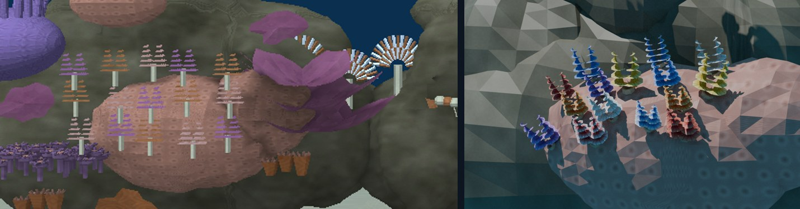](../diagnostics/reef-worms-2026-11-08/README.md)


Rank T4: model, rig, director and placement all change together, and judging the look takes visual judgement against device captures.

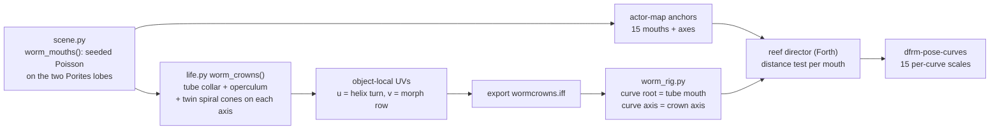

### Model

- **Tube collar.** A short calcareous rim at each mouth: an 8-sided ring about 1 cm proud of the coral, using the `sand` cell. The tube itself is never modelled, because it is hidden in the coral.
- **Twin spiral cones.** Each worm has two near-parallel cones (splayed ±0.10) standing side by side on the crown axis. Each has a thin 4-sided core and a smooth helical ribbon of radioles, **4.5 turns** at 8 segments per turn. *As built:* a jagged edge and 3.5 turns first rendered as spiky horns, so the edge was smoothed and the whorls made denser.
- **Radioles are two-sided fins.** Each is two back-to-back triangles, because engine-wide back-face culling would drop a single-sided fin seen from behind ([culling plan](2026-06-13-planetarium-dome-view-engine-wide-backface-culling.md)).
- **Operculum.** A small spined cap beside the cones, hinged on the collar. It stays put when the crown retracts, so a "hidden" worm still reads as a worm.
- **Budget.** About 330 triangles per worm, so **≤ 5,000 for all 15** (1,500 before; 4,920 as built). The cast1 headroom from step 10 (anime median 22.21 FPS against a 20 FPS gate) is the reason this is affordable. Step 10 is re-measured, and the fallback is 3 turns per cone (about 3,800 triangles). Do not cut anything else to pay for it (Will, 2026‑11‑06: retain geometry, raise budgets).

### Texture and colour

- New **worm cell** (atlas cell 8). Its 8 rows of 32 px are the eight D1 morphs, each a gradient from base colour to a lighter tip, with a thin pale band per whorl.
- UVs are **object-local**: u runs along the helix (turn fraction) and v = morph row + root→tip position. The pattern therefore follows the spiral on every crown at any orientation.
- Morph per worm = `index % 8`, with indices assigned so that no two nearest neighbours share a morph.
- Anime: the same cell posterised to 3 tones. Crowns get no outline hull (original plan: tiny crowns would turn into dark blobs). The collar and operculum get the 0.006 hull the crab uses.

### Placement and orientation

The generator, not a hand-tuned grid, chooses the tube mouths. `worm_mouths(seed)` in `scene.py`:

1. Draw uniform points on the two Porites lobe ellipsoids, `(-2.75, -.78, 1.75)` radii `(.72, .48, .43)` and `(-2.25, -.72, 1.88)` radii `(.42, .40, .34)`, displaced by the same relief function as [`_massive_coral`](../../wflevels/aquarium_thai_reef/reef/corals.py).
2. Keep a point only if its outward normal faces the camera (`n.y ≤ −0.35`), faces up (`n.z ≥ 0.3`) and is not on a steep flank (`|n.x| ≤ 0.55`), and the point is not inside the other lobe. *As built:* the first renders used `n.z ≥ 0` and showed crowns jutting sideways off the flanks, so the rule was tightened.
3. Poisson rejection at ≥ 0.14 between mouths. Points to the right of x = −2.32 are rejected, because the scroll coral stands in front of the small lobe there. *As built, all 15 mouths land on the main lobe:* the small lobe's only clear, camera-facing surface is buried in the main lobe.
4. **Crown axis = normalize(n + 0.7·up)**: out of the surface, leaning toward the light, as real crowns do. *As built,* 0.7 rather than the 0.35 first planned; the axis stays within 37° of the normal.
5. Mouth = surface point + 0.005 along n, so the collar sits on the coral rather than inside it.

The [placement mockup](2026-11-08-reef-tanks-finish/placement.html) plots the first version of this rule against the old grid. The as-built result is in the [worm review](../diagnostics/reef-worms-2026-11-08/README.md).

### Rig and reaction

- **Curve root = tube mouth, curve axis = crown axis.** A 0.02 scale now collapses the cones *into the mouth*. *As built,* the collar and operculum are static geometry in the boulder's `reef_hard` group, not part of the worm actor. They never scale, they get the baked light, and the anime style gives them the boulder's outline.
- **Two samples per curve, each half the crown height.** The lower half binds to sample 0 and the upper half to sample 1, so the crown can sway as well as retract. Today only the tip vertices reach sample 1.
- **Director.** It reads the mouth positions from the generated constants, not from `worm_centers(worm_crown_origin)`. The existing reaction radius (0.8 units, `.64 <` squared, [`generate.py:415`](../../wflevels/aquarium_thai_reef/generate.py)) and timings do not change.

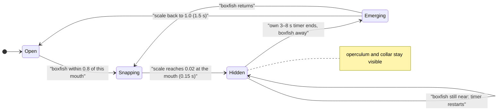

## W2 — skins for the actors that read as untextured (T3)

**As built and approved** ([skins review](../diagnostics/reef-skins-2026-11-08/README.md)). Before and after for the mobile animals and the twice-rebuilt nudibranch:

| Before | After |
|---|---|
| 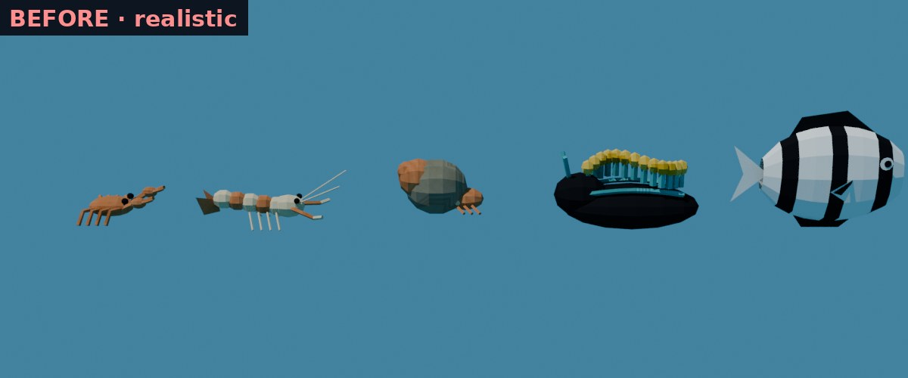 | 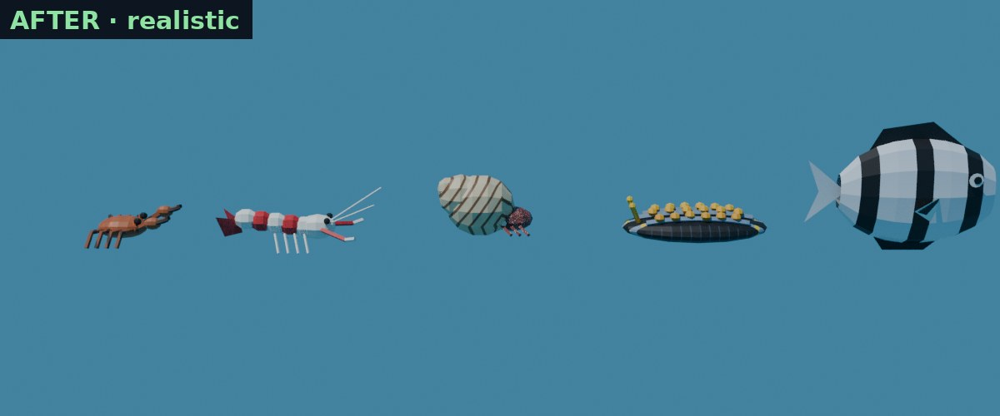 |
| 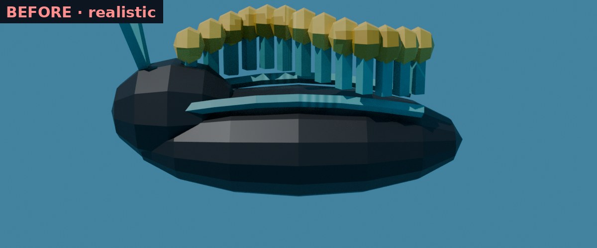 | 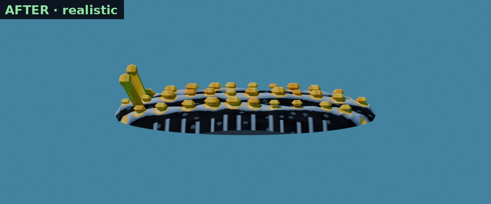 |


One rule for every creature: **object-local UVs into its own cell**, so texel density depends on the part rather than on world position. Limbs and bodies use cylindrical UVs along each part's axis; shells use a spiral; flat discs use planar UVs. The static reef keeps its world-projected UVs.

| Atlas cell | Used by | Content (realistic; anime posterises it) |
|---|---|---|
| 8 worm morphs | worms | W1 |
| 9 radiole bands | feather dusters; worm tips | brown, cream and tan bands across the radiole length |
| 10 crab | guard crab | carapace colour from W0's reference, fine darker speckle, paler underside; claw tips darker |
| 11 shrimp | banded shrimp ×2 | red/white bands along the body axis, white antennae |
| 12 nudibranch | nudibranch | black body, grey-blue longitudinal ridges, yellow tubercle tips (W0 reference) |
| 13 hermit shell | hermit crab | gastropod shell with spiral growth lines; banded legs |
| 14 crust fine | encrusting sponge and coralline crusts | fine crust mottle at the crusts' scale |
| 15 utility | humbugs, fans, water | flat swatches, water bands, clam shell, white-to-grey sheen, fan gradient; since D10 also a grey swatch and the *D. reticulatus* scale net (rows 192–255) |

- **Zoanthid carpets** keep tile 5. Each polyp disc gets planar UVs that span one flower-head cell, so every polyp shows an oral disc and a ring of tentacles instead of a sub-texel smear.
- **Humbugs** keep their bars. In the realistic style only, a belly-to-back sheen from cell 15 replaces flat white. *Superseded 2026‑11‑09 by D10:* the pair is now *Dascyllus reticulatus*, with one black bar behind the head running onto the dorsal and pelvic fins, a faint grey rear bar, a pale grey body with a dark scale-margin net (realistic only), black pelvic fins, a dark pectoral-base spot and a pale tail. Internal names stay `humbug`.
- **Sea fan and feather star** (D3): a base-to-tip gradient only. *As built,* the feather star's pinnules keep the tan polyp tile: with gradient pinnules it lost its two-tone, feathery look.
- *As built:* every face's UVs now come from one pure-Python module, `reef/uvmap.py`, which the generator, the texel audit and the review renders all use. Colour references are in [`thai-reef-skin-colours.md`](../reference/thai-reef-skin-colours.md); the shared research ledger was another session's uncommitted file, so W0 went into a separate file.

## W3 — placement: nothing floats, everything attaches (T3)

**As built and approved** ([placement review](../diagnostics/reef-placement-2026-11-08/README.md)). A three-quarter view shows the depth that the front camera hides:

| Before | After |
|---|---|
| 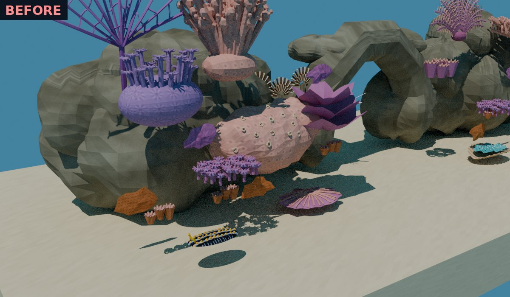 | 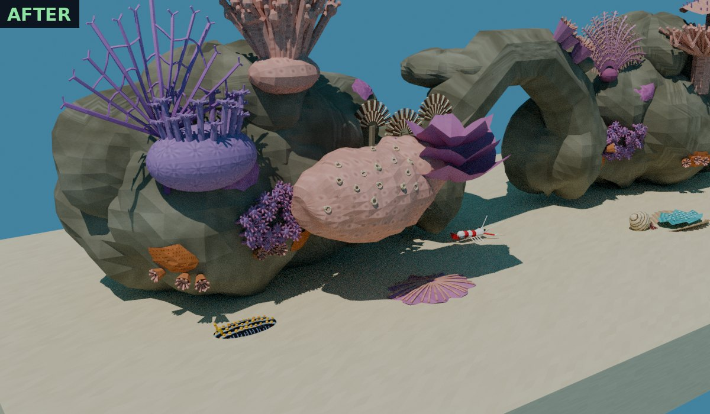 |
| 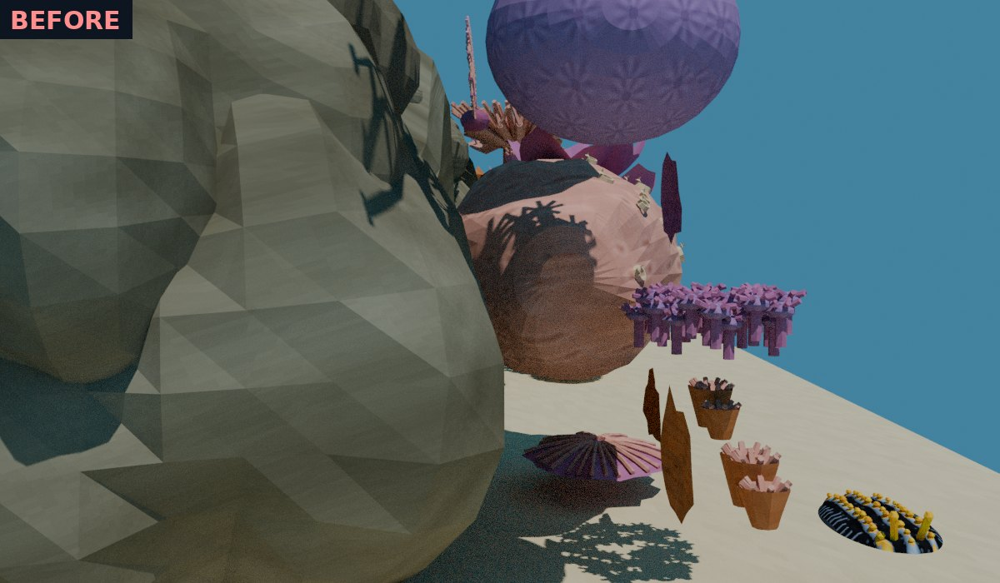 | 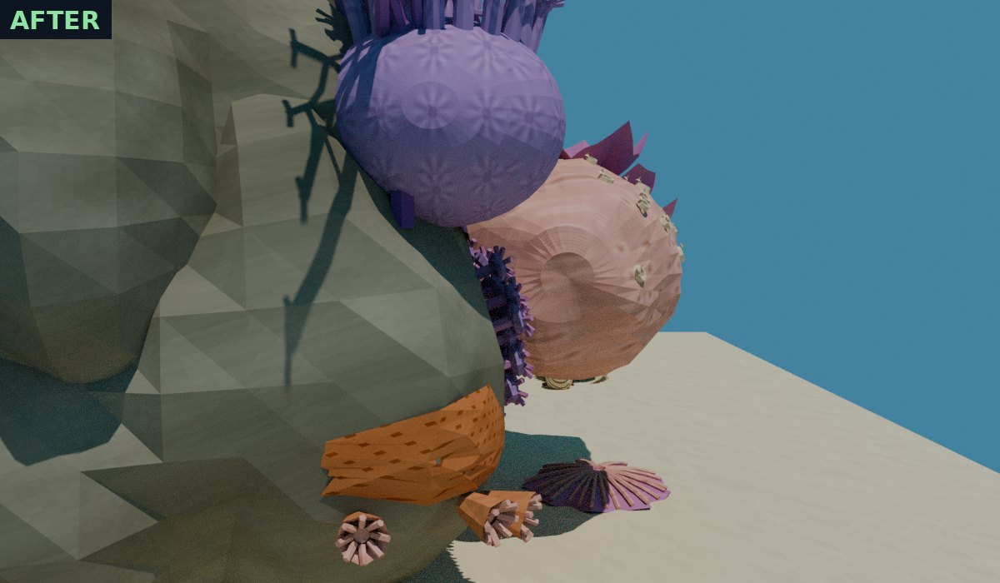 |


[](2026-11-08-reef-tanks-finish/placement.html)

- **One source of truth.** Every actor position moves into `scene.py`'s anchor table, and `generate.py` reads it. Today the two disagree: `tree_worms` is at (−0.18, −0.15, 1.20) in the table but placed at (−2.75, −1.35, 2.0); `nudibranch` is (−3.78, −0.25, 1.34) against (−4.0, −1.65, 1.05); the leather coral and others differ too. Original verification step 4 ("anchor tables identical") passes today only because both styles share the same wrong table.
- **Giant clam.** It is drawn on grey stilts above the sand. Sink the valves 40 % into the sand so the mantle shows at the gape.
- **Nudibranch.** Move it from the sand onto the left rock mass, and drive it along an authored rock path (original plan: "crawls an authored rock path at 2 cm/min, tank time ×20").
- **Encrusting crusts** ([`_encrusting_patch`](../../wflevels/aquarium_thai_reef/reef/life.py)): project their vertices onto the rock surface (ray along −n into the rock mesh), at most 1 cm proud. Today they are flat ellipses standing in front of it.
- **Regression guard**, `tests/test_thai_reef_placement.py`:
    - every sessile actor's attachment points lie within 2 cm of their host surface (Porites lobe, rock blob or sand plane);
    - every worm axis is within 37° of its surface normal (cos ≥ 0.8);
    - no two worm mouths are closer than 0.14;
    - every position in `generate.py` comes from the anchor table.

## W5 — procedural reef: random rocks, a rock count and clustered colonies, laid out in Forth (plan only)

**Status: W5 done** (2026‑11‑09): W5a–W5c built, and Will approved the layout with Random as the default ("Approve, default Random"). **D5–D8 decided** (Will, 2026‑11‑08: "d5: forth, d6: ok, d7: ok, d8: yes"). **R0's code reading is done** ([report](../diagnostics/reef-w5-r0-2026-11-08/README.md)): Forth-only is feasible with no engine change for W5 itself. **The device run (P0–P3) is done:** hidden and moved pieces cost almost nothing, and a realistic level of 97 objects aborted at load because it ran out of its 32 MB room memory slot. That sets W5b's budget in bytes, not objects (see [R0 device results](#r0-device-results-cast1-2026-11-08)). **D9 is decided:** a level settings object, with no app code. **W5a is done** (`a205df47`). W3's fixed placement shipped first, as asked (`1a30b727`, approved, pushed).

Will, 2026‑11‑08:
- "can we do that randomly-ish on initial placement in clusters? (not unlike the planted tank level)"
- "do the fixed placement that you've already developed first"
- "i also want the rocks able to be randomly generated, heh" and "user can specify amount of rocks, too"
- "can we do the placement in forth instead of custom engine code?"
- "we need to add a settings object to the level, too, ofc (or does it already have one???)"

### What exists

- **The reef has no settings object.** Its actors are the scene objects, lights, cameras, Director and the reef pieces, and it has no `settings.rprp`.
- **The Jellyfish tank is the template.** A per-level `settings.oas` (`JellyfishSettings`, owned by the Director) is compiled by `oas2oad`, bound by `settings-bindings.json`, and turned into an RP01 catalog by `build-object-properties.py`. Its Forth reads fields with `property@ ( owner field -- value flag )` (`jelly_motion.fth:2`). Its **Companions 0–50** field sets how many pre-built jellyfish are visible: the same shape as a rock count.
- **The Planted Tank grows plants in engine C++** (`plant_growth.h`, `colonies(seed)`): 16 founders at random, then lineages that grow by short steps from a random member, with per-kind step sizes, heading jitter, a crowding radius and an excluded fish route. `planted::enter()` draws a fresh seed on every level entry, and the Dream host can pass a fixed one.
- **Forth already has a seeded generator** (`random`, `seed-random`, `scripting_zforth.cc:17-18`). *Corrected by R0:* `Init` reseeds it from the clock (`scripting_zforth.cc:1600-1606`) and every level load creates a new interpreter (`level.cc:896`), so `random` already differs on every entry and needs no entropy primitive.
- **The reef cannot simply copy the Planted Tank.** Its rock, corals and colonies are baked meshes with Cycles light, anime outline hulls and static colliders, and every placement is resolved against that fixed rock at export (W3).

### Proposed design (option A, recommended): a baked kit, laid out by Forth at level entry

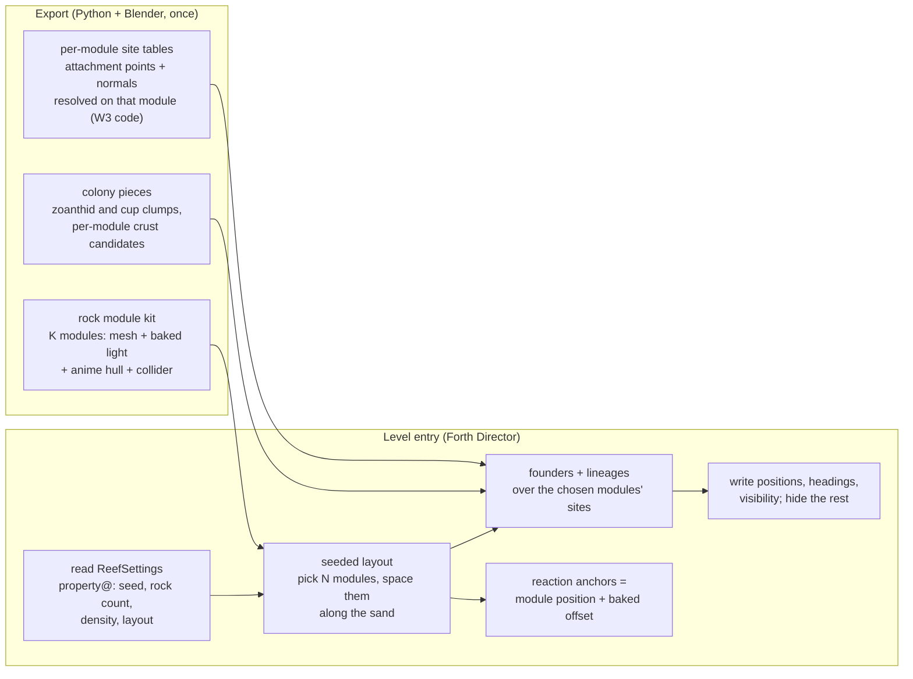

- **Settings object `ReefSettings`, owned by the Director** (W5a). It needs no engine change:

    ```
    TYPEHEADER(ReefSettings)
        PROPERTY_SHEET_HEADER(Reef,1)
        TYPEENTRYINT32(Layout,,0,1,1,"Fixed|Random",SHOW_AS_SLIDER,"Fixed is the reviewed layout; Random builds a new reef")
        TYPEENTRYINT32(Rocks,,1,5,3,"1|2|3|4|5",SHOW_AS_SLIDER,"How many rock masses stand on the sand")
        TYPEENTRYINT32(Colonies,,0,2,1,"Sparse|Normal|Dense",SHOW_AS_SLIDER,"How much attached life grows on the rock")
        TYPEENTRYINT32(Seed,,0,2147483647,0,,SHOW_AS_NUMBER,"0 draws a new reef on every entry")
        PROPERTY_SHEET_FOOTER
    TYPEFOOTER
    ```

    It is exposed wherever Settings already appear: the TV settings panel, the phone's Dream settings and the coordinator tray, through the generic provider the Planted Tank introduced.
- **The kit** (W5b). The export bakes K rock modules. Each has its mesh, baked light, anime hull, its own collider, and a **site table**: attachment points and normals resolved on that module with W3's surface code.
    - **Hero modules** carry the behaviours: the **arch** (cave, cleaner station), the **boulder** (Porites, worms, feather dusters) and the **coral-head mass** (cauliflower head, guard crab, humbugs, flowerpot).
    - **Filler modules** carry the variety: a ledge, twin pillars, a tall mass, a barrel-sponge mass and a table-coral mass.
    - **Colony pieces** are a few pre-built clumps (zoanthid and cup clumps, crust candidates per module), each a small actor.

    **As built (W5b, 2026‑11‑08; [review](../diagnostics/reef-w5b-kit-2026-11-08/README.md)).**
    - **Six modules, not eight.** The heroes are today's three rocks: left, arch and right. Each carries the corals and animals that grow on it. The fillers are a ledge, twin pillars and a tall mass. The sketch's barrel-sponge and table-coral masses are both today's right rock, which cannot be split without changing Fixed.
    - **Colliders** are pivot-centred boxes: left and right are today's boxes. The arch gains a box over the lintel only, so the cave stays open. It is the one behavioural change to Fixed: the fish can no longer swim through the lintel rock.
    - **Site tables:** 16 points per module. **Clumps:** 9 (3 zoanthid, 3 cup, 3 crust), built growing up +z for W5c to turn onto a site normal.
    - **Visibility cells:** 200–205 for the modules (a module's rock, corals and attached animals share its cell), 210–218 for the clumps, and 1112 as the guard cell. `actor-map.json` carries a `kit` section: pivots, park positions, actor indices, collider boxes, attached-animal offsets, sites and Fixed pivots.
    - **Fixed is the three heroes at their Fixed pivots.** A Director word, `reef-kit-init`, shows them once at entry; W5c replaces it. The cooked meshes match the old ones to 0.04 mm, and same-camera renders differ on at most 0.036 % of pixels, which is bake noise.
    - **Budgets:** the build now fails on any of these. Worst visible set: realistic 71,729 triangles in 22 groups, anime 55,909, against 72,000 and 22. Anime hulls: 23,582 of 24,000. Room #0 slot: realistic 18.3 MB, anime 18.4 MB, of 32 MB. Actors go from 41 to 56.
    - **Heroes keep heading 0.** Their backs are bare, because W3 dressed only the faces the camera sees ([3-rock arrangement](../diagnostics/reef-w5b-kit-2026-11-08/arrange-3-wide.jpg)). W5c may turn fillers by ½ revolution, but not heroes.

    [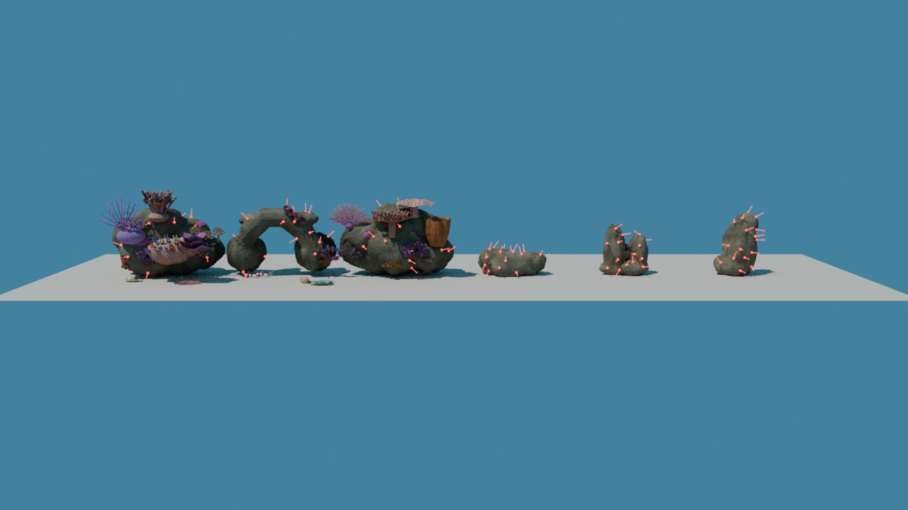](../diagnostics/reef-w5b-kit-2026-11-08/kit-row.jpg)
    [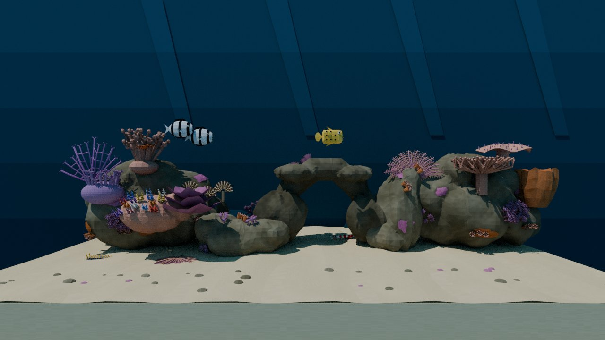](../diagnostics/reef-w5b-kit-2026-11-08/arrange-5-wide.jpg)
- **The Forth layout** (W5c). At entry the Director:
    1. reads the settings with `property@`;
    2. seeds `random`;
    3. picks N modules, keeping the heroes first while N ≥ 3;
    4. spaces the modules along the sand with seeded gaps;
    5. runs the Planted Tank's founder-and-lineage scheme over the chosen modules' site tables;
    6. writes every piece's position, heading and visibility once, and hides what is unused.

    No ray casting happens at run time: every surface was resolved at export. Each reaction anchor (worm mouths, clam, crab, cleaner station) becomes its module's position plus an offset baked at export.
- **Fewer than three rocks.** Below three rocks some heroes are absent, and the Director skips their reactions; the cleaner station needs the arch, for example. D6 decides the range.

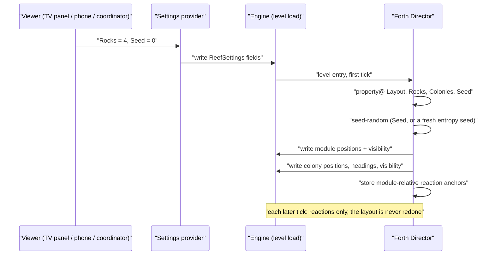

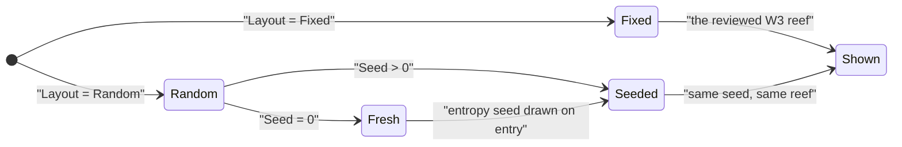

### Options weighed

| | **A. Forth lays out a baked kit (recommended)** | B. Engine C++ generator, like `plant_growth.h` | C. Bake whole-level variants |
|---|---|---|---|
| New engine code | none, if R0 passes | a reef generator in the engine (needs permission) | none |
| Rock shapes | K baked modules in seeded arrangements; optional per-lobe scale through DFRM | truly new rock every entry | only the baked variants |
| Baked light, anime hulls | kept | lost, unless rebuilt in the engine | kept |
| Rock count | 1–5 from the kit | any | one variant per count, times seeds |
| Memory | the kit (estimate in R0) | small | one level per variant (about 8 MB each) |
| Effort | T4 spike, then T3 | T4+, engine | T2, but the APK grows fast |

### R0 — feasibility spike (T3, first)

The spike answers these questions with measurements on the desktop and the Pixel, through the coordinator:

1. **Moving pieces.** Can Forth reposition anchored mesh actors once at entry, and do they render and cull correctly afterwards at no per-frame cost?
2. **Colliders.** Can a static collider move, or must each module carry its own collider actor that is shown or hidden with it? The boxfish's braking depends on the colliders.
3. **Entropy.** What gives Forth a fresh seed per entry? Candidates are a host-passed seed (as the Planted Dream does) or an existing engine value. The fallback, a one-word `fresh-seed` engine primitive, needs permission.
4. **Cost.** What do hidden actors cost, and what does the actor total do to cast1's frame time? Today's lowest median is 22.21 FPS against the 20 FPS gate.
5. **Settings.** Does `property@` read a new Director-owned `ReefSettings`, and does the generic provider expose it on the TV, the phone and the coordinator?
6. **Memory.** How big is the kit compared with today's 8 MB level?
7. **Optional.** Can multi-curve DFRM lobe scales give cheap rock-shape variety, posed once at entry?

### R0 results (code reading, 2026‑11‑08)

Full evidence is in the [R0 report](../diagnostics/reef-w5-r0-2026-11-08/README.md).

| # | Question | Verdict | What it means for W5 |
|---|---|---|---|
| 1 | Moving pieces | **Yes** | The Director already moves anchored platforms. Render matrices are rebuilt each frame and the static bake is in local space, so a move needs no re-bake. A hidden actor skips its draw and costs only a small update. Each hideable piece needs its own visibility cell, from the free global mailboxes 2–599. Rotation writes were broken; see below |
| 2 | Colliders | **Partial** | Position writes reach Jolt about two frames later; rotation and scale never do. Use one pivot-centred box collider per module, with headings 0 or ½ revolution. Park unused colliders at z = −4 *inside* the room box, because a statplat outside it asserts (`rooms.cc:157`). The "predictive braking" this plan's tank section describes does not exist: Jolt's character keeps the fish out of the rock |
| 3 | Entropy | **Yes** | Fresh per entry already. Seed 0 means: draw `random`, then `seed-random` with it. Cap Seed at 24 bits, because Forth cells are floats and `property@` returns at most 32767; larger values go through `property-int-bytes@`. Showing the drawn seed on the panel would need a new `property!` word, which is an engine change |
| 4 | Settings | **Partial** | `property@` and the TV panel (hold A for 1 s) work for any Director-owned catalog. It takes six build steps: `.oas` and bindings for both styles, an `indices` key in the reef actor-map, oas2oad and properties steps in both `build.sh` files, and a `check_tank_catalog` branch. **The phone and coordinator need app work:** the generic provider and the launch-override bridge are Planted-only today (D9) |
| 5 | Memory | **Within limits** | An 8-module kit adds about 0.7 MB realistic and up to 1.95 MB anime, giving levels of roughly 8.7–12.4 MB. The static budgets (11 groups, 70,000 triangles) must count the worst-case visible set, not every loaded group |
| 6 | DFRM lobes | **Partial; not for W5** | A pose applied once persists, but it takes the mesh off the static-bake path permanently, so it is redrawn the slow way every frame |
| 7 | Device cost | **Run on cast1 (P0–P3); see below** | Probe levels P0–P4 on cast1 and the Pixel through `task chromecast:profile`, three alternating runs each, with pass criteria in the report. P4 needs the authored kit |

**The rotation bug R0 found is fixed.** Rotation writes from scripts went into one shared Euler that applied only on a C write ([BUGS.md](../BUGS.md), dormant since 2002). The engine now applies each axis to its own actor ([`4ca61197`](https://github.com/wbniv/WorldFoundry/commit/4ca61197), approved by Will). The reef writes whole rotations, and its nudibranch, which turned about 51° because `3.141593` is in revolutions, now turns half a revolution ([`c5b6bc33`](https://github.com/wbniv/WorldFoundry/commit/c5b6bc33)).

### R0 device results (cast1, 2026‑11‑08)

Probes P0–P3 ran on cast1 through the coordinator: three alternating runs of each probe in each style, wide idle, measured over 120 s. Details are in [section 8 of the R0 report](../diagnostics/reef-w5-r0-2026-11-08/README.md#8-device-measurement-probes-p0p3-run-20261108-cast1). The Pixel did not run, because its screen was locked; it is capped at 60 FPS on this reef in any case.

| Style | P0 (today) | P1 (+16 hidden) | P2 (+21 moved once) | P3 (97 objects) |
|---|---:|---:|---:|---:|
| Realistic | 22.95 FPS (43.57 ms) | 43.63 ms | 43.59 ms | **aborts at load, 4 of 4** |
| Anime | 21.19 FPS (47.20 ms) | 47.33 ms | 47.06 ms | 47.56 ms |

- **Run-to-run spread:** 0.5–0.8 ms, so every difference in the table except the abort is noise.
- **A hidden actor costs about 4–8 µs a frame,** and a moved actor costs nothing once the one-shot layout is done. The kit's roughly 40 extra actors would cost about 0.25 ms.
- **Headroom against the 20 FPS gate:** 6.4 ms realistic and **2.8 ms anime.** The kit fits on frame time if its worst-case visible set adds no more than about 2 ms in anime, which means staying near today's 64k static triangles. P4 checks that once the kit exists.
- **Today's levels are slower than the `c1fd1d10` baseline** (24.38 and 22.21 FPS). W1–W3 and W5a added geometry, and the probe APK's libraries are a day older. Both styles still pass 20 FPS, so this run also serves as the re-run of original step 10 that W1 and W2 required (see the table at the top).
- **The realistic P3 level aborted at load: it ran out of room memory** ([section 9 of the R0 report](../diagnostics/reef-w5-r0-2026-11-08/README.md#9-root-cause-of-the-realistic-p3-load-abort-2026-11-08)). A `record` job keeps logcat and caught `FatalError: Lmalloc … out of memory, request size = 106656 … Named Room #0`. Each level's wrapper sets its Room #0 slot to 32,000,000 bytes, and every mesh actor builds its own copy of its mesh in that slot. Realistic P3 needs about 33.1 MB. This is a per-level budget, not an engine bug. The same level with only the slot raised to 36 MB or 48 MB loads on cast1 (22.89 FPS at 36 MB).
- **W5b's budget is bytes.** Free today: 15.06 MB realistic, 14.60 MB anime. Each mesh instance costs about 24 B per vertex, 108 B per face and 380 B per actor, plus each distinct mesh file's bytes once. W5b as sketched (Fixed set kept, 8 modules, 24 clumps) comes to about 29.5 MB of 32 MB.
- **Decision (default, Will may override): keep W5b inside 32 MB and make the build check it.** `report_budget.py` gains a room-slot check per style using the formula above, and the build fails when a style goes over. If the kit needs more, raising the reef's two wrappers to 36 MB is the tested fallback: it affects only the reef levels. Sharing mesh data between instances, or dropping GL's second Primitive table, would be engine changes and are not proposed.

**Order after R0:**
1. ~~W5a settings (T3).~~ Done, `a205df47`.
2. ~~The R0 device run, P0–P3, on copies of today's meshes.~~ Done; see above.
3. ~~Find the cause of the realistic P3 load abort (T4).~~ The 32 MB room slot ran out; see above.
4. ~~W5b, the kit, together with the budget-report change (T4), then P4.~~ Built; P4 passes on cast1: realistic 22.03 FPS, anime 20.26 FPS. With Fixed shown, the anime kit level is about 0.9 ms slower than before (20.83 against 21.24 FPS). Probes K1–K5 traced it to drawing the dressing as more, smaller per-module pieces; where the pieces sit doesn't matter. **Kept** (Will, 2026‑11‑08: "keep the slowdown; the increased flexibility is worth it"; "i'd rather we finish this level than worry about 1fps"). Finding the speed again is a TODO item for after the reef ships. **Design note:** express the Fixed layout as one arrangement of the kit's modules, so that both layouts share actors instead of each carrying its own copies.
5. ~~W5c, the Forth layout (T3).~~ Built 2026‑11‑09 ([review](../diagnostics/reef-w5c-layout-2026-11-08/README.md)). **Layout now defaults to Random**, approved by Will, 2026‑11‑09: "Approve, default Random". Rocks 3, Colonies Normal and Seed 0, so a new reef appears on every entry; Fixed stays selectable and still reproduces the reviewed W3 reef (tested).

### W5c as built (2026‑11‑09)

- **Each tick:** the settings poll, then `reef-layout?`, then the reactions. The layout runs on the first tick and again whenever Layout, Rocks, Colonies or Seed changes. The Forth tables (pivots, sites, offsets) are generated from `actor-map.json`'s `kit` section at export, so nothing ray-casts at run time.
- **Fixed** writes exactly today's positions (tested).
- **Seed:** Seed 0 draws a seed and keeps it while Seed stays 0, so changing Colonies leaves the rocks where they are. Any other Seed repeats exactly. The generator discards 16 values after seeding, because neighbouring small seeds picked the same rocks.
- **Rocks:** with 3 or more, all three heroes show plus seeded fillers; below 3, seeded heroes. Heroes keep heading 0; fillers take 0 or ½.
- **Deviation: 4–5 rocks use two rows.** The sand front holds about 11.2 units of rock footprint, and the three heroes alone take 10.0. So with 4 or 5 rocks the fillers stand in front and the right hero (table coral, barrel sponge and leather coral, with no reactions) stands behind them. It can end up mostly hidden behind the left rock. Which hero stands at the back is one constant in `reef/layout.py`.
- **Footprints** are 0.85 × each rock's half-width. Rocks may touch at their lumpy edges, as the left rock and the arch already do in Fixed, but never overlap.
- **Colonies:** Sparse, Normal and Dense show 3, 6 and 9 clumps, grown founder-and-lineage over the shown fillers' site points.
- **Reactions** follow their hero and are skipped while it is hidden; cleaning needs the arch. The humbugs stay visible when the left hero is hidden.
- **The patrol lane and the fish's spawn** stay clear of every collider (tested for 3–5 rocks over several seeds).
- **Mailboxes:** 870–875 hold the applied settings, the laid-out flag and the seed in use. 880–909 hold each module's shown flag, pivot, heading and hero displacement. 910–960 are layout scratch. Visibility cells: 200–205 (modules) and 210–218 (clumps). Cell 1112 is no longer used.
- **cast1, Random with 5 rocks, Dense, Seed 0:** realistic 22.30, 22.09 and 22.11 FPS (median 22.11); anime 20.56, 20.52 and 20.31 FPS (median 20.52). Both pass the 20 FPS gate.
- **Tests:** 14 new layout tests run the exported Director in the zForth VM, in both styles. The reef suites: 179 passed, 4 failed; the same 4 failed before W5b (the stale worm-harness binary, two menu-Taskfile tests and one screensaver import).
- **Build fix:** `scripts/level_asset_links.py` now makes relative links, so the reef's Dream screensaver variants also rebuild in the container.

[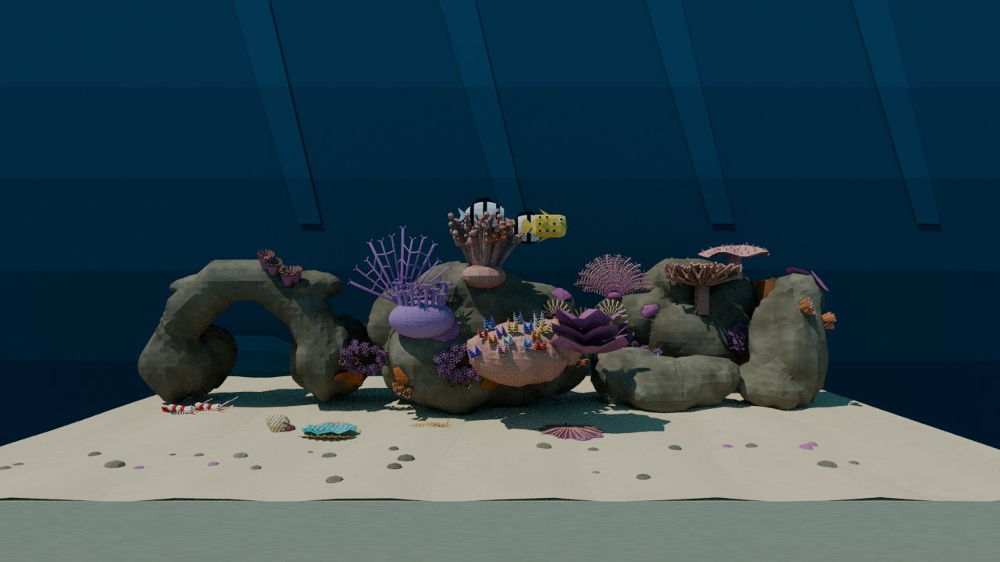](../diagnostics/reef-w5c-layout-2026-11-08/rocks5-seed31.jpg)
[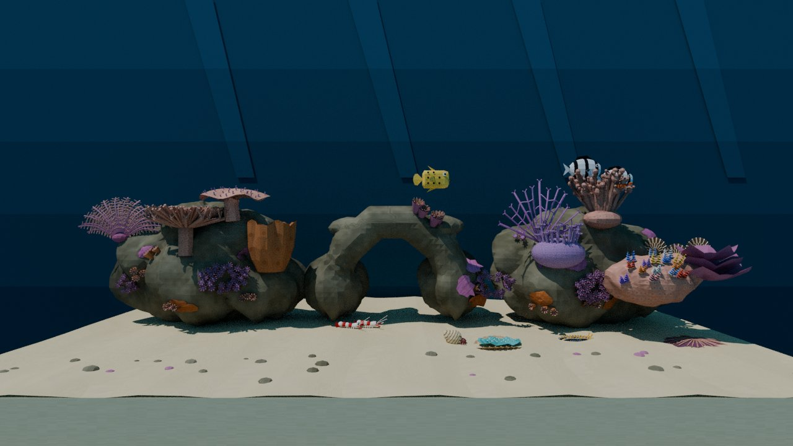](../diagnostics/reef-w5c-layout-2026-11-08/rocks3-seed22.jpg)
[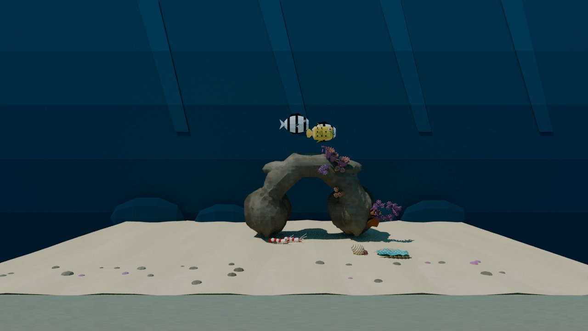](../diagnostics/reef-w5c-layout-2026-11-08/rocks1-seed11.jpg)
[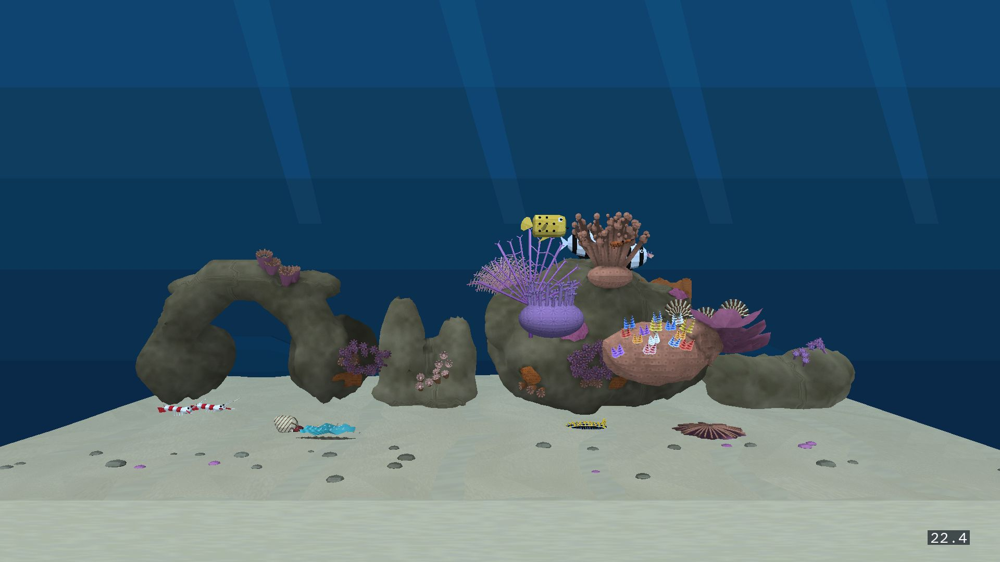](../diagnostics/reef-w5c-layout-2026-11-08/cast1-random5-realistic.jpg)
[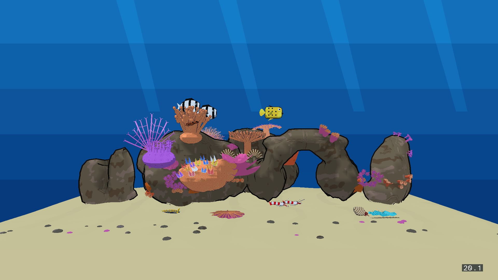](../diagnostics/reef-w5c-layout-2026-11-08/cast1-random5-anime.jpg)
[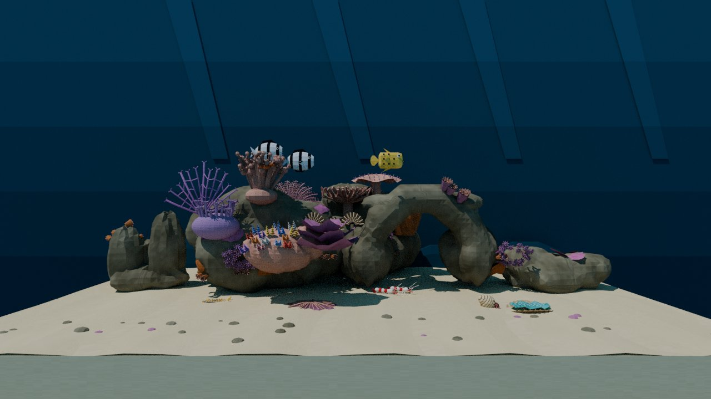](../diagnostics/reef-w5c-layout-2026-11-08/colonies-dense.jpg)

### Decisions for Will

| # | Decision | Decided (Will, 2026‑11‑08) |
|---|---|---|
| D5 | Architecture | **A**: a baked kit laid out by Forth. No engine code if R0 passes |
| D6 | Rock count | **1–5, default 3**, today's look. Heroes come first; with fewer than 3 rocks some behaviours are absent |
| D7 | Seed | **Seed 0 = a new reef on every entry** (like the Planted Tank); any other value repeats exactly |
| D9 | Where ReefSettings appears | **Decided** (Will, 2026‑11‑08: "you don't need any new android app code. use a level settings object (check out planted tank, duh)"). ReefSettings is a **level settings object** like the Planted Tank's, with **no app code**. R0 had read the phone and coordinator path as Planted-only; W5a's device check confirms what each surface shows |
| D8 | Keep the fixed layout | **Yes**: Layout = Fixed shows the reviewed W3 reef; the default is Random once W5 passes review. **Done 2026‑11‑09:** default Random (Will: "Approve, default Random") |

### Mock-ups

These are Blender renders of design prototypes, not engine captures. The colony prototype (`scatter_prototype.py`) runs the Planted Tank's founder-and-lineage scheme over the current rock with the production builders. The rock prototype (`render_rock_layouts.py`) arranges a toy module kit for different seeds and counts.

[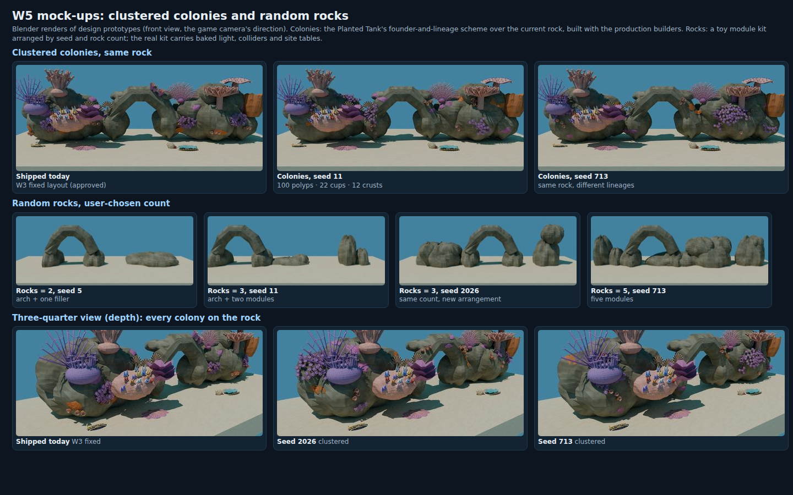](2026-11-08-reef-tanks-finish/w5-layouts.html)

## W4 — the rest of the original plan (T3, coordinator for devices)

- **`scripts/check-thai-reef.py --video`** (original step 6). It drives the boxfish past each reactor on the desktop build and asserts each reaction's window: the worms now included, the clam, dusters, crab and shrimp. Each reactor reopens 3–8 s after the boxfish leaves (2.5 s for the humbugs, 2 s for the crab).
- **Research and poster** (steps 1, 2, 13). Close or swap the humbug and boxfish Gulf records, export `gulf-of-thailand-reef-a3.pdf`, and copy it to `~/Documents/TO PRINT/`.
- **Shader gates** (step 14). Add a Metal case to the invariant test, or record why the CI Metal build cannot render it. Measure S2 on cast1, then either enable caustics at ≤ 2 ms or record "dropped".
- **cast1 acceptance** (steps 9–12). After W1–W3 land, through the coordinator: selector rows 9 and 10 plus Back, 120 s wide-idle medians for both styles, E7.1 and E7.2, and Dream for 5 minutes with each reef. Restore the device afterwards.
- **Style review** (step 15). Matched realistic and anime captures from the wide and close cameras go to Will. The tank is not finished until he approves both looks.

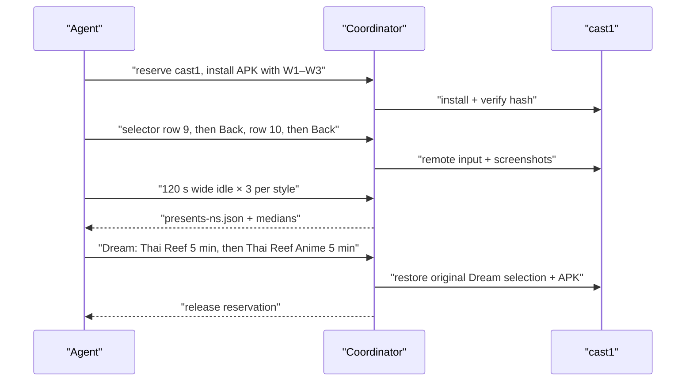

## Phases and tiers

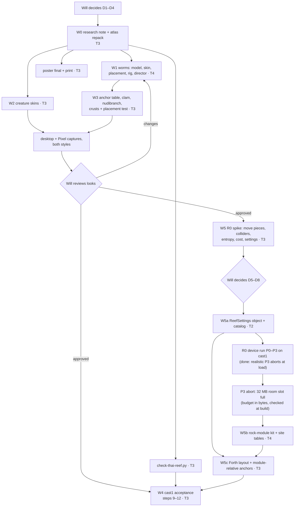

*W1–W3 and W5 are done and approved (Will approved W5 with "Approve, default Random", 2026‑11‑09).*

- **W0 and W2** can share one T3 agent: they touch the atlas and the UV writer.
- **W1** is a T4 agent. **W3** runs after it, because the anchor table includes the new worm mouths.
- **`check-thai-reef.py`** and the poster are independent and can run alongside.
- Builds and tests run in containers, as in this repository ([`build.sh`](../../wflevels/aquarium_thai_reef/build.sh)). Agent worktrees are sparse checkouts.

## New and changed files

| Path | New / changed | What |
|---|---|---|
| `wflevels/aquarium_thai_reef/reef/atlas.py` | changed | 16-cell layout; 8 creature cells |
| `wflevels/aquarium_thai_reef/reef/scene.py` | changed | `worm_mouths()`, every actor position in the anchor table |
| `wflevels/aquarium_thai_reef/reef/life.py` | changed | `worm_crowns` rebuilt; clam, nudibranch, crusts placement; object-local UV hints |
| `wflevels/aquarium_thai_reef/reef/invertebrates.py` | changed | crab, shrimp, hermit skin keys |
| `wflevels/aquarium_thai_reef/reef/worm_rig.py` | changed | root at the mouth, axis along the crown, fixed collar/operculum |
| `wflevels/aquarium_thai_reef/generate.py` | changed | positions from anchors; object-local UV writer; director reads mouths |
| `tests/test_thai_reef_placement.py` | new | W3 regression guard |
| `tests/test_aquarium_thai_reef.py` | changed | atlas cell map, worm budget ≤ 5,000, no flat-only creature |
| `scripts/check-thai-reef.py` | new | desktop reaction capture (original step 6) |
| `docs/reference/thai-reef-research.md` | changed | colour references (W0) |
| `docs/plans/2026-11-08-reef-tanks-finish/texcov.py` | new | the texel-coverage measurement above |

## Out of scope

- Any engine change. (Translucent radioles would need the texture-alpha TODO.)
- The two-habitat tanks (separate TODO item).
- Day/night polyp cycles, water-flow simulation (original plan's out-of-scope list).

## Verification

1. The texel-coverage audit passes. Every creature W2 reskins (worms, guard crab, shrimp, hermit crab, nudibranch, feather dusters and the zoanthid groups) has ≤ 20 % of its area flat or below 3 texels. Today this prints `FAIL` for all eight.
    ```sh
    python3 docs/plans/2026-11-08-reef-tanks-finish/texcov.py --check
    ```
2. The placement guard and the reef suite pass: worm mouths on the Porites surface, axes within 37° of the normal, spacing ≥ 0.14, anchors equal to placements, worm actor ≤ 5,000 triangles, 16 atlas cells.
    ```sh
    python3 -m pytest -q tests/test_thai_reef_placement.py tests/test_aquarium_thai_reef.py
    ```
3. Both levels rebuild in the container, and their anchor tables are identical and match the generator.
    ```sh
    task aquarium-thai-reef-level
    task aquarium-thai-reef-anime-level
    task aquarium-check
    ```
4. Desktop reactions, now including each worm snapping into its mouth and re-emerging on its own timer.
    ```sh
    python3 scripts/check-thai-reef.py --video
    ```
5. Matched desktop or Pixel captures of both styles, wide and close cameras, are attached here. Will approves the worms, skins and placement (original step 15).
6. Original steps 1, 2 and 13: research closed, poster exported to one A3 page, copied to `~/Documents/TO PRINT/`.
7. Original step 14: Metal case added or its absence explained; S2 measured on cast1 and enabled or dropped.
8. Original steps 9–12 on cast1, through the coordinator, with the W1–W3 build: selector and Back, three 120‑s wide-idle medians per style at ≥ 20 FPS, E7.1 and E7.2, and Dream for 5 minutes per reef. Device restored.

## Mockups

All three are self-contained, 1440 × 900, and rebuilt with `python3 docs/plans/2026-11-08-reef-tanks-finish/build_mockups.py --png`. "Today" panels embed crops of the committed cast1 captures. The proposed worm positions are computed from the boulder geometry by the W1 rule, so the drawing is the design. Everything else is design intent, not game assets.

- [Worms](2026-11-08-reef-tanks-finish/worms.html): today's crowns in both styles; the rebuilt crowns set into the boulder; open, snapping and hidden states; the eight morphs in both styles.
- [Placement](2026-11-08-reef-tanks-finish/placement.html): front and side elevations in world units, today against after; the actors that float.
- [Skins](2026-11-08-reef-tanks-finish/skins.html): per-actor today vs proposed skin; the repacked atlas.
- [W5 layouts](2026-11-08-reef-tanks-finish/w5-layouts.html): the fixed W3 layout, three seeds of clustered colonies, and four seeded rock layouts with different rock counts. Rebuilt with `render_scatter.py` and `render_rock_layouts.py` in the Blender container.
