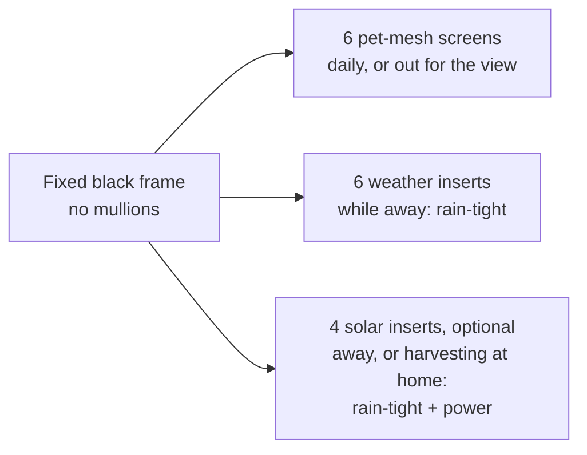
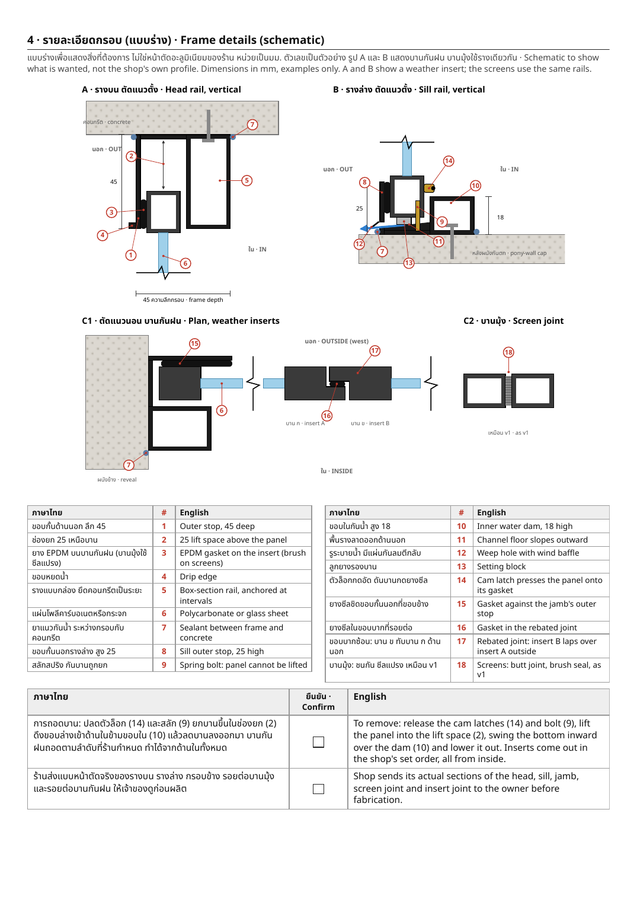
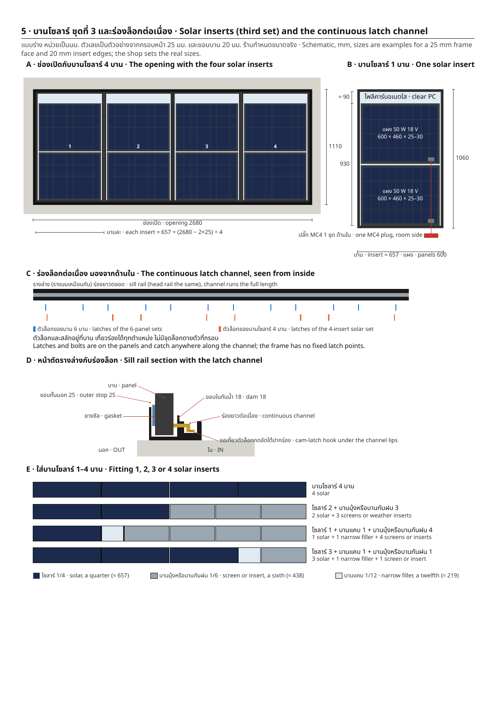
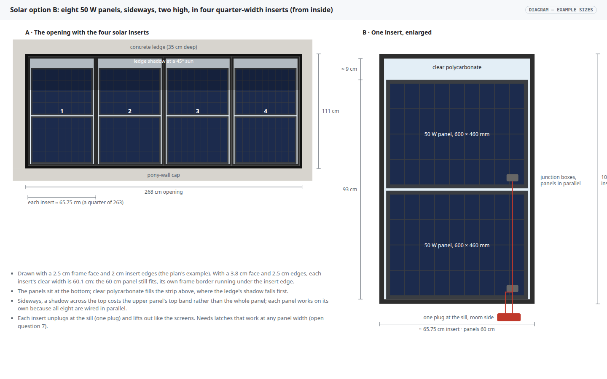
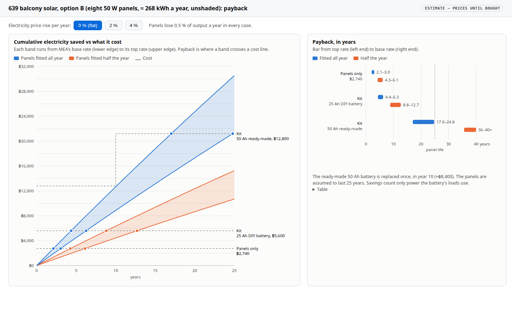
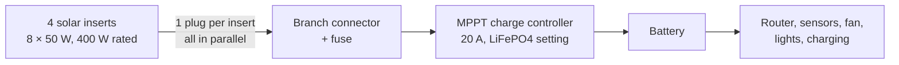
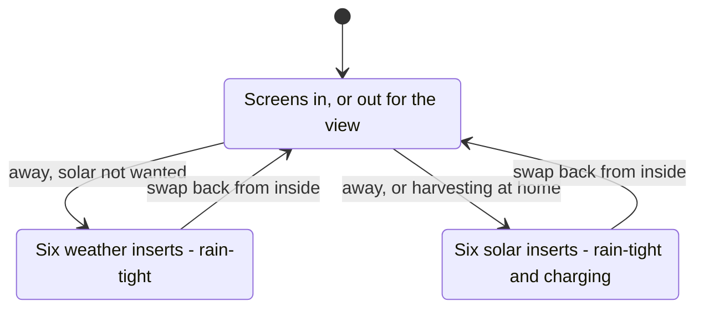
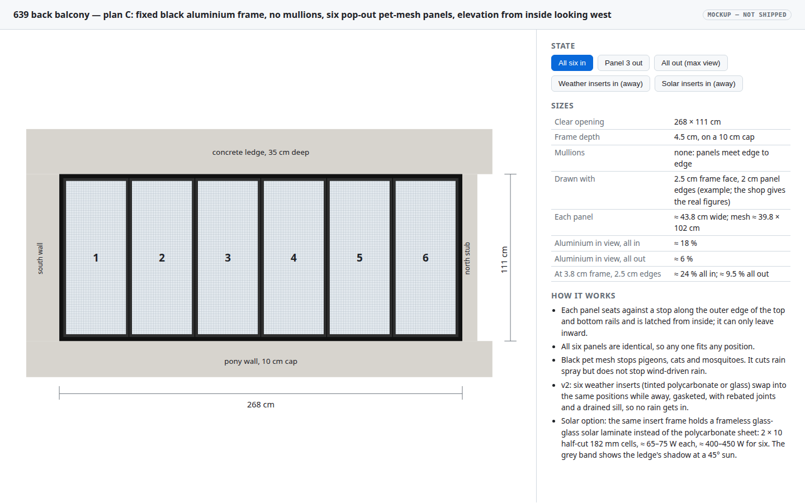
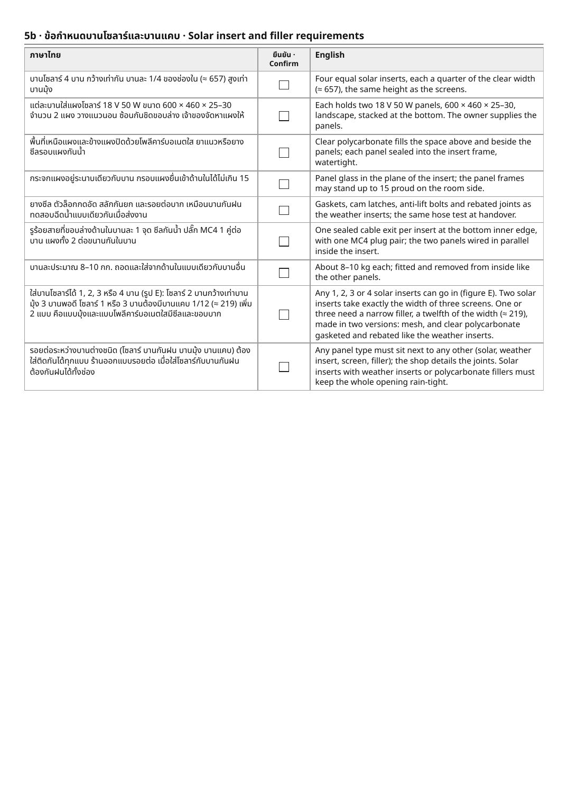

# Condo 639 back balcony: fixed screen frame with pop-out panels

9 November 2026 · **Ordered** (Will, 2026‑11‑08); **the shop has not started cutting** (Will, 2026‑11‑11), so the v3 sheet can still set the rail profiles. This is the plan for the balcony opening from now on. The earlier options, a motorised zip screen (plan A) and a glazed bi-fold window (plan B), are archived in the [balcony shade plan](2026-09-30-condo-balcony-shade.md), which also holds the game's level model of the balcony.

**TL;DR.** A fixed black aluminium frame, 4.5 cm deep, with no mullions, fills the 268 × 111 cm opening. Six identical panels stand side by side in its rails and come out from inside for the full view. Three panel sets share the rails: **pet-mesh screens** for daily use, **weather inserts** (tinted polycarbonate or glass) that make it rain-tight while Will is away, and optional **solar inserts**: eight stock 18 V 50 W panels from Lazada, two stacked sideways in each of four wider solar inserts (400 W, ≈ 268 kWh a year), or custom panels if a Thai maker will build six. Shop sheet: [v3](../rfq/2026-11-11-639-balcony-screen-frame-spec-v3.pdf) (give the shop this one); v1 and v2 are in the [archive](2026-11-11-condo-639-balcony-screen-frame-archive.md).

## Context

The back balcony of 639 opens west, on the 6th floor about 16 m up, into Bangkok afternoon sun, monsoon rain and gusts. Artificial grass covers the recessed patio floor, so **at least 99 % of rain must be kept out** while Will is away, or the grass goes mouldy. Pigeons must stay out of the balcony and the project room behind it, whose glass doors are usually open when Will is home, and cats and mosquitoes too. The frame is aluminium painted black, like the unit's other replacement windows.

Measured by Will (2026‑09‑30):

| Item | Value |
|---|---|
| Opening, clear | 268 cm wide × 111 cm tall, pony-wall cap to ledge soffit |
| Pony-wall cap | 10 cm thick |
| Concrete ledge above | 35 cm deep, about 64 cm tall, along the whole west wall; its outer edge is flush with the flat outside wall and it runs inward over the balcony (Will, 2026‑11‑11), so it does not shade the opening from outside |
| Jambs | full wall to the south, a 10 cm stub to the north |
| Frame depth | 4.5 cm, on the 10 cm cap |
| Ventilation | a side window lets air through at all times (Will, 2026‑11‑08) |

## Design: fixed frame, six pop-out pet-mesh screens

A fixed aluminium frame, painted black like the unit's other replacement windows, fills the 268 × 111 cm opening. It has **no mullions**: six removable screen panels stand side by side in the top and bottom rails and meet edge to edge. With all six panels in, the screens keep out mosquitoes and pigeons. With them out, the opening holds only the perimeter frame. Will has asked the shop for **pet-resistant mesh**, mainly against pigeons and also against cats. The **frame is 4.5 cm deep**, so it sits on the 10 cm pony-wall cap with 5.5 cm to spare.

**View arithmetic.** With an outer frame face *F*, the clear opening is (268 − 2*F*) × (111 − 2*F*) and each panel is a sixth of the width. Each panel also has its own edge frame of width *S*, so where two panels meet, 2*S* of aluminium shows. The shop has not given these widths yet, so here are two plausible pairs:

| Frame face *F*, panel edge *S* | Each panel | Mesh per panel | Aluminium in view, all panels out | Aluminium in view, all panels in |
|---|---|---|---|---|
| 2.5 cm, 2 cm | ≈ 43.8 cm wide | ≈ 39.8 × 102 cm | ≈ 6 % | ≈ 18 % |
| 3.8 cm, 2.5 cm | ≈ 43.4 cm wide | ≈ 38.4 × 98 cm | ≈ 9.5 % | ≈ 24 % |

With every panel out, only the perimeter frame stays in the view. With all six in, the view is through mesh, and the five panel joints read as 4–5 cm black lines. The panel height runs into the rails' rebates, and the shop sets that.

**Requirements and frame details** are in the [v3 shop sheet](../rfq/2026-11-11-639-balcony-screen-frame-spec-v3.pdf) ([HTML](../rfq/2026-11-11-639-balcony-screen-frame-spec-v3.html)), each with a confirm box for the shop: panels fit and leave from inside only, against outer stops on the head and sill; brush seals on the screens and EPDM gaskets on the inserts, pressed by cam latches, with an anti-lift bolt; a **continuous latch channel** along the head and sill so panels of any width lock in; rebated joints between inserts; a drained sill (outer stop 25, water dam 18, baffled weeps) and a 45 mm head with 25 mm lift and a drip edge; rails anchored along the 268 cm span; powder-coated black aluminium with stainless fixings; a hose test at handover. The superseded v1 and v2 sheets and their drawings are in the [archive]({A}.md).

**Rain.** Mesh cuts down rain spray but does not stop wind-driven rain, so the screens alone do not meet the 99 % rain rule. The weather inserts below do, for while Will is away.

## Weather inserts: no rain in while away

**Requested by Will, 2026‑11‑08:** polycarbonate (or thin glass) inserts to fit while he is away, so that no rain gets inside. Specified in a separate [v2 spec sheet](../rfq/2026-11-08-639-balcony-screen-frame-spec-v2.pdf) ([HTML](../rfq/2026-11-08-639-balcony-screen-frame-spec-v2.html)). The v1 sheet stays as it was.

The frame takes the six pet-mesh screens and six weather inserts with the same outer size and thickness in the same rails. Mesh cannot be made rain-tight, so the inserts replace the screens rather than going behind them.

**Insert sheet** (the sheet asks the shop to price and the owner to choose one): **solid polycarbonate 4–5 mm, UV-protected, grey or bronze tint (recommended)**, about 3 kg per insert with its frame. It is unbreakable when handled 16 m up, and since the inserts are only in while Will is away, the tint costs nothing in view and cuts the heat in the closed-up balcony. The alternatives are clear polycarbonate (≈ 3 kg, for storms while home too, scratches more over the years), 5 mm tempered glass (≈ 6 kg, clearest, can shatter if knocked) or 6.38 mm laminated glass (≈ 7 kg, holds together if broken). Twin-wall polycarbonate is excluded because it cannot be seen through. These weights are estimates for one ≈ 44 × 106 cm insert.

**Acceptance.** A hose test at handover: with all six inserts in, spray every joint and edge, and the inside must stay dry.

**Storage.** The set not in use, six panels about 16 mm thick, stacks to roughly 10 cm.

**Ventilation.** The balcony's side window lets air through at all times (Will, 2026‑11‑08), so sealing the main opening with the inserts does not shut the balcony in. Neither the frame nor the inserts needs a vent slot, which would only be another way for rain to get in.

## Solar inserts

**Request** (Will, 2026‑11‑09, 2026‑11‑11): an optional set of solar panels in the frame, to go in while Will is away or whenever he would rather harvest power than have the view. The six screens set the look of the frame; the solar set need not match them ("6 panels was for aesthetics"). The research, including the options not chosen, is in the [solar research document](2026-11-11-condo-639-balcony-solar-research.md).

**Recommended (option B).** Eight 18 V 50 W stock panels, 600 × 460 mm, from Lazada (≈ ฿2,740 for eight delivered at the 2026‑11‑11 checkout, ฿1,299 each at list), turned sideways and stacked two high in **four inserts a quarter of the width (≈ 65.75 cm)**, clear polycarbonate filling the rest. 400 W rated and unshaded, since nothing projects over the opening outside: ≈ 268 kWh a year if fitted all year. Each insert ≈ 8–10 kg (estimate), sealed and latched like the weather inserts, one plug at the sill. Asking Sunnergy or NSTHAI for custom laminates in the six positions (option A, ≈ 420 W) remains open. Tilting the inserts in a deeper, 10 cm frame was tested and gains only about 2 % ([variation](2026-11-11-condo-639-balcony-solar-research.md#variation-a-10-cm-frame-with-the-solar-inserts-tilted)).

**Fitting 1, 2, 3 or 4 solar inserts** (Will, 2026‑11‑11). Two solar inserts take exactly the width of three screens (2 × ¼ = 3 × ⅙), so 2 solar + 3 screens or weather inserts fits with nothing extra. With one or three, the rest of the opening is simply left open, screens out (Will: "for non-even configurations, i'd just leave the screens out"), so each solar insert must lock securely on its own. The continuous latch channel allows every combination; only 4 solar, or 2 solar with 3 weather inserts, keeps the opening rain-tight.

**Payback.** The panels alone (≈ ฿2,740 delivered) pay back in about 2–3 years at MEA's 2026 rates if fitted all year; the whole off-grid kit (panels, a 20 A MPPT controller and a 12 V LiFePO4 battery, ≈ ฿5,600–12,800) in about 4.5–25 years, sooner if electricity prices rise. Savings count only power the battery's loads use. Details, sources and the price-rise scenarios are in the [research](2026-11-11-condo-639-balcony-solar-research.md#yield-value-and-payback).

**Wiring.** Every panel is wired in parallel: the two in an insert join at their junction boxes, each insert has one plug at the sill on the room side, and the four plugs meet at a branch connector before a 20 A MPPT controller indoors. In parallel each panel works on its own, so one dirty or failed panel does not drag down the rest. Eight 50 W panels give at most ≈ 22 A at full sun, which a vertical west wall never sees; the controller simply caps the charge on a rare bright moment. An insert still pops out after one unplug.

**Where the power goes: an off-grid battery, no grid-tie inverter** (Will, 2026‑11‑09). The solar inserts go in while Will is away, and also whenever he would rather harvest power than have the view, since the condo has other windows (Will, 2026‑11‑11). The panels charge a battery that keeps the router, sensors or a fan running while he is away and powers small loads such as a fan, lights or charging when he is home, which fits the [home backup power research](/home/will/docs/plans/2026-10-07-home-backup-power.md). Nothing feeds the condo wiring, so no MEA approval or juristic-person consent is needed for it.

**Mixing sets.** Screens and weather inserts mix freely; solar inserts go in 4 at a time, 2 beside three screens or weather inserts, or 1 or 3 with the rest open. The opening is rain-tight only when every position holds a weather or solar insert.

## Mockups

**Elevation**: the black perimeter frame with six panels meeting edge to edge, drawn with a 2.5 cm frame face and 2 cm panel edges. Buttons switch between all six screens in, panel 3 out, all out, weather inserts in, custom solar inserts in (option A), and the four-insert stock solar set (option B). [Open the interactive mockup](2026-11-09-condo-639-balcony-screen-frame/elevation-plan-c.html).

**v3 sheet, pages 4–5**: the four solar inserts with dimensions, the continuous latch channel seen from inside with the latch points of both panel widths, a section through the sill rail, the 1–4 solar combinations, and the solar requirements with confirm boxes, generated by [`build_solar_sheet_svgs.py`](2026-11-09-condo-639-balcony-screen-frame/build_solar_sheet_svgs.py) and assembled into the sheet by [`build_spec_v3.py`](2026-11-09-condo-639-balcony-screen-frame/build_spec_v3.py).

## Open questions

1. **Frame face, panel edge and panel size.** These are blank on the spec sheet for the shop to fill in. The view arithmetic uses 2.5 cm / 2 cm and 3.8 cm / 2.5 cm until the shop gives the real figures.
2. ~~**Has the shop started cutting the frame?**~~ Answered 2026‑11‑11: no (Will). Give the shop the v3 sheet before it starts: v3 changes the rail profiles from v1 (a deeper head, a taller sill stop, a higher dam, baffled weeps, a drip edge, a flat gasket landing and the continuous latch channel).
3. ~~**Where does the solar power go?**~~ Answered 2026‑11‑09: an off-grid battery; no grid-tie inverter (Will). Still to size: the battery and the loads it runs.
4. ~~**Mixed sets.**~~ Answered 2026‑11‑11: the v3 sheet requires a solar insert to sit next to a screen or a weather insert, with the joints detailed by the shop, and 2 solar inserts with 3 weather inserts to keep the opening rain-tight.
5. ~~**Does this replace the zip screen and the bi-fold?**~~ Answered 2026‑11‑09: yes, this is the plan going forward (Will); plans A and B are archived.
6. ~~**Heat and damp while sealed.**~~ Answered 2026‑11‑08: the side window lets air through at all times (Will), so the balcony is not a closed box with the inserts in. The frame and inserts need no vent of their own.
7. ~~**Latches at any panel width?**~~ Answered 2026‑11‑11: the shop fabricates to specification (Will), so the v3 sheet requires a continuous latch channel along the head and sill, drawn on its page 4.

## Out of scope

- Choosing the shop or the price; the frame is already ordered.
- A level-model version of the frame in the game's condo level, which still models the archived zip screen.
- A grid-tie inverter or any connection of the solar set to the condo wiring (Will, 2026‑11‑09).

## Verification

Handover checks, each recorded here with a photo or a note when done:

1. The shop's real head, sill, jamb and joint sections arrive before cutting and match the v3 sheet: outer stops, lift space larger than the dam, gaskets on the inserts, baffled weeps.
2. Every panel of each set comes out and goes back from inside, and none can be pushed outward from inside or lifted out with its bolt engaged.
3. With the six screens in, no gap anywhere is wider than 1 mm.
4. Hose test with all six weather inserts in: spray every joint and edge; the inside stays dry.
5. If solar inserts are bought: each one's open-circuit voltage is about 14 V in sun, and the hose test is repeated with the solar set in.
