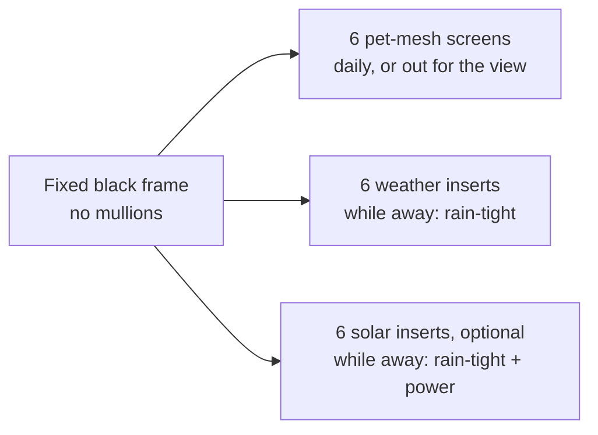
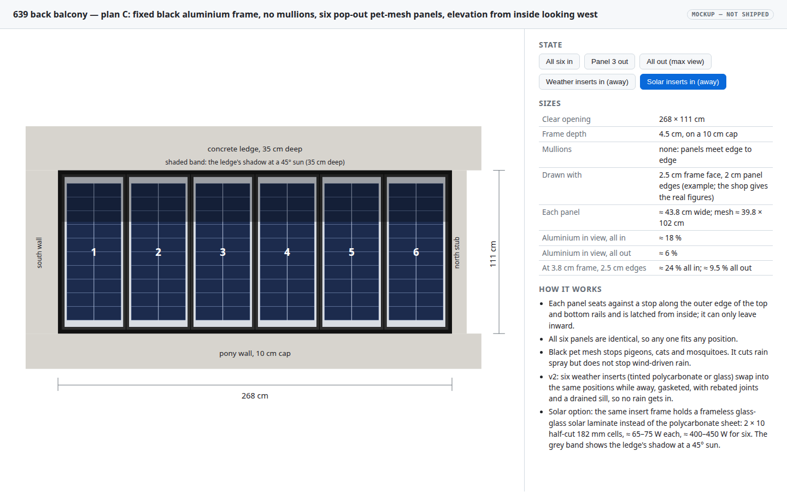
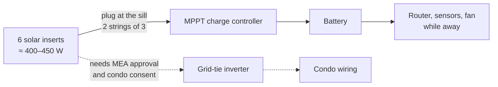
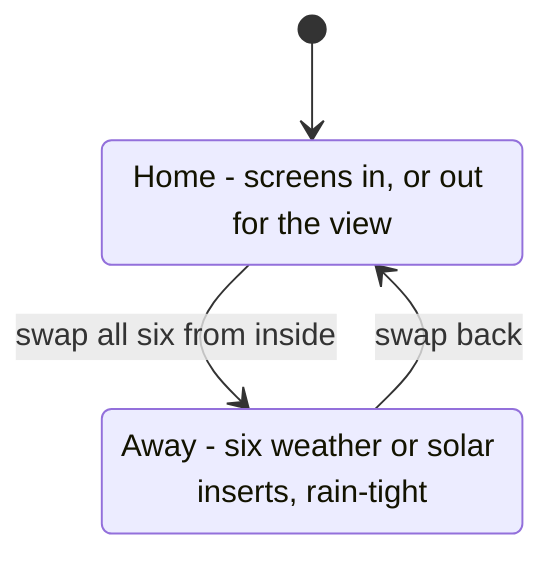
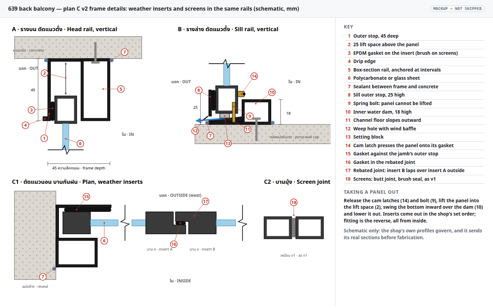
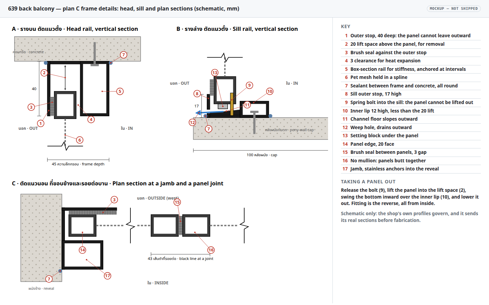

# Condo 639 back balcony: fixed screen frame with pop-out panels

9 November 2026 · **Being built** (Will, 2026‑11‑08). This is the plan for the balcony opening from now on. The earlier options, a motorised zip screen (plan A) and a glazed bi-fold window (plan B), are archived in the [balcony shade plan](2026-09-30-condo-balcony-shade.md), which also holds the game's level model of the balcony.

**TL;DR.** A fixed black aluminium frame, 4.5 cm deep, with no mullions, fills the 268 × 111 cm opening. Six identical panels stand side by side in its rails and come out from inside for the full view. Three panel sets share the rails: **pet-mesh screens** for daily use, **weather inserts** (tinted polycarbonate or glass) that make it rain-tight while Will is away, and optional **solar inserts**, about 400–450 W for six. Shop sheets: [v1](../rfq/2026-11-08-639-balcony-screen-frame-spec.pdf) (screens only) and [v2](../rfq/2026-11-08-639-balcony-screen-frame-spec-v2.pdf) (screens and weather inserts; give the shop this one).

## Context

The back balcony of 639 opens west, on the 6th floor about 16 m up, into Bangkok afternoon sun, monsoon rain and gusts. Artificial grass covers the recessed patio floor, so **at least 99 % of rain must be kept out** while Will is away, or the grass goes mouldy. Pigeons must stay out of the balcony and the project room behind it, whose glass doors are usually open when Will is home, and cats and mosquitoes too. The frame is aluminium painted black, like the unit's other replacement windows.

Measured by Will (2026‑09‑30):

| Item | Value |
|---|---|
| Opening, clear | 268 cm wide × 111 cm tall, pony-wall cap to ledge soffit |
| Pony-wall cap | 10 cm thick |
| Concrete ledge above | 35 cm deep, about 64 cm tall, along the whole west wall |
| Jambs | full wall to the south, a 10 cm stub to the north |
| Frame depth | 4.5 cm, on the 10 cm cap |
| Ventilation | a side window lets air through at all times (Will, 2026‑11‑08) |

## Design: fixed frame, six pop-out pet-mesh screens

A fixed aluminium frame, painted black like the unit's other replacement windows, fills the 268 × 111 cm opening. It has **no mullions**: six removable screen panels stand side by side in the top and bottom rails and meet edge to edge. With all six panels in, the screens keep out mosquitoes and pigeons. With them out, the opening holds only the perimeter frame. Will has asked the shop for **pet-resistant mesh**, mainly against pigeons and also against cats. The **frame is 4.5 cm deep**, so it sits on the 10 cm pony-wall cap with 5.5 cm to spare.

**View arithmetic.** With an outer frame face *F*, the clear opening is (268 − 2*F*) × (111 − 2*F*) and each panel is a sixth of the width. Each panel also has its own edge frame of width *S*, so where two panels meet, 2*S* of aluminium shows. The shop has not given these widths yet, so here are two plausible pairs:

| Frame face *F*, panel edge *S* | Each panel | Mesh per panel | Aluminium in view, all panels out | Aluminium in view, all panels in |
|---|---|---|---|---|
| 2.5 cm, 2 cm | ≈ 43.8 cm wide | ≈ 39.8 × 102 cm | ≈ 6 % | ≈ 18 % |
| 3.8 cm, 2.5 cm | ≈ 43.4 cm wide | ≈ 38.4 × 98 cm | ≈ 9.5 % | ≈ 24 % |

With every panel out, only the perimeter frame stays in the view. With all six in, the view is through mesh, and the five panel joints read as 4–5 cm black lines. The panel height runs into the rails' rebates, and the shop sets that.

**Requirements on the spec sheet** ([HTML](../rfq/2026-11-08-639-balcony-screen-frame-spec.html), [PDF](../rfq/2026-11-08-639-balcony-screen-frame-spec.pdf)), each with a confirm box for the shop:

| Requirement | Why |
|---|---|
| Panels fit and come out **from inside only**, seated against a stop on the outer edge of the top and bottom rails | At 16 m, a panel must never be able to leave outward, whether pushed by a cat, a pigeon or a gust, and nobody should reach outside to handle one |
| A positive, lockable **latch** on every panel, not friction or springs alone | Wind suction on a west face pulls panels inward, and only the latch holds against that |
| **Pet mesh, black** | Pigeons and cats. Black mesh behind a black frame is the easiest to see through |
| Brush or rubber **seals**, including where panels meet, no gap over 1 mm | Mosquitoes get through any larger gap |
| Six **identical**, interchangeable panels | Any panel fits any position |
| **Expansion clearance** | A black frame in afternoon sun gets very hot and expands, so a tight fit jams. The seals should close the gap instead |
| **Bottom rail sloped outward with weep holes**, frame sealed to the concrete | Rain that gets through the mesh drains out |
| **Powder coat**, stainless fasteners | The panels are handled often, and wet paint chips at the edges |
| **No mullions**; top and bottom rails fixed to the concrete at intervals along their length | The rails alone carry the panels across 268 cm, so they must not sag or bow |
| Option: **clear polycarbonate inserts** the same size as the panels, priced separately | For the wet season, if wanted |

**Frame details** (page 2 of the spec sheet, and the [frame-detail mockup](2026-11-09-condo-639-balcony-screen-frame/frame-detail.html)). There are three schematic sections, with millimetre sizes given only as examples, because the shop's own profiles govern:

- **A, head rail:** a 40 mm deep outer stop, a brush seal, 3 mm clearance for heat expansion, and a 20 mm lift space above the panel. The box-section rail keeps the 268 cm span stiff and is anchored into the ledge soffit at intervals.
- **B, sill rail:** a 17 mm outer stop with a weep hole. The channel floor slopes outward, the panel stands on setting blocks, and the inner lip is 12 mm high, lower than the 20 mm lift. A spring bolt into the sill stops the panel being lifted out.
- **C, plan section:** the jamb is anchored into the reveal. At each joint the two 20 mm panel edges meet across a 3 mm brush seal, so a joint shows as about a 43 mm black line.

To take a panel out, release the bolt, lift the panel into the lift space, swing the bottom inward over the inner lip, and lower it out. All of this is done from inside. The sheet also asks the shop to send its real sections before fabrication. The SVG comes from [`build_frame_detail.py`](2026-11-09-condo-639-balcony-screen-frame/build_frame_detail.py).

**Rain.** Mesh cuts down rain spray but does not stop wind-driven rain, so the screens alone do not meet the 99 % rain rule. v2 below adds weather inserts that do, for while Will is away.

## v2: weather inserts so no rain gets in while away

**Requested by Will, 2026‑11‑08:** polycarbonate (or thin glass) inserts to fit while he is away, so that no rain gets inside. Specified in a separate [v2 spec sheet](../rfq/2026-11-08-639-balcony-screen-frame-spec-v2.pdf) ([HTML](../rfq/2026-11-08-639-balcony-screen-frame-spec-v2.html)). The v1 sheet stays as it was.

**Design.** The frame takes **two panel sets in the same rails**: the six pet-mesh screens, and six weather inserts with the same outer size and thickness. Mesh cannot be made rain-tight, so the inserts replace the screens rather than going behind them. To make the inserts rain-tight, three things change from v1:

| Change | v1 | v2 | Why |
|---|---|---|---|
| Seals | brush seals | seals live **on the panels**: brush on the screens, **EPDM bulb gaskets** on the inserts; the frame's outer stops are flat and continuous, with sealed corners | A brush stops insects, not water. A compressed gasket stops water |
| Latches | spring bolt only | **compression (cam) latches** press each panel outward onto its seal, plus the anti-lift bolt; sized for wind on solid inserts | A gasket only seals when it is squeezed, and a solid insert takes the full wind load that mesh lets through |
| Joints | butt joint | inserts have **rebated (shiplap) edges** with a gasket in the step; the shop details the end inserts and the fitting order | A butt joint with no mullion behind it is a straight path for rain |
| Sill | outer stop 17, inner lip 12, plain weep hole | outer stop **25**, inner **water dam 18**, sloped floor, **baffled** weep holes | A higher dam holds back water pushed in by gusts, and the baffle stops wind blowing rain back through the weep |
| Head | 40 deep, lift 20 | **45 deep, lift 25**, **drip edge** on the outer stop | Lift must still exceed the 18 dam so panels come out. The drip edge sheds water before it reaches the gasket |

**Insert sheet** (the sheet asks the shop to price and the owner to choose one): **solid polycarbonate 4–5 mm, UV-protected, grey or bronze tint (recommended)**, about 3 kg per insert with its frame. It is unbreakable when handled 16 m up, and since the inserts are only in while Will is away, the tint costs nothing in view and cuts the heat in the closed-up balcony. The alternatives are clear polycarbonate (≈ 3 kg, for storms while home too, scratches more over the years), 5 mm tempered glass (≈ 6 kg, clearest, can shatter if knocked) or 6.38 mm laminated glass (≈ 7 kg, holds together if broken). Twin-wall polycarbonate is excluded because it cannot be seen through. These weights are estimates for one ≈ 44 × 106 cm insert.

**Acceptance.** A hose test at handover: with all six inserts in, spray every joint and edge, and the inside must stay dry.

**Storage.** The set not in use, six panels about 16 mm thick, stacks to roughly 10 cm.

**Ventilation.** The balcony's side window lets air through at all times (Will, 2026‑11‑08), so sealing the main opening with the inserts does not shut the balcony in. Neither the frame nor the inserts needs a vent slot, which would only be another way for rain to get in.

**Details** are on page 3 of the v2 sheet and in the [v2 frame-detail mockup](2026-11-09-condo-639-balcony-screen-frame/frame-detail-v2.html), generated by [`build_frame_detail_v2.py`](2026-11-09-condo-639-balcony-screen-frame/build_frame_detail_v2.py). Section A is the head with an insert, B the sill with an insert and its cam latch, C1 the inserts at a jamb and at a rebated joint, and C2 the unchanged screen joint.

## Solar inserts instead of polycarbonate

**Request** (Will, 2026‑11‑09): the option to fit solar panels in the frame instead of the screens or the weather inserts, using new panels made for it, or the six existing positions if that can seal the opening in place of polycarbonate.

**Answer: yes, the six positions work.** A solar insert is the v2 weather insert with a **frameless glass-glass solar laminate in place of the polycarbonate sheet**. It keeps the same insert frame, EPDM gaskets, rebated joints and cam latches, so it seals as well as the polycarbonate, in the same rails, with **no change to the frame or the v2 sheet**. The insert's glazing pocket already takes up to 6.38 mm laminated glass, and a 2 mm + 2 mm glass-glass laminate is about 5 mm thick. Solar inserts can therefore be ordered later, to the sheet size the shop gives for the polycarbonate.

**What fits.** Each position shows a sheet of about 39.8 × 102 cm (2.5 cm frame face, 2 cm panel edges) or 38.4 × 98 cm (3.8 cm, 2.5 cm). Two columns of today's standard 182 mm cells, cut in half (182 × 91 mm), make a block 36.4 cm wide, and ten rows make it about 93 cm tall, which fits either case:

| Item | Per insert | Six inserts |
|---|---|---|
| Cells | 2 × 10 half-cut 182 mm cells, ≈ 36 × 93 cm | 120 |
| Power (STC, estimate) | ≈ 65–75 W | ≈ 400–450 W |
| Open-circuit voltage | ≈ 14 V | two strings of three, ≈ 43 V each |
| Laminate | ≈ 5 mm glass-glass, cut to the polycarbonate sheet size | |
| Weight with insert frame | ≈ 5 kg, like the tempered-glass option | ≈ 30 kg |
| Yield, vertical west, Bangkok | | ≈ 1.7–2.2 kWh per kW per day by month before the ledge shade; ≈ 0.6 kWh/day for the set after it, only while fitted |

**No catalogue panel fits.** The near misses: a 70 W narrow panel at 1070 × 360 × 25 mm ([Exotronic](https://mygenerator.com.au/product/exotronic-70w-narrow-fixed-monocrystalline-solar-panel)) is 5 cm too tall; a 60 W panel at 830 × 400 × 25 mm ([Couleenergy](https://couleenergy.com/?p=4070)) is too wide for the 3.8 cm frame case; "slim" 100–130 W panels ([Rich Solar MEGA 130 Slim](https://richsolar.com/products/mega-130-slim-130-watt-12-volt-solar-panel)) are 1.5–1.7 m long. Framed panels are also 25–35 mm thick against the 16 mm insert. So the laminate is a custom size: dual-glass makers build to order ([Couleenergy custom dual-glass](https://couleenergy.com/?p=3930)), and six identical pieces is a small, simple order.

**Bigger new panels gain nothing.** With no mullions, the panel widths are free: three inserts of ≈ 87.7 cm or two of ≈ 131.5 cm would fit the same rails. But the power is set by the glass area, about 2.4 m² of the 2.97 m² opening, so it stays ≈ 400–450 W. Bigger inserts weigh ≈ 10–15 kg each to lift in 16 m up, need their own latch positions, and no longer swap with the screens. Six of one size is the better design.

**Yield and the ledge.** [PVGIS](https://re.jrc.ec.europa.eu/pvg_tools/en/) gives 671 kWh per kW per year for a vertical west face in Bangkok (13.70 N, 100.55 E, 14 % system losses), 46 % of the 1,472 at the best tilt of 17°. The 35 cm ledge shades the top of the panels whenever the sun is high: by a sun-path calculation, about a third of the direct sun reaching the sheets falls in its shadow, and direct sun is roughly half of what a west wall receives, so expect about 15–20 % less. That holds only if the **bypass diodes split each laminate into horizontal bands**, because the shadow moves down from the top; cells strung top to bottom would lose most of their output whenever the top row is shaded. So the six give about 230 kWh a year, ≈ 0.6 kWh a day, if fitted all year.

**Wiring.** An edge-mounted slim junction box on each laminate with short leads and plug connectors at the sill, on the room side, so an insert still pops out after one unplug and the set still stacks to about 10 cm. Two strings of three panels run to a small MPPT charge controller indoors.

**Where the power goes** is open question 3: the inserts are in only while Will is away, when nothing in the flat uses much. An off-grid battery could keep the router, sensors or a fan running while away, which fits the [home backup power research](/home/will/docs/plans/2026-10-07-home-backup-power.md). Feeding the condo's wiring needs a grid-tie inverter and MEA's approval, and Thailand's rules are being eased ([Tilleke & Gibbins, 2025](https://www.tilleke.com/insights/thailand-eases-rules-for-solar-rooftop-installations/15/)), but nothing found covers a small plug-in system in a condo or the juristic person's consent.

**Mixing sets.** All three sets have the same outer size, so positions can mix, for example solar at the ends and screens in the middle. A solar or weather insert has a rebated edge and a screen does not, so the joint between two different kinds needs a detail from the shop (open question 4). Rain-tightness needs all six positions sealed (inserts or solar).

## Mockups

**Elevation**: the black perimeter frame with six panels meeting edge to edge, drawn with a 2.5 cm frame face and 2 cm panel edges. Buttons switch between all six screens in, panel 3 out, all out, weather inserts in and solar inserts in. [Open the interactive mockup](2026-11-09-condo-639-balcony-screen-frame/elevation-plan-c.html).

**v2 frame details**: weather inserts and screens sharing the same rails, with gaskets, cam latch, rebated insert joint, 25/18 drained sill and drip edge. [Open the mockup](2026-11-09-condo-639-balcony-screen-frame/frame-detail-v2.html).

**v1 frame details**: head, sill and plan sections for screens only, with a numbered key and the removal sequence. [Open the mockup](2026-11-09-condo-639-balcony-screen-frame/frame-detail.html).

## Open questions

1. **Frame face, panel edge and panel size.** These are blank on the spec sheet for the shop to fill in. The view arithmetic uses 2.5 cm / 2 cm and 3.8 cm / 2.5 cm until the shop gives the real figures.
2. **Has the shop started cutting the frame?** v2 changes the rail profiles from v1: a deeper head, a taller sill stop, a higher dam, baffled weeps, a drip edge and a flat gasket landing. Give the shop the v2 sheet before fabrication, or ask what can still change.
3. **Where does the solar power go?** An off-grid battery for loads that run while Will is away, or a grid-tie inverter into the condo wiring, which needs MEA approval and probably the juristic person's consent. Decide before ordering solar inserts; the controller and the cable route follow from it.
4. **Mixed sets.** Can a screen sit next to a weather or solar insert? The inserts have rebated edges and the screens do not. Ask the shop to detail that joint, or keep each set whole.
5. ~~**Does this replace the zip screen and the bi-fold?**~~ Answered 2026‑11‑09: yes, this is the plan going forward (Will); plans A and B are archived.
6. ~~**Heat and damp while sealed.**~~ Answered 2026‑11‑08: the side window lets air through at all times (Will), so the balcony is not a closed box with the inserts in. The frame and inserts need no vent of their own.

## Out of scope

- Choosing the shop or the price; the frame is already ordered.
- A level-model version of the frame in the game's condo level, which still models the archived zip screen.
- Buying solar inserts before open question 3 is answered.

## Verification

Handover checks, each recorded here with a photo or a note when done:

1. The shop's real head, sill, jamb and joint sections arrive before cutting and match the v2 sheet: outer stops, lift space larger than the dam, gaskets on the inserts, baffled weeps.
2. Every panel of each set comes out and goes back from inside, and none can be pushed outward from inside or lifted out with its bolt engaged.
3. With the six screens in, no gap anywhere is wider than 1 mm.
4. Hose test with all six weather inserts in: spray every joint and edge; the inside stays dry.
5. If solar inserts are bought: each one's open-circuit voltage is about 14 V in sun, and the hose test is repeated with the solar set in.
