# Sea Stars: an eleventh aquarium tank of Indo-Pacific starfish

**Status: draft, 2026‑11‑10.** Waiting on Will's answers to D1–D10. Nothing is built yet.

## Context

Will asked on 2026‑11‑10: "i want to add a new tank level to the aquarium pack". Asked what kind of tank, he answered **"starfish"**. He then chose three things:

| Question | Will's answer |
|---|---|
| Setting | **Indo-Pacific display.** Any Indo-Pacific sea star is allowed, with no need to find a regional record (unlike the Gulf of Thailand reef) |
| What the player steers | **A starfish.** One sea star, steered across the sand and the glass |
| Roster | **Several species**: 4–6 kinds that differ in shape and colour |

The tank is the eleventh entry in the Android selector and the Dream list. It reuses the reef's shell, rock generator, `DFRM` v2 and style shading. **No engine change is expected**, and Phase 1 exists to prove it (see [Engine](#engine)).

Will then added two requirements while this plan was being written:

1. **"make sure there's a screensaver version, too"**: the `aquarium_sea_stars_screensaver` Dream variant. See [Screensaver](#screensaver).
2. **"there should be level settings (number of sea stars, etc.)"**: a Director-owned `SeaStarsSettings` object. See [Level settings](#level-settings).

### The content rule

**No species already in a tank** (Will, 2026‑11‑02; the [reef plan](2026-11-02-gulf-of-thailand-reef-tank.md#the-content-rule-will-20261102) records it). Meshes, rigs, controllers and shells may be reused. These species are taken: the clownfish and *Entacmaea quadricolor*, the blue shrimp, the betta, the jellyfish, the lionfish and its goldfish, *Diadema setosum*, *Hippocampus reidi*, the rainbow goby, the Asian arowana, the tiger barbs, and the reef roster (*Dascyllus reticulatus*, *Ostracion cubicus*, *Stenopus hispidus*, *Trapezia cymodoce*, *Tridacna squamosa*, *Phyllidia varicosa*, *Lamprometra palmata*, the Christmas tree worms, the hermit crab and the feather dusters).

The roster below doesn't repeat any of them. ***Linckia laevigata*** was in the reef's first roster, but it was dropped before anything was built ("no Gulf record", [research](../reference/thai-reef-research.md)). It has never been in a tank, so the rule allows it.

There's no shared species list to check this against. The reef plan's check (its verification step 5) was never written: `tests/test_aquarium_thai_reef.py` has no species test. This plan adds the list, `wflevels/aquarium_species.json` with one entry per tank, and a test that fails if two tanks share a species ([verification](#verification) step 6).

### What exists today

- **Ten tanks** are in [`aquarium-menu.manifest`](../../wflevels/aquarium-menu.manifest) and in [`TankChoice.java`](../../android/screensaver/src/main/java/org/worldfoundry/screensaver/TankChoice.java) (`IDS`, `LABELS`). The engine menu shows 6 rows and scrolls.
- **`DFRM` v2 has landed.** It allows up to 16 curves in one mesh, with a per-curve clip, start time and flex bias. A five-armed star is one actor with five curves ([reef plan, E1–E7](2026-11-02-gulf-of-thailand-reef-tank.md#engine-proposal-dfrm-v2-several-curves-in-one-mesh)).
- **Style shading S1–S3 has landed**, off by default. S2 caustics cost 0.55 ms a frame on cast1 ([evidence](../diagnostics/reef-style-metal-2026-11-09/README.md)). Caustics moving over open sand are this tank's main visual.
- **The reef Dream ships as Release** at 21.8 FPS on cast1 ([evidence](../diagnostics/dream-release-2026-11-09/README.md)). It has 16 animated actors and a dense static reef. This tank has 10 animals and far less static geometry, so the reef's ≥ 20 FPS gate should be easy to meet.
- **Crawling over surfaces resolved at export** is an existing pattern. The blue shrimp crawl along authored routes with known heights, and the reef's nudibranch crawls along an authored path. A type scan or ray cast at runtime would break the house rule: resolve at export, not at runtime.
- **`scripts/build-aquarium-screensaver-levels.py`, `scripts/build-object-properties.py` and `tests/test_aquarium_screensaver_catalog.py` have uncommitted changes from other work.** Phase 5 merges on top of them and never commits them.

## Decisions for Will

Each row gives a recommendation and its alternatives. Answering "D1–D10: all yes" accepts every recommendation.

| # | Decision | Recommendation | Alternatives |
|---|---|---|---|
| D1 | Name | **"Sea Stars"** in the TV menu and the Dream list; level id `aquarium_sea_stars` | "Starfish" (the familiar word, though biologists avoid it because they aren't fish); "Starfish Lagoon" |
| D2 | The player's species | **Blue sea star, *Linckia laevigata*.** Bright blue reads well on a TV, its long round arms show the bending clearly, and it's the best-known sea star | Chocolate-chip star *Protoreaster nodosus*: chunkier, but tan on tan sand reads poorly |
| D3 | The residents | **5 species, 9 animals:** 2 chocolate-chip stars, 3 red *Fromia*, 2 sand-sifting stars, 1 green brittle star, 1 cushion star ([roster](#roster)) | Drop the brittle star (it's an ophiuroid, not a true sea star). Add a *Choriaster* (granulated sea star) |
| D4 | Glass climbing | **Yes, on all four walls.** On the front glass the camera sees the underside: the tube-foot grooves and the mouth, a typical aquarium view | Sand only, with the glass as a wall. Simpler, but the tank loses its best moment |
| D5 | Speed | **Real speed ×30 for the player and ×20 for the residents**; the brittle star bolts at ×6 the stars' speed. Real speeds (centimetres per minute) are checked in Phase 0 | Real speed: true to life, but too slow to steer |
| D6 | Visual style | **One style, realistic**, with S1 clear-lagoon absorption and S2 caustics on | Two styles (realistic and anime) like the reef: twice the art and twice the acceptance work |
| D7 | Frame-rate gate on cast1, wide idle | **≥ 20 FPS (≤ 50 ms)**, the reef's gate | ≥ 30 FPS. The reef manages 21.8 FPS, so 30 FPS is a target to measure against, not a promise |
| D8 | The A button | **Reach**: the star rears up on two arms for 2 s (sea stars do this to reach for food or to right themselves) | Swap the leading arm without moving. Or leave A unused |
| D9 | The settings | **Nine fields:** a count for each resident species, Speed (Slow, Normal, Fast), Glass climbing (Off, On), Caustics (Off, On) and Seed ([list](#level-settings)). The player's species is shown read-only | Fewer fields: counts and Seed only. Or add Player species (any of the five-armed stars), which needs an underside skin for each one |
| D10 | Maximum counts, and the gate at the maximum | **4 chocolate-chip, 5 *Fromia*, 4 sand-sifting, 2 brittle, 2 cushion** (17 residents). The D7 gate must also hold at the maximum. If it doesn't, Phase 4 lowers the maximums until it does, and doesn't ask for a slower gate | Allow a slower maximum (≥ 15 FPS at full population) and keep the higher counts |

## The tank

[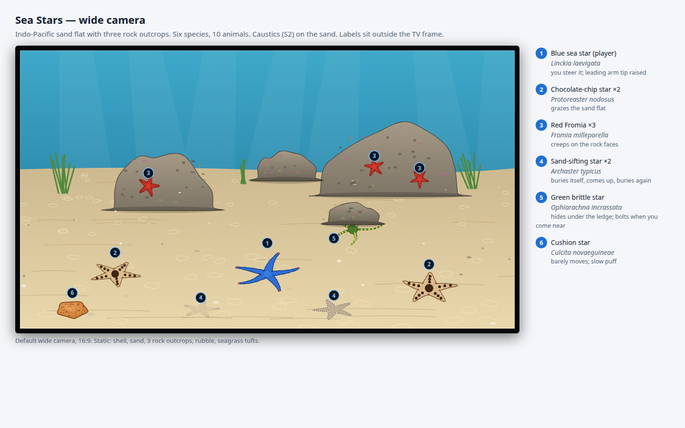](2026-11-10-starfish-tank/tank-wide.html)

- **The shell and cameras come from the reef**: `reef_shell.iff` and its wide and close cameras. The dimensions don't change, so the reef's collider and camera numbers carry over.
- **The floor is mostly open sand.** It's a flat plane at a known height, with ripples and pale rubble baked into the atlas, not modelled. Open sand is what makes the stars readable and lets the caustics show.
- **Three bare rock outcrops**, from the reef's rockscape generator with the coral dressing turned off. The rock keeps the coralline crust, pits and a little turf. A low ledge in front of the big outcrop is the brittle star's hide.
- **Seagrass tufts** in three clumps at the back corners and the middle. They're static and simple, and one species (*Thalassia hemprichii*, checked in Phase 0) is enough.
- **Static budget:** at most **20,000 triangles** in at most four static groups (the reef's static reef is far larger). Phase 2 measures the empty tank on cast1 against **≤ 38 ms**, the same early gate the reef used.

## Roster

| # | Species | Count | Look | Behaviour | Actor |
|---|---|---|---|---|---|
| 1 | Blue sea star, *Linckia laevigata* (D2) | 1, the player | cobalt blue, long round arms, a red eyespot at each tip | glides with a leading arm; climbs the glass; rears up on A | 1 actor, **5 curves**, plus an underside skin |
| 2 | Chocolate-chip star, *Protoreaster nodosus* | 2 | tan with dark brown knobs along the arms and on the disc | wanders the sand between grazing spots and pauses 20–60 s at each | 1 actor each, 5 curves |
| 3 | Red *Fromia*, *Fromia milleporella* | 3 | small, bright red, fine dark dots | creeps along authored routes on the rock faces | 1 actor each, 5 curves |
| 4 | Sand-sifting star, *Archaster typicus* | 2 | pale grey-brown, flat, a fringe of edge plates | buries itself; rises, glides 20–40 cm, sinks again; sinks at once if the player touches it | 1 actor each, 5 curves |
| 5 | Green brittle star, *Ophiarachna incrassata* | 1 | green disc, long thin arms banded yellow-green | hides under the ledge with arm tips out; bolts to another ledge when the player comes within 25 cm | 1 actor, 5 curves |
| 6 | Cushion star, *Culcita novaeguineae* | 1 | a pentagonal orange cushion with a darker net pattern, almost no arms | barely moves; swells 8 % and settles over 10 s | 1 actor, **transforms only** |

That's **10 animated actors**: one player and nine residents. Every star mesh comes from a single parametric generator (arm count, length, taper, disc size and surface pattern), so a new species costs a parameter row and an atlas cell, not a new model.

Phase 0 checks every size, colour and behaviour above against a source before it's built. Will chose a display tank, so no regional record is needed, but the behaviours the director acts out have to be real.

[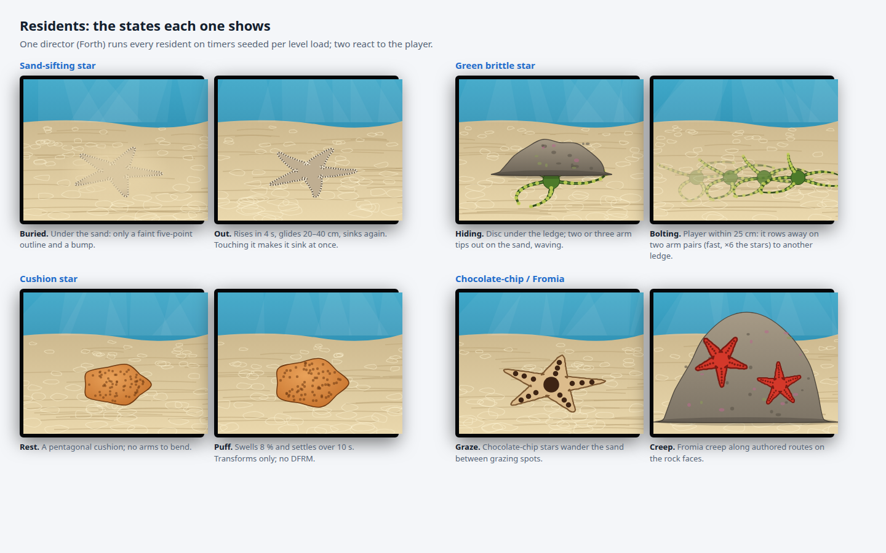](2026-11-10-starfish-tank/residents.html)

## The player

[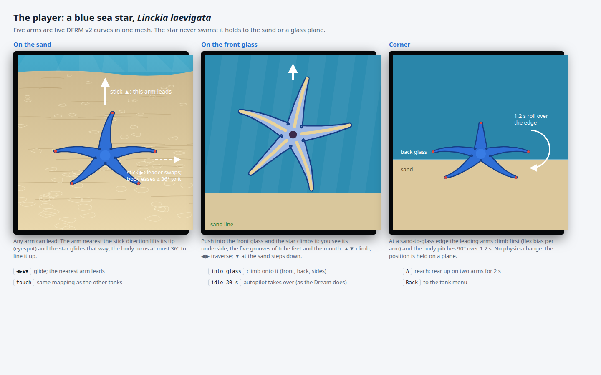](2026-11-10-starfish-tank/player.html)

**A sea star has no front, and its controls follow from that.** Any arm can lead. The stick picks a direction. The arm nearest that direction becomes the leader: its tip lifts (the eyespot looks ahead) and the star glides that way. The body turns at most 36° (half the 72° between arms) to line the leader up. So pushing the stick sideways swaps the leader instead of spinning the star round.

| Input | On the sand | On a glass wall |
|---|---|---|
| Stick | glide in that direction; the nearest arm leads | ▲▼ climb or descend, ◀▶ move along the wall |
| Push into the glass | start climbing it (the corner roll) | — |
| ▼ at the sand line | — | step back down onto the sand |
| A (D8) | reach: rear up on two arms for 2 s | reach away from the glass |
| Touch | the same mapping as the other tanks' touch profile | |
| No input for 30 s | the autopilot takes over, as the Dream driver does | |

**Surfaces are planes that are known at export.** The sand is `z = sand_z`. Each glass wall is a plane, inset by the star's half-thickness. The star's position is always on exactly one plane. Its orientation is the plane's normal, plus its heading within the plane. The rocks are Jolt colliders the star goes around. Climbing rocks is [out of scope](#out-of-scope).

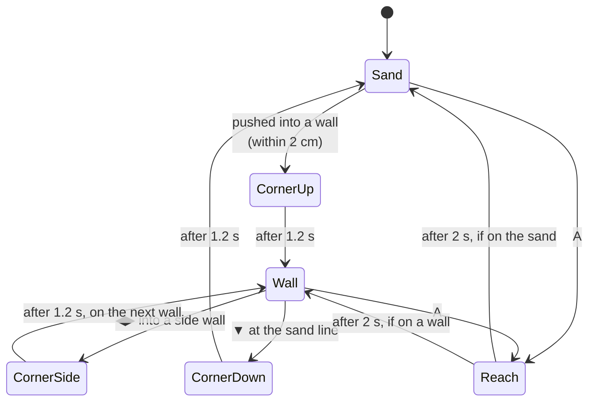

During a corner roll, the leading arms bend onto the new plane first (using the per-curve flex bias), and the body pitches through 90° over 1.2 s. The position moves along a quarter circle whose radius is the star's half-thickness. No physics is involved: the controller sets the transform each frame.

**The screensaver driver** (`sea_stars_screensaver.fth`, like each tank's `screensaver_player.fth`) chooses the next waypoint from a seeded list: sand spots, one trip up the front glass, one along the back glass. It waits 10–40 s at each. Both the idle autopilot and the Dream use it.

## Residents

One director, `star_director.fth`, runs all nine residents. Each one has a timer table seeded at level load. Two of them react to the player, and they find it through the player's mailbox position. The director never scans for it.

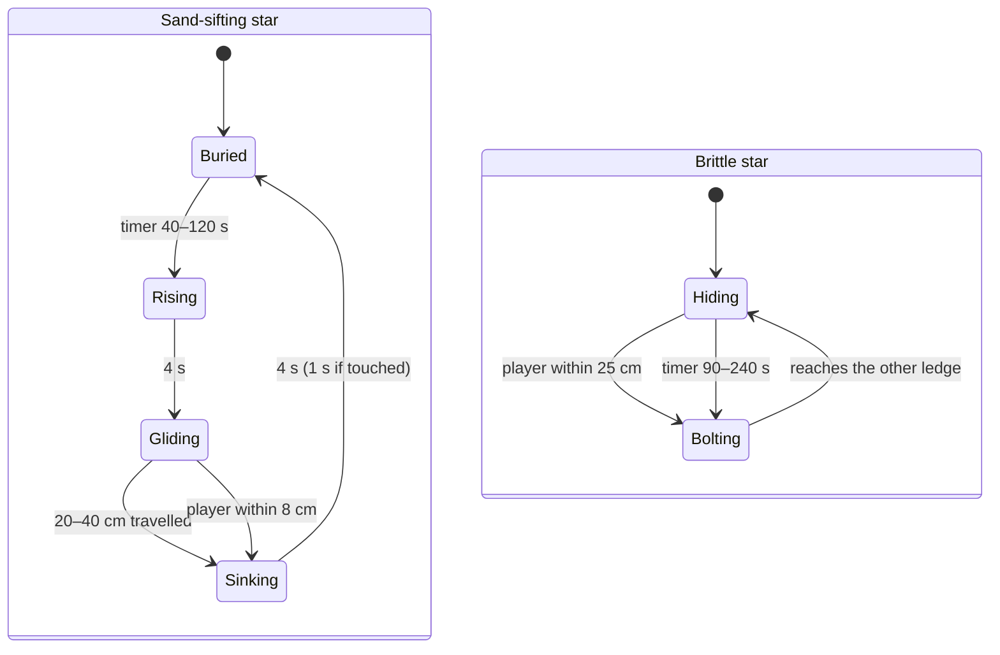

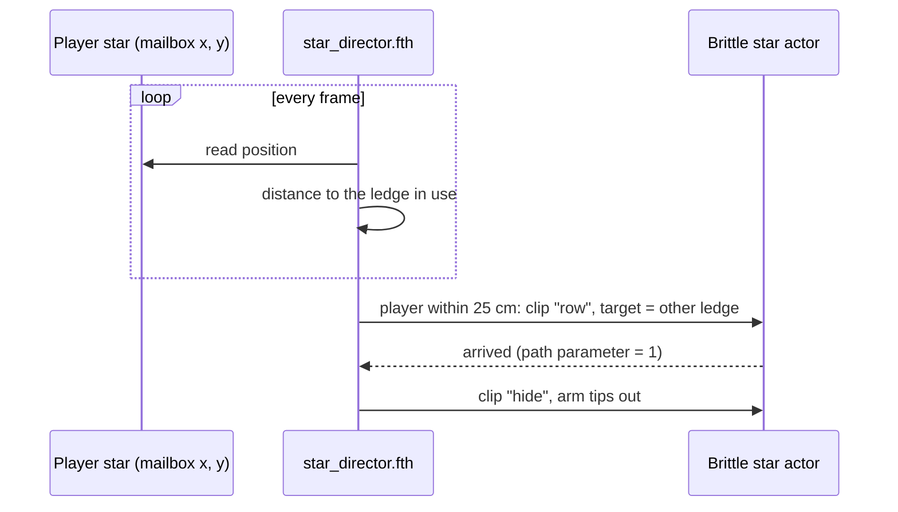

The chocolate-chip stars, the *Fromia* and the cushion star don't react. They run on timers alone, so the tank keeps moving when nobody is playing.

## Level settings

[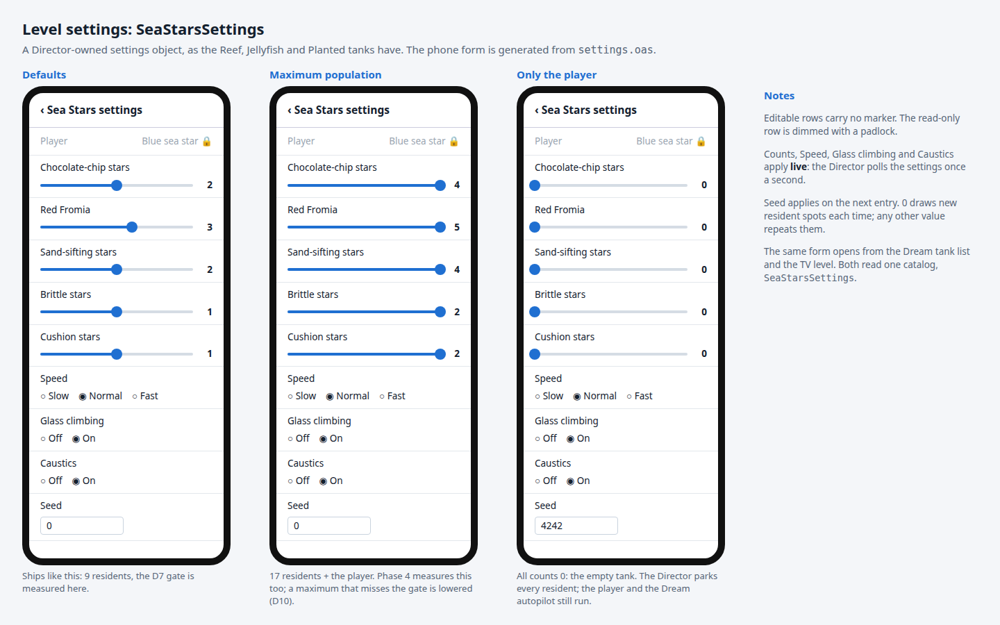](2026-11-10-starfish-tank/settings.html)

The tank gets a **Director-owned settings object**, `SeaStarsSettings`, like the reef's `ReefSettings` and the Jellyfish and Planted tanks' objects. It's the same machinery: `settings.oas` declares the fields, `settings-bindings.json` binds them to the Director, and `build-object-properties.py` attaches the RPRP catalog. The phone form is generated from the catalog. Runtime object editing is still parked, so nothing new is needed for this.

| Field | Kind | Range | Default | Applies |
|---|---|---|---|---|
| Chocolate-chip stars | slider | 0–4 | 2 | live |
| Red Fromia | slider | 0–5 | 3 | live |
| Sand-sifting stars | slider | 0–4 | 2 | live |
| Brittle stars | slider | 0–2 | 1 | live |
| Cushion stars | slider | 0–2 | 1 | live |
| Speed | radio | Slow, Normal, Fast (× 10, × 20, × 40 real speed for the residents; the player scales the same way) | Normal | live |
| Glass climbing | radio | Off, On | On | live; a star on the glass when it turns off climbs down first |
| Caustics | radio | Off, On (the S2 Camera field) | On | live |
| Seed | number | 0–16777215; 0 picks new resident spots on every entry | 0 | next entry |

**The level holds the maximum population (D10).** The `.lev` places all 17 residents. At level load, and again whenever a count changes, the Director **parks** the extras: they're hidden, moved out of view, and skipped in the director's update loop. A count that goes up unparks a resident at a free spot from the seeded list and fades it in over 2 s. The player is never parked. With every count at 0, the tank holds only the player, and the Dream autopilot still runs.

Phase 4 measures how much a parked actor costs. If a hidden actor still pays for its deform or its draw, parking has to skip both (that's still a Forth-side change, not an engine one). The D7 gate is measured at the defaults **and** at the maximum ([verification](#verification) step 9).

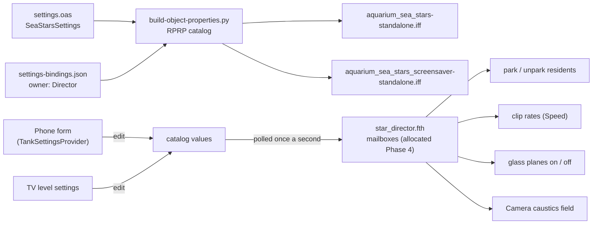

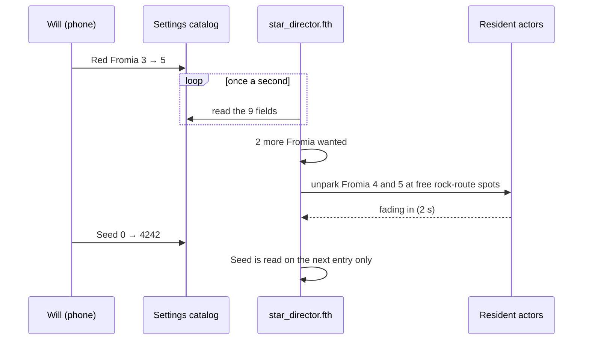

## Screensaver

[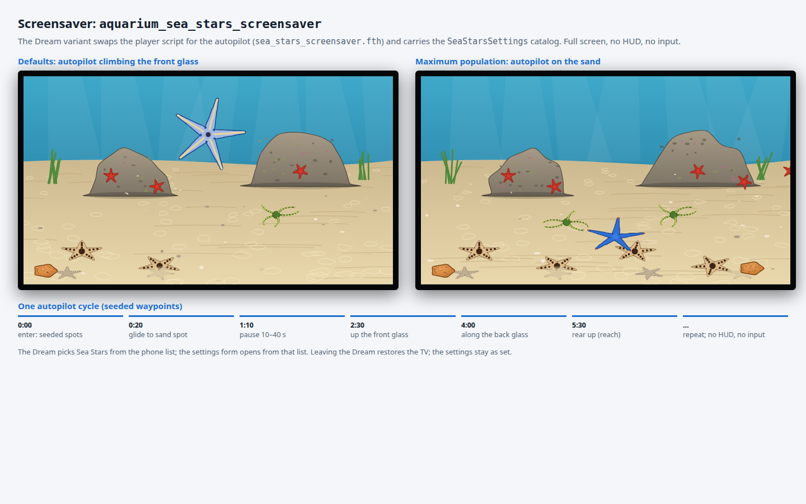](2026-11-10-starfish-tank/screensaver.html)

Every tank has a Dream variant, and so does this one: **`aquarium_sea_stars_screensaver`**. `scripts/build-aquarium-screensaver-levels.py` makes it from the canonical level in the usual way:

- It **swaps the player's script** for the autopilot, `sea_stars_screensaver.fth`, which drives the player star along seeded waypoints with no input. The same driver takes over in the playable level after 30 s of no input.
- It **attaches the `SeaStarsSettings` catalog**, so the phone's Dream settings edit the same nine fields. `check_tank_catalog` gets a Sea Stars branch that checks for the schema and its keys.
- It's **full screen, with no HUD and no input**, like the other Dream variants.
- `TankChoice.java` gets `aquarium_sea_stars` / "Sea Stars" as its eleventh entry, and `TankSettingsProvider` sends it to the phone unchanged.

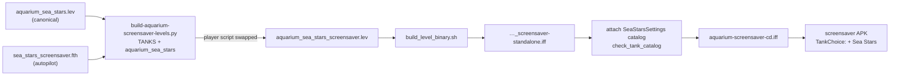

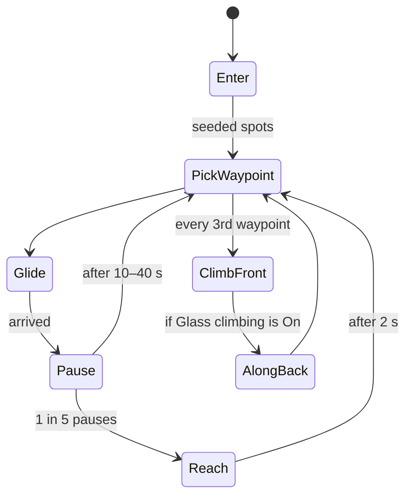

If Glass climbing is Off, the autopilot skips the glass legs, and every waypoint is on the sand.

## How the arms move

Each five-armed star is one mesh with one `DFRM` v2 curve per arm (5 of the 16 allowed). The clips come from the same generator for every species, scaled by arm length:

| Clip | Used by | What it does |
|---|---|---|
| `glide` | every star | a slow wave along each arm, out of phase between arms (the tube feet aren't modelled) |
| `lead` | player, chocolate-chip | the leading arm's tip lifts 15° and its eyespot faces the travel direction (set by the leader's flex bias) |
| `corner` | player | the leading arms bend 90° onto the new plane before the body follows |
| `reach` | player | two arms plant, three lift and curl up |
| `row` | brittle star | two arm pairs row and one arm leads, fast and snake-like |
| `hide` | brittle star | the disc is still and two or three tips wave |
| `bury` / `rise` | sand-sifting star | transforms only: it sinks 1 cm into the sand while the arms flatten |

The cushion star has no arms worth bending. Its puff is a scale transform.

**Mailboxes:** each animated actor needs its control-block cells. Phase 4 allocates a global range next to the reef's [table](2026-11-02-gulf-of-thailand-reef-tank.md#reef-global-mailbox-allocation) and records it there.

## Engine

**No engine change is planned.** Everything here uses features that already exist: `DFRM` v2, transforms, S1/S2 Camera fields, Jolt colliders, and the Forth bridge.

The risky part is holding the player on a plane. A swimming player already moves freely in 3D, so the crawl controller is a swimmer whose position the controller clamps to a plane every frame. Phase 1 proves this on the desktop before any art is made. If Jolt fights the clamp (gravity, depenetration jitter at the glass, or the player's collider snagging at a corner), **work stops and Will gets an engine proposal**, with scope and cost, as the reef did for `DFRM` v2.

## Phases

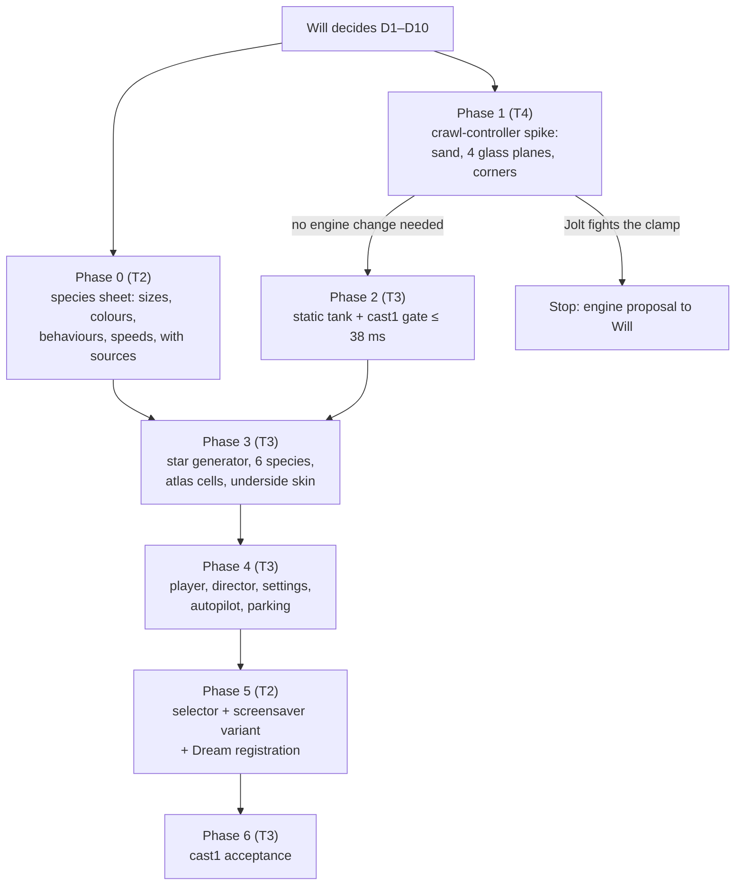

- **Phase 0, species sheet** (T2). This is `docs/reference/sea-stars-research.md`. For each species it records the size, colour, behaviour and real speed with a source, plus the seagrass species. Anything without a source is changed or dropped, and the changes come back to Will.
- **Phase 1, crawl-controller spike** (T4). A placeholder five-armed star goes in the reef shell with its colliders. The spike covers the leader-arm steering, the four glass planes, the corner roll and rock avoidance. It runs headless on the desktop with a trace test: a scripted input goes once round the tank and up the front glass, and the test asserts the star is always on a plane (within 1 mm) and inside the tank. Rank T4 because the result decides whether an engine change is needed.
- **Phase 2, static tank** (T3). The shell, sand, three outcrops, the ledge and the seagrass, built by `wflevels/aquarium_sea_stars/build.sh` in the Blender container and wrapped as `task aquarium-sea-stars-level`. `report_budget.py` prints the triangles in each static group. The early cast1 gate is ≤ 38 ms with no actors. If it misses, thin the rocks before Phase 3.
- **Phase 3, the stars** (T3). `stars.py` is the parametric generator. It makes six species, their atlas cells, and the player's underside skin (grooves and mouth), with five-curve `DFRM` v2 chunks written by `dfrm_chunk.py`. Desktop captures from the close camera go to Will for an art review.
- **Phase 4, behaviour** (T3). `sea_star_player.fth`, `star_director.fth` and `sea_stars_screensaver.fth`. `scripts/check-sea-stars.py --video` drives the player past the brittle star and over a sand-sifting star, and asserts each reaction within its timing window. **Settings:** `settings.oas`, `settings-bindings.json`, the Director's once-a-second poll, parking and unparking, and a desktop run at the maximum population with a measured cost per parked actor.
- **Phase 5, registration and the screensaver** (T2). One line is appended to the manifest, and the tank is added wherever the ten are listed ([files](#new-and-changed-files)). Indices 0–9 don't move. Also build the `aquarium_sea_stars_screensaver` variant with its catalog, add the `check_tank_catalog` branch, and add the `TankChoice.java` entry. The other session's uncommitted edits to `build-aquarium-screensaver-levels.py` stay uncommitted: merge on top of them and stage only this plan's hunks.
- **Phase 6, acceptance** (T3). Through the coordinator on cast1 (and cast2 if it's free): the selector and Back, the D7 frame gate at the defaults and at the maximum population, each over 120 s of wide idle, and a 10-minute Dream run, and a settings change made on the phone during the Dream that shows on the TV within 2 s. Then restore the device's original settings and Dream selection.

Work happens in a sparse worktree branched from `2026-new-level` (a full checkout is 4.2 GB). The finish line is a push to `2026-new-level`, with no PR to master.

[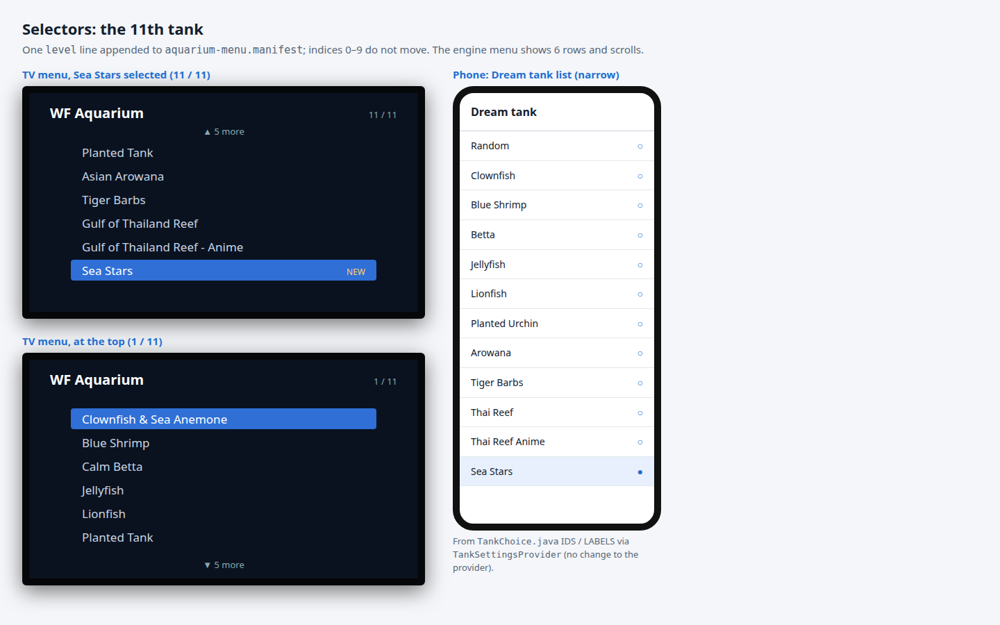](2026-11-10-starfish-tank/selectors.html)

## Pipeline: from generator to TV

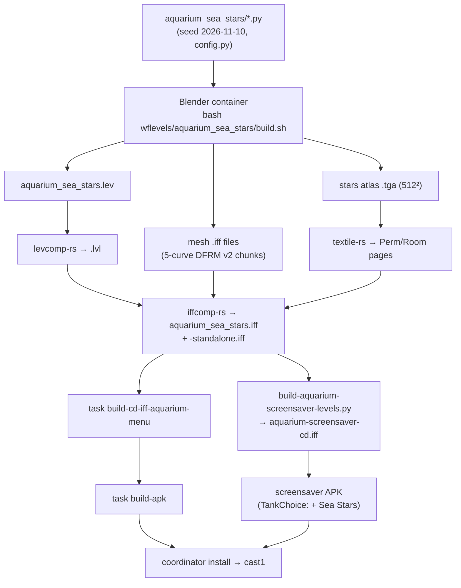

## New and changed files

| Path | New / changed | What |
|---|---|---|
| `wflevels/aquarium_sea_stars/` | new | `config.py`, `build.sh`, `run.sh`, `generate.py`, `stars.py`, `scene.py`, `report_budget.py`, `settings.oas`, `settings-bindings.json`; Forth: `sea_star_player.fth`, `star_director.fth`, `sea_stars_screensaver.fth` |
| `wflevels/aquarium_sea_stars_screensaver/` | new (generated) | the Dream variant, written by `build-aquarium-screensaver-levels.py`, gitignored like the other variants |
| `wflevels/aquarium_species.json` | new | each tank's species list, the source for the content-rule test |
| `scripts/check-sea-stars.py` | new | desktop reaction and trace capture |
| `tests/test_aquarium_sea_stars.py` | new | budgets, director timing tables, the plane-hold trace |
| `tests/test_sea_stars_settings.py` | new | the nine fields, their ranges and defaults, the bindings, park and unpark under count changes |
| `tests/test_aquarium_species.py` | new | no species in two tanks |
| `docs/reference/sea-stars-research.md` | new | the Phase 0 species sheet |
| `wflevels/aquarium-menu.manifest`, `Taskfile.yml` (`aquarium-sea-stars-level`, `build-cd-iff-aquarium-menu` deps), `scripts/aquarium-levels.sh`, `scripts/compare-level-build-routes.sh`, `scripts/build-aquarium-screensaver-levels.py` (`TANKS`, the `check_tank_catalog` branch), `scripts/build-aquarium-variant.py`, `android/screensaver/…/TankChoice.java` | changed | registration (Phase 5) |
| `tests/test_aquarium_menu.py`, `tests/test_aquarium_screensaver_input.py`, `tests/test_species_movement.py`, `tests/test_aquarium_screensaver_catalog.py` | changed | 11 tanks, the new TOC count, and the Sea Stars catalog |
| Engine | **none** | unless Phase 1 escalates |

## Out of scope

- Climbing the rocks. That needs surface data resolved at export for the rock meshes. The sand and the glass are planes, so they don't.
- Feeding, stomach eversion, regrowing arms, or anything carried over between sessions.
- An anime twin (D6), and an A3 poster (not asked for).
- Companion invertebrates such as urchins, sea cucumbers or a harlequin shrimp. Will chose several sea-star species instead.
- Choosing the player's species in the settings (D9 shows it read-only).

## Verification

1. The Phase 0 species sheet exists, and every size, colour, behaviour and speed the director uses has a source.
    ```
    grep -c 'https://' docs/reference/sea-stars-research.md
    ```
2. The crawl spike's trace test passes: the star stays on a plane within 1 mm, and inside the tank, through a full circuit, the front-glass climb and all four corner rolls.
    ```
    scripts/in-linux-container.sh python3 -m pytest tests/test_aquarium_sea_stars.py -k plane_hold -v
    ```
3. The level builds in the Blender container and rebuilds byte for byte.
    ```
    task aquarium-sea-stars-level && git status --porcelain wflevels/aquarium_sea_stars/
    task level-build-compare
    ```
4. The static budget holds: at most 20,000 triangles in at most four static groups.
    ```
    python3 wflevels/aquarium_sea_stars/report_budget.py
    ```
5. Director timing and the reactions: the brittle star bolts within 0.5 s of the player coming within 25 cm, and a touched sand-sifting star is buried within 1 s.
    ```
    WF_CONTAINER_IMAGE=linux-test scripts/in-linux-container.sh python3 scripts/check-sea-stars.py --video
    ```
6. The content rule: no species appears in two tanks' lists, and every tank has a list.
    ```
    scripts/in-linux-container.sh python3 -m pytest tests/test_aquarium_species.py -v
    ```
7. The registration tests pass with 11 tanks.
    ```
    scripts/in-linux-container.sh python3 -m pytest tests/test_aquarium_menu.py tests/test_aquarium_screensaver_input.py tests/test_species_movement.py tests/test_aquarium_screensaver_catalog.py -v
    ```
8. The settings object declares the nine fields with the D9 ranges and defaults, and the Director parks and unparks to match each count, from all zero to the maximum, in a desktop run.
    ```
    scripts/in-linux-container.sh python3 -m pytest tests/test_sea_stars_settings.py -v
    ```
9. The screensaver variant builds and carries the `SeaStarsSettings` catalog with all nine keys.
    ```
    python3 scripts/build-aquarium-screensaver-levels.py aquarium_sea_stars
    ```
10. On cast1, the early gate: the static tank with no actors runs at ≤ 38 ms, median over 120 s of wide idle (coordinator `profile`).
11. On cast1, the D7 gate: the full tank runs at the defaults **and** at the maximum population at ≥ 20 FPS, median over 120 s of wide idle; the selector reaches Sea Stars and Back returns to the menu.
12. On cast1, the Dream: Sea Stars, picked on the phone, runs for 10 minutes with no crash, and the autopilot climbs the front glass at least once (recorded MP4). During the run, Red Fromia changed from 3 to 5 on the phone shows two more *Fromia* on the TV within 2 s. Then the device's original Dream selection and settings are restored.

## Mockups

All six are self-contained, 1440 × 900, and rebuilt by `python3 docs/plans/2026-11-10-starfish-tank/build_mockups.py --png` from one seed. They show design intent, not game assets.

- [Wide view](2026-11-10-starfish-tank/tank-wide.html): every species numbered, with the labels outside the TV frame.
- [Player](2026-11-10-starfish-tank/player.html): on the sand, on the front glass (underside), the corner roll, and the controls.
- [Residents](2026-11-10-starfish-tank/residents.html): two states for each resident.
- [Settings](2026-11-10-starfish-tank/settings.html): the `SeaStarsSettings` phone form at the defaults, at the maximum population, and with every count at 0 (the empty tank).
- [Screensaver](2026-11-10-starfish-tank/screensaver.html): the Dream variant at the defaults (the autopilot on the front glass) and at the maximum, plus one autopilot cycle.
- [Selectors](2026-11-10-starfish-tank/selectors.html): the TV menu at 11 / 11 and 1 / 11, and the phone's Dream list.
