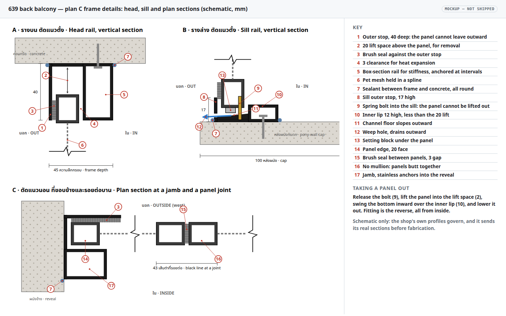
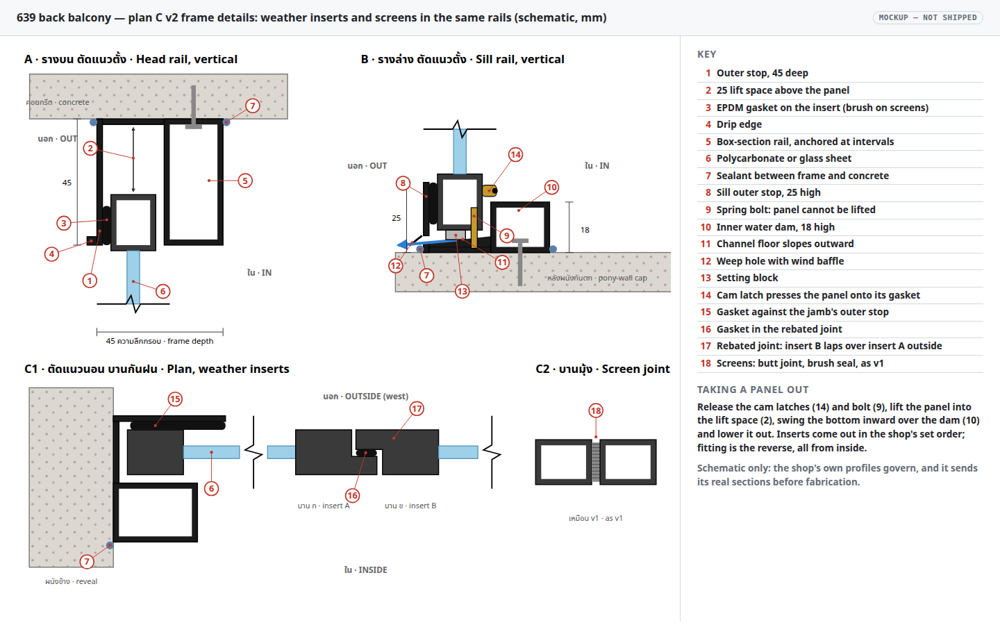

# Condo 639 balcony screen frame: archive of the v1 and v2 designs

11 November 2026 · Superseded by the [v3 shop sheet](../rfq/2026-11-11-639-balcony-screen-frame-spec-v3.pdf) in the [screen-frame plan](2026-11-09-condo-639-balcony-screen-frame.md). Kept for reference: the v1 sheet (screens only) and the v2 sheet (screens and weather inserts), with their drawings.

## v1: screens only

Shop sheet: [v1 HTML](../rfq/2026-11-08-639-balcony-screen-frame-spec.html), [v1 PDF](../rfq/2026-11-08-639-balcony-screen-frame-spec.pdf).

**Requirements on the spec sheet** ([HTML](../rfq/2026-11-08-639-balcony-screen-frame-spec.html), [PDF](../rfq/2026-11-08-639-balcony-screen-frame-spec.pdf)), each with a confirm box for the shop:

| Requirement | Why |
|---|---|
| Panels fit and come out **from inside only**, seated against a stop on the outer edge of the top and bottom rails | At 16 m, a panel must never be able to leave outward, whether pushed by a cat, a pigeon or a gust, and nobody should reach outside to handle one |
| A positive, lockable **latch** on every panel, not friction or springs alone | Wind suction on a west face pulls panels inward, and only the latch holds against that |
| **Pet mesh, black** | Pigeons and cats. Black mesh behind a black frame is the easiest to see through |
| Brush or rubber **seals**, including where panels meet, no gap over 1 mm | Mosquitoes get through any larger gap |
| Six **identical**, interchangeable panels | Any panel fits any position |
| **Expansion clearance** | A black frame in afternoon sun gets very hot and expands, so a tight fit jams. The seals should close the gap instead |
| **Bottom rail sloped outward with weep holes**, frame sealed to the concrete | Rain that gets through the mesh drains out |
| **Powder coat**, stainless fasteners | The panels are handled often, and wet paint chips at the edges |
| **No mullions**; top and bottom rails fixed to the concrete at intervals along their length | The rails alone carry the panels across 268 cm, so they must not sag or bow |
| Option: **clear polycarbonate inserts** the same size as the panels, priced separately | For the wet season, if wanted |

**Frame details** (page 2 of the spec sheet, and the [frame-detail mockup](2026-11-11-condo-639-balcony-screen-frame-archive/frame-detail.html)). There are three schematic sections, with millimetre sizes given only as examples, because the shop's own profiles govern:

- **A, head rail:** a 40 mm deep outer stop, a brush seal, 3 mm clearance for heat expansion, and a 20 mm lift space above the panel. The box-section rail keeps the 268 cm span stiff and is anchored into the ledge soffit at intervals.
- **B, sill rail:** a 17 mm outer stop with a weep hole. The channel floor slopes outward, the panel stands on setting blocks, and the inner lip is 12 mm high, lower than the 20 mm lift. A spring bolt into the sill stops the panel being lifted out.
- **C, plan section:** the jamb is anchored into the reveal. At each joint the two 20 mm panel edges meet across a 3 mm brush seal, so a joint shows as about a 43 mm black line.

To take a panel out, release the bolt, lift the panel into the lift space, swing the bottom inward over the inner lip, and lower it out. All of this is done from inside. The sheet also asks the shop to send its real sections before fabrication. The SVG comes from [`build_frame_detail.py`](2026-11-11-condo-639-balcony-screen-frame-archive/build_frame_detail.py).

**v1 frame details**: head, sill and plan sections for screens only, with a numbered key and the removal sequence, generated by [`build_frame_detail.py`](2026-11-11-condo-639-balcony-screen-frame-archive/build_frame_detail.py).

## v2: weather inserts added

Shop sheet: [v2 HTML](../rfq/2026-11-08-639-balcony-screen-frame-spec-v2.html), [v2 PDF](../rfq/2026-11-08-639-balcony-screen-frame-spec-v2.pdf). What changed from v1 to make the inserts rain-tight; v3 keeps all of it:

| Change | v1 | v2 | Why |
|---|---|---|---|
| Seals | brush seals | seals live **on the panels**: brush on the screens, **EPDM bulb gaskets** on the inserts; the frame's outer stops are flat and continuous, with sealed corners | A brush stops insects, not water. A compressed gasket stops water |
| Latches | spring bolt only | **compression (cam) latches** press each panel outward onto its seal, plus the anti-lift bolt; sized for wind on solid inserts | A gasket only seals when it is squeezed, and a solid insert takes the full wind load that mesh lets through |
| Joints | butt joint | inserts have **rebated (shiplap) edges** with a gasket in the step; the shop details the end inserts and the fitting order | A butt joint with no mullion behind it is a straight path for rain |
| Sill | outer stop 17, inner lip 12, plain weep hole | outer stop **25**, inner **water dam 18**, sloped floor, **baffled** weep holes | A higher dam holds back water pushed in by gusts, and the baffle stops wind blowing rain back through the weep |
| Head | 40 deep, lift 20 | **45 deep, lift 25**, **drip edge** on the outer stop | Lift must still exceed the 18 dam so panels come out. The drip edge sheds water before it reaches the gasket |

**v2 frame details**: weather inserts and screens sharing the same rails, with gaskets, cam latch, rebated insert joint, 25/18 drained sill and drip edge. The same drawing is page 3 of the v3 sheet; its generator, [`build_frame_detail_v2.py`](2026-11-09-condo-639-balcony-screen-frame/build_frame_detail_v2.py), stays with the plan.
