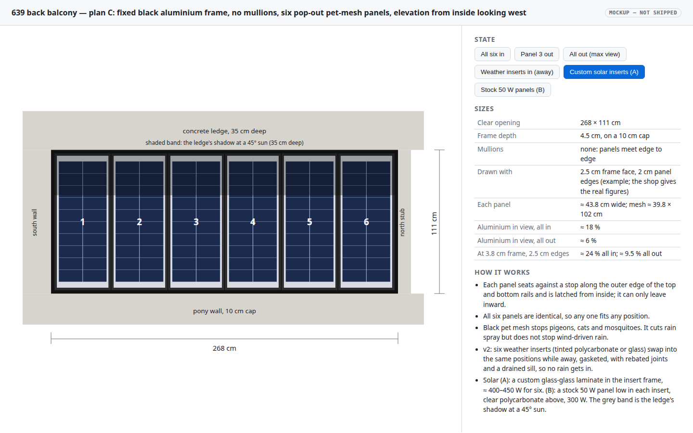
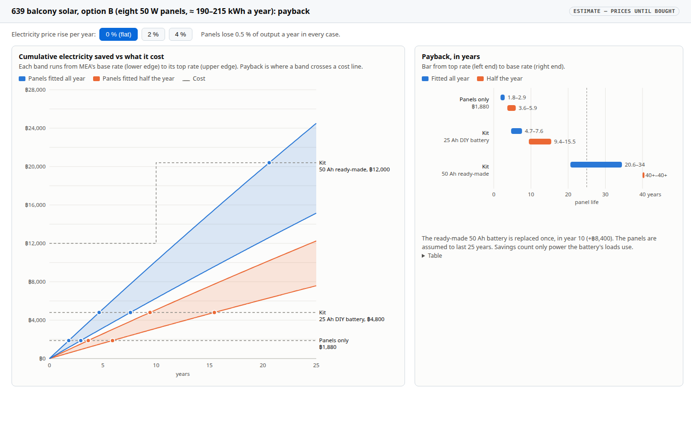
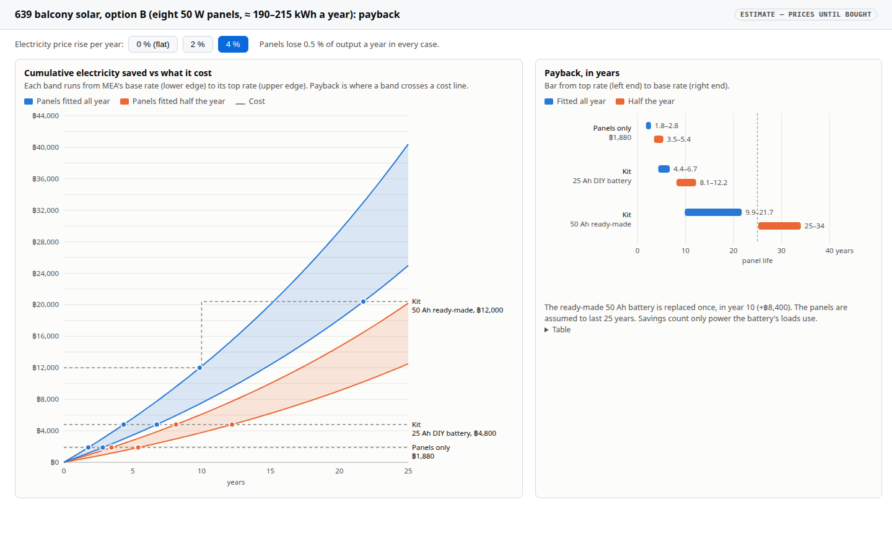

# Condo 639 balcony: solar insert research

11 November 2026 · Research behind the solar summary in the [screen-frame plan](2026-11-09-condo-639-balcony-screen-frame.md#solar-inserts): what fits the frame, what can be bought in Thailand, how much the ledge shades the panels, and what the panels are worth.

## Custom laminate in the six positions

**Request** (Will, 2026‑11‑09): the option to fit solar panels in the frame instead of the screens or the weather inserts, using new panels made for it, or the six existing positions if that can seal the opening in place of polycarbonate.

**Answer: yes, the six positions work.** The cleanest solar insert (option A below) is the weather insert with a **frameless glass-glass solar laminate in place of the polycarbonate sheet**. It keeps the same insert frame, EPDM gaskets, rebated joints and cam latches, so it seals as well as the polycarbonate, in the same rails, with **no change to the frame or the shop sheet**. The insert's glazing pocket already takes up to 6.38 mm laminated glass, and a 2 mm + 2 mm glass-glass laminate is about 5 mm thick. Solar inserts can therefore be ordered later, to the sheet size the shop gives for the polycarbonate.

**What fits a custom laminate.** Each position shows a sheet of about 39.8 × 102 cm (2.5 cm frame face, 2 cm panel edges) or 38.4 × 98 cm (3.8 cm, 2.5 cm). Two columns of today's standard 182 mm cells, cut in half (182 × 91 mm), make a block 36.4 cm wide, and ten rows make it about 93 cm tall, which fits either case:

| Item | Per insert | Six inserts |
|---|---|---|
| Cells | 2 × 10 half-cut 182 mm cells, ≈ 36 × 93 cm | 120 |
| Power (STC, estimate) | ≈ 65–75 W | ≈ 400–450 W |
| Open-circuit voltage | ≈ 14 V | two strings of three, ≈ 43 V each |
| Laminate | ≈ 5 mm glass-glass, cut to the polycarbonate sheet size | |
| Weight with insert frame | ≈ 5 kg, like the tempered-glass option | ≈ 30 kg |
| Yield, vertical west, Bangkok | | ≈ 1.7–2.2 kWh per kW per day by month before the ledge shade; ≈ 0.6 kWh/day for the set after it, only while fitted |

## Buying in Thailand, and other ways to fit

**Will, 2026‑11‑09:** "i can't order custom panels made in usa --- i'm in thailand!", asking about other panel sizes, marine flexible panels, and letting the extra 5 cm of a too-tall panel hang over the room side of the pony-wall cap.

**Where to buy.** Thai shops sell standard sizes; none found advertises custom sizes outright. Two are worth asking for a ≈ 40 × 95 cm panel: [Sunnergy](https://www.sunnergysolar.com/category/164/%E0%B8%AB%E0%B8%A1%E0%B8%A7%E0%B8%94%E0%B9%81%E0%B8%9C%E0%B8%87%E0%B9%82%E0%B8%8B%E0%B8%A5%E0%B9%88%E0%B8%B2%E0%B9%80%E0%B8%8B%E0%B8%A5%E0%B8%A5%E0%B9%8C) says it makes 5–400 W panels and designs systems to order, and [NSTHAI](https://www.nsthai.com/solar-panel) lists 5–200 W stock sizes and asks buyers to enquire about sizes not in its table. Chinese factories make custom sizes and ship to Bangkok, but custom work usually starts at 50 or more pieces, with single samples sold as prototypes ([Alibaba's seller guide](https://seller.alibaba.com/blogs/2026/southeast-asia/renewable-energy/custom-size-solar-panels-lead-time-moq-guide-alibaba-b2b)).

**The ledge decides more than the panel size.** On a vertical west wall in Bangkok, 53 % of the sunlight is direct, 33 % diffuse sky and 14 % reflected ([PVGIS](https://re.jrc.ec.europa.eu/pvg_tools/en/), 2020 hourly data). The 35 cm ledge's shadow reaches more than 5 cm down for 94 % of the direct sun, more than 20 cm for 65 %, more than 30 cm for 48 % and more than 40 cm for 35 % (sun-path calculation). Two rules follow:

- **Mount the panel low** in its insert, with clear polycarbonate filling the space above, so the shadow falls on the filler first.
- **Orient the bypass-diode groups as horizontal bands.** Standard panels usually group their cells along the long side, so a portrait panel has vertical groups: a shadow on its top edge cuts every group and loses nearly all the direct light, about half the panel's output. Turned landscape, the groups become bands and only the top one drops out. Check each model's datasheet for its diode layout.

**Options**, nameplate watts for the whole opening and an estimate after the ledge's shadow (other losses are in the yield figure below):

| Option | Where from | Inserts | Nameplate | After ledge shade | Notes |
|---|---|---|---|---|---|
| A. Custom glass-glass laminate, 2 × 10 half-cut cells, bands horizontal | ask Sunnergy or NSTHAI; China at 50+ pieces | 6 alike, swap with the screens | ≈ 420 W | ≈ 350 W | the best result, if a maker will build 6 |
| B. **Eight 18 V 50 W stock panels, 600 × 460 mm, landscape, two stacked** in each of **four inserts a quarter of the width (≈ 65 cm)**, clear polycarbonate filling the rest, wired in parallel | Lazada, ฿234.52 each on a LazFlash sale (฿1,299 normally; screenshot 2026‑11‑11) | 4 wide, a solar-only set | 400 W | ≈ 280–320 W | **recommended**: the most power for the money, ≈ ฿1,880 for eight; landscape keeps the ledge's shadow to the top band; ≈ 8–10 kg per insert (estimate); locks in through the v3 sheet's continuous latch channel |
| B2. Two 18 V 30 W stock panels, 390 × 430 mm, stacked at the bottom of each insert, clear polycarbonate above, wired in parallel | Lazada, ฿160.79 each on a LazFlash sale (฿699 normally; screenshot 2026‑11‑11) | 6 alike, swap with the screens | 360 W | ≈ 265–275 W | keeps six inserts that swap with the screens; ≈ ฿1,930 for twelve; each panel works on its own, so the lower one keeps charging while the ledge shades the upper one |
| B3. 50 W stock panel, 630 × 395 × 25 mm, one per insert at the bottom | [NSTHAI](https://www.nsthai.com/solar-panel) stock | 6 alike | 300 W | ≈ 245 W | its 80 W (฿414) is 960 × 460 mm (22.7 V open-circuit, 4.44 A), also too wide for one insert; the 100 W (฿477) size is not read yet |
| C. 60 W stock panel, 790 × 405 × 25 mm, at the bottom | [Solarbesttech](https://www.solarbesttech.com/th/products/444046-%E0%B9%81%E0%B8%9C%E0%B8%87%E0%B9%82%E0%B8%8B%E0%B8%A5%E0%B9%88%E0%B8%B2%E0%B9%80%E0%B8%8B%E0%B8%A5%E0%B8%A5%E0%B9%8C-mono-solar-panel-%E0%B8%A3%E0%B8%B8%E0%B9%88%E0%B8%99-gspv60m-60w-5bb) | 6 alike | 360 W | ≈ 250 W | taller, so it reaches up into more shadow; 40.5 cm wide, so the insert edge covers its frame border |
| D. 100 W stock panel, 620 × 765 mm, turned landscape at the bottom | NSTHAI stock | 3 double-width (≈ 88 cm) | 300 W | ≈ 265 W | least shade loss if its diode halves become bands; ≈ 8 kg per insert (estimate) |
| E. 150 W stock panel, 980 × 765 mm, portrait | NSTHAI stock | 3 double-width | 450 W | ≈ 225 W | fits with no overhang, but portrait: the ledge costs about half; ≈ 10 kg per insert (estimate) |
| F. Marine semi-flexible ≈ 50 W, ≈ 810 × 330 × 2 mm, bonded to the outer face of each polycarbonate insert | flexible panels are sold in Thailand ([JIB](https://www.jib.co.th/web/product/readProduct/83316/1379/SOLAR-PANAL--แผงโซล่าเซลล์--ECOFLOW-100W-FLEXIBLE-SOLAR-PANEL)); this narrow size is a listing seen on Alibaba | the weather inserts themselves | ≈ 300 W | ≈ 200 W | thinnest, but bonded flat with no air behind it runs hot; check the warranty |
| G. Stock panels on brackets **behind clear weather inserts**, inside | any stock size, e.g. two 200 W, 1200 × 765 mm, landscape | the weather inserts, unchanged | 400 W | ≈ 280 W | no change to frame or inserts; loses ≈ 10–15 % through the polycarbonate; needs clear, not tinted, inserts |

The "after ledge shade" column applies the shadow figures above to each layout (direct light lost where the shadow reaches a diode group, diffuse and reflected light kept). It is an estimate, not a measurement.

**Recommendation.** Ask Sunnergy and NSTHAI to quote option A. If neither will build six, use option B: eight stock 18 V 50 W panels, turned sideways and stacked two high in four inserts a quarter of the width. The six screens set the look of the frame; the solar set has no reason to match them (Will, 2026‑11‑11: "6 panels was for aesthetics"). The v3 sheet's continuous latch channel lets option B and the double-width options (D, E) lock in at any width.

**Thickness.** Stock panels are 25–30 mm thick against a 16 mm insert. The insert frame holds the panel with its glass in the insert's plane, and the panel's frame stands about 10–15 mm proud on the room side, which the rails do not mind. A gasket or silicone bead seals the panel's frame to the insert frame on the outside face.

## Yield, value and payback

**Yield and the ledge.** [PVGIS](https://re.jrc.ec.europa.eu/pvg_tools/en/) gives 671 kWh per kW per year for a vertical west face in Bangkok (13.70 N, 100.55 E, 14 % system losses), 46 % of the 1,472 at the best tilt of 17°. The 35 cm ledge shades the top of the panels whenever the sun is high: by a sun-path calculation, about a third of the direct sun reaching the sheets falls in its shadow, and direct sun is roughly half of what a west wall receives, so expect about 15–20 % less. That holds only if the **bypass diodes split each laminate into horizontal bands**, because the shadow moves down from the top; cells strung top to bottom would lose most of their output whenever the top row is shaded. So the six custom laminates give about 230 kWh a year, ≈ 0.6 kWh a day, if fitted all year; the stock options in the table give roughly 0.4–0.5 kWh a day. **What it is worth** at MEA's residential rates from the September 2026 bill, with Ft 0.1623 and 7 % VAT ([Sanook](https://www.sanook.com/news/9903946/), [ERC Ft](https://www.erc.or.th/th/document-ft/)): at the base rate for the first 200 units a month (3.0000), 3.38 THB/kWh, 671 kWh (one kW of panels for a year) is ≈ 2,270 THB, ≈ 189 THB a month; at the top rate above 400 units a month (4.3583), spread evenly as 55.9 kWh a month, 4.84 THB/kWh, it is ≈ 3,246 THB, ≈ 270 THB a month. The custom set fitted all year, ≈ 230 kWh, is worth ≈ 780–1,110 THB a year, and option B, ≈ 190–215 kWh, ≈ 640–1,040 THB, before battery losses and only for power the battery's loads actually use.

**Payback (option B, estimates until bought).** Eight 18 V 50 W panels at ฿234.52 each on a Lazada flash sale, ≈ ฿1,880 (≈ ฿10,400 at the normal ฿1,299); the insert frames and polycarbonate are needed for the weather inserts anyway. The off-grid kit adds a 20 A MPPT controller with a LiFePO4 setting, ≈ ฿1,000–1,200 on AliExpress Thailand (PowMr, or a 100 V-input unit with 400+ sales), and a 12 V LiFePO4 battery. 12.8 V 25 Ah (320 Wh) runs a 10 W router for about a day without sun; 50 Ah (640 Wh) about 2.5 days, the safer choice for monsoon weeks. AliExpress Thailand (11.11 sale, screenshots 2026‑11‑11): 3.2 V 25 Ah cells from ฿269 each, four 3.2 V 50 Ah cells for a DIY 12 V pack ≈ ฿4,770, both plus a 4S battery-management board; a ready-made 12 V 50 Ah pack with a Bluetooth BMS ≈ ฿8,400 (SYPOOE, 5.0★ from 15 reviews). Each list price is the cheapest size in its listing until the listing is opened. In all ≈ 4,800 THB (25 Ah DIY) to ≈ 12,000 THB (50 Ah ready-made), plus about ฿500 of cable and connectors and the shop's fitting charge. Against 640–1,040 THB a year if the panels were fitted all year:

| Cost counted | Fitted all year | Fitted half the year |
|---|---|---|
| Panels only, ≈ ฿1,880 | 2–3 years | 3.5–6 years |
| Whole off-grid kit, ≈ 4,800–12,000 THB | 4.5–19 years | 9–37 years |

With the flash-sale panels and a small DIY battery, the kit pays back in about 5 years if the panels stay in most of the year; with a ready-made 50 Ah battery, which lasts roughly ten years, it barely pays back. Since Will may fit them whenever he does not need the view, not only while away (2026‑11‑11), the "fitted all year" column is the realistic end. The value also counts only power the battery's loads use: a router alone (≈ 90 kWh a year, 300–435 THB) pays back far more slowly than loads that use the whole yield, such as a fan or charging while home. The case for solar here is mainly independent power, not the bill.

**Electricity price rises.** The table above holds the price flat. Thai household rates move with the Ft fuel charge, which the regulator resets every four months, so the charts let the price rise 0, 2 or 4 % a year, and in every case the panels lose 0.5 % of their output a year. A rise barely changes the short paybacks and shortens the long ones:

| Cost counted, option B | Flat price | +2 % a year | +4 % a year |
|---|---|---|---|
| Panels only, ≈ ฿1,880, fitted all year | 1.8–2.9 years | 1.8–2.9 years | 1.8–2.8 years |
| Kit with a 25 Ah DIY battery, ≈ ฿4,800, fitted all year | 4.7–7.6 years | 4.5–7.1 years | 4.4–6.7 years |
| Kit with a 50 Ah ready-made battery, ≈ ฿12,000, replaced in year 10, fitted all year | 21–35 years | 17–26 years | 10–22 years |
| Same three, fitted half the year | 3.6–5.9 / 9.4–15.5 / 40+ years | 3.5–5.6 / 8.7–13.6 / 31–40+ years | 3.5–5.4 / 8.1–12.2 / 25–34 years |

