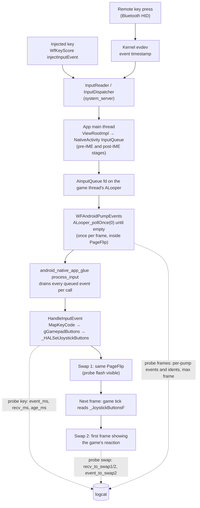
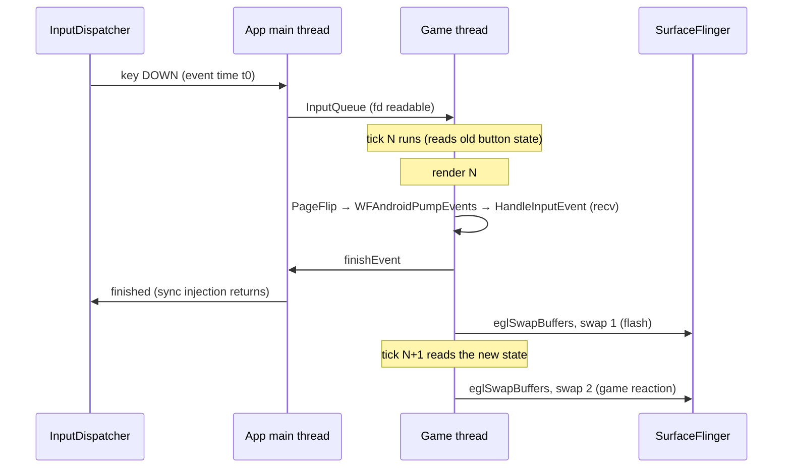
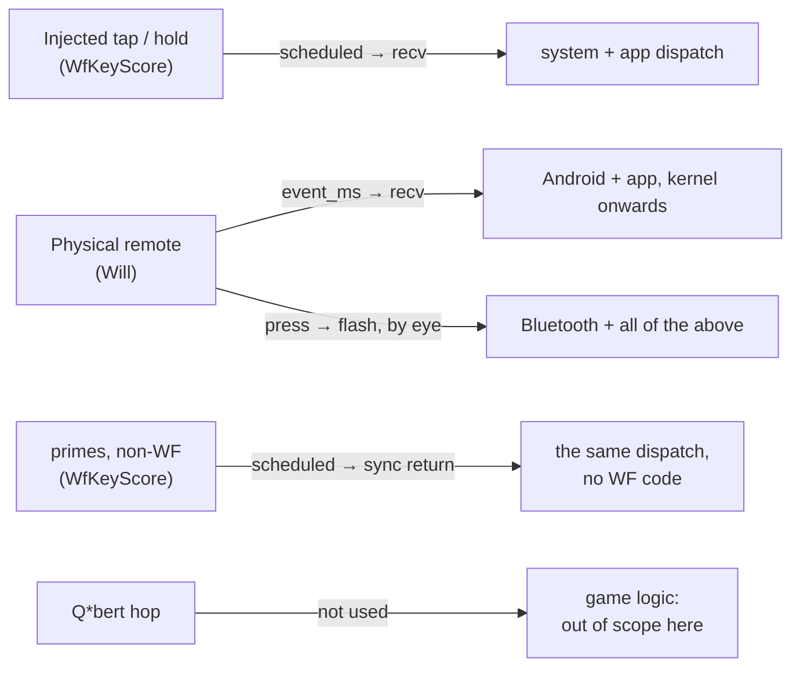
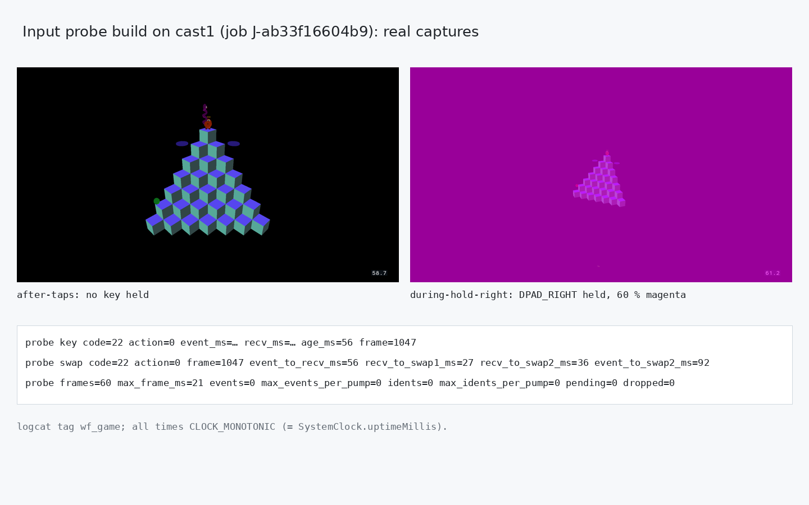

# Android remote-key input latency, measured in isolation from the game

TODO: `[android-input-latency]` (TODO.md, Done 2026‑11‑13; opened as `[T4] Android remote-key latency on the Chromecast HD`). Follow-ups: the coordinator Remote item in `~/chromecast-coordinator/TODO.md` and the Q\*bert input item in this repo's TODO.md.

## Context

On 2026‑11‑13 Will watched Q*bert on cast1 (`chromecast-test-01`: Chromecast HD, Android 14,
armeabi-v7a) and reported: "when i press keys on the remote control, the lag is insane and the
keypress takes SECONDS". In coordinator check `J‑f484ffd6354d` (Q*bert poke-resume), the
injected `DPAD_RIGHT` and `DPAD_UP` taps never made Q*bert hop, while the FPS overlay read
60–69. Will's direction: **"measure that in isolation from a game"**. Q*bert's intro gate, its
once-per-tick stick read and its hop cooldown (`wflevels/qbert_practice/blender_create_qbert.py`
~555–760) would confound any measurement taken through gameplay.

**Clarified by Will, 2026‑11‑13:** "the remote control" was the coordinator's Remote (the tray
Remote window), not the handheld Google TV remote, and he was watching the TV itself, not a preview.
The coordinator Remote's own path (measurement M4) was added to the plan, and the physical-remote
run became optional.

Nothing measured the app's input path until now. The only trace was the per-edge logcat line
`key code=… action=… mask=…`, written when `HandleInputEvent` sees a key. It has no event time,
so it cannot show whether a key arrived late.

## Approach

Time each stage on the device's own clock at the HAL, below any level's logic, and compare
injected keys, held keys, physical remote presses and a non-WF app on the same Chromecast.

1. **Injected keys, no new code.** The coordinator's `WfKeyScore` helper injects each key with
   `UiAutomation.injectInputEvent(…, sync=true)` and logs `SystemClock.uptimeMillis()` together
   with an `ANCHOR` row that pairs uptime with wall time. The app's logcat line carries wall
   time. Together they give scheduled-to-receipt latency for every edge, and the helper's
   return time gives receipt-to-finish (a synchronous injection returns once the app has
   finished the event).
2. **Input probe build (`WF_INPUT_PROBE`)**, gradle build type `inputprobe` (a release build
   plus the probe). Per key edge it logs:
   `probe key code= action= event_ms= recv_ms= age_ms= frame=`, where `event_ms` is
   `AKeyEvent_getEventTime`: the kernel timestamp for a physical remote, the creation time for
   an injected key. After the second swap that follows the key it logs
   `probe swap … recv_to_swap1_ms recv_to_swap2_ms event_to_swap2_ms`. Once a second it logs
   `probe frames= max_frame_ms= events= max_events_per_pump= idents= max_idents_per_pump=`, so
   a backlog would show as a growing count per pump. While a key is held, the whole frame is
   tinted magenta, drawn in `AndroidSwapBuffers` after the HUD: a person or a screen capture
   sees the instant the app got the key, whatever the level does with it. All times are
   `CLOCK_MONOTONIC`, the clock `uptimeMillis` uses, so probe lines and helper rows compare
   directly.
3. **Non-WF baseline**: the same key score against `primes`, a Java/WebView app with no
   NativeActivity, on the same cast. The helper's synchronous-return time is the dispatch-to-finish
   cost of any focused window.
4. **Physical remote**: Will presses a fixed sequence (in the probe APK, then on the launcher).
   The probe shows the Android-side `age_ms` for real presses. The flash shows whether the app
   reacts at once. Remote-to-kernel (Bluetooth) time cannot be measured from software, so Will
   compares how quickly the flash appears against how quickly the launcher moves its focus.

5. **Coordinator Remote (M4)**, the path Will used: open an owned `remote` job on cast1 the
   way the tray does, and time each `key-down`/`key-up`/`tap` command from host submit to
   "applied" (`docs/diagnostics/…/remote-latency.py`). Clicks are sent one at a time first,
   then as a burst of three, as the tray emits them. The service reports each command's own
   split: `queued_to_picked_up` and `run_seconds`.

Critical files: `wfsource/source/hal/android/input_probe.h` (new; header-only tracker, tested
on the desktop by `tests/android_input_probe_test.cc`), `hal/android/native_app_entry.cc`
(`HandleInputEvent`, `WFAndroidPumpEvents`), `gfx/gl/android_window.cc` (`AndroidSwapBuffers`),
`CMakeLists.txt` (option and test), `android/app/build.gradle.kts` (build type).

Rejected: putting the probe in the existing `diagnostic` build type. That type also starts the
`WF_RUNTIME_DIAGNOSTICS` socket server and per-input `wfdiag` receipts, which would add
unrelated work to the very path being timed.

## Diagrams

### The input path, stage by stage



### One frame, in order



### What each measurement isolates



## Mockups

The only visible surface is the probe build's flash: a 60 % magenta tint over the whole frame
while any remote key is held. Release builds draw nothing new.

[](2026-11-13-android-input-latency/probe-flash.html)

## Verification

1. Host unit test of the tracker, in the container:
   `scripts/in-linux-container.sh bash -c 'cd /src && g++ -std=c++17 -Wall -Wextra -Werror -O2 -I wfsource/source tests/android_input_probe_test.cc -o /tmp/aip && /tmp/aip'`
   prints `android_input_probe: all checks passed`.
2. The release build is unchanged: `tests/test_phone_controller_android.py`,
   `tests/test_android_lifecycle.py` and `tests/test_android_menu_back.py` give the same results
   as at HEAD.
3. `./gradlew :app:assembleQbertInputprobe` builds `worldfoundry-qbert-inputprobe.apk`, and
   the page-alignment verifier passes.
4. Injected keys on cast1 (scripted check, Q*bert release APK `3b33384c`): every edge reaches
   `HandleInputEvent` less than 100 ms after its scheduled time, with no backlog in a burst of
   ten 50 ms taps 120 ms apart.
5. Injected keys on cast1 with the probe APK: `age_ms` < 100 for every edge, the
   `max_events_per_pump` count stays small, and a capture during a hold shows the magenta flash.
6. Non-WF baseline (`primes`): synchronous-injection return times recorded for comparison.
7. Physical remote, probe APK: `age_ms` for Will's presses, and his report of whether the flash
   appears at once.
8. cast1 is left as it was found: Q*bert release `3b33384c` installed and verified, Seahorse
   Dream still the selected screensaver.

## Results

**Verdict.** The seconds are spent in the coordinator Remote, not in World Foundry. Will was
using the coordinator's Remote (the tray Remote window), watching the TV itself. The tray sends a
D‑pad click as a key-down edge on press and a key-up edge on release. The coordinator worker
applies each edge by starting a new `app_process … WfKeyHold edge` on the Chromecast HD, which
also connects a `UiAutomation` (`plugins/android/operations.py` `remote_key_edge`), and that costs
about **2.0–2.2 s per edge**. Edges run one at a time from one queue
(`plugins/android/interactive_input.py`). A click's DOWN therefore reaches the TV about 2 s after
the click and its UP about 4 s after, and three quick clicks finish 12 s after the first.
Between the late DOWN and its UP, Android sees a held key, so a click also arrives as a long
press with auto-repeat. Once a key reaches the app, WF receives it in 3–59 ms and shows it on
the next swap. Filed in the coordinator's TODO (see the commit list in the report);
not fixed here.

| Path, cast1 (Chromecast HD) | Measured | Evidence |
|---|---|---|
| Coordinator Remote, one click, waited (`key-down` → 0.1 s → `key-up`) | DOWN applied 2.04–3.08 s after submit, UP 2.12–2.27 s; queue pickup 0.04–0.15 s, run 1.94–2.90 s | M4, `J‑0fcd77d98d33` |
| Coordinator Remote, three clicks 0.15 s apart, as the tray emits | edges applied 2.3, 4.5, 6.6, 8.4, 10.2, 12.1 s after their submits | M4 |
| Coordinator Remote `tap` (`input keyevent`) | 0.64–0.73 s per tap (run 0.42–0.56 s) | M4 |
| Injected tap and hold, WfKeyScore persistent helper → Q*bert (release `3b33384c`) | scheduled → `HandleInputEvent` 6–57 ms (median 33), no backlog in a burst of ten 50 ms taps | M1, `J‑5e8afa6b3c9d` |
| Same, synchronous-injection return (dispatch + app finish) | DOWN median 42.5 ms (23–58), UP 34.5 ms (12–43) | M1 |
| Non-WF baseline, `primes` (Java/WebView), same score | DOWN median 22 ms (10–37), UP 16 ms (10–26) | M2, `J‑fa5070e2a0ef` |
| Probe APK, 44 edges | event → recv 3–56 ms (median 30.5); recv → swap 1 (flash) 1–27 ms; recv → swap 2 (first tick to read it) 14–137 ms (median 18); event → swap 2 20–172 ms (median 47); at most 1 input event per pump; 60 frames per second, worst in-game frame 135 ms | M3, `J‑ab33f16604b9` |
| Physical Google TV remote | not measured: optional once the cause was found | — |

WF is about 20 ms slower than `primes`: a key waits for the next frame's pump, and a DOWN
crosses the pump twice, once for its pre-IME copy (`AInputQueue_preDispatchEvent`) and once
for the copy that reaches `HandleInputEvent`. Both are below one frame each; neither is a
backlog. The capture taken during a 2 s hold reads (153, 0, 153), the flash over black, and the
capture after release reads (0, 0, 0).

**Separate finding, Q*bert's game logic.** Every injected edge reached `HandleInputEvent` and
set its button bit. Even so, Q*bert never hopped from the top cube after the intro: not on ten
100 ms taps, ten 50 ms taps or two 2 s holds of `DPAD_RIGHT`/`DPAD_LEFT`. It only turned to
face the direction, and no cube changed colour (M1 and M3 captures). Filed as its own TODO item;
not investigated here.

### Verification record

1. Host unit test of the tracker, in the container:
   `scripts/in-linux-container.sh bash -c 'cd /src && g++ -std=c++17 -Wall -Wextra -Werror -O2 -I wfsource/source tests/android_input_probe_test.cc -o /tmp/aip && /tmp/aip'`
   prints `android_input_probe: all checks passed`.

    ```
    android_input_probe: all checks passed
    ```
    PASS. On the first run the stats window never opened at time 0, a sentinel bug in the
    tracker; the test caught it, and it was fixed before the device runs.

2. The release build is unchanged: `tests/test_phone_controller_android.py`,
   `tests/test_android_lifecycle.py` and `tests/test_android_menu_back.py` give the same results
   as at HEAD.

    ```
    HEAD:        3 failed, 15 passed, 2 skipped
    with probe:  3 failed, 15 passed, 2 skipped   (the same three tests)
    ```
    PASS (no change). The three failures exist at HEAD and are not from this work:
    `test_back_hides_the_panel_before_the_key_is_dropped`,
    `test_launcher_reuses_the_single_native_engine` and
    `test_back_returns_from_level_and_exits_from_selector`.

3. `./gradlew :app:assembleQbertInputprobe` builds `worldfoundry-qbert-inputprobe.apk`, and
   the page-alignment verifier passes.

    ```
    APK page alignment: PASS (…/apk/qbert/inputprobe/worldfoundry-qbert-inputprobe.apk)
    BUILD SUCCESSFUL in 16m 57s
    ```
    PASS (sha256 `a2746e1f…`, built from HEAD `0532c59b` plus this change in a sparse worktree,
    without other sessions' uncommitted edits).

4. Injected keys on cast1 (scripted check, Q*bert release APK `3b33384c`): every edge reaches
   `HandleInputEvent` less than 100 ms after its scheduled time, with no backlog in a burst of
   ten 50 ms taps 120 ms apart.

    ```
    44 edges; scheduled -> app 6..57 ms; burst edges 6..48 ms
    ```
    PASS.

5. Injected keys on cast1 with the probe APK: `age_ms` < 100 for every edge, the
   `max_events_per_pump` count stays small, and a capture during a hold shows the magenta flash.

    ```
    edges score 44 probe keys 44 swaps 44
    event->recv min/med/max 3 30.5 56
    recv->swap2 min/med/max 14 18.0 137
    max events/pump 1   max idents/pump 4 (start-up)
    input-frame-002.png (during-hold-right) (153, 0, 153); input-frame-003.png (released) (0, 0, 0)
    ```
    PASS.

6. Non-WF baseline (`primes`): synchronous-injection return times recorded for comparison.

    ```
    primes sched->syncReturn DOWN min/med/max 10 22 37  UP 10 16 26
    qbert  sched->syncReturn DOWN min/med/max 23 42.5 58  UP 12 34.5 43
    ```
    PASS (recorded).

7. Physical remote, probe APK: `age_ms` for Will's presses, and his report of whether the flash
   appears at once.

    Not run. Will's report concerned the coordinator Remote, not the handheld remote, so this
    became optional (orchestrator, 2026‑11‑13). The probe APK is ready for it.

8. cast1 is left as it was found: Q*bert release `3b33384c` installed and verified, Seahorse
   Dream still the selected screensaver.

    ```
    J-e8b1b47011ce install explicit-install a2746e1f -> 3b33384c verified
    selected_component org.worldfoundry.seahorsegrid/org.worldfoundry.screensaver.SeahorseGridDreamService
    stay_on_while_plugged_in 0   sleep_timeout_ms -1
    ```
    PASS.

Evidence is private and uncommitted, in `docs/diagnostics/android-input-latency-2026-11-13/`:
`m1-…` to `m4-…`, the recipes, `remote-latency.py`, and both APKs.
