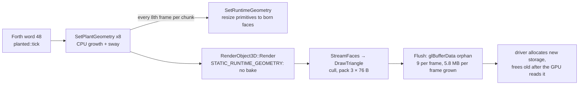
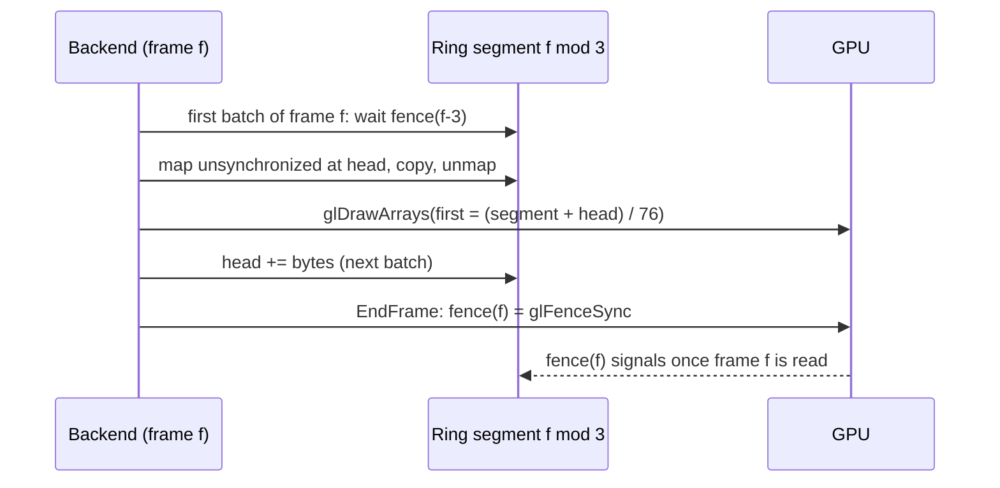
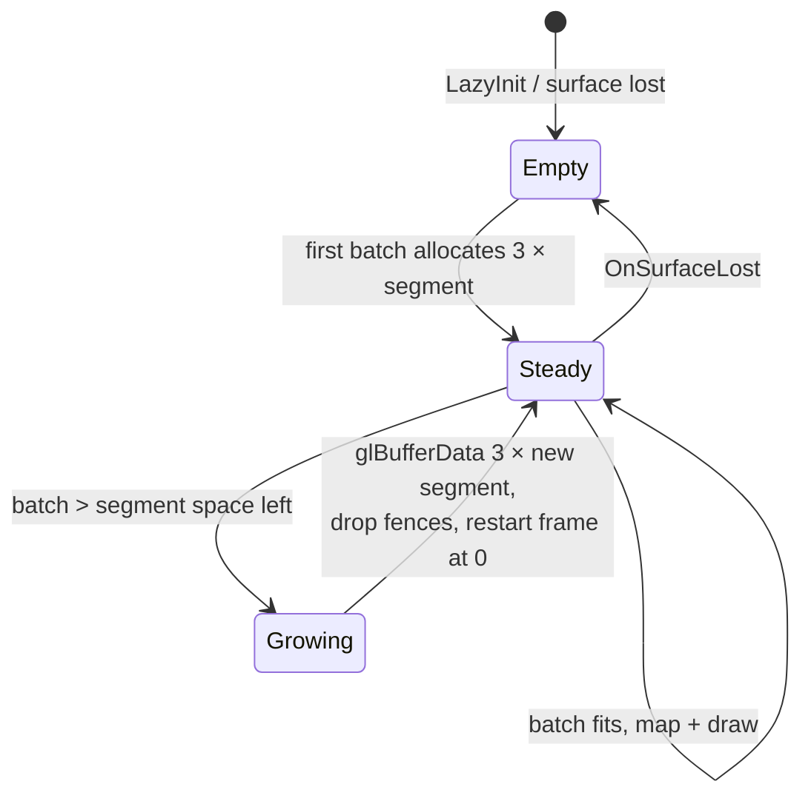
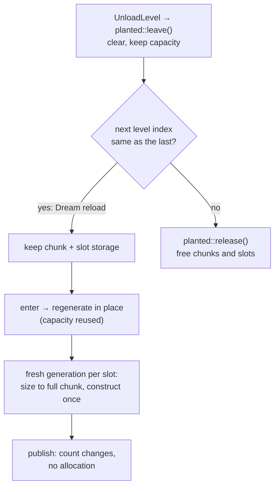

# Planted Tank memory swing: stream ring and persistent plant storage

**Status: not pursued.** Will, 2026‑11‑13: the PSS-spread gate isn't important; replaced by resource tracking (allocations freed). The root-cause findings below stand as a record.

Date: 2026‑11‑13. TODO entry: **Planted Tank screensaver (third Dream)**, Verification
step 9 (memory gate) of [the planted plan](2026-10-21-planted-tank-screensaver.md).
Tier T4 (root cause was unknown; the change crosses the GL backend, the render object
and the plant runtime).

## Problem

The cast2 soak ([evidence](../diagnostics/planted-soak-continuous-2026-11-13/README.md))
kept one PID through 50 reloads with no crash and no upward trend, but the PSS spread in
the final ten minutes was 11,848 KiB against Will's limit of under 4,096 KiB. GL mtrack
spans 10,288 KiB and Native Heap 5,907 KiB in that window. The limit is not relaxed.

## What the plants allocate (traced, then measured on the desktop)

Each frame, `planted::tick` (Forth custom word 48) calls
`RenderActor3D::SetPlantGeometry` for the 8 plant chunks. It rewrites every vertex
position (growth plus sway) and, every 8th frame per chunk, republishes the born faces
through `RenderObject3D::SetRuntimeGeometry`. That marks the object
`STATIC_RUNTIME_GEOMETRY`, so it is never baked: every frame `StreamFaces` sends each
surviving face to `ModernRendererBackend::DrawTriangle` as three 76‑byte vertices, and
`Flush` uploads each batch with `glBufferData(GL_ARRAY_BUFFER, …, GL_STREAM_DRAW)`.
That call orphans the buffer's storage: the driver allocates new storage for every
batch and frees the old once the GPU has read it.

Measured with the device's own bundle (extracted from `planted-release-2d8f70c1.apk`)
on the desktop engine at speed 6, hold 5, seven tanks, using two counters this change
adds to `--frame-profile` (`stream-allocs`, `stream-alloc-bytes`) and a `frame-heap:`
line (malloc bytes in use):

| Phase in the tank | Stream allocations per frame | Bytes streamed per frame | C heap in use |
|---|---|---|---|
| 1–4 s (just loaded) | 9 | 0.65–1.7 MB | 190.8–198.5 MB |
| 12–14 s (growing) | 9 | 5.2–6.0 MB | 207.8–212.2 MB |
| 15 s to the reload (grown, hold) | 9 | 5.6–6.1 MB | flat at the tank's peak |

So the streaming traffic is **about 5.8 MB per frame through 9 orphaned allocations per
frame**, and the C heap grows by **17–20 MB inside every tank and drops at the reload**.

Struct sizes behind the heap growth (desktop, 64‑bit): `Primitive` 136 B,
`TriFace` 20 B, `Vertex3D` 24 B, `plantgrowth::Vertex` 48 B. A tank of about 52,000
faces and 80,000 vertices holds 7.0 MB of primitives, 1.0 MB of faces, 1.9 MB of
vertices and 4.4 MB of chunk data. On the 32‑bit Chromecast the primitive is about
88 B, so 4.6 MB.

## Root cause

**Native Heap (ours, deterministic).** The plant runtime storage lives in each plant
actor and in `planted::State`, and its size follows the born faces:
`_runtimePrimitives` grows by repeated `resize` as faces are born (a reallocation chain),
the faces vector is touched progressively, and every reload frees all of it (the actors
die, `planted::leave()` frees the chunks) and allocates it again. The release 1× cycle on
cast1 ([J‑cbc06d527a67](../diagnostics/runtime-editing-followups-2026-11-13/README.md),
`release-timing/`) shows exactly that: Native Heap rises 20,206 → 23,826 KiB while the
plants grow, stays flat through the 120 s hold, and drops to 20,518 KiB at the next tank.
At 8× the samples right after a reload are bimodal (19.9–20.9 MiB or 28.8–29.7 MiB),
which is the old tank's freed storage still resident (or not yet) while the new tank's is
allocated.

**GL mtrack (driver memory driven by our traffic).** GL mtrack is the Mali driver's
memory for the process. It has no upward trend over 50 reloads, so nothing is retained.
It sits at about 44.9 MB and drops by about 10 MB at moments that do not line up with the
reloads (samples 056 and 074 are 1.9 and 2.6 s before one, in the hold), then recovers in
steps over one to three tanks. In the 1× cycle it varies by 7.5 MB during the hold, when
our traffic is constant. That is the driver trimming and refilling the storage it
recycles for our orphaned uploads: 10 MB is about two frames of the 5.8 MB per frame we
make it allocate, and the level makes no other GL allocation per frame (textures and the
19 static meshes, 292 faces, are created once per load).

What the evidence does not settle: whether some of the GL variation is the tiler heap,
which follows the triangle count rather than the upload method. Only a device run after
this change can split the two. If the GL swing stays, the tiler is the next suspect and
this change still removes the per-frame allocation it can.

## Design

Two independent changes, one per root cause. Neither changes what is drawn.

### 1. Stream ring (GL)

The streaming vertex buffer becomes a fixed ring of 3 frame segments, written with
`glMapBufferRange(GL_MAP_WRITE_BIT | GL_MAP_UNSYNCHRONIZED_BIT)` and drawn with
`glDrawArrays(first = offset / 76)`. A fence ends each frame's segment; before a frame
writes into a segment it waits for that segment's fence (three frames old, normally
already signalled). A batch that does not fit grows the ring once (the only
`glBufferData`, counted in `stream-allocs`), to 1.5× or what is needed, rounded up to
64 KiB. After warm-up the driver allocates nothing per frame for streaming.

Rules:

- WebGL 2 (Emscripten) has no buffer mapping; it keeps the orphaning path unchanged.
- A fence wait that times out (100 ms) falls back to one orphaning upload for that
  batch, counted, so a stalled GPU degrades to today's behaviour instead of hanging.
- `OnSurfaceLost` forgets the ring (its names died with the context); the next batch
  rebuilds it.
- The ring is about 3 × 6.1 MB = 18 MB of GL memory in the planted level: a fixed cost
  that replaces the recycled storage the driver held anyway.

Rejected: **GPU-side plant deformation** (upload rest positions once, grow and sway in
the vertex shader). It would also remove the CPU work, but the software back-face cull
reads each face's deformed centre, so an exact match needs a triangle soup carrying
per-face data (about 10 MB), a new program variant through the style and fog paths, and
parity work on a shipped look. Kept as the follow-up if the tiler heap turns out to
dominate. Also rejected: **streaming the 28‑byte compact vertex**, which cuts traffic
2.7× but keeps an allocation per batch, and **`glBufferSubData` into a fixed buffer**,
which Mali answers by ghosting (copying) the whole in-flight buffer.

### 2. Persistent plant storage (Native Heap)

The plant runtime storage moves out of the actors into a pool of 8 per-chunk slots that
lives for the process, is sized at the chunk's full face and vertex count when a tank
starts, never shrinks, and is fully constructed when it grows, so its pages are touched
once:

- `plantgrowth::meshes` fills the existing `planted::State::chunks` in place
  (`clear()`, capacity kept) instead of returning new vectors;
- `RenderActor3D::SetPlantGeometry` takes the slot index and uses the slot's vertices,
  faces and primitives; on a fresh generation it sizes them to the chunk's totals;
- `RenderObject3D::SetRuntimeGeometry` gains an overload that uses caller-owned
  primitive storage (the slot's), so publishing never reallocates;
- `planted::leave()` clears (keeps capacity); `planted::release()` frees chunks and
  slots, and `WFGame` calls it when it loads a level whose index differs from the one
  it unloaded. The Dream always reloads its own index, so it keeps the storage; the game
  frees it on leaving the planted level.

Rejected: **retaining capacity unconditionally** (keeps up to about 14 MB after the
player leaves the planted level in the game) and **reserving at the 30,000‑vertex chunk
cap** (11.5 MB of chunk data alone, 2.6× what a tank uses).

## Mockups

No visible surface: the same triangles reach the same shader with the same vertex data.

## Verification

1. **Build and unit contracts in the container.** `scripts/in-linux-container.sh scripts/build-wf-game-container.sh --out /build/wf-game-plantmem` builds; `python3 -m pytest -q tests/test_plant_runtime.py` passes (the plant runtime harness, ASan).
2. **Regression test.** `python3 -m pytest -q tests/test_planted_memory_stability.py` runs the desktop engine on the planted bundle for at least four tanks at 8× with hold 5 and asserts: every profile window after the first tank has `stream-allocs` max 0; `frame-heap` in-use spread after the first tank is under 1 MiB; same tank count as wall time allows, no crash. Before the change the same assertions fail (9 allocations per frame, 17–20 MB heap swing).
3. **Picture unchanged.** A frame captured with `--capture-frame` at a fixed tank (Initial age, Paused, Sway off) is byte-identical before and after the change.
4. **Device (after cast2 is free; coordinated by the orchestrator).** Repeat plan step 9 on cast2 with an APK built from this change: same PID, no crash, final ten minute PSS spread under 4,096 KiB, with GL mtrack and Native Heap spans reported.
