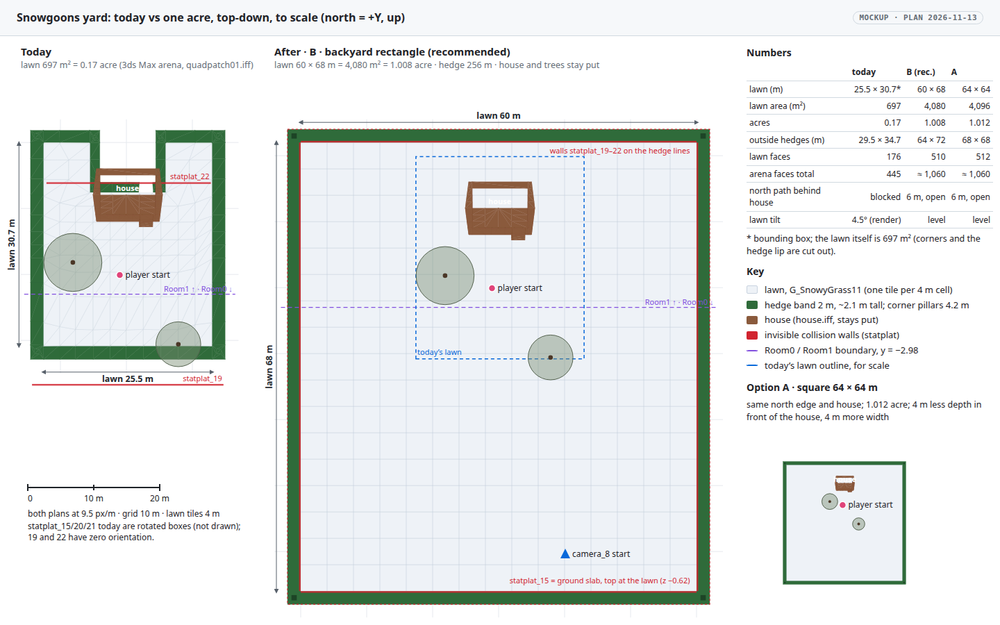
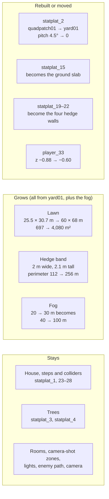
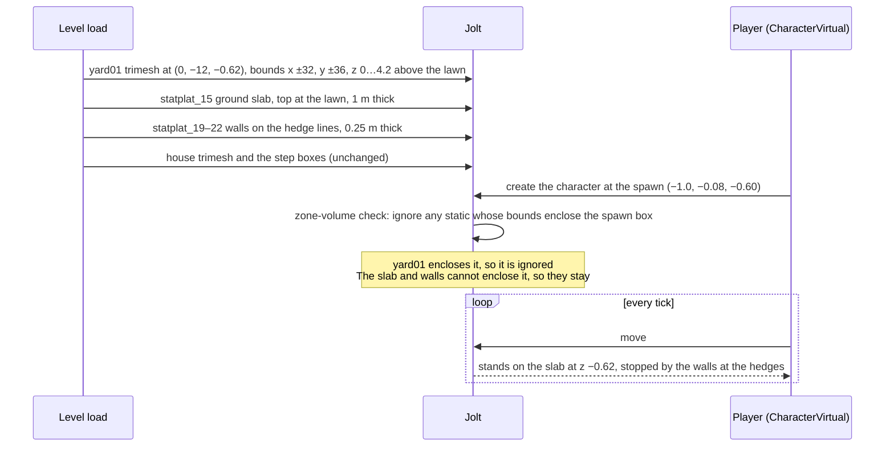
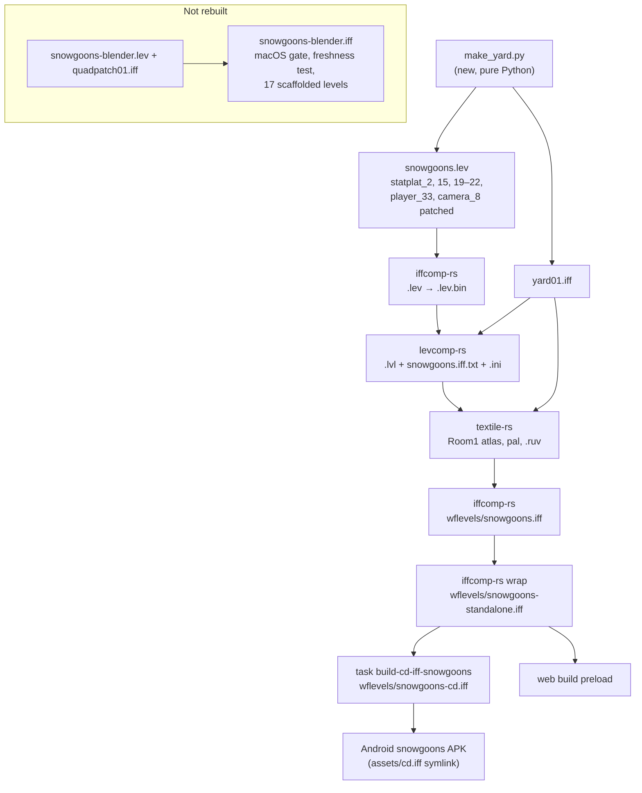
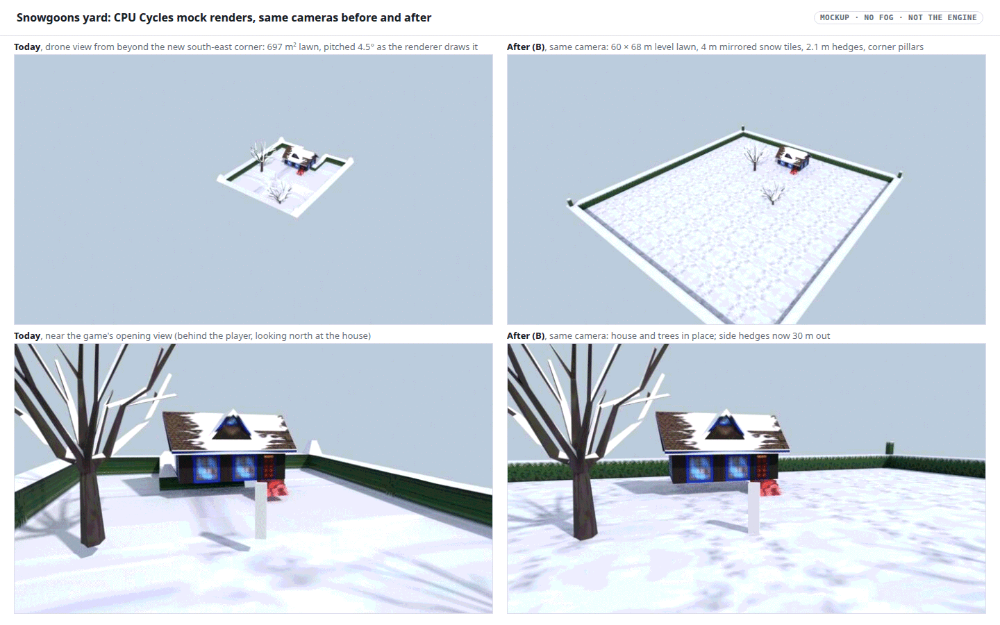

# Snowgoons: a one-acre backyard

**Date:** 2026‑11‑13
**Status:** plan for Will's review. Nothing is implemented yet; the mockups below are renders, not the shipped asset.
**TODO:** Level / Gameplay, "Snowgoons arena: enlarge the backyard to one acre" (T4).
**Ask (Will):** enlarge the Snowgoons arena / backyard to the equivalent of 1 acre (4,046.86 m², about 63.6 × 63.6 m, or a backyard-shaped rectangle of the same area).

## Summary

Today's lawn is **697 m² (0.17 acre)**: 5.81 times too small in area, 2.41 times in each direction. The plan replaces the 3ds Max arena mesh in the classic Snowgoons level, the one the Android app ships, with a generated yard. The lawn is **60 m wide and 68 m deep (4,080 m², 1.008 acre)**, level, and tiled in 4 m cells of the existing snow texture. The 2 m hedge band moves out to the new edge. The house, both trees and the player start stay where they are, with the house still at the back of the yard and a 6 m path behind it.

Two engine facts shape the design more than the size does. First, UVs are clamped to 0–1, so a texture can only tile through geometry, never through UV values. Second, a mesh's collider ignores the actor's rotation, and a static whose bounds enclose the player's spawn is ignored as a "zone volume". So the yard is level, its floor and hedge walls get their own simple colliders, and the lawn is gridded to one texture copy per cell.

## What one WF unit is, here

**1 WF unit = 1 metre.** The evidence, all from the shipped level:

| Evidence | Value | Reads as |
|---|---|---|
| `Falling Acceleration` on every actor in `snowgoons.lev` | 9.81 (player 9.80) | Earth gravity in m/s² |
| `player.iff` mesh / player collision box | 0.5 × 0.5 × 2.5 / 0.66 × 0.72 × 2.0 | a 2 m figure |
| `house.iff` footprint and height | 10.5 × 8.8, ridge 6.5 above its base | a small log cabin |
| `house.iff` front door (material 20, `G_DoorF`) | 1.25 wide × 2.0 tall | a door |
| `house.iff` steps (material 21) | 1.0 rise | a short flight of steps |
| Camera near / far plane (`gfx/gl/display.cc:674`) | 1 / 1000 | metres, as the fog docs state (`docs/level-building.md:1180`) |

Jolt runs in SI units, and its gravity is the 9.81 above, so the physics agrees.

## The current arena, measured

Read from `wflevels/snowgoons-blender/quadpatch01.iff` (481 vertices, 445 faces) and the actor `statplat_2` in `snowgoons.lev`. Numbers are reproducible with [`plan_view.py`](2026-11-13-snowgoons-one-acre-arena/plan_view.py) and [`render_mockup.py`](2026-11-13-snowgoons-one-acre-arena/render_mockup.py).

| Part | Material | Faces | Size |
|---|---|---|---|
| Lawn | 5, `G_SnowyGrass11` | 176 | local x −12.50…13.00, y −17.71…13.03: **25.5 × 30.7 m bounding box, 696.5 m² of lawn**, at local z −0.50 |
| Hedge inner faces | 2, `G_HedgeWsnowSide` | 95 | 2.0–2.4 m tall; no outer face |
| Hedge tops and corner pillars | 1, `G_HedgeWsnowTp` | 174 | band 2 m wide; four pillars about 0.8 m square, 4.2 m tall |
| Whole arena with hedges | | 445 | 29.5 × 34.7 m (1,024 m²) |

The actor sits at (−0.04, 6.83, −0.69) with orientation a = 0.0784 rad, a **4.5° pitch about X**. Rendered (Blender's import applies the same Euler), the lawn runs from x −12.54 to 12.96 and y −10.80 to 19.86, and from z −2.29 at the south edge up to −0.17 at the north. The north hedge wraps the house: the house sits in a notch, and an invisible wall (`statplat_22`) keeps the player out of the strip behind it.

Scale factor to one acre: 4,046.86 / 696.5 = **5.81 in area, 2.41 in each direction**.

## Findings that shape the design

1. **UVs are clamped per vertex, so tiling has to be geometry.** `CalcVRAMuv` clamps every u and v to 0–1 before mapping into the atlas (`wfsource/source/gfx/material.cc:274-283`, `CLIP01`); the static-mesh path records the same primitives. Today's lawn UVs span −0.79 to 1.79, so the lawn shows one 32 px copy stretched over about 10 m with smeared edges, and the hedge faces (u span 2.46 per 2.4 m face) smear the same way. A tiling lawn needs every face's UVs inside 0–1: one copy per cell.
2. **A mesh collider ignores the actor's rotation.** `JoltBodyCreateStaticMesh` takes the position only (`physics/jolt/jolt_backend.cc:287`, called from `physics/physical.hpi:224-233`), while rendering uses the full matrix with orientation (`renderassets/rendacto.cc:474`, `physical.hpi:386-389`). Today the lawn is drawn pitched 4.5° but collides level at z −1.19, up to about 1.1 m apart at the south edge. The new yard has zero orientation, so what you see is what you stand on.
3. **A static that encloses the spawn is ignored.** Any static body whose world bounds enclose the character's spawn box is treated as a zone volume and skipped for that character (`jolt_backend.cc:681-705`). A single yard mesh with hedges and pillars encloses every spawn inside it, so on its own it would give the player no floor. By the same arithmetic today's arena (bounds z −1.19…3.06 around a spawn at z −0.88…1.12) and the ground box `statplat_15` (z −8.62…2.79) are both skipped today; whether the current player stands on anything is not yet observed (Phase 0). The design does not depend on the answer. The floor and the hedge walls get their own colliders, thin enough that they can never enclose the spawn.
4. **The existing invisible walls would cut across the new lawn.** `statplat_19` (y −16.85…−16.60, x ±14.5) and `statplat_22` (y 13.73…13.98, x −12.1…12.8) are zero-orientation thin walls. `statplat_15`, `20` and `21` carry 3ds Max orientations such as (4.7125, 3.0717, 1.5707) that land nowhere sensible. Left alone in a 60 m yard, 19–22 are invisible walls in the middle of the lawn, so all five are repurposed (below).
5. **The authored bounding box is used, not the mesh's.** `levcomp-rs` writes the `.lev`'s `Global Bounding Box` and ignores the mesh extent (`wftools/levcomp-rs/src/lvl_writer.rs:320-330`). The yard actor's box must be written to the new mesh bounds.
6. **`snowgoons-blender.lev` and `quadpatch01.iff` are shared, so neither is edited.** About 17 level generators import `snowgoons-blender.lev` as their scaffold (they delete its statplats but keep its rooms, camera and fog). It is also the level the macOS frame gate and `tests/test_renderer_references_fresh.py` render (`wflevels/snowgoons-blender/snowgoons-standalone.iff`). `quadpatch01.iff` is used by both `.lev` files and appears in 13 tracked IFFs. The yard is a new asset, `yard01.iff`, referenced only by the classic `snowgoons.lev`.
7. **The Android app is built from the classic level.** The chain is `snowgoons.lev` → `wflevels/snowgoons.iff` → `snowgoons-standalone.iff` → `task build-cd-iff-snowgoons` → `wflevels/snowgoons-cd.iff`, the APK's `cd.iff` symlink. The web build also preloads `snowgoons-standalone.iff` (`CMakeLists.txt:2164`). `build_level_binary.sh` cannot build it today, because the `.lev` lives in `snowgoons-blender/` under another name; the 2026‑09‑20 relight rebuilt it by hand ([pipeline](../investigations/2026-04-19-snowgoons-build-pipeline.md)).
8. **The rooms are already big enough.** Room0 and Room1 (`room_6`, `room_16`) span x ±92.7 and y −157.8 to 151.8, split at y −2.98, and the two camera-shot zones span x ±81. The new yard fits with no room, zone or light change.
9. **The house base is the right lawn height.** The house's lowest vertex is at world z −0.62 (`house.iff` z −0.50, actor z −0.12). A level lawn there puts the steps on the grass. The player's authored spawn, z −0.88, would then be under the lawn, so it moves up to −0.60.

## Design (recommended: option B)

### Layout

| | Today | After (B) |
|---|---|---|
| Lawn | 25.5 × 30.7 m bounding box, 697 m² | **60 × 68 m = 4,080 m² = 1.008 acre** |
| Lawn, world | x −12.5…13.0, y −10.8…19.9, pitched | x −30…30, y −46…22, level at z −0.62 |
| Hedges | 2 m band, 2.0–2.4 m tall, 4 corner pillars | 2 m band, 2.1 m tall, 4 corner pillars 0.8 m square, 4.2 m tall |
| Outside the hedges | 29.5 × 34.7 m | 64 × 72 m |
| House | at the back, in a hedge notch | same place; north hedge 6 m behind it, a walkable path round the house |
| Trees, player x/y, camera start | | unchanged (camera_8's start at y −40.4, outside today's yard, is now inside it) |

The north hedge line moves from y 19.86 to 22, and the yard grows sideways and to the south, in front of the house. The opening shot still looks north at the house with the player in front of it. The extra space is to the sides and behind the camera, to be explored rather than seen all at once.

### The yard mesh, `yard01.iff`

- **Origin and pivot:** actor at (0, −12, −0.62), orientation (0, 0, 0). In mesh space the lawn is at z = 0 and spans x ±30, y ±34, following the "Mesh origin" rule in `CLAUDE.md` (base at local z = 0).
- **Lawn:** a 15 × 17 grid of 4 m cells, 510 faces on 288 shared vertices. The vertex at grid (i, j) has u = i mod 2 and v = j mod 2. Every cell then spans exactly one texture copy, mirrored in alternate cells, so no UV is ever clamped and the seams match. The texture is `G_SnowyGrass11` only, today's lawn texture. The other "SnowyGrass" files are green grass or grass-to-snow edges, and mixing them in drew a checkerboard in the first mock render.
- **Hedges:** 128 segments of 2 m. Each has an inner face (`G_HedgeWsnowSide`, v 0 at the lawn and 1 at the top, u alternating 0/1 along the run) and a top (`G_HedgeWsnowTp`), with corner squares and four pillars. That is about 560 faces. As today there is no outer face.
- **Totals:** about 1,070 faces and 910 vertices, about 37 KB on disk (today: 445 faces, 481 vertices, 22 KB).
- **Materials:** the `MATL` chunk is copied byte for byte from `quadpatch01.iff`, so the indices (1 top, 2 side, 5 lawn), flags (2) and texture set are unchanged and textile packs the same Room1 atlas. Vertex colour is white (0xFFFFFF), as in `quadpatch01.iff`.
- **Facing:** with the engine's normal, (v1 − v0) × (v2 − v0), the lawn and tops face +Z and the inner hedge faces face the lawn. A new test checks both.

### Collision

| Collider | Today | After |
|---|---|---|
| `statplat_15` | rotated box (6.135, 3.1415, 0), skipped as a zone volume | **ground slab**: zero orientation, at (0, −12, −0.62), box x ±32, y ±36, z −1…0 |
| `statplat_19`, `20`, `21`, `22` | thin walls, two of them rotated, at the old hedge lines and through the house | **four hedge walls** on the inner hedge lines (y −46, x 30, x −30, y 22), 0.25 m thick, 2.1 m tall, zero orientation |
| `statplat_2` (the yard) | trimesh of the pitched arena | trimesh of `yard01`, level; the slab and walls hold the player whether or not it is skipped |
| House, steps, trees | trimesh / boxes | unchanged |

### Camera, fog, rooms and actors

- **Fog:** `camera_8` `FoggingStartDistance` / `FoggingCompleteDistance` change from 20 / 30 to **40 / 100 m**. The hedge box's diagonal is 96 m, so the far hedge is hazy but there, instead of the yard ending in flat grey at 30 m. This edits only `snowgoons.lev`, so no scaffolded level inherits it.
- **Camera:** the bungee camera follows the player, so it needs no limits. Its start and the camera shots stay where they are, all inside the new hedges.
- **Rooms and camera-shot zones:** unchanged (finding 8). The yard actor stays in Room1, as the arena is today, and both rooms are always active.
- **Actors:** there are no spawn areas or generators in this level. `enemy_29` follows its path; `missile_30` and the tools are untouched.
- **Lights:** directional and ambient, so position does not matter. Unchanged.

### Performance and memory on the Chromecast HD

- **Faces:** about +625 in one statically baked mesh (the arena goes from 445 to about 1,070). The level's frame is about 1,563 triangles today (macOS headless count). The GPU cost is small; the per-face back-face cull runs on the CPU over about 1,070 instead of 445 faces.
- **ROOM pool:** today the RM1 chunk is 111,744 bytes in a 300,000 byte ROOM pool (`snowgoons-standalone.iff.txt`); the yard adds about 15 KB on disk plus its runtime vertex and primitive arrays. Verification step 8 measures the high-water mark. If headroom is under 25 %, raise `ROOM` in `snowgoons-standalone.iff.txt` only (it does not touch other levels).
- **OBJD / PERM:** unchanged; no actors are added.
- **Draw distance:** the far plane is 1,000 m; nothing changes.

### Build pipeline

- **Generator:** `wflevels/snowgoons-blender/make_yard.py`, pure Python with every dimension in one constants block. It writes `yard01.iff` (`MODL { VRTX MATL FACE }`, `MATL` copied from `quadpatch01.iff`). With `--lev` it patches `snowgoons.lev` in place, reusing `_split_objects` from `scripts/add_ambient_light.py` and `set_euler` / `_fx` from `scripts/relight_level.py`. It is deterministic: a second run changes no byte.
- **Build script:** `build_level_binary.sh` gains an optional `WF_LEVEL_DIR` (default unchanged), so `WF_LEVEL_DIR=wflevels/snowgoons-blender build_level_binary.sh snowgoons` writes `wflevels/snowgoons.iff` and, because `snowgoons-standalone.iff.txt` sits there, `wflevels/snowgoons-standalone.iff`.
- **Taskfile:** `task snowgoons-yard` (generate) and `task snowgoons-level` (generate, build in the linux-test container, then `build-cd-iff-snowgoons`), with `sources:` / `generates:`.
- **Shared textile outputs:** both `.lev` files write `Room1.tga`, `.ruv`, `pal*.tga` into the same directory. Because `yard01`'s `MATL` equals `quadpatch01`'s, the Room1 atlas should come out byte-identical; step 2 checks it.

## Choices for Will

| # | Choice | Recommended | Alternative |
|---|---|---|---|
| 1 | Shape | **B: 60 × 68 m rectangle**, today's proportions, more lawn in front of the house | A: 64 × 64 m square (4,096 m²), 4 m wider and 4 m shallower |
| 2 | Behind the house | **Open: a 6 m path all round the house**, the whole acre walkable | Keep the house as a backdrop (hedge notch and barrier); the walkable lawn is then about 3,700 m² unless the lawn grows to make it up |
| 3 | Fog | **40 → 100 m**: the whole yard visible, far hedges hazy | Keep 20 → 30 m: the yard fades to grey past 30 m, so most of the new size is never seen |
| 4 | Props | **Open lawn with today's two trees** for this change | Add more `tree02` / `tree03` instances (permanent meshes, no new memory) to fill the space |
| 5 | Lawn tile | **4 m** (8 px per metre) | 2 m (sharper, 4 times the lawn faces) or 8 m (closer to today's blur) |
| 6 | Which copies | **The Android chain and the web preload.** The editor/macOS-gate variant (`snowgoons-blender`) and the legacy CD images (`wflevels/cd.iff`, `cd_full.iff`, `full_cd/L4.iff`, `wfsource/source/game/{cd,snowgoons}.iff`) keep the old arena | Also port `snowgoons-blender`; that regenerates the freshness and macOS references and touches the scaffold the other levels import |

## Rejected

- **Scale `quadpatch01.iff` by 2.41.** It would stretch the hedges to 5 m tall and 4.8 m thick unless the scale were non-uniform, and keep the 4.5° pitch and the clamped, smeared UVs. A stretched lawn cannot tile.
- **Author the yard in Blender and export it with the add-on.** There is no `.blend` for this level, the exporter re-derives materials and flags, and it needs the Blender container. A 200-line generator copies the known-good `MATL` and is testable on its own.
- **Wrap UVs in the shader so the old mesh could tile.** That is an engine change, and `CLIP01` throws the out-of-range UVs away at load, so the data is not there to wrap.
- **One yard mesh as the only collider.** Finding 3: it encloses the spawn and would be ignored, leaving no floor.

## Mockups

| | |
|---|---|
|  | **Plan view.** Today and option B side by side at 9.5 px per metre, with option A as a thumbnail. Today's geometry is read from the shipped meshes; colliders in red, the Room0/Room1 boundary dashed. |
|  | **Renders** in the Blender container (CPU Cycles, the level's own textures, no fog). Drone view and near-opening view, the same cameras before and after. The yard is a mock built from the plan's numbers, not `yard01.iff`. |

The states that matter here are today, option B and option A; the level has no empty or error state. The mock renders show no fog, so step 6 is where the real look is judged.

## Phases

- **Phase 0, evidence (no asset change).** Run today's `snowgoons-standalone.iff` in the linux-test container with the debug bridge and log the player's z for 10 s, plus the `ccollision` "ignoring zone body" lines. This shows whether today's player stands on anything (finding 3). The answer is reported to Will; the design does not depend on it.
- **Phase 1, generator and tests.** `make_yard.py`, `yard01.iff`, the `snowgoons.lev` patch, `tests/test_snowgoons_one_acre_yard.py`, and the faces-up test updated (below).
- **Phase 2, build.** `WF_LEVEL_DIR` in `build_level_binary.sh`, the two tasks, and the rebuilt `snowgoons.iff`, `snowgoons-standalone.iff` and `snowgoons-cd.iff`.
- **Phase 3, desktop verification** in the linux-test container (steps 5–8).
- **Phase 4, device.** APK rebuild and a coordinator job, after the current install campaign has finished.

### Tests

- **New, `tests/test_snowgoons_one_acre_yard.py`** (no engine, no display), reading the built `wflevels/snowgoons-cd.iff` as well as the source:
    - lawn area (horizontal faces of material 5) ≥ 4,046.86 m² and ≤ 4,128 m² (1.02 acre);
    - every horizontal face points up; every inner hedge face points at the lawn;
    - every UV inside 0–1 (the tiling guard for finding 1);
    - the lawn at local z 0;
    - in `snowgoons.lev`: the yard actor's orientation is zero (finding 2), its bounding box equals the mesh bounds (finding 5), the player spawns on the lawn inside the walls, the slab's top equals the lawn and it covers the spawn, and no wall or slab encloses the spawn box (finding 3);
    - the yard bytes in `snowgoons.iff`, `snowgoons-standalone.iff` and `snowgoons-cd.iff` equal `yard01.iff` (the bundles were rebuilt).
- **Updated, `tests/test_snowgoons_arena_faces_up.py`:** the old arena now lives in 10 tracked IFFs, not 13. The three Android-chain files carry `yard01` instead, and the test names them so a stale rebuild is caught.
- **Unchanged and still expected to pass:** `tests/test_renderer_references_fresh.py`, because the `snowgoons-blender` level it renders is not rebuilt.

## Verification

Run each step, paste the raw output below it, then write PASS or FAIL.

1. Generator is deterministic and touches only its outputs: `task snowgoons-yard` twice, `sha256sum wflevels/snowgoons-blender/yard01.iff wflevels/snowgoons-blender/snowgoons.lev` after each, then `git status --short wflevels/snowgoons-blender/`. Same hashes both times; only `yard01.iff` (new) and `snowgoons.lev` changed.
2. Rebuild: `task snowgoons-level`. Then `git status --short wflevels/` lists `snowgoons.iff`, `snowgoons-standalone.iff`, `snowgoons-cd.iff` and the classic level's intermediates (`snowgoons.lev.bin`, `snowgoons.lvl`, `snowgoons.iff.txt`, `asset.inc`, `snowgoons.ini`), and **not** `snowgoons-blender.iff`, `snowgoons-blender/snowgoons-standalone.iff`, `Room1.tga` or `Room1.ruv`.
3. Geometry tests: `scripts/in-linux-container.sh python3 -m pytest tests/test_snowgoons_one_acre_yard.py tests/test_snowgoons_arena_faces_up.py -v`. All pass.
4. Area: the yard test prints the lawn area measured from the built `wflevels/snowgoons-cd.iff`; it reads 4,080 m² (≥ 4,046.86 m², ≤ 4,128 m²).
5. Freshness reference untouched: `scripts/in-linux-container.sh bash -c 'xvfb-run -a -s "-screen 0 1280x720x24" python3 -m pytest tests/test_renderer_references_fresh.py -v'` (built engine from `scripts/build-wf-game-container.sh`, `WF_GAME=` pointing at it). Passes with no reference regenerated.
6. Desktop capture: in the linux-test container, `bash -c 'xvfb-run -a -s "-screen 0 1280x720x24" <wf_game> -L/src/wflevels/snowgoons-standalone.iff --capture-frame=20 …'` and again at frame 600 after driving the player south. Look at both frames: tiled lawn with no smear, hedges at the new edge, house steps on the grass, far hedge in haze rather than flat grey.
7. Walk test: drive the player through the debug bridge south for 30 s, then east, then round the back of the house, logging position every second. z stays within 0.05 m of −0.62; the player stops at the walls near y −45.7, x 29.7 and x −29.7; it never falls below −1.
8. Memory: the ROOM pool high-water mark after level load, from the engine's memory log or the debug bridge, is under 75 % of `ROOM` (300,000). If not, raise `ROOM` in `snowgoons-standalone.iff.txt`, rebuild (step 2) and repeat.
9. Android bundle tests: `scripts/in-linux-container.sh python3 -m pytest tests/test_game_apps_android.py tests/test_aquarium_android.py -v`. The APK-bytes check (`test_aquarium_android.py`, snowgoons `assets/cd.iff` equals `wflevels/snowgoons-cd.iff`) is expected to fail until the APK is rebuilt. Rebuild only after the current install campaign has finished, then rerun.
10. Device: a coordinator `record` job installs the rebuilt snowgoons APK on one Chromecast and records 60 s while walking to a far corner. Frame rate no lower than today's on the same device, the yard visible, no `FatalError` in logcat.
11. Plan renders: `task md -- docs/plans/2026-11-13-snowgoons-one-acre-arena.md` prints no `Warning: mermaid.ink render failed`.

## Risks

- **Phase 0 may show today's player falling.** If the current player has no floor, today's game is already broken on that point. The yard fixes it by construction, but Will should hear it as a finding about the shipped build.
- **The lawn may read as a repeating pattern** from the drone height in the mock. In the engine the camera sits at player height with fog, and step 6 judges it. If it does read as a pattern, the 8 m tile (choice 5) is a one-constant change.
- **Bungee camera behind a hedge.** As today, hedges have no outer face. When the player hugs the south hedge the camera can sit outside it and see through the hedge. That is unchanged behaviour, not a regression, but the larger yard makes the case rarer, not impossible.
- **Shared textile outputs.** If the Room1 atlas does not come out byte-identical (step 2), the `snowgoons-blender` build's committed intermediates and its built IFF disagree until it is rebuilt. The fix is to rebuild it too, which is choice 6's alternative.

## Not in this change

- Porting the yard to `snowgoons-blender` and the legacy CD images (choice 6).
- New props or gameplay in the extra space (choice 4).
- The 3ds Max rotations left on the trees' colliders (`statplat_3` and `statplat_4` are rotated about Z, and their trimesh colliders are not, finding 2). That is a separate defect in a separate file.
