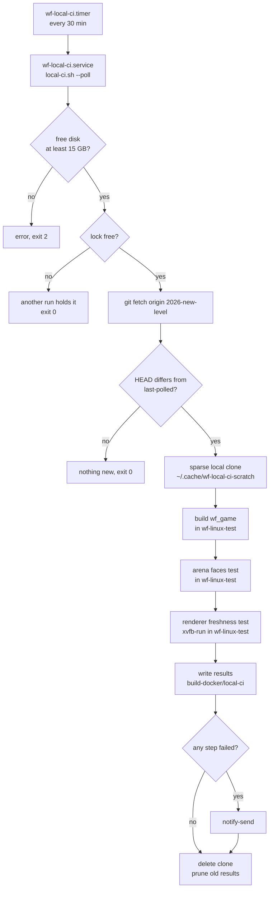
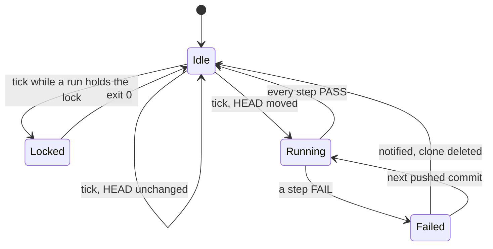

# Local CI: the renderer freshness and snowgoons arena tests run on this PC

TODO: `[local-ci]` (replaces `[T5] Decide whether the renderer freshness test or the cheaper snowgoons geometry test runs in CI`). Evidence: [metal-snowgoons-cull-2026-10-17](../diagnostics/metal-snowgoons-cull-2026-10-17/README.md).

## Context

The snowgoons arena shipped inverted on Linux GL and Metal for a month (`25a57d73` → `23658e9a`). Two tests now guard that class of bug, and neither runs anywhere:

- `tests/test_snowgoons_arena_faces_up.py`: cheap; reads every tracked `.iff`, no engine, no display.
- `tests/test_renderer_references_fresh.py`: builds nothing itself, but needs a built `wf_game` and an X display; it renders frame 20 of snowgoons and aquarium and compares them with the committed references.

**Decision (Will, 2026‑11‑14):** both run automatically. There are no GitHub Actions minutes, and Codemagic's free Mac minutes are capped and kept for Mac work, so they run **here, on this PC**, as a local CI.

## Design

### Runner: `scripts/local-ci.sh` (`task ci:local`)

```
scripts/local-ci.sh [--poll] [--tests-from REV] [--keep N] [--no-notify] [COMMIT]
```

1. **Preflight.** Stop with a clear error, before anything else, if free space on the filesystem that holds `build-docker/` is under `WF_CI_MIN_FREE_GB` (default 15 GB) or Docker is unreachable.
2. **Lock.** `flock -n` on `build-docker/local-ci/.lock`. A second run while one holds it prints `local-ci: another run holds the lock (pid N)` and exits 0, so a timer tick that lands mid-run is a no-op, not an error.
3. **Fetch.** `git fetch origin 2026-new-level`. `COMMIT` defaults to `origin/2026-new-level`.
4. **Poll gate (`--poll`, the timer's mode).** If the resolved SHA equals `build-docker/local-ci/last-polled`, print `nothing new` and exit 0. Otherwise record it before running, so a commit that fails is not retried every tick.
5. **Throwaway checkout.** A **local clone** (`git clone --local --no-checkout`, objects hard-linked, so it costs no object space) under `~/.cache/wf-local-ci-scratch/<sha>-<pid>/`, sparse (non-cone): everything except `docs/plans/`, `docs/diagnostics/`, `docs/papers/` and `docs/reference/` (4.3 GB of the 4.8 GB tree), with every `*.iff` and C/C++ source under `docs/` put back. The checkout is about 550 MB. The shared main checkout is never touched.
    - **Why a clone and not `git worktree add`:** a worktree's `.git` is a file that points at `~/WorldFoundry-wbniv/.git/worktrees/…`, which does not exist inside the container (only the checkout is mounted at `/src`), and the arena test lists its inputs with `git ls-files`. A local clone carries its own `.git`, so git works in the container with no extra mounts.
    - **Why those `docs/` files come back:** the arena test opens every tracked `*.iff` (four live under `docs/`), and `CMakeLists.txt` compiles `docs/diagnostics/reef-triangle-normal-2026-11-06/loader-probe.cpp` (the first sparse attempt failed CMake's generate step without it).
    - The `~/.cache/*-scratch` name means `disk-hygiene.timer` ages out anything a killed run leaves behind after 7 days. Normal runs delete it on exit (an `EXIT` trap, pass or fail).
6. **Overlay (`--tests-from REV`, manual use only).** Replace the CI test files and their harness with REV's copies: the two tests, `tests/compare_renderer_frames.py`, `scripts/audit_face_hand.py`, `scripts/build-wf-game-container.sh` and `scripts/in-linux-container.sh`. This runs today's guards against an older commit, which is how step 3 of the verification proves they catch the bug: the tests did not exist before the fix.
7. **Build** (`--builder`, default `dev`), from the clone, so `/src` is the clone and `/build` is the clone's own `build-docker/`. The engine is built from scratch each run (the build directory goes with the clone). Since [the single desktop build](2026-11-14-single-desktop-build.md):
    - `dev`: `scripts/in-linux-container.sh scripts/build-wf-game-container.sh --dev`, the engine `task build` builds (CMake Debug with `cmake/wf-game-dev.cmake`, `WF_DESIGNER_CHEATS` on, so the Linux GL `--capture-frame` works). The build scripts are the runner's own; a commit whose `CMakeLists.txt` predates the option is built with `-DCMAKE_CXX_FLAGS=-DDESIGNER_CHEATS=1`.
    - `release`: `build-wf-game-container.sh` (CMake Release), the original default; it cannot capture, so `renderer-fresh` fails on it.
    - `build_game` and `cmake` are accepted as the old names of `dev` and `release`. (Originally `build_game` ran `engine/build_game.sh`, now retired.)
8. **Tests**, each in its own container run, each with its own log and duration:
    - `python3 -m pytest -v -rs tests/test_snowgoons_arena_faces_up.py`
    - `bash -c '… xvfb-run -a -s "-screen 0 1280x720x24" python3 -m pytest -v -rs tests/test_renderer_references_fresh.py …'` with `WF_GAME=/build/wf-game/src/engine/wf_game`. `bash -c` keeps `xvfb-run` from being PID 1, and the trailing `exit "$rc"` keeps bash from `exec`-ing it.
    - **A skip is a failure.** The freshness test skips when it has no engine or display, which is exactly how it hid before. A step passes only when pytest exits 0, reports at least one pass and reports no skip.
9. **Containers.** Every container run sets `WF_CONTAINER_MEMORY` (default 8g here: the PC has 31 GB and other sessions share it), core dumps off (the wrapper's `--ulimit core=0`), and the labels `org.wbniv.project=WorldFoundry-wbniv`, `org.wbniv.purpose=local-ci`, `org.wbniv.source=scripts/local-ci.sh` through a new `WF_CONTAINER_LABELS` in `in-linux-container.sh`. No new image and no long-running container: the runs reuse `wf-linux-test:local` with `--rm`, so the container registry needs no entry.
10. **Results** under `build-docker/local-ci/` (gitignored by `build*/`):
    - `<sha12>/` (or `<sha12>-tests-<rev12>/` for an overlay run): `summary.txt`, `result.tsv` (step, result, seconds), one log per step.
    - `latest`: a copy of the newest `summary.txt`. `last-polled`: the SHA the timer last took.
    - Only the newest `--keep` result directories (default 20) are kept.
11. **Notify** on failure (any step FAIL, including the build): `notify-send -u critical -a wf-local-ci`, as `disk-hygiene.sh` does, naming the commit and the failing steps. `--no-notify` silences it for a deliberate failing run.
12. **Exit status:** 0 when every step passes (or nothing new / locked), 1 when a step fails, 2 on a usage or preflight error.



A failed build still writes results and notifies; the test steps after it are recorded as `SKIP (no engine)` and the run counts as failed.



### Trigger: a systemd user timer

- `scripts/systemd/wf-local-ci.service.in` and `wf-local-ci.timer` live in the repo. `scripts/install-local-ci.sh` renders the service with the repo path, writes both to `~/.config/systemd/user/`, reloads, and enables the timer. It is idempotent and needs no sudo.
- **Every 30 minutes** (`OnCalendar=*:0/30`, `RandomizedDelaySec=2min`, `OnBootSec=5min`). The first from-scratch engine build in the sparse clone took 16 min 57 s (2026‑11‑14, load average 27–36 on this 8‑core PC from other sessions), and the tests add about a minute. At 15 or 20 minutes most ticks would land during a run and only hit the lock; at 30 a push still gets a result within about 50 minutes, and the machine is idle between pushes. The lock makes an overlap harmless anyway.
- The service is `Type=oneshot`, `Nice=10`, `IOSchedulingClass=idle`, so a build never competes with an interactive session.
- **No git hook.** Hooks are shared by every project through `core.hooksPath=~/python-tui-lib/git-hooks`, and a multi-minute engine build must not block anyone's push.

## Findings (2026‑11‑14): the freshness test cannot pass on any engine buildable at HEAD

The first run on HEAD (`6eb75ccd`) built, passed the arena test and failed the freshness test with `no frame captured` for both levels. Cause, traced in the source:

1. **The CMake build never compiles Linux frame capture.** In `wfsource/source/gfx/gl/display.cc` the backend frame counter (`Display::RenderEnd`), the capture FBO and the `CaptureFrame` call are all inside `#if DESIGNER_CHEATS && defined(__LINUX__)`, and so is `bRecordVideo` in `game/main.cc`. `CMakeLists.txt` never defines `DESIGNER_CHEATS` (`build.ninja` has no such flag), so `--capture-frame=N=path` is parsed and silently ignored: the engine exits 0 with no PNG, even at `--capture-frame=1`. The macOS gate is unaffected because `display_macos.cc` does not use that guard. The same ignored capture reproduces with the older CMake binary in `build-docker/wf-game/` (built 2026‑11‑09).
2. **The build that does define it fails to link at HEAD.** `engine/build_game.sh` (what `task build` runs) passes `-DDESIGNER_CHEATS=1`, but it does not compile `engine/planted_preview.cpp` or `engine/runtime_diagnostics_form.cpp`, which `cd6b9e9e` (2026‑11‑11, "Migrate runtime settings to actor OADs …") added to `CMakeLists.txt` only. Link: `undefined reference to planted::oadPreviewProperties()` and `wfoptions::diagnosticsForm(…)`. So `task build` is broken from a clean checkout since `cd6b9e9e`.
3. Ungating only the capture blocks in a scratch copy of `display.cc` and building with CMake failed twice more on link (`wf_hud_initials`, then `bRecordVideo`, both defined only under `DESIGNER_CHEATS`). That was the third attempt, so the engine fix was not pursued here; the test was not weakened.

**Decided (Will, 2026‑11‑14): neither patch, the long-term fix.** CMake became the single desktop build and `engine/build_game.sh` was retired; the CMake debug engine defines `DESIGNER_CHEATS` (`WF_DESIGNER_CHEATS`), and the CI's default builder is that engine ([plan](2026-11-14-single-desktop-build.md)). The options as they stood:

- **(A)** Fix `engine/build_game.sh` (add the two sources and whatever generated includes `cd6b9e9e` gave CMake) and run the CI with `--builder build_game` (`WF_CI_BUILDER=build_game` in the unit). It also repairs `task build`.
- **(B)** Make Linux `--capture-frame` independent of `DESIGNER_CHEATS` (the capture globals in `main.cc` and the `display.cc` capture blocks), so the CMake Release build, which is what the macOS gate's counterpart is, can capture. The CI then keeps the default `--builder cmake`.

Until that landed, the CI reported `renderer-fresh FAIL` on every new commit, which was true.

## Mockups

The only visible surfaces are a desktop notification and a text file.

Notification (failure only):

```
┌──────────────────────────────────────────────────────────────┐
│ ● wf-local-ci                                                │
│ WF local CI FAILED on be86bbb9                               │
│ Failing: arena-faces-up, renderer-fresh.                     │
│ be86bbb9 Index nine plans that had no row in docs/plans/…   │
│ See ~/WorldFoundry-wbniv/build-docker/local-ci/latest        │
└──────────────────────────────────────────────────────────────┘
```

`build-docker/local-ci/latest` (failing run):

```
WF local CI   FAIL
commit        be86bbb9b006  Index nine plans that had no row in docs/plans/README.md
tests from    23658e9a6cc6
started       2026-11-14T09:02:11Z
finished      2026-11-14T09:13:40Z   (689 s)
results       build-docker/local-ci/be86bbb9b006-tests-23658e9a6cc6

step                 result   seconds
build                PASS     540
arena-faces-up       FAIL     6
renderer-fresh       FAIL     58

──── arena-faces-up: last 25 lines ────
E   AssertionError: wflevels/cd.iff@149144: 283 of 283 horizontal arena faces point down; …
…
```

A passing run has the same layout with `PASS` everywhere and no log tails.

## Files

| File | Change |
| --- | --- |
| `scripts/local-ci.sh` | new: the runner |
| `scripts/install-local-ci.sh` | new: installs and enables the user timer |
| `scripts/systemd/wf-local-ci.service.in`, `scripts/systemd/wf-local-ci.timer` | new: the unit files |
| `scripts/in-linux-container.sh` | `WF_CONTAINER_LABELS` (space-separated `KEY=VALUE` docker labels) |
| `Taskfile.yml` | `ci:local`, `ci:install` |
| `docs/plans/README.md`, `TODO.md` | index row; the T5 item becomes a Done line |

## Verification

1. Both scripts parse and answer `--help`: `bash -n scripts/local-ci.sh scripts/install-local-ci.sh && scripts/local-ci.sh --help && scripts/install-local-ci.sh --help`.

    ```
    $ bash -n scripts/local-ci.sh scripts/install-local-ci.sh && scripts/local-ci.sh --help | head -5 && scripts/install-local-ci.sh --help | head -2
    Usage: scripts/local-ci.sh [-h|--help] [--poll] [--tests-from REV] [--builder B] [--keep N] [--no-notify] [COMMIT]

    Builds wf_game and runs the CI tests on COMMIT (default: origin/2026-new-level, fetched
    first) in a throwaway sparse clone under ~/.cache/wf-local-ci-scratch, never in this
    checkout. Every build and test runs in the wf-linux-test container.
    install-local-ci.sh: install and start the WorldFoundry local CI user timer.
    ```
    **PASS**
2. A manual run on origin's HEAD passes both tests and the build: `task ci:local`, then `cat build-docker/local-ci/latest`.

    ```
    2026-11-14T03:23:09Z local-ci: testing 6eb75ccd92d8 (TODO: park the Cyber load and mesh-check item); results in …/build-docker/local-ci/6eb75ccd92d8
    2026-11-14T03:31:19Z local-ci: build: PASS (481 s)
    2026-11-14T03:31:23Z local-ci: arena-faces-up: PASS (4 s)
    2026-11-14T03:31:28Z local-ci: renderer-fresh: FAIL (5 s)
    …
    E       AssertionError: snowgoons: no frame captured
    …
    ============================== 2 failed in 2.83s ===============================
    2026-11-14T03:31:29Z local-ci: notified: WF local CI FAILED on 6eb75ccd | Failing: renderer-fresh. 6eb75ccd TODO: park the Cyber load and mesh-check item. See /home/will/WorldFoundry-wbniv/build-docker/local-ci/latest
    task: Failed to run task "ci:local": exit status 1
    ```
    **FAIL** for `renderer-fresh`: the CMake engine ignores `--capture-frame` (see **Findings**). The runner, the build and the arena test work. With `--builder build_game` the engine does not link at HEAD (`cd6b9e9e`, **Findings** 2).

    **Rerun 2026‑11‑14, after [the single desktop build](2026-11-14-single-desktop-build.md)** (`b4e0899a`, default builder now `dev`):

    ```
    $ WF_CI_RESULTS=~/WorldFoundry-wbniv/build-docker/local-ci task ci:local COMMIT=b4e0899a
    2026-11-14T06:07:35Z local-ci: testing b4e0899a3c2a (One desktop build: task build runs CMake; engine/build_game.sh retires), builder dev; results in /home/will/WorldFoundry-wbniv/build-docker/local-ci/b4e0899a3c2a
    2026-11-14T06:26:39Z local-ci: build: FAIL (1089 s)
    2026-11-14T06:26:45Z local-ci: arena-faces-up: PASS (6 s)
    2026-11-14T06:26:45Z local-ci: renderer-fresh: SKIP (no engine) (0 s)
    ```
    **NOT COMPLETED**: the build was killed (exit 137) by the session's own disk guard as free space reached 15.3 GB (load average about 50 from other sessions stretched the build to 18 min), not by a compile error. The same commit's dev engine, built by the same `build-wf-game-container.sh --dev` in the worktree, captured and passed `test_renderer_references_fresh.py` 2/2 (single-desktop-build plan, steps 1–3). Rerun when the disk has room.
3. The guards catch the bug class: `scripts/local-ci.sh --no-notify --tests-from 23658e9a be86bbb9` (be86bbb9 is the parent of the arena fix 23658e9a; 46bfc8db's parent 8200a766 already contains the fix) exits 1 with `arena-faces-up` and `renderer-fresh` both FAIL, while step 2 passed them at HEAD.

    Run with `--builder build_game` added: be86bbb9 predates `cd6b9e9e`, so `build_game.sh` links there and its engine captures.

    ```
    $ scripts/local-ci.sh --no-notify --builder build_game --tests-from 23658e9a be86bbb9
    2026-11-14T04:05:22Z local-ci: keeping the commit's scripts/build-wf-game-container.sh (not in 23658e9a6cc6)
    2026-11-14T04:05:22Z local-ci: overlaid the CI tests and harness from 23658e9a6cc6
    2026-11-14T04:20:39Z local-ci: build: PASS (917 s)
    2026-11-14T04:20:42Z local-ci: arena-faces-up: FAIL (3 s)
    2026-11-14T04:20:57Z local-ci: renderer-fresh: FAIL (15 s)
    E           AssertionError: wflevels/cd.iff@149144: 283 of 283 horizontal arena faces point down; the floor is culled from above. Its migration decision must be reverse_all, not keep.
    E       AssertionError: snowgoons: the committed Linux reference is stale (or the engine binary is older than the source):
    E         640x480: exact=258357/307200 (84.100586%)
    E         pixels exceeding tolerance 3: 39809
    E         difference bbox (inclusive): 0,287–639,479
    ========================= 1 failed, 1 passed in 12.91s =========================
    exit=1
    ```

    The control, the fix commit itself with the same builder:

    ```
    $ scripts/local-ci.sh --no-notify --builder build_game 23658e9a
    2026-11-14T04:35:04Z local-ci: build: PASS (825 s)
    2026-11-14T04:35:07Z local-ci: arena-faces-up: PASS (3 s)
    2026-11-14T04:35:21Z local-ci: renderer-fresh: PASS (14 s)
    WF local CI   PASS
    exit=0
    ```

    **PASS** for "catches the bug class": both tests fail on the broken commit (39,809 px, the README's number exactly) and pass on the fix. At HEAD the arena test passes (step 2); the freshness test cannot run at HEAD until the **Findings** decision is made.
4. A second run while one holds the lock exits 0 with "another run holds the lock".

    ```
    $ scripts/local-ci.sh  (while run 1 holds the lock)
    2026-11-14T03:23:23Z local-ci: another run holds the lock (pid 3924626); exiting
    exit=0
    ```
    **PASS**
5. `scripts/local-ci.sh --poll` right after a poll run of the same HEAD prints "nothing new" and exits 0.

    The timer's own ticks after its 12:01 run of `1a82f942` (step 10):
    ```
    $ journalctl --user -u wf-local-ci.service --no-pager --since "2026-11-14 12:30"
    Nov 14 12:31:08 will-latitude5320 local-ci.sh[4175101]: 2026-11-14T05:31:08Z local-ci: nothing new: origin/2026-new-level is still 1a82f942546d
    Nov 14 12:31:08 will-latitude5320 systemd[1133]: Finished wf-local-ci.service - WorldFoundry local CI: build wf_game and run the renderer and arena tests on a new origin/2026-new-level.
    Nov 14 13:02:04 will-latitude5320 local-ci.sh[63939]: 2026-11-14T06:02:04Z local-ci: nothing new: origin/2026-new-level is still 1a82f942546d
    Nov 14 13:31:17 will-latitude5320 local-ci.sh[128665]: 2026-11-14T06:31:17Z local-ci: nothing new: origin/2026-new-level is still 1a82f942546d
    ```
    **PASS** (`Finished`, not failed: exit 0)
6. The disk guard stops a run: `WF_CI_MIN_FREE_GB=100000 scripts/local-ci.sh` exits 2 with a free-space error and creates no clone.

    ```
    $ WF_CI_MIN_FREE_GB=100000 scripts/local-ci.sh
    2026-11-14T03:23:23Z local-ci: ERROR: only 20 GB free on the filesystem of /home/will/WorldFoundry-wbniv/build-docker/local-ci (need 100000 GB, WF_CI_MIN_FREE_GB)
    exit=2
    ```
    **PASS** (the only clone present afterwards was run 1's, which was running)
7. A failing run notifies: the step 3 run, repeated without `--no-notify`, logs `notified:` with the notify-send summary.

    Run 1 (step 2) notified, without `--no-notify`:
    ```
    2026-11-14T03:31:29Z local-ci: notified: WF local CI FAILED on 6eb75ccd | Failing: renderer-fresh. 6eb75ccd TODO: park the Cyber load and mesh-check item. See /home/will/WorldFoundry-wbniv/build-docker/local-ci/latest
    ```
    **PASS**
8. No clone is left behind and old results are pruned: `ls ~/.cache/wf-local-ci-scratch/` is empty after steps 2–7, and `build-docker/local-ci/` holds at most `--keep` result directories.

    ```
    $ ls -A ~/.cache/wf-local-ci-scratch/; ls build-docker/local-ci/
    23658e9a6cc6-build_game
    6eb75ccd92d8
    be86bbb9b006-tests-23658e9a6cc6-build_game
    latest
    ```
    **PASS** (scratch empty after three runs, one of them failing; pruning beyond `--keep` not yet exercised, since only three results exist)
9. The installer is idempotent and the timer is live: `scripts/install-local-ci.sh` run twice, then `systemctl --user list-timers wf-local-ci.timer --no-pager`.
10. One timer-triggered run: after the next push moves origin's HEAD, `journalctl --user -u wf-local-ci.service` shows a run started by the timer, and `build-docker/local-ci/latest` names the new HEAD.

    `1a82f942` was pushed at 11:46:58 +07; the next tick took it:
    ```
    Nov 14 12:01:04 will-latitude5320 systemd[1133]: Starting wf-local-ci.service - WorldFoundry local CI: build wf_game and run the renderer and arena tests on a new origin/2026-new-level...
    Nov 14 12:01:08 will-latitude5320 local-ci.sh[4127821]: 2026-11-14T05:01:08Z local-ci: testing 1a82f942546d (TODO: local CI built; the freshness test is blocked on a build choice), builder cmake; results in /home/will/Wo…
    Nov 14 12:07:28 will-latitude5320 local-ci.sh[4127821]: 2026-11-14T05:07:28Z local-ci: build: PASS (374 s)
    Nov 14 12:07:31 will-latitude5320 local-ci.sh[4127821]: 2026-11-14T05:07:31Z local-ci: arena-faces-up: PASS (3 s)
    Nov 14 12:07:36 will-latitude5320 local-ci.sh[4127821]: 2026-11-14T05:07:36Z local-ci: renderer-fresh: FAIL (5 s)
    Nov 14 12:07:37 will-latitude5320 systemd[1133]: Finished wf-local-ci.service - WorldFoundry local CI: build wf_game and run the renderer and arena tests on a new origin/2026-new-level.
    $ head -2 build-docker/local-ci/1a82f942546d/summary.txt   # what latest held until the step 2 rerun replaced it
    WF local CI   FAIL
    commit        1a82f942546d  TODO: local CI built; the freshness test is blocked on a build choice
    ```
    **PASS** (the run was started by the timer and names the new HEAD; its `renderer-fresh FAIL` is the pre-fix **Findings** result, builder `cmake`). The timer runs the main checkout's `scripts/local-ci.sh`, so it uses the `dev` builder only once that checkout has `b4e0899a`.
11. Every diagram in this plan renders: `task md -- docs/plans/2026-11-14-local-ci.md` prints no `mermaid.ink render failed`.

    ```
    $ task md -- docs/plans/2026-11-14-local-ci.md 2>&1 | grep -ci "mermaid.ink render failed\|warning"
    0
    ```
    **PASS** (both diagrams render)
