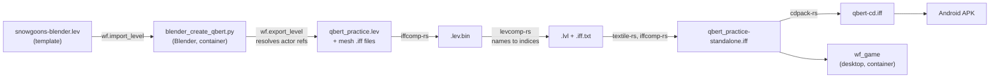
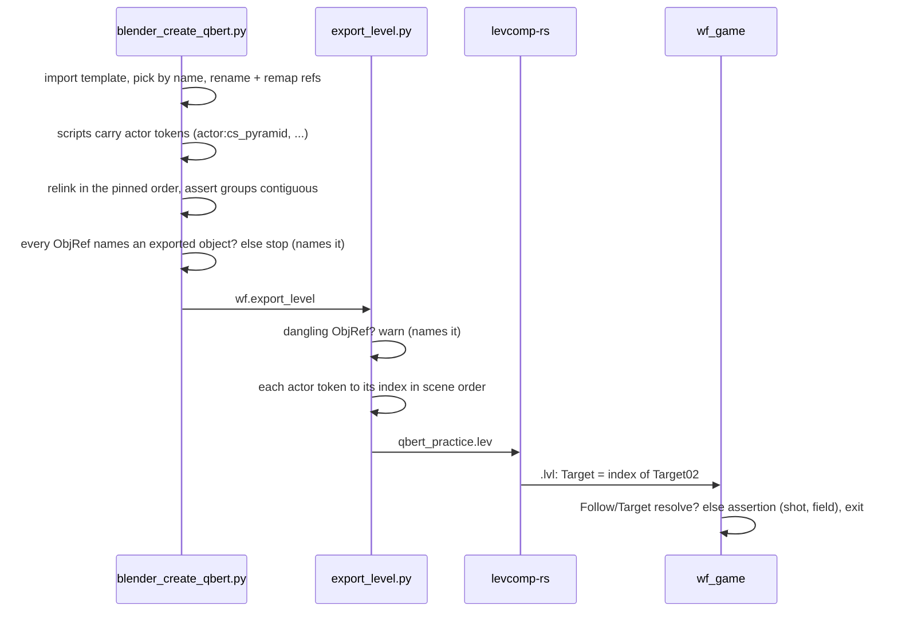

# Q\*bert: repair the Blender pipeline so a plain regeneration loads and plays

TODO: `[T4] **Repair the Q\*bert Blender pipeline: it cannot regenerate a loadable level at HEAD.**`
(TODO.md `## Open`). Follows [2026‑11‑14 Q\*bert remote hop](2026-11-14-qbert-remote-hop.md), whose
fix had to be replayed onto the committed `.lev` with `patch_lev_scripts.py` because the generator
could not produce a loadable level.

**No visible surface:** the goal is that a regenerated level plays exactly like the committed one,
so there are no mockups; the evidence is the field-level `.lev` comparison and the engine and VM
runs in Verification.

## The pipeline



## Root causes

**1. Hardcoded actor indices.** The director and player scripts address actors by number
(`N write-actor-mailbox`, `INDEXOF_CAMSHOT`). The numbers came from three places: literals (CamShots
8/12/13, curse bubble 33), "objects so far + 1" counts taken at creation time, and a base plus an
offset for cubes and intro shots. Since the 2026‑09‑20 relight (`0bc58826`) the generator creates an
`AmbientLight` early, while the committed `.lev` got its AmbientLight appended last by
`add_ambient_light.py`, so every literal is off by one and the bubble assert stops the script
(`Bubble actor idx drifted to 34`). The uncommitted 2026‑10‑27 edit in the main tree fixes the
literals by computing them from scene order and patching a marker into the player script; it is the
right idea but still computes indices in the generator, long before the order is final.

**2. The template's object names changed under the generator.** `c782aa53` (2026‑05‑22)
regenerated `snowgoons-blender.lev` from the decompiled oracle, so its objects are now named
`class_N` (`actboxor_5`, `room_6`, `target_13`, `player_33`, …) instead of `Actboxor01`, `Target02`,
`Player`. The generator was last run before that, and two of its steps depended on the old names:

- *Which template object survives.* "Keep the first of each class" walks `bpy.data.objects`, which
  Blender sorts by name. With the old names that kept `Actboxor01`, `Room01`, `GMACamTar`; with the
  new ones `actboxor_17` sorts before `actboxor_5` and `target_13` wins, so the kept objects, their
  field values and the export order all changed.
- *References.* The generator renamed the kept target and copied it to make `Target02`, but never
  set the CamShot's `Target`; it relied on the template already saying `"Target02"`. The new template
  says `"target_14"`, an object the dedupe step deleted. levcomp writes 0 for a name it cannot
  resolve, so every CamShot's Target became object 0. Same for `Actboxor01.Activated By Actor`
  (`player_33`), `Room01.Adjacent Room 1` and `Player.Tool A`.

**3. The engine's check is compiled out.** `SetCameraParametersFromShot` does
`assert(shotData->Target)` and `assert(theLevel->GetObject(shotData->Target))`, but since
`191c4c90` (2026‑10‑07) Release and MinSizeRel build with `DO_ASSERTIONS=0`, where `assert` is
`((void)0)`. The desktop engine in the container and every Android build are Release, so the
dereference of the null actor at index 0 ran unchecked: SIGSEGV in `SetCameraParametersFromShot`
on the first camera update (`NormalCameraHandler::_update` ← `BungeeCameraHandler::predictPosition`).
The same holds for `Follow` (`bol[Follow]`).

## Approach

1. **Resolve actor references at export.** The exporter replaces `{{actor:NAME}}` in every `Script`
   field with NAME's actor index, computed from the same scene order it writes (the order levcomp
   numbers), and fails the export on an unknown name. The generator writes tokens instead of numbers
   everywhere (`actor_ref('curse_bubble')`), and asserts, just before export, that the groups it
   addresses as base + offset (cubes, intro shots) are contiguous. Per the house rule, resolve at
   export, not in the generator and not at runtime.
2. **Check object references before they reach levcomp.** The exporter warns on stderr for every
   `ObjRef` field naming an object that is not exported (object, field, name); it does not refuse,
   because 30 committed levels inherit harmless dangling `Adjacent Room 1` / `Tool A` references
   from the snowgoons template, which compile to "no object" exactly like an empty field. The Q\*bert
   generator allows none: it checks every `ObjRef` against the export list and stops before
   exporting. This is where the CamShot would have been caught, with names.
3. **Make the generator independent of template naming.** Pick each kept template object by its
   explicit name (`TEMPLATE_PICK`), failing loudly if the template is renamed again; rename the kept
   objects to the level's canonical names and remap every reference to them; set the CamShot
   `Target` and every other cross-reference explicitly; clear references to deleted objects.
4. **Pin the export order.** Relink objects in an explicit order before export: the infrastructure
   head in the committed order, then everything in creation order, `AmbientLight` last. With step 1
   the order no longer matters for correctness; pinning it keeps the regenerated `.lev` aligned with
   the committed one, so every actor index, and therefore every script, matches.
5. **The CamShot check fires in every build.** `SetCameraParametersFromShot` resolves Follow and
   Target through one helper that, on an unresolved reference, reports through `_sys_assert` (the
   engine's assertion report, compiled into every build): the shot's actor index, the field and the
   bad index, then exit. Release keeps `DO_ASSERTIONS=0` for everything else.

**Rejected:** committing the uncommitted edit as-is. It fixes the literals but leaves the creation-
time counts, which break the next time an object is inserted earlier, and it does nothing for the
Target. **Rejected:** turning `DO_ASSERTIONS` back on for Release. `191c4c90` removed ~1,400 asserts
from the Android frame on purpose; this is one data check, not a reason to undo that.
**Rejected:** resolving tokens in the generator just before export. It works for this level only;
in the exporter every generator (aquarium, condo) can use the same tokens.



## Drift classes

The regeneration with only the bubble edit differed from the committed `.lev` in ~1,000 lines and
18 mesh files. Each class, its cause, and what this change does with it:

| Class | Cause | Effect on the level | Kept? |
|---|---|---|---|
| Object names `camera_8`, `player_33`, … | template renamed (`c782aa53`) | none by itself; breaks references | no: renamed back |
| Object order, every index +1 | AmbientLight created early; wrong template instances kept | every script number | no: order pinned |
| Kept `actboxor_17`/`room_16`/`target_13` instead of the committed ones | alphabetical `bpy.data.objects` dedupe over the new names | Room flipped 180° about X, Actboxor `Activated By` Actor, targets Mass 75 and visible | no: explicit picks, fields set |
| CamShot `Target` = `target_14` | reference never set; template's target deleted | SIGSEGV (Release) | no: set explicitly |
| Dangling `Adjacent Room 1`, `Tool A` | references to deleted template objects (dangling in the committed level too) | none: an unresolvable name and an empty one both compile to the default | cleared |
| FX32 text, e.g. `0.94999998` vs `0.94999695` | template values were decompiled from 16.16 | none: same 16.16 value after iffcomp's truncation | yes, harmless |
| `STR` labels `"0.600000"` vs `"0.6"` | `relight_level.py` printed `%f` | none: label only | yes |
| Camera `Caustic*`, `WaterAbsorb*`, `ToonBands`; Level `Prewarm No Palette Program` | schema fields added since the last regeneration, at their defaults | none: levcomp writes the same default for an absent field | yes |
| `Light01` euler c = −2.18 vs 4.10 | Blender normalises the angle (4.10 − 2π) | same direction | yes |
| Cube bounding boxes ±0.99999994 vs ±1.0 | float32 noise in Blender 5.0.1 mesh math | 1/65536 smaller collision box | yes |
| 18 mesh `.iff` files | exporter canonical vertex/face order (2026‑06‑02); 1‑LSB UV noise on ~10 vertices | same triangles, winding, colours, materials | yes |
| Director and player scripts | the remote-hop fix (`41c48094`) in the generator | the intended behaviour | yes: must match the committed scripts exactly |

## Files

- `wftools/wf_blender/actor_refs.py` (new, no `bpy`): token resolution and reference validation.
- `wftools/wf_blender/export_level.py`: resolve tokens (unknown name refuses the export), warn on dangling references.
- `tests/conftest.py`: `WF_GAME=<path>` selects the engine (a container-built one).
- `docs/level-building.md`: the `{{actor:NAME}}` rule beside the zForth bridge words.
- `wflevels/qbert_practice/blender_create_qbert.py`: steps 3 and 4, tokens everywhere.
- `wfsource/source/game/movecam.cc`: step 5.
- `wftools/wf_blender/build_level_binary.sh`: `WF_LEVEL_OUT_DIR`, so a test can build a level
  variant outside `wflevels/`.
- `tests/test_wf_blender_actor_refs.py`, `tests/test_camshot_missing_target.py`: regression tests.
- The regenerated level: `.lev`, `.lvl`, mesh `.iff` files, `.blend`, `qbert_practice*.iff`,
  `qbert-cd.iff`.

## Verification

All runs in containers: Blender 5.0.1 in `wf-blender:local` with this worktree mounted at `/src`
(the image's add-on symlink points at `/src/wftools/wf_blender`, so a run from the main checkout
would use the main checkout's exporter), the engine (Release, `WF_ASAN=OFF`) and pytest in
`wf-linux-test:local`.

1. The generator runs to completion in the `blender` container and the export loads: no assert, no
   export error, and the standalone level runs 30 frames on the desktop engine (Release, container).

    ```
    [qbert] Kept template objects: ['Actboxor01', 'Camera', 'Director', 'Level', 'Light01', 'Matte', 'Player', 'Room01', 'Target01', 'cs_pyramid']
    [qbert] Export order pinned: 67 actors, references checked
    Info: Exported 67 objects to /src/wflevels/qbert_practice/qbert_practice.lev
    [qbert] Done — /src/wflevels/qbert_practice/qbert_practice.lev
    ✓ built /src/wflevels/qbert_practice-standalone.iff (368640 bytes)
    REGEN-DONE
    ```
    The 30-frame run is `test_the_unmodified_level_runs` in step 2 (exit 0). PASS.

2. Before/after for the engine check: on a level whose `cs_pyramid.Target` names no object, the HEAD
   engine dies with SIGSEGV in `SetCameraParametersFromShot`; the fixed engine reports the assertion
   naming the shot and the field and exits; the unmodified level still runs.
   `tests/test_camshot_missing_target.py` in the `linux-test` container.

    The test breaks every CamShot's Target (whichever shot is live first must fire). Before, HEAD
    engine (`WF_GAME=/build/qbert-pipeline/wf_game.head`):
    ```
    E       AssertionError: no assertion naming the shot; exit 134, tail:
    E         Aborted (core dumped)
    FAILED tests/test_camshot_missing_target.py::test_a_camshot_target_that_names_no_object_fires_the_assertion
    1 failed, 1 passed in 2.28s
    ```
    Under gdb the first signal is the SIGSEGV, and exit 134 is WAMR's handler
    (`engine/vendor/wamr-2.2.0/.../posix_thread.c` `signal_callback`) aborting on a fault outside
    WebAssembly:
    ```
    Thread 1 "wf_game.head" received signal SIGSEGV, Segmentation fault.
    #0  SetCameraParametersFromShot(Actor const*, cameraPosition&, Array<BaseObject*> const&) ()
    #1  NormalCameraHandler::_update(MovementObject&, cameraPosition&) ()
    #2  BungeeCameraHandler::predictPosition(...)
    ...
    #0  __GI_abort ()   #1  signal_callback ()   #2  <signal handler called>   #3  SetCameraParametersFromShot
    ```
    After, fixed engine (`WF_GAME=/build/qbert-pipeline/wf_game.fix`):
    ```
    ..                                                                       [100%]
    2 passed in 1.68s
    ```
    and the report it checks for (from the export with `target_14`):
    ```
    +- ASSERTION FAILED ----------------------------------------------------------+
    |CamShot actor 14: Target is object 0, which is not an actor in this level (an object name the .lev could not resolve exports as 0)|
    |in file ".../wfsource/source/game/movecam.cc" on line 267                    |
    exit=255
    ```
    PASS. The engine has only the index; the name (`target_14`) is lost in levcomp, which is why
    the generator now refuses dangling references before export (step 4) and the exporter warns.

3. Exporter unit tests: `python3 -m pytest tests/test_wf_blender_actor_refs.py -q`.

    ```
    ......                                                                   [100%]
    6 passed in 0.03s
    ```
    PASS.

4. Field-level comparison of the regenerated `.lev` with the committed one shows only the "kept"
   classes in the table above, and the director and player scripts are byte-identical.

    Objects aligned by name, numbers compared after iffcomp's 16.16 truncation:
    ```
    order A == order B (67 objects), index shifts: Counter({0: 67})
    identical after 16.16 quantization (text-only drift): Running Deceleration 17, Surface Friction 17,
        Falling Acceleration 17, Step Size 16, light RGB 2 each, Hither 7, ...
    == Global Bounding Box: 28: cube_00 .. cube_27     (-0.99999994 vs -1.0)
    == Orientation: 2: Light01, AmbientLight
    == Adjacent Room 1: Room01  "Room02" -> ""
    == Tool A: Player           "tool01" -> ""
    == ToonBands, WaterAbsorbR/G/B, CausticScale, CausticStrength: Camera   absent -> default 0
    == Prewarm No Palette Program: Level                                   absent -> False
    ```
    No `Script`, `Target`, `Activated By`, `Mass` or `Visibility Mailbox` row: both scripts match
    the committed (remote-hop) level exactly. Binary check: the committed `.lev` and the regenerated
    one, both built with today's tools, give `.lvl` files that differ in 231 bytes; substituting
    only the 28 cube boxes and the two light eulers from the committed `.lev` into the regenerated
    one gives a `.lvl` that differs in **0** bytes. So the cleared references and the new schema
    fields compile to exactly what the committed level had. PASS.

5. The hop behaviour holds on the regenerated level: `tests/test_qbert_remote_hop.py` (VM) and
   `tests/test_disc_lure.py` (engine, debug bridge) pass.

    ```
    $ python3 -m pytest -q tests/test_qbert_remote_hop.py tests/test_wf_blender_actor_refs.py
    10 passed in 2.97s
    $ WF_GAME=/build/qbert-pipeline/wf_game.fix xvfb-run -a ... python3 -m pytest -q -rA tests/test_disc_lure.py tests/test_director_mailbox.py
    PASSED tests/test_disc_lure.py::test_disc_lure_left
    PASSED tests/test_disc_lure.py::test_disc_lure_right
    PASSED tests/test_disc_lure.py::test_no_spurious_retire_at_normal_coord
    ERROR tests/test_director_mailbox.py::test_round
    3 passed, 1 error in 1.93s
    ```
    `test_round` is the pre-existing collection error recorded in the remote-hop plan (a helper
    taking `cli, r`, no such fixtures). The desktop engine with the debug bridge
    (`build-docker/qbert-pipeline/drive.py`, the remote-hop plan's driver) on the regenerated level:
    ```
    intro done True
    after RIGHT {400: 1.0, 401: 1.0, 402: 0.0, 418: 1.0, 419: 0.0, 420: 0.0, ..., 433: 0.875, ...}
    after DOWN {400: 2.0, 401: 1.0, 402: 0.0, 418: 1.0, 419: 0.0, 420: 0.0, ..., 433: 0.625, ...}
    zforth errors: 2      (both "zforth: INDEXOF_CAMSHOT = 1921 (expect 1921)")
    ```
    The same readings as the shipped level in the remote-hop plan. PASS. Not re-checked on a
    device.

6. A second regeneration is byte-identical to the first (`.lev`, `.lvl`, mesh files).

    `sha256sum -c` of the first run's 27 outputs after the second run:
    ```
    wflevels/qbert_practice/qbert_practice.blend: FAILED
    wflevels/qbert_practice/qbert_practice.blend1: FAILED
    25 OK
    ```
    PASS for every level output (`.lev`, `.lev.bin`, `.lvl`, 18 mesh files, both level `.iff`,
    `qbert-cd.iff`). The `.blend` differs run to run (Blender writes save-time data); it is
    committed because it now carries the `{{actor:…}}` scripts, and `.blend1` (Blender's backup
    of the previous save) is left as committed.
