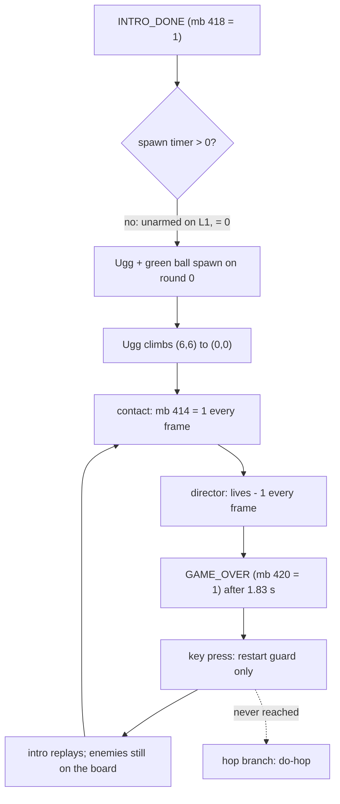
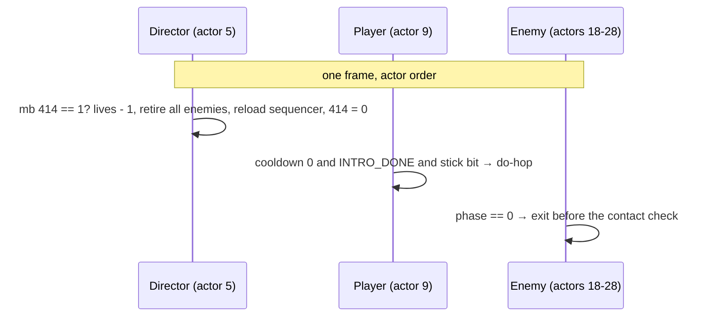

# Q\*bert ignores remote input after the intro: the game is already over

TODO: `[T4] **Q\*bert ignores remote input after the intro: it turns but never hops.**` (TODO.md `## Open`).
Evidence it starts from: [android-input-latency results](2026-11-13-android-input-latency.md#results),
jobs J‑5e8afa6b3c9d, J‑ab33f16604b9 and J‑f484ffd6354d.

## Context

On cast1 every injected D‑pad edge reached `HandleInputEvent` in 6–57 ms and set the right bit
(`DPAD_RIGHT` → `0x2000`, `DPAD_LEFT` → `0x4000`, `DPAD_UP` → `0x0800`), and the player script
tests exactly those bits (`EJ_BUTTONB_UP..LEFT` are 11..14 in `hal/sjoystic.h`, one definition for
every platform). Yet Q\*bert never hopped after the intro. So the input reached the script; the
question was why the hop branch never ran.

## Root cause

**By the time anyone presses a key, the game is over.** It is not an Android problem: the
desktop build and a host run of the exported scripts behave the same way, frame for frame.

Measured with the new host harness (`tests/level_script_vm.cc`: every actor script of the
exported `.lev`, one shared zForth context, run in actor order like the engine) on the committed
level, with no input at all:

| Frame after `INTRO_DONE` (60 Hz) | What happens |
|---|---|
| 0 | the green ball (mb 489) and **Ugg** (mb 556) spawn on round 0 (L1R1) |
| 0 → 106 | Ugg climbs its edge (6,6) → (5,5) → … → (0,0), the apex, where Q\*bert stands |
| 107 | Ugg's contact check writes `FALL_DEATH` (mb 414) = 1 |
| 108, 109, 110 | the contact check fires again every frame; the director takes one life each time: 3 → 0 |
| 110 (1.83 s) | `GAME_OVER` (mb 420) = 1; lives keep falling below zero |
| 143 | Wrong‑Way spawns, climbs to the apex, kills 18 more times |

The desktop engine in the container (debug bridge, `build-docker/qbert-hop-diag/`) shows the
same sequence: `INTRO_DONE`, Ugg at (0,0), lives 3 → 0 → −15, `GAME_OVER` = 1. In game over the
player script runs only its restart guard, so a key press restarts the game (the intro replays
and the yaw snaps back to the rest pose, the likely source of the "turn" seen on the TV; not
confirmed frame by frame) and never reaches the hop branch. After a restart the enemies still on the board, Coily included, are still active and
kill Q\*bert at the apex again within frames.

Three defects combine. All three date from when the enemy scripts first compiled
(`d378b752` *Fix Qbert enemy script headers for zForth*, 2026‑10‑27); before it, every enemy
script failed to compile, so no enemy ever ran and the hop worked.

1. **Green ball, Ugg and Wrong‑Way spawn on round 0.** The director's one‑shot init arms their
   spawn timers only from L2 (green, `425 read-mailbox 3 >`) and L3 (Ugg/Wrong‑Way,
   `425 read-mailbox 7 >`), as the comments intend. But the spawn blocks themselves only test
   "timer > 0 ? count down : spawn", and an unarmed timer is 0, which means "spawn now".
2. **One touch drains every life.** Enemy contact sets mb 414 every frame the enemy shares
   Q\*bert's cube, and the director decrements lives once per frame. Nothing clears the board.
3. **The restart guard underruns the data stack.** In the player's game‑over guard,
   `0 = if … else drop then` drops `prev_stick` in the else branch although `0 =` and `if`
   already consumed it. Holding a key while the 3 s game‑over hold (mb 591) expires aborts the
   player script once per frame with `zforth error 3` (`ZF_ABORT_DSTACK_UNDERRUN`): the 12–27
   `zforth error 3 calling _wfs0` lines in the cast1 `wf.log` files. Harmless to play (the
   branch exits anyway) but it is a stack bug in the input path.



## Approach

Fix the three defects in the level generator (`wflevels/qbert_practice/blender_create_qbert.py`),
regenerate `qbert_practice.lev` → `.lvl` → `.iff` → `qbert-cd.iff` through the normal pipeline,
and guard all three with a host test that runs the exported scripts.

1. **Gate the late enemies on the round.** The green‑ball spawn block also requires
   `ROUND_NUMBER > 3`, the Ugg and Wrong‑Way blocks `ROUND_NUMBER > 7`: the same conditions the
   init and round‑clear code already use to arm their timers, now named once
   (`_GB_ROUND_GATE`, `_CLIMBER_ROUND_GATE`) and used at all three places.
2. **A death costs one life and clears the board, as in the arcade.** The director's death
   handler (`mb 414 == 1`) now also retires every enemy (phase 0, visibility mirror 0, parked
   below the room), resets the Coily globals so a new egg can come, and reloads the spawn
   sequencer for the round. One fragment, `_retire_enemies_forth()`, used only there. Enemy
   scripts run after the director in the same frame and exit on phase 0, so no second contact
   is possible.
3. **No spawns during game over.** Every spawn site (sequencer, green ball, climbers, second
   egg) is gated on `INTRO_DONE == 1` *and* `GAME_OVER == 0`. The death that ends the game has
   cleared the board, so it stays empty through the game‑over screen and the replayed intro.
4. **Drop the bogus `else drop`** in the player's restart guard.

**Rejected:** arming the late timers with a huge value on early rounds. It only postpones the
spawn (a long L1 still gets Ugg), and it hides the intent; a round gate states it.
**Rejected:** debouncing deaths with the `cs_death` hold (mb 415) alone. It turns one touch into
one life per second while the enemy stays put; the board still never clears, so a parked Coily
still ends the game in 3 s.

```mermaid
stateDiagram-v2
    [*] --> Intro
    Intro --> Play: INTRO_DONE
    Play --> Play: stick bit, cooldown 0 → do-hop
    Play --> DeathHold: contact or fall (mb 414)
    DeathHold --> Play: lives left; board cleared, sequencer reloaded
    DeathHold --> GameOver: lives reach 0; board cleared
    GameOver --> GameOver: no spawns; 3 s hold (mb 591)
    GameOver --> Intro: fresh stick press (restart guard)
```





**No visible surface changes** beyond the game now being playable (no UI, HUD or layout
change), so there are no mockups; the device captures in Verification are the evidence.

## Regeneration is blocked at HEAD

The full Blender pipeline cannot produce a loadable Q\*bert level at HEAD, for two reasons
outside this fix:

1. **The generator stops** in the `blender` container (Blender 5.0.1) on
   `AssertionError: Bubble actor idx drifted to 34`. It creates `AmbientLight` before the
   enemies and the exporter writes actors in scene order, so every actor after it exports one
   index later than the hardcoded CamShot indices (8/12/13) and the curse‑bubble assert (33)
   expect. A fix exists only as an uncommitted edit in the main checkout, dated 2026‑10‑27
   10:09; it is not this change's to commit.
2. **With that edit underneath, the export does not load.** Every CamShot's `Target` field
   names `target_14`, an object that does not exist (the importer renamed `Target02` and the
   reference was not remapped), and the desktop engine dies with SIGSEGV in
   `SetCameraParametersFromShot` on the first frame. The export also carries drift since
   2026‑10‑27: every actor index shifts by one, fixed-point rounding and field changes touch
   ~600 `.lev` lines, 18 mesh `.iff` files and both `.blend` files change bytes.

**What was done instead.** Two exports from that same broken pipeline, without and with this
change, differ only in the director and player scripts. `patch_lev_scripts.py` (in this plan's
bundle) replays exactly that token-level delta onto the committed `qbert_practice.lev`, mapping
the inserted actor indices to the committed object order by name, and copies everything else
byte for byte. The result was then built by the non-Blender half of the normal pipeline
(`build_level_binary.sh qbert_practice`, then `cdpack` as in `task build-cd-iff-qbert`). Its
delta from the committed scripts is identical to the export delta hunk for hunk (10 of 10 in
the director, 1 of 1 in the player), except the retire fragment's actor indices, which map to
18..28, the committed order of `redball_0` .. `coily_snake`. The `.lvl` and `.iff` also pick up
levcomp-rs changes since 2026‑10‑27 (rebuilding the committed `.lev` with today's tools does
not reproduce the committed `.lvl` either). When the generator pipeline is repaired, a plain
regeneration supersedes these outputs.

## Files

- `wflevels/qbert_practice/blender_create_qbert.py`: the four changes above.
- `wflevels/qbert_practice/qbert_practice.lev`, `.lvl`, `wflevels/qbert_practice.iff`,
  `wflevels/qbert_practice-standalone.iff`, `wflevels/qbert-cd.iff`: the committed level plus
  the generator's script delta, built as described above.
- `docs/plans/2026-11-14-qbert-remote-hop/patch_lev_scripts.py`: the delta replay.
- `tests/test_disc_lure.py`: `test_no_spurious_retire_at_normal_coord` now tells the lure
  apart by its +500, because a snake that catches Q\*bert is now retired by the death.
- `tests/level_script_vm.cc`, `tests/level_script_vm.py`: the host harness (reusable for any
  level whose actors talk through mailboxes).
- `tests/test_qbert_remote_hop.py`: the regression tests.

## Verification

1. Host regression tests, against the committed level before the fix (expected to fail) and the
   regenerated level after it: `python3 -m pytest tests/test_qbert_remote_hop.py -q`.

    Before (committed level, HEAD `583111c1`):
    ```
    FAILED tests/test_qbert_remote_hop.py::test_a_right_press_after_the_intro_hops
        assert [1.0, -15.0] == [0, 3]        (GAME_OVER, LIVES) 150 frames after the intro
    FAILED tests/test_qbert_remote_hop.py::test_green_ball_ugg_and_wrong_way_stay_off_level_one
        AssertionError: frame 224  assert [1.0, 1.0, 0.0] == [0, 0, 0]
    FAILED tests/test_qbert_remote_hop.py::test_one_contact_costs_one_life_and_clears_the_board
        AssertionError: every enemy leaves the board on a death
    FAILED tests/test_qbert_remote_hop.py::test_holding_a_key_through_the_game_over_hold_does_not_abort_a_script
        AssertionError: script aborts (actor, count, zf_result): [(9, 60, 3)]
    4 failed in 3.24s
    ```
    After (the fixed level; also against the full export from the blocked pipeline, which
    carries the same scripts):
    ```
    ....                                                                     [100%]
    4 passed in 3.16s
    ```
    PASS. The last failure is the cast1 `zforth error 3 calling _wfs0` signature: actor 9 is
    the player, `3` is `ZF_ABORT_DSTACK_UNDERRUN`.
2. The generator still produces a level that compiles in the engine: the regenerated
   `qbert_practice-standalone.iff` runs on the desktop engine in the container with no
   `zforth compile error` lines, and a debug-bridge `RIGHT` press after the intro moves
   Q\*bert to (1,1) (`build-docker/qbert-hop-diag/drive.py`).

    The full export from the blocked pipeline: FAIL, SIGSEGV on the first frame (see
    "Regeneration is blocked at HEAD"), with or without this change. The level built from the
    committed `.lev` plus the delta, on a desktop engine built from HEAD in the container:
    ```
    intro done True
    before {400: 0.0, 401: 0.0, 402: 0.0, 418: 1.0, 419: 0.0, 420: 0.0, ...}
    before+1s {400: 0.0, 401: 0.0, 402: 0.0, 418: 1.0, 419: 0.0, 420: 0.0, ...}
    after RIGHT {400: 1.0, 401: 1.0, 402: 0.0, 418: 1.0, 419: 0.0, 420: 0.0, ..., 433: 0.875, ...}
    after DOWN {400: 2.0, 401: 1.0, 402: 0.0, 418: 1.0, 419: 0.0, 420: 0.0, ..., 433: 0.625, ...}
    zforth-lines=0
    ```
    PASS for the shipped level. On the committed level the same run reads
    `after RIGHT {400: 0.0, 401: 0.0, ..., 420: 1.0}`: game over, no hop.
3. Existing level tests still pass: `tests/test_director_mailbox.py`, `tests/test_disc_lure.py`.

    HEAD level: `3 passed, 1 error`. Fixed level, before adjusting the lure test:
    `FAILED tests/test_disc_lure.py::test_no_spurious_retire_at_normal_coord ...
    COILY_SNAKE_ACTIVE=0.0` (the snake caught Q\*bert inside the 0.5 s window and the death
    retired it). After telling the lure apart by its +500:
    ```
    ERROR tests/test_director_mailbox.py::test_round
    7 passed, 1 error in 6.13s
    ```
    PASS. `test_round` errors identically at HEAD: `test_round(cli, r)` is a helper that pytest
    collects as a test, and neither fixture exists.
4. Device, cast1 through the coordinator: Q\*bert release APK built from a clean worktree at the
   fix commit, installed with a `check`; after the intro, `DPAD_RIGHT`/`DPAD_DOWN` taps and a
   2 s hold make Q\*bert hop (captures show him off the apex and cube tops recoloured), and
   `wf.log` of that run has no `zforth error` line. Screensaver settings on cast1 unchanged
   (read-only `screensaver-list`).

    APK built at `41c48094` in a clean sparse worktree
    (`ANDROID_HOME=$HOME/android-sdk-local ./gradlew :app:assembleQbertRelease`:
    `APK page alignment: PASS`, `BUILD SUCCESSFUL in 7m 3s`), frozen as
    `~/tmp/qbert-remote-hop/worldfoundry-qbert-release.apk`, sha256 `742196b4…8c58a16`; its
    `assets/cd.iff` is byte-identical to the committed `wflevels/qbert-cd.iff` (`a9cf9630…`).
    Coordinator check J‑a6d314ffb843 on cast1 (recipe and evidence in
    [`docs/diagnostics/qbert-remote-hop-2026-11-14/`](../diagnostics/qbert-remote-hop-2026-11-14/)):
    ```
    key code=22 action=0 mask=0x2000   planned 12.5 s  DPAD_RIGHT tap
    key code=20 action=0 mask=0x1000   planned 14.0 s  DPAD_DOWN tap
    key code=22 action=0 mask=0x2000   planned 15.5 s  DPAD_RIGHT held 2.0 s
    after-intro        Q*bert on the apex, all tops blue
    after-right-tap    Q*bert on (1,1), its top yellow
    after-down-tap     Q*bert on (2,1), its top yellow
    during-right-hold  (3,2) (4,3) (5,4) (6,5) yellow, "+25" popup; he hopped off the
                       bottom-right edge, fell and is back on the apex (game still on)
    wf.log, this run:  4 lines matching "zforth", all "zforth: INDEXOF_CAMSHOT = 1921"
    ```
    `screensaver-list` on cast1 afterwards: `selected_component`
    `org.worldfoundry.seahorsegrid/...SeahorseGridDreamService`, `stay_on_while_plugged_in` 0,
    `sleep_timeout_ms` -1, `idle_timeout_ms` 600000 (unchanged). PASS. The lives count is not
    visible on Android (no HUD in the captures), so "one life per death" rests on step 1.
