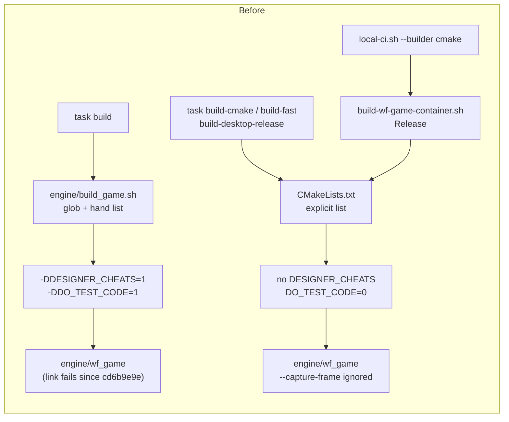
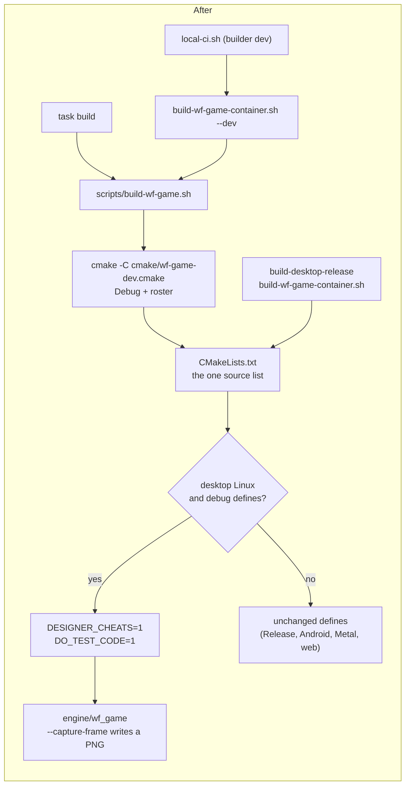
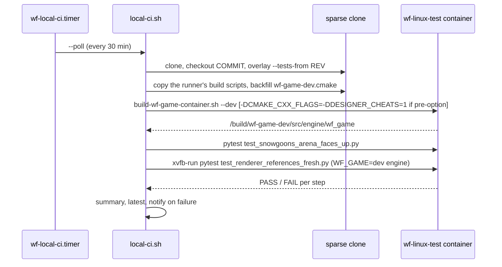

# One desktop build: CMake builds the dev engine, `engine/build_game.sh` retires

TODO: `[single-desktop-build]` (unblocks `[verify T3] **Local CI: …**`, [local-CI plan](2026-11-14-local-ci.md) **Findings**).

## Context

Two scripts built the desktop engine from two source lists, and they drifted:

- `engine/build_game.sh` (what `task build` ran) globbed `wfsource/source/*` and listed its stubs by hand. It is the only build that defined `DESIGNER_CHEATS` and `DO_TEST_CODE=1`.
- `CMakeLists.txt` builds every other target (Release desktop, Android, iOS, macOS, web, the editor, ctest) and gets new sources first.

`cd6b9e9e` (2026‑11‑11) added `engine/planted_preview.cpp` and `engine/runtime_diagnostics_form.cpp` to CMake only, so `task build` has not linked from a clean checkout since. The CMake engine links, but without `DESIGNER_CHEATS` it parses `--capture-frame` and ignores it, so the local CI's renderer freshness test cannot pass on any engine buildable at HEAD.

**Decision (Will, 2026‑11‑14):** "i choose what moves us in the long-term fix": CMake becomes the single desktop build, `build_game.sh` goes, and Linux `--capture-frame` works in that one build.

There is no visible surface beyond CLI and build output, so this plan has no mockups.

## `DESIGNER_CHEATS`: what it gates

Every use at `origin/2026-new-level` (`1a82f942`):

| Where | What it gates | Depends on |
|---|---|---|
| `game/main.cc:96` | defines `bRecordVideo`, the HUD globals `wf_hud_*` (score, timer, lives, marble, game over, initials, PILOT ring), moon overlay globals | — |
| `game/main.cc:424`, `:503` | `-record_video`, `-f` flags | `bRecordVideo` |
| `gfx/gl/display.cc:49–581` (with `__LINUX__`) | HUD drawing (`DrawHud`: arcade, Marble, moon, PILOT text, Q*bert initials), capture FBO declarations, `WfCaptureActive()`, `hscore.h` | `main.cc` globals, `scripting_pilot.cc` ring |
| `gfx/gl/display.cc:620–1193` | `RenderEnd` backend frame counter, capture FBO, `CaptureFrame` (PNG + `-record_video` ffmpeg pipe) | `bRecordVideo`, `gCaptureFrame` |
| `gfx/gl/display.cc:757`, `:888`, `:979`, `:1304`, `:1325` | surface size under capture, FBO bind in `RenderBegin`, frame count, HUD call, capture in `PageFlip` | the two blocks above |
| `game/game.cc:62`, `:718`, `:940` | `hscore.h`; per-frame HUD mailbox reads and Q*bert initials entry; HUD reset on return to the menu | `main.cc` globals |
| `game/game.cc:659` | `PIGSUserAborted()` level abort | — |
| `engine/stubs/scripting_pilot.cc:21`, `:31` | PILOT `T:`/`TH:` text into the HUD ring | `main.cc` globals |
| `game/player.cc:174` | free-camera motion | — |
| `gfx/vmem.hp:59`, `gfx/vmem.cc:101`, `:192`; `asset/assslot.cc:55` | `ClearSlot`: VRAM slots painted a debug colour when (re)loaded | — |
| `hal/linux/platform_init.cc:146` | `-halmem=` / `-scratchmem=` arena sizes | — |
| `pigsys/pigsys.cc:333–455`, `pigsys.hp:466`, `psysvers.h:45`, `hal/linux/platform_main.cc:36` | version banner, `_sys_printenv` | — |
| `game/level.cc:1073` | `saveTextureBuffer` (also needs `WRITER`, never defined) | — |
| `gfx/ccycle.cc:141`, `game/actor.hp:325` | `#if 0` / commented out | — |

`DO_TEST_CODE=1` (also only in `build_game.sh`) gates `--debug-print-actors` (`game/main.cc:83`, `:400`, `game/actor.cc:690`), which `Taskfile.yml` and `wflevels/baseline/verify.py` pass, and the HAL test macros in `hal/halbase.h:63` and `hal/hal.cc:113`.

### Option, not split

**Chosen: one CMake option per switch,** `WF_DESIGNER_CHEATS` (→ `DESIGNER_CHEATS=1`) and `WF_TEST_CODE` (→ `DO_TEST_CODE=1`), both ON by default exactly where `build_game.sh` put them.

**Rejected: splitting capture/record out into its own feature** (say `WF_FRAME_CAPTURE`, on in every Linux build like the ungated Metal capture). The capture is not separable at the define level: the capture FBO, the HUD and the `-record_video` pipe share the same two `#if` blocks in `display.cc` and the globals `main.cc` defines, and the HUD is drawn into the capture FBO. A split means re-guarding about a dozen blocks of `display.cc`, which another session is editing right now, to buy one thing nothing needs yet: capture in a Release desktop engine. The CI's freshness test wants the debug engine anyway, because its references and the macOS gate it guards (`macos-desktop-debug`) are debug captures. If a Release capture is wanted later, the split is still possible and is smaller once this lands.

### Defaults on every target

| Target | Build | `DESIGNER_CHEATS` before → after | `DO_TEST_CODE` before → after | Effect |
|---|---|---|---|---|
| Desktop Linux dev, `task build` | was `build_game.sh`, now CMake Debug + `cmake/wf-game-dev.cmake` | 1 → 1 | 1 → 1 | same engine and defines; builds again (it did not link since `cd6b9e9e`) |
| Desktop Linux CMake Debug (`task build-cmake`, `build-fast`, `build-asan`, ctest builds) | CMake Debug | — → 1 | 0 → 1 | capture works, HUD shows on HUD levels, `--debug-print-actors` works; bigger binary |
| Desktop Linux Release (`build-desktop-release`, `build-wf-game-container.sh`, `baseline:check`) | CMake Release | — → — | 0 → 0 | none |
| Android (APK, casts) | CMake, NDK | — → — (forced OFF) | 0 → 0 | none: defines identical (verification step 6) |
| iOS, macOS (Metal) | CMake, Xcode / Ninja | — → — (forced OFF) | 0 → 0 | none |
| Web (Emscripten) | CMake | — → — (forced OFF) | 0 → 0 | none |

Turning either option ON for Android, iOS, macOS or the web is a configure error. A desktop Release build may turn them on with `-DWF_DESIGNER_CHEATS=ON`, as `scripts/style-gl-sweep.sh` effectively does today with `CMAKE_CXX_FLAGS`.

**Rejected default: ON for every desktop Linux build, Release included,** following the old OpusMake table in `docs/compile-time-switches.md` (cheats on in `release`, off only in `final`). It would change the Release desktop engine that `baseline:check` and the reef test run (HUD, VRAM slot colours), which this change does not need to touch.

## Flag diff: `build_game.sh` (with `task build`'s environment) against CMake

| Flag | `build_game.sh` | CMake Debug, before | CMake + `wf-game-dev.cmake`, after |
|---|---|---|---|
| `DESIGNER_CHEATS=1` | yes | no | yes (`WF_DESIGNER_CHEATS`) |
| `DO_TEST_CODE` | `1` | `0` | `1` (`WF_TEST_CODE`) |
| `NDEBUG` | only `physics_jolt.cc`, `jolt_backend.cc` | every engine TU (Jolt ODR fix, `CMakeLists.txt` Jolt block) | same as before; kept, the ODR comment says why |
| `-O2` on `physics_jolt.cc`, `jolt_backend.cc` | yes | `-O0` | `-O0`; x86‑64 GCC emits no FMA without `-march`, so physics results do not change |
| `-O1` on `rest_api.cc`, `debug_server.cc`, `wfmut*.cpp`, `runtime_*.cpp` | yes | `-O0` | `-O0` (debug only; no behaviour) |
| Jolt library | `MinSizeRel` + `NDEBUG` | `-O2 -w -fno-rtti` + `NDEBUG` | same as before |
| ASan + UBSan | `-fsanitize=address,undefined` | same, minus `vptr` (meaningless under `-fno-rtti`), runtime static | same as before |
| Scripting roster | Lua + zForth (+ neural-forth) + PILOT (env from `task build`) | CMake default: + Fennel, QuickJS, WAMR, Wren | Lua + zForth (+ neural-forth) + PILOT (`wf-game-dev.cmake`) |
| `WF_REST_API`, `WF_DEBUG_BRIDGE`, wfmut | on | on (bridge forced on in Debug) | on |
| Debug defines (`BUILDMODE_DEBUG DO_ASSERTIONS=1 DO_DEBUGGING_INFO=1 DO_IOSTREAMS=1 SW_DBSTREAM=1 DEBUG=1 DEBUG_VARIABLES=1`), `DO_VALIDATION=0 DO_DEBUG_FILE_SYSTEM=0`, `-fpermissive -w -fno-rtti -O0 -g`, `__GAME__`, `ERR_DEBUG(x)=` | yes | yes | yes |
| Link | `-lGL -lGLU -lX11 -lm -lpthread -ldl -Wl,-z,noexecstack` | same | same |
| Sources (engine C++ TUs of `wfengine` + `wf_game`) | glob of 31 directories minus a skip list, plus 17 hand-listed stubs: 188 | explicit list: 190 | the same 190. Compared from `build.ninja` against the glob: the only difference is `engine/planted_preview.cpp` and `engine/runtime_diagnostics_form.cpp`, the `cd6b9e9e` drift. Vendored C (Lua, zForth, neural-forth) builds as libraries in both |
| Editor build | `WF_ENABLE_EDITOR=1` → `engine/wf_game-dev` | `engine/wf_game` | `engine/wf_game-dev` (new `OUTPUT_NAME` when `WF_ENABLE_EDITOR`) |

## Design





### Pieces

1. **`CMakeLists.txt`:** the two options after the debug-defines block; `DO_TEST_CODE=${_wf_test_code}` keeps the define list byte-identical for every target that leaves them off. An editor engine is `engine/wf_game-dev`.
2. **`cmake/wf-game-dev.cmake`** (new): the initial cache of the dev engine, Debug plus `task build`'s scripting roster. The one place that configuration lives. Command-line `-D`s win.
3. **`scripts/build-wf-game.sh`** (new): unpack Jolt if needed, configure with the cache file (Ninja when available) into `build-wf-game/` (`build-wf-game-dev/` with `--editor`), build `wf_game` (or `--target T`). Extra configure flags after `--`.
4. **`scripts/build-wf-game-container.sh --dev`:** runs `build-wf-game.sh` in the container copy, into `/build/wf-game-dev`. Its default (Release) is unchanged for `check-thai-reef.py --container`.
5. **`Taskfile.yml`:** `build` → `scripts/build-wf-game.sh {{.CLI_ARGS}}`, deps `vendor-unpack-archives` (the dev engine needs no submodule, so a clean checkout builds offline); `ensure-build` watches the two new files instead of `build_game.sh`; `build-editor` → `build-wf-game.sh --editor`.
6. **`engine/build_game.sh` deleted.** `tests/test-texture-atlas.sh`, which sourced it to reuse its objects, becomes a three-line CMake wrapper around the same `texture_atlas_address_test` that ctest already runs (its `WF_ATLAS_MATERIAL_SOURCE` replay of a pre-fix `material.cc` is dropped; check out the old file instead). Comments and docs that name `build_game.sh` as the build are updated (stubs headers, `engine/vendor/README.md`, `docs/dev-setup.md`, `docs/compile-time-switches.md`, test docstrings, `tests/conftest.py`, project memory). Historical plans, transcripts and diagnostics keep the name.
7. **`scripts/local-ci.sh`:** builders `dev` (default: `build-wf-game-container.sh --dev`) and `release`; `build_game` and `cmake` stay as aliases of them. Two additions so the bug-class proof can still build commits older than this change:
    - **The build scripts are the runner's.** After the checkout (and any `--tests-from` overlay, which now carries only the tests and their helpers), `scripts/build-wf-game.sh`, `scripts/build-wf-game-container.sh` and `scripts/in-linux-container.sh` are copied from the runner's own tree, like `local-ci.sh` itself. A commit's older copy (for example `be86bbb9`'s `build-wf-game-container.sh`, which has no `--dev`) cannot build the dev engine. The dev engine's configuration, `cmake/wf-game-dev.cmake`, stays the commit's when it has one, and is backfilled (and logged) when it does not.
    - **Pre-option CMake.** When the commit's `CMakeLists.txt` has no `WF_DESIGNER_CHEATS`, the dev builder passes `-DCMAKE_CXX_FLAGS=-DDESIGNER_CHEATS=1` (what `style-gl-sweep.sh` does for old commits), and logs it.

### The CI path



## Files

| File | Change |
|---|---|
| `CMakeLists.txt` | `WF_DESIGNER_CHEATS`, `WF_TEST_CODE`; `wf_game-dev` output name for editor builds |
| `cmake/wf-game-dev.cmake` | new: the dev engine's initial cache |
| `scripts/build-wf-game.sh` | new: the desktop build entry |
| `scripts/build-wf-game-container.sh` | `--dev`, extra configure flags |
| `scripts/local-ci.sh` | `dev` / `release` builders, harness backfill, pre-option shim |
| `Taskfile.yml` | `build`, `ensure-build`, `build-editor` |
| `engine/build_game.sh` | deleted |
| `tests/test-texture-atlas.sh` | CMake wrapper |
| comments and docs | as listed under **Pieces** 6 |
| `docs/plans/2026-11-14-local-ci.md` | verification steps 2, 5, 10 |

## Verification

First run 2026‑11‑14 in the sparse worktree `.worktrees/single-desktop-build` at `b4e0899a`; the disk stop line (15 GB free, other sessions filling the disk) held steps 4, 5 and 7 back until 2026‑11‑15, when they were completed. **All nine steps PASS.**

1. `task build`, now CMake, builds from a clean checkout: in the container, a fresh sparse clone of the change runs `scripts/build-wf-game.sh` (what `task build` runs; the container has no `task`) and writes `engine/wf_game`; on the host, `task --dry build` shows that command.

    The fresh worktree (checked out from `origin/2026-new-level`, nothing built; Jolt unpacked as `vendor-unpack-archives` does), built through `build-wf-game-container.sh --dev`, which copies the tree and runs `build-wf-game.sh` in it:

    ```
    $ scripts/in-linux-container.sh scripts/build-wf-game-container.sh --dev
    -- WF: WF_DESIGNER_CHEATS=ON WF_TEST_CODE=ON
    [364/364] Linking CXX executable /build/wf-game-dev/src/engine/wf_game
    -rwxr-xr-x 1 root root 227869392 Nov 14 05:45 /build/wf-game-dev/src/engine/wf_game
    exit=0
    $ task --dry build | tail -2
    task: [vendor-unpack-archives] test -d engine/vendor/jolt-physics-5.5.0 || tar -xzf engine/vendor/jolt-physics-5.5.0.tar.gz --one-top-level=engine/vendor/jolt-physics-5.5.0 --strip-components=1
    task: [build] bash scripts/build-wf-game.sh --
    $ task --dry build -- -DWF_ASAN=OFF | tail -1
    task: [build] bash scripts/build-wf-game.sh -- '-DWF_ASAN=OFF'
    ```
    **PASS** (364 of 364 steps, from nothing)
2. `--capture-frame` writes a PNG: the dev engine from step 1, under `xvfb-run`, with `--frame-step-smoke=30 --cycles=1 -Lwflevels/snowgoons-blender/snowgoons-standalone.iff -rate20 --no-fps --capture-frame=20=/tmp/f20.png`, leaves a 640×480 PNG.

    ```
    == step 2: --capture-frame
    engine exit 0
    /build/f20.png PNG 640 x 480
    ```
    **PASS** (before this change the CMake engine exited 0 with no file)
3. `tests/test_renderer_references_fresh.py` passes at HEAD with the dev engine.

    ```
    $ WF_GAME=/build/wf-game-dev/src/engine/wf_game xvfb-run … python3 -m pytest -v -rs tests/test_renderer_references_fresh.py
    tests/test_renderer_references_fresh.py::test_reference_matches_a_fresh_linux_capture[snowgoons] PASSED [ 50%]
    tests/test_renderer_references_fresh.py::test_reference_matches_a_fresh_linux_capture[aquarium] PASSED [100%]
    ============================== 2 passed in 19.39s ==============================
    ```
    **PASS**
4. The bug-class proof holds with the CMake dev builder: `scripts/local-ci.sh --no-notify --tests-from 23658e9a be86bbb9` fails both `arena-faces-up` and `renderer-fresh`; `scripts/local-ci.sh --no-notify 23658e9a` passes both.

    **NOT RUN** on the first pass (disk). Second pass, 2026‑11‑14 14:39 +07, from this worktree:

    ```
    $ WF_CI_RESULTS=~/WorldFoundry-wbniv/build-docker/local-ci scripts/local-ci.sh --no-notify --tests-from 23658e9a be86bbb9
    2026-11-14T06:39:46Z local-ci: testing be86bbb9b006 (Index nine plans that had no row in docs/plans/README.md) with the tests of 23658e9a6cc6, builder dev; results in /home/will/WorldFoundry-wbniv/build-docker/local-ci/be86bbb9b006-tests-23658e9a6cc6
    2026-11-14T06:40:04Z local-ci: overlaid the CI tests from 23658e9a6cc6
    2026-11-14T06:40:05Z local-ci: backfilled cmake/wf-game-dev.cmake from the runner (not in be86bbb9b006)
    2026-11-14T06:40:05Z local-ci: CMakeLists.txt of be86bbb9b006 predates WF_DESIGNER_CHEATS: passing -DCMAKE_CXX_FLAGS=-DDESIGNER_CHEATS=1
    2026-11-14T07:01:38Z local-ci: build: PASS (1293 s)
    2026-11-14T07:01:45Z local-ci: arena-faces-up: FAIL (7 s)
    E           AssertionError: wflevels/cd.iff@149144: 283 of 283 horizontal arena faces point down; the floor is culled from above. Its migration decision must be reverse_all, not keep.
    2026-11-14T07:01:56Z local-ci: renderer-fresh: FAIL (10 s)
    tests/test_renderer_references_fresh.py::test_reference_matches_a_fresh_linux_capture[snowgoons]      ← log ends here
    ```
    That renderer-fresh result does not count: the session's disk guard killed its container at 15.09 GB free, mid-test, and the `23658e9a` control was stopped before its build.

    **Third pass, 2026‑11‑15 00:54 +07** (63 GB free), both runs back to back from this worktree:
    ```
    $ WF_CI_RESULTS=~/WorldFoundry-wbniv/build-docker/local-ci scripts/local-ci.sh --no-notify --tests-from 23658e9a be86bbb9
    2026-11-14T17:54:36Z local-ci: testing be86bbb9b006 (Index nine plans that had no row in docs/plans/README.md) with the tests of 23658e9a6cc6, builder dev; results in /home/will/WorldFoundry-wbniv/build-docker/local-ci/be86bbb9b006-tests-23658e9a6cc6
    2026-11-14T17:54:42Z local-ci: overlaid the CI tests from 23658e9a6cc6
    2026-11-14T17:54:42Z local-ci: backfilled cmake/wf-game-dev.cmake from the runner (not in be86bbb9b006)
    2026-11-14T17:54:42Z local-ci: CMakeLists.txt of be86bbb9b006 predates WF_DESIGNER_CHEATS: passing -DCMAKE_CXX_FLAGS=-DDESIGNER_CHEATS=1
    2026-11-14T18:04:46Z local-ci: build: PASS (604 s)
    2026-11-14T18:04:48Z local-ci: arena-faces-up: FAIL (2 s)
    2026-11-14T18:05:02Z local-ci: renderer-fresh: FAIL (14 s)
    E           AssertionError: wflevels/cd.iff@149144: 283 of 283 horizontal arena faces point down; the floor is culled from above. Its migration decision must be reverse_all, not keep.
    E       AssertionError: snowgoons: the committed Linux reference is stale (or the engine binary is older than the source):
    E         640x480: exact=258357/307200 (84.100586%)
    E         pixels exceeding tolerance 3: 39809
    E         difference bbox (inclusive): 0,287–639,479
    ========================= 1 failed, 1 passed in 11.43s =========================
    exit=1
    $ WF_CI_RESULTS=~/WorldFoundry-wbniv/build-docker/local-ci scripts/local-ci.sh --no-notify 23658e9a
    2026-11-14T18:05:08Z local-ci: testing 23658e9a6cc6 (Reverse the snowgoons arena: its floor faced down on GL and Metal), builder dev; results in /home/will/WorldFoundry-wbniv/build-docker/local-ci/23658e9a6cc6
    2026-11-14T18:05:14Z local-ci: backfilled cmake/wf-game-dev.cmake from the runner (not in 23658e9a6cc6)
    2026-11-14T18:05:14Z local-ci: CMakeLists.txt of 23658e9a6cc6 predates WF_DESIGNER_CHEATS: passing -DCMAKE_CXX_FLAGS=-DDESIGNER_CHEATS=1
    2026-11-14T18:14:55Z local-ci: build: PASS (581 s)
    2026-11-14T18:14:57Z local-ci: arena-faces-up: PASS (2 s)
    2026-11-14T18:15:09Z local-ci: renderer-fresh: PASS (12 s)
    exit=0
    ```
    **PASS**: on the CMake `dev` builder both tests fail on the broken commit (39,809 pixels, the same count as the `build_game` proof in the local-CI plan) and both pass on the fix. (The aquarium case passes on both, as before: only snowgoons carries the bug.)
5. The ctest and pytest suites that passed before still pass: ctest of the dev configuration before (`-DWF_DESIGNER_CHEATS=OFF -DWF_TEST_CODE=OFF`, the old CMake Debug defines) and after, same pass set; the engine-binary pytest tests (`test_game_shutdown.py`, `test_ui_font_missing.py`) pass with the dev engine.

    Engine-binary pytest, dev engine:
    ```
    tests/test_game_shutdown.py::test_game_shutdown[bundle] PASSED           [ 33%]
    tests/test_game_shutdown.py::test_game_shutdown[standalone] PASSED       [ 66%]
    tests/test_game_shutdown.py::test_game_shutdown[cycles] PASSED           [100%]
    ============================== 3 passed in 11.66s ==============================
    tests/test_ui_font_missing.py::test_a_bundle_without_the_font_stops_start_up FAILED [ 50%]
    tests/test_ui_font_missing.py::test_the_same_bundle_with_the_font_starts PASSED [100%]
    E       AssertionError: ['DBSTREAMS UI_FONT unavailable: cd.iff has no UIFT chunk (repack it with cdpack, which adds wfsource/source/game/ui-font.wfga)']
    ```
    The failure is the debug stream banner, not this change: `game/main.cc:594` writes `DBSTREAMS ` with no newline to `cver` (`std::cerr`, `cpplib/stdstrm.cc:45`) under `SW_DBSTREAM > 0`, which every debug-defines build has with or without `DESIGNER_CHEATS`, and the `UI_FONT unavailable` line follows it on stderr. The test expects the bare line, so it can pass only on a Release engine. Not observed on a before-engine (the disk stop came first).

    ctest: the "all targets" build of the after configuration stopped on `dfrm_strand_test`, which does not compile in **either** configuration (the `memory.hp` `new`/`delete` macros, on under `DO_ASSERTIONS`, collide with the test's own `operator delete`):
    ```
    -- WF: WF_DESIGNER_CHEATS=OFF WF_TEST_CODE=OFF
    before: dfrm_strand.cc.o exit 1; first error: tests/dfrm_strand.cc:45:42: error: macro "delete" passed 2 arguments, but takes just 1
    -- WF: WF_DESIGNER_CHEATS=ON WF_TEST_CODE=ON
    after: dfrm_strand.cc.o exit 1; first error: tests/dfrm_strand.cc:45:42: error: macro "delete" passed 2 arguments, but takes just 1
    ```
    The `-k 0` rerun of both configurations and their ctest was killed by the disk guard at 15.1 GB free. **PARTIAL**: shutdown PASS; `test_ui_font_missing` FAIL on a cause that predates this change; ctest before/after **NOT RUN**.

    **Second pass, 2026‑11‑15** (63 GB free). "Before" is a real pre-change tree, `origin` `1a82f942` in its own sparse worktree, configured with the same `cmake/wf-game-dev.cmake` (its `CMakeLists.txt` has no option); "after" is this change. Each: every target with `ninja -k 0`, then `ctest -j2` with Xvfb on `:0` (the gl tests set `DISPLAY=:0` themselves; a first attempt under `xvfb-run -a` failed 23 tests in both trees on `XOpenDisplay`), then the two engine-binary tests on that tree's own `engine/wf_game`:
    ```
    == after: wfengine game/main.cc defines with CHEATS/TEST_CODE: -DDESIGNER_CHEATS=1 -DDO_TEST_CODE=1
    targets that failed to build: CMakeFiles/dfrm_strand_test.dir/tests/dfrm_strand.cc.o
    tests/dfrm_strand.cc:45:42: error: macro "delete" passed 2 arguments, but takes just 1
    == after ctest exit 8
    85% tests passed, 9 tests failed out of 61
    	  3 - deformer_golden (Failed)
    	  4 - face_loader_regression (Failed)
    	  5 - dfrm_strand (Failed)
    	 12 - levelobj_short_record_aquarium_thai_reef (Failed)
    	 39 - opaque_material_programs (Failed)
    	 40 - prelit_material_flags (Failed)
    	 46 - pixelmap_context_loss (Failed)
    	 47 - egl_rebuild_depth (Failed)
    	 48 - frame_profile_flush (Failed)
    -- engine pytest (engine/wf_game of this tree)
    3 passed in 4.52s
    1 failed, 1 passed in 1.65s

    == before: wfengine game/main.cc defines with CHEATS/TEST_CODE: -DDO_TEST_CODE=0
    targets that failed to build: CMakeFiles/dfrm_strand_test.dir/tests/dfrm_strand.cc.o
    tests/dfrm_strand.cc:45:42: error: macro "delete" passed 2 arguments, but takes just 1
    == before ctest exit 8
    85% tests passed, 9 tests failed out of 61
    	  (the same nine)
    -- engine pytest (engine/wf_game of this tree)
    3 passed in 4.16s
    1 failed, 1 passed in 1.63s
    E       AssertionError: ['DBSTREAMS UI_FONT unavailable: cd.iff has no UIFT chunk (repack it with cdpack, which adds wfsource/source/game/ui-font.wfga)']

    $ diff <failing tests, after> <failing tests, before> && echo "failing sets identical"
    failing sets identical
    $ diff <passing tests, after> <passing tests, before> && echo "passing sets identical"
    passing sets identical      (52 each)
    ```
    The nine fail the same way in both trees: `dfrm_strand` (F1, not built), `face_loader_regression` (`make-loader-fixture.py` exits 2), `opaque_material_programs`, `pixelmap_context_loss`, `egl_rebuild_depth` (UBSan: null `LMalloc` at `gfx/glpipeline/backend_factory.cc:269`), `prelit_material_flags` (an engine assertion), `frame_profile_flush` (LeakSanitizer), `deformer_golden` and `levelobj_short_record_aquarium_thai_reef`. All predate this change; they belong to the Debug ASan ctest tree, which nothing ran before.
    **PASS**: the same 52 pass and the same 9 fail before and after; `test_game_shutdown` passes on both; `test_ui_font_missing` fails identically on the pre-change engine (F2 confirmed).

### Findings: two failures that predate this change

- **F1 `dfrm_strand_test` does not compile in any Debug build.** `f86a9339` (2026‑11‑03, "Improve reef preview and fix aquarium loading") added `void operator delete(void* p, std::size_t) noexcept` at `tests/dfrm_strand.cc:45`. With `DO_ASSERTIONS=1`, `memory/memory.hp:169–170` defines the function-like macros `new(param)` and `delete(param)` (`MEMORY_TRACK_FILE_LINE`), so the two-argument `delete(` is a macro call with too many arguments. Release builds (no `DO_ASSERTIONS`) are unaffected, which is why the CMake Release ctest trees never showed it. **Confirmed pre-change:** it fails to compile in the real `1a82f942` tree (step 5, second pass), and with the switches off, whose `wfengine` defines are byte-identical to `origin`'s CMake Debug (step 6), and the TU includes nothing this change touched. A one-line `#undef new` / `#undef delete` in the test after its includes would fix it; not done here (not this change's code).
- **F2 `test_ui_font_missing.py::test_a_bundle_without_the_font_stops_start_up` fails on every debug-defines engine.** `game/main.cc:594` (unchanged since the 2010 first commit) writes `DBSTREAMS ` with no newline to `cver`, which is `std::cerr` (`cpplib/stdstrm.cc:45`), whenever `SW_DBSTREAM > 0`; the `UI_FONT unavailable` fatal line then lands on the same stderr line. The test (`ffd7fe2f`, 2026‑10‑17) compares the whole line, so it passes only on a Release engine (`SW_DBSTREAM=0`). Neither gate involves `DESIGNER_CHEATS` or `DO_TEST_CODE`. **Confirmed pre-change** (step 5, second pass): the `1a82f942` engine fails with the identical `DBSTREAMS UI_FONT unavailable` line. Fix options for whoever owns it: end the banner line, or match the line with `endswith`.
6. Android's compile definitions are unchanged: configure the Android NDK build at `origin/2026-new-level` and at the change, and diff the `wfengine` defines (`build.ninja` `DEFINES`); no difference. Same check for a desktop Release configure.

    `wfengine`'s `DEFINES` for `game/main.cc`, configured in the container (NDK 26.2.11394342, arm64-v8a, android-21) from `origin`'s `CMakeLists.txt` (before) and this change's (after):
    ```
    == wfengine DEFINES, android: before → after
    identical (20 defines)
    == wfengine DEFINES, android-rel: before → after
    identical (19 defines)
    == wfengine DEFINES, release: before → after
    identical (50 defines)
    == wfengine DEFINES, debug: before → after
    8a9
    > -DDESIGNER_CHEATS=1
    13c14
    < -DDO_TEST_CODE=0
    ---
    > -DDO_TEST_CODE=1
    $ cmake … android … -DWF_DESIGNER_CHEATS=ON
    CMake Error at CMakeLists.txt:252 (message):
      WF_DESIGNER_CHEATS and WF_TEST_CODE are desktop-Linux switches; turn them
      off for this target
    configure exit=1
    ```
    **PASS** (`android` is `task build-cmake-android`'s RelWithDebInfo, `android-rel` the Release the APK ships)
7. `task ci:local` on the change's HEAD: build, arena-faces-up and renderer-fresh all PASS; then the local-CI plan's steps 2, 5 and 10 get their raw output.

    ```
    $ WF_CI_RESULTS=~/WorldFoundry-wbniv/build-docker/local-ci task ci:local COMMIT=b4e0899a
    2026-11-14T06:07:35Z local-ci: testing b4e0899a3c2a (One desktop build: task build runs CMake; engine/build_game.sh retires), builder dev; results in /home/will/WorldFoundry-wbniv/build-docker/local-ci/b4e0899a3c2a
    2026-11-14T06:26:39Z local-ci: build: FAIL (1089 s)
    2026-11-14T06:26:45Z local-ci: arena-faces-up: PASS (6 s)
    2026-11-14T06:26:45Z local-ci: renderer-fresh: SKIP (no engine) (0 s)
    ```
    That first run was killed by this session's disk guard (`docker kill` at 15.3 GB free, exit 137), not by a compile error.

    **Timer run, 2026‑11‑14 21:01 +07** (after disk was freed): the runner clone's `local-ci.sh --poll` on the then HEAD `b8bffa69`, which contains this change, with the `dev` builder:
    ```
    $ journalctl --user -u wf-local-ci.service --since "2026-11-14 20:55" --until "2026-11-14 21:15"
    Nov 14 21:01:04 will-latitude5320 systemd[1133]: Starting wf-local-ci.service - WorldFoundry local CI: build wf_game and run the renderer and arena tests on a new origin/2026-new-level...
    Nov 14 21:01:11 will-latitude5320 local-ci.sh[1035498]: 2026-11-14T14:01:11Z local-ci: testing b8bffa694a58 (Close touch cancellation/recovery: Pixel step 5 passes with recording off), builder dev; results in /home/will/WorldFoundry-wbniv/build-docker/local-ci
    Nov 14 21:11:03 will-latitude5320 local-ci.sh[1035498]: 2026-11-14T14:11:03Z local-ci: build: PASS (586 s)
    Nov 14 21:11:05 will-latitude5320 local-ci.sh[1035498]: 2026-11-14T14:11:05Z local-ci: arena-faces-up: PASS (2 s)
    Nov 14 21:11:17 will-latitude5320 local-ci.sh[1035498]: 2026-11-14T14:11:17Z local-ci: renderer-fresh: PASS (12 s)
    Nov 14 21:11:18 will-latitude5320 systemd[1133]: Finished wf-local-ci.service - WorldFoundry local CI: build wf_game and run the renderer and arena tests on a new origin/2026-new-level.
    $ cat build-docker/local-ci/latest
    WF local CI   PASS
    commit        b8bffa694a58  Close touch cancellation/recovery: Pixel step 5 passes with recording off
    builder       dev
    started       2026-11-14T14:01:11Z
    finished      2026-11-14T14:11:17Z   (606 s)
    results       /home/will/WorldFoundry-wbniv/build-docker/local-ci/b8bffa694a58

    step                 result                 seconds
    build                PASS                   586
    arena-faces-up       PASS                   2
    renderer-fresh       PASS                   12
    ```
    **PASS**
8. Nothing still calls `build_game.sh`: `git grep -n build_game -- ':!docs/plans' ':!docs/transcripts' ':!docs/diagnostics'` lists only the retirement notes.

    Left after the sweep: the retirement notes (`CMakeLists.txt`, `scripts/build-wf-game.sh`, `scripts/local-ci.sh` aliases, `docs/dev-setup.md`, project memory), `TODO.md`, and dated records that describe what was true then (`docs/investigations/`, `docs/qbert/plans/`, `docs/drop-dead-renderers-plan.md`, `docs/BUGS.md`). Live how-tos (`docs/level-building.md`, `docs/linux-engine-port.md`, `docs/dev-setup.md`) now say `task build`.
    **PASS**
9. Every diagram here renders: `task md -- docs/plans/2026-11-14-single-desktop-build.md` prints no `mermaid.ink render failed`.

    (This repo's Taskfile has no `md` task; the shared script directly.)
    ```
    $ ~/python-tui-lib/scripts/md-to-html.sh docs/plans/2026-11-14-single-desktop-build.md 2>&1 | grep -ci "mermaid.ink render failed"
    0
    ```
    **PASS**
