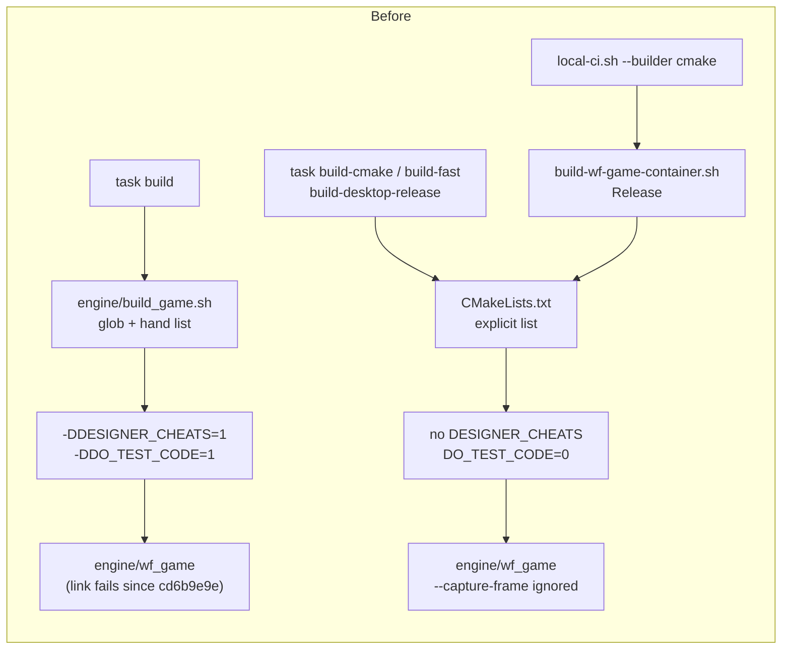
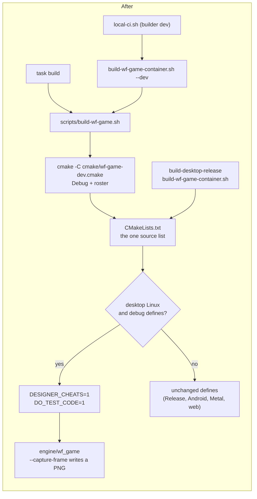
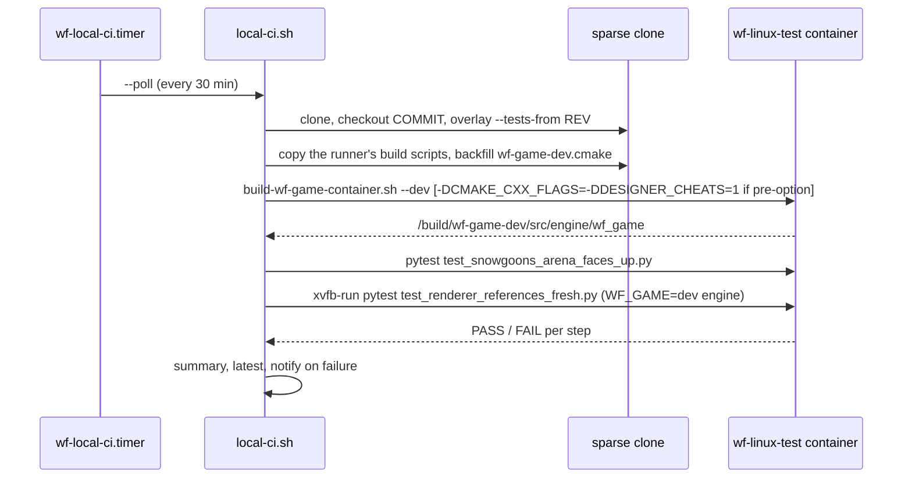

# One desktop build: CMake builds the dev engine, `engine/build_game.sh` retires

TODO: `[single-desktop-build]` (unblocks `[verify T3] **Local CI: …**`, [local-CI plan](2026-11-14-local-ci.md) **Findings**).

## Context

Two scripts built the desktop engine from two source lists, and they drifted:

- `engine/build_game.sh` (what `task build` ran) globbed `wfsource/source/*` and listed its stubs by hand. It is the only build that defined `DESIGNER_CHEATS` and `DO_TEST_CODE=1`.
- `CMakeLists.txt` builds every other target (Release desktop, Android, iOS, macOS, web, the editor, ctest) and gets new sources first.

`cd6b9e9e` (2026‑11‑11) added `engine/planted_preview.cpp` and `engine/runtime_diagnostics_form.cpp` to CMake only, so `task build` has not linked from a clean checkout since. The CMake engine links, but without `DESIGNER_CHEATS` it parses `--capture-frame` and ignores it, so the local CI's renderer freshness test cannot pass on any engine buildable at HEAD.

**Decision (Will, 2026‑11‑14):** "i choose what moves us in the long-term fix": CMake becomes the single desktop build, `build_game.sh` goes, and Linux `--capture-frame` works in that one build.

There is no visible surface beyond CLI and build output, so this plan has no mockups.

## `DESIGNER_CHEATS`: what it gates

Every use at `origin/2026-new-level` (`1a82f942`):

| Where | What it gates | Depends on |
|---|---|---|
| `game/main.cc:96` | defines `bRecordVideo`, the HUD globals `wf_hud_*` (score, timer, lives, marble, game over, initials, PILOT ring), moon overlay globals | — |
| `game/main.cc:424`, `:503` | `-record_video`, `-f` flags | `bRecordVideo` |
| `gfx/gl/display.cc:49–581` (with `__LINUX__`) | HUD drawing (`DrawHud`: arcade, Marble, moon, PILOT text, Q*bert initials), capture FBO declarations, `WfCaptureActive()`, `hscore.h` | `main.cc` globals, `scripting_pilot.cc` ring |
| `gfx/gl/display.cc:620–1193` | `RenderEnd` backend frame counter, capture FBO, `CaptureFrame` (PNG + `-record_video` ffmpeg pipe) | `bRecordVideo`, `gCaptureFrame` |
| `gfx/gl/display.cc:757`, `:888`, `:979`, `:1304`, `:1325` | surface size under capture, FBO bind in `RenderBegin`, frame count, HUD call, capture in `PageFlip` | the two blocks above |
| `game/game.cc:62`, `:718`, `:940` | `hscore.h`; per-frame HUD mailbox reads and Q*bert initials entry; HUD reset on return to the menu | `main.cc` globals |
| `game/game.cc:659` | `PIGSUserAborted()` level abort | — |
| `engine/stubs/scripting_pilot.cc:21`, `:31` | PILOT `T:`/`TH:` text into the HUD ring | `main.cc` globals |
| `game/player.cc:174` | free-camera motion | — |
| `gfx/vmem.hp:59`, `gfx/vmem.cc:101`, `:192`; `asset/assslot.cc:55` | `ClearSlot`: VRAM slots painted a debug colour when (re)loaded | — |
| `hal/linux/platform_init.cc:146` | `-halmem=` / `-scratchmem=` arena sizes | — |
| `pigsys/pigsys.cc:333–455`, `pigsys.hp:466`, `psysvers.h:45`, `hal/linux/platform_main.cc:36` | version banner, `_sys_printenv` | — |
| `game/level.cc:1073` | `saveTextureBuffer` (also needs `WRITER`, never defined) | — |
| `gfx/ccycle.cc:141`, `game/actor.hp:325` | `#if 0` / commented out | — |

`DO_TEST_CODE=1` (also only in `build_game.sh`) gates `--debug-print-actors` (`game/main.cc:83`, `:400`, `game/actor.cc:690`), which `Taskfile.yml` and `wflevels/baseline/verify.py` pass, and the HAL test macros in `hal/halbase.h:63` and `hal/hal.cc:113`.

### Option, not split

**Chosen: one CMake option per switch,** `WF_DESIGNER_CHEATS` (→ `DESIGNER_CHEATS=1`) and `WF_TEST_CODE` (→ `DO_TEST_CODE=1`), both ON by default exactly where `build_game.sh` put them.

**Rejected: splitting capture/record out into its own feature** (say `WF_FRAME_CAPTURE`, on in every Linux build like the ungated Metal capture). The capture is not separable at the define level: the capture FBO, the HUD and the `-record_video` pipe share the same two `#if` blocks in `display.cc` and the globals `main.cc` defines, and the HUD is drawn into the capture FBO. A split means re-guarding about a dozen blocks of `display.cc`, which another session is editing right now, to buy one thing nothing needs yet: capture in a Release desktop engine. The CI's freshness test wants the debug engine anyway, because its references and the macOS gate it guards (`macos-desktop-debug`) are debug captures. If a Release capture is wanted later, the split is still possible and is smaller once this lands.

### Defaults on every target

| Target | Build | `DESIGNER_CHEATS` before → after | `DO_TEST_CODE` before → after | Effect |
|---|---|---|---|---|
| Desktop Linux dev, `task build` | was `build_game.sh`, now CMake Debug + `cmake/wf-game-dev.cmake` | 1 → 1 | 1 → 1 | same engine and defines; builds again (it did not link since `cd6b9e9e`) |
| Desktop Linux CMake Debug (`task build-cmake`, `build-fast`, `build-asan`, ctest builds) | CMake Debug | — → 1 | 0 → 1 | capture works, HUD shows on HUD levels, `--debug-print-actors` works; bigger binary |
| Desktop Linux Release (`build-desktop-release`, `build-wf-game-container.sh`, `baseline:check`) | CMake Release | — → — | 0 → 0 | none |
| Android (APK, casts) | CMake, NDK | — → — (forced OFF) | 0 → 0 | none: defines identical (verification step 6) |
| iOS, macOS (Metal) | CMake, Xcode / Ninja | — → — (forced OFF) | 0 → 0 | none |
| Web (Emscripten) | CMake | — → — (forced OFF) | 0 → 0 | none |

Turning either option ON for Android, iOS, macOS or the web is a configure error. A desktop Release build may turn them on with `-DWF_DESIGNER_CHEATS=ON`, as `scripts/style-gl-sweep.sh` effectively does today with `CMAKE_CXX_FLAGS`.

**Rejected default: ON for every desktop Linux build, Release included,** following the old OpusMake table in `docs/compile-time-switches.md` (cheats on in `release`, off only in `final`). It would change the Release desktop engine that `baseline:check` and the reef test run (HUD, VRAM slot colours), which this change does not need to touch.

## Flag diff: `build_game.sh` (with `task build`'s environment) against CMake

| Flag | `build_game.sh` | CMake Debug, before | CMake + `wf-game-dev.cmake`, after |
|---|---|---|---|
| `DESIGNER_CHEATS=1` | yes | no | yes (`WF_DESIGNER_CHEATS`) |
| `DO_TEST_CODE` | `1` | `0` | `1` (`WF_TEST_CODE`) |
| `NDEBUG` | only `physics_jolt.cc`, `jolt_backend.cc` | every engine TU (Jolt ODR fix, `CMakeLists.txt` Jolt block) | same as before; kept, the ODR comment says why |
| `-O2` on `physics_jolt.cc`, `jolt_backend.cc` | yes | `-O0` | `-O0`; x86‑64 GCC emits no FMA without `-march`, so physics results do not change |
| `-O1` on `rest_api.cc`, `debug_server.cc`, `wfmut*.cpp`, `runtime_*.cpp` | yes | `-O0` | `-O0` (debug only; no behaviour) |
| Jolt library | `MinSizeRel` + `NDEBUG` | `-O2 -w -fno-rtti` + `NDEBUG` | same as before |
| ASan + UBSan | `-fsanitize=address,undefined` | same, minus `vptr` (meaningless under `-fno-rtti`), runtime static | same as before |
| Scripting roster | Lua + zForth (+ neural-forth) + PILOT (env from `task build`) | CMake default: + Fennel, QuickJS, WAMR, Wren | Lua + zForth (+ neural-forth) + PILOT (`wf-game-dev.cmake`) |
| `WF_REST_API`, `WF_DEBUG_BRIDGE`, wfmut | on | on (bridge forced on in Debug) | on |
| Debug defines (`BUILDMODE_DEBUG DO_ASSERTIONS=1 DO_DEBUGGING_INFO=1 DO_IOSTREAMS=1 SW_DBSTREAM=1 DEBUG=1 DEBUG_VARIABLES=1`), `DO_VALIDATION=0 DO_DEBUG_FILE_SYSTEM=0`, `-fpermissive -w -fno-rtti -O0 -g`, `__GAME__`, `ERR_DEBUG(x)=` | yes | yes | yes |
| Link | `-lGL -lGLU -lX11 -lm -lpthread -ldl -Wl,-z,noexecstack` | same | same |
| Sources (engine C++ TUs of `wfengine` + `wf_game`) | glob of 31 directories minus a skip list, plus 17 hand-listed stubs: 188 | explicit list: 190 | the same 190. Compared from `build.ninja` against the glob: the only difference is `engine/planted_preview.cpp` and `engine/runtime_diagnostics_form.cpp`, the `cd6b9e9e` drift. Vendored C (Lua, zForth, neural-forth) builds as libraries in both |
| Editor build | `WF_ENABLE_EDITOR=1` → `engine/wf_game-dev` | `engine/wf_game` | `engine/wf_game-dev` (new `OUTPUT_NAME` when `WF_ENABLE_EDITOR`) |

## Design

### Pieces

1. **`CMakeLists.txt`:** the two options after the debug-defines block; `DO_TEST_CODE=${_wf_test_code}` keeps the define list byte-identical for every target that leaves them off. An editor engine is `engine/wf_game-dev`.
2. **`cmake/wf-game-dev.cmake`** (new): the initial cache of the dev engine, Debug plus `task build`'s scripting roster. The one place that configuration lives. Command-line `-D`s win.
3. **`scripts/build-wf-game.sh`** (new): unpack Jolt if needed, configure with the cache file (Ninja when available) into `build-wf-game/` (`build-wf-game-dev/` with `--editor`), build `wf_game` (or `--target T`). Extra configure flags after `--`.
4. **`scripts/build-wf-game-container.sh --dev`:** runs `build-wf-game.sh` in the container copy, into `/build/wf-game-dev`. Its default (Release) is unchanged for `check-thai-reef.py --container`.
5. **`Taskfile.yml`:** `build` → `scripts/build-wf-game.sh {{.CLI_ARGS}}`, deps `vendor-unpack-archives` (the dev engine needs no submodule, so a clean checkout builds offline); `ensure-build` watches the two new files instead of `build_game.sh`; `build-editor` → `build-wf-game.sh --editor`.
6. **`engine/build_game.sh` deleted.** `tests/test-texture-atlas.sh`, which sourced it to reuse its objects, becomes a three-line CMake wrapper around the same `texture_atlas_address_test` that ctest already runs (its `WF_ATLAS_MATERIAL_SOURCE` replay of a pre-fix `material.cc` is dropped; check out the old file instead). Comments and docs that name `build_game.sh` as the build are updated (stubs headers, `engine/vendor/README.md`, `docs/dev-setup.md`, `docs/compile-time-switches.md`, test docstrings, `tests/conftest.py`, project memory). Historical plans, transcripts and diagnostics keep the name.
7. **`scripts/local-ci.sh`:** builders `dev` (default: `build-wf-game-container.sh --dev`) and `release`; `build_game` and `cmake` stay as aliases of them. Two additions so the bug-class proof can still build commits older than this change:
    - **The build scripts are the runner's.** After the checkout (and any `--tests-from` overlay, which now carries only the tests and their helpers), `scripts/build-wf-game.sh`, `scripts/build-wf-game-container.sh` and `scripts/in-linux-container.sh` are copied from the runner's own tree, like `local-ci.sh` itself. A commit's older copy (for example `be86bbb9`'s `build-wf-game-container.sh`, which has no `--dev`) cannot build the dev engine. The dev engine's configuration, `cmake/wf-game-dev.cmake`, stays the commit's when it has one, and is backfilled (and logged) when it does not.
    - **Pre-option CMake.** When the commit's `CMakeLists.txt` has no `WF_DESIGNER_CHEATS`, the dev builder passes `-DCMAKE_CXX_FLAGS=-DDESIGNER_CHEATS=1` (what `style-gl-sweep.sh` does for old commits), and logs it.

### The CI path

## Files

| File | Change |
|---|---|
| `CMakeLists.txt` | `WF_DESIGNER_CHEATS`, `WF_TEST_CODE`; `wf_game-dev` output name for editor builds |
| `cmake/wf-game-dev.cmake` | new: the dev engine's initial cache |
| `scripts/build-wf-game.sh` | new: the desktop build entry |
| `scripts/build-wf-game-container.sh` | `--dev`, extra configure flags |
| `scripts/local-ci.sh` | `dev` / `release` builders, harness backfill, pre-option shim |
| `Taskfile.yml` | `build`, `ensure-build`, `build-editor` |
| `engine/build_game.sh` | deleted |
| `tests/test-texture-atlas.sh` | CMake wrapper |
| comments and docs | as listed under **Pieces** 6 |
| `docs/plans/2026-11-14-local-ci.md` | verification steps 2, 5, 10 |

## Verification

1. `task build`, now CMake, builds from a clean checkout: in the container, a fresh sparse clone of the change runs `scripts/build-wf-game.sh` (what `task build` runs; the container has no `task`) and writes `engine/wf_game`; on the host, `task --dry build` shows that command.
2. `--capture-frame` writes a PNG: the dev engine from step 1, under `xvfb-run`, with `--frame-step-smoke=30 --cycles=1 -Lwflevels/snowgoons-blender/snowgoons-standalone.iff -rate20 --no-fps --capture-frame=20=/tmp/f20.png`, leaves a 640×480 PNG.
3. `tests/test_renderer_references_fresh.py` passes at HEAD with the dev engine.
4. The bug-class proof holds with the CMake dev builder: `scripts/local-ci.sh --no-notify --tests-from 23658e9a be86bbb9` fails both `arena-faces-up` and `renderer-fresh`; `scripts/local-ci.sh --no-notify 23658e9a` passes both.
5. The ctest and pytest suites that passed before still pass: ctest of the dev configuration before (`-DWF_DESIGNER_CHEATS=OFF -DWF_TEST_CODE=OFF`, the old CMake Debug defines) and after, same pass set; the engine-binary pytest tests (`test_game_shutdown.py`, `test_ui_font_missing.py`) pass with the dev engine.
6. Android's compile definitions are unchanged: configure the Android NDK build at `origin/2026-new-level` and at the change, and diff the `wfengine` defines (`build.ninja` `DEFINES`); no difference. Same check for a desktop Release configure.
7. `task ci:local` on the change's HEAD: build, arena-faces-up and renderer-fresh all PASS; then the local-CI plan's steps 2, 5 and 10 get their raw output.
8. Nothing still calls `build_game.sh`: `git grep -n build_game -- ':!docs/plans' ':!docs/transcripts' ':!docs/diagnostics'` lists only the retirement notes.
9. Every diagram here renders: `task md -- docs/plans/2026-11-14-single-desktop-build.md` prints no `mermaid.ink render failed`.
