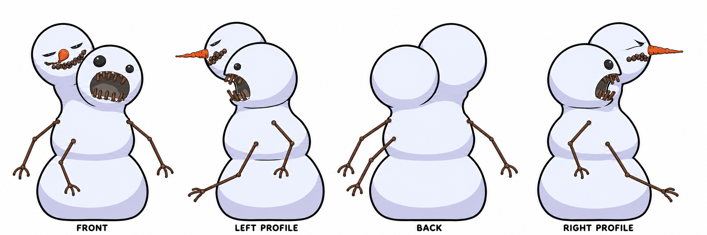
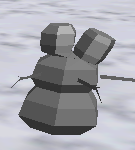
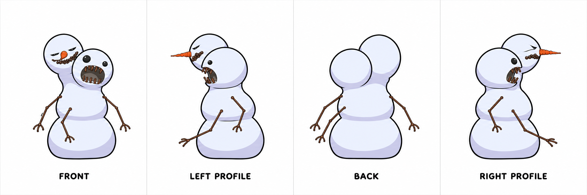

# Snowgoon character, rig and snowball actions

**Date:** 2026-11-14
**Status:** the 2D concept and action references are approved; both TRELLIS seeds were generated and verified on 2026-11-14. Neither raw model nor the first 2,800-triangle projected salvage is accepted for production. Rigging and animation remain.
**Builds on:** [one-acre Snowgoons yard](2026-11-13-snowgoons-one-acre-arena.md), which added the original two-headed snowman as a static Enemy mesh.

## Goal

Turn the current snowman into a readable, game-ready snowgoon with a reviewed
look, a textured low-poly model, articulated arms, and an in-game action cycle
where it scoops snow, packs a snowball, and throws it. Preserve the recognizable
two-headed snowman silhouette from `snowman01.iff`. The existing 200-triangle
mesh has thin, static twig arms; it is not a rig and cannot establish that those
actions will read correctly.

This is a flat 2D concept sheet for the 3D modeler and image-to-3D inputs. The
four views are ordered front, left profile, back, and right profile. The earlier
3D-looking turnaround is only an exploratory presentation and is not a modeling
input.

The existing source mesh contains 147 vertices and 200 triangles, is about
2.20 m tall, and already has two heads and three static twig branches. The
concept is a redesign and articulation guide, not a request to add a third
branch to a two-armed source. The branches are geometry without a rig, so they
cannot scoop, pack, or throw. The current 1280 × 720 gameplay capture shows the
actor at about 114 × 122 screen pixels in perspective; it confirms scene scale
and twin-head silhouette, but cannot show the static arms' action reach.

At this view the static twig arms read short and do not communicate a scoop.
The modeler reference therefore calls for thin but longer arms, plus a visible
forward torso bend so the character lowers itself to the snow instead of
reaching with straight arms alone.

### Reconstruction input layout

The approved v10 sheet's arms crossed adjacent panel boundaries, so its panels
cannot be cropped cleanly. This spaced v11 layout keeps the same four-view
design direction and puts each complete figure in its own column. It is a
preprocessing layout; v10 remains the approved concept artwork.

The four square crops and reproducible preprocessing record are in
[`input-runs/2026-11-14-v11/`](2026-11-14-snowgoon-character/input-runs/2026-11-14-v11/).
The crops exclude labels and panel dividers, retain the complete figures, and
use identical 543 × 543 RGB canvases without resizing. The front input crop
masks one detached ink fleck beside the left arm; its untouched source crop is
retained alongside it.

### Action pose reference

The turnaround defines the design. This separate flat 2D pose strip makes the
action's body movement explicit: fold forward through the torso to scoop, rise
partway to pack the snowball with all three arms, then bend through the throw
and recovery.

The v1 strip accidentally added a second carrot-shaped protrusion beside each
upper head. V2 corrected that to one nose per pose; v3 adds the three-arm pack
pose; v4 corrects the head order to match the right-profile turnaround. V4 is
the current action reference; earlier versions remain for change history.

### Calvin & Hobbes visual references

The source visual language is Bill Watterson's Calvin & Hobbes Snow Goons. The
local [reference index](2026-11-14-snowgoon-character/references.md) archives
the publication details, stable viewing links and design observations. Open the
strips at their original source:

The cover identifies the 1992 collection. Its contents span June 1990 through
April 1991; the Snow Goons story itself is a shorter January 1991 sequence.
The cover image is a local personal research copy; the strip images below are
being collected separately by their original publication dates.

- [January 4, 1991 — the goon changes its own shape](https://www.gocomics.com/calvinandhobbes/1991/01/04): use for the lumpy, improvised snow silhouette, added head and arm, and the comic escalation of the design.
- [January 7, 1991 — the goons build another goon](https://www.gocomics.com/calvinandhobbes/1991/01/07): use for a hunched action pose, snowball making, and how the figure reads beside Calvin and the fort.
- [January 18, 1991 — newspaper page scan](https://archives.nd.edu/observer/1991-01-18_v23_074.pdf): the page includes the snowgoon lumbering toward the yard; use for staging, scale and movement attitude.
- [January 3, 1991 — snowballs stick and the goon packs on snow](https://www.gocomics.com/calvinandhobbes/1991/01/03): use for the snowball interaction and the self-building gag.
- [Collected story: *Attack of the Deranged Mutant Killer Monster Snow Goons*](https://www.simonandschuster.com/books/Attack-of-the-Deranged-Mutant-Killer-Monster-Snow-Goons/Bill-Watterson/Calvin-and-Hobbes/9780836218831): publisher record for the complete arc and the primary collection to consult for additional poses.

#### Inline strip references

All eighteen complete strips are saved as local-only personal references under
the ignored `build-docker/snowgoon-personal-references/` directory. The January
12 strip is the primary level-layout reference: it shows the sleeping goon
army surrounding the house overnight.

**December 31, 1990 — Calvin brings the snowman to life.**

**January 1, 1991 — the snow goon follows Calvin to his front door.**

**January 2, 1991 — Calvin and Hobbes debate what to do with the snowman.**

**January 3, 1991 — snowballs stick and the goon packs on snow.**

**January 4, 1991 — the goon adds heads and an arm.**

**January 5, 1991 — the first goon lumbers toward the yard.**

**January 7, 1991 — goons build another snow figure.**

**January 8, 1991 — Susie learns about the goon and notices the others.**

**January 9, 1991 — the goons begin building their own army.**

**January 10, 1991 — Calvin is called in while trying to stop the goons multiplying.**

**January 11, 1991 — Calvin counts fifteen goons and worries about the school bus.**

**January 12, 1991 — sleeping goons surround the house; primary level composition inspiration.**

**January 14, 1991 — Calvin and Hobbes sneak out to attack a goon.**

**January 15, 1991 — Calvin tries to freeze the goons in place.**

**January 16, 1991 — Dad slips on the frozen yard and becomes a “snow goon.”**

**January 17, 1991 — Calvin tries to explain the freezing to his parents.**

**January 18, 1991 — Calvin explains the snowgoon army.**

**January 19, 1991 — Calvin and Hobbes reflect on the snow goons.**

Use these as design and motion references, not as a tracing target. Preserve the
existing two-headed model as this game's starting identity, then develop an
original in-game sculpt with its own face, proportions, rig and texture.

This 2D sheet is still a design prompt, not a final model specification. Review
that the back and profile views preserve the same head order, silhouette, body
shape, all three thin arms, shoulder roots, elbows, and arm lengths before
handoff to the 3D modeler. Keep the game's chunky proportions. The two
smooth, similarly sized heads should remain visibly different and unsettling,
with distinct expressions and a modest tapered carrot nose. All three arms
should keep the longer, thin twig proportions seen in the strips. Their reach
should support scooping, packing, and throwing without thickening the branches.
The reference strips do not show a scarf, so the current concept leaves the
snow body bare.

## Scope and constraints

- Keep this work in the classic Snowgoons level and its own asset/build paths;
  do not change the shared Blender scaffold or unrelated levels.
- The prepared 2D package feeds the GCP GPU Route C workflow documented in
  [`Route C actor HOWTO`](../../../finding-your-way/docs/route-c-actor-how-to.md).
  Generate two TRELLIS multi-view mesh/appearance candidates from all four
  views jointly per seed. Do not hand this to an unspecified external
  modeler. Use Blender for review, cleanup, rigging and export after candidate
  generation; preserve the raw outputs and receipts.
- Target at most 2,800 triangles for the complete snowgoon model, subject to
  review at game distance. Keep the final model, materials, animation and any
  projectile within the existing level's memory and frame budgets.
- Do not alter engine source without a separate, concrete proposal and Will's
  explicit permission. Read-only inspection of Blender/runtime asset support
  can continue without engine edits.

## Work plan

### 1. Baseline and concept approval

- [ ] Record source commit, dirty-tree context, current Snowgoons APK/level
  hashes, and the installed snowgoon capture. Preserve the current mesh and
  gameplay as a rollback baseline.
- [x] Approve the current 2D concept direction: two smooth, nearly equal-sized
  heads with distinct deranged faces, a modest tapered carrot nose, three long
  thin twig arms, and no scarf. Will approved the sheet on 2026-11-14.
- [x] Compare the approved concept with the original source mesh. Confirmed the
  source is 147 vertices/200 triangles, about 2.20 m tall, with two heads and
  three static twig branches.
- [x] Compare with the current gameplay capture. The 2.20 m actor occupies
  approximately `(895,237)`–`(1009,359)` in the 1280 × 720 opening capture;
  see the crop and source/hash in the input manifest. The perspective view
  confirms scene scale and twin-head silhouette. Its static arms cannot confirm
  bending or action reach.
- [x] Produce a corrected four-view 2D concept sheet: the front carrot nose is
  visible, the back is a true rear view with the head offset mirrored from the
  front, the left and right profiles face opposite directions with their
  near/far head offsets mirrored, and all three twig arms retain the approved
  thin, long proportions. See `concept-turnaround-2d-v10.png`.
- [x] Inspect the approved sheet and source resolution. The v10 illustration
  has adjacent arm tips across panel boundaries, so use the separate v11 input
  layout. Crop all four views at one scale and save preprocessing settings and
  SHA-256 hashes in the unique run directory. The front input has the detached
  ink fleck masked; its raw crop is retained.

**Gate:** approved 2D concept, spaced input layout, four hashed crops and action
poses are ready for the Route C multi-view run.

### 2. GCP Route C: multi-view mesh and appearance candidates

- [x] Prepare the Route C package: approved v10 sheet, spaced v11 layout, four
  equal-sized inputs, strip reference index, in-game baseline and the 2D
  action-pose strip. The source masks and hashes are recorded in the v11
  manifest.
- [x] Create a unique TRELLIS input manifest pinned to code revision
  `193e0502b5cb3eb5997ec457d5340e95d09b158e`, model revision
  `25e0d31ffbebe4b5a97464dd851910efc3002d96`, and seeds 42 and 7. Record all
  four exact image hashes and use `front`, `left`, `back`, `right` names expected
  by the worker.
- [x] Create the run-specific four-image input directory and manifest at
  [`gpu-run-2026-11-14/inputs/`](2026-11-14-snowgoon-character/gpu-run-2026-11-14/inputs/).
  All four crops are 543 × 543 RGB with distinct hashes; the worker accepted
  the manifest and seed list locally.
- [x] Review the exact input set before GPU allocation:

  

- The initial bounded VM was deleted before input upload when the action-sheet
  head-order mismatch was noticed. No images were uploaded and no inference ran;
  verify cleanup before creating a fresh VM for the corrected package.

- [x] Pass the Route C read-only resource preflight on 2026-11-14: the project
  has zero existing instances, disks and reserved addresses; the unique VM
  identity is unused, and the output path does not exist. The official [GCP
  Spot pricing page](https://cloud.google.com/spot-vms/pricing) currently lists
  `g2-standard-4` with one L4 at $0.402748/hour. The four-hour automatic
  deletion caps compute at about $1.62 at that rate; boot disk and transfer
  charges are additional and depend on actual usage. Keep the run on bounded
  Spot; do not escalate to Standard or extend its lifetime.
- [x] Run the explicit preflight/create/wait/push/run/fetch/verify/delete
  lifecycle in the Route C HOWTO. Preserve partial downloads on failure and
  retry only into a fresh directory while the bounded VM remains available.
  Retain both raw meshes, vertex attributes/colour, Gaussian appearance,
  receipts, consumed conditioning images, logs, hashes and lifecycle evidence.
- [x] Verify both outputs and receipts locally, confirm each receipt proves all
  four views reached the same shape call, then delete the VM promptly and
  verify cleanup before visual selection.
- [x] Review both seeds from four axes. Neither raw candidate is accepted for
  production: vertex-colour previews have weak/blurred facial detail, incorrect
  pink arm colour and inconsistent face placement; the meshes contain about
  668k and 678k triangles, far above the 2,800-triangle target. Preserve both
  seeds and diagnose these gaps before any additional GPU allocation.

**Gate:** both TRELLIS candidates, inputs, receipts and cleanup evidence are
archived. Both raw candidates are rejected for production pending a corrective
model/appearance approach; do not start rigging these raw meshes.

#### Route C run evidence (2026-11-14)

The successful run used the pinned TRELLIS code and weight revisions, with all
four labelled 543 × 543 views supplied together for seeds 42 and 7. The
downloaded receipts passed the Route C verifier and match the manifest and
conditioning image hashes. [Verification JSON](2026-11-14-snowgoon-character/gpu-run-2026-11-14/download-verification.json),
[GPU lifecycle record](2026-11-14-snowgoon-character/gpu-run-2026-11-14/gpu-lifecycle.json),
[cleanup log](2026-11-14-snowgoon-character/gpu-run-2026-11-14/gpu-cleanup.log),
[raw four-axis review](2026-11-14-snowgoon-character/gpu-run-2026-11-14/raw-review/index.html),
and the failed first-attempt log are retained under
[`gpu-run-2026-11-14/`](2026-11-14-snowgoon-character/gpu-run-2026-11-14/).

The first Blender contact sheet used yaw 0 and was useful only as an unlabelled
four-axis inspection. The corrected game-facing preview applies the Route C
`-Y` up-axis and 90-degree yaw, so +X is the front, -X the back, and the two
profile views map to the approved left/right order. This corrected review is
the visual reference for judging the candidates.

The raw generated vertex colours are muddy on faces and turn the twig arms
pink. A local salvage experiment collapsed seed 42 to exactly 2,800 triangles
and projected the approved four source views onto a 512 × 512 UV texture. Four
RGBA projection inputs and their [contact sheet](2026-11-14-snowgoon-character/gpu-run-2026-11-14/projection-input-review.png)
are prepared by `prepare_projection_inputs.py`; connected white margins are
transparent while enclosed snow stays opaque. The [projected review](2026-11-14-snowgoon-character/gpu-run-2026-11-14/salvage-seed42-projection2/contact-sheet.png)
shows improved twig color and restored face marks, but severe seams, misplaced
facial details and gaps remain where the generated geometry disagrees with the
source views. This salvage is rejected for production. The first blank bake
from an incorrect camera-group mask is preserved in `salvage-seed42/`; the
corrected experiment is in `salvage-seed42-projection2/`, with its editable
Blender scene, script and stats. Do not rig or integrate it. Next, improve the
projection mappings/face-region masks or change the input/model approach before
another GPU allocation.

The first uploaded worker attempt exposed a quoting bug in the shared Route C
shell script: it wrote literal `n` characters between pip constraints. A
run-local worker copy fixes the quoting; the unchanged shared script is outside
this repository and remains unmodified. That Spot VM was subsequently
reclaimed. A second, successful bounded Spot run generated both candidates;
the outputs were downloaded before deletion. Final cleanup confirmed zero
instances, disks and reserved addresses. The earlier VM created before the
action-sheet head-order correction was deleted before any input upload.

Google's [Spot price page](https://cloud.google.com/spot-vms/pricing) listed
`g2-standard-4` with one L4 at $0.402748/hour during preflight. The VM used a
four-hour automatic deletion limit; that compute-rate estimate excludes the
boot disk and transfer and is not an invoice.

### 3. Articulation and rig validation

- [ ] Inspect how the current engine animation manager, animation-cycle assets,
  Blender importer/exporter and actor scripts represent animated meshes.
  Separate confirmed support from assumptions; `snowgoon.iff` currently has no
  authored arm rig or action cycles.
- [ ] Build a simple, stable rig with torso/root and three
  distinct arm roots:
  two high shoulder roots and the added third arm root on the upper torso. Give
  each thin twig arm independently movable upper segment, elbow, forearm and
  forked hand pivots. Add a torso pivot at the middle/lower snow-body junction
  so the upper body and both heads can fold forward together, then rise partway
  for packing. Bring all three hands to the snowball so they visibly press and
  shape it together. Include only enough head control for readable weight
  shifts and aiming.
- [ ] Review poses in Blender: a visible forward torso fold lowers one hand to
  the snow; the goon partly rises and packs the snowball with all three arms;
  the throw uses torso bend/rotation, arm wind-up, release and follow-through.
  Reject body intersections, broken pivots, reach achieved only by stretching
  arms, silhouette collapse and detached limbs. Save labelled pose renders and
  the editable rig scene.
- [ ] Determine whether the existing runtime can play the required rigged
  cycles. First test current asset/tool support and existing animation playback.
  If unsupported, document the exact format/runtime gap and propose the smallest
  engine change for permission before touching engine code. Do not silently
  substitute a non-articulated static pose or commit to an unverified export.

**Gate:** arm articulation is demonstrated in Blender and a tested runtime
representation is identified. If engine support is missing, the work pauses at
a reviewable engine-change proposal while asset/tooling work continues.

### 4. Animation and action behavior

- [ ] Author and export a seamless idle, scoop, pack, throw and recovery cycle.
  Show a clear forward bend for scooping, a partial rise for three-armed
  packing, then torso-led anticipation, one-handed release and
  follow-through. Keep the throwing hand, snowball and release frame aligned;
  return to idle without a visible pop.
- [ ] Add a snowball prop with held and flying states. Show it between the hands
  while packing, attach it to the throwing hand during wind-up, release it at
  the authored animation event/frame, then fly toward the target with a visible
  trajectory. Preserve collision and cleanup behavior; avoid a projectile
  persisting after impact or level reset.
- [ ] Connect the sequence to the existing Enemy/script path if it can express
  the required timing. Define deterministic state transitions and interruption
  behavior (target lost, actor hit/removed, projectile impact, level reset).
  Request engine approval first if animation events, rig playback or projectile
  ownership require engine edits.
- [ ] Verify timing at normal and varied frame rates. The prop must not release
  early/late, duplicate, or remain attached after a throw; each cycle must end
  in a valid idle/retry state.

### 5. Integration and acceptance

- [ ] Integrate only the accepted snowgoon model, texture, rig/cycles, action
  logic and projectile into the classic level. Keep the old asset available in
  history and do not modify the acre yard geometry.
- [ ] Add focused asset/export tests for model budget, materials/texture,
  rig bones/pivots, required cycles, actor placement, snowball release timing and
  deterministic generated outputs.
- [ ] Compare matched desktop captures of the baseline and candidate. Inspect
  close-up face, front/back/profiles, normal gameplay distance, joints across
  every action, snowball flight/release/impact, and level reset.
- [ ] Build/freeze the APK locally. Use coordinator-owned device sessions for
  cast2 gameplay validation, including at least one complete scoop/pack/throw
  and retry/reset path. Retain APK digest, jobs and captures. Do not use raw
  ADB.
- [ ] Record performance/memory impact and any unresolved limitation. Commit
  only this accepted character scope when requested; do not bundle unrelated
  working-tree changes.

## Acceptance criteria

- A reviewed, coherent four-view concept retains the original two-headed
  snowman identity and clearly communicates the arm construction.
- A game-ready textured mesh is at most 2,800 triangles, fits the actor scale,
  and has preserved source/seed receipts and an editable Blender scene.
- Shoulder and elbow pivots pass the full action pose range without visible
  intersections or collapse.
- Scoop, pack, throw, release, flight, impact, recovery and idle work in the
  native runtime; the snowball release aligns to the throwing hand.
- No engine source changes occur without explicit permission. Any runtime gap
  has a concrete, bounded proposal rather than an unapproved implementation.
- Focused checks and coordinator device evidence are recorded, with honest
  performance and test results.
