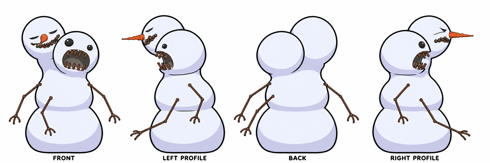

# Snowgoon character, rig and snowball actions

**Date:** 2026-11-14
**Status:** planning; Will approved the 2D concept direction on 2026-11-14. Model, rig, and animation work remain.
**Builds on:** [one-acre Snowgoons yard](2026-11-13-snowgoons-one-acre-arena.md), which added the original two-headed snowman as a static Enemy mesh.

## Goal

Turn the current snowman into a readable, game-ready snowgoon with a reviewed
look, a textured low-poly model, articulated arms, and an in-game action cycle
where it scoops snow, packs a snowball, and throws it. Preserve the recognizable
two-headed snowman silhouette from `snowman01.iff`. The existing 200-triangle
mesh has thin, static twig arms; it is not a rig and cannot establish that those
actions will read correctly.

This is a flat 2D concept sheet for the 3D modeler and image-to-3D inputs. The
four views are ordered front, left profile, back, and right profile. The earlier
3D-looking turnaround is only an exploratory presentation and is not a modeling
input.

The existing source mesh contains 147 vertices and 200 triangles, is about
2.20 m tall, and already has two heads and three static twig branches. The
concept is a redesign and articulation guide, not a request to add a third
branch to a two-armed source. The branches are geometry without a rig, so they
cannot scoop, pack, or throw. A matched in-game capture is still needed to
confirm scale and silhouette at play distance.

### Calvin & Hobbes visual references

The source visual language is Bill Watterson's Calvin & Hobbes Snow Goons. The
local [reference index](2026-11-14-snowgoon-character/references.md) archives
the publication details, stable viewing links and design observations. Open the
strips at their original source:

The cover identifies the 1992 collection. Its contents span June 1990 through
April 1991; the Snow Goons story itself is a shorter January 1991 sequence.
The cover image is a local personal research copy; the strip images below are
being collected separately by their original publication dates.

- [January 4, 1991 — the goon changes its own shape](https://www.gocomics.com/calvinandhobbes/1991/01/04): use for the lumpy, improvised snow silhouette, added head and arm, and the comic escalation of the design.
- [January 7, 1991 — the goons build another goon](https://www.gocomics.com/calvinandhobbes/1991/01/07): use for a hunched action pose, snowball making, and how the figure reads beside Calvin and the fort.
- [January 18, 1991 — newspaper page scan](https://archives.nd.edu/observer/1991-01-18_v23_074.pdf): the page includes the snowgoon lumbering toward the yard; use for staging, scale and movement attitude.
- [January 3, 1991 — snowballs stick and the goon packs on snow](https://www.gocomics.com/calvinandhobbes/1991/01/03): use for the snowball interaction and the self-building gag.
- [Collected story: *Attack of the Deranged Mutant Killer Monster Snow Goons*](https://www.simonandschuster.com/books/Attack-of-the-Deranged-Mutant-Killer-Monster-Snow-Goons/Bill-Watterson/Calvin-and-Hobbes/9780836218831): publisher record for the complete arc and the primary collection to consult for additional poses.

#### Inline strip references

All eighteen complete strips are saved as local-only personal references under
the ignored `build-docker/snowgoon-personal-references/` directory. The January
12 strip is the primary level-layout reference: it shows the sleeping goon
army surrounding the house overnight.

**December 31, 1990 — Calvin brings the snowman to life.**

**January 1, 1991 — the snow goon follows Calvin to his front door.**

**January 2, 1991 — Calvin and Hobbes debate what to do with the snowman.**

**January 3, 1991 — snowballs stick and the goon packs on snow.**

**January 4, 1991 — the goon adds heads and an arm.**

**January 5, 1991 — the first goon lumbers toward the yard.**

**January 7, 1991 — goons build another snow figure.**

**January 8, 1991 — Susie learns about the goon and notices the others.**

**January 9, 1991 — the goons begin building their own army.**

**January 10, 1991 — Calvin is called in while trying to stop the goons multiplying.**

**January 11, 1991 — Calvin counts fifteen goons and worries about the school bus.**

**January 12, 1991 — sleeping goons surround the house; primary level composition inspiration.**

**January 14, 1991 — Calvin and Hobbes sneak out to attack a goon.**

**January 15, 1991 — Calvin tries to freeze the goons in place.**

**January 16, 1991 — Dad slips on the frozen yard and becomes a “snow goon.”**

**January 17, 1991 — Calvin tries to explain the freezing to his parents.**

**January 18, 1991 — Calvin explains the snowgoon army.**

**January 19, 1991 — Calvin and Hobbes reflect on the snow goons.**

Use these as design and motion references, not as a tracing target. Preserve the
existing two-headed model as this game's starting identity, then develop an
original in-game sculpt with its own face, proportions, rig and texture.

This 2D sheet is still a design prompt, not a final model specification. Review
that the back and profile views preserve the same head order, silhouette, body
shape, all three thin arms, shoulder roots, elbows, and arm lengths before using
them for GPU reconstruction. Keep the game's chunky proportions. The two
smooth, similarly sized heads should remain visibly different and unsettling,
with distinct expressions and a modest tapered carrot nose. All three arms
should keep the longer, thin twig proportions seen in the strips. Their reach
should support scooping, packing, and throwing without thickening the branches.
The reference strips do not show a scarf, so the current concept leaves the
snow body bare.

## Scope and constraints

- Keep this work in the classic Snowgoons level and its own asset/build paths;
  do not change the shared Blender scaffold or unrelated levels.
- Use the four-view TRELLIS workflow in the
  [Route C actor HOWTO](../../finding-your-way/docs/route-c-actor-how-to.md)
  only after the views are coherent and approved. All four views must condition
  each shape seed together. Start with two seeds, not an automatic sweep.
- TRELLIS vertex colour is a source appearance, not the final game texture.
  Preserve raw colour/attributes, unwrap and bake or paint a compact game-ready
  texture, and inspect it under Snowgoons lighting.
- Target at most 2,800 triangles for the complete snowgoon model, subject to
  review at game distance. Keep the final model, materials, animation and any
  projectile within the existing level's memory and frame budgets.
- Do not alter engine source without a separate, concrete proposal and Will's
  explicit permission. Continue Blender, level, asset, script and test work
  independently where possible.

## Work plan

### 1. Baseline and concept approval

- [ ] Record source commit, dirty-tree context, current Snowgoons APK/level
  hashes, and the installed snowgoon capture. Preserve the current mesh and
  gameplay as a rollback baseline.
- [x] Approve the current 2D concept direction: two smooth, nearly equal-sized
  heads with distinct deranged faces, a modest tapered carrot nose, three long
  thin twig arms, and no scarf. Will approved the sheet on 2026-11-14.
- [x] Compare the approved concept with the original source mesh. Confirmed the
  source is 147 vertices/200 triangles, about 2.20 m tall, with two heads and
  three static twig branches; see the diagnostic render above.
- [ ] Compare the approved concept with a matched in-game view. Confirm actor
  scale, base/origin, body/head proportions, three-arm layout, twig joints,
  hand shape, reach, and neutral pose at play distance.
- [x] Produce a corrected four-view 2D concept sheet: the front carrot nose is
  visible, the back is a true rear view with the head offset mirrored from the
  front, the left and right profiles face opposite directions with their
  near/far head offsets mirrored, and all three twig arms retain the approved
  thin, long proportions. See `concept-turnaround-2d-v10.png`.
- [ ] Inspect orthographic consistency and source resolution, then crop the
  views and save labels, preprocessing settings, and SHA-256 hashes in a unique
  input run directory. No GPU instance before this input gate passes.

**Gate:** concept direction approved; four-view consistency and input
preparation remain before reconstruction. A sheet with inconsistent views is
not accepted as GPU input.

### 2. GPU mesh and appearance candidates

- [ ] Follow the HOWTO's explicit GCP lifecycle: preflight, create, ready,
  upload, generate, download, verify, delete, verify cleanup. Use a unique run
  identity, bounded VM lifetime, fresh local output directory and current price
  source. Do not take over another run's resources.
- [ ] Pin TRELLIS code/weights, container digest, inference settings and two
  seeds in the manifest. Prove with the adapter test that each seed consumes all
  four images in one joint shape call.
- [ ] Keep both raw meshes, vertex colours, Gaussian appearance, receipts,
  input hashes and worker logs. Verify outputs locally, then delete the VM and
  confirm its instance, disk and address are gone before review.
- [ ] Compare both candidates from front, back, both profiles and three-quarter
  views. Check the twin heads, face readability, arm attachment, shoulder and
  elbow placement, hand silhouette, body intersections and lower-body shape.
  Confirm that all three arms remain distinct, thin and articulable. Reject
  candidates that fuse an arm into the torso or make the joints hard to read.
- [ ] Select one candidate with recorded reasons. Clean it in Blender, preserve
  the raw source, build a UV map and bake/paint a game-ready texture. Save an
  editable Blender file and reproducible cleanup/export settings. Keep texture
  allocation within the level's existing page budget where feasible.

**Gate:** viable model and appearance candidate selected, audited and fitted to
the existing approximately 2.2 m actor height and base/origin convention.

### 3. Articulation and rig validation

- [ ] Inspect how the current engine animation manager, animation-cycle assets,
  Blender importer/exporter and actor scripts represent animated meshes.
  Separate confirmed support from assumptions; `snowgoon.iff` currently has no
  authored arm rig or action cycles.
- [ ] Build a simple, stable rig with torso/root and three distinct arm roots:
  two high shoulder roots and the added third arm root on the upper torso. Give
  each thin twig arm independently movable upper segment, elbow, forearm and
  forked hand pivots. Add only the body/head controls needed for readable weight
  shifts and aiming.
- [ ] In Blender, test shoulder lift/reach, elbow curl and hand orientation
  on all three arms through the scoop, chest-level packing and forward throwing
  ranges. Use the third arm to assist snow gathering/packing or balance, while
  preserving a clear throw path for the throwing arm. Inspect both sides and
  front/back. Reject intersections with the body, broken joints, bad pivots,
  silhouette collapse and detached-looking limbs. Save labelled pose
  renders and the editable rig scene.
- [ ] Determine whether the existing runtime can play the required rigged
  cycles. First test current asset/tool support and existing animation playback.
  If unsupported, document the exact format/runtime gap and propose the smallest
  engine change for permission before touching engine code. Do not silently
  substitute a non-articulated static pose or commit to an unverified export.

**Gate:** arm articulation is demonstrated in Blender and a tested runtime
representation is identified. If engine support is missing, the work pauses at
a reviewable engine-change proposal while asset/tooling work continues.

### 4. Animation and action behavior

- [ ] Author and export a seamless idle, scoop, pack, throw and recovery cycle.
  Keep the throwing hand, snowball and release frame aligned. Provide clear
  anticipation, two-handed packing, one-handed release and follow-through;
  return to idle without a visible pop.
- [ ] Add a snowball prop with held and flying states. Show it between the hands
  while packing, attach it to the throwing hand during wind-up, release it at
  the authored animation event/frame, then fly toward the target with a visible
  trajectory. Preserve collision and cleanup behavior; avoid a projectile
  persisting after impact or level reset.
- [ ] Connect the sequence to the existing Enemy/script path if it can express
  the required timing. Define deterministic state transitions and interruption
  behavior (target lost, actor hit/removed, projectile impact, level reset).
  Request engine approval first if animation events, rig playback or projectile
  ownership require engine edits.
- [ ] Verify timing at normal and varied frame rates. The prop must not release
  early/late, duplicate, or remain attached after a throw; each cycle must end
  in a valid idle/retry state.

### 5. Integration and acceptance

- [ ] Integrate only the accepted snowgoon model, texture, rig/cycles, action
  logic and projectile into the classic level. Keep the old asset available in
  history and do not modify the acre yard geometry.
- [ ] Add focused asset/export tests for model budget, materials/texture,
  rig bones/pivots, required cycles, actor placement, snowball release timing and
  deterministic generated outputs.
- [ ] Compare matched desktop captures of the baseline and candidate. Inspect
  close-up face, front/back/profiles, normal gameplay distance, joints across
  every action, snowball flight/release/impact, and level reset.
- [ ] Build/freeze the APK locally. Use coordinator-owned device sessions for
  cast2 gameplay validation, including at least one complete scoop/pack/throw
  and retry/reset path. Retain APK digest, jobs and captures. Do not use raw
  ADB.
- [ ] Record performance/memory impact and any unresolved limitation. Commit
  only this accepted character scope when requested; do not bundle unrelated
  working-tree changes.

## Acceptance criteria

- A reviewed, coherent four-view concept retains the original two-headed
  snowman identity and clearly communicates the arm construction.
- A game-ready textured mesh is at most 2,800 triangles, fits the actor scale,
  and has preserved source/seed receipts and an editable Blender scene.
- Shoulder and elbow pivots pass the full action pose range without visible
  intersections or collapse.
- Scoop, pack, throw, release, flight, impact, recovery and idle work in the
  native runtime; the snowball release aligns to the throwing hand.
- No engine source changes occur without explicit permission. Any runtime gap
  has a concrete, bounded proposal rather than an unapproved implementation.
- Focused checks and coordinator device evidence are recorded, with honest
  performance and test results.
