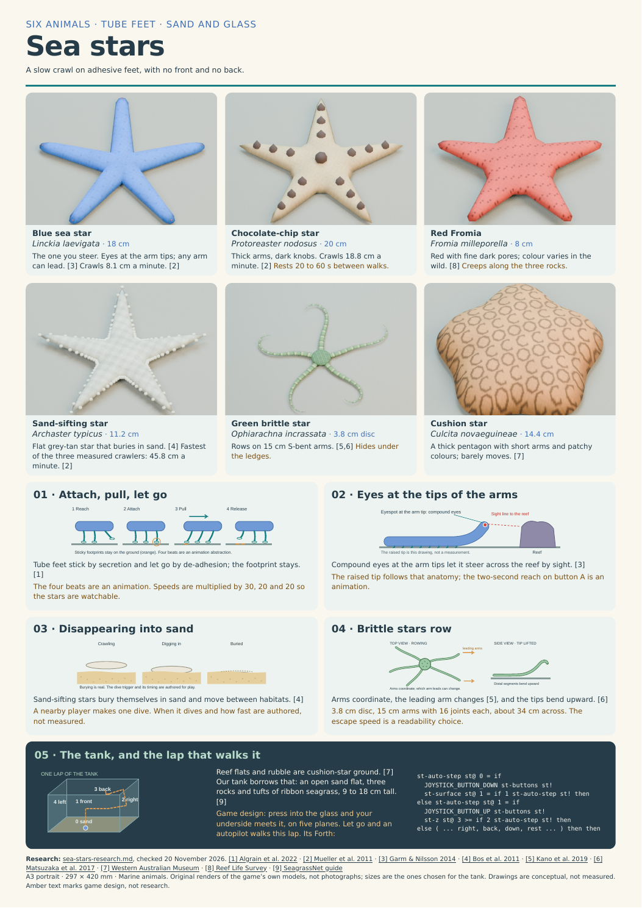
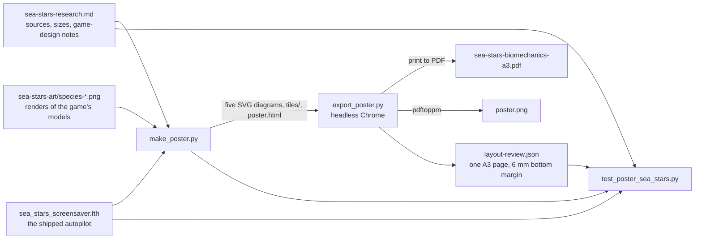

# Sea Stars A3 research poster

**Status: built and exported 2026‑11‑20.** One A3 portrait page in the format of the other levels' posters ([sea urchin](../reference/sea-urchin-biomechanics-poster/poster.png), [sea anemone](../reference/sea-anemone-biomechanics-poster/poster.png), [seahorse](../reference/seahorse-biomechanics-poster/poster.png) and the rest): a strap line and title, the animals, numbered panels with an original diagram, a short paragraph and bracketed citations each, a dark panel for the tank and some Forth, and a footer of checked sources.

## What is on it

The animals lead. Six large portrait cards come first, three across and two down, each with the animal's name, its Latin name, the size chosen for the tank, and one or two facts with their citations. Below them sit four diagram panels and a dark panel about the tank.

| Part | Content | Evidence |
|---|---|---|
| Six animal cards | blue sea star, chocolate-chip star, Red Fromia, sand-sifting star, green brittle star, cushion star: the game's own renders, sizes, measured crawl speeds, habits | the renders in [`sea-stars-art`](../reference/sea-stars-art/); [`sea-stars-research.md`](../reference/sea-stars-research.md) |
| 01 Attach, pull, let go | tube feet stick by secretion and leave a footprint; the ×30, ×20, ×20 speed multipliers | Algrain et al. 2022 (added to the research file) |
| 02 Eyes at the tips of the arms | arm-tip compound eyes in the blue sea star; the raised tip and the two-second reach are game | Garm & Nilsson 2014 |
| 03 Disappearing into sand | burrowing in the sand-sifting star; the dive trigger is game | Bos et al. 2011 |
| 04 Brittle stars row | coordinated rowing arms, bent tips, the model's joints | Kano et al. 2019, Matsuzaka et al. 2017 |
| 05 The tank, and the lap that walks it | cushion-star habitat and the tank that borrows it (sand flat, three rocks, ribbon seagrass); the five planes; the autopilot's real Forth | Western Australian Museum, SeagrassNet guide; the shipped `sea_stars_screensaver.fth` |

Anything the research file calls game design is set in amber on the poster and says so. The page never presents a game timing as research. Engine performance does not belong on it; it is recorded in the [cast1 acceptance evidence](../diagnostics/sea-stars-cast1-acceptance-2026-11-20/README.md).

## How it is built

`task poster-sea-stars` runs both scripts; `task test-poster-sea-stars` runs the guard. The page is a fixed 297 × 420 mm box that clips, so overflow does not show as a second page; the export therefore measures the last inked row of the PNG and fails under 6 mm.

## Verification

1. `task poster-sea-stars` exports one A3 page with at least 6 mm at the bottom. **PASS** (9.0 mm).
2. `task test-poster-sea-stars`: six checks pass (layout; the six animals lead; every citation has a source and every source is cited; research numbers match the research file; game design is marked; the Forth is the shipped autopilot, line for line).
3. Every source link opens the paper or museum page it names; [1] was read on its open-access page before it was cited.

## What it does not claim

The diagrams are conceptual, not measured kinematics. The cushion star's slow puff, the sand star's dive, the brittle star's escape speed and the reach are stylised animation or play, and the poster says so. 
