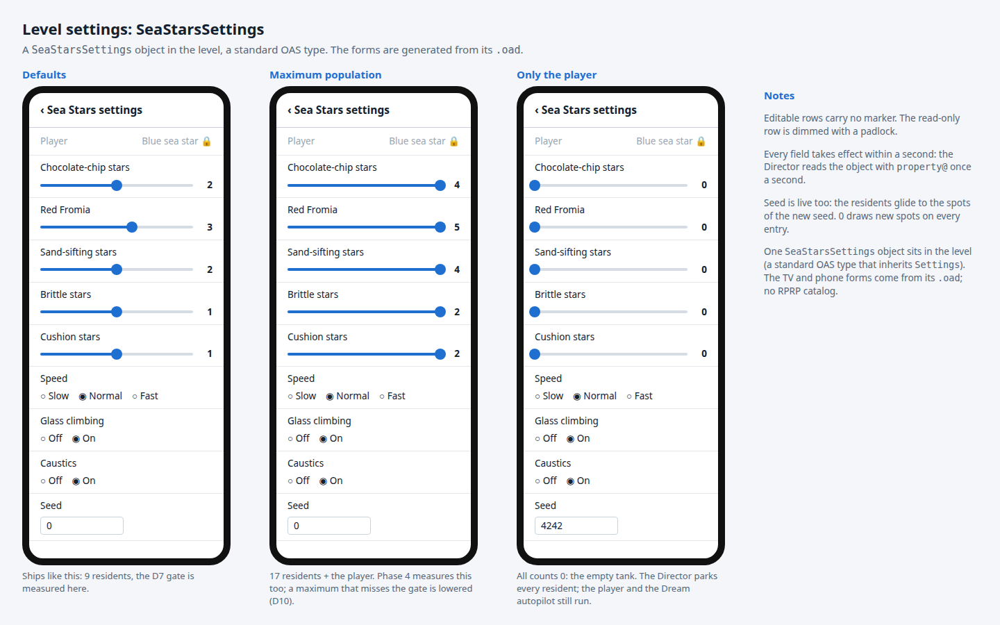
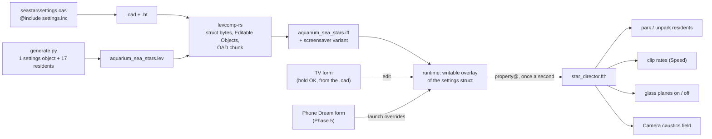
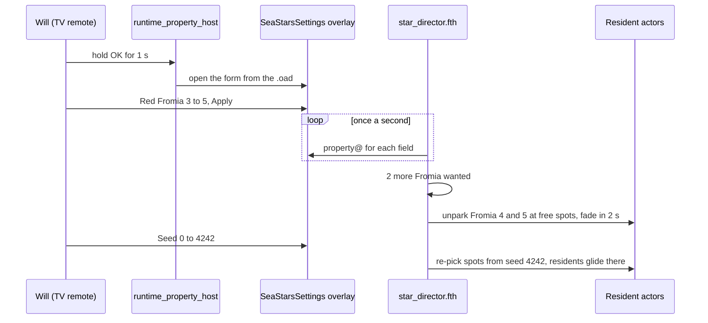
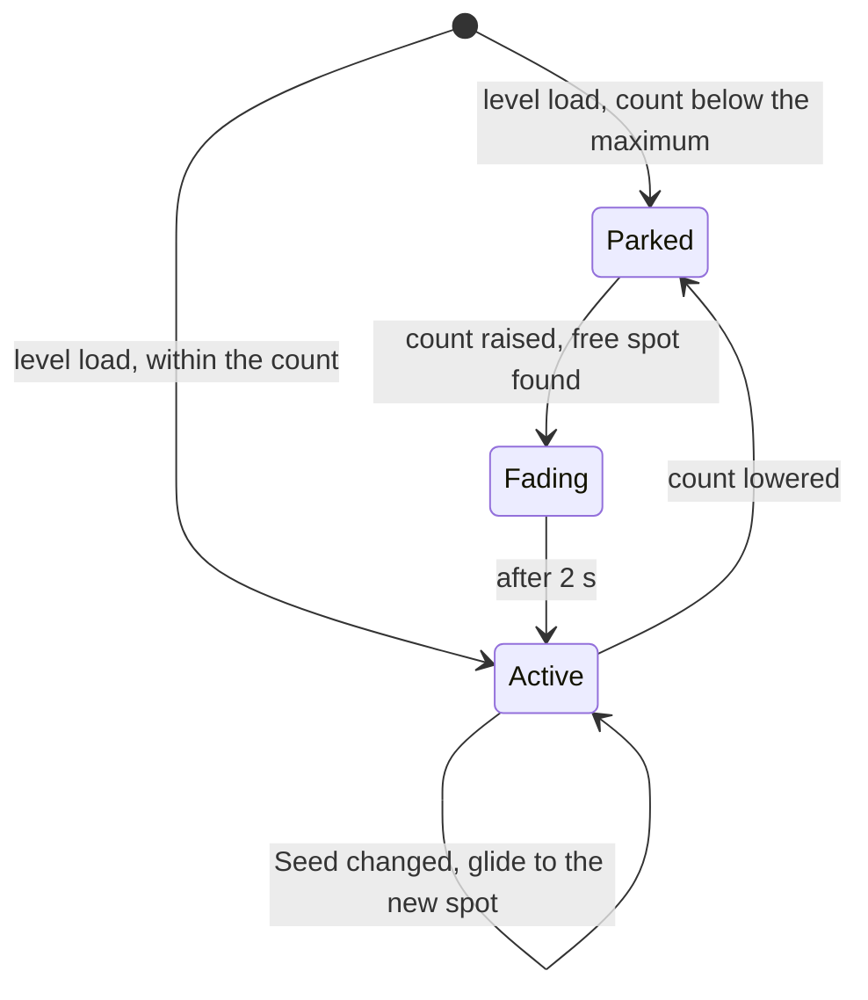
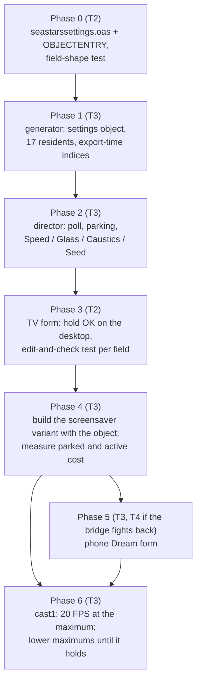

# Sea Stars settings: the `SeaStarsSettings` object, parking and the phone's Dream form

**Status: Phases 0‑3 are built and verified on the desktop, 2026‑​11‑​20; Phases 4 (rebuild the Dream variant and bundles), 5 (the phone's Dream form) and 6 (the cast1 gate) are done as well, all pushed to `2026-new-level`. Phase 6: the default population holds 20.35 FPS steady (after parked residents stopped being drawn, `4d001445`); the maximum population fails at 11.8 FPS (about 1 FPS and 3 ms per resident, four times the 0.7 ms assumed in S3). 2026‑11‑20 decision: keep the maximums and gate the default only; making a resident cheaper is a TODO. See the [acceptance README](../diagnostics/sea-stars-cast1-acceptance-2026-11-20/README.md).** This is the deferred decision **D11** of the [Sea Stars plan](2026-11-10-starfish-tank.md#level-settings) (Will, 2026‑​11‑​20: "let's do D11 later", then "accepting all recommendations. implement"). The type, the 17-resident level, the settings-driven director and the tests are in `53d7c718` and `01a1da62`. The nine fields, their ranges and the 17-resident maximum are exactly D9 and D10; nothing about them was reopened.

## Context

The first release behaves as the original plan said it would. Will tried to hold OK on cast2 and no form appeared ("holding ok button down doesn't bring up settings"); that is correct for the shipped level. The hold gesture only opens a form for an actor that `registry_->editableObjects()` lists (`engine/runtime_property_host.cpp`, `Host::openOwner`), and the OK button is **Reach** in this level (D8).

### What exists today

Everything this plan needs is already in the tree, because the Planted Tank and the Jellyfish tank already ship the same pattern:

- **A settings holder type.** [`plantedtanksettings.oas`](../../wfsource/source/oas/plantedtanksettings.oas) does `@include settings.inc` and declares fields as `SHOW_AS_…|SHOW_AS_LIVE`. A field marked live is one the engine re-reads after the level loads; `levcomp` lists the object as editable because it has such fields. [`jellyfishsettings.oas`](../../wfsource/source/oas/jellyfishsettings.oas) is the second example.
- **The level places one instance.** `wflevels/aquarium_tanks/generate.py` (around line 401) creates an object whose `wf_schema_path` is the type's `.oad`, with no model and no mass, then asks the `catalog` tool for each field's index (`settings_fields`).
- **The Forth reads it with `property@`.** `property@ ( actor field -- value valid )` reads the writable overlay (`planted_cycle.fth`, `jelly_motion.fth`). A value above 32767 uses `property-int-bytes@` instead, which is how the Planted tank reads *Hold seconds* and how Sea Stars must read *Seed* (up to 2147483647).
- **The TV form is generated from the `.oad`.** Nothing on the TV side is hand-built per tank.
- **The Dream's phone form is half generic and half Planted-only.** The generic half: `scripts/gen-settings-capabilities.py` turns an actor's `.oad` into a capabilities asset (field indices, types, ranges), and `PlantedSettingsProvider.java` reads that asset. The Planted-only half: `PlantedSettings.java` keeps the choices in a `planted` preferences file, and `dream_host.cc` hands them to the engine with `plantedBridge.startFirstTank(launchOverrideSink)`, which applies them when the level registry loads. Sea Stars has no equivalent, and **copying the Planted-only half would add a second one-off** (Will, 2026‑​11‑​20: "sounds like something too specific, something that we don't want at all"). Phase 5 therefore reuses the generic half and generalises the rest, or stops.

### What the level looks like today

10 animated actors: the player and 9 residents (`config.RESIDENTS`: two chocolate-chip stars, three *Fromia*, two sand-sifting stars, one brittle star, one cushion star). The controller and director are `sea_star_player.fth` and `star_director.fth`; the director's per-resident tables are composed by `controller.py`.

## Decisions for Will

Only one decision is new. The rest were made in the Sea Stars plan and are restated so a reviewer need not chase them.

| # | Decision | Recommendation | Alternatives |
|---|---|---|---|
| S1 | **Is the phone's Dream form part of this item?** | **Yes, as the last phase, and shippable separately.** Phases 0-4 give the TV form and a fully working level; Phase 5 adds the phone form for the Dream **on a shared mechanism, never a Sea Stars clone of the Planted one**. If Phase 5 grows, Phases 0-4 still land. | Drop the phone form (Dream stays at the defaults), or make it a separate TODO item |
| S2 | The nine fields and their ranges | **As D9:** counts 0-4, 0-5, 0-4, 0-2, 0-2 (default 2, 3, 2, 1, 1); Speed (Slow, Normal, Fast = x10, x20, x40 real speed); Glass climbing (Off, On); Caustics (Off, On); Seed 0-2147483647 | Already decided |
| S3 | The maximum population (17 residents) and the frame gate at the maximum | **As D10:** the level holds all 17; the 20 FPS gate must hold at the maximum, and Phase 6 lowers the maximums until it does | Already decided |
| S4 | How extra residents are removed | **Park, don't destroy:** hidden, moved out of view, skipped by the director | Already decided (D11) |

**A risk S3 makes concrete.** The reef budgets 16 animated actors and records about 0.7 ms per added actor on cast1. At the maximum Sea Stars has 18 (the player plus 17), against the 10 it ships with. S3 already answers this: measure, then lower the maximums. Phase 4 measures first, and only then does Phase 6 spend a cast1 run.

## Design

[](2026-11-20-sea-stars-settings/settings.html)

The mockup is the form the TV and phone both build from the type's `.oad`. It already shows the three states that matter: the defaults, the maximum population, and every count at 0 (the empty tank, which still has the player and the autopilot).

### Pieces

1. **`seastarssettings.oas`** and its `OBJECTENTRY`, so the `.mas` rules generate the `.oad` and `.ht`. Nine fields, each `SHOW_AS_…|SHOW_AS_LIVE`. *Seed* uses the INT32 range capped at 2^31-1.
2. **`generate.py` places one `SeaStarsSettings` object** and **17 residents**, and writes the settings actor's index and the nine field indices into the director script at export time. Nothing scans for the type at runtime.
3. **`star_director.fth` polls once a second** with `property@` (and `property-int-bytes@` for Seed) and acts on what changed.
4. **Parking.** The director keeps a parked flag per resident. A parked resident is hidden, moved off the tank and skipped in the update loop. A count that goes up unparks one at a free spot from the seeded list and fades it in over 2 s.
5. **The live effects.** *Speed* scales the clip rates; *Glass climbing* switches the glass planes on and off (a star on the glass climbs down first); *Caustics* writes the `Camera` caustics field; *Seed* re-picks resident spots and the residents glide to them.
6. **The Dream variant keeps the object.** `scripts/build-aquarium-screensaver-levels.py` already builds `aquarium_sea_stars_screensaver`; it must carry the settings object, its Editable Objects entry and its `OAD ` chunk, and it must still contain no `RPRP` chunk.
7. **The phone's Dream form** (Phase 5): generate a capabilities asset from `seastarssettings.oad` with the existing `gen-settings-capabilities.py`, and serve it through a **shared** level-settings provider, preferences and override path, not a Sea Stars copy of the Planted ones. If that means generalising `PlantedSettingsProvider`/`plantedBridge` into one mechanism the Planted tank also uses, that is the work; it must leave the Planted tank behaving exactly as today.







## Phases

Rank follows the delegation table: the director work is multi-file against a settled design (T3); the phone form has one real unknown and is the only place a T4 escalation is plausible.



- **Phase 0, the type** (T2). `wfsource/source/oas/seastarssettings.oas` modelled on `plantedtanksettings.oas`, registered as an `OBJECTENTRY`. `tests/test_sea_stars_settings.py` checks the nine fields' names, ranges, defaults and that each carries `SHOW_AS_LIVE`.
- **Phase 1, the generator** (T3). Place the settings object as `generate.py` places `PlantedTankSettings`; place 17 residents (the 9 shipped keep their positions and names); write the indices into the director. `report_budget.py` reports the new animated-actor count. The default population must still look and behave exactly as shipped.
- **Phase 2, the director** (T3). The once-a-second poll, parking and unparking, Speed, Glass climbing, Caustics and Seed. **Parked residents must cost nothing**: if a hidden actor still pays for its deform or its draw, parking skips both. That is a Forth-side change, not an engine one. Phase 4 measures it.
- **Phase 3, the TV form** (T2). Prove on the desktop that holding OK opens the form built from the `.oad`, and write an edit-and-check test for **every** field (the project rule for live fields): set the field, step the director, assert the effect.
- **Phase 4, the Dream variant and the cost** (T3). Rebuild `aquarium_sea_stars_screensaver` and assert it carries the object, its Editable Objects entry and its `OAD ` chunk, with no `RPRP`. Measure a parked actor against an active one on the desktop with `--frame-profile`.
- **Phase 5, the phone's Dream form** (T3, T4 if the generalisation reaches the engine). **Do not clone the Planted tank's bridge.** First read `planted_bridge.cc`, `PlantedSettings.java` and `PlantedSettingsProvider.java` and decide, with evidence, whether they can be made level-agnostic (the capabilities asset already is). If they can, generalise them and move the Planted tank onto the shared path in the same change, with its existing tests unchanged. If making them level-agnostic needs an engine-side change, **stop and report `ESCALATE:`** with what you found: that becomes its own decision for Will, because this plan otherwise needs no engine change.
- **Phase 6, the cast1 gate** (T3). 3 runs of 120 s at the default population and at the maximum, through the coordinator, with Sea Stars picked from the menu. If the maximum misses 20 FPS, lower the maximum counts (not the gate) and record the new maximums in this plan and the mockup.

Work happens in a sparse worktree branched from `2026-new-level`; the finish line is a push to `2026-new-level`, with no PR to master. A fresh sparse worktree needs four things before it can build or run anything: the engine built in the container (`scripts/build-wf-game-container.sh`), the menu bundle from `task aquarium-regenerate` (never the host-Blender `aquarium-level` route), an `android/local.properties` pointing at `/home/will/android-sdk-local`, and the extracted `engine/vendor/jolt-physics-5.5.0/` copied from the main checkout. The coordinator only stages APKs from `build/coordinator-artifacts/`.

## New and changed files

| Path | New / changed | What |
|---|---|---|
| `wfsource/source/oas/seastarssettings.oas` (+ generated `.oad`, `.ht`) | new | the settings type, nine live fields |
| `wflevels/aquarium_sea_stars/generate.py` | changed | place the settings object and 17 residents; export-time indices |
| `wflevels/aquarium_sea_stars/config.py`, `controller.py` | changed | resident table to 17, per-resident park state, director polling |
| `wflevels/aquarium_sea_stars/star_director.fth` | changed | poll, park, Speed, Glass, Caustics, Seed |
| `scripts/build-aquarium-screensaver-levels.py` | changed | keep the settings object in the Sea Stars variant |
| `android/screensaver/src/main/java/org/worldfoundry/screensaver/` | changed (Phase 5) | a Sea Stars preferences file and provider |
| `android/screensaver/src/main/cpp/dream_host.cc` | changed (Phase 5) | the override sink for the Sea Stars fields |
| `tests/test_sea_stars_settings.py` | new | the nine fields, `SHOW_AS_LIVE`, export-time indices, an edit-and-check test per field, park and unpark under count changes |
| `tests/test_aquarium_sea_stars.py` | changed | the 17-resident budget and the unchanged default |

## Out of scope

- Choosing the player's species (D9 shows it read-only).
- More resident species, an anime twin, feeding behaviour: all out of scope in the Sea Stars plan.
- Moving the five RPRP catalogs of the other tanks to this mechanism (the runtime object editing work, not this item).

## What building it found

Three things differ from what this plan assumed, and one measurement.

1. **Caustics needed a small C++ hook, not a Forth write.** Forth has only read words for properties (`property@`, `property-int-bytes@`), and the Camera reads its style once when it is built. `RenderCamera` now has `CausticStrength()` and `SetCausticStrength()` (the one engine-side addition, in `wfsource/source/gfx/camera.hp`), and the `SeaStarsSettings` class applies Caustics Off or On from `OnPropertiesChanged`, remembering the authored strength. The plan said no engine change; this is the smallest one that makes the field live.
2. **Mailboxes above 1900 are actor-local.** `GLOBAL_USER_MAX` is 1900, so a cell written above it is private to the one actor that wrote it. Every shared cell therefore lives below it: DFRM blocks 640‑1719 (60 cells for each of the 18 animated actors), then the director's tables from 1720, with the scalars ending at 1867. `controller.py` asserts this and a test checks that no two cells collide.
3. **Seed 0 needs a random value from outside Forth.** Forth has none, so the `SeaStarsSettings` class writes one per level entry into a shared cell (`kSeaStarsEntrySeedMailbox`, kept equal to the Forth cell by a test). A non‑zero Seed ignores it and gives the same spots every entry; each resident's offset is a function of the resolved seed, kept small enough to stay on open sand (or along a rock for Fromia), and a Seed edit makes residents glide, not jump.
4. **Parked residents cost nothing measurable on the desktop.** The level with 8 parked residents ran at 31.7 ms per stepped frame against 31.8 ms for the 9‑resident level of `f8d95b37` (ratio 0.998, 2 alternating runs of 30 frames, software rendering; `docs/diagnostics/sea-stars-settings-2026-11-20/parking-cost.json`). This is not a cast1 figure: step 8 still decides.

Also learned: **holding OK opens the settings form** (the level stops updating while it is open), and **Reach is the press of OK**, so a check that wants Reach must tap, not hold. Applying a form edit runs when the app's Back key does, which exists only inside the menu bundle, so applying an edit is covered by the zForth VM tests and on the device, not by the plain desktop run.


## Verification

1. The type exists and declares the nine fields with the D9 ranges and defaults, each `SHOW_AS_LIVE`.
    ```
    scripts/in-linux-container.sh python3 -m pytest tests/test_sea_stars_settings.py -v -k "fields or ranges or live"
    ```
2. The level builds in the Blender container and rebuilds byte for byte, with one settings actor and 17 residents.
    ```
    task aquarium-sea-stars-level && git status --porcelain wflevels/aquarium_sea_stars/
    python3 wflevels/aquarium_sea_stars/report_budget.py
    ```
3. Every field changes the level when edited: for each of the nine, set it, step the director, assert the effect. Counts go from all 0 to the maximum and back, parking and unparking each time.
    ```
    scripts/in-linux-container.sh python3 -m pytest tests/test_sea_stars_settings.py -v -k "edit or park"
    ```
4. Holding OK on the desktop opens the form built from the `.oad`, and Apply changes the tank.
    ```
    WF_CONTAINER_IMAGE=linux-test scripts/in-linux-container.sh timeout -s KILL 400 xvfb-run -a -s "-screen 0 1280x720x24" python3 scripts/check-sea-stars-settings.py form
    ```
5. The default population still behaves exactly as shipped (the existing desktop check passes unchanged).
    ```
    WF_CONTAINER_IMAGE=linux-test scripts/in-linux-container.sh xvfb-run -a -s "-screen 0 1280x720x24" python3 scripts/check-sea-stars.py --wf-game /build/wf-game/src/engine/wf_game
    ```
6. The screensaver variant carries the settings object, its Editable Objects entry and its `OAD ` chunk, and no `RPRP` chunk appears in either Sea Stars `.iff`.
    ```
    python3 scripts/build-aquarium-screensaver-levels.py aquarium_sea_stars && ! grep -a -q RPRP wflevels/aquarium_sea_stars-standalone.iff wflevels/aquarium_sea_stars_screensaver-standalone.iff
    ```
7. A parked resident costs nothing: the frame time with all counts at 0 equals the frame time of a level with no residents, within the noise of 3 runs.
    ```
    WF_CONTAINER_IMAGE=linux-test scripts/in-linux-container.sh timeout -s KILL 1500 xvfb-run -a -s "-screen 0 1280x720x24" python3 scripts/check-sea-stars-settings.py parking-cost --baseline-level /src/build-docker/sea-stars-baseline/aquarium_sea_stars-standalone.iff
    ```
8. On cast1, Sea Stars holds 20 FPS (median of 3 runs of 120 s) at the default population **and** at the maximum, or the maximums are lowered until it does and recorded.
    ```
    task chromecast:profile   # via the coordinator; menu row 11 of 11, as in the cast1 acceptance README
    ```
9. On cast1 and on the phone, a change made to a count during the Dream shows on the TV within 2 s, and the device's original Dream settings are restored afterwards (Phase 5).

Steps 4 and 7 are `scripts/check-sea-stars-settings.py form` and `parking-cost`. The baseline level for step 7 is `git show f8d95b37:wflevels/aquarium_sea_stars-standalone.iff`.

## Mockups

[Settings form](2026-11-20-sea-stars-settings/settings.html): the `SeaStarsSettings` form at the defaults, at the maximum population and with every count at 0. It is the mockup approved with the Sea Stars plan, copied here so this plan carries it.
