# Advent Calendar: December worlds

**Status: design proposal, 21 November 2026.** A World Foundry app and Android TV screensaver with a growing collection of interpretations of the same 24-day Advent calendar: **Victorian Christmas**, **Postmodern Play**, **Surreal Dream**, **Mondriaan**, **Van Gogh**, **Bruegel Winter**, **Neon Noir**, **O’Keeffe Desert**, **O’Keeffe Flowers**, **Bangkok**, **Paris**, **Ukraine**, **Barcelona**, **Tivissa**, **Thai Reef**, **Sea Stars**, **Coober Pedy**, **Cats**, **Gnomes**, **Reindeer**, **Christmas Trees**, **Just Presents**, **Snowflakes**, **Holly and Berries**, **Trains**, **Commodore Amiga**, **Super Nintendo**, **De Stijl**, **Bauhaus**, **Tropical Fish**, **Siamese Fighting Fish**, **Thai Vowels**, **Thai Consonants**, **Shangri-La**, **Cannabis**, **Xanadu**, **Lipstick Palms**, **Stripes**, **Ferns**, **Mushrooms**, **Old Books**, **Hamburgers and Ingredients**, **Cheeses**, **Chiles**, **Rainbows**, **Poinsettias**, **Wreaths**, **Nine Inch Nails**, **Hot Air Balloons**, **Dragons**, **Babylon 5**, **Crystals**, **Magic Rocks**, **Rare Earths**, **Nuclear Power Plant**, **Skiing**, **Dragonflies**, **Ant Farm Colony**, **Butterflies**, **Mathematics**, **24 Buildings**, **Faery Garden**, **Æon Flux**, **Catan**, **Lab Glassware**, **Crabs**, **Tartan**, **Candles**, **Fabric Bolts**, **Birds**, **Chocolates**, **Colors**, **Pac-Man**, **Airplanes**, **Camping**, **Glamping**, **Orange**, **Calla Lilies**, **Wizardry**, **Water**, **Cyberpunk**, **Max Headroom**, **Friends**, **Purses**, **Country Flags**, **Currencies**, **Trees** and **Neuromancer**. All run only in December, use the device's local civil date, and share calendar rules; Coober Pedy has its own opal surprises. This plan proposes no engine changes; explicit permission is required before modifying engine code.

## The experience

A wide, richly detailed scene fills the TV. Twenty-four numbered doors are part of its composition, arranged to suit the artwork but easy to find. Each day from 1 to 24 December unlocks its corresponding door; an opened door reveals a small festive vignette. The calendar remains available through 31 December so the completed scene can be enjoyed. The launcher offers a choice of the styles and a way to explore the calendar; the screensaver quietly brings the chosen world to life without needing input.

### Victorian Christmas

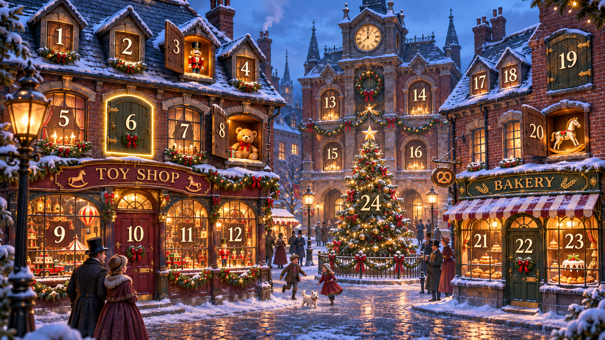

*Visual concept, not a runtime capture: the opening states and toy subjects are illustrative; the calendar rules below govern the final design.*

A magical Victorian town square at blue hour: snow on slate roofs, brick and stone shopfronts, gas lamps, an evergreen tree, wreaths and warm windows. A toy shop, bakery, stationer's, clockmaker and a small townhouse offer distinct places to discover doors. Think illustrated Christmas cards and theatrical miniature village, rendered as a convincing dimensional scene with depth, material and light. This is a visual era and mood, not a requirement to imitate paper, cardboard, hinges or a physical printed calendar. Doors may be tiny shop doors, shutters, windows, a carriage compartment or a cupboard, each recognizably marked with a legible number.

Restrained life makes it a screensaver: snow drifts slowly, lamps glow, smoke curls and a few figures move gently. Favor deep midnight blue, evergreen, oxblood, brass and pools of amber. Keep the whole scene readable from a comfortable TV viewing distance. No camera movement is needed to understand where the doors are; a very slow, limited drift may be tested, with a still option.

### Postmodern Play

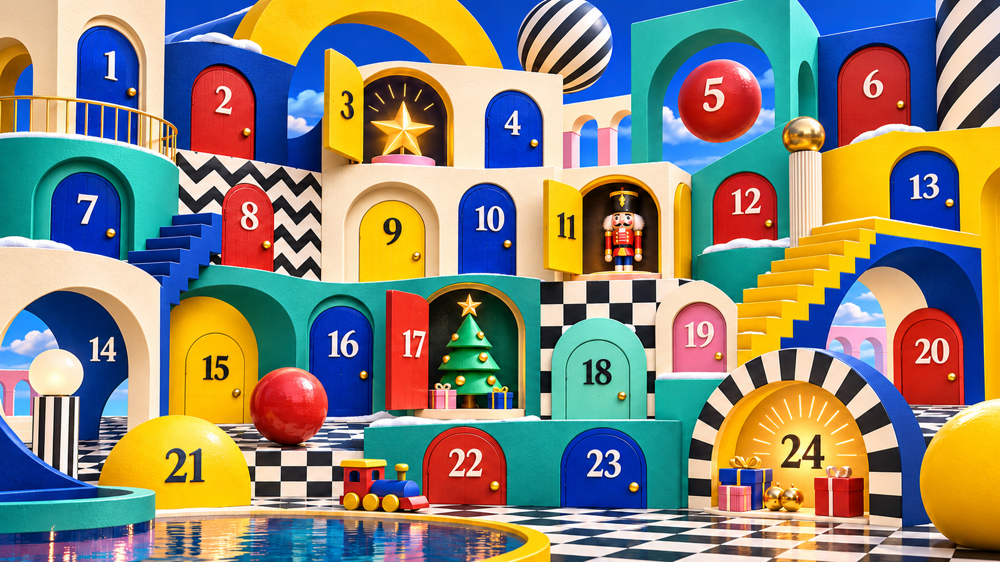

*Visual concept, not a runtime capture: the opening states and toy subjects are illustrative; the calendar rules below govern the final design.*

A jubilant abstract holiday city assembled from oversized arches, spheres, striped columns, zigzags, checkerboards and improbable stairs. Its doors are bold geometric openings with large, playful numbers; each opens onto the same day's recognizable subject reimagined in this visual language. Use saturated cobalt, tomato red, teal, warm ivory, sunny yellow and black-and-white pattern, with pink used sparingly, balanced against a quiet background. Compositions should feel designed and festive, not like a generic grid of UI tiles. Simple, slow rotations, bobbing shapes and traveling points of light bring it to life. Door labels remain high contrast and legible over patterns. This style is a distinct authored world, not just a palette swap.

### Surreal Dream

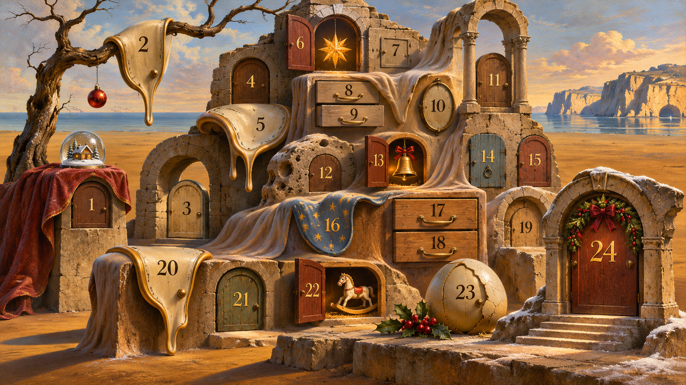

*Visual concept, not a runtime capture: the opening states and toy subjects are illustrative; the calendar rules below govern the final design.*

Inspired by the dreamlike atmosphere of Salvador Dalí’s *The Persistence of Memory*, this world places the calendar in a quiet, sunlit landscape of distant sea and cliffs, long shadows and improbable forms. Doors and drawers nestle into weathered stone, flowing drapery and softly melting shapes; each opens onto a tiny festive surprise interpreted through the same surreal lens. Keep the composition original rather than reproducing the painting. Slow, almost imperceptible movement and warm light make the scene suitable for a screensaver. The numbers and focus treatment remain clear despite the strange forms.

### Mondriaan

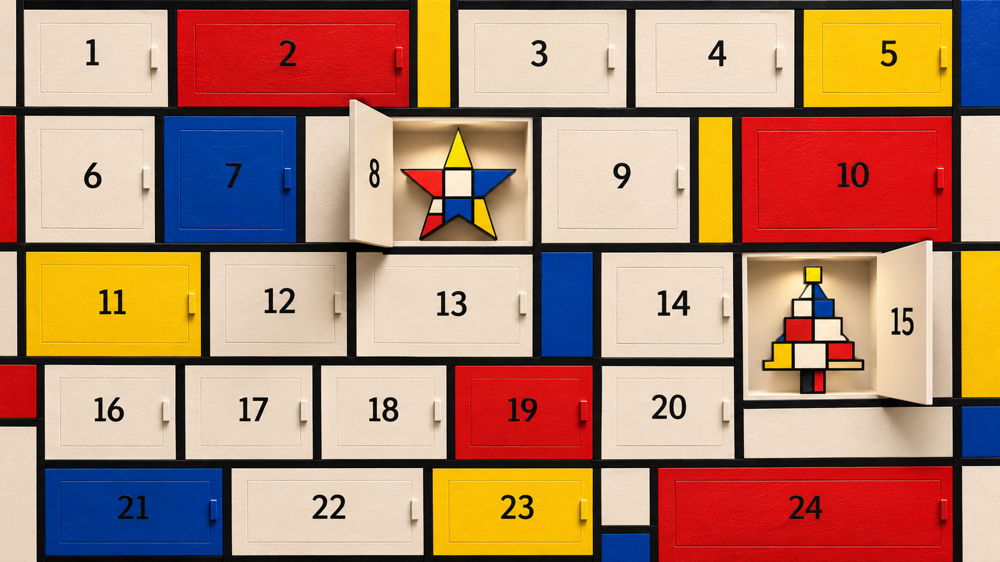

*Visual concept, not a runtime capture: the opening states and toy subjects are illustrative; the calendar rules below govern the final design.*

A De Stijl composition inspired by Piet Mondriaan: black horizontal and vertical lines divide warm white space into asymmetrical rectangles, punctuated by red, yellow and blue. Twenty-four doors are integrated into the composition, with restrained depth and legible, high-contrast numerals. Behind them, festive subjects become small compositions in the same geometric vocabulary. Door movements and lighting are calm and precise, and the image remains an artwork when the calendar is idle. The final layout should retain generous white space and asymmetry; the concept is a starting point rather than a prescribed regular grid.

### Van Gogh

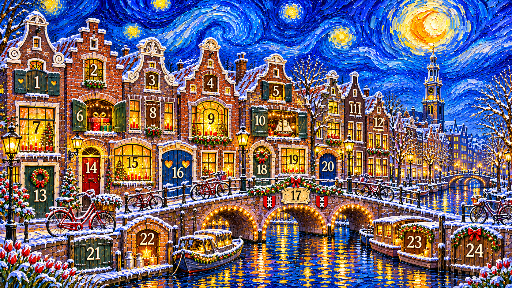

An Amsterdam winter canal scene with tall narrow gabled houses, brick facades, arched bridges, bare trees, bicycles and moored boats. Swirling cobalt skies, vigorous impasto, luminous stars and golden windows give the scene its Van Gogh-inspired character. Gentle light and brushstroke motion give the painting life. Numbered openings belong to the houses and landscape; the final design must give each day one legible, unique number.

### Bruegel Winter

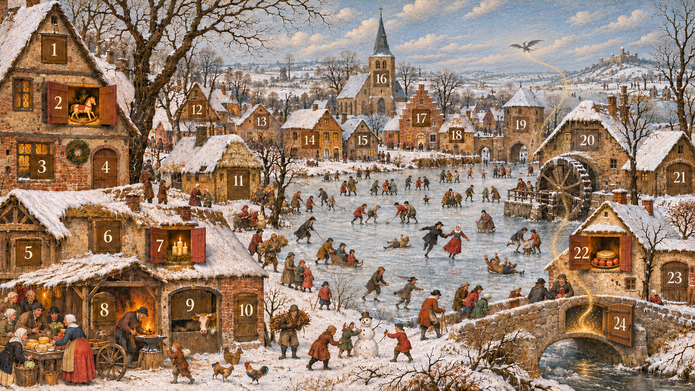

Inspired by Pieter Bruegel the Elder’s winter scenes, a broad Flemish village surrounds a frozen river full of tiny skaters and everyday life. Snowy roofs, bare trees, a mill and warmly lit interiors frame many small stories. On day 24, opening the door reveals a distant dragon gliding across the sky, small against the landscape, with a neutral to slightly menacing bearing. It is hidden until day 24 is eligible and revealed; after the reveal it remains visible in the completed scene. Animate the dragon, skaters and villagers slowly while keeping each door discoverable. The dragon replaces the shared day 24 tree for this style.

### Neon Noir

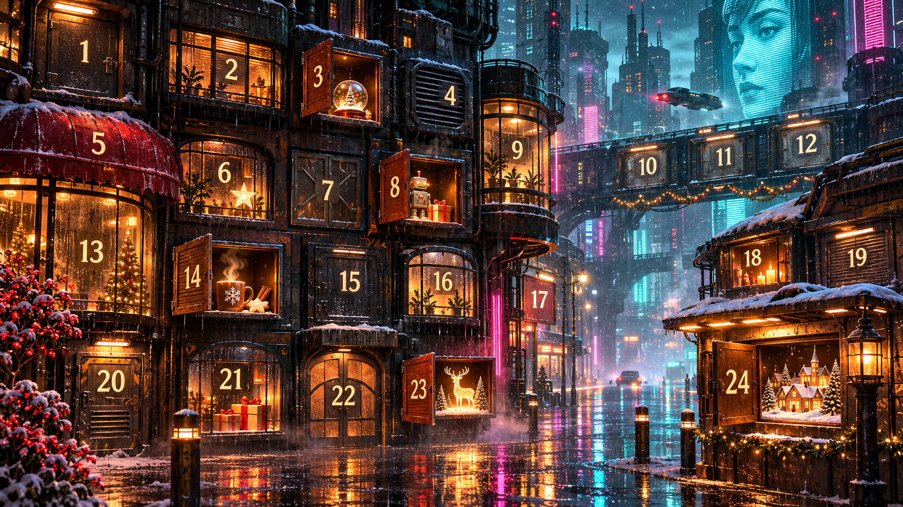

A Blade Runner-inspired retrofuturist city at night: layered shopfronts, rain, winter mist, amber windows and cyan neon reflected in the street. Festive light and small surprises bring warmth to the scene. Use an original city and artwork; make every number readable against dark facades.

### O’Keeffe Desert

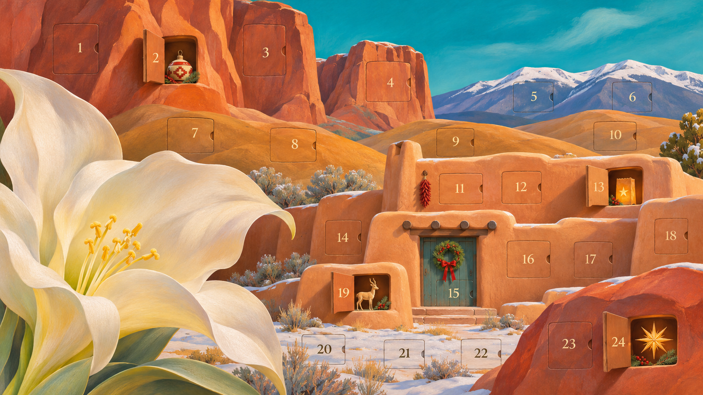

A spacious New Mexico winter landscape inspired by Georgia O’Keeffe: monumental organic forms, a large white flower, adobe, clear desert light and snowy mountains. Doors nestle into the rock and architecture. Preserve the strong silhouette, quiet space and luminous colors as subtle light moves through the scene.

These four images are visual concepts, not runtime captures: sample open doors, numbers and contents are illustrative. The final scenes must each have all 24 unique, reachable doors and follow the calendar rules below.

### O’Keeffe Flowers

A second O’Keeffe-inspired scene fills the frame with monumental overlapping flowers, flowing petals and luminous colors. Small calendar doors sit among the petals; preserve clarity without losing the spacious, sensual botanical composition.

### Bangkok

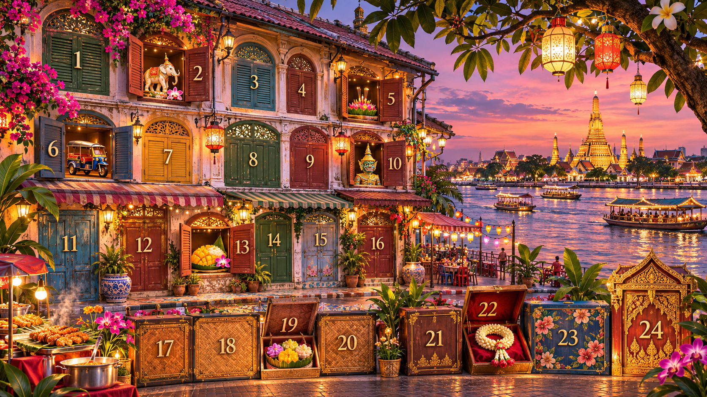

A warm Chao Phraya riverside evening with shophouses, boats, tropical plants, food and lights.

### Paris

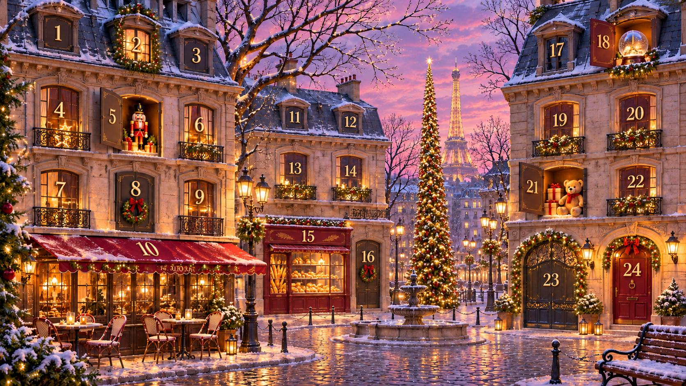

A wintry Paris street with balconies, cafés, glowing windows and festive lights. A tall, slender Christmas tree rises in the square, with the Eiffel Tower still visible beyond it.

### Ukraine

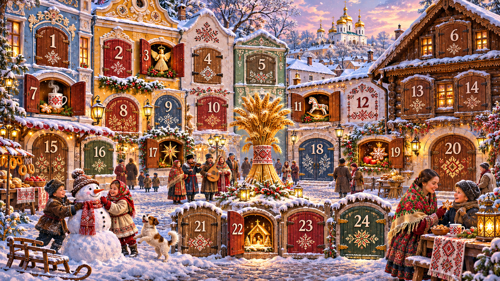

A peaceful winter town with traditional architecture, warm windows and festive details, including a didukh.

### Barcelona

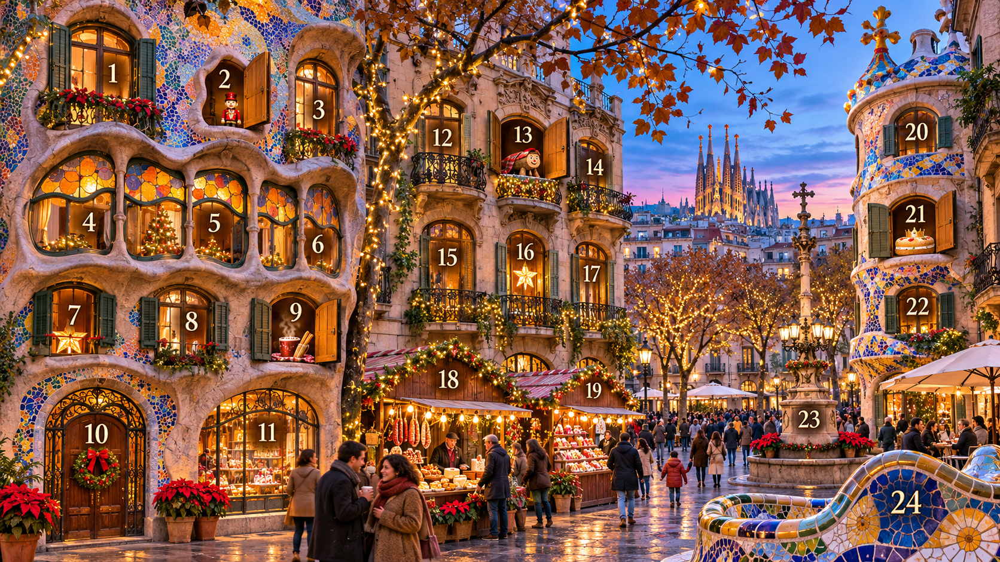

A lively Catalan square with modernista forms, mosaic, balconies and a Christmas market.

### Tivissa

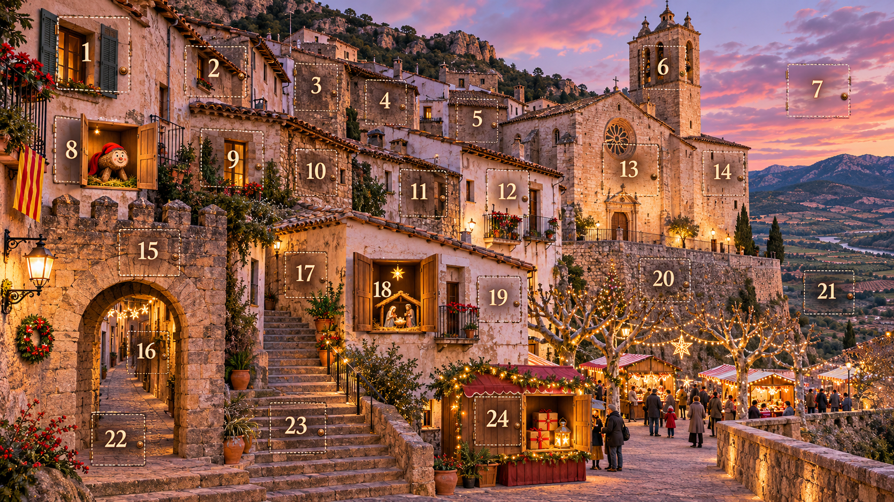

A Mediterranean winter in Tivissa’s hilltop old town, with winding streets, a fortified gateway and Sant Jaume near Plaça de la Baranova. The [town council](https://www.tivissa.cat/municipi-2/informacio/presentacio/) describes its position above the Ebre valley and the church at the town’s edge; [local tourism](https://www.turismeriberaebre.org/que-fer/patrimoni-cultural/visites-guiades-culturals/ruta-pel-nucli-antic-de-tivissa/) describes the old streets and Portal d’Avall. The image is an imaginative composite, not an accurate survey; check photographs before modeling its landmarks.

### Thai Reef

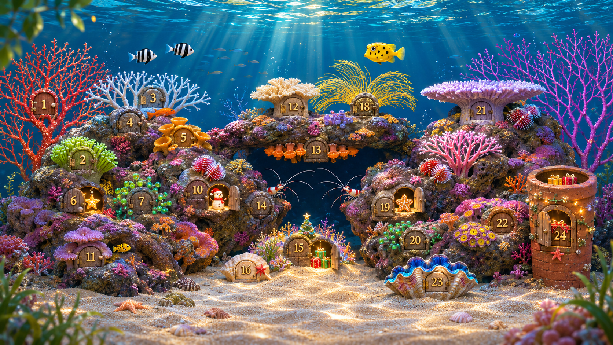

Use the [Gulf of Thailand tank layout](2026-11-02-gulf-of-thailand-reef-tank/tank-wide.png): two rock masses and a central arch over sand, with the tank’s corals, boxfish, damselfish, shrimp and giant clam. Tiny doors sit among the reef rather than obscuring its inhabitants.

### Sea Stars

A calm sand flat with three rocks and ribbon seagrass, and the six animals in the [Sea Stars reference](2026-11-20-sea-stars-poster.md). Integrate doors without hiding their distinctive forms and movement.

### Coober Pedy: an opal every day

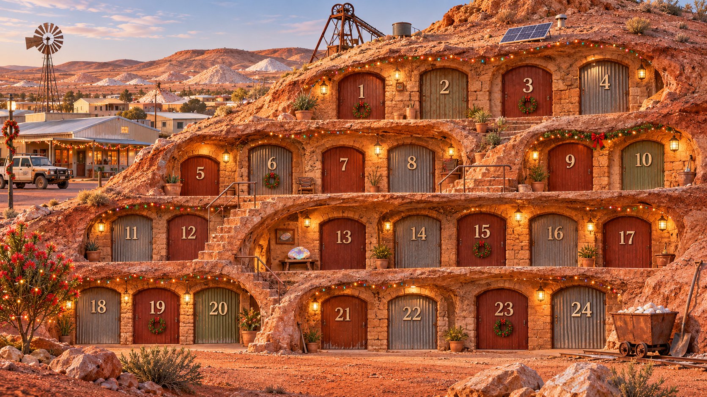

*All doors closed.*

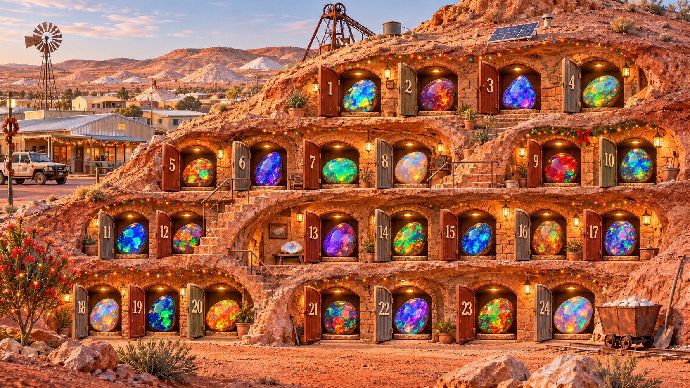

*All doors open: 24 different opals. This is a concept illustration, not a runtime capture.*

A summer Christmas in the South Australian opal town: a sunlit ochre desert, mining heaps and hillside dugouts, with warm lights and numbered doors in the earth. The [local visitor guide](https://www.cooberpedy.com/about-coober-pedy-2/) describes the mullock heaps and hillside dugout homes; the illustrations are an imaginative calendar, not a town survey. Each of the 24 doors reveals a different opal, with varied body color, shape and play-of-color; day 24 can be the most spectacular. This deliberately replaces the shared surprise list for this style. Show them all together in the completed calendar, with individual stones distinct at TV size. The local December gate and opening rules remain shared.

### Kanamara Matsuri: requested concept

A playful Advent calendar inspired by Kawasaki’s Kanamara Matsuri, featuring a Japanese festival procession, lanterns, stalls, phallic fertility imagery and 24 numbered doors. The [Japan National Tourism Organization](https://www.japan.travel/en/spot/362/) describes the festival at Kanayama Shrine and its phallus-shaped portable shrines. This is a festival-inspired fantasy for the December calendar, not a claim that the real festival occurs in December. The image generator rejected the requested concept under its sexual-content filter, so no mockup has been created.

### Tom of Finland-inspired concept

This style has its own document: [Advent calendar: Tom of Finland-inspired concept](2026-11-21-advent-tom-of-finland-concept.md). It is a clothed, non-explicit concept built in Blender, with all 24 numbers readable.

The generated visuals are art-direction concepts, not faithful architectural surveys or runtime captures. Their day numbers and examples must be corrected against the rules below.

## The 24 surprises

Use original assets with recorded provenance. Each reveal is a small, wordless, charming scene, interpreted separately in each style except Coober Pedy, where every day reveals an opal, and Bruegel Winter, where day 24 reveals a dragon. Keep the subject recognizable at TV size; the final art can refine the list without changing the dates.

| Day | Surprise | Day | Surprise | Day | Surprise |
|---|---|---|---|---|---|
| 1 | Candle | 9 | Drum | 17 | Gingerbread house |
| 2 | Robin | 10 | Bell | 18 | Lantern |
| 3 | Holly | 11 | Snowman | 19 | Skates |
| 4 | Rocking horse | 12 | Star | 20 | Wreath |
| 5 | Mitten | 13 | Train | 21 | Toy soldier |
| 6 | St Nicholas | 14 | Music box | 22 | Sleigh |
| 7 | Wrapped present | 15 | Squirrel | 23 | Angel |
| 8 | Candy cane | 16 | Stocking | 24 | Glowing Christmas tree |

The 24th is the visual finale: the tree and a gentle shared glow across the scene, or the style-specific opal or dragon for Coober Pedy and Bruegel Winter. From 25–31 December all doors are eligible and the finale remains visible; there are no invented doors 25–31. No religious text, narration or purchase flow is needed. Music or effects, if added, are optional and off by default; the unattended Dream is silent by default.

## Dates, interaction and persistence

- **Season:** local December 1 at 00:00 through December 31 at 23:59:59. At all other times the app does not start a calendar scene: its launcher shows a simple “Available in December” screen and exits on Back. If Android starts its selected Dream outside December, finish the Dream promptly; do not change the user's selected screensaver or promise that Android will select another one. Recheck date while running and on resume, timezone or system-time change. Leaving December stops the scene, including at January 1 midnight. A clock change into December allows a subsequent launch to run.
- **Eligibility:** in December a door numbered `n` is available when `n <= min(local day, 24)`; future doors cannot be opened. Past dates remain available, allowing catch-up. All 24 are available from December 24 through 31. Use local civil date rather than elapsed runtime or UTC; handle time-zone changes and clock corrections without waiting for restart.
- **App:** select a style, navigate the scene by remote, and press Select to open an eligible door. Focus is obvious and its number readable; future doors indicate they are not yet available without revealing their surprise. Revisit an opened door to see its vignette again; Back closes the vignette, then returns to the chooser. Use a defined directional focus graph, including sensible edges, so all doors are reachable without precision pointing. Also support keyboard equivalents on desktop.
- **Dream:** Android remote input wakes the Dream, so do not require it for the calendar. Automatically reveal all eligible doors in chronological order at a calm pace, then hold the completed-to-date scene before gently repeating individual reveals. Starting mid-December shows earlier days too. It must never reveal future dates; at midnight reconcile immediately and animate the newly eligible door. Each reveal is brief enough to appreciate, with the overall scene visible between reveals. An animation in progress is cancelled or reconciled safely on a date change. No user interaction is recorded merely because the Dream played it.
- **Saved state:** persist manually opened days keyed by local calendar year, shared between the styles, and persist the chosen Dream style separately. Changing style preserves opened days; automatic Dream reveals do not mark them opened. A new year starts clean. If the clock moves backward within a year, keep stored marks but hide and block any now-future door; they become visible again when eligible. Reinstall or cleared app data starts fresh; no account, network or cross-device sync is required. Use atomic updates and validate corrupted or missing preferences.
- **Settings:** a remote-accessible settings dialog offers Dream style (Victorian Christmas / Postmodern Play / Surreal Dream / Mondriaan / Van Gogh / Bruegel Winter / Neon Noir / O’Keeffe Desert / O’Keeffe Flowers / Bangkok / Paris / Ukraine / Barcelona / Tivissa / Thai Reef / Sea Stars / Coober Pedy), ambient motion (On / Still), optional sound (Off by default, only if implemented) and existing orientation choices, landscape by default. Save, Cancel and reset have the shared screensaver contract; changes apply on next launch unless live behavior is explicitly implemented. Test-clock controls belong only in a test build, never customer settings.

## Integration and feasibility

Follow the [multi-level chooser and screensaver HOWTO](../howto/combine-levels-chooser-and-screensaver-launch.md), checking its current implementation and concurrent package work before integration. Treat the styles as authored levels with stable IDs in one Advent package. Build L4-rooted standalone bundles, list each once in an Advent menu manifest, pack in manifest order with `shell-menu.fth`, and use that same manifest for the Dream bundle and `LevelCatalog`. Reuse `LevelLaunch` where applicable rather than copying catalog or launch code. Preserve bundle order and verify manifest/catalog/TOC agreement. A named one-run launch must validate the ID and not change the saved Dream choice. The HOWTO identifies coordinator named-level launch as unverified or unavailable; do not claim it works without current evidence.

The calendar needs the same date and door state in both launcher and Dream. First investigate existing wall-clock access, input, animation, scene state and Android persistence interfaces; prototype the bridge from host date and persisted opened-day state into the levels, and prove changes can be observed while running. Do not assume level elapsed time is a wall clock or that existing shared APIs already provide this bridge. If engine changes are necessary, document the exact proposal and obtain explicit permission before editing engine code; continue assets, host-side work and tests independently. The 3D Clocks package is for clocks; this is a separate Advent package, while reusing generic infrastructure and the shared [settings contract](2026-11-21-screensaver-app-and-remediation.md).

Define the actual entry points and secure settings access during integration. Ensure the December gate covers launcher, named launch, preview and actual Dream, not only a menu. A standalone Android Dream is subject to system selection and idle policy; installing an APK alone does not activate it. If a WebView is used for TV controls, support [Chromium/WebView 91](../reference/chromecast-webview-compatibility.md), including held and released direction input on cast2.

## Delivery and acceptance

1. **Prove the contract:** inventory existing APIs and in-progress integration, document actual IDs and build paths, and make a minimal test scene demonstrating local-date updates, persistence, eligible-door selection and Dream lifecycle. Resolve the engine permission question before engine edits.
2. **Create the worlds:** author all scenes and 24 distinct sets of reveal assets; establish geometry, texture and animation budgets from measurements on both target devices. Check composition, contrast, safe margins, door numbering and focus at 1080p and on a TV. Record asset provenance and make builds reproducible.
3. **Build the package:** wire manifest, standalone levels, menu, Dream, chooser, settings and year-scoped state. Verify all launch paths enforce the December gate and share the same rules. Follow the HOWTO's container build and test guidance and reconcile it with current repository tasks.
4. **Automated checks:** inject a deterministic local clock in tests. Cover November 30 → December 1, December 1, 23 → 24, 24 → 25, December 31 → January 1, a new year, startup outside December, midnight while running, timezone changes and forward/backward clock corrections. Assert no future reveals, catch-up, persisted manual openings, Dream playback not changing them, switching styles, corrupt preferences and all door focus paths. Exercise all entry points and settings Save/Cancel/reset.
5. **Device acceptance:** freeze a release APK locally, check coordinator queue and reservations, and test in owned sessions on cast1 and cast2. Capture all complete visual treatments and representative reveals, test remote focus and Back, all styles and settings persistence, and the actual Dream/preview lifecycle and December gate using a test build plus real-time sanity check. Test held and released direction input on cast2 if using a WebView. Profile sustained runs for frame rate, memory and thermal behavior, verify unattended silence and check wake/restart behavior. Keep coordinator evidence and report unsupported test paths rather than using direct device control.

Acceptance means all styles are attractive and legible, all 24 reveals are present in each, including 24 opals in Coober Pedy, the app and Dream honor local December boundaries and eligibility across clock changes, shared state behaves as specified, and the installed package works on both devices with documented evidence. This document is a design plan; none of these capabilities has yet been demonstrated for Advent Calendar.

### Cats

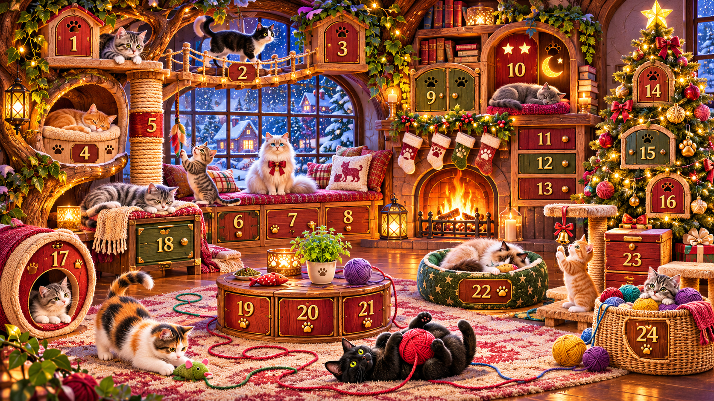

*Visual concept, not a runtime capture; the final calendar follows the shared rules and has 24 unique, reachable doors.*

A cozy Christmas cat house glows with firelight while snow falls outside. Cats of different colors and personalities nap in baskets, perch on shelves, explore tunnels and play among balls of yarn, catnip toys and a pot of catnip. Numbered doors and drawers are woven into cat furniture, cupboards and the room itself, with clear labels visible from across the room. Slow tail flicks, stretches, batting paws and a gently rolling ball of yarn bring the scene to life without distracting from the calendar. Each day's festive surprise can be interpreted with a playful feline touch.

### Gnomes

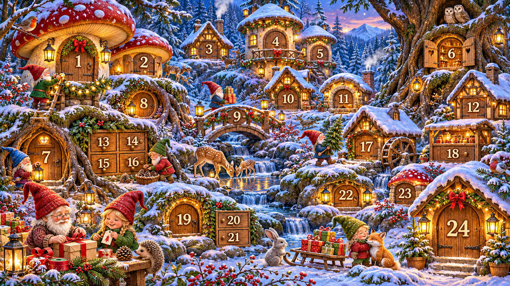

*Visual concept, not a runtime capture; the final calendar follows the shared rules and has 24 unique, reachable doors.*

In a snowy woodland village, gnomes in colorful pointed hats prepare for Christmas among mushroom cottages, tree-root homes and tiny timber workshops. Lanterns light bridges and paths, woodland animals visit, and small gifts wait to be wrapped. Numbered doors and drawers belong to the village and remain legible from across the room. Gentle snowfall, drifting chimney smoke, lantern light and gnomes going about their tasks give the scene a quiet life; each day's festive surprise takes on the village's handcrafted character.

### Reindeer

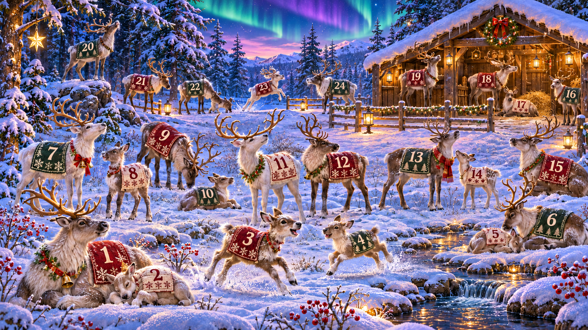

*Visual concept, not a runtime capture; the final calendar follows the shared rules and has 24 unique, reachable doors.*

A herd of individually distinctive reindeer gathers in a snowy woodland clearing beneath an aurora, with a warm stable, a stream and festive lanterns. Each reindeer carries its own clearly legible number on a patterned cloth; selecting an eligible reindeer reveals that day’s festive surprise. Keep the animals easy to distinguish and select from across the room. Gentle breathing, ear flicks, falling snow and slow aurora light bring the herd to life.

### Christmas Trees

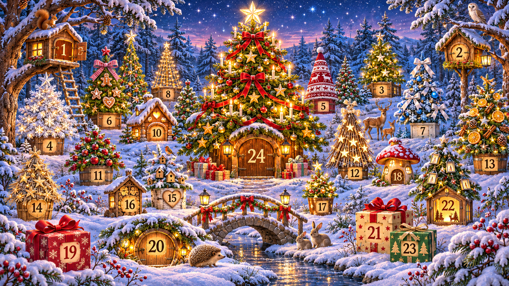

*Visual concept, not a runtime capture; the final calendar follows the shared rules and has 24 unique, reachable doors.*

A snowy forest clearing becomes a celebration of Christmas trees, from a magnificent central evergreen to small trees decorated with handmade ornaments, ribbons, stars and lights. Numbered openings nestle into tree stands, gifts and little woodland structures, with clear labels visible from across the room. Lights twinkle gently, ornaments sway and snow falls slowly; each day's festive surprise adds another detail to the woodland celebration.

### Just Presents

*Visual concept, not a runtime capture; the final calendar follows the shared rules and has 24 unique, reachable doors.*

Presents as far as the eye can see: towering stacks, tiny parcels and enormous boxes wrapped in exuberant colors, patterns, ribbons and bows. The numbered calendar openings are part of the gifts themselves, clearly visible amid the abundance. Ribbons flutter, bows bob and points of light shimmer gently; opening each eligible present reveals the day's festive surprise.

### Snowflakes

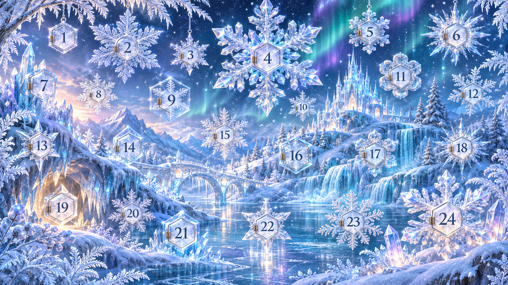

*Visual concept, not a runtime capture; the final calendar follows the shared rules and has 24 unique, reachable doors.*

A luminous winter landscape celebrates the intricate variety of snowflakes. Crystal forms hang at different depths above a frozen lake, surrounded by frosted branches, icy mountains and a soft aurora. Numbered openings sit within the crystalline forms, with enough contrast to remain legible across the room. Snowflakes drift and turn slowly while light glints across their facets; each day's festive surprise appears in a frosty interpretation.

### Holly and Berries

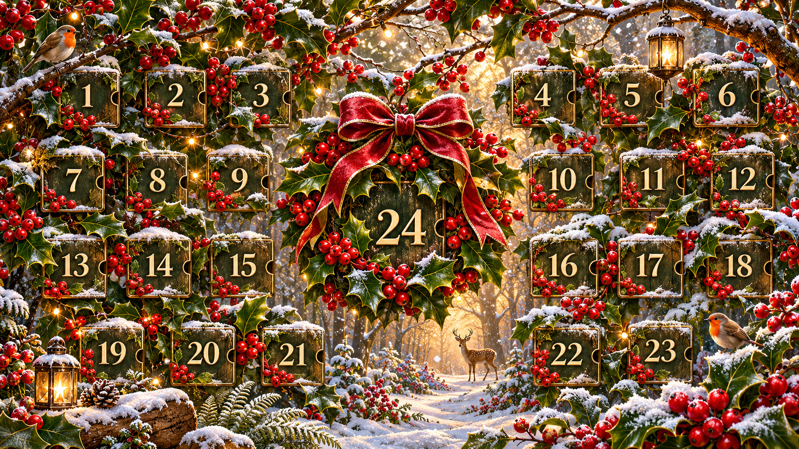

*Visual concept, not a runtime capture; the final calendar follows the shared rules and has 24 unique, reachable doors.*

Glossy evergreen holly leaves and bright red berries fill a festive woodland scene, woven into wreaths and garlands around glimpses of snowy trees and warm lantern light. Numbered openings nestle among the foliage, with clear contrast for viewing across the room. Snow drifts, leaves move gently and lights glimmer as each eligible opening reveals its festive surprise.

### Trains

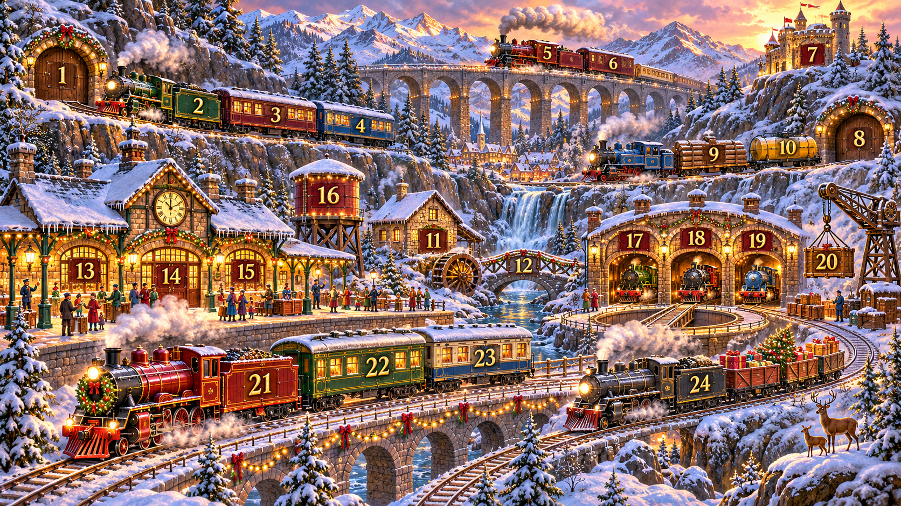

*Visual concept, not a runtime capture; the final calendar follows the shared rules and has 24 unique, reachable doors.*

Trains, trains and more trains wind through a snowy miniature mountain railway: colorful steam engines pull passenger coaches and freight wagons over bridges, through tunnels and past a warmly lit station and engine sheds. Numbered openings belong to the trains and railway buildings, remaining legible and selectable from across the room. Engines travel slowly, wheels turn, steam rises and signals glow; each day's festive surprise has its own railway character.

### Commodore Amiga

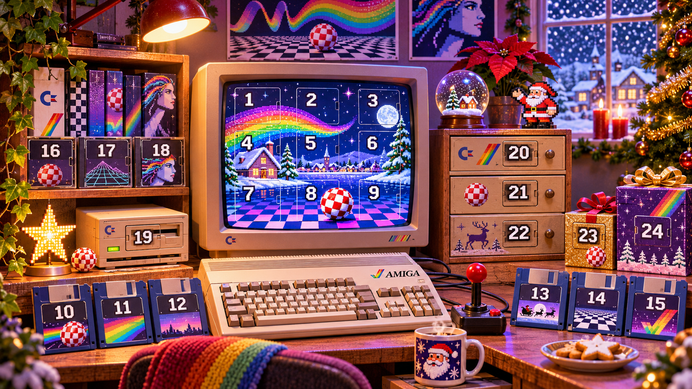

*Visual concept, not a runtime capture; the final calendar follows the shared rules and has 24 unique, reachable doors.*

A cozy late-1980s computer room celebrates the Amiga: a beige computer, CRT monitor, floppy disks and joystick sit amid festive lights. Colorful pixel art, rainbow gradients and a bouncing checkerboard ball evoke its creative and demoscene heritage. Numbered openings appear on disks, screen and desk; slow pixel animation and soft monitor glow keep the scene alive, with each day's surprise interpreted in a 16-bit style.

### Super Nintendo

*Visual concept, not a runtime capture; the final calendar follows the shared rules and has 24 unique, reachable doors.*

A festive early-1990s living room centers on a Super Nintendo, controller, cartridges and a CRT displaying a colorful snowy 16-bit game world. Numbered openings are woven into the screen, cartridges and room, with legible labels across the scene. Gentle pixel animation, twinkling lights and a warm fire bring it to life. The visual concept includes familiar game characters; the final design should use original artwork or appropriately licensed material.

### De Stijl

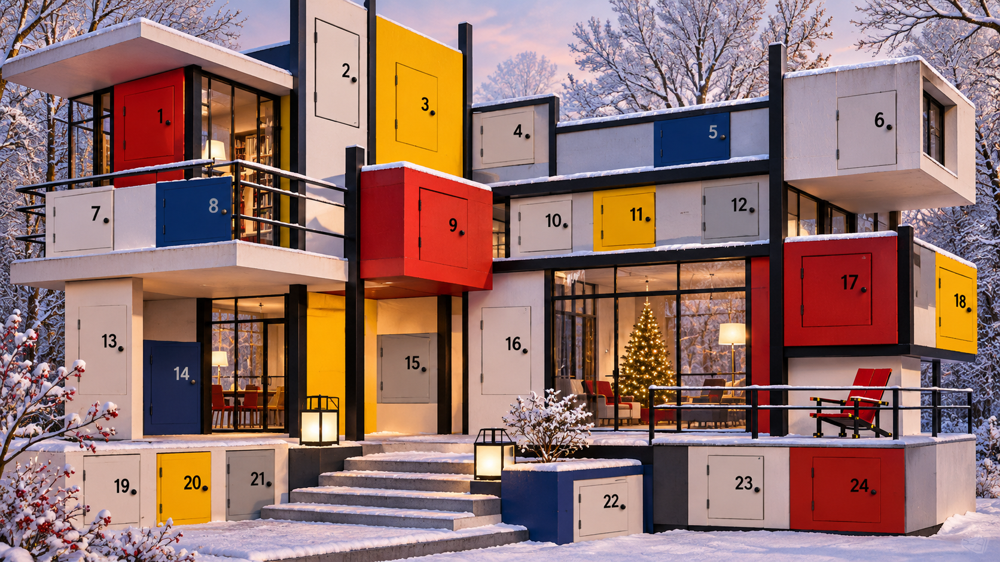

*Visual concept, not a runtime capture; the final calendar follows the shared rules and has 24 unique, reachable doors.*

A winter pavilion takes De Stijl into three dimensions: interlocking planes, projecting volumes and strong black lines frame red, yellow and blue against white and grey. Numbered openings become part of the architecture, arranged asymmetrically and legible from across the room. Warm interior light and restrained falling snow soften the precise geometry; each festive surprise is reimagined in the same visual vocabulary.

### Bauhaus

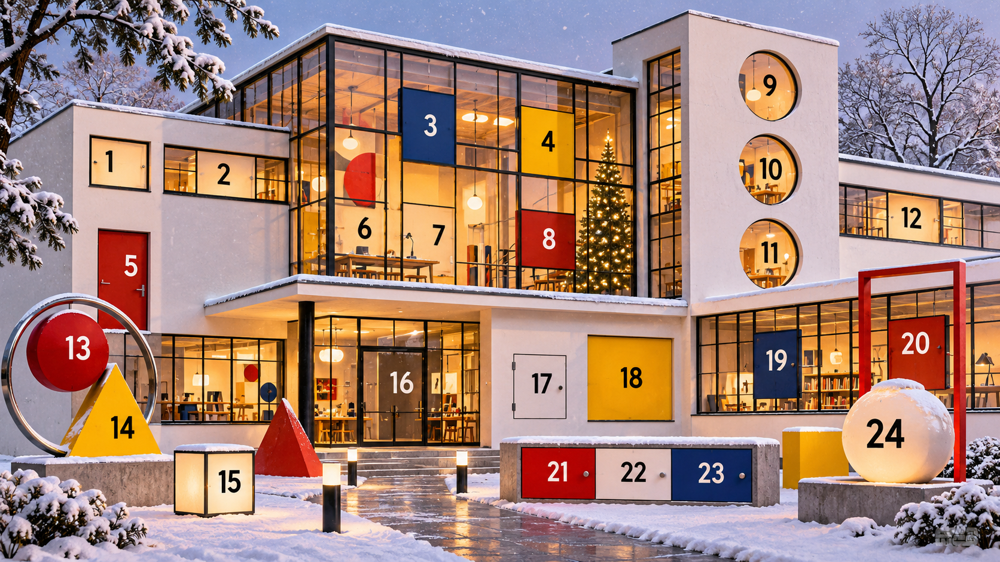

*Visual concept, not a runtime capture; the final calendar follows the shared rules and has 24 unique, reachable doors.*

A modernist workshop glows on a snowy evening, with glass curtain walls, flat roofs and asymmetrical white volumes. Circles, triangles, squares and tubular forms become playful festive ornaments in primary colors, black and white. Numbered openings are integrated into the architecture and geometric objects, with clear functional typography. Gentle snow and warm interior light animate the scene; each day's surprise is interpreted in the same geometric language.

### Tropical Fish

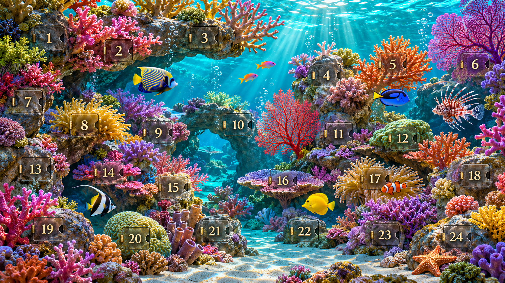

*Visual concept, not a runtime capture: the fish shown are illustrative. The final calendar follows the shared date rules and has 24 unique, reachable openings.*

A sunlit tropical reef of colorful coral, sea fans and anemones becomes home to a growing collection of fish. Each eligible day reveals one different tropical fish; revealed fish remain visible as the reef fills through December. Label each revealed fish with its common name, clearly associating the label with the fish and keeping it legible from across the room. Labels should follow or otherwise identify moving fish without obscuring other labels or calendar openings. Gentle swimming, shifting sunlight and bubbles make the reef a peaceful screensaver. Verify the proposed species and their names during detailed design.

Proposed daily fish and labels; verify identification against the final artwork.

| Day | Fish |
|---|---|
| 1 | Ocellaris clownfish |
| 2 | Blue tang |
| 3 | Yellow tang |
| 4 | Regal angelfish |
| 5 | Emperor angelfish |
| 6 | Copperband butterflyfish |
| 7 | Moorish idol |
| 8 | Mandarin dragonet |
| 9 | Royal gramma |
| 10 | Banggai cardinalfish |
| 11 | Pajama cardinalfish |
| 12 | Firefish |
| 13 | Flame angelfish |
| 14 | Coral beauty angelfish |
| 15 | Raccoon butterflyfish |
| 16 | Longnose butterflyfish |
| 17 | Purple tang |
| 18 | Powder blue tang |
| 19 | Orchid dottyback |
| 20 | Yellow watchman goby |
| 21 | Six-line wrasse |
| 22 | Green chromis |
| 23 | Blue-spotted jawfish |
| 24 | Volitans lionfish |

### Siamese Fighting Fish

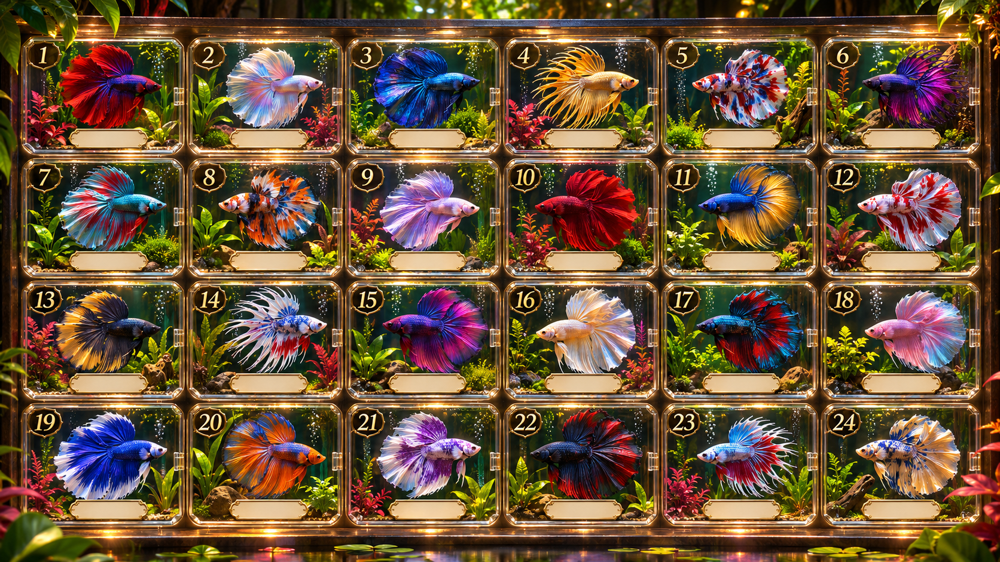

*Visual concept, not a runtime capture: fish and blank labels are illustrative. The final calendar follows the shared date rules and has 24 unique, reachable openings.*

A jewel-toned gallery of individually separated, planted aquatic habitats celebrates the flowing fins and diverse colors of Siamese fighting fish. Each eligible day reveals one distinct betta, which remains visible through December. Label each revealed fish clearly with its identifying variety or color and fin type, verified against its appearance; keep the label legible from across the room. Gentle fin movement, plants and light bring the gallery to life. The proposed daily labels below describe color and fin form; the final artwork should be checked against each label.

| Day | Fish label |
|---|---|
| 1 | Red halfmoon betta |
| 2 | White halfmoon betta |
| 3 | Royal blue halfmoon betta |
| 4 | Gold crowntail betta |
| 5 | Red, white and blue marble betta |
| 6 | Purple crowntail betta |
| 7 | Turquoise and red crowntail betta |
| 8 | Orange koi betta |
| 9 | Lavender halfmoon betta |
| 10 | Solid red betta |
| 11 | Blue and gold betta |
| 12 | Red and white marble betta |
| 13 | Black and gold betta |
| 14 | White, blue and red crowntail betta |
| 15 | Purple and magenta betta |
| 16 | Ivory halfmoon betta |
| 17 | Blue and red betta |
| 18 | Pink halfmoon betta |
| 19 | Blue and white betta |
| 20 | Orange and blue betta |
| 21 | Purple and white marble betta |
| 22 | Black and red betta |
| 23 | Blue, white and red crowntail betta |
| 24 | Gold and blue marble betta |

### Thai Vowels

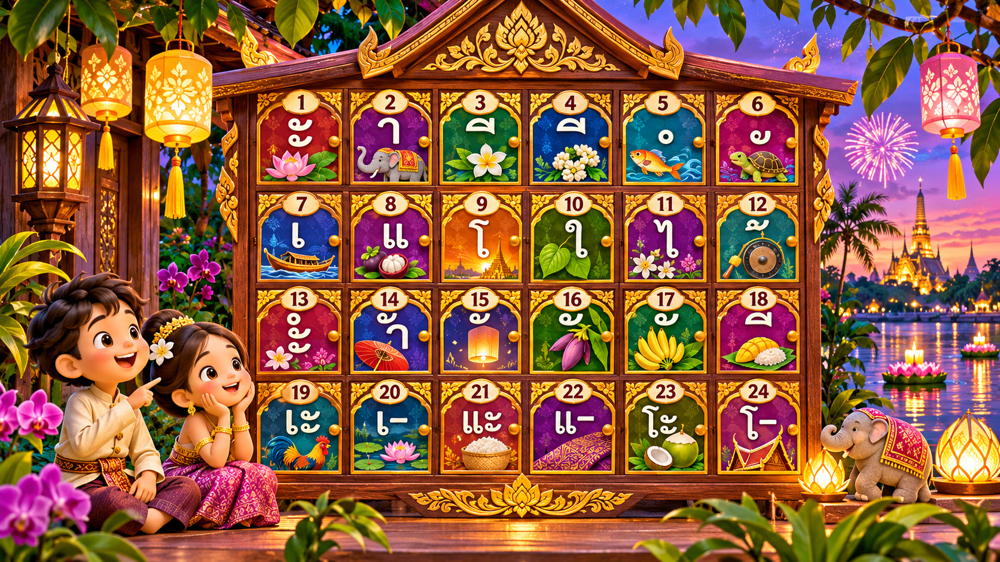

*Visual concept, not a runtime capture: the generated symbols and illustrations are decorative and must not be used as instructional text. The final calendar follows the shared rules and has 24 unique, reachable openings.*

A warm Thai-inspired evening setting of teak, lanterns and tropical plants frames a playful exploration of Thai vowel writing. Each eligible day introduces a vowel or vowel pattern with a large, legible Thai example, its pronunciation and an illustrated example word; show how the vowel is positioned relative to its consonant. A gentle animation and optional spoken example bring each reveal to life. The 24-day sequence, spellings, pronunciations and examples require review by a Thai language expert before use.

### Thai Consonants

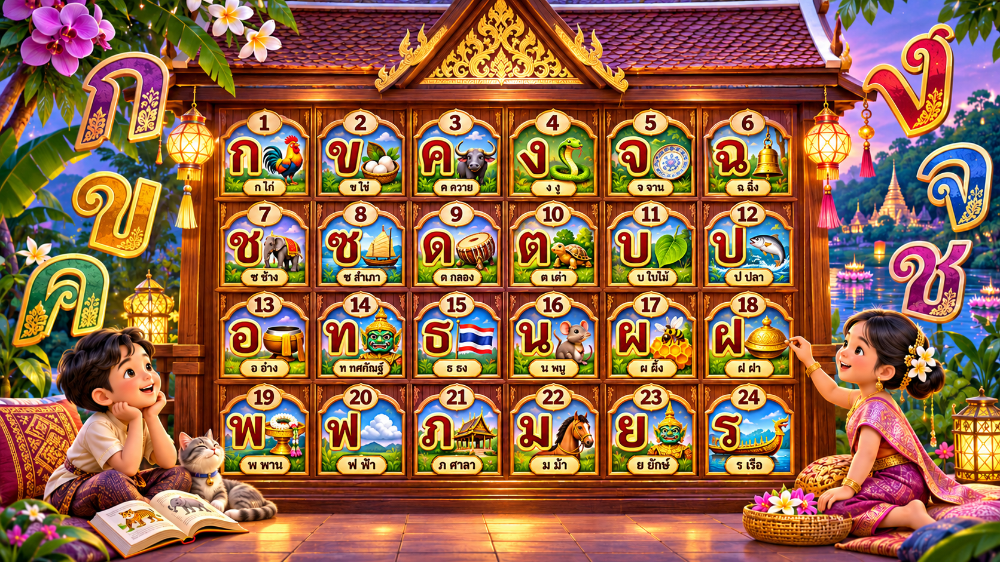

*Visual concept, not a runtime capture: generated letters and illustrations are decorative and must not be used as instructional text. The final calendar follows the shared rules and has 24 unique, reachable openings.*

A lantern-lit Thai pavilion and tropical garden frame an illustrated exploration of Thai consonants. Each eligible day introduces one or more consonants with large, legible letters, their conventional names, pronunciation and an illustrated example; an optional spoken example accompanies the reveal. Plan the 24 days deliberately so the intended coverage is clear. A Thai language expert should review the sequence, letters, names, pronunciations and illustrations before use.

### Shangri-La

*Visual concept, not a runtime capture; the final calendar follows the shared rules and has 24 unique, reachable doors.*

A peaceful imagined mountain valley lies beneath snowy peaks, with waterfalls, a tranquil lake, terraced gardens and a lantern-lit village. Numbered openings are integrated into the buildings, bridges and landscape, remaining legible from across the room. Mist drifts, water flows and lights glimmer as each eligible opening reveals a festive surprise.

### Cannabis

*Visual concept, not a runtime capture; the final calendar follows the shared rules and has 24 unique, reachable openings.*

A festive botanical conservatory celebrates cannabis foliage and flowers amid stained glass, botanical illustrations and warm lanterns. Emerald, gold and purple give the scene a rich, whimsical character. Numbered openings are part of cabinets and displays; soft light and gently moving leaves bring it to life.

### Xanadu

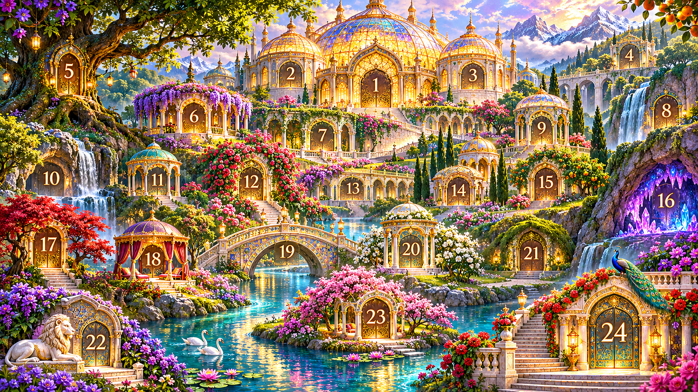

*Visual concept, not a runtime capture; the final calendar follows the shared rules and has 24 unique, reachable openings.*

An imagined pleasure dome rises above a winding river, lush gardens, ancient trees and luminous caverns. Twenty-four numbered openings belong to the architecture and landscape, with clear labels; flowing water and shifting light animate this opulent dream world.

### Lipstick Palms

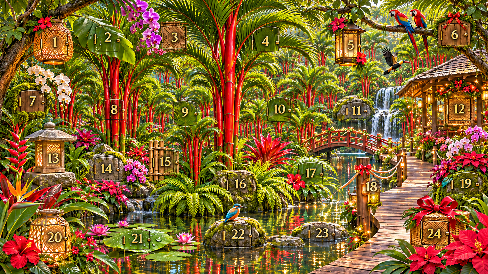

*Visual concept, not a runtime capture; the final calendar follows the shared rules and has 24 unique, reachable openings.*

An abundant grove of lipstick palms fills a lush tropical garden, with vivid red stems beneath arching green fronds. Reflective water, orchids, ferns and festive lanterns surround the numbered openings. Leaves sway, water ripples and light glimmers as daily surprises appear among the greenery.

### Stripes

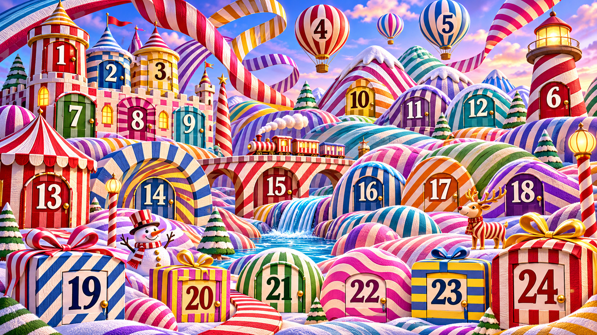

*Visual concept, not a runtime capture; the final calendar follows the shared rules and has 24 unique, reachable openings.*

A playful landscape built from stripes of different widths, directions and colors: striped hills, ribbons, arches and festive forms. Bold numbered openings stay clear against the patterns; ribbons and lights move gently.

### Ferns

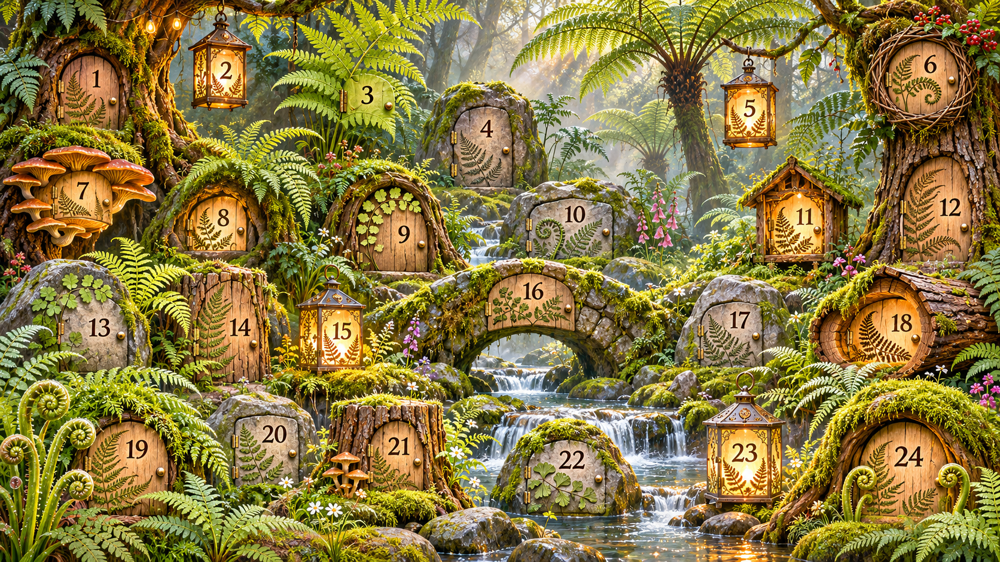

*Visual concept, not a runtime capture; the final calendar follows the shared rules and has 24 unique, reachable openings.*

A misty woodland overflows with fern fronds, tree ferns and curled fiddleheads, with moss, a stream and warm lanterns. Numbered openings nestle among the greenery as fronds sway gently.

### Mushrooms

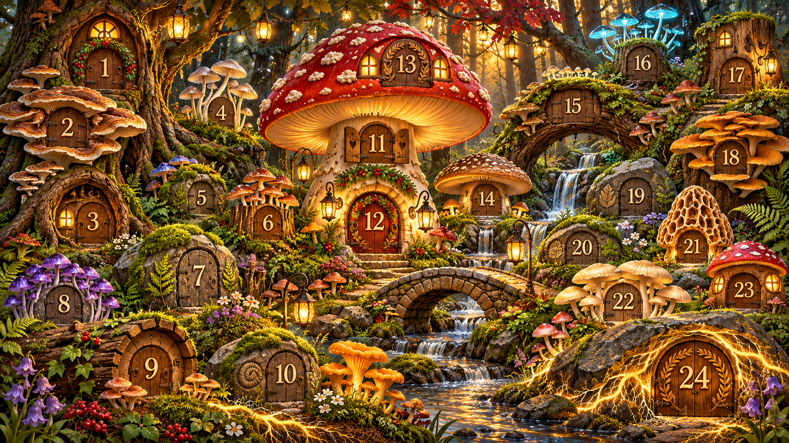

*Visual concept, not a runtime capture; the final calendar follows the shared rules and has 24 unique, reachable openings.*

A magical woodland celebrates mushrooms of many shapes and colors, from tiny fungi to towering caps and shelf mushrooms. Lanterns glow among moss, roots and numbered openings, with subtle light and woodland movement.

### Old Books

*Visual concept, not a runtime capture; the final calendar follows the shared rules and has 24 unique, reachable openings.*

A cozy old library overflows with leather-bound books, gilt covers, weathered pages and shelves reached by ladders. A fire and reading lamps glow as numbered openings in books and furniture reveal daily surprises; pages stir and light flickers gently.

### Hamburgers and Ingredients

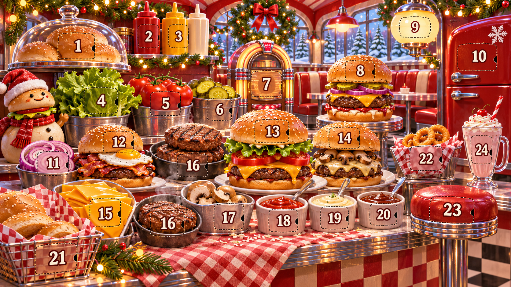

*Visual concept, not a runtime capture; the final calendar follows the shared rules and has 24 unique, reachable openings.*

A festive diner celebrates hamburgers and all their ingredients: buns, patties, lettuce, tomatoes, pickles, cheese, onions and sauces. Numbered openings are tucked among food and diner details, with playful daily surprises and gentle ambient movement.

### Cheeses

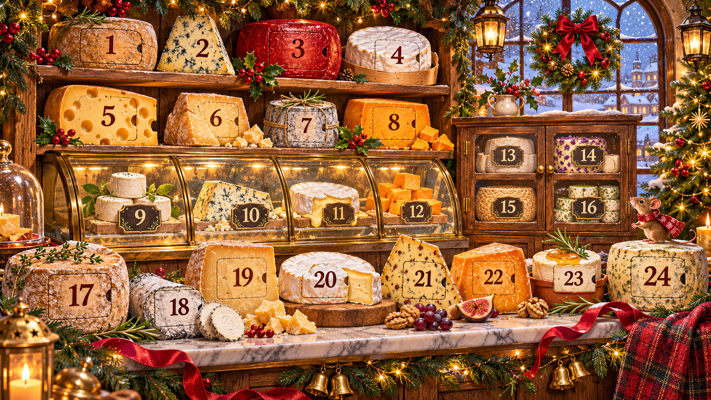

*Visual concept, not a runtime capture; the final calendar follows the shared rules and has 24 unique, reachable openings.*

A festive fromagerie overflows with cheese: wheels, wedges, soft rinds, blue veins, aged varieties and brightly colored cheeses fill shelves and counters. Numbered openings are woven into the display, with a different cheesy surprise each day. Warm lantern light and subtle movement make the scene inviting.

### Chiles

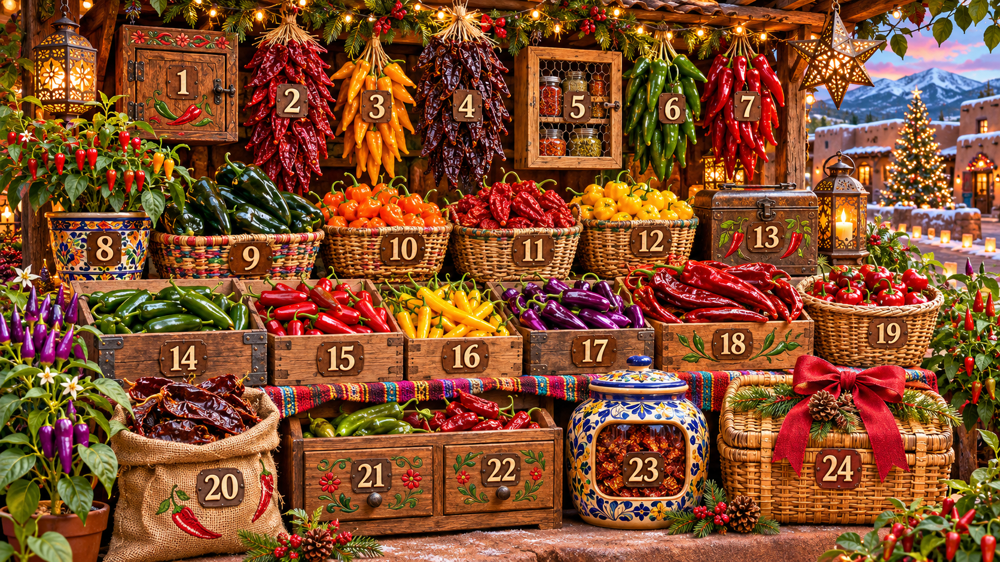

*Visual concept, not a runtime capture; the final calendar follows the shared rules and has 24 unique, reachable openings.*

A festive market overflows with chiles of many colors, shapes and sizes: glossy fresh peppers, dried ristras, baskets and living plants. Numbered openings sit among the crates and displays, revealing a different fiery surprise each day. Warm lantern light and gently moving leaves bring the market to life.

### Rainbows

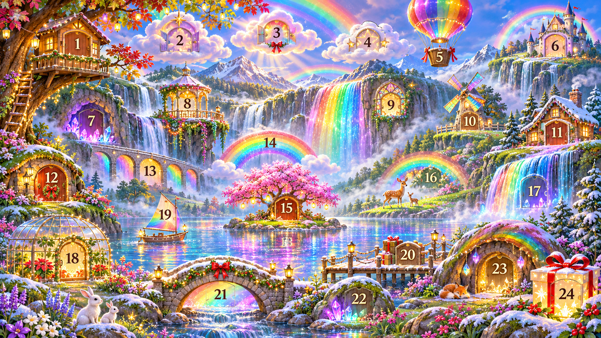

*Visual concept, not a runtime capture; the final calendar follows the shared rules and has 24 unique, reachable openings.*

Luminous rainbows arc through a magical landscape of waterfalls, clouds, mountains and a sparkling lake. Numbered openings nestle into the landscape and rainbow-lit structures, remaining clear against the colors. Shifting light, drifting mist and flowing water make the scene a tranquil celebration of color as daily surprises appear.

### Poinsettias

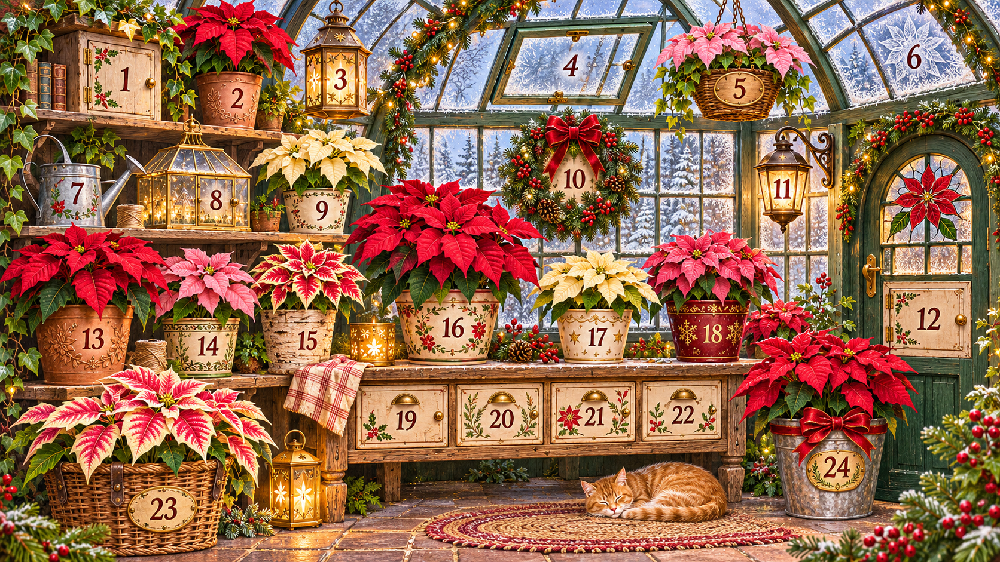

*Visual concept, not a runtime capture; the final calendar follows the shared rules and has 24 unique, reachable openings.*

A conservatory overflows with poinsettias in red, pink, cream and variegated colors. Lanterns glow among pots and foliage.

### Wreaths

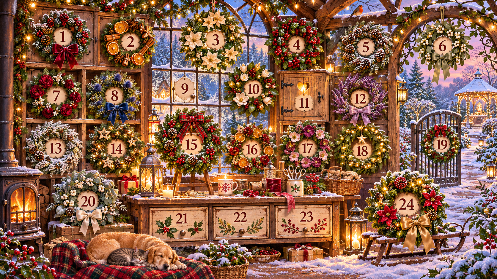

*Visual concept, not a runtime capture; the final calendar follows the shared rules and has 24 unique, reachable openings.*

A festive workshop celebrates wreaths of evergreen, berries, pinecones, ribbons, flowers and lights.

### Nine Inch Nails

*Visual concept, not a runtime capture; the final calendar follows the shared rules and has 24 unique, reachable openings.*

An original industrial rock-inspired world of rusted machinery, cables, distressed concrete, synthesizers and stark red and white light. Use original artwork and appropriately licensed audio.

### Hot Air Balloons

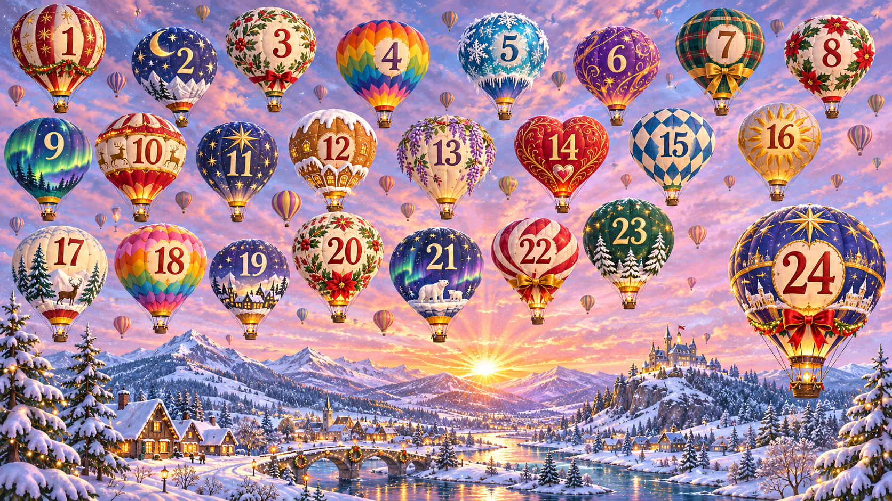

*Visual concept, not a runtime capture; the final calendar follows the shared rules and has 24 unique, reachable openings.*

At least 24 distinct hot air balloons fill a winter sky; each of 24 numbered balloons reveals a daily surprise. More balloons drift in the distance.

### Dragons

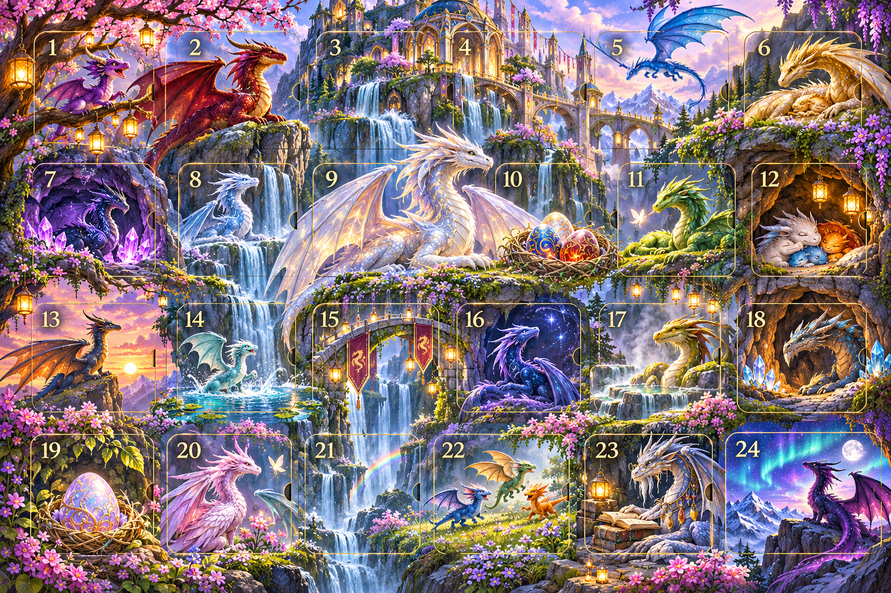

*Visual concept, not a runtime capture; the final calendar follows the shared rules and has 24 unique, reachable openings.*

A mountain sanctuary is home to dragons of many colors and personalities, with a few eggs in sheltered nests. Dragons fly, rest and explore as the calendar unfolds.

### Babylon 5

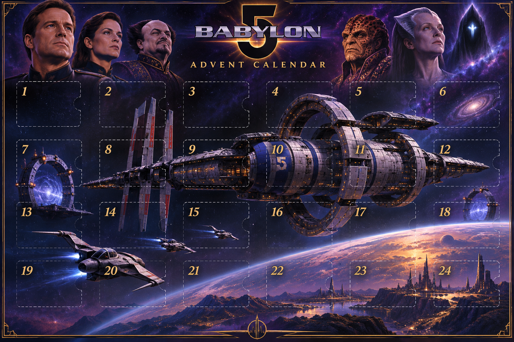

*Visual concept, not a runtime capture; the final calendar follows the shared rules and has 24 unique, reachable openings.*

A rotating space station and its surrounding ships frame a chronological retelling of the five-season story. Daily reveals follow the arc below, with spoilers; use licensed material for a released adaptation. The generated image is only a visual impression, not an accurate model reference.

**Proposed daily arc (spoilers):**

1. Sinclair and the station’s mission.
2. The ambassadors and fragile peace.
3. The mystery of Sinclair at the Battle of the Line.
4. The Shadows stir on Z’ha’dum.
5. The fall of President Santiago.
6. Sheridan takes command.
7. The Narn–Centauri conflict escalates.
8. The fall of Narn.
9. Delenn and the Rangers.
10. Kosh and the Vorlons.
11. Earth’s authoritarian turn.
12. Babylon 5 declares independence.
13. Sinclair becomes Valen.
14. The war against the Shadows.
15. Sheridan goes to Z’ha’dum.
16. Sheridan returns from death.
17. The First Ones depart.
18. The campaign to liberate Earth.
19. Clark falls and Earth is freed.
20. The Interstellar Alliance is founded.
21. The telepath crisis.
22. The Centauri crisis and Londo’s fate.
23. The Alliance endures.
24. Sheridan’s farewell and the station’s end.

Review episode-specific details and chronology against the series during detailed design.

### Crystals

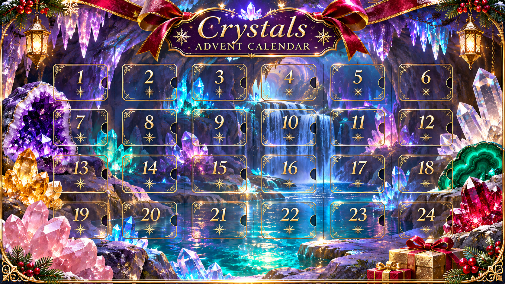

*Visual concept, not a runtime capture; the final calendar follows the shared rules and has 24 unique, reachable openings.*

A luminous cavern displays crystals of many shapes and colors, with light glinting slowly across their facets.

### Magic Rocks

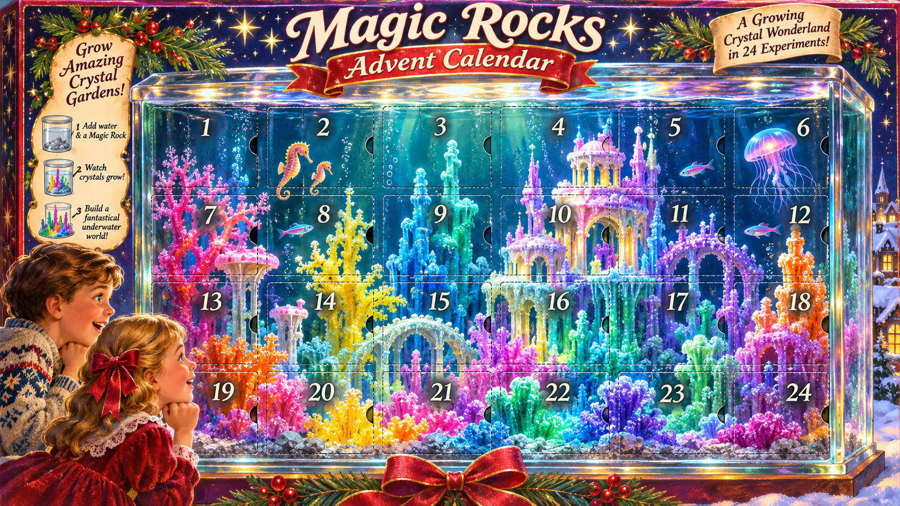

*Visual concept, not a runtime capture; the final calendar follows the shared rules and has 24 unique, reachable openings.*

A nostalgic chemical garden in a glass aquarium grows colorful, otherworldly towers and delicate branching forms. This interprets Magic Rocks as the crystal-growing toy.

### Rare Earths

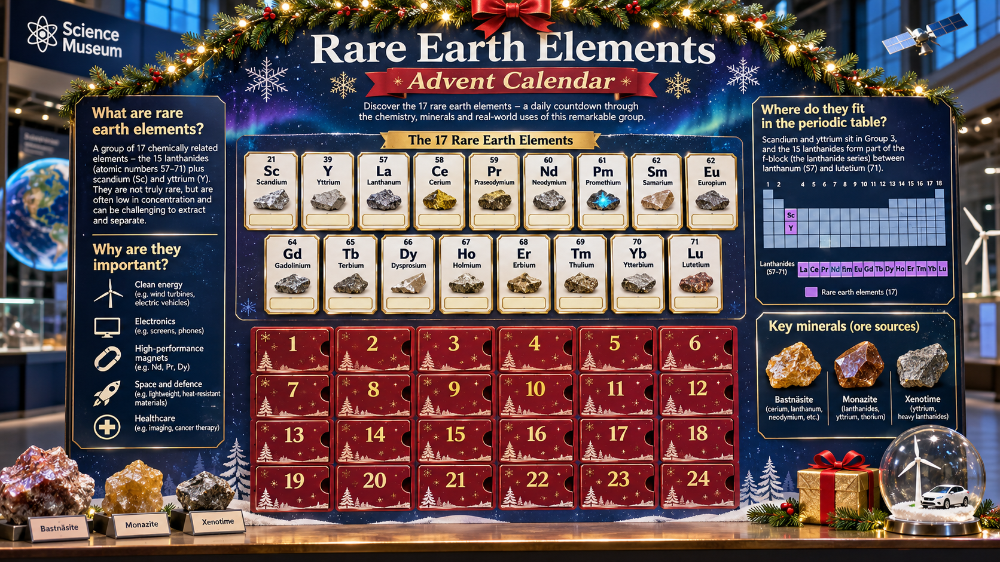

*Visual concept, not a runtime capture; the final calendar follows the shared rules and has 24 unique, reachable openings.*

A science museum study guide presents the 17 rare-earth elements with large, accurate names, symbols and atomic numbers. The generated image is atmospheric only: typeset and verify all scientific labels independently. Seven additional days explore concepts and review. [USGS reference](https://www.usgs.gov/centers/national-minerals-information-center/rare-earths-statistics-and-information).

| Day | Element | Symbol | Atomic number |
|---|---|---|---|
| 1 | Scandium | Sc | 21 |
| 2 | Yttrium | Y | 39 |
| 3 | Lanthanum | La | 57 |
| 4 | Cerium | Ce | 58 |
| 5 | Praseodymium | Pr | 59 |
| 6 | Neodymium | Nd | 60 |
| 7 | Promethium | Pm | 61 |
| 8 | Samarium | Sm | 62 |
| 9 | Europium | Eu | 63 |
| 10 | Gadolinium | Gd | 64 |
| 11 | Terbium | Tb | 65 |
| 12 | Dysprosium | Dy | 66 |
| 13 | Holmium | Ho | 67 |
| 14 | Erbium | Er | 68 |
| 15 | Thulium | Tm | 69 |
| 16 | Ytterbium | Yb | 70 |
| 17 | Lutetium | Lu | 71 |

Days 18–24: periodic-table placement; lanthanides; common properties; minerals and extraction; magnets and technology; recycling; and a review quiz. Develop and verify the study text and answers.

### Nuclear Power Plant

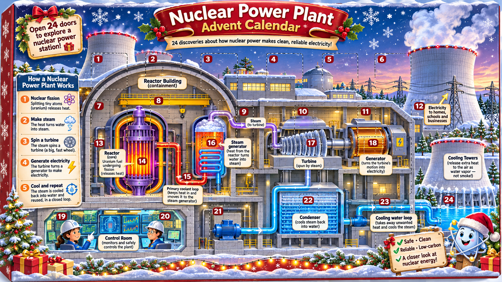

*Visual concept, not a runtime capture; the final calendar follows the shared rules and has 24 unique, reachable openings.*

A fascinating illustrated power plant invites exploration of the reactor, heat transfer, turbine, generator and cooling systems through daily educational reveals; verify the final diagram and labels.

### Skiing

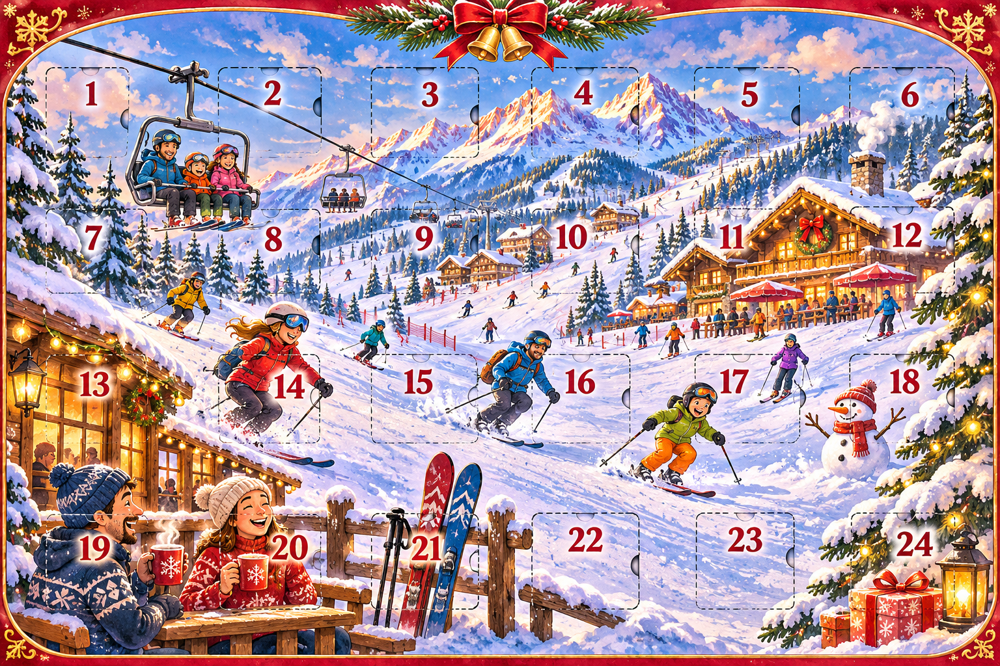

*Visual concept, not a runtime capture; the final calendar follows the shared rules and has 24 unique, reachable openings.*

A snowy mountain comes alive with skiers, lifts, trails and warm alpine lodges.

### Dragonflies

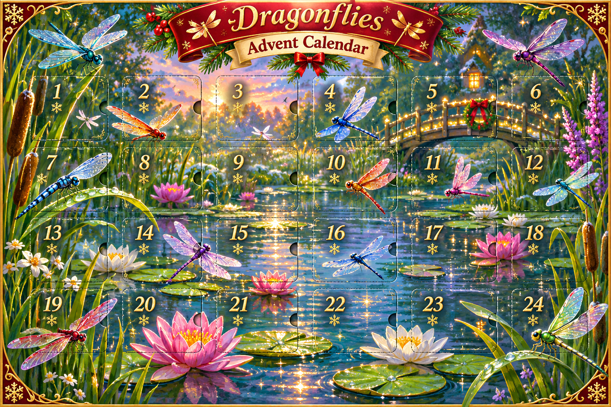

*Visual concept, not a runtime capture; the final calendar follows the shared rules and has 24 unique, reachable openings.*

Colorful dragonflies hover and dart above a lush pond of reeds and water lilies.

### Ant Farm Colony

*Visual concept, not a runtime capture; the final calendar follows the shared rules and has 24 unique, reachable openings.*

A cutaway ant colony reveals a network of tunnels and chambers, busy ants and a living woodland surface.

### Butterflies

*Visual concept, not a runtime capture; the final calendar follows the shared rules and has 24 unique, reachable openings.*

A lush garden fills with colorful butterflies, flowers and gentle movement.

### Mathematics

*Visual concept, not a runtime capture; the final calendar follows the shared rules and has 24 unique, reachable openings.*

A playful world of shapes, patterns, equations and puzzles offers a mathematical discovery each day; verify examples and solutions.

### 24 Buildings

*Visual concept, not a runtime capture; the final calendar follows the shared rules and has 24 unique, reachable openings.*

A festive cityscape features 24 distinct buildings, each numbered and each offering its own daily architectural discovery.

### Faery Garden

*Visual concept, not a runtime capture; the final calendar follows the shared rules and has 24 unique, reachable openings.*

A secret garden of tiny faeries, flowers, moss, glowing mushrooms and lanterns holds a little discovery behind each numbered opening. Wings flutter and lights glimmer gently.

### Æon Flux

*Visual concept, not a runtime capture; the final calendar follows the shared rules and has 24 unique, reachable openings.*

An original surreal dystopian city draws on the angular, acrobatic animation and mysterious atmosphere of Æon Flux. Tall architecture, dramatic silhouettes and subtle movement frame the daily reveals; use original artwork or appropriately licensed material.

### Catan

*Visual concept, not a runtime capture; the final calendar follows the shared rules and has 24 unique, reachable openings.*

A miniature island of hexagonal fields, forests, pasture, hills and mountains grows with roads and settlements. Daily openings reveal resources and scenes from the island; a released adaptation would require appropriate rights.

### Lab Glassware

*Visual concept, not a runtime capture; the final calendar follows the shared rules and has 24 unique, reachable openings.*

A colorful laboratory celebrates flasks, beakers, test tubes and intricate glass apparatus, with gentle bubbles and reflections. Numbered openings are integrated into the scene and reveal daily surprises.

### Crabs

*Visual concept, not a runtime capture; the final calendar follows the shared rules and has 24 unique, reachable openings.*

A lively coastal tide pool is filled with crabs of varied shapes and colors, moving among rocks and sea life. Numbered openings are integrated into the scene and reveal daily surprises.

### Tartan

*Visual concept, not a runtime capture; the final calendar follows the shared rules and has 24 unique, reachable openings.*

A cozy winter world celebrates an abundance of different woven tartan patterns in many colors and scales, spread across blankets, ribbons, clothing and furnishings. Numbered openings are integrated into the scene and reveal daily surprises.

### Candles

*Visual concept, not a runtime capture; the final calendar follows the shared rules and has 24 unique, reachable openings.*

An inviting room glows with candles of many shapes, sizes and colors, their flames flickering gently. Numbered openings are integrated into the scene and reveal daily surprises.

### Fabric Bolts

*Visual concept, not a runtime capture; the final calendar follows the shared rules and has 24 unique, reachable openings.*

A textile shop overflows with fabric bolts, rolls, swatches and threads in rich colors and patterns. Numbered openings are integrated into the scene and reveal daily surprises.

### Birds

*Visual concept, not a runtime capture; the final calendar follows the shared rules and has 24 unique, reachable openings.*

A festive woodland welcomes a variety of birds among branches and foliage, with gentle natural movement. Numbered openings are integrated into the scene and reveal daily surprises.

### Chocolates

*Visual concept, not a runtime capture; the final calendar follows the shared rules and has 24 unique, reachable openings.*

A luxurious chocolate shop displays truffles, pralines and other chocolates, with a different sweet surprise each day. Numbered openings are integrated into the scene and reveal daily surprises.

### Colors

*Visual concept, not a runtime capture; the final calendar follows the shared rules and has 24 unique, reachable openings.*

A joyful world explores colors and their combinations through luminous shapes, materials and daily surprises. Numbered openings are integrated into the scene and reveal daily surprises.

### Pac-Man

*Visual concept, not a runtime capture; the final calendar follows the shared rules and has 24 unique, reachable openings.*

A nostalgic arcade maze celebrates Pac-Man, ghosts, pellets and glowing screens. A released adaptation requires appropriate rights. Numbered openings are integrated into the scene and reveal daily surprises.

### Airplanes

*Visual concept, not a runtime capture; the final calendar follows the shared rules and has 24 unique, reachable openings.*

A festive airfield and sky feature diverse airplanes, from vintage propeller aircraft to modern jets. Numbered openings are integrated into the scene and reveal daily surprises.

### Camping

*Visual concept, not a runtime capture; the final calendar follows the shared rules and has 24 unique, reachable openings.*

A woodland campsite with tents, a campfire and a starry sky offers a cozy outdoor Christmas. Numbered openings are integrated into the scene and reveal daily surprises.

### Glamping

*Visual concept, not a runtime capture; the final calendar follows the shared rules and has 24 unique, reachable openings.*

A luxurious campsite features furnished tents, warm blankets and strings of lights beneath the stars. Numbered openings are integrated into the scene and reveal daily surprises.

### Orange

*Visual concept, not a runtime capture; the final calendar follows the shared rules and has 24 unique, reachable openings.*

A celebration of the color orange fills the scene with flowers, fruit, fabrics, leaves and glowing light. Numbered openings are integrated into the scene and reveal daily surprises.

### Calla Lilies

*Visual concept, not a runtime capture; the final calendar follows the shared rules and has 24 unique, reachable openings.*

A lush garden of calla lilies displays graceful blooms in white, pink, yellow and deep purple. Numbered openings are integrated into the scene and reveal daily surprises.

### Wizardry

*Visual concept, not a runtime capture; the final calendar follows the shared rules and has 24 unique, reachable openings.*

A wizard’s study is filled with spellbooks, wands, potions and enchanted objects; magic glimmers with each reveal. Numbered openings are integrated into the scene and reveal daily surprises.

### Water

*Visual concept, not a runtime capture; the final calendar follows the shared rules and has 24 unique, reachable openings.*

A celebration of water moves through waterfalls, streams, rain, waves and sparkling droplets. Numbered openings are integrated into the scene and reveal daily surprises.

### Cyberpunk

*Visual concept, not a runtime capture; the final calendar follows the shared rules and has 24 unique, reachable openings.*

A neon-lit futuristic city glows with rainy reflections, layered streets and festive light. Numbered openings are integrated into the scene and reveal daily surprises.

### Max Headroom

*Visual concept, not a runtime capture; the final calendar follows the shared rules and has 24 unique, reachable openings.*

A retro-futurist television world evokes Max Headroom through CRT screens, digital geometry and broadcast glitches. A released adaptation requires appropriate rights. Numbered openings are integrated into the scene and reveal daily surprises.

### Friends

*Visual concept, not a runtime capture; the final calendar follows the shared rules and has 24 unique, reachable openings.*

A cozy 1990s New York apartment and coffeehouse evoke the television series Friends during the holidays. A released adaptation requires appropriate rights. Numbered openings are integrated into the scene and reveal daily surprises.

### Purses

*Visual concept, not a runtime capture; the final calendar follows the shared rules and has 24 unique, reachable openings.*

A gallery treats purses and handbags as art, celebrating sculptural shapes, materials, color, pattern and craftsmanship. Each daily reveal introduces a different imaginative design.

### Country Flags

*Visual concept, not a runtime capture; the final calendar follows the shared rules and has 24 unique, reachable openings.*

A colorful collection of country flags becomes a daily journey around the world. Each reveal names its country and displays a clearly legible, accurately rendered flag. Include Thailand as day 21. Verify flag designs and labels against authoritative references during detailed design; the generated image is illustrative.

### Currencies

*Visual concept, not a runtime capture; the final calendar follows the shared rules and has 24 unique, reachable openings.*

An artistic museum of banknotes and coins celebrates currencies from around the world. Each reveal identifies the currency and its country or countries. Verify names, usage and visual details during detailed design; generated text and notes are illustrative.

### Trees

*Visual concept, not a runtime capture; the final calendar follows the shared rules and has 24 unique, reachable openings.*

A landscape celebrates a rich variety of trees, from evergreens and broadleaf trees to flowering and tropical species. Leaves sway gently and each day reveals another arboreal surprise.

### Neuromancer

*Visual concept, not a runtime capture; the final calendar follows the shared rules and has 24 unique, reachable openings.*

A rain-soaked cyberpunk city and a luminous cyberspace grid evoke the atmosphere of William Gibson’s *Neuromancer*. Neon, shadowy streets and digital forms frame daily discoveries; slow reflections and shifting light bring the scene to life. A released adaptation of the novel requires appropriate rights.
