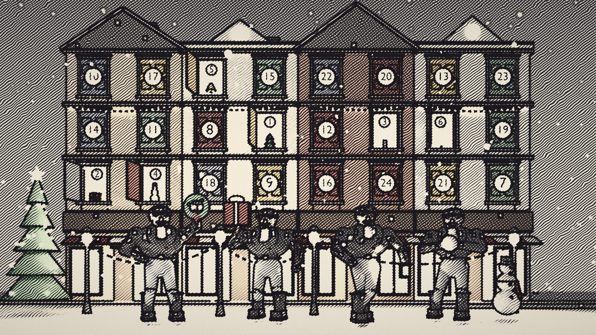
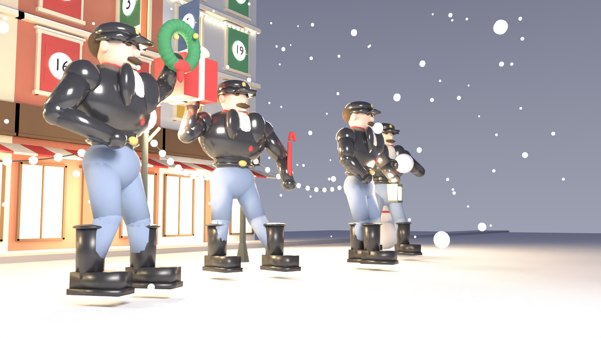
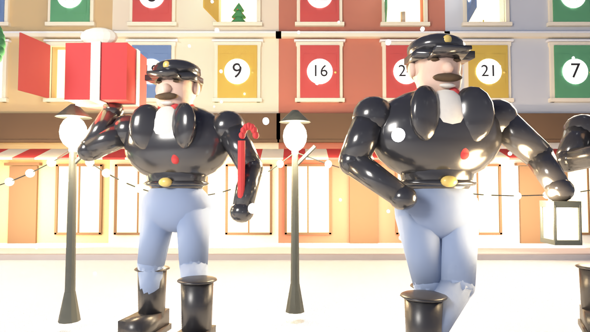
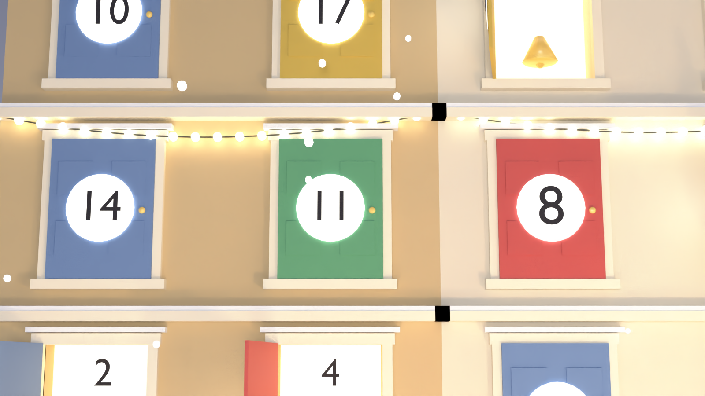
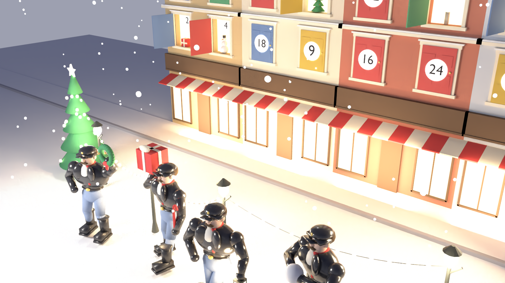

# Advent calendar: Tom of Finland-inspired concept

**Status: concept image built, 21 November 2026.** A style study for the [Advent Calendar plan](2026-11-21-advent-calendar.md): one more way to dress the same 24-day calendar. The calendar's dates, interaction and the actual 24 surprises are defined there; this page covers only the picture.

## What it shows

Four fully clothed adult men in leather jackets, peaked caps, scarves and boots on a snowy street in front of four townhouses. One hangs a wreath, one carries a gift, one holds a lantern and one has a snowball. The 24 numbered doors sit on the façades. Days 1 to 6 are shown open on small surprises (fir, gift, candle, snowman, bell, star), with their numbers on the niche back walls. The scene is non-explicit.

Door numbers are shuffled and the open set is days 1 to 6 for illustration only; the dates and the surprises come from the [plan's rules](2026-11-21-advent-calendar.md#the-24-surprises).

## How it was made, and what it is not

An image generator rejected the earlier prompt, and no image-generation tool was available later, so this was built in Blender: a procedural scene, Freestyle ink outlines, then a script that turns tone into pen hatching. It is a layout and art-direction concept.

The men are simplified 3D figures that nod to the style (broad chests, narrow waists, caps, gloss on the leather). They are not drawn with Tom of Finland's draughtsmanship, and no reference artwork was studied or copied. A web search for the style returned only general descriptions.

Rebuild it with the commands in [`tom-of-finland-src/README.md`](2026-11-21-advent-tom-of-finland-concept/tom-of-finland-src/README.md). The request history and outcome are in the [handoff](2026-11-21-advent-tom-of-finland-concept/tom-of-finland-handoff.md).

## Technical details

### Files

| File | What it is |
|---|---|
| [`tom-of-finland-concept.png`](2026-11-21-advent-tom-of-finland-concept/tom-of-finland-concept.png) | The hatched ink drawing, 1920×1080 PNG (about 3 MB) |
| `renders/men-left.png`, `men-close.png`, `doors.png`, `high.png` | Plain Blender renders from other cameras, 1600×900 PNG (see [Plain renders](#plain-blender-renders)) |
| [`tom-of-finland-src/build_scene.py`](2026-11-21-advent-tom-of-finland-concept/tom-of-finland-src/build_scene.py) | Builds the whole scene and renders it (Blender Python) |
| [`tom-of-finland-src/ink_post.py`](2026-11-21-advent-tom-of-finland-concept/tom-of-finland-src/ink_post.py) | Raw render to hatched drawing (Python, numpy, Pillow) |
| [`tom-of-finland-src/denoise.py`](2026-11-21-advent-tom-of-finland-concept/tom-of-finland-src/denoise.py) | Denoise for the plain renders: Intel OIDN, with a bilateral-filter fallback |
| [`tom-of-finland-src/README.md`](2026-11-21-advent-tom-of-finland-concept/tom-of-finland-src/README.md) | Rebuild commands |

Raw renders are intermediates and are not kept in the repo; `build-docker/advent/` holds them locally.

### Blender and scene

| Item | Value |
|---|---|
| Blender | 5.0.1, from the `wf-blender:local` container ([`docker/Dockerfile.blender`](../../docker/Dockerfile.blender)), run headless with `blender -b -P` |
| Render engine | Cycles on CPU; view transform Standard, look None |
| Scene size | 425 objects (386 meshes), 150,812 triangles, 36 materials, 14 lights |
| Lights | 1 sun (moonlight), 2 area lights (key front-left, warm rim back-right), 4 area lights (shop windows), 4 point lights (lamps), 3 warm point lights |
| Images and textures | None: 0 image datablocks, 0 textures |
| Fonts | Blender's built-in default, `Bfont Regular`, for the 24 door numbers |
| Seeds | Door shuffle `Random(24)`, snowfall `Random(11)`, fir lights `Random(5)` |
| Hatched drawing | 1920×1080, 64 samples, Freestyle outlines on, then `ink_post.py`; about 12 minutes on CPU |
| Plain renders | 1600×900, 128 samples, indirect-light sample clamp 4.0, 4 bounces (2 diffuse, 2 glossy), Freestyle off, then `denoise.py` (Intel OIDN 2.5.1); about 22 minutes each on CPU |

### Models

Every model is original and procedural, built in `build_scene.py` from `bmesh` primitives: cubes, UV spheres, cones, extruded polygons for the gabled roofs and pediments, and an extruded ten-point polygon for the stars. Nothing is imported, downloaded or generated.

- **Men:** each is built from dozens of ellipsoids, cones and boxes placed from hand-set joint positions (shoulders, elbows, hands, hips, knees, feet), at 1.2× scale and 4.6 m tall before scaling. Parts are grouped by material: leather jacket and gloves, jeans, boots, skin, scarf, shirt, hair and moustache, brass belt buckle and cap badge.
- **Street:** four townhouses 9.2 m wide, each a ground floor with shop windows, door and striped awning plus three storeys with two advent doors, with gabled or flat roofs and chimneys; four lamp posts, string-light garlands, a fir with lights and a star, and two snowmen.
- **Doors:** 24 hinged panels with a paper-white sticker and a numeral. Days 1 to 6 are swung open on lit niches with a surprise model each.
- **Sky and snow:** an inverted emissive sphere with a gradient, and 520 low-poly emissive flakes.

### Materials

Plain node colours only, no image textures. Opaque surfaces use Principled BSDF with a base colour, roughness and specular level (leather: roughness 0.2, specular 1.0; snow: roughness 1.0). Windows, lamps, flakes, stars, garlands and the door stickers use Emission nodes. The sky is an emission gradient driven by object-space height.

### Denoising

Ubuntu's Blender 5.0.1 is built without OpenImageDenoise, so Cycles cannot denoise inside Blender (its denoiser list is empty), and the Ubuntu archive has no OIDN package. The `wf-blender` container therefore carries Intel's standalone `oidnDenoise` 2.5.1 (the upstream release tarball, pinned by sha256 in [`docker/Dockerfile.blender`](../../docker/Dockerfile.blender), at `/opt/oidn`). `denoise.py` converts each render to PFM, runs `oidnDenoise --ldr --srgb` on colour only (no albedo or normal passes), and converts back. Outside the container it falls back to a 7×7 bilateral filter. Run it with `WF_CONTAINER_IMAGE=blender scripts/in-linux-container.sh python3 -I …/denoise.py in.png out.png`.

The hatched drawing needs no denoising: `ink_post.py` blurs the tone map before hatching, which hides the grain.

### Provenance

All geometry, materials and scripts were written for this concept. No third-party models, textures, brushes, HDRIs or reference images are used. The only bundled asset is Blender's default font.

## Plain Blender renders

The same scene, rendered as plain Cycles images (no ink pass, no outlines) from four other cameras, 1600×900, denoised with OIDN. The cameras are listed in `build_scene.py` (`CAMERAS`).

| View | Camera | Lens |
|---|---|---|
| [`men_left`](2026-11-21-advent-tom-of-finland-concept/renders/men-left.png) | Low, from the left of the street, looking along the four men | 35 mm |
| [`men_close`](2026-11-21-advent-tom-of-finland-concept/renders/men-close.png) | Close on the gift carrier and the lantern holder | 28 mm |
| [`doors`](2026-11-21-advent-tom-of-finland-concept/renders/doors.png) | Square-on to the upper-left façades, door numbers and open niches | 50 mm |
| [`high`](2026-11-21-advent-tom-of-finland-concept/renders/high.png) | High from the right across the street | 35 mm |

Seen this close the men are plainly built from smooth primitives, with inflated limbs and the shiny black surfaces of a toy; the `doors` view frames the top row a little tight.

## Not done

The separate, more fetish-focused request was not attempted. If an image generator becomes available, this scene's layout can serve as its brief.
