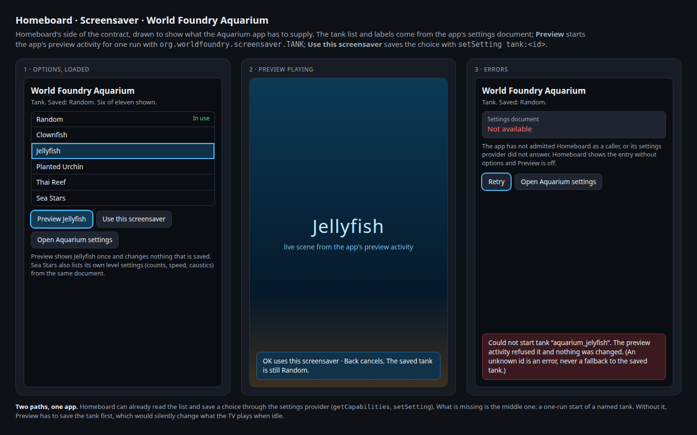
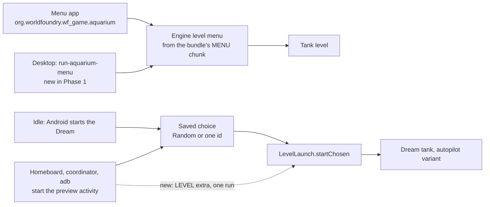
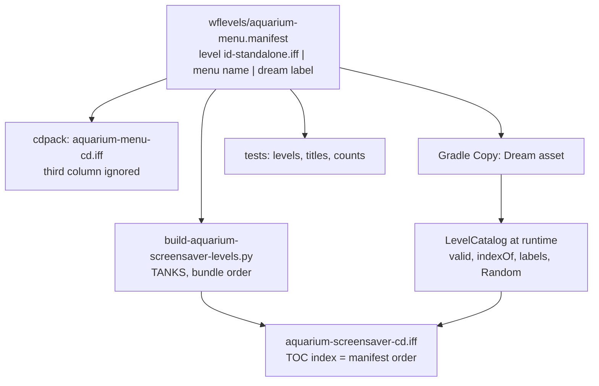
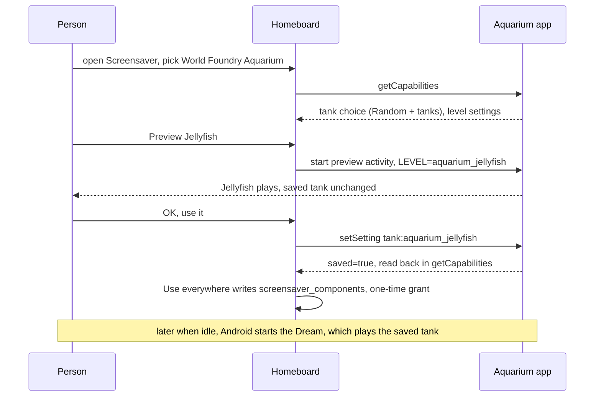
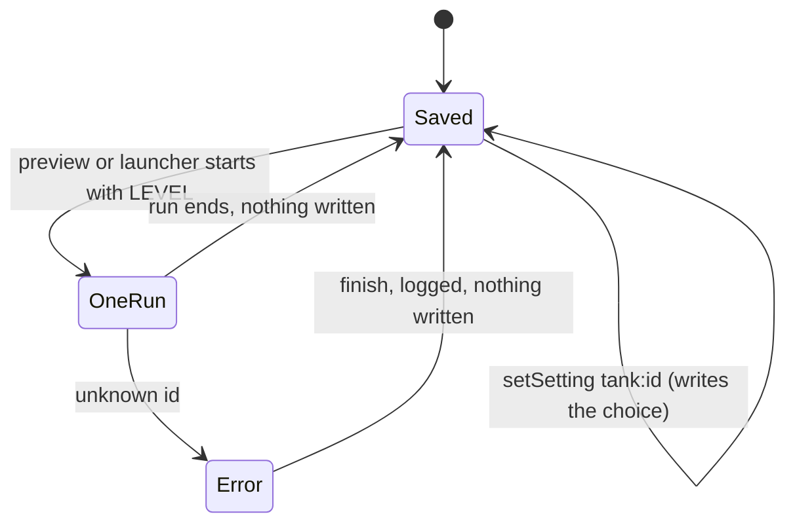

# Aquarium: close the gaps in the menu app and in launching one tank from a screensaver launcher

**Status: Phase 1 done (2026‑11‑21); Phases 2 to 4 not started. D1 to D6 accepted; D7 open. D3 accepted, and the scope widened (Will, 2026‑11‑21): "don't forget 3d clocks bundle, too! we [want] generic mechanisms and existing assets remediated".** So the catalogue and the one-run launch are **generic mechanisms**, not Aquarium code: the Aquarium, the 3D Clocks bundle and the single-level screensavers all use them, and the existing assets are brought onto them (the [remediation plan](2026-11-21-screensaver-app-and-remediation.md) audits and fixes each level). Will, 2026‑11‑21: "write plan to fix gaps in using app with menu as well as screensaver running a specific level. also consider what ../homeboard-tv/ provides for screensaver choosing, configuration, and everything it can control and do with screensavers". Reconciled with the [screensaver app and remediation plan](2026-11-21-screensaver-app-and-remediation.md) the same day: see [Reconciliation](#reconciliation-with-the-screensaver-app-and-remediation-plan). The three fixes were agreed in the conversation first: a `run-aquarium-menu` desktop task, an intent extra on `ScreensaverPreviewActivity`, and one source for the tank roster. This plan adds the Homeboard side and the order of work.

## Context

There are two ways to meet the aquarium tanks, and they are separate apps today.

| | Playable app (the menu) | Screensaver (Dream) |
|---|---|---|
| Android package | `org.worldfoundry.wf_game.aquarium` (flavor `aquarium` in `android/app`) | `org.worldfoundry.screensaver` (flavor `aquarium` in `android/screensaver`) |
| Bundle | `wflevels/aquarium-menu-cd.iff`, from `task build-cd-iff-aquarium-menu` | `wflevels/aquarium-screensaver-cd.iff`, autopilot variants from `scripts/build-aquarium-screensaver-levels.py` |
| How a tank is chosen | the engine's level menu (`wflevels/aquarium-menu.manifest`); Back in a tank returns to it | `TankChoice` in Java: Random or one id, saved in SharedPreferences |
| Desktop | no task (only `run-smb-menu` exists) | not applicable |

**What is true today, with evidence.**

- **The desktop has no way to run the aquarium menu.** `Taskfile.yml:2147` defines `run-smb-menu` and nothing for the aquarium; `run-aquarium` runs one standalone tank with `-L`. The menu code is portable (`wfsource/source/game/level_menu.cc`), so only the task is missing.
- **A screensaver launcher cannot start a named tank.** `ScreensaverPreviewActivity.onResume` reads `EXTRA_DREAM`, which only tells `seahorse_grid` from everything else; every other launch plays `TankChoice.chooseForDream(this)`, the saved choice. The only outside lever is the settings provider's `tank:<id>`, which writes the saved choice (`TankSettingsProvider.java:56`). So a caller that wants to look at Jellyfish has to change what the TV plays when idle.
- **The roster lives in six places.** The Sea Stars branch shows the cost of adding the eleventh tank (`git diff 2026-new-level...feat/sea-stars`): `wflevels/aquarium-menu.manifest`, `TankChoice.IDS` and `LABELS`, `TANKS` and `SCRIPT_NAMES` in `scripts/build-aquarium-screensaver-levels.py`, and `LEVELS`, `TITLES` and three hard-coded counts in `tests/test_aquarium_menu.py` (`levels=10` to `11`, `len(toc) == 13` to `14`, `toc[1:11]` to `toc[1:12]`). A miss is partly guarded: the build script refuses a `TankChoice.IDS` whose order differs from `TANKS` (`build-aquarium-screensaver-levels.py:215`), which is the only check tying the Java list to the bundle's table-of-contents order.
- **Sea Stars is implemented but not on this branch.** It is on `feat/sea-stars` (worktree `.worktrees/sea-stars`, tip `b3e77cd0`) with its manifest line, `TankChoice` entry and a new `TankLaunch.startChosen` that hands the level its saved settings before starting. On `2026-new-level` the menu lists ten tanks. The phases below touch the same files, so they follow that merge (Decision D5).
- **Seahorse Grid is not a tank.** It is its own app with one scene and stays outside the roster (Will, 2026‑11‑21). `EXTRA_DREAM = seahorse_grid` remains as it is.

## What Homeboard provides

Homeboard TV (`~/homeboard-tv`, [screensaver plan](../../../homeboard-tv/docs/plans/2026-11-20-screensavers.md), [how-to](../../../homeboard-tv/docs/how-to/screensaver.md), [Cast1 test records](../../../homeboard-tv/docs/testing/2026-11-20-screensavers.md)) is the launcher that would sit in front of our screensaver. Its controls, and what each needs from us:

| Homeboard control | State (its own records) | What it needs from the Aquarium |
|---|---|---|
| **List and choose** built-in entries (Clock, Home background) and Android screensaver apps found on the TV | built; Cast1 reads and lists installed apps | nothing; our Dream already appears by its `DreamService` |
| **Preview** | built for Homeboard's own entries; **none for another app's Dream**, because Android gives apps no way to start another app's screensaver | a preview activity Homeboard can start. We have one (`ScreensaverPreviewActivity`, exported). Its Stage 5 plans to start it, so it needs a way to say which tank |
| **Options per entry** | built for its own entries; for ours it plans to read our settings document (Stage 5) | `getCapabilities` already returns the tank as a choice (schema 1) and Sea Stars' level settings (schema 2, on the branch) |
| **Use this screensaver** | built | `setSetting tank:<id>` already saves the choice |
| **Use everywhere** | built; Cast1 setup screen, one-time question and Restore passed on 2026‑11‑21; Cast2 pending | nothing; it writes Android's `screensaver_components` with `WRITE_SECURE_SETTINGS` |
| **This TV's screensaver**: Start now, Open ‹app› settings, Restore the original | built | `Open Aquarium settings` needs a settings activity the Dream declares. **We have none:** `res/xml/dream.xml` is an empty `<dream/>` with no `settingsActivity`. The [remediation plan](2026-11-21-screensaver-app-and-remediation.md) supplies one dialog per level |
| **Start on Home after** 1, 2, 5, 10, 15 or 30 min | built, Home only; "Android decides" is the default | for our entry it plays the preview activity, so again needs the tank extra |
| **Remote key mapped to "screensaver"** | built | the same preview path |
| A timer or alarm always ends the screensaver | built | nothing |
| **Phone controller** (list, tap to choose, Show on TV now) | Stage 4, not built | the same list and the same start |
| **Get screensavers** directory, roles on cards, Install for Homeboard's own publisher's apps | Stages 2 and 5, not built | package, certificate and hash in the catalogue, metadata declaring the roles |
| **Companion-app discovery from metadata** | Stage 5, not built; the metadata keys are not yet defined in Homeboard's repo | we declare what Homeboard will read (Phase 4 below) |

Three facts shape this plan. The app and the Dream are **two packages**, and the Homeboard decision (4) wants them to become one APK that is both, so nothing here may bake in the split. Homeboard's directory text still says the playable app has "eight tanks"; it has ten and, with Sea Stars, eleven. And the coordinator already has the pattern we need: `settings_launch_extra` in `scripts/wf_device/plugins/android/applications.json` names an Intent string extra that carries a one-run override without writing settings.

## Approach

Four phases, in this order. Each ships alone and has its own test.

**Phase 1 · `run-aquarium-menu` (desktop task).** Copy `run-smb-menu`: deps `ensure-build` and `build-cd-iff-aquarium-menu`, copy `wflevels/aquarium-menu-cd.iff` to a gitignored `build-aquarium-menu/cd.iff`, and run `wf_game` there. Up/Down choose, Space starts, Backspace in a tank returns to the menu. The interactive window runs on the host as `run-aquarium` does; the test does not: it runs headless in the `linux-test` container through the existing `tests/level_menu_harness.py` scripted input. Add the task to the build tests in `tests/test_aquarium_menu.py` so a rename cannot orphan it.

*Phase 1 result (2026‑11‑21).* `task run-aquarium-menu` exists, with the Android app's engine flags read from `android/app/src/aquarium/assets/wf_args.txt` (the reef tanks need the larger VRAM). A scripted run of the real engine on the desktop display showed `level-menu: showing 10 entries ("WF Aquarium")`, moved to the third entry, started Calm Betta and exited with code 0. Tests: `test_aquarium_menu.py` gained the task-definition check and a host-logic test that lists the tanks and picks the third. The container image lacks PyYAML, so the three yaml-reading tests in that file (two older, one new) fail there and pass on the host; the other three pass in the container.

**Phase 2 · One roster per package, in a manifest, read by one generic `LevelCatalog`.** The Aquarium's `wflevels/aquarium-menu.manifest` is already the list of tanks, in the bundle's order, with a menu name. It becomes the only place a tank is added, and the code that reads it is not Aquarium-specific: `LevelCatalog` (replacing the Aquarium-only `LevelCatalog` and the static `TankChoice` arrays) takes any manifest of this format. The Aquarium is its first user; the **3D Clocks bundle declares its clocks in a manifest of the same format** and uses the same class; Seahorse Grid and Planted Tank, which each play one level, get a one-entry manifest so that every package answers the same questions (which ids, which labels, is this id valid). The class lives in `android/screensaver/src/main` and the manifest is copied into each flavor's assets by one Gradle `Copy`; if the 3D Clocks package is not a flavor of this module, it adds that source directory with `srcDir`, never a copy of the class.

- A tank's **id** is its level file name without `-standalone.iff` (`aquarium_jellyfish`). Nothing to store.
- The **Dream label** differs from the menu name for some tanks ("Planted Tank" in the menu, "Planted Urchin" in the Dream, which plays the saltwater variant; "Calm Betta" and "Betta"). Add an optional third column: `level aquarium_plants-standalone.iff | Planted Tank | Planted Urchin`. `cdpack-rs` (`parse_manifest`, `wftools/cdpack-rs/src/main.rs:49`) reads two fields today and would fold a third into the name, so it learns to accept and ignore it. Existing manifests, including the SMB one, stay byte for byte identical; a test pins that.
- The Dream APK ships the manifest as an asset, copied by a Gradle `Copy` task from `wflevels/aquarium-menu.manifest`, and `LevelCatalog` parses it at runtime. This replaces the static `IDS` and `LABELS` arrays with no generated source to go stale. `TankChoice.valid`, `indexOf`, the settings provider and `chooseForDream` read the catalogue.
- `build-aquarium-screensaver-levels.py` takes `TANKS` from the manifest and drops the regex that compared it to the Java source. `SCRIPT_NAMES` and the Sea Stars `st-dream` edit stay in the script: they are per-tank behaviour, not roster, and a tank without an entry takes the generic path. A manifest id with no `wflevels/<id>/` directory stops the build with that id named.
- `tests/test_aquarium_menu.py` builds `LEVELS`, `TITLES` and the counts from the manifest. `tests/test_aquarium_screensaver_catalog.py` and the sentence in `android/screensaver/README.md` that says the bundle order "must match `TankChoice.IDS`" are updated to say it follows the manifest.

"One file" therefore means one file for the **roster**. A tank with new behaviour still needs its own level and, if it needs a driver, one line in `SCRIPT_NAMES`.

**Phase 3 · One `LEVEL` extra, one `LevelLaunch`, on every package's launch activities.** The Aquarium's `ScreensaverPreviewActivity` and its TV launcher entry `AquariumActivity` (D3, accepted), the **3D Clocks bundle's launcher and preview activities**, and the single-level apps' `SeahorseGridActivity` and `PlantedTankActivity` all accept `org.worldfoundry.screensaver.LEVEL`: a catalogue id or `random`. A single-level app accepts its own one id and refuses any other. It applies for that run only and never touches the saved choice. With no extra, behaviour is unchanged. An id the catalogue does not hold is an error: log it, show it, `finish()`; there is no fallback to the saved tank (engine rule: fail loud). The decision lives in one place, `LevelLaunch.startChosen(context, player, requested)` (the generic form of the Sea Stars branch's `TankLaunch`), so Sea Stars' launch overrides apply the same way (`settings_launch_extra` already carries them in `PlantedTankActivity`). `adb` proof: `am start -n org.worldfoundry.screensaver/.ScreensaverPreviewActivity --es org.worldfoundry.screensaver.LEVEL aquarium_jellyfish`.

**Phase 4 · Homeboard and the coordinator.** Cross-repo, so each half is a handoff item in the other repo, not an edit from here.

- **Coordinator** (`~/chromecast-coordinator`): `applications.json` gains `level_launch_extra` beside `settings_launch_extra`, and `screensaver-show` accepts a bounded `tank` argument, validated against `getCapabilities`, that it passes through that extra. `screensaver-select` stays the persistent route.
- **Homeboard** (Stage 5): our manifest declares, as `<meta-data>`, the preview activity, the extra's name and the settings authority (already `org.worldfoundry.screensaver.SETTINGS_AUTHORITY`). Homeboard maps **Preview** to a one-run start with `LEVEL`, **Use this screensaver** to `setSetting tank:<id>`, and the Home idle timer, the remote key and **Show on TV now** to the same one-run start.
- **Docs:** Homeboard's "eight tanks" becomes "the tanks the app lists".

The mockup shows what Homeboard's Options screen does with this: the tank is a choice in the app's settings document, Preview plays it once, and an unknown id is an error.

Three states on one canvas: the Options screen with the tank list and the **Preview** and **Use this screensaver** buttons, the preview playing with the saved tank unchanged, and the two errors (no settings document, unknown tank id). It asks you to confirm D4 below. [Open the interactive mockup](2026-11-21-aquarium-menu-and-screensaver-launch/homeboard-tank-options.html). The desktop menu and the Android menu are unchanged on screen, so Phase 1 and Phase 2 have no new visible surface.

## Diagrams

How a tank gets chosen, today and after. The dashed route is the new one.

The roster after Phase 2. One manifest feeds the menu bundle, the Dream, the screensaver bundle build and the tests.

What Homeboard does with the app, in order.

Modes of the tank choice. A run has one of two sources, and only one of them is written down.

## Reconciliation with the screensaver app and remediation plan

The [screensaver app and remediation plan](2026-11-21-screensaver-app-and-remediation.md) (the "remediation plan", proposed 2026‑11‑21) covers the shared 3D Clocks package and a settings and launch contract for **every** World Foundry screensaver level. Where the two overlap, one of them owns the item and the other follows it.

| Topic | This plan | Remediation plan | Resolution |
|---|---|---|---|
| Start one named level without touching the saved Dream choice | Phase 3: the `LEVEL` extra | Contract items 2 and 4: a documented, authorized entry; "previewing must not overwrite the persisted Dream selection"; invalid ids rejected, never substituted | **Same mechanism. This plan defines it for the Aquarium package** (D2 is its "reject invalid ids"); the 3D Clocks package adopts the same extra name and the same rules. The extra is named `LEVEL`, not `TANK`, so one key serves tanks and clocks (D6) |
| One catalogue for launcher, automation, settings and Dream; stable ids; easy to add levels | Phase 2: the manifest is the roster, `LevelCatalog` reads it | Contract item 4, for the clocks package | **One generic mechanism, one manifest per package.** `LevelCatalog` is written for any manifest of this format, and the 3D Clocks bundle is a planned user from the start. Its package ID and revision come from the concurrent work and are recorded there, then the manifest is added; this plan does not build the clocks package |
| A settings dialog for every level, with Save, Cancel, reset | not planned; only the provider's tank choice | **Owns it**, for all levels including the Aquarium's ten and Sea Stars | This plan does **not** build dialogs. Its Homeboard "Open Aquarium settings" button waits for them: `dream.xml` is empty today, so there is no target. One fact to carry over: Sea Stars (on `feat/sea-stars`) is an eleventh tank with its own schema 2 settings; the remediation plan's inventory counts ten |
| Stale documentation: the README says eight tanks, `TankChoice` lists ten | Phase 2 rewrites the README sentence that ties the bundle order to `TankChoice.IDS` | Inventory step corrects stale catalogue and README text | One edit, made once. **Phase 2 lands first** so the inventory records the manifest as the source rather than a list that changes under it |
| `TankChoice`, `TankLaunch` (the Sea Stars branch's), `ScreensaverPreviewActivity`, the build script and `tests/test_aquarium_menu.py` | edited by Phases 2 and 3 | "Coordinate changes in shared files with ongoing work" | The remediation plan's baseline (step 1) freezes the inventory **before** these edits and re-runs it after (step 3) |
| Device evidence | Verification 5, 6 and 8 run on a Chromecast | Step 4 reserves cast1 and cast2 for installed acceptance | **One reservation, not two.** Verification 5 and 6 are folded into step 4's per-level launch check, so this plan adds no separate device campaign. Verification 8 (the coordinator's `screensaver-show`) is its "documented automation interface" |
| Access control on the automation entry | `ScreensaverPreviewActivity` is already `exported="true"`; the extra writes nothing | "Define and test the actual invocation, export and access controls" | Open. The minimal design is: exported, no persistent effect, unknown id refused. A signature permission would also stop the coordinator's `adb shell am start`, so any tighter rule has to be tried against that path first. Settle in Phase 3 together with the 3D Clocks work |
| The desktop menu task, Homeboard handoff | Phases 1 and 4 | not covered | Stays here |
| Separate-app versus shared package | keeps the Aquarium package as it is | "Use the existing package boundaries for Aquarium, Seahorse and Planted"; all clocks go in one 3D Clocks package; the Minute Machine plan's own app is being reconciled to it | Agreed. The playable menu app stays its own package too. The mechanisms are shared; the packages are not merged |

**Order.** Remediation step 1 (baseline and inventory), then this plan's Phase 1 (independent), then Phases 2 and 3, then the remediation plan's steps 2 to 4, whose acceptance run exercises them on cast1 and cast2. Phase 4 follows Homeboard's Stage 5.

## Decisions

D1 to D6 accepted on 2026‑11‑21. D7 (single-level apps join) is still open; the wording below assumes its recommendation until you say otherwise.

- **D1. Roster source. ACCEPTED (Will, 2026‑11‑21).** The existing manifest with an optional third column (the Dream label), against a new JSON file that generates the manifest. **Recommended: the manifest**, as you asked: no generated file to check in or go stale, one `cdpack` change that existing bundles do not see.
- **D2. A bad `LEVEL` id. ACCEPTED (Will, 2026‑11‑21).** Fail loudly (log, show, finish) against falling back to the saved tank. **Recommended: fail loudly.** A silent fallback would make a typo in a caller look like it worked.
- **D3. Which activities take the extra. ACCEPTED (Will, 2026‑11‑21: "sure, but don't forget 3d clocks bundle, too!").** Both `ScreensaverPreviewActivity` and the TV launcher entry `AquariumActivity`, through the shared launch class, so a launcher shortcut such as "Open Jellyfish" works without a second mechanism. The same holds in the 3D Clocks bundle: its launcher and preview activities take the extra too.
- **D7. Single-level apps join the mechanism.** Seahorse Grid and Planted Tank get a one-entry manifest and accept `LEVEL` for their own id. **Recommended: yes**, since you want generic mechanisms and the coordinator should not special-case them (`PlantedTankActivity` keeps `settings_launch_extra` for its settings overrides).
- **D4. How Homeboard lists the tanks. ACCEPTED (Will, 2026‑11‑21).** One entry "World Foundry Aquarium" with Tank as an option, against one entry per tank. **Recommended: one entry**, because Homeboard shows four entries per page and a tank is a setting of the same screensaver. This is Homeboard's call at its Stage 5; the mockup shows the one-entry form.
- **D6. The name of the one-run extra. ACCEPTED (Will, 2026‑11‑21: "LEVEL is the name, not tank").** `org.worldfoundry.screensaver.LEVEL` (a catalogue id or `random`), shared with the 3D Clocks package, against `TANK` for the Aquarium and a different key per package. **Recommended: `LEVEL`.** The coordinator then needs one `level_launch_extra` convention instead of one per package; Homeboard still reads the key's name from each app's metadata.
- **D5. Order against the Sea Stars branch. ACCEPTED (Will, 2026‑11‑21).** Another agent is merging `feat/sea-stars` (Will, 2026‑11‑21). Phases 2 and 3 edit `TankChoice`, `ScreensaverPreviewActivity`, `build-aquarium-screensaver-levels.py` and `tests/test_aquarium_menu.py`, all of which `feat/sea-stars` already edits. **Recommended: merge `feat/sea-stars` into `2026-new-level` first**, then build on it; Phase 1 does not depend on it and can go now. Who merges it is not decided here.

## Rank and cost

| Phase | Rank | Why |
|---|---|---|
| 1 `run-aquarium-menu` | T1 | copy of a task that exists; the recipe is fixed |
| 2 one roster | T3 | Rust parser, Gradle, Java, Python and tests, against the settled design above |
| 3 `LEVEL` extra | T3 | launch activities in four packages (Aquarium, 3D Clocks, Seahorse, Planted) through one `LevelLaunch`; follows Phase 2 |
| 4 Homeboard and coordinator | T3 | two other repos and a contract; the handoff items are small |

No cloud resources are created or changed, so there is no AWS cost. Device checks use the coordinator's recipes and leave the TV as they found it.

## Out of scope

- **One APK that is both the playable app and the Dream** (Homeboard decision 4, [distribution research](../../../homeboard-tv/docs/investigations/2026-11-20-screensaver-distribution.md)). It would merge the two tables in Context; this plan keeps the split and adds nothing that depends on it.
- **A desktop bundle of every World Foundry level** (the second use case in the [level menu plan](2026-10-01-level-menu-selector.md)).
- **A settings dialog for each level, the full screensaver inventory, building the 3D Clocks package itself and the Minute Machine app question.** Owned by the [remediation plan](2026-11-21-screensaver-app-and-remediation.md), which also remediates the existing assets. This plan supplies the catalogue and the launch extra those levels use, and wires the 3D Clocks bundle to them.
- **Seahorse Grid and the Planted Tank app** as roster members. They stay separate apps; `PlantedTankActivity` keeps its own `settings_launch_extra`.
- **Homeboard Stages 2 to 5 themselves** (providers, directory, phone panel, companion apps). Phase 4 only supplies what they will read.
- **Changing Android's idle time from Homeboard.** Its Stage 0 question 5 is still open.

## Verification

1. `python3 -m pytest tests/test_aquarium_menu.py -v` passes in the `linux-test` container (`scripts/in-linux-container.sh`), with `LEVELS`, `TITLES` and the counts read from the manifest. Delete one manifest line locally and the same command fails naming the missing id.
2. `task run-aquarium-menu` opens the menu with every manifest tank in order; Space starts one; Backspace returns. The headless scripted-input run in `tests/level_menu_harness.py` selects the third entry and reaches its level.
3. `cdpack` on `wflevels/smb-menu.manifest` and on a copy of `aquarium-menu.manifest` with a third column on every line produces bundles byte for byte equal to the two-column ones.
4. The screensaver's JVM unit tests (a `task` entry added in Phase 2, in the pattern of `task test-planted-screensaver`, which runs `PlantedConfigTest`; offline Gradle per `android/screensaver/README.md`) pass `LevelCatalogTest`: ids, labels, `valid`, `indexOf`, the order equals the screensaver bundle's table of contents, and an unknown id is rejected.
5. (Run inside the remediation plan's step 4 reservation, not as a separate campaign.) `adb shell am start -n org.worldfoundry.screensaver/.ScreensaverPreviewActivity --es org.worldfoundry.screensaver.LEVEL aquarium_jellyfish` on a Chromecast through the coordinator: the top activity is the preview, the Jellyfish tank plays, and `content call … getCapabilities` still shows the old saved tank.
6. The same with `LEVEL` set to an unknown id: the activity logs the error and finishes, and the saved tank is unchanged.
7. With no extra, the preview plays the saved tank exactly as before (the existing `tests/test_aquarium_screensaver_*.py` pass, the catalogue one with its updated source of truth).
8. Coordinator `screensaver-show` with `tank` set shows that tank on Cast1 and leaves the saved tank alone; an id outside `getCapabilities` is refused before any launch.
9. Homeboard Stage 5 on Cast1: Preview plays the chosen tank, **Use this screensaver** saves it, Restore returns the original screensaver. Recorded in Homeboard's testing record and linked back here.
10. **3D Clocks bundle.** For each clock id in its manifest, the coordinator starts the bundle's launch activity with `--es org.worldfoundry.screensaver.LEVEL <id>`: that clock plays with no chooser and the saved Dream clock is unchanged on readback. An unknown id is refused with the error logged. Run inside the remediation plan's step 4 reservation.
11. **Single-level apps.** Seahorse Grid and Planted Tank start with their own id as `LEVEL`, and refuse any other id with the error logged. With no extra, both behave exactly as before.
12. **One catalogue class.** `grep -rn "class .*Catalog" android/screensaver/src` finds one implementation, used by the Aquarium, the 3D Clocks bundle and both single-level apps; no per-package copy of the parser exists.
