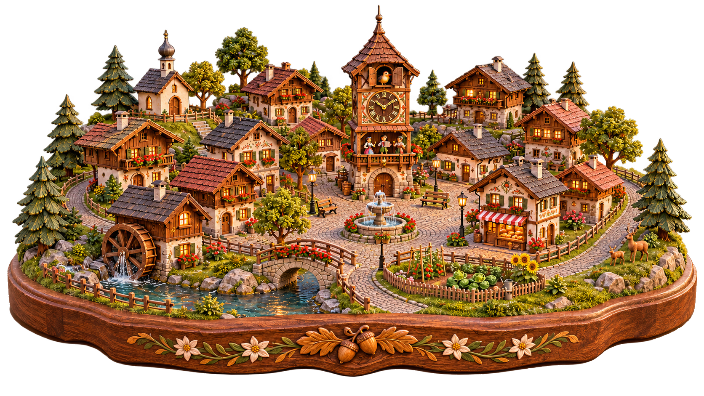
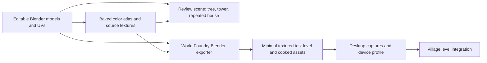

# Cuckoo Village: model and texture three reusable assets

**Status: assets implemented and device-profiled; baseline comparison outstanding, 2026‑11‑21.** The [asset README](../../wflevels/cuckoo_village_assets/README.md) links the editable scene, Blender reviews, desktop engine checks and Chromecast evidence. The models compile and render in World Foundry; the desktop test switches window lights and exercises the minute-hand and bird-door pivots. Both Chromecasts rendered the sample. A minimal visible baseline ran on cast1; single-sample PSS variability prevents a reliable asset-only delta, and cast2 was reserved before its baseline could be run. The artwork is a simplified, stylized interpretation of the concept. These are assets for the [Cuckoo Village level](2026-11-21-cuckoo-village.md), not the full village, its animation system, or its [screensaver app](2026-11-21-screensaver-app-and-remediation.md). No engine changes are authorized. If the exporter or renderer cannot support a necessary feature, document the precise engine change and obtain explicit permission before modifying engine code; continue independent modeling and texturing work.

## Art direction

Use this approved-looking village concept as the visual target: warm, handmade Alpine miniature, detailed painted wood, pale plaster, red-brown roof tiles, stone foundations, planted window boxes and layered deep-green conifers. It is reference art, not an exact model sheet. The assets must look good together from multiple angles as the camera travels around the village. Build the village objects themselves; do not model the room, table, mountains, sky or other backdrop. Use the level's uniform dark background for review captures.

| Asset | Readable silhouette | Surface and details | Reuse and separation |
|---|---|---|---|
| **Pine tree** | A tapered evergreen, irregular tiered branches, visible trunk at its base | Bark grain and overlapping needles with dark interiors and sunlit tips; rich but not neon green | A single tree model with its origin at ground center; rotate and modestly scale instances to vary the village. Avoid prominent repeating markings. |
| **Clock tower** | Landmark taller than the houses: stone base, timber-and-plaster body, pitched roof, dial, bird door and figure balcony | Tile and wood grain, carved trim, dial markings, stonework and a sheltered balcony; visible construction on sides and back | Static structure and independently pivoted minute hand, hour hand and bird door; balcony must provide room for four separate figures and their route. Figure and bird models/animation belong to the level plan. |
| **Standard house** | Compact two-storey cottage with pitched roof, chimney, front door and windows; attractive silhouette from all sides | Plaster, timber framing, individual-looking roof tiles, shutters, window frames, masonry base and flower boxes | One reusable house, ground-center origin, complete rear and side facades. Design material and accent variations or reversible interchangeable details so repeated instances do not look stamped out. |

The tower's dial and hands must read correctly when viewed from the front. Author the neutral hand meshes separately with the pivot at the dial center and document the forward axis and rotation convention; pose them at 10:08 in the beauty view. Keep the cuckoo door separately hinged, with a dark opening behind it. Provide unobstructed balcony space for four future figures; use simple labeled stand-ins for scale in a review scene only, not as finished animated assets. Separate window panes or otherwise provide a demonstrated renderer-compatible day/dusk lighting approach so the house windows can glow without illuminating the whole wall. Do not assume Blender emission or a material swap works in the engine until tested.

## Asset and texture specification

- Author editable Blender sources plus image textures and UV maps, with stable names, relative texture references, applied transforms and sensible origins. Deliver separate assets and a simple review scene that instances them together; retain any procedural source or scripts necessary to regenerate them. Each mesh should have outward-facing normals and no missing faces when viewed from the camera route. Explicitly name the tower's movable components and pivots.
- Choose consistent project units and proportions in the review scene; document actual bounding dimensions. The tower should be clearly taller than the house, and tree height should sit comfortably beside both. Confirm the final scale against the level camera and its dial readability target before locking proportions.
- Deliver image-based color textures with visible surface detail, rather than flat material swatches. Use a small shared, reusable atlas where practical: timber grain, plaster, stone, roof tiles, foliage, bark, windows and trim. Make UVs deliberate, with padding and sufficient texel density; protect the dial and front details from atlas bleeding. Avoid unsupported node graphs: bake procedural appearance to the image textures used by the exporter. Record the dimensions, sources, licenses and generation steps of every texture. Use original or appropriately licensed assets.
- Keep silhouettes convincing while controlling geometry and material count for cast1 and cast2. **Initial review targets**, to be refined after the export spike: tree ≤ 2,000 triangles; house ≤ 4,000; tower static structure ≤ 8,000, plus moving pieces. Prefer one shared atlas at or below 2048 × 2048 initially, subject to actual texture and memory limits. These are design budgets, not measured device guarantees; report counts after triangulation and any deliberate exceptions.
- The standard house must be reused without ten unique geometry copies in source. Verify how exported instances consume geometry and texture memory in this engine; a Blender linked duplicate alone is not evidence of runtime sharing. The village level owns final instance count and placement.

## Pipeline and deliverables

Use the existing World Foundry Blender exporter and level compilation rather than assuming a generic interchange file is sufficient. The [reef generator](../../wflevels/aquarium_thai_reef/generate.py) demonstrates an image texture node, atlas and explicit `UVMap` through the project exporter; its [build script](../../wflevels/aquarium_thai_reef/build.sh) runs the Blender level pipeline and cooked budget check. Inspect the actual importer/exporter and target renderer for texture formats, naming, material behavior, pivots and triangle limits before settling on an atlas. Blender's appearance alone is not proof of World Foundry compatibility.

Proposed asset location is `wflevels/cuckoo_village/assets/`, coordinated with the level work to avoid naming collisions. Provide:

1. Editable source for all three textured assets, including UVs and separate tower components; image texture source and any reproducible generation or bake scripts.
2. A small World Foundry test level with one tree, tower and at least three differently oriented house instances, plus day and dusk examples. It is an asset test, not the complete Cuckoo Village level.
3. Exported and cooked output from the repository's normal build path, along with a concise asset README: dimensions, origins, component names, texture and material setup, build commands, polygon and texture budgets, licenses, and known limitations.
4. High-quality review renders on a plain dark background: front and three-quarter views of each asset, a rear or side view to check the house and tower, a group view showing repeated houses, a close view of the clock and balcony, and matching in-engine captures. Label Blender renders as such; distinguish them from actual engine/device captures.

## Work and acceptance

1. **Export spike:** make a small textured, UV-mapped sample with the candidate atlas and separate hinged/rotating pieces; export, cook and render it in World Foundry. Verify texture orientation, alpha where needed, color, winding, transforms and pivot behavior. Prove a viable dusk window approach. If a required feature fails, investigate supported alternatives and request explicit engine permission only for a concrete necessary engine proposal.
2. **Model and texture:** build the pine, tower and reusable house to the approved concept. Use the proportions, named pieces and budgets above; review from multiple angles and refine the details that survive normal viewing distance. Keep the four figures and bird as simple scale placeholders only.
3. **Integrate and verify:** create and build the asset test level through the normal Blender and World Foundry tools. Compare Blender and engine front, rear and three-quarter captures; verify texture resolution, seams, missing faces and occlusion. Exercise clock-hand and door pivots independently, check three differently oriented house instances and compare day/dusk windows. Measure cooked triangles, atlas memory and instance behavior; record limitations.
4. **Device acceptance:** freeze a build locally, check the coordinator queue and use owned sessions on cast1 and cast2. Capture the actual rendered assets, inspect their appearance at full-scene and close ranges, and profile frame rate and memory for the sample level. Compare with the empty-level baseline and report results; do not claim the full village meets a performance target from this sample alone. Coordinator downtime has no direct device fallback.

Acceptance means all three editable **and textured** assets are delivered, reusable and correctly exported into World Foundry; the house can be instanced, tower moving parts have usable pivots, dusk windows have a verified implementation path, and review captures and device evidence demonstrate their actual appearance. Full village assembly, figures, clock choreography and release remain in the companion level and app plans.
