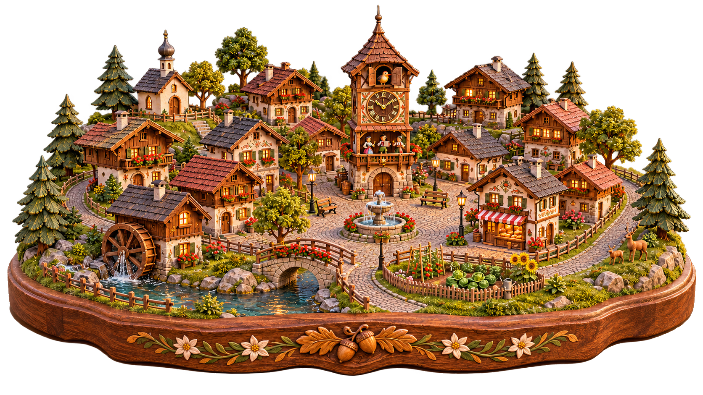
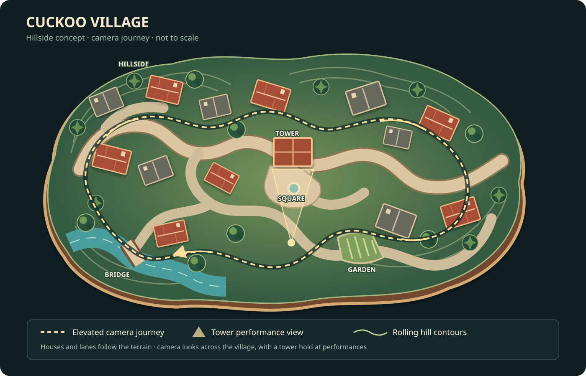
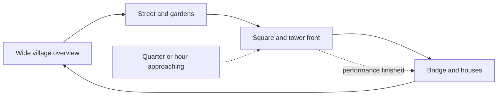
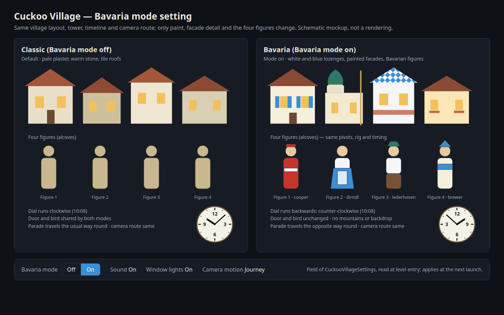
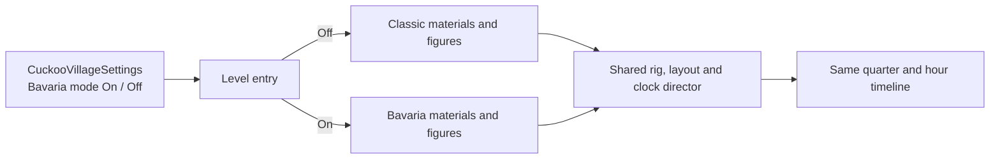
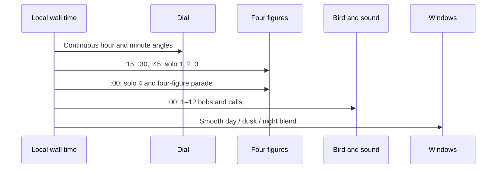
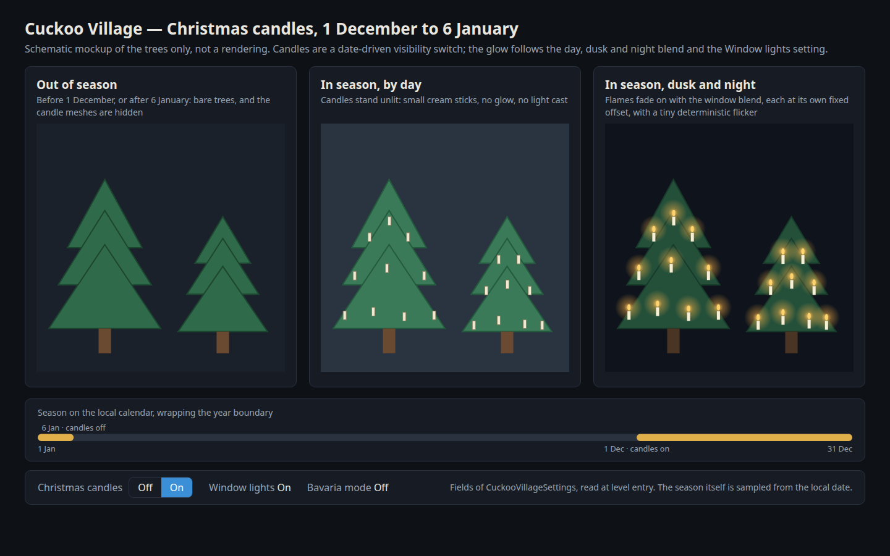
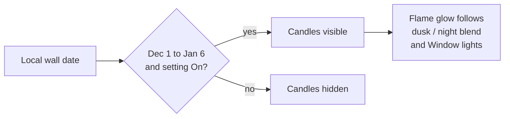
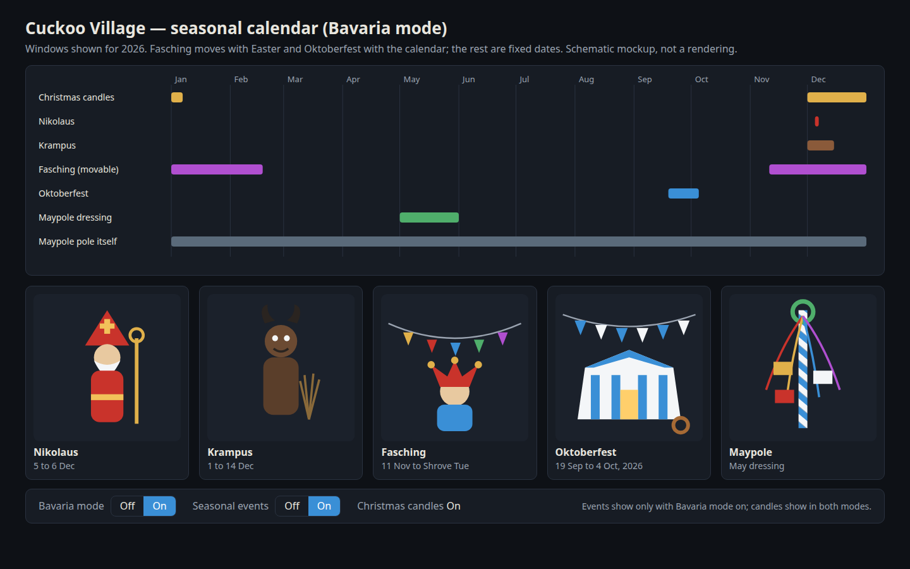

# Cuckoo Village: a glockenspiel clock

**Status: proposed, 2026‑11‑21.** This is the third clock implementation. It belongs in the shared **3D Clocks** screensaver package alongside all other World Foundry clock implementations. Work on that package is already in progress; coordinate with its current implementation before fixing names, interfaces or bundle order. This plan does not authorize engine changes.

The [original idea](../../../homeboard-tv/docs/investigations/2026-11-21-3d-timepieces.md#48-cuckoo-village) is a model village around a clock tower. A figure steps onto the balcony each quarter, the four parade on the hour, and a bird calls the count. Read the time from the small tower dial; watch for the hourly parade and house windows lighting at dusk.

## Visual target

This concept shows the intended village scale, rather than a literal level layout or a verified rendering. Houses, streets and the square are subjects in their own right; the tower is one landmark among them. Preserve the village and its model base, but remove all surroundings: no room, table, sky, mountains, horizon, landscape or other background objects. The concept image uses transparency to show that boundary; in the running screensaver use a uniform dark background, with no backdrop imagery or scenery. Day and dusk are expressed through light on the village and the windows, not a changing sky.

The village is a complete tabletop model: painted wood, pale plaster, warm stone, tile roofs, a paved square, gardens with small trees (a few of them conifers, for the Christmas candles), a small bridge and restrained flowers. A loop of streets connects a dozen varied houses around the central tower, with attractive facades on all sides. The dial is above a balcony; four distinct figures wait visibly in alcoves behind the balcony. They are small toy mechanisms, with clear silhouettes and simple pivoted movement. A cuckoo door sits above the dial. At dusk the windows become warm amber and the village lighting cools toward blue, with enough fill light to retain the figures and dial; the background stays uniformly dark.

The diagram is a proposed top-down arrangement and camera path, not a construction drawing. The dashed route shows the elevated moving camera; the translucent wedge marks the front-facing view held for clock performances.

The dial is small in village-wide views and will not be legible from every angle. Provide a clear front-facing tower view during each quarter performance and on the hour; target a dial diameter of at least 10% of picture height in that view, with high-contrast hands and marks. Check it in a 1080p capture and on an actual TV. The minute hand is longer, the hour hand shorter, and both move continuously: minute angle is `6 × (minute + second/60)` degrees; hour angle is `30 × ((hour % 12) + minute/60 + second/3600)` degrees clockwise from twelve. At 10:08 the minute hand points just past one and the hour hand just past ten.

### Camera journey

Travel slowly and smoothly around the village on a closed elevated route, with wide establishing views interspersed with closer looks down streets, over gardens and across the square. Keep the route inside a collision-free envelope above roofs and avoid clipping or abrupt turns. Favor views that show multiple houses and the relationships between them; do not spend the entire cycle staring at the tower. Use a roughly four-minute loop, with gentle easing and a steady horizon. At each quarter, smoothly reach a front-facing tower-and-square view before the event, hold through the solo or parade and bird calls, and then return to the journey. The hourly hold must last through `:24`. Make route position and event transitions a deterministic function of local time, so starting midway or changing the clock immediately produces a valid camera pose. Check every transition for speed, clipping, blocked views and motion sickness. A fixed-camera setting uses a wide establishing view with the village visible, rather than a tower closeup.

### Bavaria mode

**Bavaria mode** is a user-controlled **Bavaria mode** setting (On / Off, default Off) in the level's `CuckooVillageSettings` object (see [Level settings](#level-settings)). When on, it themes the same village. It changes how the village looks and who performs, not how it works. Layout, camera route, timing, lighting schedule, sound and level interface are identical to **Classic** (Bavaria mode off). The only behaviour change is the joke every Bavarian knows: the clock **runs backwards**, like the reversed clock face on Munich's Isartor and the "Bavarian clock" sold as a souvenir. The tower dial sweeps counter-clockwise and the hourly parade travels the opposite way round its route. The dial still shows the correct local time, and every event still happens at the same moment. The mode is otherwise a theme, so it must never fork the clock logic.

| Element | Classic | Bavaria |
|---|---|---|
| Facades | Pale plaster, warm stone | Painted facades with flower boxes, shutters and timber trim; some gables in the white-and-blue lozenge pattern |
| Roofs and landmarks | Tile roofs | Steeper tile roofs; one house or the tower's neighbour carries a green onion dome; a painted maypole in the square |
| Four figures | Four distinct toy figures | A cooper (*Schäffler*), a dirndl figure, a lederhosen figure with a hat, and a brewer. Slot 1 to 4 keep the same quarter assignments |
| Tower and clock case | Plain painted tower woodwork | Chalet-style carved case: a steep gable roof with carved fascia boards, carved leaves and vine around the dial, a pair of deer or a hunting motif above the cuckoo door, and a carved balcony rail. Pinecone-shaped weights hang on chains at each side of the tower |
| Parade | The four figures travel the closed parade route in the Classic direction | The same route and the same start and end alcoves, travelled in the **opposite direction**. Figure order along the route is therefore reversed. Timing is unchanged |
| Dial | Numerals 1 to 12 run clockwise; hands sweep clockwise | **Reversed dial.** Numerals 1 to 12 run counter-clockwise with 12 still at the top, so 3 sits on the left and 9 on the right. The digits themselves are upright and unmirrored. Both hands sweep anti-clockwise. The dial's size, marks and contrast are unchanged |
| Bird and door | Shared | Same bird and door mechanism. The door sits in the carved chalet front, so its hinge and travel are unchanged |
| Palette | Warm neutrals | Warm neutrals plus a white-and-blue accent, kept inside the dusk and night lighting blend |

Rules for the mode:

- **Same rig.** Each Bavarian figure reuses the Classic figure's skeleton, pivots, alcove, balcony path and parade route geometry. Only meshes and materials differ, apart from the parade direction below. A figure must read clearly in silhouette at the quarter-performance view.
- **Same budget.** Share house shells, roofs, streets, gardens and the dial; swap material variants and a limited set of extra meshes (onion dome, maypole, flower boxes, shutters, chalet roof and carved case trim, deer, pinecone weights). Set the extra-mesh budget after measuring the two existing clock levels, and gate Bavaria mode on the same performance threshold as Classic.
- **Still no surroundings.** No Alps, mountains, sky, horizon or backdrop, and no beer-hall or product branding. The uniform dark background rule from the visual target applies unchanged. The white-and-blue lozenge is a regional pattern used as decoration, not a coat of arms or a flag.
- **No new audio.** The cuckoo call and optional cues are unchanged. No looped music, and no yodelling or other speech or song.
- **Read once, at level entry.** The level reads the Bavaria mode field of `CuckooVillageSettings` through `property@`. Every field of the type is `SHOW_AS_LIVE`, and the director is a pure function of the clock that holds no mode state, so an edit made from the settings form takes effect on the next frame; nothing needs a relaunch. (This replaces the earlier entry-only wording: a live field costs nothing here.)
- **Reversed dial, same time.** Use the Classic angle formulas unchanged, and apply the reversal at the dial: the hand pivots take the negated angle (minute `-6 × (minute + second/60)`, hour `-30 × ((hour % 12) + minute/60 + second/3600)` degrees from twelve), and the face texture carries the mirrored numeral layout. Do not mirror hand or face geometry with a negative scale: it flips triangle winding and trips back-face culling, which the engine's backface-cull invariant test guards. At 10:08 the minute hand points just past one on the left of twelve, and the hour hand just past ten on the right of twelve. The dial and the parade are the only places Bavaria mode changes behaviour. Do not change the dial's sampling or the performance and lighting timelines, and keep it a pure function of the wall-clock sample. The hands are the only dial elements that move.
- **Reversed parade, same schedule.** Use one parade timeline for both modes. The director samples the same progress along the route over the same 24-second window and takes the direction as a fixed sign chosen at level entry: Bavaria mode traverses the route with progress reversed, so each figure leaves its own alcove, travels the loop the other way and returns to the same alcove. Start time, duration, settle-by `:24` and the bird's calls are unchanged. Solo turns at `:15`, `:30` and `:45` (step forward, bow, return) are not reversed. Pause and arbitrary-start behaviour stays a pure function of the wall-clock sample, with no accumulated state. Re-check that reversed figures do not collide, clip the carved balcony rail or pinecone weights, or hide the dial in the front-facing view, and that the camera hold still frames the whole parade.
- **Dial stays readable.** The reversed dial must still pass the 10% picture-height and contrast rule in the front-facing view. Add a reading aid only if a 1080p capture and an actual TV show the reversed numerals are hard to read: for example, heavier marks at 12, 3, 6 and 9. A sticker or caption explaining the joke is not acceptable.
- **Carving stays clear of the dial.** The chalet carving is decorative relief on the tower front. It must not cover or shadow the dial, hands, marks, balcony alcoves or the cuckoo door, and the 10% picture-height dial target and contrast rule apply in both modes. The pinecone weights hang beside the tower and stay still: they do not drop or follow the time, because the dial and hands are the only clock state. Check that they, and the carved roof, never block the front-facing performance view or the camera route.
- **Original assets.** Model and texture every figure and facade pattern from scratch or from licensed sources, and record the licence. Do not copy the Munich Rathaus-Glockenspiel's figures, facade or any other protected design.

## Clockwork and lighting

Use the device's local wall time as the single source for the dial, choreography and lighting. The Minute Machine work proposes a shared wall-clock interface; inspect and reuse the actual interface when integrated. Do not confuse the engine's elapsed level `TIME` with civil time. Derive every visible pose from the current sample, so entry at any point, pause/resume, timezone changes, DST and clock corrections do not require replaying events or accumulating simulation state.

For a clear interpretation of “a figure steps onto the balcony at each quarter,” each figure remains visible in its own alcove and takes a solo turn at its assigned quarter. At the hour the fourth figure steps forward and all four parade together. This preserves four visible figures at 10:08 and avoids a hidden fourth at the hour.

| Local time | Visual action | Sound |
|---|---|---|
| `:15`, first 8 s | Figure 1 steps forward, bows and returns | Optional short mechanical cue |
| `:30`, first 8 s | Figure 2 steps forward, bows and returns | Optional short mechanical cue |
| `:45`, first 8 s | Figure 3 steps forward, bows and returns | Optional short mechanical cue |
| `:00`, first 24 s | Figure 4 steps forward; all four travel in a closed parade, then settle into their own alcoves | Bird calls the hour, 1–12 calls; noon and midnight each call 12 |

The bird emerges at the hour, bobs once per call, then retreats. Reserve up to 18 seconds for calls at a fixed 1.4-second spacing, with one call at `:01`; parade and bird overlap, and everything settles by `:24`. Each call is a short recorded or synthesized cuckoo; use licensed or original sound assets. Sound defaults on to fulfill the concept, with a persistent mute setting. Respect system volume and audio focus; no speech or looped music. When muted the bird still visibly bobs the count. On entering mid-performance, reconstruct the correct visual pose immediately but **do not play missed calls**; play only future call boundaries reached in normal forward time. On a discontinuous clock jump, rebase without a burst or replay; a normal next boundary may sound. Audio implementation and Dream audio focus must be verified on device rather than assumed from another silent Dream.

For the initial version, define a predictable **local-time lighting schedule**, not real astronomical sunset: day through 17:30, smooth dusk from 17:30 to 18:30, night until 05:30, and smooth dawn from 05:30 to 06:30. House windows fade on during dusk and off during dawn, with a fixed per-window stagger derived from its index; never randomize every frame. This makes arbitrary starts and time jumps deterministic, requires no location permission and makes dusk testable. It is an artistic schedule; a location-based sunset is future work. Favor baked material variants or existing supported material controls over many real-time lights; confirm the chosen approach on the target renderer.

### Christmas candles

From 1 December to 6 January the village trees carry small lit candles, in the German tradition of the candlelit Christmas tree. The season is a function of the local calendar date, taken from the same wall-clock sample as the dial and lighting. It applies in both Classic and Bavaria modes, because both villages have the same trees.

- **Season.** Candles are shown from `Dec 1 00:00` through `Jan 6 23:59:59` local time (Advent to Epiphany) and hidden otherwise. The season spans the year boundary, so test it as a date range that wraps. This is a visibility switch on candle meshes sampled each frame, not accumulated state, so a start on any date, a clock correction, a time-zone or DST change, and a run that crosses midnight on 30 November, 31 December or 6 January all show the right state without a restart.
- **Where.** A few small candles on each of the conifers and on one or two trees in the square, spaced so that a single tree never carries more than a dozen. Candles are tiny cream sticks with a small warm flame. They are decoration and must not touch the dial, balcony alcoves or cuckoo door, or hide them from the front-facing performance view.
- **Light.** Flames glow with the same day / dusk / night blend as the windows, with the same fixed per-candle stagger derived from its index. By day they stand unlit. A very small flicker is a deterministic function of the wall-clock sample and candle index, never random per frame. Use baked emissive materials, with no real-time light per candle, as for the windows, and confirm the approach on the target renderer. The **Window lights** setting also controls candle glow.
- **Setting.** **Christmas candles** (On / Off, default On) in `CuckooVillageSettings`, read at level entry. With it off, the trees stay bare in the season.
- **Budget.** Candles share one mesh and one material, instanced or batched. Count them against the measured performance budget of the two existing clock levels. The candle meshes exist all year but are hidden outside the season, and hidden candles draw nothing.
- **Test.** The test build's deterministic test clock covers the date, so the season can be checked in any month. Do not expose a date override as a customer setting.

### Seasonal events (Bavaria mode)

Bavaria mode also carries dated Bavarian customs. They are decoration on the same village, shown only when Bavaria mode is on, and controlled by one **Seasonal events** setting (see [Level settings](#level-settings)). The **Christmas candles** stay separate and apply in both modes. Every event is a visibility switch sampled from the local date, like the candles, and never accumulated state.

| Event | Window (local date) | What appears | Basis |
|---|---|---|---|
| Nikolaus | `Dec 5 00:00` to `Dec 6 23:59:59` | A small St Nicholas figure in the square: mitre, crozier and book | St Nicholas brings presents on 5 December |
| Krampus | `Dec 1 00:00` to `Dec 14 23:59:59` | One or two small Krampus figures beside the square, with a bundle of twigs | Krampus runs cluster around 5 and 6 December, and young men traditionally dress as Krampus in the first two weeks of December |
| Fasching | `Nov 11 11:11` through Shrove Tuesday `23:59:59` (movable) | Paper garlands across the streets, jester caps on the four figures, and a masked pair in the square | Munich's season starts on 11 November at 11:11 and ends on Faschingsdienstag, the day before Ash Wednesday |
| Oktoberfest | First Saturday after 15 September through the first Sunday in October, extended to 3 October when that Sunday is 1 or 2 October | Blue-and-white bunting across the streets and a small festival tent with warm lights and a pretzel stall in the square | Rule from the Munich city pages; 2026 runs 19 September to 4 October |
| Maypole | The pole stands all year; its May dressing runs `May 1 00:00` to `May 31 23:59:59` | A painted maypole in the square, with a fresh wreath and ribbons in May | See the maypole research below |

**Nikolaus and Krampus** are toys in the same pivoted style as the four figures: a gentle deterministic sway, no sound, and no horror. A Krampus has a friendly cartoon face, horns and a bundle of twigs, and no chains or violence. Nikolaus stands in the square on 5 and 6 December. Krampus appears on the wider window, so on 5 and 6 December the two stand together.

**Fasching** is movable. Shrove Tuesday is Easter Sunday minus 47 days, so the season calendar needs an Easter computation (the Gregorian computus), checked against a table. The garlands and caps are static meshes, not particles, so a start at any moment shows a valid scene.

**The maypole, researched.** Sources agree that a Bavarian *Maibaum* is raised on 1 May or the night before, sometimes weeks earlier, and how long it stays varies. Some places take it down at the end of May and store it. In many Bavarian towns it stands in the centre for the rest of the year and is replaced every two to five years, and after five years at the latest for safety. A "correctly" painted Bavarian pole has a blue-and-white spiral running from bottom left to top right, and hangs signs showing a village's trades and clubs. Franconia (northern Bavaria) uses red and white stripes instead. In the night before 1 May neighbouring villages try to steal the pole, so it is guarded (*Maibaumklau*). From this the plan decides:
- The pole stands in the Bavaria-mode square all year, because that is the common Bavarian practice.
- It is painted in the blue-and-white spiral, running bottom left to top right, with generic trade and club signs, no real businesses or brands. Red and white is not used.
- The May dressing (wreath and ribbons, 1 to 31 May) is a design choice for this plan, not a sourced rule, and the window is easy to change.
- The pole stealing and guarding is not depicted.

**Rules for the events**
- **One season calendar.** A single function maps the local wall-clock sample to the set of active events, and everything above reads it. It includes the Christmas candles. It is a pure function of the local date, with no stored state, so any start date, clock correction, time-zone or DST change and midnight crossing show the right events.
- **Test the calendar against a table.** Easter and Shrove Tuesday for 2026 to 2040 (for example Shrove Tuesday is 17 February 2026, 9 February 2027, which matches Munich's published 2027 date, and 29 February 2028), the Oktoberfest window for 2026 and for a year where the first Sunday of October is the 1st or 2nd (2023), and every boundary second in the table above.
- **Measure the worst day, not an average one.** On 1 to 14 December the Christmas candles, Krampus, Nikolaus and (while it runs) Fasching overlap. Set the performance gate from that day on cast1, with every event's meshes shared or batched and hidden meshes drawing nothing.
- **Keep the performance view clear.** Extra figures and tents stand to the side of the front-facing tower view, never covering the dial, balcony, alcoves or cuckoo door, and never in the camera route.
- **No new audio and no branding.** No music, speech or song, and no brewery names, logos or product marks on tents, bunting or signs.
- **Original assets**, as for the rest of Bavaria mode.
- **Not now:** an Almabtrieb season and a mountain setting are parked as [TODO items](../../TODO.md) to investigate later. They conflict with the "no mountains" rule and are not part of this plan.

## Level settings

The [companion app and screensaver plan](2026-11-21-screensaver-app-and-remediation.md) owns package integration, the settings dialog, and the sweep of existing screensavers. This level supplies the following setting definitions and behavior.

These are the fields of one user-controlled **level settings object**, `CuckooVillageSettings`, authored in the level like the Planted Tank's `PlantedTankSettings`. The level reads it on entry, and the companion plan's settings dialog edits it. Bavaria mode is one of its fields, not a separate build or level.

Recommended Cuckoo Village settings:

| Setting | Values | Default | Effect |
|---|---|---|---|
| Sound | On / Off | On | Cuckoo calls and optional quarter cues; animation remains visible when off |
| Window lights | On / Off | On | Dusk/dawn window glow, and the glow of the Christmas candles; ambient day/night lighting still changes |
| Christmas candles | On / Off | On | Shows lit candles on the village trees from 1 December to 6 January. Off leaves the trees bare |
| Seasonal events | On / Off | On | Shows the dated [Bavarian events](#seasonal-events-bavaria-mode) (Nikolaus, Krampus, Fasching, Oktoberfest, maypole dressing). They appear only while Bavaria mode is on |
| Bavaria mode | On / Off | Off | Switches the village and figures to the [Bavaria mode](#bavaria-mode) theme; layout, timeline, lighting and sound are unchanged |
| Camera motion | Journey / Still | Journey | Slow village tour with performance views, or fixed wide establishing view |
| Orientation | Existing shared orientation choices | Existing package default | Use the package's shared implementation |

Do not expose test-only time overrides as customer settings. The companion plan owns the shared settings interface and Dream lifecycle.

### Opening the settings, and what is built

**Every 3D clock carries a settings object and opens it with a keypress** (Will, 2026‑11‑21: "all 3d clocks will require settings object and keypress to activate"). The keypress is the engine's: hold **A, the remote's centre (OK) button, alone for 1 second** in the level (`Host::gesture`, `engine/runtime_property_host.cpp`). The host opens the form of the one editable object, here `CuckooVillageSettings`, which is editable because its fields are live. How the six pieces are built, and the audit that checks them for every clock and tank, is in the [pack HOWTO](../howto/combine-levels-chooser-and-screensaver-launch.md#5-give-every-level-settings-and-a-way-to-open-them).

| Field | In the level today |
|---|---|
| Window lights | **Built.** Off keeps every cottage window dark; `tests/test_cuckoo_village_settings_effect.py` |
| Camera motion | **Built.** Still holds the wide establishing view from the front; same test |
| Bavaria mode, Seasonal events, Christmas candles, Sound | **The field exists and the director has a reader word for it; nothing responds yet.** Each lands with its feature: Bavarian figures and the reversed dial and parade, the events, the candles, the audio |

The field indices are the catalog's (129 to 134) and are written into the director at export time, never hand-typed. The phone's Dream form needs a capabilities asset generated from the `.oad` (`scripts/gen-settings-capabilities.py`), and the Dream's `LevelSettings` serves only Sea Stars today; generalising it by clock id is Phase 3 of the [Tide Harbour plan](2026-11-21-tide-harbour-clock.md). Until then the village's settings are reached by holding A on a TV or gamepad.

## Implementation and verification

1. **Integration contract.** Coordinate with the active 3D Clocks work, identify the other two catalog IDs and shared package interfaces, and record their actual revision and build commands. Inspect the clock and sound APIs. If any engine changes are required, write a concrete proposal and obtain Will's explicit permission before editing engine code. Asset generation, level scripts, packaging and tests may proceed independently.
2. **Model and export.** Build tower, four distinct figures, bird, buildings and window materials using the repository's reproducible level pipeline. Set budgets after measuring the two existing clock levels; share meshes and materials where possible. Use simple keyed or script-driven transforms, not runtime physics. Build the Bavaria material variants and four Bavarian figures on the same rig as the Classic figures. Check clean regeneration and licensing of any external assets, Bavaria assets included.
3. **Clock director.** Implement dial angles and deterministic timed poses. Use a reference timeline for solo turns, parade, bird, camera and lighting; make transitions continuous and avoid collisions or figure occlusion. Verify the runtime against the reference at arbitrary timestamps, especially each boundary, 10:08, 12:00, midnight, dusk and dawn. Test local-time jumps in both directions, startup mid-event and no audio catch-up. Run the same timestamp set with Bavaria mode off and on and confirm identical camera, call timing and solo-turn poses; only meshes and materials may differ, apart from the two reversals. The two dial hand angles must be exact negatives of each other, and during the hourly parade each figure's route progress must be the Classic progress reversed, starting and ending in the same alcove at the same times (check 10:08 and each boundary). Test the Christmas candles at `11-30 23:59:59`, `12-01 00:00:00`, `12-31 23:59:59`, `01-01 00:00:00`, `01-06 23:59:59` and `01-07 00:00:00`, with the setting on and off, and across a time-zone change. Check the season calendar against its table for every Bavaria-mode event: each window boundary, Easter and Shrove Tuesday for 2026 to 2040, the Oktoberfest window for 2026 and 2023, and the overlap days in December. With Bavaria mode off or **Seasonal events** off, none of those events may appear.
4. **Integration handoff.** Supply the scene, stable ID, settings definitions and assets to the companion app plan. Verify the scene responds to the saved settings and works in the shared package.
5. **Device acceptance.** Build and freeze the APK locally. Use the shared coordinator, check queue and reservations, and keep each interactive session owned through cleanup. On cast1 and cast2 capture a daytime wide scene and a dusk scene against the empty background, with Bavaria mode off and on, with all four Bavarian figures legible in the quarter view; record a full camera tour showing the whole village and all transitions into and out of quarter holds, an actual quarter and full hourly performance including audible count and mute behavior, and compare the dial to device local time. Use a deterministic test clock in a test build where available; also verify real wall-clock behavior. Check held/released directional input in chooser and settings on cast2 if a TV WebView is used, observing the [WebView 91 minimum](../reference/chromecast-webview-compatibility.md). Profile the release build, record FPS and resource/thermal behavior during a sustained Dream, and set a performance gate from measurements of the existing clocks before acceptance. Test repeated wake/restart and a long unattended run.
6. **Acceptance.** Verify correct local-time rendering, four quarter turns and the hourly parade, one to twelve correctly timed calls, visible dusk transition, a full camera journey, the empty background and scene settings, including the Bavaria mode setting in `CuckooVillageSettings` selecting the Bavaria or Classic theme at launch with identical timing in both, and the Bavaria dial reading the correct device time counter-clockwise, plus lit candles on the trees from 1 December to 6 January (and only then) with the **Christmas candles** setting honoured, and each Bavarian seasonal event visible only in its window, in Bavaria mode with **Seasonal events** on. Capture the worst-overlap December day and one scene each for Fasching, Oktoberfest and May using the test clock. Installed package launch, chooser, Dream persistence and the cross-screensaver settings sweep are acceptance criteria of the [companion plan](2026-11-21-screensaver-app-and-remediation.md), which must be verified on the installed package.
