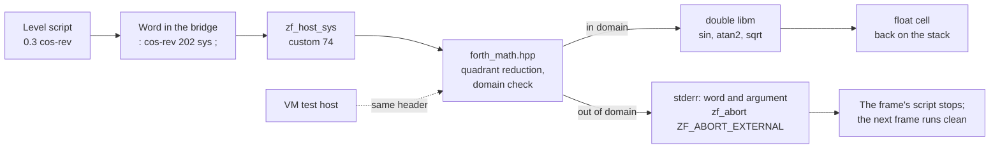
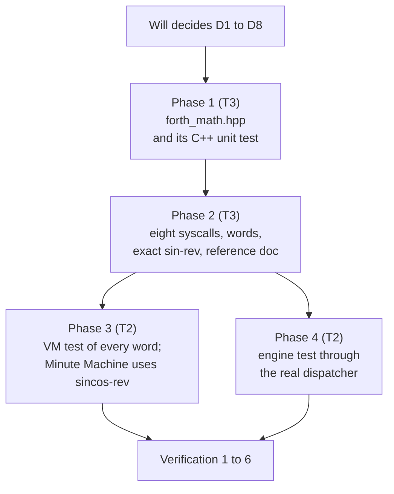

# Forth math words: the full trig set in the zForth bridge

**Status: implemented 2026‑11‑21; verification recorded below.** Will: "implement trig plan". D3 and D9 had not been answered, so they were taken as recommended: **D3 option B** (plain `libm` and a shared vector file; no promise at special points) and **D9 deferred** (no fixed point until a chip is chosen). Two details changed in implementation and are now in the contract: a non-finite argument is a domain error for every word, and on a single-precision-FPU build `tan-rev` is only specified away from its poles (the angle `2π·x` is computed in `float` there). Earlier answers: D1, D2, D4, D5, D6, D7 and D8 by Will on 2026‑11‑21; the research for [D3](#research-for-d3) and [D8 and D9](#research-for-d8-and-d9) is below.

## Context

Will added one Forth word this morning and then asked for the rest. The sequence on 2026‑11‑21:

> "these days, probably nothing is cheaper than a real sine on a real cpu's fp hw"
>
> "might as well add the rest of the trig functions, too. write plan in docs/plans/ and open in browser"

The first remark turned the Minute Machine's parabola into a real sine: `sin-rev ( revolutions -- sin )`, syscall 201 in [`scripting_zforth.cc`](../../engine/stubs/scripting_zforth.cc), committed in `dc33b4eb`. It cut the director's worst error against the reference model from 15 mm to 0.0016 mm. This plan adds the rest of the family and makes the whole set exact where scripts need it to be.

### What exists today

| Fact | Evidence |
|---|---|
| zForth ships no trig. The bridge has `sin-rev` and nothing else | `grep -n 'sin-rev' engine/stubs/scripting_zforth.cc` finds the word and its syscall only |
| It has no square root either. C++ has `fsn_isqrt` for the file-system level, and Forth cannot call it | `scripting_zforth.cc:203` |
| **13 hand-rolled definitions in 7 level scripts**, each a rational approximation written in Forth | table below |
| The hand-rolled sine is a parabola that is about 0.16 % off, which is what put the Minute Machine camera 14 mm out at 10 m. Nobody has measured the hand-rolled arctangent | [Minute Machine plan, what was built](2026-11-21-sixty-second-chain-reaction.md#what-was-built-and-where-it-differs) |
| `sin-rev` is not exact at the quarter turns: `sin-rev 0.5` gives about 1.2 × 10⁻¹⁶, not 0. A script that tests `= 0` or divides by it gets junk | `std::sin(2π · 0.5)` in double |
| An engine failure should be loud, never skipped. The Forth VM already aborts on a division by zero | the engine fails loudly and never skips and logs (Will, 2026‑11‑14, on a NULL guard: "that's antithetical to the design philosophy of the game engine"); `zforth.c:670` aborts on division by zero |

| Script | Hand-rolled definitions |
|---|---|
| `wflevels/aquarium_tanks/controller.fth` | `tk-sin`, `tk-cos`, `tk-atan-oct`, `tk-atan2` |
| `wflevels/aquarium_blue_shrimp/shrimp.fth` | `sh-sin`, `sh-cos`, `sh-atan-oct`, `sh-atan2` |
| `wflevels/aquarium_sea_stars/sea_star_player.fth` | two |
| `wflevels/aquarium/clownfish_idle.fth` | two |
| `wflevels/aquarium/school_rig.fth`, `barb_school_rig.fth` | one each |
| `wflevels/condo_639_640/camera_controls.fth` | one |

(Counted with `grep -rn -E '^: [a-z0-9]+-(sin|cos|atan2|atan-oct|tan|asin|acos|atan) ' wflevels --include=*.fth`: 13 lines in 7 files. Phase 1 re-counts them.)

## Decisions for Will

Each row has a recommendation and its alternatives.

| # | Decision | Recommendation | Alternatives |
|---|---|---|---|
| D1 | Which words (**answered: yes**, Will) | **Eight:** `cos-rev`, `tan-rev`, `asin-rev`, `acos-rev`, `atan-rev`, `atan2-rev`, `sincos-rev`, `sqrt` (with the existing `sin-rev`, the full circular set plus the square root every `atan2` user needs for a distance) | Only the six circular functions. Or add the six hyperbolic ones (`sinh`, `cosh`, `tanh`, `asinh`, `acosh`, `atanh`): nothing in the repository uses them, so they would be untested speculation |
| D2 | Angle unit (**answered: revolutions only**, Will) | **Revolutions only**, every word suffixed `-rev`, like `sin-rev` and like the engine's Euler angles `a`, `b`, `c` | Also radian words (`sin`, `cos`, …): two units in one script is how a 360 ends up in a radian argument |
| D3 | Exactness (**taken as recommended, option B**) | **Not exact: plain `libm`, plus a shared file of test vectors.** The contract is "the true value, rounded to a 32-bit float, within one ulp", with no promise at special points such as `sin-rev 0.5` (about 1.2 × 10⁻¹⁶) or `cos-rev 0.25`. Every client, now and later, tests against the same language-neutral vectors ([research](#research-for-d3)). Exactness can be added later without breaking any script, because it only shrinks errors; it could not be taken away | **A.** Exact at the quarter turns, by a quadrant reduction every client would have to copy bit for bit (my first recommendation). **C.** Plain `libm` plus a four-entry special case at the quarter turns |
| D4 | Domain errors (**answered: fail loudly**, Will) | **Fail loudly:** print the word and the argument to stderr, then abort the script's frame (`ZF_ABORT_EXTERNAL`). The domain errors are `asin-rev` and `acos-rev` outside −1 to 1, and `sqrt` of a negative; `tan-rev` at exactly ¼ or ¾ of a turn too, but only if D3 keeps the quarter turns exact (otherwise its pole just returns a very large number). The [words table](#the-words) has each one. The one tolerance: an argument up to 10⁻⁶ outside −1 to 1 is clamped, because the dot product of two unit vectors in a 32-bit cell is often 1.0000001 | Return 0 and keep going. The engine's rule is against that |
| D5 | One implementation (**answered: ok**, Will: "not sure i care?") | | One implementation | **A header-only `engine/stubs/forth_math.hpp`**, used by the bridge and by the VM test host, so the tests run the code that ships | Write the maths in the bridge and again in the test host |
| D6 | Migrating the 13 hand-rolled definitions (**answered: add to TODO**, done) | | Migrating the 13 hand-rolled definitions | **A separate item, after this one.** Each one changes motion slightly, because an approximation becomes the true value, and ten shipped tanks have captures and checks. Folded into this plan, a seven-file behaviour change would hide inside a maths-library addition. The consumer in this plan is the Minute Machine director | Migrate them here |
| D7 | `sincos-rev ( rev -- sin cos )` (**answered: yes**, Will) | | `sincos-rev ( rev -- sin cos )` | **Yes, one syscall for both.** `tk-root` computes the sine and cosine of the same pitch and roll angles back to back, and a rotation matrix always needs the pair | Leave the pair as two calls |
| D8 | Precision and speed (**answered**, Will: "use whatever the hardware is internally and interface with 32-bit float") | **Hardware-native precision inside, 32-bit float at the interface.** The maths runs in the widest type the chip does natively: `double` on phones and desktops, `float` (`sinf`, `atan2f`…) on a chip whose FPU is single-precision. `zf_cell` stays a 32-bit float. The type is one `Real` typedef in `forth_math.hpp`, chosen at compile time, and the conversion to and from a cell happens in one place, the bridge | Look-up tables, to save the call. Always `double`, which a single-precision chip would run in software |
| D9 | Fixed point for ESP32-class chips (**deferred, as recommended**) | **Not now.** No ESP32 plan or chip exists in the repository, and a fixed-point build with no target is untestable. Keep the door open: the `Real` typedef and the single cell boundary (D8) are the only two places a fixed-point variant would touch. Decide with the ESP32 plan, once it names a chip ([research](#research-for-d8-and-d9)) | Build a 16.16 variant now. Or make `float` the only supported cell forever |

## Research for D3

Will's concern, 2026‑11‑21: exactness "has upstream client implementations". I read that as: every other implementation of these words would have to reproduce it. Here is what the repository shows.

| Question | Finding |
|---|---|
| Who else implements or uses these words? | **Nobody.** Only the zForth bridge exposes them. The Lua, QuickJS, JerryScript, WAMR, Wren and PILOT hosts and the five other Forth hosts (`ficl`, `atlast`, `embed`, `libforth`, `pforth`) expose no trigonometry at all, and no level script in those languages calls it: the only matches in the tree are vendored test files. (`grep` over `engine/stubs/scripting_*.cc` and `wflevels`) |
| Which builds run scripts at all? | The mobile builds are Forth-only (`WF_FORTH_ENGINE=zforth`, the others forced off, `CMakeLists.txt:80-86`). Only the desktop dev build compiles every engine |
| Is there a second zForth? | A TypeScript port is recommended in [the JS port plan](2026-05-12-zforth-js-port-recommendation.md); **no code exists**. It would be the first real client of the word set |
| What about Homeboard? | It will embed this engine as a pinned prebuilt library (`homeboard-tv/TODO.md`): the same C++, so the same words, not a reimplementation |
| Does a different `libm` change a result? | Not visibly. The double result is rounded to a float, so two libms that differ in the last double bit (about 10⁻¹⁶) give the same float except about once in 10⁸ calls (my arithmetic; I have not run the other platforms' libms). `sin(2π · 0.5)` is the same 1.2246467991473532 × 10⁻¹⁶ in every IEEE `libm`, because the argument is computed identically. The Codemagic parity test (`tests/test_codemagic_aquarium_parity.py`) is where a difference would show |

So exactness is **not needed for the platforms to agree**; it is a convenience for scripts that compare a float with 0. It is also the one part of the specification that forces a *particular algorithm* on every future client, whereas "the true value rounded to a float" is a single line in any language (in JavaScript: `Math.fround(Math.sin(2 * Math.PI * (x - Math.floor(x))))`).

| Option | What a client has to do | What a script gets |
|---|---|---|
| **A.** Exact at the quarter turns | Reproduce the quadrant reduction exactly, and the pole check in `tan-rev` | Exact 0, 1, 0, −1; `tan-rev` refuses ¼ and ¾ |
| **B.** Plain `libm` (recommended) | One line per word, checked against the shared vectors | The true value within one ulp; `sin-rev 0.5` is 1.2 × 10⁻¹⁶, so a script must not compare it with 0, as it must not for any float |
| **C.** Plain `libm` and four special cases | The line, plus a four-entry table | Exact quarter turns only |

**The recommendation is B, with a shared vector file.** `tests/data/forth_math_vectors.json` holds a few hundred cases per word, generated by `tests/gen_forth_math_vectors.py` from Python's `math` module in double precision: the quarter and eighth turns, tiny and huge arguments, the poles, the edges of the `asin` and `acos` domain including the 10⁻⁶ slack, the eight directions of `atan2-rev`, and each domain error as `{"error": "domain"}`. A result passes if it is within one float ulp or 10⁻⁷ of the stored value, whichever is larger. The C++ bridge tests against the file now; the JavaScript port, if it is ever written, loads the same file. Moving from B to A or C later breaks nothing, because it only makes results more exact; moving the other way would.


## Research for D8 and D9

Will asked: "maybe fixed point again? will we need fixed point again for esp32 support?" What the repository shows, and what it does not:

| Question | Finding |
|---|---|
| Is there an ESP32 plan or a chosen chip? | **No.** ESP32 appears in two allocator-alignment plans ([lmalloc non-aligned requests](2026-05-31-lmalloc-nonaligned-caller-requests.md), [hard-coded HAL alignment](2026-05-19-replace-hard-coded-hal-allocator-alignment-with.md)) as a platform whose alignment rules matter, and nowhere else |
| Does the engine still have fixed point? | **Yes, in the source, unused.** `wfsource/source/math/scalar.hp` has a `SCALAR_TYPE_FIXED` mode, but no CMake target sets it: every build is `SCALAR_TYPE_FLOAT` |
| What is the Forth cell? | `typedef float zf_cell` in `engine/stubs/zfconf.h`. Upstream zForth uses an integer cell, so a fixed-point Forth would be a different build of the VM, not a flag |
| Which Espressif chips have a hardware FPU? | **Verified 2026‑11‑21** (it was from memory in the first draft). [Espressif's developer article on FPUs](https://developer.espressif.com/blog/2025/10/cores_with_fpu/) (October 2025) lists an FPU on the **ESP32, ESP32‑S3, ESP32‑H4 and ESP32‑P4**, and none on the **S2, C2, C3, C5, C6, C61 and H2**. It states that **every FPU Espressif ships is single-precision only**, so `double` is emulated in software on all of them, and that a chip without an FPU runs `float` through `newlib`'s software routines (correct IEEE 754, but slower). Consistent with the [ESP32 datasheet](https://www.espressif.com/sites/default/files/documentation/esp32_datasheet_en.pdf) ("Support for Floating Point Unit"), the [ESP32‑S3 datasheet](https://www.espressif.com/sites/default/files/documentation/esp32-s3_datasheet_en.pdf) (single-precision FPU), and the [ESP-IDF speed guide for the S3](https://docs.espressif.com/projects/esp-idf/en/stable/esp32s3/api-guides/performance/speed.html) ("double precision calculations are emulated in software and are very slow"); the [ESP32‑C6 reference manual](https://www.espressif.com/sites/default/files/documentation/esp32-c6_technical_reference_manual_en.pdf) shows the single- and double-precision extension bits both 0. **Corrections to my first version:** it left out the H4 and P4 (both have an FPU) and the C5 and C61 (neither does). I did not read the C2 or H2 datasheets themselves: for those two I rely on the article's table |

What follows: on a chip with a single-precision FPU (ESP32, S3, H4, P4) a `float` build is fast and needs no fixed point, as long as the maths uses `float` and not `double`, which is exactly what D8's `Real` typedef does. On a chip with no FPU at all (S2, C2, C3, C5, C6, C61, H2) even `float` runs in software, and that is where fixed point could start to pay; whether the project targets one is not decided anywhere. So D9 recommends waiting for that decision rather than building a variant nobody can run, and D8 is written so that nothing has to be undone then. The specs of the four chips that have an FPU (cores, clock, memory, Wi‑Fi, Bluetooth and the rest) are in the [ESP32 FPU investigation](../investigations/2026‑11‑21‑esp32-chips-with-hardware-fpu.md).


## The words

All angles are in **revolutions**. `sincos-rev` leaves the sine below the cosine, so `sin cos` reads in that order.

| Word | Stack effect | Range of the result | Domain error |
|---|---|---|---|
| `sin-rev` (exists) | `( rev -- sin )` | −1 to 1 | none; within one ulp of the true value (D3) |
| `cos-rev` | `( rev -- cos )` | −1 to 1 | none; within one ulp of the true value (D3) |
| `sincos-rev` | `( rev -- sin cos )` | each −1 to 1 | none |
| `tan-rev` | `( rev -- tan )` | any | none under D3 option B: near ¼ and ¾ of a turn it returns a very large number (about 1.6 × 10¹⁶ at ¼). Under option A it would refuse exactly ¼ and ¾ |
| `asin-rev` | `( x -- rev )` | −¼ to ¼ | \|x\| > 1 + 10⁻⁶ |
| `acos-rev` | `( x -- rev )` | 0 to ½ | \|x\| > 1 + 10⁻⁶ |
| `atan-rev` | `( x -- rev )` | −¼ to ¼, never reached | none |
| `atan2-rev` | `( y x -- rev )` | −½ to ½, with +½ for (0, −1) | none: `0 0 atan2-rev` is 0, as `tk-atan2` already treats a zero vector (its heading is undefined) |
| `sqrt` | `( x -- r )` | 0 or more | x < 0 |

`atan2-rev` takes `y` first, then `x`, as in C and in `tk-atan2`, so `dy dx atan2-rev` is the heading of the vector (dx, dy) in the engine's own convention: 0 along +x, ¼ along +y.

## How a call reaches the hardware



The bridge gets syscalls 74 to 81 (`sys` 202 to 209), registered in the same `kFlWords` table that registers `sin-rev`. Custom 72 (`sys` 200) is the neural-forth gate and custom 73 is `sin-rev`, so these are the next free numbers.

## Phases



- **Phase 1, the maths** (T3). `forth_math.hpp`: pure functions on `double` that return a value and an error code, with no engine types, so a test includes it alone. Plain `libm` calls on the hardware-native `Real` type (D3 as recommended, D8; a quadrant reduction if Will chooses A), the domain checks and the clamp (D4). `tests/data/forth_math_vectors.json` with `tests/gen_forth_math_vectors.py` (D3). `tests/forth_math_test.cpp`, which checks every vector, and a `task test-forth-math`, in the same shape as `task test-wall-clock`. Phase 1 also re-counts the 13 hand-rolled definitions and measures, for the record, how far each is from the true function (the parabola's 0.16 % is known; the arctangent's is not).
- **Phase 2, the bridge** (T3). The eight syscalls and their words, `sin-rev` moved onto the exact implementation, one message per domain error before the abort. `docs/forth-math-words.md`: the table above, with the units and the domains, linked from `docs/scripting-languages.md`.
- **Phase 3, the VM test** (T2). `tests/verify_forth_math.py`, modelled on `tests/verify_forth_source.py` and on `tests/verify_minute_machine_forth.py`: it compiles the real zForth VM with a host that calls `forth_math.hpp`, and runs every word. The Minute Machine's VM host drops its private `sin-rev` and uses the shared header, and the director's camera switches from `.25 + mm-sin` to `sincos-rev`.
- **Phase 4, the engine test** (T2). `tests/verify_forth_math_engine.py`, modelled on `tests/verify_forth_reload.py`: hot-load a script that computes each word and writes the results to mailboxes, in the real engine, and read them back through the debug bridge. This is the only test that goes through the bridge's own dispatcher rather than a copy of it.

This is not a Dream or an Android change, so there is no cast1 step. The Minute Machine's cast1 run, which is separate, picks the words up when the next APK is built.

No mockups: the change has no visible surface (a script-language library).

## New and changed files

| Path | New / changed | What |
|---|---|---|
| `engine/stubs/forth_math.hpp` | new | the maths, header-only |
| `engine/stubs/scripting_zforth.cc` | changed | syscalls 74 to 81, the word table, `sin-rev` on the shared code |
| `tests/forth_math_test.cpp`, `tests/data/forth_math_vectors.json`, `tests/gen_forth_math_vectors.py`, `Taskfile.yml` (`test-forth-math`) | new / changed | the C++ unit test and the shared vectors |
| `tests/verify_forth_math.py` | new | every word in the real VM |
| `tests/verify_forth_math_engine.py` | new | every word in the real engine |
| `tests/test_forth_math_docs.py` | new | the doc's table equals the registered table |
| `docs/forth-math-words.md`, `docs/scripting-languages.md` | new / changed | the reference |
| `tests/verify_minute_machine_forth.py`, `wflevels/minute_machine/forth.py` | changed | the shared header; `sincos-rev` for the camera |

## Out of scope

- Migrating the 13 hand-rolled definitions in 7 level scripts (D6). It becomes its own TODO item, with each script's existing check as its verification.
- The six hyperbolic functions, unless D1 adds them.
- Radian words (D2).
- Vector and matrix words, quaternions, and random numbers.
- The other script engines. Lua and JavaScript have their own `Math`, and the WebAssembly and neural-forth paths are untouched.

## Verification

1. The C++ unit test passes: every case in the shared vector file within one float ulp or 10⁻⁷, 100 000 random arguments within one float ulp of a `long double` reference, the odd and even symmetries and `sin² + cos² = 1` to 10⁻⁷, the round trips, the eight directions of `atan2-rev`, every domain error flagged, an argument 10⁻⁷ over 1 clamped and one 10⁻⁵ over refused. (If D3 is A, also exact 0, 1, 0, −1 at the quarter turns.)
    ```
    task test-forth-math
    ```
    ```
    task: [test-forth-math] python3 tests/gen_forth_math_vectors.py --check
    vectors up to date
    task: [test-forth-math] docker run --rm --ulimit core=0 -v "$PWD":/src:ro wf-linux-test:local bash -c 'set -euo pipefail; for mode in "" "-DWF_FORTH_MATH_FLOAT"; do g++ -std=c++17 -O1 -Wall -Wextra $mode -I/src/engine/stubs -I/src/tests /src/tests/forth_math_test.cpp -o /tmp/forth_math_test && /tmp/forth_math_test; done'
    forth_math_test (double Real): OK, 3329 checks, 860 shared vectors across 9 words
    forth_math_test (float Real): OK, 3329 checks, 860 shared vectors across 9 words
    ```
    **PASS.** Every one of the 860 shared vectors, in both `Real` modes. The float run uses the single-FPU tolerances written into the vector file; see the contract note in the Status line.
2. Every word runs in the real zForth VM, leaves both stacks empty, and a domain error aborts with the VM's external-abort code and leaves the VM usable on the next call. 10 000 calls grow neither the dictionary nor the stacks.
    ```
    python3 tests/verify_forth_math.py
    ```
    ```
    49 checks across 9 words in the real zForth VM: PASS
    ```
    **PASS.** Includes the named domain aborts (the VM's external-abort code, a message naming the word) and 10 000 calls of every word with no growth of the dictionary or the stacks.
3. Every word works through the engine's own dispatcher.
    ```
    scripts/in-linux-container.sh scripts/build-wf-game-container.sh --dev
    WF_CONTAINER_ENV="WF_GAME=/build/wf-game-dev/src/engine/wf_game" scripts/in-linux-container.sh bash -c 'timeout 400 xvfb-run -a -s "-screen 0 1280x720x24" python3 tests/verify_forth_math_engine.py'
    ```
    ```
    18 engine checks: PASS
    ```
    **PASS.** Run in the container against the Debug ASan engine (`wf-game-dev`): all nine words through the bridge's own dispatcher, the domain error named in the engine log, the engine still running, and recovered by a good script.
4. The Minute Machine director still matches its reference model with the shared header and `sincos-rev`, with no worse an error than today's 0.0016 mm, and the engine still matches its reference.
    ```
    python3 tests/verify_minute_machine_forth.py
    WF_CONTAINER_ENV="WF_GAME=/build/wf-game-dev/src/engine/wf_game" scripts/in-linux-container.sh bash -c 'timeout 900 xvfb-run -a -s "-screen 0 1280x720x24" python3 scripts/check-minute-machine.py --compare'
    ```
    ```
    125 frames; worst position 0.0015 mm, rotation 0.0008 deg, scale 0.000006
    PASS
    10:08:22: 75 actors; worst position 0.015 mm (domino_08/3009), rotation 0.005 deg (domino_00/3013), scale 0.00000 ()
    10:08:41.5: 75 actors; worst position 0.015 mm (domino_08/3009), rotation 0.005 deg (domino_02/3013), scale 0.00000 (spring/3042)
    10:08:57: 75 actors; worst position 0.015 mm (domino_08/3009), rotation 0.003 deg (seesaw/3013), scale 0.00000 (spring/3042)
    12:59:59.9: 75 actors; worst position 0.015 mm (domino_08/3009), rotation 0.003 deg (seesaw/3013), scale 0.00000 (spring/3042)
    13:00:00.3: 75 actors; worst position 0.015 mm (domino_08/3009), rotation 0.003 deg (seesaw/3013), scale 0.00000 (spring/3042)
    13:00:00.9: 75 actors; worst position 0.015 mm (domino_08/3009), rotation 0.003 deg (seesaw/3013), scale 0.00000 (spring/3042)
    00:00:00.6: 75 actors; worst position 0.015 mm (domino_08/3009), rotation 0.003 deg (seesaw/3013), scale 0.00000 (spring/3042)
    23:59:59.95: 75 actors; worst position 0.015 mm (domino_08/3009), rotation 0.003 deg (seesaw/3013), scale 0.00000 (spring/3042)
    PASS
    ```
    **PASS.** The director with the shared glue and `sincos-rev` agrees with `timeline.py` to 0.0015 mm in the VM, and the real engine agrees at eight times across the minute, the hour and midnight. `scripts/check-minute-machine.py --compare` needed a fix first: it watched 657 mailboxes at once and the bridge lost the tail of the first batch, so it now watches ten actors at a time and waits until every value has arrived.
5. The reference document lists exactly the words the bridge registers, with the same stack effects.
    ```
    python3 -m pytest tests/test_forth_math_docs.py -v
    ```
    ```
    collecting ... collected 4 items
    tests/test_forth_math_docs.py::test_the_document_lists_exactly_the_registered_words_with_their_stack_effects PASSED [ 25%]
    tests/test_forth_math_docs.py::test_the_syscall_numbers_are_a_contiguous_block_after_the_neural_gate PASSED [ 50%]
    tests/test_forth_math_docs.py::test_the_bridge_registers_and_dispatches_through_the_shared_table PASSED [ 75%]
    tests/test_forth_math_docs.py::test_the_scripting_doc_points_at_the_reference PASSED [100%]
    ============================== 4 passed in 0.08s ===============================
    ```
    **PASS.**
6. Nothing else moved: the existing Forth tests still pass.
    ```
    task test-forth-source && python3 -m pytest tests/test_minute_machine_forth.py tests/test_minute_machine_timeline.py tests/test_minute_machine_channels.py -q
    ```
    ```
    task: [test-forth-source] python3 tests/verify_forth_source.py
    PASS: 10105 checks, including 10000 repeated calls
    .......................                                                  [100%]
    23 passed in 58.57s
    ```
    **PASS.** 10 105 VM checks and the 23 Minute Machine, vector and VM tests.
