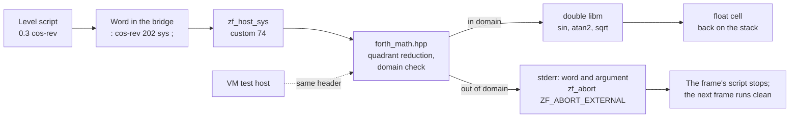
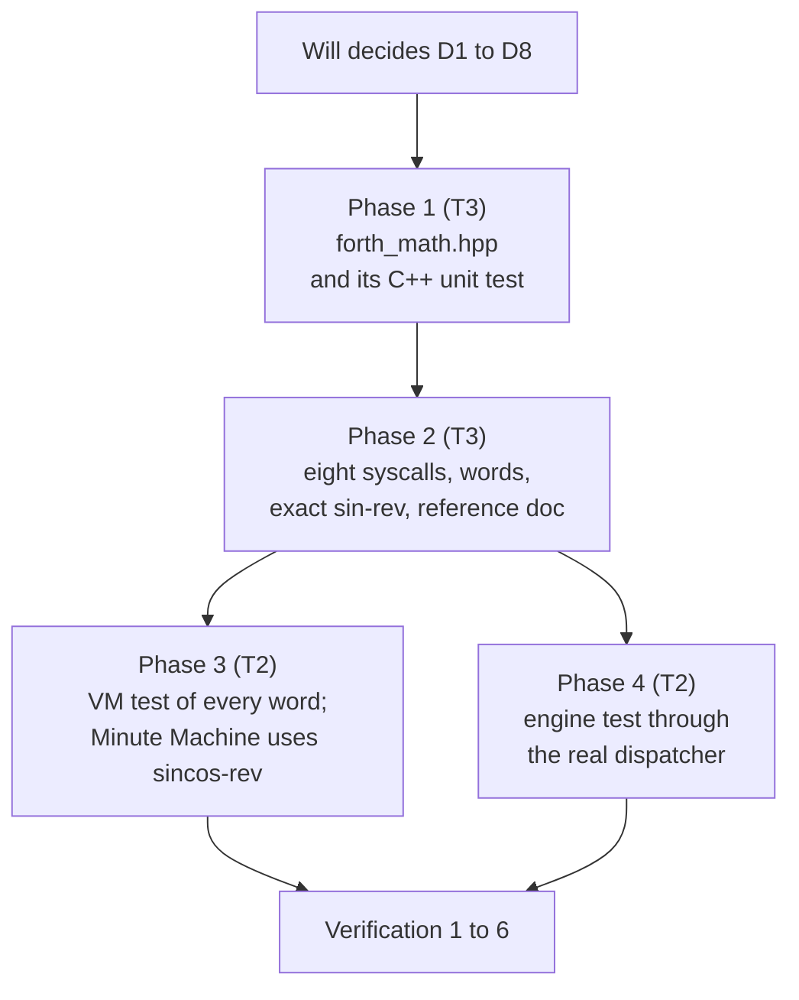

# Forth math words: the full trig set in the zForth bridge

**Status: draft for review, 2026‑11‑21.** Nothing is built. Eight decisions (D1 to D8) wait for Will.

## Context

Will added one Forth word this morning and then asked for the rest. The sequence on 2026‑11‑21:

> "these days, probably nothing is cheaper than a real sine on a real cpu's fp hw"
>
> "might as well add the rest of the trig functions, too. write plan in docs/plans/ and open in browser"

The first remark turned the Minute Machine's parabola into a real sine: `sin-rev ( revolutions -- sin )`, syscall 201 in [`scripting_zforth.cc`](../../engine/stubs/scripting_zforth.cc), committed in `dc33b4eb`. It cut the director's worst error against the reference model from 15 mm to 0.0016 mm. This plan adds the rest of the family and makes the whole set exact where scripts need it to be.

### What exists today

| Fact | Evidence |
|---|---|
| zForth ships no trig. The bridge has `sin-rev` and nothing else | `grep -n 'sin-rev' engine/stubs/scripting_zforth.cc` finds the word and its syscall only |
| It has no square root either. C++ has `fsn_isqrt` for the file-system level, and Forth cannot call it | `scripting_zforth.cc:203` |
| **13 hand-rolled definitions in 7 level scripts**, each a rational approximation written in Forth | table below |
| The hand-rolled sine is a parabola that is about 0.16 % off, which is what put the Minute Machine camera 14 mm out at 10 m. Nobody has measured the hand-rolled arctangent | [Minute Machine plan, what was built](2026-11-21-sixty-second-chain-reaction.md#what-was-built-and-where-it-differs) |
| `sin-rev` is not exact at the quarter turns: `sin-rev 0.5` gives about 1.2 × 10⁻¹⁶, not 0. A script that tests `= 0` or divides by it gets junk | `std::sin(2π · 0.5)` in double |
| An engine failure should be loud, never skipped. The Forth VM already aborts on a division by zero | the engine fails loudly and never skips and logs (Will, 2026‑11‑14, on a NULL guard: "that's antithetical to the design philosophy of the game engine"); `zforth.c:670` aborts on division by zero |

| Script | Hand-rolled definitions |
|---|---|
| `wflevels/aquarium_tanks/controller.fth` | `tk-sin`, `tk-cos`, `tk-atan-oct`, `tk-atan2` |
| `wflevels/aquarium_blue_shrimp/shrimp.fth` | `sh-sin`, `sh-cos`, `sh-atan-oct`, `sh-atan2` |
| `wflevels/aquarium_sea_stars/sea_star_player.fth` | two |
| `wflevels/aquarium/clownfish_idle.fth` | two |
| `wflevels/aquarium/school_rig.fth`, `barb_school_rig.fth` | one each |
| `wflevels/condo_639_640/camera_controls.fth` | one |

(Counted with `grep -rn -E '^: [a-z0-9]+-(sin|cos|atan2|atan-oct|tan|asin|acos|atan) ' wflevels --include=*.fth`: 13 lines in 7 files. Phase 1 re-counts them.)

## Decisions for Will

Each row has a recommendation and its alternatives.

| # | Decision | Recommendation | Alternatives |
|---|---|---|---|
| D1 | Which words | **Eight:** `cos-rev`, `tan-rev`, `asin-rev`, `acos-rev`, `atan-rev`, `atan2-rev`, `sincos-rev`, `sqrt` (with the existing `sin-rev`, the full circular set plus the square root every `atan2` user needs for a distance) | Only the six circular functions. Or add the six hyperbolic ones (`sinh`, `cosh`, `tanh`, `asinh`, `acosh`, `atanh`): nothing in the repository uses them, so they would be untested speculation |
| D2 | Angle unit | **Revolutions only**, every word suffixed `-rev`, like `sin-rev` and like the engine's Euler angles `a`, `b`, `c` | Also radian words (`sin`, `cos`, …): two units in one script is how a 360 ends up in a radian argument |
| D3 | Exactness | **Exact at the quarter turns.** `sin-rev` and `cos-rev` give exactly 0, 1, 0, −1 at 0, ¼, ½, ¾ of a turn, by reducing the argument to a quadrant first, and are odd and even functions exactly: `sin-rev (−x)` = −`sin-rev x` | Call `std::sin(2π x)` directly, as `sin-rev` does today |
| D4 | Domain errors | **Fail loudly:** print the word and the argument to stderr, then abort the script's frame (`ZF_ABORT_EXTERNAL`). The domain errors are `asin-rev` and `acos-rev` outside −1 to 1, `tan-rev` at exactly ¼ or ¾ of a turn, and `sqrt` of a negative (the [words table](#the-words) has each one). The one tolerance: an argument up to 10⁻⁶ outside −1 to 1 is clamped, because the dot product of two unit vectors in a 32-bit cell is often 1.0000001 | Return 0 and keep going. The engine's rule is against that |
| D5 | One implementation | **A header-only `engine/stubs/forth_math.hpp`**, used by the bridge and by the VM test host, so the tests run the code that ships | Write the maths in the bridge and again in the test host |
| D6 | Migrating the 13 hand-rolled definitions | **A separate item, after this one.** Each one changes motion slightly, because an approximation becomes the true value, and ten shipped tanks have captures and checks. Folded into this plan, a seven-file behaviour change would hide inside a maths-library addition. The consumer in this plan is the Minute Machine director | Migrate them here |
| D7 | `sincos-rev ( rev -- sin cos )` | **Yes, one syscall for both.** `tk-root` computes the sine and cosine of the same pitch and roll angles back to back, and a rotation matrix always needs the pair | Leave the pair as two calls |
| D8 | Precision and speed | **Double inside, float out.** `zf_cell` is a 32-bit float, so each result is the correctly rounded double result, within one ulp of the true value. No tables and no fixed point: a hardware sine is both faster and exact | Look-up tables, to save the call |

## The words

All angles are in **revolutions**. `sincos-rev` leaves the sine below the cosine, so `sin cos` reads in that order.

| Word | Stack effect | Range of the result | Domain error |
|---|---|---|---|
| `sin-rev` (exists) | `( rev -- sin )` | −1 to 1 | none; exact 0, 1, 0, −1 at the quarter turns (D3) |
| `cos-rev` | `( rev -- cos )` | −1 to 1 | none; exact at the quarter turns |
| `sincos-rev` | `( rev -- sin cos )` | each −1 to 1 | none |
| `tan-rev` | `( rev -- tan )` | any | **an argument of exactly ¼ or ¾ of a turn** (the tangent is infinite); the argument is exact, so the test is exact |
| `asin-rev` | `( x -- rev )` | −¼ to ¼ | \|x\| > 1 + 10⁻⁶ |
| `acos-rev` | `( x -- rev )` | 0 to ½ | \|x\| > 1 + 10⁻⁶ |
| `atan-rev` | `( x -- rev )` | −¼ to ¼, never reached | none |
| `atan2-rev` | `( y x -- rev )` | −½ to ½, with +½ for (0, −1) | none: `0 0 atan2-rev` is 0, as `tk-atan2` already treats a zero vector (its heading is undefined) |
| `sqrt` | `( x -- r )` | 0 or more | x < 0 |

`atan2-rev` takes `y` first, then `x`, as in C and in `tk-atan2`, so `dy dx atan2-rev` is the heading of the vector (dx, dy) in the engine's own convention: 0 along +x, ¼ along +y.

## How a call reaches the hardware



The bridge gets syscalls 74 to 81 (`sys` 202 to 209), registered in the same `kFlWords` table that registers `sin-rev`. Custom 72 (`sys` 200) is the neural-forth gate and custom 73 is `sin-rev`, so these are the next free numbers.

## Phases



- **Phase 1, the maths** (T3). `forth_math.hpp`: pure functions on `double` that return a value and an error code, with no engine types, so a test includes it alone. Quadrant reduction for the circular functions (D3), the domain checks and the clamp (D4). `tests/forth_math_test.cpp` and a `task test-forth-math`, in the same shape as `task test-wall-clock`. Phase 1 also re-counts the 13 hand-rolled definitions and measures, for the record, how far each is from the true function (the parabola's 0.16 % is known; the arctangent's is not).
- **Phase 2, the bridge** (T3). The eight syscalls and their words, `sin-rev` moved onto the exact implementation, one message per domain error before the abort. `docs/forth-math-words.md`: the table above, with the units and the domains, linked from `docs/scripting-languages.md`.
- **Phase 3, the VM test** (T2). `tests/verify_forth_math.py`, modelled on `tests/verify_forth_source.py` and on `tests/verify_minute_machine_forth.py`: it compiles the real zForth VM with a host that calls `forth_math.hpp`, and runs every word. The Minute Machine's VM host drops its private `sin-rev` and uses the shared header, and the director's camera switches from `.25 + mm-sin` to `sincos-rev`.
- **Phase 4, the engine test** (T2). `tests/verify_forth_math_engine.py`, modelled on `tests/verify_forth_reload.py`: hot-load a script that computes each word and writes the results to mailboxes, in the real engine, and read them back through the debug bridge. This is the only test that goes through the bridge's own dispatcher rather than a copy of it.

This is not a Dream or an Android change, so there is no cast1 step. The Minute Machine's cast1 run, which is separate, picks the words up when the next APK is built.

No mockups: the change has no visible surface (a script-language library).

## New and changed files

| Path | New / changed | What |
|---|---|---|
| `engine/stubs/forth_math.hpp` | new | the maths, header-only |
| `engine/stubs/scripting_zforth.cc` | changed | syscalls 74 to 81, the word table, `sin-rev` on the shared code |
| `tests/forth_math_test.cpp`, `Taskfile.yml` (`test-forth-math`) | new / changed | the C++ unit test |
| `tests/verify_forth_math.py` | new | every word in the real VM |
| `tests/verify_forth_math_engine.py` | new | every word in the real engine |
| `tests/test_forth_math_docs.py` | new | the doc's table equals the registered table |
| `docs/forth-math-words.md`, `docs/scripting-languages.md` | new / changed | the reference |
| `tests/verify_minute_machine_forth.py`, `wflevels/minute_machine/forth.py` | changed | the shared header; `sincos-rev` for the camera |

## Out of scope

- Migrating the 13 hand-rolled definitions in 7 level scripts (D6). It becomes its own TODO item, with each script's existing check as its verification.
- The six hyperbolic functions, unless D1 adds them.
- Radian words (D2).
- Vector and matrix words, quaternions, and random numbers.
- The other script engines. Lua and JavaScript have their own `Math`, and the WebAssembly and neural-forth paths are untouched.

## Verification

1. The C++ unit test passes: exact values at the quarter turns for `sin-rev` and `cos-rev`, the odd and even symmetries, `sin² + cos² = 1` to 10⁻⁷, `asin-rev (sin-rev x) = x` and the other round trips, the eight directions of `atan2-rev`, every domain error flagged, an argument 10⁻⁷ over 1 clamped and one 10⁻⁵ over refused, and 100 000 random arguments within one float ulp of a `long double` reference.
    ```
    task test-forth-math
    ```
2. Every word runs in the real zForth VM, leaves both stacks empty, and a domain error aborts with the VM's external-abort code and leaves the VM usable on the next call. 10 000 calls grow neither the dictionary nor the stacks.
    ```
    python3 tests/verify_forth_math.py
    ```
3. Every word works through the engine's own dispatcher.
    ```
    scripts/in-linux-container.sh scripts/build-wf-game-container.sh --dev
    WF_CONTAINER_ENV="WF_GAME=/build/wf-game-dev/src/engine/wf_game" scripts/in-linux-container.sh bash -c 'timeout 400 xvfb-run -a -s "-screen 0 1280x720x24" python3 tests/verify_forth_math_engine.py'
    ```
4. The Minute Machine director still matches its reference model with the shared header and `sincos-rev`, with no worse an error than today's 0.0016 mm, and the engine still matches its reference.
    ```
    python3 tests/verify_minute_machine_forth.py
    WF_CONTAINER_ENV="WF_GAME=/build/wf-game-dev/src/engine/wf_game" scripts/in-linux-container.sh bash -c 'timeout 900 xvfb-run -a -s "-screen 0 1280x720x24" python3 scripts/check-minute-machine.py --compare'
    ```
5. The reference document lists exactly the words the bridge registers, with the same stack effects.
    ```
    python3 -m pytest tests/test_forth_math_docs.py -v
    ```
6. Nothing else moved: the existing Forth tests still pass.
    ```
    task test-forth-source && python3 -m pytest tests/test_minute_machine_forth.py tests/test_minute_machine_timeline.py tests/test_minute_machine_channels.py -q
    ```
