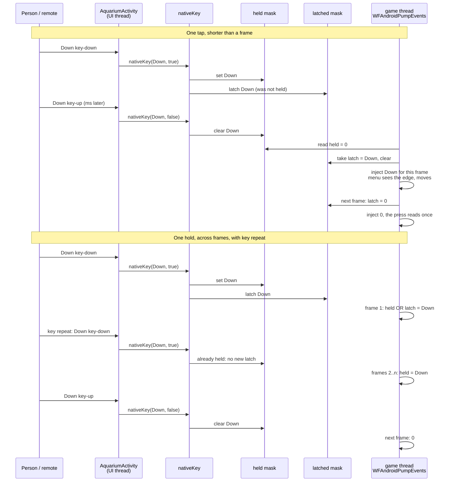

# The launcher menu's key latch: a short press is never lost

## Context

On cast1 (Chromecast HD), 2026‑11‑21, the one Aquarium app's launcher menu (`org.worldfoundry.screensaver`, `.AquariumActivity`, `TankPlayer.MENU`) ignored a coordinator `remote-tap` of Down and of Select, while a 300&nbsp;ms `remote-hold` worked; Back worked because `backPending` already latches.
`nativeKey` in `android/screensaver/src/main/cpp/dream_host.cc` sets a held mask (`menuButtons`) on key‑down and clears it on key‑up from the UI thread, and the game thread samples it once per frame in `WFAndroidPumpEvents`; frames on this device are about 200&nbsp;ms apart, so a press shorter than one frame can be set and cleared between two samples.
The level menu (`wfsource/source/game/level_menu.cc`) acts on an edge, `buttons & ~prev_`, so it needs to see a press in at least one frame.

## Decision

Keep the held mask and add a second atomic mask, the **latch**: presses since the game thread last read the menu input. Both live in a small pure header, `android/screensaver/src/main/cpp/menu_key_latch.h` (class `MenuKeyLatch`, no Android or engine types):

- `keyDown(mask)`: OR the mask into the held mask, and latch only the bits that were not already held, so Android's key repeat (more key‑downs while held) queues nothing.
- `keyUp(mask)`: clear the held bits; a latched press that has not been read yet stays latched.
- `takeFrame()`: the game thread, once per frame in `WFAndroidPumpEvents`: return held OR latched, and clear the latch.
- `clearLatch()` / `clear()`: drop the latch only, or the latch and the held mask.

`dream_host.cc` replaces `std::atomic<uint32_t> menuButtons` with one `MenuKeyLatch menuKeys`. `nativeKey` calls `keyDown`/`keyUp`; `WFAndroidPumpEvents` feeds `HALInjectJoystickButtons(menuKeys.takeFrame())`. `clear()` runs where `menuButtons.store(0)` ran (`nativePrepare`, and the end of `nativeRun`) and when `nativeRun` enters menu mode; `clearLatch()` runs on the game thread when `levelmenu::SelectorVisible()` changes, that is when a tank starts from the menu or the menu comes back. The held mask is left alone there, so a key still held keeps its present meaning.

Screensaver host only. The game app, the Dream, `ScreensaverPreviewActivity`, `LaunchMode` and the saved choice do not change. The game app (`native_app_entry.cc`) drains its input queue inside the same per‑frame pump, so a key‑down and key‑up queued in one pump would cancel there too; it is noted below, not changed here.

## Edge cases

| Case | Expected |
|---|---|
| Press and release inside one frame | reads pressed for exactly that one frame, then clear |
| Key held across frames | reads pressed every frame until released |
| Key repeat while held | no extra latched frame after release |
| Release before the frame reads a latched press | the held bit clears; the press still reads once |
| Two different keys pressed in one frame | both read in that frame |
| Menu start (`nativePrepare`, `nativeRun` entering menu mode), end of a run | latch and held mask cleared |
| A tank starts from the menu, or the menu comes back | latch cleared on the game thread |
| Two taps of one key inside one frame | read as one press (one frame of input cannot carry two edges); acceptable |

## Mockups

No visible surface: the menu draws exactly as before; only which key presses reach it changes.

## Verification

1. `task test-menu-key-latch`: the helper's cases compiled with g++ in `wf-linux-test:local`.
2. `scripts/in-linux-container.sh python3 -m pytest tests/test_one_aquarium_app.py -q`: the source checks, including that `nativeKey` latches and `WFAndroidPumpEvents` consumes the latch.
3. `df -h /`, then, only with at least 4&nbsp;GB free, `task build-aquarium-screensaver-apk`.
4. Copy the APK to `build/screensaver-aquarium-menu-latch-<short-commit>.apk`; record its size and sha256.
5. On cast1 (Will): install, start the menu with `am start -n org.worldfoundry.screensaver/.AquariumActivity`, then a coordinator `remote-tap` of Down moves the highlight from "1 / 11" to "2 / 11", and a `remote-tap` of Select starts the tank.

### Results

(recorded after the run)
