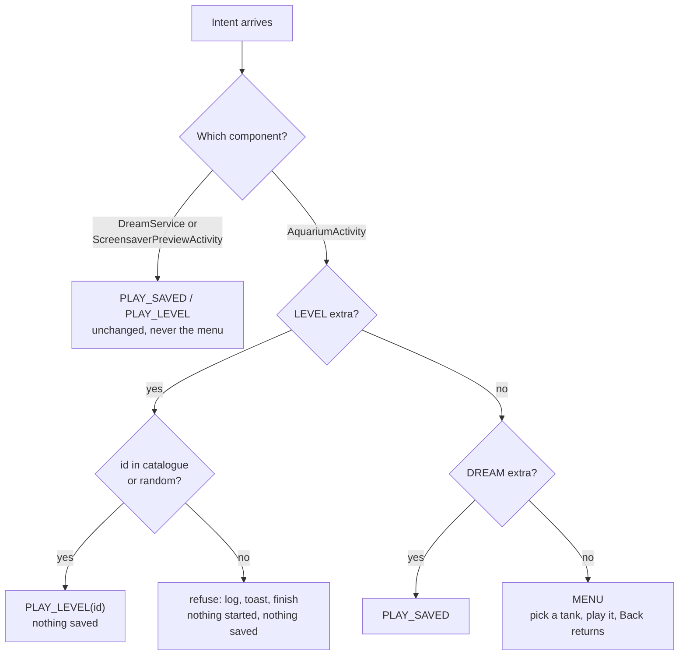
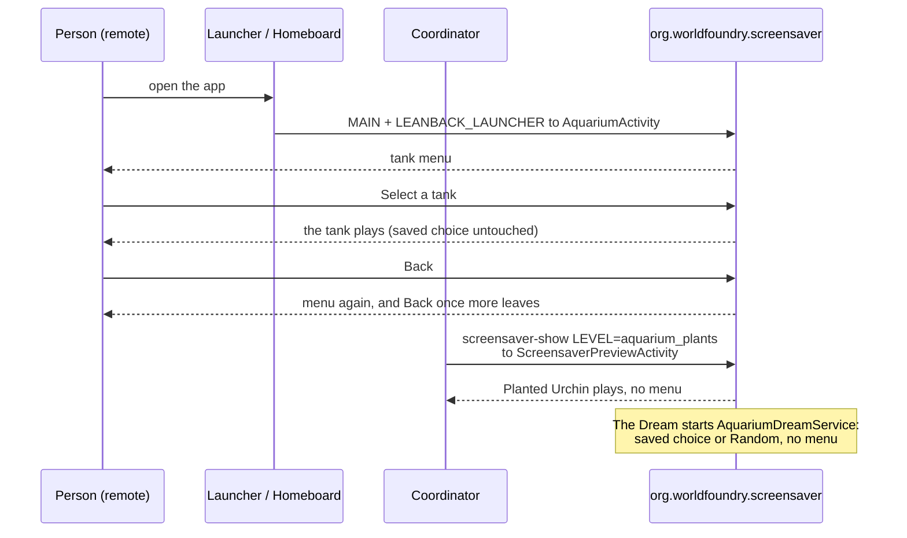
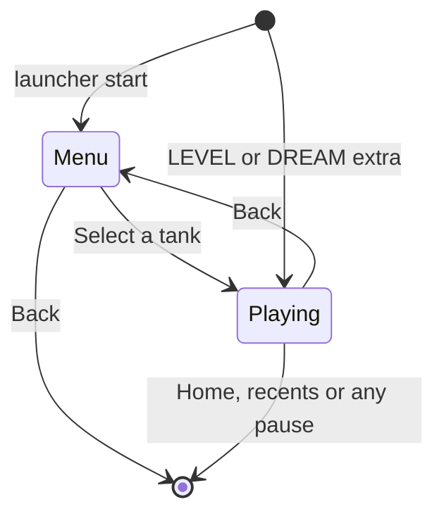

# One Aquarium app: the tank menu when launched normally, the screensaver when started as one

Date: 2026‑11‑21  
Status: plan written by the coordinator session for Will; the implementing agent records what it measures and decides under **Open for the implementer**, then builds. **Built 2026‑11‑21** (branch `one-aquarium-app`); Verification 1 to 3 and 8 recorded below; 4 to 7 wait for the coordinator session on Cast1. Nothing is installed.

## Context

Will launched the installed Aquarium screensaver by hand on Cast1 and got a random tank with no menu. That is right for a screensaver and wrong for a normal launch. He wants **one app** that decides by how it was started (Will, 2026‑11‑21: "i wanted these to be the same app" and "have it decide what to do based on whether it's being invoked as a screensaver or launched normally"). This is also Homeboard decision 4 ("one APK that is both the playable app and the Dream"), which the [launch plan](2026-11-21-aquarium-menu-and-screensaver-launch.md) listed as out of scope while promising not to bake in the split.

Today there are two packages:

| | Playable app | Screensaver |
|---|---|---|
| Package | `org.worldfoundry.wf_game.aquarium` | `org.worldfoundry.screensaver` |
| Normal launch | the engine's tank menu (`wflevels/aquarium-menu-cd.iff`); Back in a tank returns to it | `.AquariumActivity` calls `LevelLaunch.startChosen(…, null)`: plays the saved choice, default `random`; **no menu** |
| As a Dream / preview | none | `AquariumDreamService`; `ScreensaverPreviewActivity` (exported; `DREAM` and `LEVEL` extras) |
| Settings | none | `TankSettingsProvider` (authority `org.worldfoundry.screensaver.settings`), SharedPreferences `screensaver`/`tank` |

## Decisions (made 2026‑11‑21; the implementer does not reopen them)

1. **`org.worldfoundry.screensaver` survives.** It is already the Dream, is registered in the coordinator (`applications.json` key `screensaver`) and in Homeboard, and owns the saved choice and the `LEVEL` extra. Its DreamService, preview activity, provider authority, preference keys and `LEVEL` contract do not change.
2. **`org.worldfoundry.wf_game.aquarium` stays installed and unchanged for now.** **Superseded 2026‑11‑22:** Will wants one APK, so it is retired; see [One Aquarium APK](2026-11-22-one-aquarium-apk.md). The coordinator, Homeboard's directory and diagnostics still name it. Retiring it is a later decision; this task only lists what references it.
3. **The menu changes nothing that is saved.** Choosing a tank in the menu starts it for that run. It never writes `screensaver`/`tank`; `setSetting tank:<id>` stays the only way to change what the Dream plays.
4. **One roster.** A tank is added in one place, `wflevels/aquarium-menu.manifest`, read by one `LevelCatalog` (Phase 2 of the launch plan). The menu and the Dream both read it. No second list.

## How the app tells the two modes apart

`AquariumActivity` is the only activity that gains a menu. The Dream (`AquariumDreamService`) and `ScreensaverPreviewActivity` are separate classes and keep calling `LevelLaunch.startChosen`, so they can never show it.

| Signal on the incoming intent to `AquariumActivity` | Mode |
|---|---|
| `LEVEL` extra present (a catalogue id or `random`) | **PLAY_LEVEL(id)**: `LevelLaunch.startChosen(…, id)`; an unknown id is refused as the `LevelLaunch` contract says (log, toast, finish, nothing saved) |
| `DREAM` extra present | **PLAY_SAVED** (automation asked for the screensaver's content; today's behaviour) |
| Neither extra: a plain `MAIN` + `LEANBACK_LAUNCHER` or `LAUNCHER` start by the launcher or a person | **MENU** |
| Any start through `ScreensaverPreviewActivity` or the DreamService | **PLAY_SAVED** or **PLAY_LEVEL** exactly as today, never the menu |

The decision is one pure function (intent facts in, `MENU` / `PLAY_SAVED` / `PLAY_LEVEL(id)` out) with no Android types, so a JVM test covers every row. Homeboard's "Start now" and the coordinator's `screensaver-show` use `ScreensaverPreviewActivity`, so they never reach the menu.







The activity already finishes on `onPause`, so leaving the app by Home or recents ends the run and the next launch starts fresh (a menu again). Only Back inside a tank is new: it returns to the menu instead of finishing.

## Open for the implementer (measure, then decide, then record here)

1. **How the menu is drawn.** Preferred: the engine's own tank menu from the playable app, so the two look identical, which needs the menu bundle (`aquarium-menu-cd.iff`) in the one APK next to the autopilot bundle (`aquarium-screensaver-cd.iff`) and `TankPlayer` choosing the bundle by mode. Measure the combined APK size (the two APKs are about 10.6 MB and 11.3 MB today) and whether the engine can open either bundle at runtime. **Fallback**, only if the combined size or the engine rules it out: a Java list of the catalogue labels (D‑pad up and down, Select) in front of `TankPlayer`. That is a new visible surface, so the fallback needs a mockup under `docs/plans/2026-11-21-one-aquarium-app/` before it is coded.
2. **Back from a tank to the menu** in the engine menu: does the menu bundle already do it (it does in the playable app), and does it still work when the APK also holds the autopilot bundle?
3. **What else treats `.AquariumActivity` as "plays a tank".** The coordinator registry's `activity` for `screensaver` (used by `verify-launch`) will now land on the menu, which stays resumed, so the check should still pass; confirm by reading `applications.json` and the launcher verification, and list anything that would show the menu where a tank was expected (a screenshot in `verify-launch`, for example). Nothing in the coordinator is changed by this task.
4. **Sea Stars.** It is being merged by another agent on `feat/sea-stars`. Say what the later merge needs (the manifest line and `LevelCatalog` already carry the roster, so it should need no menu change).

### Decided by the implementer (2026‑11‑21)

**1. The engine's own menu, two bundles in one APK, chosen per run.** No Java list, so there is no new visible surface: the menu is the game app's, pixel for pixel, and needs no mockup. What the code allows, read from the source:

- The screensaver's native host (`android/screensaver/src/main/cpp/dream_host.cc`) already links the whole engine, the level menu included; it hides the menu only by clearing `levelmenu::Drawer()` every frame. A positional level argument sets `_overrideLevelNum` (`game.cc`), which skips the menu; without one, the menu bundle's `shell-menu.fth` asks the player (`RunLevelMenu`). So the menu needs no second native library and no `NativeActivity`: the launcher activity runs the same `TankPlayer` with the sentinel level `TankPlayer.MENU` (‑1), and the host then passes no positional level, keeps the drawer, and forwards the remote's keys.
- The engine opens a bundle by the fixed name `cd.iff` (`game.cc`, `ui_font_engine.cc`). The APK keeps the autopilot bundle as `assets/cd.iff`, untouched for every screensaver start, and adds the game app's menu bundle as `assets/menu-cd.iff` (a symlink to the tracked `wflevels/aquarium-menu-cd.iff`, as the game app's own asset is). One Android-only setter in the asset accessor, `WFAndroidSetBundleAsset`, redirects the engine's `cd.iff` for that run; the game app never calls it and is unchanged.
- **Rejected: one merged bundle** (22 levels, the menu listing the playable half). Same bytes, but the assets are stored deflated and opened with `AASSET_MODE_RANDOM`, so a seek reinflates from the start of the asset: every tank behind 25&nbsp;MB of the other mode's levels would load slower, and it needs a new build product. Two bundles keep each mode's loading exactly as in today's two apps.
- **Rejected: the game app's `NativeActivity` and `libwf_game.so` inside this package.** A second copy of the engine (about 1.7&nbsp;MB compressed per ABI) and Java shared across two Gradle modules, to get the phone controller, which a TV-only menu does not need.
- Size: the menu bundle is 25&nbsp;239&nbsp;552 bytes raw, 6&nbsp;838&nbsp;028 gzip‑6 (`gzip -6 -c wflevels/aquarium-menu-cd.iff | wc -c`), so the APK should grow from about 10.6&nbsp;MB to about 17.4&nbsp;MB. Built: **17&nbsp;386&nbsp;111 bytes** (Verification 3), against 10&nbsp;593&nbsp;217 for the last screensaver build in the main checkout.

**2. Back.** The game app's rules, moved onto the game thread of the screensaver's host (`applyMenuBack`): an open settings form closes first, Back in a tank calls `levelmenu::RequestReturn()` (the engine's own return to the menu, used by the game app), Back on the menu ends the engine, and `TankPlayer` then finishes the activity and ends the process as after any run. The menu bundle is the game app's file and is opened alone, so the autopilot bundle beside it changes nothing in it. The remote's key table moves to one header, `hal/android/key_map.h`, used by both hosts.

**3. What else treats `.AquariumActivity` as "plays a tank".** Read, not changed: the coordinator's `applications.json` entry `screensaver` has `"activity": "org.worldfoundry.screensaver/.AquariumActivity"` beside `preview_activity` `.ScreensaverPreviewActivity` with `preview_extra` `DREAM` and `level_launch_extra` `LEVEL`. `screensaver-show` uses the preview activity, so it is unchanged. A plain `launch` or `verify-launch` of the app starts `.AquariumActivity` with no extras and now lands on the menu, which stays resumed; nothing in the coordinator's scripts parses the `wf_dream` log or `AquariumActivity` (`grep -rn "wf_dream\|start level\|AquariumActivity" scripts` there finds nothing), so only a screenshot that expects a tank would differ. The coordinator's `aquarium` entry is the game app (`org.worldfoundry.wf_game.aquarium/android.app.NativeActivity`, eight scenes listed).

**4. Sea Stars.** `feat/sea-stars` (tip `b3e77cd0`) is already an ancestor of this branch: the manifest lists `aquarium_sea_stars`, and `git diff HEAD...feat/sea-stars` over `android/screensaver`, the manifest and the screensaver bundle script is empty. A later Sea Stars commit needs no menu change: the menu bundle reads the manifest (`task build-cd-iff-aquarium-menu`). One count is still hard-coded outside the manifest: `dream_host.cc` refuses a level above 10, which a twelfth tank must raise; `tests/test_dream_host_vram.py` now checks it against the manifest and fails when they differ.

**5. Edge cases.**

| Start | What happens |
|---|---|
| Homeboard "Start now" (This TV's screensaver) | "Android's own start screensaver now shortcut" (Homeboard's `docs/how-to/screensaver.md`), so `AquariumDreamService`: a tank, never the menu |
| Coordinator `screensaver-show`; Homeboard Preview and Show on TV now (its Stage 5, planned to use the preview activity) | `.ScreensaverPreviewActivity` with `DREAM` and maybe `LEVEL`: a tank, never the menu |
| Homeboard's app tile, the TV launcher, coordinator `launch` / `verify-launch` | `.AquariumActivity`, no extras: the menu |
| `LEVEL` of another type (`--ei … LEVEL 3`) | read as its text, so refused as an unknown id (`"3"`), never the menu |
| Home, recents, any pause | the activity finishes on `onPause` (as before) and the process ends; the next launch is a fresh menu |
| Back from recents | the task's original intent is replayed: a launcher start gives the menu, an `am start … LEVEL` start gives that tank again |
| Process restore after the menu is backgrounded | none: the activity finishes on pause, so Android never restores it with saved state |
| Up / Down on the menu | the engine's menu cursor; in a tank, the tank's own controls (the same buttons as the game app) |

## Not in this task

- Retiring `org.worldfoundry.wf_game.aquarium`; Homeboard's catalogue text; any coordinator change.
- Installing anything on a device: the coordinator session installs the built APK on Cast1 and checks both modes on a real Chromecast.

## Verification

1. **The mode function.** JVM unit tests cover every row of the table: no extras gives `MENU`; `DREAM` gives `PLAY_SAVED`; `LEVEL=<id>` gives `PLAY_LEVEL(id)`; `LEVEL=random` is accepted; an unknown `LEVEL` is refused as the contract says; the Dream and preview paths never return `MENU`.

    ```
    $ task test-aquarium-launch-mode
    37 checks, 0 failures
    ```

    The same test against the tip's `AquariumActivity` (the launcher started a tank) fails, so it would have caught the report:

    ```
    FAIL AquariumActivity decides through LaunchMode
    FAIL AquariumActivity starts the menu for MENU
    37 checks, 2 failures
    ```

    **PASS.** Rows: no extras `MENU`; `DREAM` `PLAY_SAVED`; `LEVEL=<id>` and `LEVEL=random`, with or without `DREAM`, `PLAY_LEVEL`; `LEVEL` empty, `3` or unknown is `PLAY_LEVEL` and the real catalogue refuses it naming the id; the Dream and preview never reference `LaunchMode`, `startMenu` or `TankPlayer.MENU` and still start through `LevelLaunch`. `task test-level-catalog` still gives `52 checks, 0 failures`.
2. **Saved choice untouched.** A test (or a documented on-device read) shows `screensaver`/`tank` is unchanged after choosing and playing a tank from the menu.

    Covered by the same 37 checks: `TankChoice.set(` has one caller in the package, `TankSettingsProvider.java`, and `AquariumActivity` has no `getSharedPreferences` or `TankChoice.set`. The menu itself runs inside the engine, which has no route to the Java preferences. **PASS** (source guard; the on-device readback belongs with step 4).
3. **The build.** The one APK builds with the repo's own route; record the exact command, the APK path and its size.

    ```
    $ task vendor-unpack-archives     # now a dep of the task below; a fresh worktree has no unpacked Jolt
    $ task build-aquarium-screensaver-apk
    BUILD SUCCESSFUL in 30m 33s
    $ ls -l android/screensaver/build/outputs/apk/aquarium/release/screensaver-aquarium-release.apk
    -rw-rw-r-- 1 will will 17386111 Nov 21 20:16 android/screensaver/build/outputs/apk/aquarium/release/screensaver-aquarium-release.apk
    $ unzip -v …/screensaver-aquarium-release.apk | grep -E "lib/|assets/"
     4364112  Defl:N  1764007  60% … lib/arm64-v8a/libwf_dream.so
     3473952  Defl:N  1731085  50% … lib/armeabi-v7a/libwf_dream.so
    25245696  Defl:N  6793031  73% … assets/cd.iff
        1461  Defl:N      617  58% … assets/levels.manifest
    25239552  Defl:N  6790018  73% … assets/menu-cd.iff
        2627  Defl:N      652  75% … assets/sea-stars-settings.json
    $ aapt2 dump badging … | grep -E "^package|leanback"
    package: name='org.worldfoundry.screensaver' versionCode='3' versionName='0.3' …
    leanback-launchable-activity: name='org.worldfoundry.screensaver.AquariumActivity' …
    $ apksigner verify --print-certs …
    Signer #1 certificate DN: C=US, O=Android, CN=Android Debug
    ```

    **PASS.** `assets/cd.iff` is byte for byte the screensaver bundle the main checkout last built (sha256 `13f7e9a7…1683`, rebuilt here by the task's container step), `assets/menu-cd.iff` is the tracked game-app bundle, and both `libwf_dream.so` carry `TankPlayer_nativeKey`, `TankPlayer_nativeBack`, `WFAndroidSetBundleAsset` and `menu-cd.iff`. A frozen copy is `build/screensaver-aquarium-one-app-61952e23.apk` in the worktree (sha256 `5e2508d4…ec28`).
4. **Normal launch shows the menu on Cast1** (coordinator session): install through `screensaver:install`, start the launcher activity, capture the screen: the tank menu, not a tank.

    **PASS** on cast1 (Chromecast HD), 2026‑11‑22, with `screensaver-aquarium-release.apk` built from `bef848b8`, 18 467 357 bytes, sha256 `a0a44ba7eca9bfee510513db9aedf436168d062c14ed9c7ebf731a463b3195ee`. Installed by job `J‑d297aa348794` (install, then verify-launch: completed, no unresolved effects). A `check` job, `J‑3efc2e7072c3`, started the registered launcher activity `org.worldfoundry.screensaver/.AquariumActivity` and captured the screen at 4 s: the "WF Aquarium / Choose a tank" menu at **1 / 11**, not a tank ([frame](../diagnostics/aquarium-cast1-menu-latch-2026-11-22/menu-1-normal-launch.png)).
5. **Preview and level start unchanged on Cast1:** `screensaver-show` with no level and with `LEVEL=aquarium_plants`: `ScreensaverPreviewActivity` on top, the saved tank unchanged, no menu.

    **PASS** on cast1, 2026‑11‑22. With the Aquarium Dream selected (the original Seahorse Grid selection restored afterwards), `screensaver-show` ran twice. No level, `J‑cf050836b9c6`: `ScreensaverPreviewActivity` on top, `am start … --es org.worldfoundry.screensaver.DREAM aquarium`, a tank playing and no menu ([frame](../diagnostics/aquarium-cast1-menu-latch-2026-11-22/show-no-level-J-cf050836b9c6.png)). With `LEVEL=aquarium_plants`, `J‑a59814391138`: the same activity, the `am start` line also carries `--es org.worldfoundry.screensaver.LEVEL aquarium_plants`, and the Planted Urchin tank plays, no menu ([frame](../diagnostics/aquarium-cast1-menu-latch-2026-11-22/show-level-aquarium_plants-J-a59814391138.png)). The saved `tank` setting reads `random` in the `getCapabilities` result of both runs, so the level start did not write it. **The coordinator task takes the level from `WF_CC_LEVEL`, not `LEVEL=`:** the first attempt (`LEVEL=aquarium_plants task chromecast:screensaver:show …`, `J‑67e5cc5fa71a`) dropped the level silently, and its `am start` line has no `LEVEL` extra, because the coordinator Taskfile maps `OVERRIDES` but not `LEVEL`.
6. **The Dream** still starts a tank and not the menu (select the screensaver, trigger it).

    **PASS** on cast1, 2026‑11‑22, job `J‑95eed06d2d53` (`dream-check`, 380 s, the real system Dream, not a preview): `dumpsys dreams` shows `mCurrentDream` = `org.worldfoundry.screensaver/.AquariumDreamService`, `isPreview=false`, bound ([dumpsys](../diagnostics/aquarium-cast1-menu-latch-2026-11-22/dumpsys-dreams-J-95eed06d2d53.txt), [result](../diagnostics/aquarium-cast1-menu-latch-2026-11-22/dream-check-J-95eed06d2d53.json)); cast1's settings and foreground were restored. The screenshot is solid black (a Dream's surface does not capture), so the tank is proved by the app's engine log instead: its own `wf.log` ([tail](../diagnostics/aquarium-cast1-menu-latch-2026-11-22/aquarium-engine-log-tail-J-8fa27c7326e3.txt), read by `screensaver-list`) shows `=== wf_dream start level 3 of 11 ===` at 1795330303 s, inside the job's window (1795329930 to 1795330309), and no `start the menu` line. The same log's other start, `start level 10 of 11` at 1795329867 s, is the `LEVEL=aquarium_plants` run of step 5 (its `am start` is stamped 1795329867), so the planted tank is level 10 of the screensaver bundle, not 5 as the expected line above guessed; the menu manifest's order and the bundle's order differ, and the run showed the right tank. The Dream's pick was one run, so it proves "a tank, not the menu", not that the pick is uniform.
7. **Back** in a tank returns to the menu; Back in the menu leaves (remote key presses through the coordinator).

    **PASS** on cast1, 2026‑11‑22, same `check` job `J‑3efc2e7072c3` (remote keys through the coordinator's input script, applied on the device clock): DPAD_DOWN moved the menu to 2 / 11 and 3 / 11 (Calm Betta), OK started that tank ([frame](../diagnostics/aquarium-cast1-menu-latch-2026-11-22/tank-4-calm-betta-after-ok.png)), Back in the tank returned to the menu with Calm Betta still selected ([frame](../diagnostics/aquarium-cast1-menu-latch-2026-11-22/menu-5-after-back-in-tank.png), byte for byte the same picture as before the tank), and Back on the menu left the app: the next capture is the Google TV home screen. The job ended `failed` with `target-left-foreground`, which is that last Back: the checker fails a run whose app leaves the foreground. Timeline: [input-timeline.json](../diagnostics/aquarium-cast1-menu-latch-2026-11-22/input-timeline.json).
8. **Nothing else moved:** the JVM suite and the repo's Python roster and manifest tests pass; `git diff --stat` shows no change to the DreamService, `ScreensaverPreviewActivity`'s contract, the provider authority or the preference keys.

    ```
    $ git diff --stat 5c2e263c HEAD -- …/AquariumDreamService.java …/ScreensaverPreviewActivity.java …/TankSettingsProvider.java …/TankChoice.java …/LevelLaunch.java android/screensaver/src/aquarium/AndroidManifest.xml android/screensaver/src/main/AndroidManifest.xml
    $
    $ scripts/in-linux-container.sh python3 -m pytest -p no:cacheprovider -q tests/test_one_aquarium_app.py tests/test_dream_host_vram.py tests/test_screensaver_overlay.py tests/test_aquarium_menu.py tests/test_aquarium_screensaver_catalog.py tests/test_aquarium_screensaver_input.py tests/test_sea_stars_settings.py tests/test_aquarium_android.py
    FAILED tests/test_aquarium_screensaver_catalog.py::test_canonical_planted_tank_keeps_freshwater_default
    FAILED tests/test_aquarium_screensaver_catalog.py::test_built_planted_dream_is_saltwater
    FAILED tests/test_aquarium_android.py::test_aquarium_assets_are_its_cd_iff_and_the_phone_controller
    FAILED tests/test_aquarium_android.py::test_snowgoons_assets_and_main_has_none
    FAILED tests/test_aquarium_android.py::test_no_task_points_at_pre_flavor_apk_paths
    5 failed, 68 passed, 32 skipped in 25.53s
    ```

    **PASS for this change, with five failures that are not it.** The diff over the Dream, the preview, the provider, the preference keys, `LevelLaunch` and both manifests is empty. The five failures fail the same way on a clean checkout of the tip `5c2e263c`: two need `wftools/wf_attr_edit/target/release/catalog`, which is not built in a fresh worktree, and three assert the game app's asset list (it now has `wf_args.txt`), `src/main/assets` (it now has `runtime-property-ui.json`) and an old `chromecast-aquarium` command. `test_dream_host_vram.py` also failed on the tip (it read `TankChoice.IDS`, removed in `ec9b872e`) and now passes, reading the manifest. JVM: steps 1 and 2.
