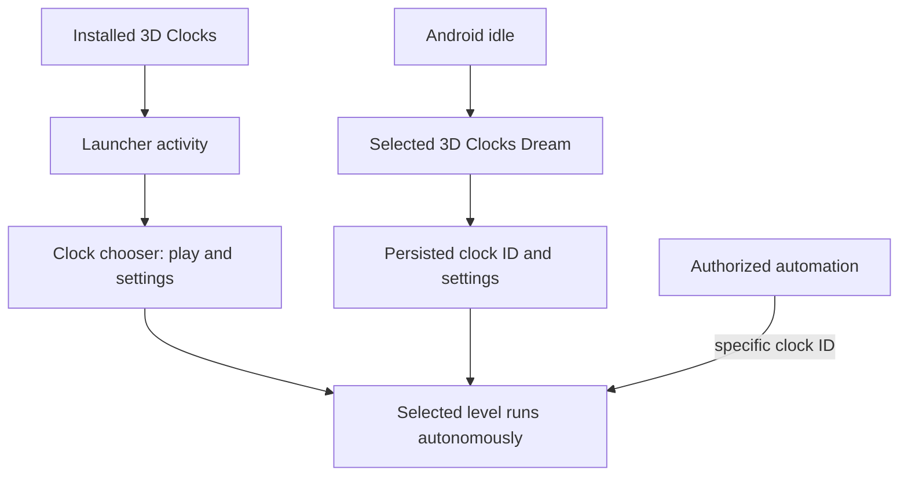

# World Foundry screensavers: shared 3D Clocks app and settings remediation

**Status: proposed, 2026‑11‑21.** This plan covers the supporting app and screensaver behavior, plus an audit and remediation of **all existing World Foundry screensaver levels**. The [Cuckoo Village level plan](2026-11-21-cuckoo-village.md) owns its scene, choreography, visual assets and level-specific settings. The shared 3D Clocks package is already being worked on; integrate with that work rather than build a competing package. No engine changes are authorized by this plan.

## Scope and current evidence

All World Foundry clock implementations belong in one 3D Clocks package; Cuckoo Village is the third. Reconcile the separate-app proposal in the [Minute Machine plan](2026-11-21-sixty-second-chain-reaction.md) with this requirement and the actual concurrent implementation. Record the package ID, revision, catalog and build commands once agreed with that work. The shared package and its unattended launch paths have not yet been demonstrated in this checkout; treat them as acceptance criteria, not confirmed capabilities.

The current checkout's [screensaver module](../../android/screensaver/README.md) describes Aquarium, Seahorse Grid and Planted Tank as separate APKs. Its README says eight Aquarium variants, but [TankChoice.java](../../android/screensaver/src/main/java/org/worldfoundry/screensaver/TankChoice.java) currently lists ten: Clownfish, Blue Shrimp, Betta, Jellyfish, Lionfish, Planted Urchin, Arowana, Tiger Barbs, Thai Reef and Thai Reef Anime. Reconcile source, bundles, installed versions and documentation during the audit. Seahorse and Planted each have a separate level. Settings providers and saved preferences exist for some apps; that alone does not prove a user-accessible dialog exists for every level. Discover any other shipped, installed or in-progress World Foundry screensavers and include them too. Record versions and evidence; do not assume this starting inventory is exhaustive.

## Package and launch contract

1. A normal app launch opens a remote-operable chooser listing every bundled clock, including all three initial implementations. Each entry offers Play and Settings. Once selected, the level runs continuously without input. The chooser itself is interactive.
2. Provide a documented, authorized automation entry that starts a specific stable clock ID directly without navigating the chooser or requiring human intervention. Define and test the actual invocation, export and access controls alongside the concurrent package. Reject invalid IDs clearly; do not silently substitute a different clock. A one-off launch need not change the saved Dream choice.
3. Save a specific clock for the Dream. Once the Android Dream and idle policy have been configured, the system starts that clock directly on every idle activation, process restart and reboot, with no chooser or human input. Document a deterministic default when no clock is saved. Installation alone does not select a Dream or configure idle behavior; see the [platform investigation](../investigations/2026-10-17-chromecast-screensaver-from-a-level.md).
4. Launcher, automation, settings and Dream use one catalog and the same assets. Previewing a clock must not overwrite the persisted Dream selection. Preserve stable IDs across updates and make it straightforward to add all future World Foundry clocks to this package. Verify all existing clock implementations after integration.

## Settings contract for every World Foundry screensaver level

Every level, including one with only common options, gets an accessible settings dialog. The launcher exposes Settings for each level; where the platform exposes Dream settings, offer an entry to the selected level's dialog. A shell-only provider or tray control is useful automation support but does not replace the dialog. The dialog names the level and supports TV remote navigation, current values, defaults, validation, Save, Cancel and reset-to-default. Save persists per-level preferences across process and Dream restarts; Cancel leaves saved values unchanged; reset applies to that level only. Apply saved changes at the next level start unless live application is explicitly implemented and tested. Existing unrelated preferences and Dream choices must survive upgrade. Settings cannot leak between levels.

Keep settings out of the running noninteractive Dream; remote input still wakes it. Reuse the existing settings schema, actor fields and providers where appropriate so the dialog and coordinator agree on values, validation and persistence. Do not expose diagnostic time overrides to customers. The [village plan](2026-11-21-cuckoo-village.md#level-settings) defines sound, window lights, camera motion and orientation for Cuckoo Village. Common orientation and any level-specific settings must reflect actual supported behavior, not decorative controls.

## Inventory, audit and remediation

Produce a checked-in inventory from manifests, catalogs, bundles, source, build variants and installed device evidence. For **each level**, record package and level ID, artifact/revision, launcher and Dream entry, current settings and defaults, persistence source, accessible dialog and provider, gaps, required fix, and automated/device evidence. Explicitly enumerate the ten Aquarium IDs above, Seahorse Grid, Planted Tank, all clock levels and any additional discoveries. Mark missing or unverified information as such. Check both standalone and bundled forms where the same level ships in more than one place.

Remediate every discovered gap within this plan: add or repair the dialog, wire each supported setting to the correct level, align UI and provider validation, preserve existing preferences, and correct stale catalog and README documentation. A level with no unique configuration still gets a dialog with the applicable shared settings. If a useful control would require an engine change, document the exact proposal and seek explicit permission before engine edits; complete independent app, tooling and asset work meanwhile. Track any blocked item with its owner and reason, and do not call the sweep complete until it is resolved and retested.

Use the existing package boundaries for Aquarium, Seahorse and Planted unless a separately approved design changes them; this sweep does not imply moving non-clock levels into the clock package. Coordinate changes in shared files with ongoing work. Verify that device configuration or settings migrations do not accidentally change which Dream is selected.

## Implementation and verification

1. **Baseline:** coordinate with the active clock-package work; freeze the inventory and compare current source with installed artifacts. Record working and missing settings paths, per-level IDs and values, and the initial selected Dream. Establish a reproducible build for each affected APK.
2. **Build shared app integration:** implement or complete the catalog, chooser, direct launch and persisted Dream selection in the existing package effort. Integrate all clock levels and their settings, including Cuckoo Village. Reconcile the earlier Minute Machine proposal. Check clean install, upgrade, invalid IDs, absent or corrupted preference handling and catalog-to-bundle consistency.
3. **Sweep and fix:** implement and test the settings contract for every level in the inventory; update user-facing documentation and the inventory with fixes and evidence. Exercise defaults, changes, Save, Cancel, reset, validation, persistence, isolation and any prior settings migration. Verify UI and provider read/write the same values. Repeat the inventory after remediation to catch omissions.
4. **Installed acceptance:** build and freeze APKs locally before coordinator submission. Check queue and reservations and use owned sessions through cleanup. On cast1 and cast2 open the clock package to its chooser, select each clock and open its settings; independently launch a specific level using the documented automation interface with no human input. Save Cuckoo Village as the Dream, trigger natural idle, wake and repeat after process restart and reboot, recording package version, selected ID, on-screen evidence and restored original device state. Confirm the chooser preview does not change the Dream selection. Exercise each other screensaver's settings dialog and actual level behavior on device, with screenshots and settings readback; exercise at least one changed setting per level, or a shared setting when it has no unique setting. Test TV remote navigation and wake/restart lifecycle; for any TV WebView honor the [WebView 91 minimum](../reference/chromecast-webview-compatibility.md), including held and released directional input on cast2.
5. **Report:** link the inventory, test results, screenshots and coordinator evidence for each package and level. If a coordinator workflow cannot exercise a path, explicitly report the gap; no direct-device fallback. Do not claim installed unattended behavior or sweep completion without successful evidence.

Acceptance requires all clock implementations in the shared package, both installed launch paths verified, a persistent unattended specific-level Dream, and every discovered World Foundry screensaver level audited and remediated to the settings contract. Cuckoo Village's visual and performance acceptance belongs to its [level plan](2026-11-21-cuckoo-village.md).
