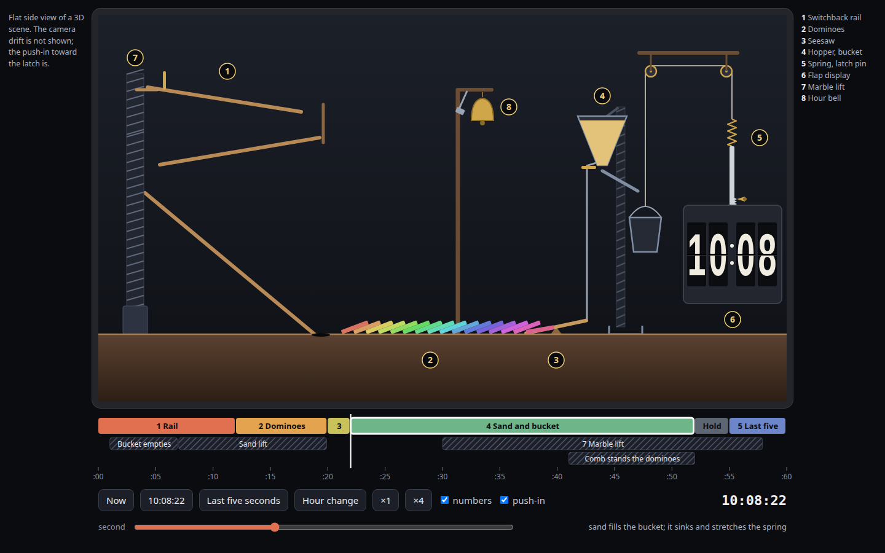
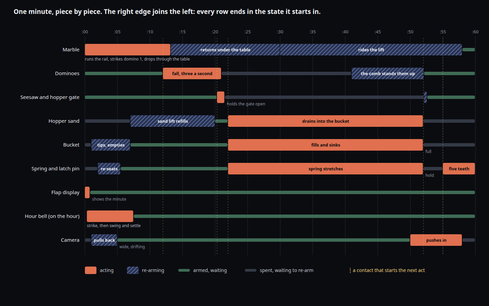
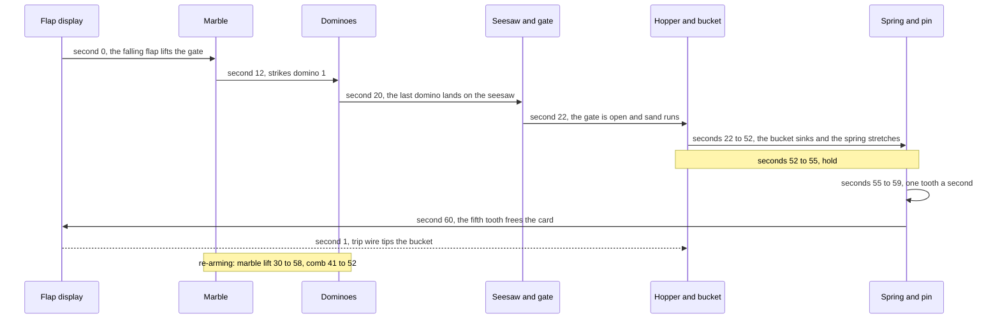
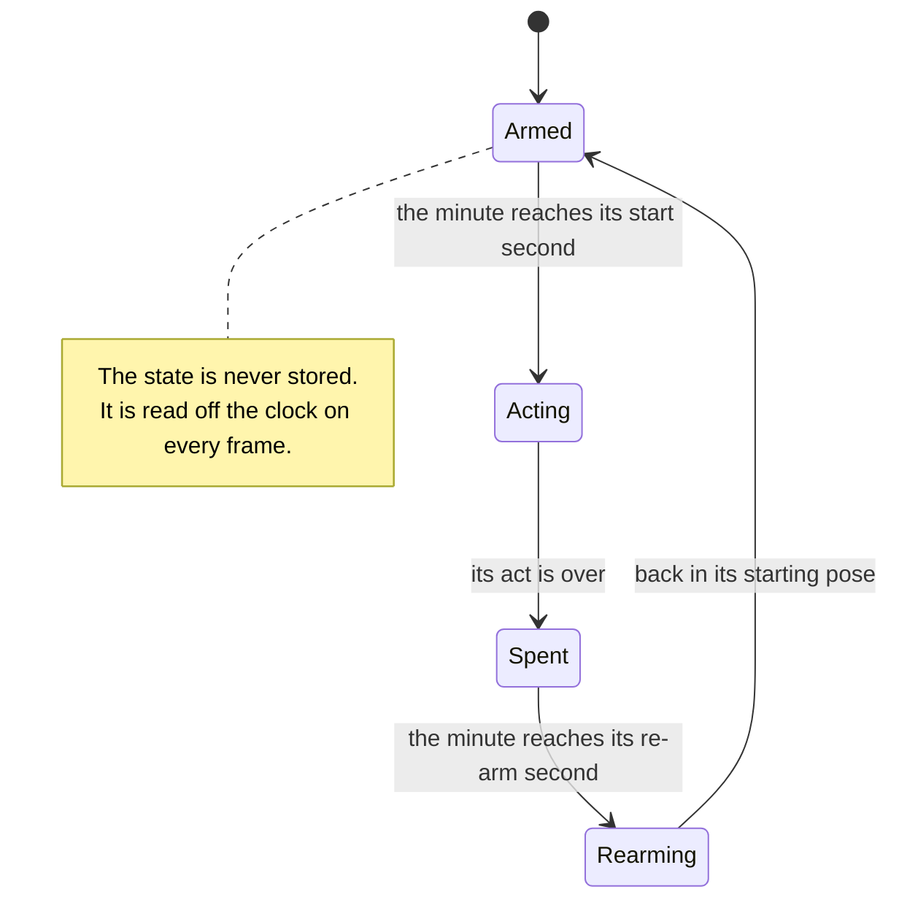
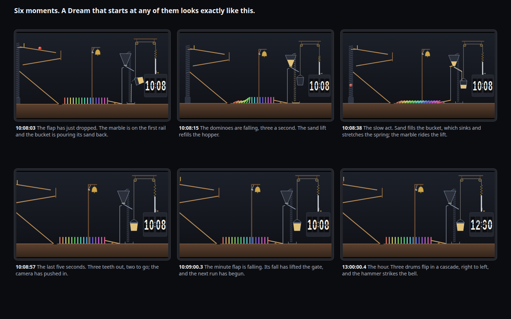
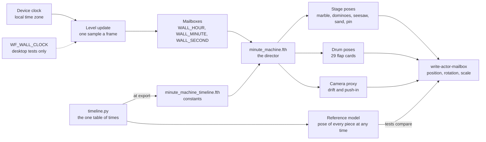
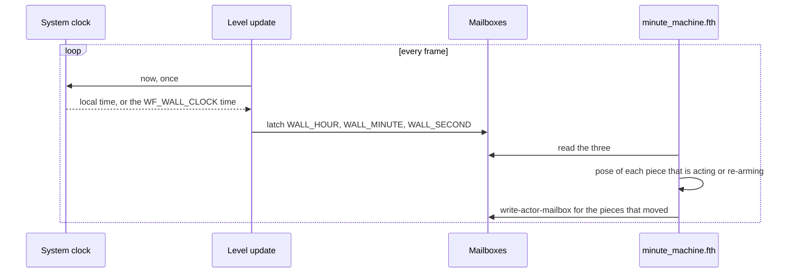
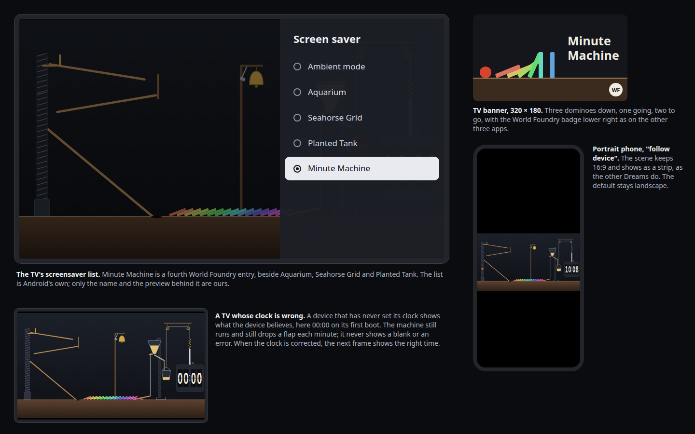
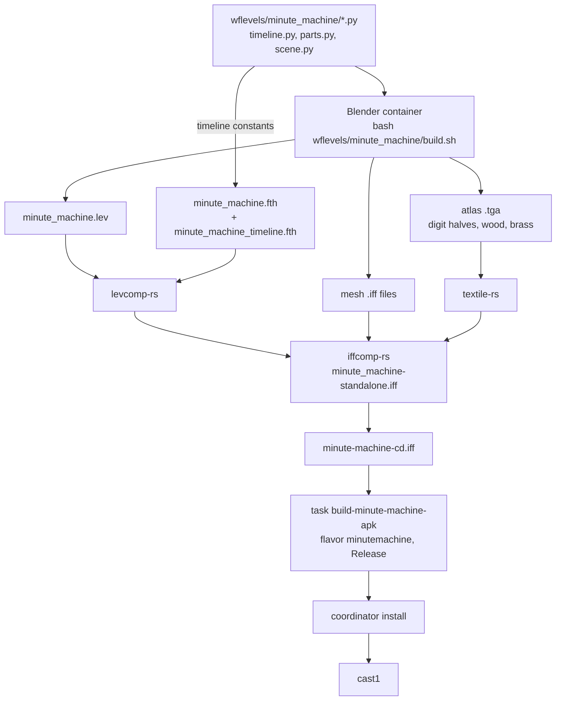
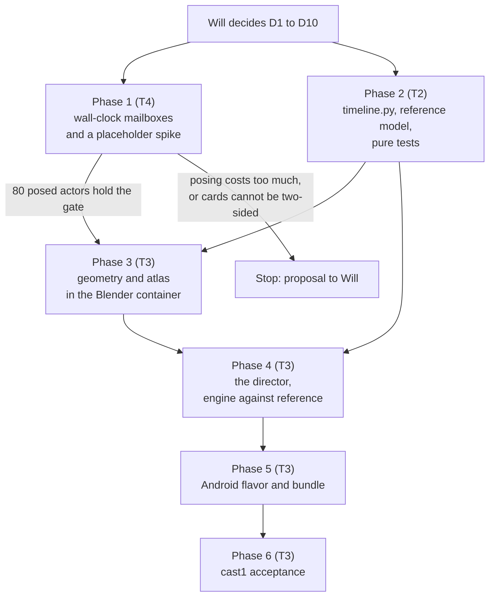

# Minute Machine: a sixty-second chain reaction that drops the minute flap

**Status: approved, 2026‑11‑21.** Will accepted every recommendation in D1 to D10 (2026‑11‑21: "D1-10: accept recommendations") and asked for it to be built ("implement / deploy / commit / push"). The engine addition that tells a script the time of day was approved first (Will, 2026‑11‑21: "yes, engine change to know TOD is pre-approved"). Phases 1 to 5 are built and pushed; Phase 6 (cast1) is in progress. See [What was built, and where it differs](#what-was-built-and-where-it-differs).

## Context

Will asked on 2026‑11‑21: "write plan for 17. Sixty-second chain reaction". Idea 17 is one of the 30 in the [3D timepieces brainstorm](../../../homeboard-tv/docs/investigations/2026-11-21-3d-timepieces.md#17-sixty-second-chain-reaction), which lives in the Homeboard repository. The whole of it reads:

> A Rube Goldberg machine timed to take exactly one minute: ramp, dominoes, seesaw, bucket and string. Its last act is to drop the minute flap, and then every piece re-arms. Several machines could take turns, so no two minutes look alike.
>
> **Reads:** the flap display, and how far along the chain the action is. **Look for:** the last five seconds.

**Why the plan is in this repository.** Homeboard's `TODO.md` already says where a 3D clock comes from: "World Foundry 3D clock as the bundled default screensaver. Will will provide the design. Compile the engine into Homeboard as a pinned prebuilt library". So the scene is a World Foundry level. I have assumed this plan covers the level and its own Android Dream, and that putting it inside Homeboard stays Homeboard's item (D2). If that is wrong, only the [Android](#android-a-fourth-dream) section changes.

The brainstorm sets four rules for a clock that works as a TV screensaver. This plan is built on them:

| Rule from the brainstorm | How this plan meets it |
|---|---|
| The scene must be a function of the clock, because a screensaver starts at an arbitrary moment | Every piece's pose is computed from the hour, the minute and the second, with no history. It is choreography that looks like physics. Nothing is simulated ([mechanism](#every-pose-is-a-function-of-the-clock)) |
| It has to say how it is read | A split-flap display shows `HH:MM`; the place the action has reached along the chain is the seconds hand |
| Nothing bright should sit still | The camera drifts slowly all the time, so the digits move on the screen ([camera](#camera-and-burn-in)) |
| One small event a minute, one big event an hour | The minute flap drops each minute. On the hour up to three more drums flip in a cascade and a bell is struck ([display](#the-flap-display)) |

### What exists today

- **Three Dreams ship as flavors of one Android project**, each with its own package, DreamService and level bundle ([`android/screensaver/README.md`](../../android/screensaver/README.md)). On cast1, as Release builds: reef 21.8 FPS, Seahorse Grid 29.6 FPS, Planted Tank 40.0 FPS.
- **A script can pose any actor.** `write-actor-mailbox` writes another actor's `X_POS`, `Y_POS`, `Z_POS` (3009 to 3011), `ROTATION_A/B/C` (3012 to 3014, in revolutions) and `X/Y/Z_SCALE` (3040 to 3042). The aquarium's `tk-orient` in [`controller.fth`](../../wflevels/aquarium_tanks/controller.fth) does exactly this for every fish, and the same file has `tk-sin` and `tk-cos`. zForth cells are floats (`zfconf.h:24`).
- **A script cannot learn the time of day.** `TIME` (mailbox 1906) is the level clock, seconds since the level loaded (`level.cc:2022` returns `levelClock()`). The Forth bridge calls `time()` only to colour files by age in the file-system level. This is the one [engine addition](#engine-the-wall-clock).
- **A desktop check can read any mailbox on every frame.** `run_aquarium_checks.py` gives `watch([(actor, mailbox)])` and `hold(None, frames)`; `check-aquarium-barb-motion.py` uses them to assert a bound on every fish's step. The tests here use the same route.
- **The camera follows a proxy.** A CamShot's position is `(CamShot - Follow) + TrackObject` (`movecam.cc:222`), and the aquarium's close camera is moved by writing the positions of its camera and look-at actors. The slow drift uses that.

## Decisions for Will

Each row has a recommendation and its alternatives. **Will accepted all ten recommendations on 2026‑11‑21.** The [live mockup](2026-11-21-sixty-second-chain-reaction/machine.html) shows D3 and D6.

| # | Decision | Recommendation | Alternatives |
|---|---|---|---|
| D1 | Name | **"Minute Machine"** in the screensaver list; level id `minute_machine`; package `org.worldfoundry.minutemachine` | "Chain Reaction"; "Sixty Seconds" |
| D2 | Where it ships first | **A fourth Dream flavor** in `android/screensaver`, like Seahorse Grid. It can be on cast1 as soon as it runs. Homeboard embeds it later, under its own item | Wait for the one World Foundry app, or build it straight into Homeboard |
| D3 | The acts | **Six acts** ([table](#the-machine)): rail, dominoes, seesaw, sand and bucket, a three-second hold, the last five seconds. The sand hopper, the spring and the toothed pin are added to the sketch's parts, because a ball on a ramp and a row of dominoes are over in seconds, and a minute needs one act that is honestly slow | The sketch's five parts only, each slowed to fill the minute. Or ten short acts with no slow one |
| D4 | The display | **Four split-flap drums, 24‑hour `HH:MM` with a leading zero**: 3 + 10 + 6 + 10 = 29 cards | Two drums as in a Solari flip clock, 24 hour cards and 60 minute cards (84 actors). Or follow Android's 12/24‑hour setting |
| D5 | The hour | **A cascade and a bell.** The drums that change flip 0.12 s apart, right to left, and a hammer strikes a bell that swings for 7 s. At midnight the hours drum flutters through seven cards to get from 3 to 0 | Nothing extra on the hour |
| D6 | Camera | **One wide camera that drifts**, plus **a 10 % push-in toward the latch from :50**, back out by :05. The mockup has a tick box that turns the push-in off | Drift only. Or a cut to a close camera for the last five seconds |
| D7 | Look | **A painted wooden toy on a dark table**: wood rails, brass pulleys, a red marble, dominoes in a run of colours, black flap cards with off-white digits | Brass and steel laboratory apparatus. Or bright nursery colours on a light table |
| D8 | Sound | **Silent**, like the other three Dreams | Clicks for the last five seconds and a bell on the hour |
| D9 | Frame-rate gate on cast1 | **At least 30 FPS** as a Release build, median over 120 s. Seahorse Grid manages 29.6 FPS with 24 deforming meshes; this scene has no deformers | At least 20 FPS, the reef's gate |
| D10 | Machines and settings in the first release | **One machine and no settings object.** Orientation is the only setting, as in Seahorse Grid. The timeline is a table, so a second machine is a second table, chosen from the minute of the day; it and a settings object are later items | Build two machines now. Or add settings now: machine, push-in, 12‑hour |

## The machine

[](2026-11-21-sixty-second-chain-reaction/machine.html)

The mockup runs from your computer's clock. "Last five seconds" and "Hour change" jump to those moments, and the slider scrubs through one minute. It is a flat side view of a 3D scene, so it draws 16 dominoes in a straight row where the level has 24 along an S-curve.

| # | Act | Seconds | What happens | What starts it |
|---|---|---|---|---|
| 1 | Switchback rail | :00 to :12 | A gate lifts and the marble runs down three rails, 4.2 s, 3.7 s and 2.9 s, speeding up along each, then rolls across the table | The falling flap lifts the gate |
| 2 | Dominoes | :12 to :20 | 24 dominoes fall along an S-curve, three a second. Each takes 2 s to settle onto the next | The marble strikes domino 1, then drops through a hole in the table |
| 3 | Seesaw | :20 to :22 | The low end goes down, the far end lifts a rod, and the rod slides the hopper's gate open | The last domino lands on the seesaw |
| 4 | Sand and bucket | :22 to :52 | Sand runs from the hopper into a bucket that hangs on a string over two pulleys. As it fills it sinks and stretches a spring at the string's other end. This is the slow act: the sand level reads as a gauge | The gate opens |
| – | Hold | :52 to :55 | The hopper is empty. The bucket hangs full, the spring is stretched, and nothing moves but the lift | The sand runs out |
| 5 | The last five seconds | :55 to :60 | The spring pulls a toothed latch pin past a pawl, one tooth a second, with a visible click each time | The stretched spring |
| 6 | The flap | :00 | The fifth tooth frees the minute card. It falls in 0.4 s, and its fall lifts the gate for act 1 | The pin clears the card |

**Every piece re-arms behind the action**, in view, so the machine is ready when the flap falls:

| Piece | Seconds | How it re-arms |
|---|---|---|
| Bucket | :01 to :07 | A trip wire from the flap tips it. It pours its sand into a trough, rises as it empties, and rights itself |
| Latch pin | :02 to :05.5 | Sinks back as the spring relaxes, and seats under the next card |
| Hopper | :07 to :20 | A short screw lift carries the sand from the trough back to the hopper |
| Marble | :13 to :58 | Rolls back under the table, then rides the tall screw lift to the gate, where it waits 2 s |
| Dominoes | :41 to :52 | A comb under the table stands them up in the order they fell, one every 0.46 s |
| Seesaw and gate | :52 | Swing back when the comb lifts the last domino off the seesaw |

[](2026-11-21-sixty-second-chain-reaction/timeline.html)

Each row of the chart ends in the state it starts in, which is what lets the minute repeat without a seam.



Each piece goes through the same four states once a minute:



[](2026-11-21-sixty-second-chain-reaction/moments.html)

## Every pose is a function of the clock

One director script, `minute_machine.fth`, poses every moving piece. On each frame it reads three numbers (the hour, the minute, and the second with its fraction) and writes transforms. It keeps no state between frames except a note of what it last wrote, so that it can skip a piece that has not moved.



**No physics runs.** No piece is a dynamic Jolt body, and no piece needs a collider. The curves are chosen to look like gravity, and each is a closed form of the time:

| Piece | Pose, with `t` the second within the minute |
|---|---|
| Marble on a rail | Distance along the rail = length × (τ / T)², a constant acceleration from rest; τ is the time since it reached the rail and T the rail's time |
| Domino `i` | Lean = `acos(thickness / pitch)` × clamp((t - 12 - i / 3) / 2). That angle is where a fallen domino rests on its neighbour. On re-arm the lean eases back to 0 over 0.6 s |
| Seesaw, rod, gate | One smoothstep from :20.3 to :20.8, and its reverse at :52.1 |
| Sand | Fill = (t - 22) / 30. The bucket's sand level, the bucket's sink, the hopper's level and the stream's length all come from it. Sand is three scaled meshes, not particles |
| Spring | Stretch = bucket sink - pin travel, so the string never changes length |
| Latch pin | Travel = one tooth × the sum of five 0.15 s smoothsteps, at :55, :56, :57, :58 and :59 |
| Flap card | Angle = 180° × u², with u = (t - 0.12 × k) / 0.4 and k the drum's place in the cascade |
| Bell | Swing = 16° × (1 - q / 7)² × sin(2π × 1.3 × q), with q the seconds since the strike |
| Screw lifts | Turn = rate × t; the marble's height on the lift is linear in t |
| Camera | Azimuth = 8° × sin(2π × seconds of day / 600) |

Four things follow from this, and each is tested ([verification](#verification)):

- **A Dream that starts at any moment is correct on its first frame.** At 10:08:47 the comb is half-way along the dominoes and the marble is two thirds of the way up the lift.
- **A clock that jumps is harmless.** A time-zone change, a daylight-saving step or a network time correction changes the three numbers, and the next frame shows the new time. Nothing has to catch up.
- **Pause and resume need no code.** The scene has nothing to restore.
- **Two TVs show the same frame**, to within their clocks' difference.

The director writes only what changed. In the worst second, about 6 dominoes, 2 lifts, 3 sand meshes, the spring and the camera move at once: around 20 writes a frame. On the first frame it writes everything.

## The flap display

Each of the four drums is a real split-flap unit in miniature, so the engine needs no way to swap a texture at run time:

- **A card is a thin two-sided mesh.** Its front carries the top half of one digit and its back the bottom half of the digit after it. The halves are baked from one digit atlas.
- **A drum has one card for each digit it shows**: 3 for the tens of hours, 10 for the hours, 6 for the tens of minutes, 10 for the minutes. That is 29 cards.
- **A card's pose depends on its slot**, the difference between its index and the drum's position. Slot 0 stands upright at the front and shows a top half. Slot 1 hangs at the front and shows a bottom half. The rest sit round the spindle behind them, as in the real thing, which also keeps hidden cards from lying in the same plane as visible ones.
- **A flip** moves the drum's position by one over 0.4 s: the upright card falls through 180° about the spindle with a gravity curve.

On the hour the changed drums flip in a cascade 0.12 s apart, from the minutes leftward. At midnight the hours drum must go from 3 to 0, and a real drum can only go forward, so it flutters through seven cards at 0.12 s each. That happens once a day.

The digits must read from a sofa: **each digit is at least 10 % of the screen's height** from the wide camera. Phase 3 measures it in a capture.

## Camera and burn-in

One wide CamShot frames the whole machine. It follows an invisible proxy that the director moves:

- **Drift:** the proxy swings the camera ±8° round the machine with a 10‑minute period. The display's digits never sit on the same pixels for long, which is the brainstorm's burn-in rule. The drift comes from the seconds of the day, so it too has no state.
- **Push-in (D6):** from :50 to :58 the camera moves 10 % closer, toward the latch and the display, and it eases back from :01 to :05. The pull-back is why the marble's start is seen a moment late; the mockup shows this honestly, and its tick box shows the scene without the push-in.
- **Digit brightness:** the off-white of the digits is at most 80 % of full white.

## Engine: the wall clock

**Approved** (Will, 2026‑11‑21). This is the only engine change planned.

- **Three read-only system mailboxes**: `WALL_HOUR` (0 to 23), `WALL_MINUTE` (0 to 59) and `WALL_SECOND` (0 up to but not including 60, with its fraction). Their numbers come from the free system range after `CAMSHOT` (1921), and `GLOBAL_SYSTEM_MAX` moves up with them (`mailbox.inc`). They are split three ways so that each stays exact in a `Scalar` and in a float Forth cell; a single seconds-of-day value would lose the fraction that smooth motion needs.
- **One sample a frame.** The level update reads the system clock once, converts it with `localtime_r` to the device's time zone, and latches all three. A script therefore never sees a new minute beside an old second.
- **`WF_WALL_CLOCK=HH:MM:SS[.mmm][@rate]`** on the desktop engine starts the wall clock at that time and runs it at `rate` (default 1; `@0` freezes it, `@600` runs ten minutes a second). A malformed value stops the engine at start-up with a message; it is not ignored. Android has no override: device checks use the device's real clock.
- **Nothing else changes.** `TIME` and `DELTA_TIME` stay the level clock.



Other timepieces from the brainstorm (the orrery, the sundial, the globe) will want the date. That is a later addition in the same place, not part of this plan.

## What was built, and where it differs

Everything below is in `wflevels/minute_machine/`, `tests/` and `scripts/`, pushed to `2026-new-level`.

| Plan | What happened |
|---|---|
| Phase 1 spike on a placeholder level of boxes | **Not built as a separate level.** The real level was built directly (Phases 3 and 4), so the spike's questions were answered on it: 73 animated actors pose from the clock; two-sided cards need no special handling, because each card is a closed box with art on both faces; the camera drifts on a proxy; the mailboxes stay exact across midnight. The cast1 frame-rate measurement moved to Phase 6, as planned |
| Mailboxes `WALL_HOUR`, `WALL_MINUTE`, `WALL_SECOND` | As planned, ids 1922 to 1924, `GLOBAL_SYSTEM_MAX` 1925. Tested without an engine (`task test-wall-clock`) and in the Debug ASan engine (`tests/test_wall_clock.py`) |
| The Forth's own sine | **Added, not in the plan:** `sin-rev ( revolutions -- sin )`, a double-precision sine in the Forth bridge (Will, 2026‑11‑21: "probably nothing is cheaper than a real sine on a real cpu's fp hw"). My first director used the older parabola, which is about 0.16 % off and put the camera 14 mm out; with `sin-rev` the whole director agrees with `timeline.py` to 0.002 mm |
| Comb re-arm "one every 0.7 s" | 0.46 s, because 24 dominoes at 0.7 s would not finish by :52 |
| Flap card back | Shows the digit **after** the card's own, not before |
| Fallen flap cards | **Added, then corrected on cast1:** stacked in depth (`CARD_STACK`) so no two faces share a plane. The first spacing, 1 cm, was not enough: cards were 18 mm thick with art 10 mm proud, so the art of a card behind came out level with the front card's face, and **the hour 9 drew as 8** on the TV (found by reading the real screenshot, then reproduced on the desktop; no earlier check could see it). Cards are now 8 mm thick with art 4 mm proud, stacked 16 mm apart, and `tests/test_minute_machine_parts.py` fails if the spacing is not more than a card's thickness plus its art |
| Two strings | **Added:** the pail string and the spring string change length, so each is a unit mesh scaled in z |
| Director arithmetic | Each piecewise motion is a sum of eased steps (`channels.py`); a test proves the steps equal `timeline.py` on 1 ms samples, and the Forth is generated from the same steps. The director also runs, in the real zForth VM against mocked mailboxes, against `timeline.py` (`tests/verify_minute_machine_forth.py`: 125 frames across minute, hour and midnight, worst 0.0015 mm) |
| Physics realism | **Not done; a TODO item** (Will, 2026‑11‑21: "ball down ramp isn't realistic physics (same for dominoes, really--falling too slowly)"). The marble eases over 4.2, 3.7 and 2.9 s where a rolling sphere on the same rails would take about 2.1, 2.1 and 1.3 s, and a domino tips in 2 s where a real one takes a fraction of a second. The motion is choreography to fit the 60 s budget, not simulation |
| Camera | `CAMERA_R_PX` is 750 (7.5 m), after the first capture showed the machine filling 60 % of the width at 11 m |

## Android: a fourth Dream

[](2026-11-21-sixty-second-chain-reaction/picker.html)

The `minutemachine` flavor copies the Seahorse Grid flavor's shape: its own manifest, `MinuteMachineDreamService`, `MinuteMachineActivity` for the launcher, a settings provider that offers orientation only, a launcher icon and a TV banner with the World Foundry badge, and `cd.iff` as its asset. A device whose clock is wrong shows what the device believes; the machine never shows a blank or an error.



## Phases



- **Phase 1, the clock and a spike** (T4). Add the three mailboxes and `WF_WALL_CLOCK`. Then build a placeholder level from boxes: one 10‑card drum, 24 dominoes, a marble, a camera proxy and enough extra boxes to reach 80 posed actors, with a director that poses them from the clock. The spike answers four questions before any art is made: whether 80 actors posed by mailbox hold D9 on cast1 (one coordinator `profile` run, with `--script-profile` on the desktop first); whether two-sided cards draw correctly with back-face culling on; whether the camera can drift on a proxy; and whether the three mailboxes stay exact across midnight. Rank T4, because the answers decide whether the design stands. If one fails, work stops and Will gets a proposal.
- **Phase 2, the timeline** (T2). `wflevels/minute_machine/timeline.py` holds every time in the tables above and the pose function of every piece. It writes the Forth constants and is the reference model. Its tests need no engine: every piece's pose at second 60 equals its pose at second 0; no pose jumps between two samples 1 ms apart; and each contact happens when the next act starts.
- **Phase 3, geometry** (T3). The table, rails, lifts, dominoes, seesaw, hopper, bucket, pulleys, spring, pin and pawl, the four drums and the bell, built by `build.sh` in the Blender container and wrapped as `task minute-machine-level`. Moving parts are authored with their pivot at the origin, so a rotation needs no offset. `report_budget.py` prints the totals against **15,000 static triangles** and **80 animated actors**. Desktop captures at the six moments go to Will for an art review.
- **Phase 4, the director** (T3). `minute_machine.fth` implements every row of the pose table. `scripts/check-minute-machine.py` starts the engine at 12 times, watches every posed actor's mailboxes, and compares each frame with the reference model.
- **Phase 5, Android** (T3). The `minutemachine` flavor, its Java, manifest, CMake hook, icons, bundle task and `task build-minute-machine-apk`; a row in the README's table; and the app's registration with the coordinator.
- **Phase 6, acceptance** (T3). On cast1 through the coordinator: the D9 gate, a 10‑minute Dream, and the digits checked against the device's own clock. Then cast1's screensaver is set back to the Seahorse Dream.

Work happens in a sparse worktree branched from `2026-new-level`. The finish line is a push to `2026-new-level`, with no PR to master.

## New and changed files

| Path | New / changed | What |
|---|---|---|
| `wfsource/source/mailbox/mailbox.inc`, `wfsource/source/game/level.cc`, `level.hp` | changed | `WALL_HOUR`, `WALL_MINUTE`, `WALL_SECOND`: one latched sample a frame; the `WF_WALL_CLOCK` override |
| `docs/command-line-switches.md` | changed | `WF_WALL_CLOCK` |
| `wflevels/minute_machine/` | new | `timeline.py`, `parts.py`, `scene.py`, `generate.py`, `build.sh`, `report_budget.py`; Forth: `minute_machine.fth`, and the generated `minute_machine_timeline.fth` |
| `scripts/check-minute-machine.py` | new | engine against reference at 12 start times; `--video` for the art review |
| `tests/test_wall_clock.py` | new | the three mailboxes, midnight, the override, a malformed value |
| `tests/test_minute_machine_timeline.py` | new | loop closure, continuity, contacts; no engine |
| `tests/test_minute_machine.py` | new | budgets; every flap card's two digit halves; digit height from the wide camera |
| `android/screensaver/src/minutemachine/`, `…/MinuteMachineDreamService.java`, `MinuteMachineActivity.java`, `MinuteMachineSettingsProvider.java`, `build.gradle.kts` | new / changed | the fourth flavor |
| `Taskfile.yml` (`minute-machine-level`, `build-minute-machine-apk`), `scripts/gen-screensaver-android-icons.py`, `android/screensaver/README.md` | changed | build tasks, icons, the README's table |

## Out of scope

- A second machine, and the rule that picks one for each minute (D10).
- A settings object: machine, push-in off, 12‑hour digits (D10).
- Sound (D8).
- Putting the scene inside Homeboard, or inside the one World Foundry app (D2).
- The date, and the other 29 timepieces.
- Real rigid-body simulation. The machine only has to look as if it obeys physics.
- Shadows, if the engine does not already draw them for this kind of scene.

## Verification

1. The wall-clock mailboxes follow the clock, stay consistent across midnight, and a malformed override stops the engine.
    ```
    scripts/in-linux-container.sh python3 -m pytest tests/test_wall_clock.py -v
    ```
2. The timeline closes and is continuous: every piece's pose at second 60 equals its pose at second 0, no pose jumps between samples 1 ms apart, and each contact falls on the start of the next act.
    ```
    scripts/in-linux-container.sh python3 -m pytest tests/test_minute_machine_timeline.py -v
    ```
3. The level builds in the Blender container and rebuilds byte for byte.
    ```
    task minute-machine-level && git status --porcelain wflevels/minute_machine/
    ```
4. The budgets hold: at most 15,000 static triangles and at most 80 animated actors; each digit is at least 10 % of the screen's height from the wide camera.
    ```
    python3 wflevels/minute_machine/report_budget.py
    scripts/in-linux-container.sh python3 -m pytest tests/test_minute_machine.py -v
    ```
5. The engine matches the reference model from 12 start times, including 10:08:22, 10:08:41 and 10:08:57: every posed actor within 1 mm and 0.5° on every frame for 30 s.
    ```
    scripts/in-linux-container.sh python3 scripts/check-minute-machine.py --starts 12
    ```
6. The minute, the hour and midnight: the minute card starts to fall within one frame of second 0; after 10:08:59 the display reads 10:09, after 12:59:59 it reads 13:00 and the bell swings, and after 23:59:59 it reads 00:00.
    ```
    scripts/in-linux-container.sh python3 scripts/check-minute-machine.py --boundaries
    ```
7. No pose depends on history: at ten minutes a second the engine still matches the reference on every frame.
    ```
    scripts/in-linux-container.sh python3 scripts/check-minute-machine.py --rate 600
    ```
8. The APK builds as a Release build.
    ```
    task build-minute-machine-apk
    ```
9. On cast1, the D9 gate: at least 30 FPS, median over 120 s that include a whole minute (coordinator `profile`).
10. On cast1, the Dream: Minute Machine runs for 10 minutes with no crash and the recording shows a flap fall at each of the minute changes; a screenshot's digits equal the device's `date +%H:%M` taken in the same job. Then cast1's screensaver is set back to the Seahorse Dream.

## Mockups

All four are self-contained, 1440 × 900, and rebuilt by `python3 docs/plans/2026-11-21-sixty-second-chain-reaction/build_mockups.py --png`. They share one drawing routine and one table of times with the timeline chart. They show design intent, not game assets.

- [The machine](2026-11-21-sixty-second-chain-reaction/machine.html): running from the clock, with jumps to the last five seconds and to an hour change, a scrubber, and tick boxes for the numbers and the push-in.
- [Six moments](2026-11-21-sixty-second-chain-reaction/moments.html): the states a Dream can start in, including the flap mid-fall and the hour cascade.
- [One minute](2026-11-21-sixty-second-chain-reaction/timeline.html): each piece's armed, acting, spent and re-arming spans.
- [Android surfaces](2026-11-21-sixty-second-chain-reaction/picker.html): the screensaver list, the TV banner, the portrait strip, and a TV whose clock is wrong.
