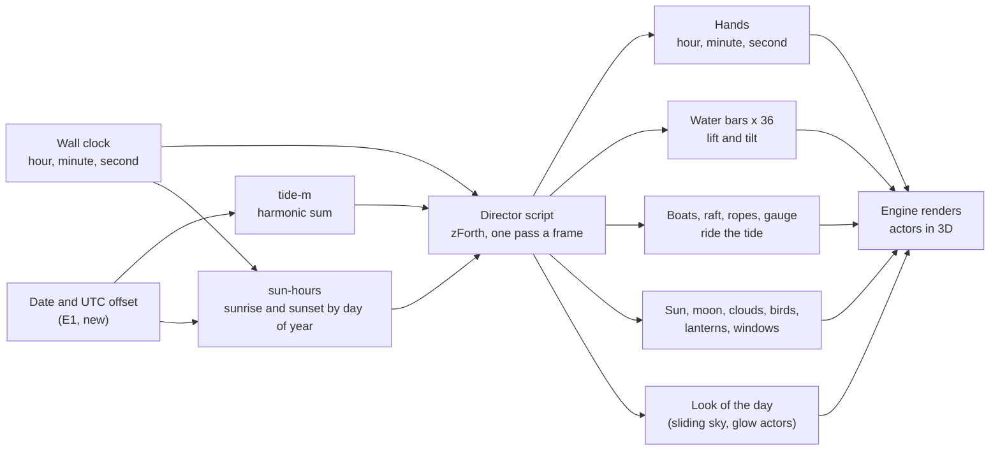
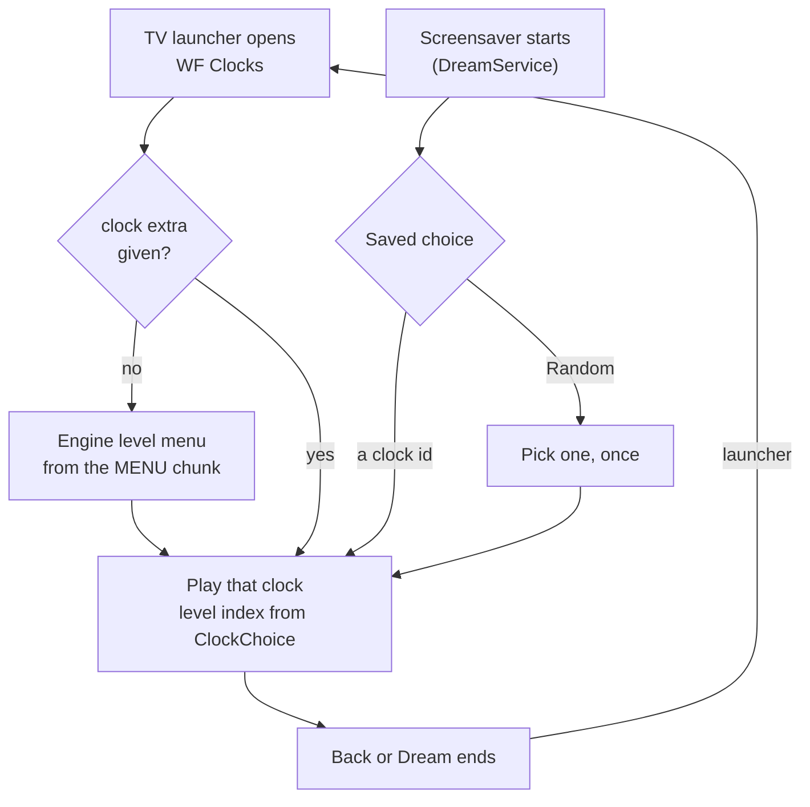
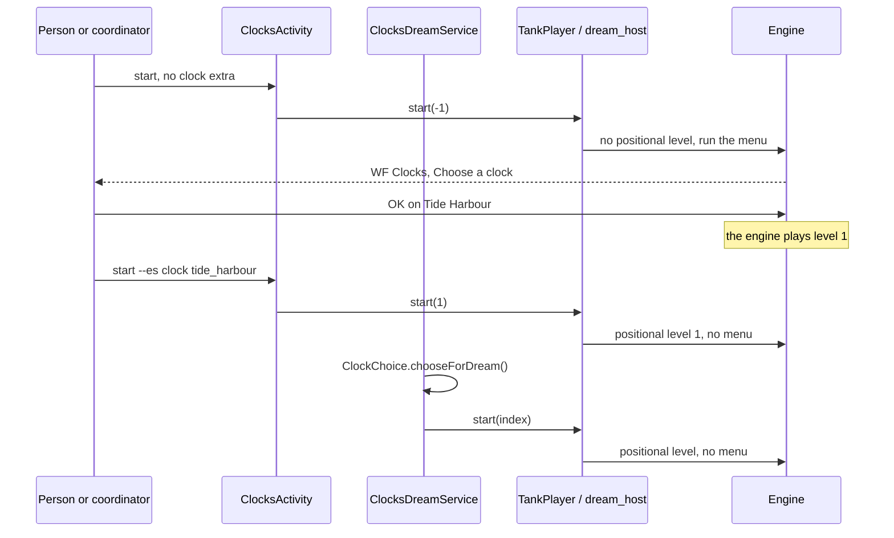
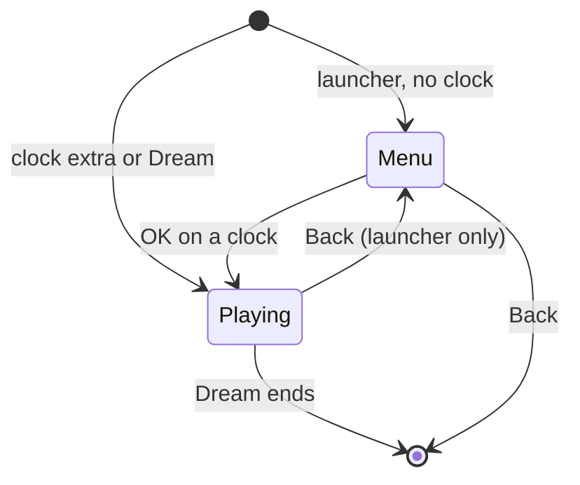
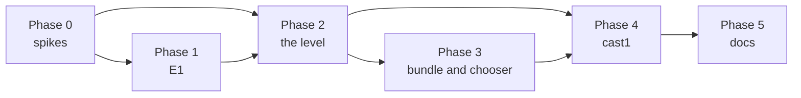

# Tide Harbour: the second 3D clock, and the clocks bundle that holds it

**Status: plan for review, 2026‑11‑21.** Nothing here is built. The one engine addition, [E1, a date mailbox](#engine-changes-needing-permission), is **approved** (Will, 2026‑11‑21: "approval to add date to engine"); everything else uses what the engine already does. **Runtime control of lights is deliberately not part of this plan** (Will, 2026‑11‑21: "more likely the task is to add control of lights from runtime. today, put it on TODO, and don't use as part of the screensaver implementation for now"); it is its own TODO item.

## Context

Will asked on 2026‑11‑21: "turn Tide harbour entry into the next screensaver in the 3d clock series. we're going to need more animation, i believe / this will be our second 3d clock screensaver / we're gong to implement several of the 50 ideas (each as a separate level) and then bundle them all together info a single cd.iff (i suppose with a menu chooser like the aquarium). when starting as a screensaver, should be able to pass in which clock level to play and not show the chooser menu". While the plan was being researched he added: "we can also move actors in 3d space!!!"

Idea 40 is one of the 50 in the [3D timepieces brainstorm](../../../homeboard-tv/docs/investigations/2026-11-21-3d-timepieces.md#40-tide-harbour), which lives in the Homeboard repository. The whole entry:

> An old Bangkok riverside scene on the Chao Phraya, with wooden stilt houses, piers, traditional boats and a Thai-style clock tower. Its dial shows the time; boats and floating platforms rise and fall with the river's tide.
>
> **Reads:** from the tower dial. **Look for:** the changing water level and boats moving on their moorings. The mockup is concept art; a working clock needs hands that move with the time. Tide predictions for the river remain to be investigated.

That picture is the look to aim at. The plan has two jobs that happen to ship together:

1. **Tide Harbour**, the level: a harbour whose water, boats and sky are a function of the date and the time, with a working clock tower to read.
2. **WF Clocks**, the bundle: one Android app and one `cd.iff` holding every clock level, with a chooser, and a way for a screensaver to name its clock and skip the chooser. Minute Machine becomes the first entry; each later idea is one more level and one more manifest line.

### What the research found

| Question | Finding |
|---|---|
| How does the Aquarium choose? | The Dream picks an index with `TankChoice` (`IDS`, a saved choice, or Random resolved once at start) and passes it to `nativeRun`, which hands the engine the index as its one positional argument ([`TankLaunch.java`](../../android/screensaver/src/main/java/org/worldfoundry/screensaver/TankLaunch.java), [`dream_host.cc`](../../android/screensaver/src/main/cpp/dream_host.cc)). The chooser people see is the **engine's own level menu**: `cdpack --manifest` appends a `MENU` chunk, built from a few lines (`title`, `prompt`, `level <path> \| <name>`), and the engine runs it when the desired level is negative ([`game.cc:306`](../../wfsource/source/game/game.cc), [`aquarium-menu.manifest`](../../wflevels/aquarium-menu.manifest), [level-menu plan](2026-10-01-level-menu-selector.md)). So the chooser needs no new UI code. |
| Where is the gap? | `nativeRun` returns at once for a level below 0 or above 10, so today a Dream can never ask for the menu. It also names the Minute Machine as `player.start(0)` in two places. Both change in Phase 3. |
| Can a script move an actor in 3D? | Yes, and it is how Minute Machine works: 75 actors posed from the wall clock through position, rotation and scale mailboxes, **59.7 FPS on cast1 with no deformers** ([Minute Machine plan](2026-11-21-sixty-second-chain-reaction.md)). That is the animation this plan uses. |
| Is more animation machinery needed? | **No, not for motion.** The expensive kind is the mesh deformer: Seahorse Grid manages 29.6 FPS with 24 deforming meshes, and `DFRM` v1 poses only one curve per mesh ([reef plan](2026-11-02-gulf-of-thailand-reef-tank.md)). A river can be made from many rigid bars (below), which costs what Minute Machine's pieces cost. |
| Can a script change colour or light? | **Not today.** A `Light` actor reads its red, green and blue fields once, when it is built ([`light.cc:51`](../../wfsource/source/game/light.cc)); the clear colour is fixed too. Runtime light control is a separate engine feature, now its own TODO item, and **this plan does not use it**. The day turns to dusk and night with parts that already move: a sliding sky, glow actors and keyed looks ([D5](#decisions)). |
| What does the tide need that the engine lacks? | A **date**. The engine's clock mailboxes carry hour, minute and second only. A tide is set by the Moon: its heights repeat roughly every 24 h 50 min, so the same clock time gives a different water level each day. |
| Where do real predictions come from? | The Royal Thai Navy Hydrographic Department has been Thailand's tide authority since 1954 and publishes predictions for 29 sites from harmonic constants fitted to a year of observations ([IHO national report, 2024](https://iho.int/uploads/user/Inter-Regional%20Coordination/RHC/NIOHC/NIOHC23/NIOHC23-8.1I_2024_National%20Report%20Thailand.pdf); [GLOSS report, 2001](https://gloss-sealevel.org/gloss/gloss/sites/gloss/files/publications/documents/thailand_2001.pdf)). Its gauge at Bangkok Bar is [PSMSL station 287](https://psmsl.org/data/obtaining/stations/287.php) and Ko Sichang is [station 449](https://psmsl.org/data/obtaining/stations/449.php). **Not found yet:** the river's tide type and amplitudes, or a ready table of constants for a Chao Phraya station. Phase 0 looks. Until then the mockups use an invented curve and say so. |

The numbers are not guessed: nothing below states a tidal range, a tide type or a harmonic constant for Bangkok, because none was found.

## Decisions

Recommendations are in the third column. Nothing is decided until Will answers.

| # | Decision | Recommendation | Alternatives weighed |
|---|---|---|---|
| D1 | How the harbour animates | **Rigid actors only, posed from the clock.** The river is **36 separate bars**, each lifted and tilted by two waves; boats bob, rock and swing on moorings; ropes are stretched bars; hands, sun, moon, clouds, birds and lanterns are more actors. About 100 in all, close to Minute Machine's 75. No new animation machinery | A `DFRM` deformer for the water: one smooth surface, but a deformer per mesh costs far more on cast1 and v1 allows one curve |
| D2 | Where Minute Machine goes | **Into the bundle as level 0.** A new `clocks` flavor, application `org.worldfoundry.clocks`, replaces the `minutemachine` flavor in the same change; cast1 gets the old package uninstalled | Keep both apps: two icons and two screensaver entries for one family |
| D3 | How the clock is chosen | Launcher with no clock named: **the chooser**. `--es clock tide_harbour` on the launcher activity: **straight to that clock**. The Dream: its saved choice (default **Random**, resolved once at start), never the chooser. The settings provider offers the choice | A chooser inside the Dream (a screensaver must never wait for a person) |
| D4 | The order and names of clocks | **Stable ids**, as `TankChoice.IDS`: `minute_machine`, `tide_harbour`. The index is the table-of-contents position; a new clock is appended | Sort alphabetically (an index change would silently re-point saved choices) |
| D5 | How the day turns to night | **No engine change.** A tall gradient mesh for the sky that slides past the camera; glow actors for lamps and windows, moved in front of the dark glass at dusk; and the water, boats and buildings drawn in a few keyed looks (day, dusk, night) cross-faded by moving the lit set forward. Phase 0 shows how well this holds and records the gaps | Runtime light control (a script-writable light colour): would dim everything with one write, but it is an engine feature in its own right and is **deferred to a TODO item, not used here**. Bake one fixed sunset: cheap, but then the look says nothing about the time |
| D6 | The tide itself | **Real harmonic constants from the Hydrographic Department** if Phase 0 finds them, summed in Forth from the date. If it finds none, a labelled synthetic curve with the right period (about 12 h 25 min and 24 h 50 min) and no claim to be a prediction | A free online table (not licensed for embedding; fetch only what the task needs) |
| D7 | Frame-rate gate | **At least 30 FPS** on cast1, Release, median over 120 s, the same gate Minute Machine used. Actor budget **150 rigid actors**, measured in Phase 0 on boxes first | A higher gate: the water bars are the likely cost, so measure first |
| D8 | The dial | **Roman numerals**, as in the concept art: legible from across a room. Thai numerals ๑–๑๒ are a later variant | Thai numerals now: more local, harder to read at a glance |
| D9 | Art style | **Low-poly, flat colour, a few small textures** (roof tile, wood, dial face), built in Blender in the container. Reads as the concept art at a distance and fits the VRAM page | Painterly textures like the concept art: much heavier on the 2048 × 2048 page |
| D10 | Burn-in | **The camera drifts slowly all the time**, as Minute Machine's does; the water, sky and clouds always move, so no pixel sits still | A static camera: the tower dial would burn in |

## Approach

### The pose-from-clock design, again

Nothing is simulated. A screensaver can start at any moment, so every piece's pose is a **pure function of the date and the time**, computed fresh each frame by the director script, exactly as Minute Machine does. The motions that are not tied to the tide or the hands (ripples, bobbing, birds, clouds) take their phase from the time of day too, so they are repeatable and testable.

### The river from rigid bars

The water is a stack of 36 long thin boxes, near to far, slightly overlapping. Each is posed every frame with its own height and tilt: two travelling waves added together, scaled up toward the camera so far water looks calm and near water looks lively. The whole river's mean level rides the tide, and a few of the bars also carry a glint that brightens and fades. The [live mockup](2026-11-21-tide-harbour-clock/harbour.html) does exactly this in flat form (tick "outline the water bars" to see them), and its counter says how many actors it poses.

**Risk, stated plainly:** flat bars may look banded on a 1080p TV, where the concept art is smooth. Phase 0 builds the 36 bars as plain boxes and looks at them on the real TV before anything else is made. The fallback, if it fails, is to raise the count (the budget allows about 150) or to use one `DFRM` mesh for the water alone and pay for that one deformer.

### The tide and the sun

- **Tide:** `tide-m` sums a few constituents, `amplitude × cos(2π × (hours × cycles per hour) + phase)`, with the K1, O1, M2 and S2 constituents the usual starting set. K1 and O1 are the once-a-day constituents (periods 23.93 h and 25.82 h) and M2 the twice-a-day one (12.42 h), from the [USGS tables](https://pubs.usgs.gov/dds/dds74/OTHER/tide_key.pdf). Which of them matter on the Chao Phraya is for Phase 0 to find; the set above is only where such a fit usually starts. The date supplies the phase. A float cell holds about seven digits, so **days since 2000‑01‑01 reduced to a phase** keeps the error to a few minutes of tide. Phase 0 measures the real error against the department's own table and writes it down.
- **Time zone:** the constants are for Thai local time (UTC+7, no daylight saving). E1 also exposes the device's UTC offset, so a TV elsewhere still shows Bangkok's tide at the right Bangkok moment, or can be told otherwise by a setting later.
- **Sun and moon:** sunrise and sunset move through the year, by an amount Phase 0 takes from NOAA's solar tables for Bangkok, not from memory. They are fitted to one smooth curve of the day of year, which the new Forth trig words compute. The moon rises opposite the sun; its phase is a stretch goal, not in this plan.
- **What the tide moves:** the river's mean level, the boats on their ropes (the rope lengths change), the raft between its posts, the water hyacinth drifting up and down the bank, and a **tide gauge board** on a pier post with a pointer, so the tide can be read as well as seen.

### The clock tower

The dial is the one thing that tells the time. The hour, minute and second hands are three actors turned by the clock, the second hand sweeping. Under the dial, the arch glows at dusk. The tower is the tallest thing in the frame and is lit even at night, so the dial stays readable ([moments](#moments)).

### Moments

Six frozen moments from the same code: dawn at low tide, noon, the sunset of the concept art, dusk, night and deep night at another tide. The sky, the water colour, the lit windows and lanterns, and the water level all change with the clock, which is what makes the picture say what time it is even without reading the dial. The mockups draw the day's light freely; how closely the engine's existing moving parts can match them, with no light control, is what the Phase 0 spike must show.

### The bundle and the chooser

What changes, file by file:

- `wflevels/clocks-menu.manifest`: `title WF Clocks`, `prompt Choose a clock`, one `level` line per clock.
- `scripts/pack-clocks-bundle.py`: generalises `pack-minute-machine-bundle.py`. It reads the manifest, calls `cdpack --manifest`, and links the result as `android/screensaver/src/clocks/assets/cd.iff`.
- `ClockChoice.java` (like `TankChoice`: `IDS`, `LABELS`, saved choice, `chooseForDream`), `ClockLaunch.java`, `ClocksActivity.java` (reads the `clock` extra), `ClocksDreamService.java`, `ClocksSettingsProvider.java` with a `clock:` setting beside the orientation.
- `dream_host.cc`: `nativeRun` accepts **-1 for "show the menu"**, by leaving out the positional argument, and the upper bound becomes the bundle's length. A test pins the host's argument list, as `tests/test_dream_host_vram.py` already does.
- `build.gradle.kts`: flavor `clocks`; the `minutemachine` flavor, its three `MinuteMachine*.java` classes and its source set are removed, and the manifest, strings, icons and banner are kept under the new name.
- `scripts/gen-screensaver-android-icons.py` and the Taskfile follow.

### Shared code

`channels.py`, `forth.py`, the Blender part helpers and the check scripts in `wflevels/minute_machine/` are mostly not about Minute Machine. They are hoisted into `wflevels/clock_common/` in Phase 2, and Minute Machine is rebuilt from them with its tests unchanged, so a third clock starts from a library, not a copy.

### Engine changes needing permission

| # | Change | Why | Cost |
|---|---|---|---|
| **E1** | Two more system mailboxes: **calendar day** (whole days since 2000‑01‑01, device local) and **UTC offset** (minutes). Latched once a frame with the clock, like `WALL_HOUR`. `WF_WALL_CLOCK` learns a date (`2026-11-21T10:08:22@0`) | The tide and the sunrise change by the day. Without a date there is no tide | Small: Minute Machine's own change, in the same files (`mailbox.inc`, `level.cc`, `wallclock.hp`), and its test file |

E1 is the only engine change, and it is **approved** (Will, 2026‑11‑21: "approval to add date to engine"). Runtime light control (once called E2) is out of this plan and tracked in `TODO.md`.

### State of a clock level

## Phases

| Phase | Work | Tier | Gate |
|---|---|---|---|
| **0 Spikes and research** | (a) 36 plain bars plus 100 boxes on a placeholder level, on cast1: FPS and banding. (b) The look of the day with no light control: a sliding sky, glow actors and keyed looks, judged on the TV at the six moments. (c) The tide: find the Hydrographic Department's constants for a Chao Phraya station, or record that none are public; check the arithmetic against their table. (d) Sunrise and sunset by day of year against NOAA | T4 | Answers D5, D6, D7 and the water risk; the plan is revised with the results |
| **1 Engine E1** | Mailboxes, override, tests | T4 | `task test-wall-clock` passes with a date; Minute Machine unaffected |
| **2 Tide Harbour level** | `clock_common` hoisted; `wflevels/tide_harbour/` with `timeline.py`, `channels.py`, `parts.py`, Blender build, `-standalone.iff`; director VM test; engine comparison | T3 | Director matches the model in the VM and the engine, as Minute Machine's did |
| **3 Bundle and chooser** | Manifest, pack script, `Clock*` classes, host change, flavor `clocks`, `minutemachine` flavor removed | T3 | Desktop and cast1: no argument shows the menu; a named clock skips it; the Dream never shows it |
| **4 cast1** | Install, FPS gate, 10-minute Dream run, six moments checked on the TV, tide gauge checked against the model | T3 | D7 gate, and the moments match the mockups |
| **5 Docs** | `android/screensaver/README.md`, `docs/level-building.md` note, `docs/forth-math-words.md` unaffected | T2 | `task md` renders |

## New and changed files

| File | Change |
|---|---|
| `wflevels/clock_common/` | New: the generic parts of `channels.py`, `forth.py` and helpers, moved from `wflevels/minute_machine/` |
| `wflevels/tide_harbour/` | New: `timeline.py`, `parts.py`, `forth.py`, `blender_create_tide_harbour.py`, `build.sh`, `actor-map.json`, `tide_harbour.lev`, `tide_harbour-standalone.iff.txt`, `tide_constants.json` (with its source, date and licence) |
| `wflevels/clocks-menu.manifest` | New |
| `scripts/pack-clocks-bundle.py`, `scripts/check-tide-harbour.py` | New |
| `android/screensaver/src/main/java/org/worldfoundry/screensaver/Clock*.java`, `ClocksActivity`, `ClocksDreamService`, `ClocksSettingsProvider` | New; the three `MinuteMachine*.java` classes removed |
| `android/screensaver/src/main/cpp/dream_host.cc`, `tests/test_dream_host_vram.py` | Menu request (-1), bundle bound |
| `android/screensaver/build.gradle.kts`, `src/clocks/`, `src/minutemachine/` (removed) | Flavor `clocks` |
| `mailbox.inc`, `level.cc`, `level.hp`, `wallclock.hp`, `tests/wall_clock_test.cpp` | E1; `docs/command-line-switches.md` for the date override |
| `Taskfile.yml` | `tide-harbour-level`, `clocks-bundle`, `build-clocks-apk`, `test-tide-harbour` |
| `docs/plans/2026-11-21-tide-harbour-clock/` | These mockups and `build_mockups.py` |

## Out of scope

- The other 48 ideas. The bundle makes each one a level and a manifest line; which comes next is Will's call.
- Runtime control of lights (a script-writable light colour, and the clear colour): its own engine feature, in `TODO.md`. This plan works without it.
- The moon's phase, spring and neap tides as a display, weather, sound, other harbours.
- Thai dial numerals (D8), a painterly texture pass (D9), a runtime settings screen beyond the clock choice.
- Any claim that the on-screen tide is a navigation-grade prediction. It is a picture of the tide, to the accuracy Phase 0 measures and prints.

## Verification

These steps are the contract. Each is run when its phase lands, with the raw output recorded under it.

1. `task test-tide-harbour`: the timeline is a pure function of date and time; the tide sum matches the department's table to the error Phase 0 recorded; sunrise and sunset match the checked figures; the director in the real zForth VM matches `timeline.py` for every actor at 125 frames.
2. `task tide-harbour-level`: the Blender container builds `tide_harbour-standalone.iff`; the level has at most 150 animated actors; its signed-volume winding test passes.
3. `python3 scripts/check-tide-harbour.py --compare`: the real engine, set to eight chosen dates and times with `WF_WALL_CLOCK`, agrees with the model on every actor (position, rotation, scale).
4. `task clocks-bundle`, then `cdpack --list wflevels/clocks-screensaver-cd.iff`: two levels in the stated order and a `MENU` chunk.
5. Desktop engine in the container, three runs: no level argument shows the menu (debug-bridge screenshot); `1` plays Tide Harbour with no menu; `0` plays Minute Machine with no menu.
6. `task build-clocks-apk`, then on cast1: `am start … --es clock tide_harbour` shows no menu; the Dream with the saved choice `clock:minute_machine` plays Minute Machine; Random picks one and keeps it for the whole run.
7. cast1 `profile` workflow, Release: median at least 30 FPS over 120 s, and the count of animated actors printed.
8. Six screenshots from cast1, at the six times the mockups show: each reads the right time from the dial, and the tide gauge agrees with the model.

## Housekeeping done with this plan

- A `TODO.md` entry for each of the two jobs, ranked.
- A row in the [plan index](README.md).
- The mockups are schematics of the design, not game assets. Their tide curve is **invented** and labelled so; the water bars are the technique, flat.
