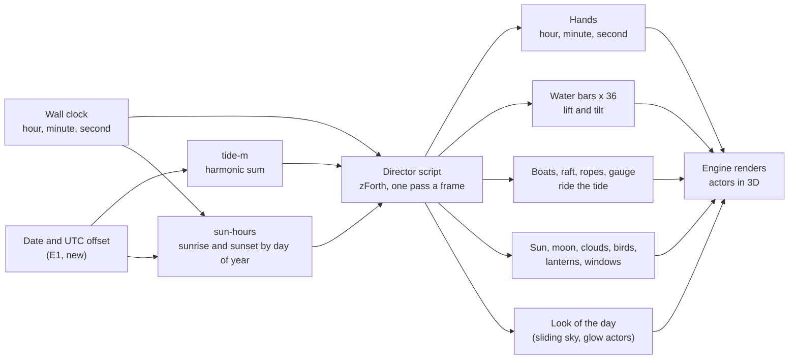
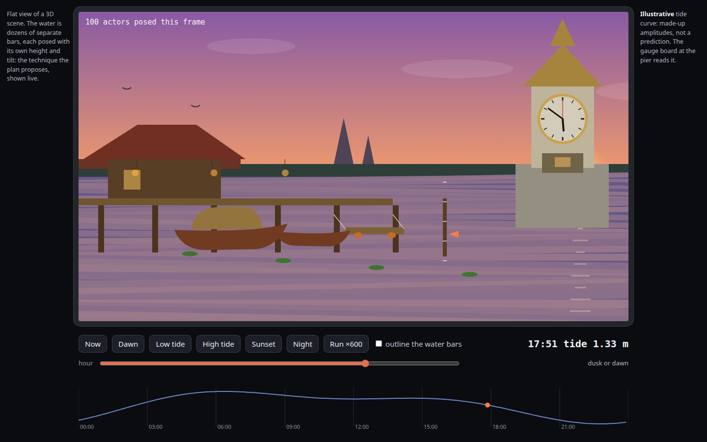
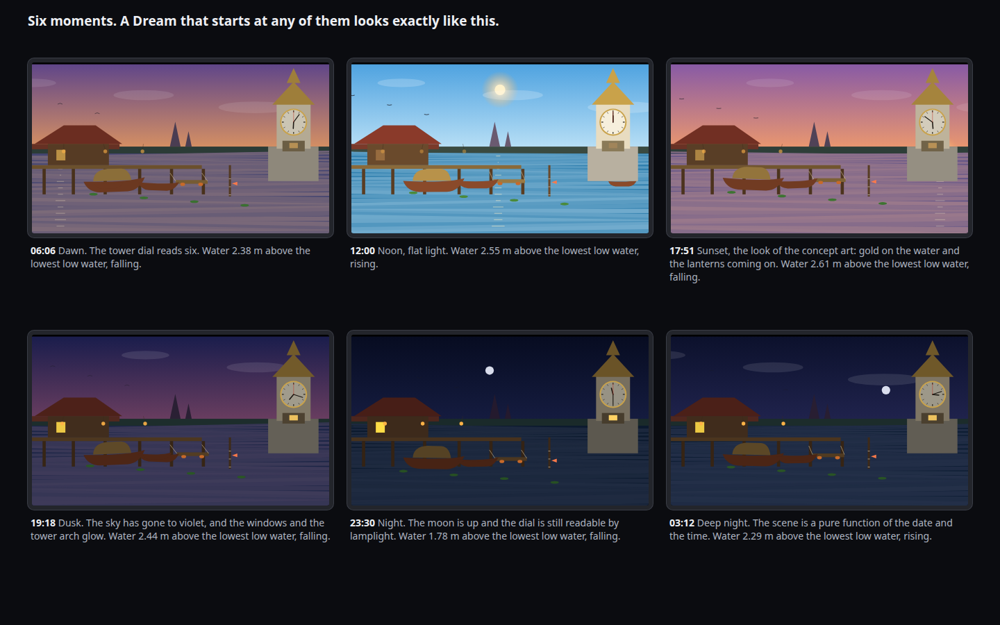
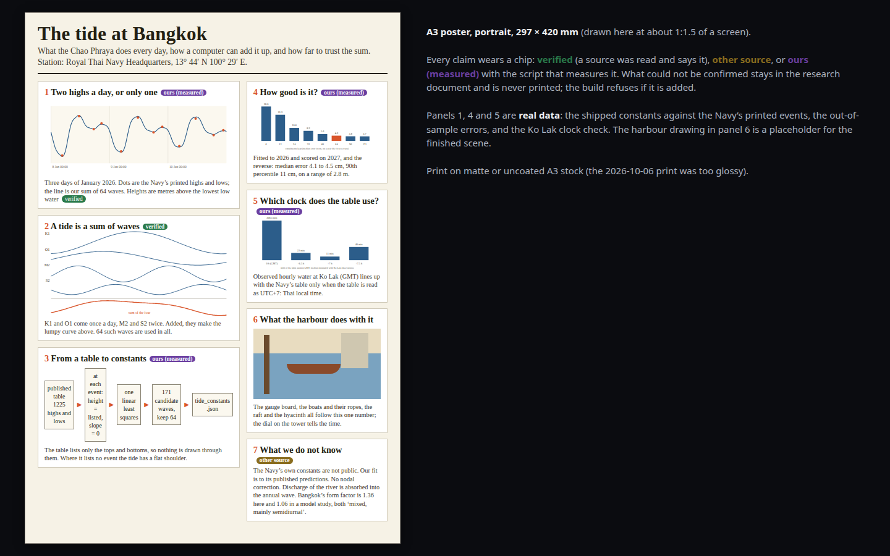
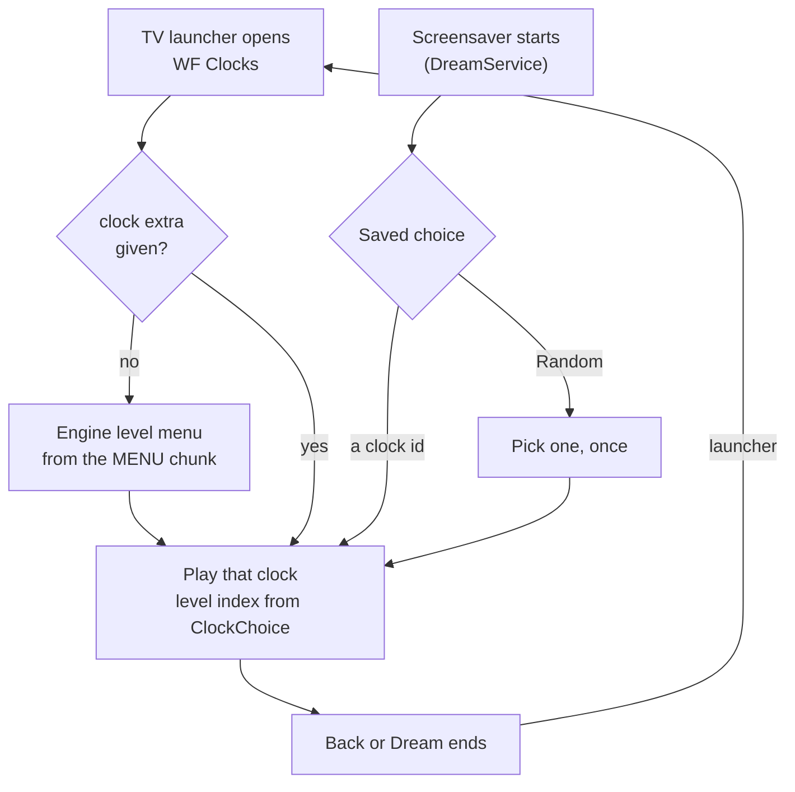
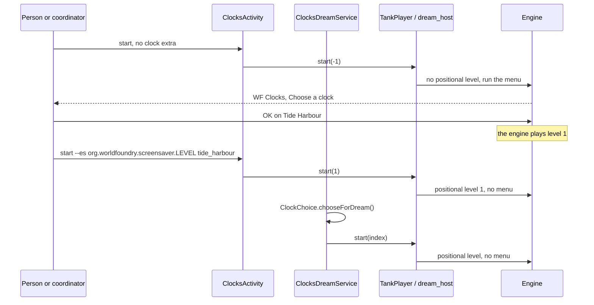
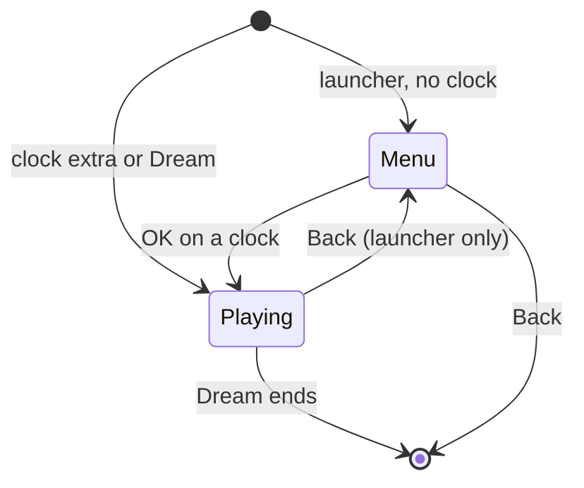
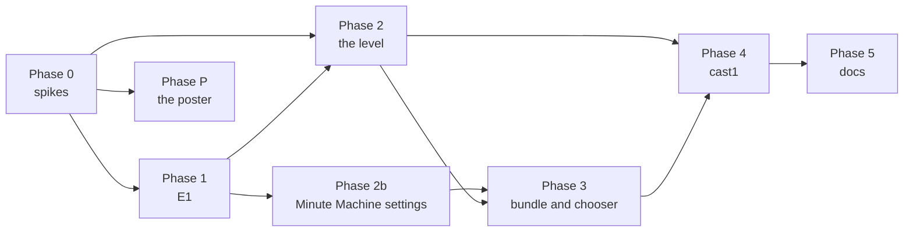

# Tide Harbour: the second 3D clock, and the clocks bundle that holds it

**Status: plan for review, 2026‑11‑21.** The level and the bundle are not built. Done so far: the one engine addition, E1 (a date mailbox), is approved and built ([Phase 1 record](#phase-1-record-e1-built)); the Bangkok tide is fitted to the Navy's published predictions and validated on an unseen year ([Phase 0 record](#phase-0-record-the-tide), [research document](../reference/chao-phraya-tide-research.md)). **Approved: D1 to D12 and the answers to Q1 to Q8 at my recommendations, except Q2, which Will answered Thai: the dial uses Thai numerals** (Will, 2026‑11‑21: "accept all except answer to q2 is thai"). The A3 poster is built (Phase P). **Phase 0 is done on the desktop and on cast1 ([records](#phase-0-record-the-spike-cast1-half)): the 150-actor budget holds the display's refresh rate by day (59.3 FPS), but the veil approach halves the frame rate at night (29.97 FPS), so D5 is open again and needs a decision before Phase 2.** **Runtime control of lights is deliberately not part of this plan** (Will, 2026‑11‑21: "more likely the task is to add control of lights from runtime. today, put it on TODO, and don't use as part of the screensaver implementation for now"); it is its own TODO item.

## Context

Will asked on 2026‑11‑21: "turn Tide harbour entry into the next screensaver in the 3d clock series. we're going to need more animation, i believe / this will be our second 3d clock screensaver / we're gong to implement several of the 50 ideas (each as a separate level) and then bundle them all together info a single cd.iff (i suppose with a menu chooser like the aquarium). when starting as a screensaver, should be able to pass in which clock level to play and not show the chooser menu". While the plan was being researched he added: "we can also move actors in 3d space!!!"

Idea 40 is one of the 50 in the [3D timepieces brainstorm](../../../homeboard-tv/docs/investigations/2026-11-21-3d-timepieces.md#40-tide-harbour), which lives in the Homeboard repository. The whole entry:

> An old Bangkok riverside scene on the Chao Phraya, with wooden stilt houses, piers, traditional boats and a Thai-style clock tower. Its dial shows the time; boats and floating platforms rise and fall with the river's tide.
>
> **Reads:** from the tower dial. **Look for:** the changing water level and boats moving on their moorings. The mockup is concept art; a working clock needs hands that move with the time. Tide predictions for the river remain to be investigated.


That picture is the look to aim at. The plan has two jobs that happen to ship together:

1. **Tide Harbour**, the level: a harbour whose water, boats and sky are a function of the date and the time, with a working clock tower to read.
2. **WF Clocks**, the bundle: one Android app and one `cd.iff` holding every clock level, with a chooser, and a way for a screensaver to name its clock and skip the chooser. Minute Machine becomes the first entry; each later idea is one more level and one more manifest line.

### What the research found

| Question | Finding |
|---|---|
| How does the Aquarium choose? | `LevelLaunch` picks the level through a `LevelCatalog`: the one-run `org.worldfoundry.screensaver.LEVEL` extra if there is one, otherwise the saved choice kept by `TankChoice` (Random is resolved once at start). It never writes the saved choice, and an id the catalogue does not hold starts nothing. The index goes to `nativeRun`, which hands the engine it as its one positional argument ([`LevelLaunch.java`](../../android/screensaver/src/main/java/org/worldfoundry/screensaver/LevelLaunch.java), [`dream_host.cc`](../../android/screensaver/src/main/cpp/dream_host.cc), [launch plan](2026-11-21-aquarium-menu-and-screensaver-launch.md)). The chooser people see is the **engine's own level menu**: `cdpack --manifest` appends a `MENU` chunk, built from a few lines (`title`, `prompt`, `level <path> \| <name>`), and the engine runs it when the desired level is negative ([`game.cc:306`](../../wfsource/source/game/game.cc), [`aquarium-menu.manifest`](../../wflevels/aquarium-menu.manifest), [level-menu plan](2026-10-01-level-menu-selector.md)). So the chooser needs no new UI code. |
| Where is the gap? | `nativeRun` returns at once for a level below 0 or above 10, so today a Dream can never ask for the menu. It also names the Minute Machine as `player.start(0)` in two places. Both change in Phase 3. |
| Can a script move an actor in 3D? | Yes, and it is how Minute Machine works: 75 actors posed from the wall clock through position, rotation and scale mailboxes, **59.7 FPS on cast1 with no deformers** ([Minute Machine plan](2026-11-21-sixty-second-chain-reaction.md)). That is the animation this plan uses. |
| Is more animation machinery needed? | **No, not for motion.** The expensive kind is the mesh deformer: Seahorse Grid manages 29.6 FPS with 24 deforming meshes, and `DFRM` v1 poses only one curve per mesh ([reef plan](2026-11-02-gulf-of-thailand-reef-tank.md)). A river can be made from many rigid bars (below), which costs what Minute Machine's pieces cost. |
| Can a script change colour or light? | **Not today.** A `Light` actor reads its red, green and blue fields once, when it is built ([`light.cc:51`](../../wfsource/source/game/light.cc)); the clear colour is fixed too. Runtime light control is a separate engine feature, now its own TODO item, and **this plan does not use it**. The day turns to dusk and night with parts that already move: a sliding sky, glow actors and keyed looks ([D5](#decisions)). |
| What does the tide need that the engine lacks? | A **date**. The engine's clock mailboxes carry hour, minute and second only. A tide is set by the Moon: its heights repeat roughly every 24 h 50 min, so the same clock time gives a different water level each day. |
| Where do real predictions come from? | **Found.** The Royal Thai Navy Hydrographic Department posts, for every day, the predicted time and height of each high and low water at 31 stations, as a public PDF per station per year ([2026](https://hydro.navy.mi.th/sevicetide), [2027](https://hydro.navy.mi.th/servicetide2570)). Station **HD, Royal Thai Navy Headquarters**, is on the river inside Bangkok. Heights are metres above the lowest low water and the times are Thai local time, UTC+7, which was **measured** against Ko Lak's observed hourly record (median 11 min at +7 h, 308 min at 0). The Bangkok tide is **mixed, mainly semidiurnal** (form factor 1.36 from our fit; 1.06 in an independent model study), and the year's listed highs and lows run from 0.53 m to 3.33 m. Fitting 64 harmonic constituents to the 2026 table and scoring them on the 2027 table, which the fit never saw, gives a **median error of 4.5 cm** (and 4.1 cm the other way round). The department's own constants are not public, so ours are a fit to its published predictions. Everything, with sources, locators and what was not found, is in the [research document](../reference/chao-phraya-tide-research.md). |

Nothing in this plan states a tidal range, a tide type, a harmonic constant or an error that is not in the [research document](../reference/chao-phraya-tide-research.md) with its source or its script.

## Decisions

Recommendations are in the third column. Nothing is decided until Will answers.

| # | Decision | Recommendation | Alternatives weighed |
|---|---|---|---|
| D1 | How the harbour animates | **Rigid actors only, posed from the clock.** The river is **36 separate bars**, each lifted and tilted by two waves; boats bob, rock and swing on moorings; ropes are stretched bars; hands, sun, moon, clouds, birds and lanterns are more actors. About 100 in all, close to Minute Machine's 75. No new animation machinery | A `DFRM` deformer for the water: one smooth surface, but a deformer per mesh costs far more on cast1 and v1 allows one curve |
| D2 | Where Minute Machine goes | **Into the bundle as level 0.** A new `clocks` flavor, application `org.worldfoundry.clocks`, replaces the `minutemachine` flavor in the same change; cast1 gets the old package uninstalled | Keep both apps: two icons and two screensaver entries for one family |
| D3 | How the clock is chosen | Launcher with no clock named: **the chooser**. `--es org.worldfoundry.screensaver.LEVEL tide_harbour` on the launcher activity: **straight to that clock**. The extra is the one shared `LEVEL` extra of the [aquarium launch plan](2026-11-21-aquarium-menu-and-screensaver-launch.md) (Will, 2026‑11‑21: "LEVEL is correct"), not a clock-only key. The Dream: its saved choice (default **Random**, resolved once at start), never the chooser. The settings provider offers the choice | A chooser inside the Dream (a screensaver must never wait for a person) |
| D4 | The order and names of clocks | **Stable ids**, as the Aquarium's, read from `clocks-menu.manifest` by the shared `LevelCatalog`: `minute_machine`, `tide_harbour`. The index is the table-of-contents position; a new clock is appended | Sort alphabetically (an index change would silently re-point saved choices) |
| D5 | How the day turns to night | **No engine change: translucent veils** (measured on the desktop 2026‑11‑21, [spike](../diagnostics/tide-harbour-spike-2026-11-21/README.md)). A handful of large boxes with a translucent tinted material (`wf_opacity`) in front of the camera, from faint warm to dark blue, and the director shows exactly one at a time through its visibility mailbox. What must stay bright (lit windows, lanterns, **the dial and the moon**) is drawn in front of the veil, scaled along the same ray. Replaces the earlier idea of a sliding sky and re-textured sets, which the spike made unnecessary. **Measured on cast1 2026‑11‑21: not as built.** With the dark veil and the lit-window glows on screen, a Chromecast HD locked to 30 FPS (every frame 33.4 ms, 100% of refreshes missed); by day, with no veil showing, it ran 58 to 59 FPS ([record](#phase-0-record-the-spike-cast1-half)). The cause (veil fill rate, the glows, or 1080p) is not isolated, so D5 needs a revision or a split probe before Phase 2. **Open:** that, and the horizon glow a veil cannot give | Runtime light control (a script-writable light colour): would dim everything with one write, but it is an engine feature in its own right and is **deferred to a TODO item, not used here**. Bake one fixed sunset: cheap, but then the look says nothing about the time |
| D6 | The tide itself | **Settled by the research: fitted harmonic constants for Bangkok**, summed in Forth from the date. 64 constituents, median error 4 to 5 cm on an unseen year ([tide_constants.json](../../wflevels/tide_harbour/tide_constants.json)). The department publishes a new table each year, so `task tide-refit` repeats the fit (the years and the file addresses in `tide_fit/` are edited by hand first); the scene needs no nodal correction for the next year (3.7 cm against 3.3 cm) | A synthetic curve (no longer needed); a third-party table (the department's own tables are public and primary) |
| D7 | Frame-rate gate | **At least 30 FPS** on cast1, Release, median over 120 s, the same gate Minute Machine used. Actor budget **150 rigid actors**, measured in Phase 0 on boxes first: **59.3 FPS median on cast1 by day** with 150 posed actors, so the budget holds; the night scene with the veil does not ([record](#phase-0-record-the-spike-cast1-half)) | A higher gate: the water bars are the likely cost, so measure first |
| D8 | The dial | **Thai numerals ๑ to ๑๒** (Will's answer to Q2), as a Bangkok tower would carry. The cost is legibility across a room, so the digits are drawn large and heavy, and the tower's dial is checked at TV distance in Phase 2. The [harbour mockup](2026-11-21-tide-harbour-clock/harbour.html) shows the problem at its scale: all twelve are small. Two remedies, in order: draw the dial about 1.5 times larger than in the concept art, or carry digits only at ๑๒, ๓, ๖ and ๙ with plain ticks between; if both fail, the concept art's Roman numerals are the fallback | Roman numerals, as in the concept art: more legible, less local |
| D9 | Art style | **Low-poly, flat colour, a few small textures** (roof tile, wood, dial face), built in Blender in the container. Reads as the concept art at a distance and fits the VRAM page | Painterly textures like the concept art: much heavier on the 2048 × 2048 page |
| D10 | Burn-in | **The camera drifts slowly all the time**, as Minute Machine's does; the water, sky and clouds always move, so no pixel sits still | A static camera: the tower dial would burn in |
| D11 | An A3 poster about the tides and the calculation | **Yes, portrait A3 (297 × 420 mm), on the repository's poster pipeline** ([seahorse poster](../reference/seahorse-biomechanics-poster/README.md)): the [research document](../reference/chao-phraya-tide-research.md) first, then `make_poster.py` and `export_poster.py` (PDF, 300 DPI PNG, `layout-review.json`) and a pytest guard. Every claim wears a chip (**verified**, **other source**, **ours (measured)**); the build refuses an unconfirmed claim. See [the poster](#the-poster) | A figure in the plan only: no printable object, and the research would stay buried here |
| D12 | Sun and moon | **No tables, and no claim about the moon.** The sun's rise and set come from a closed-form formula (the sun's declination and the equation of time, for Bangkok's latitude and longitude and the date), a few lines of Forth using the new trig words, and checked in Phase 2 against five published sunrise and sunset times. The moon is only a disc on an arc: its phase and position are **not** claimed, in the scene or on the poster. Will asked (2026‑11‑21): "should we??" about researching sunrise, sunset and moon tables; the answer was no | Tables for every date (a lot of data for a look nobody can check); a fixed 06:00 and 18:00 (seasonal drift is a few tens of minutes, which would pass, but the formula is as cheap and is right); the real moon (phase and position are a project of their own, and the plan's moon-phase stretch is already out of scope) |
| D13 | A settings object in every clock level | **Decided** (Will, 2026‑11‑21: "make sure level has a settings object (same for all clocks---audit)"). Every clock level carries one settings object, built the same way for all clocks: an `.oas` type that includes `settings.inc` with live fields, one instance placed in the level, read by the director with `property@`, a TV form and a phone Dream form both generated from its `.oad`, and a test that edits and checks every live field. [`scripts/audit-clock-settings.py`](../../scripts/audit-clock-settings.py) checks all six and is run in verification. The audit found **no clock has one yet**: see [Settings objects](#settings-objects) | A settings object only where a clock needs options today (what Minute Machine did; it leaves each later clock to decide, and the phone form and the chooser then differ clock to clock) |

## Questions for Will: answered

**Answered 2026‑11‑21** (Will, 2026‑11‑21: "accept all except answer to q2 is thai"). Every recommendation was accepted except Q2. No engine permission is pending: E1 is approved and built, and light control is deferred.

| # | Question | Answer |
|---|---|---|
| Q1 | Accept D1 to D12 as written? | ~~Accept all.~~ **Accepted**, with D8 changed by Q2. |
| Q2 | Dial numerals (D8)? | **Thai numerals ๑ to ๑๒** (not the recommended Roman). |
| Q3 | Art style (D9)? | ~~Low-poly flat colour with a few small textures.~~ **Accepted.** |
| Q4 | Retire the Minute Machine app and uninstall its package from cast1? | ~~Yes, in the same change.~~ **Accepted.** |
| Q5 | Poster language? | ~~English only for now.~~ **Accepted.** |
| Q6 | Tide size on screen? | ~~True to scale against the pier and the gauge board.~~ **Accepted.** |
| Q7 | A TV outside Thailand? | ~~Device time everywhere, as if Thai.~~ **Accepted.** |
| Q8 | Attribution for the tide? | ~~Credit the department; no further step.~~ **Accepted.** |

### Open

| # | Question | Recommendation | What it blocks |
|---|---|---|---|
| Q9 | **What do all clocks share in their settings?** (Will, 2026‑11‑21: "make sure level has a settings object (same for all clocks---audit)") A common `Clock` sheet every clock's settings type includes, and each clock's own fields beside it. | Common: **Camera drift** (Slow, the default, or Off), the burn-in guard Minute Machine's D10 called "push-in". Minute Machine's own: **Hour format** (24 hours by default, or 12). Tide Harbour's own: **Dial numerals** (Thai by default, Roman, or none), **Gauge board** (on or off), **Boats and birds** (on or off). The first release ships these and no more. | The `.oas` files, Phases 2 and 2b |
| Q10 | **Start the clocks from the baseline toolkit?** The level guides say new scenes should (a generated core with explicit defaults, no snowgoons import). Minute Machine and the spike use the old import; retrofitting Minute Machine is a small TODO item. | Yes: Tide Harbour and every later clock; Minute Machine on its next change. | Phase 2 |
| Q11 | **May I prune Docker's build cache (only that)?** Free disk fell to about 5 GB, right at the stop line; Docker reports 21 GB of reclaimable build cache and 23 GB of reclaimable images, and the rootless Docker trial is the live engine, so I will touch none of it without your word. The cast1 half of Phase 0 needs an APK build. | Yes, the build cache only; I will show you the list first. | The cast1 half of Phase 0 |
| Q12 | **Commit the clocks' built outputs, and check they stay fresh?** The aquarium levels commit their `.iff` files and bundles and CI proves they rebuild identically (`task aquarium-check`); Minute Machine git-ignores them. The clocks bundle could follow either. | Follow the aquarium: commit the built outputs and add a `clocks-check`, so a change to an input cannot ship a stale bundle. It adds a few MB per clock to the repository. | Phase 3 |

Optional, not blocking: which of the other 48 ideas comes after Tide Harbour.

## Approach

### The pose-from-clock design, again

Nothing is simulated. A screensaver can start at any moment, so every piece's pose is a **pure function of the date and the time**, computed fresh each frame by the director script, exactly as Minute Machine does. The motions that are not tied to the tide or the hands (ripples, bobbing, birds, clouds) take their phase from the time of day too, so they are repeatable and testable.



### The river from rigid bars

The water is a stack of 36 long thin boxes, near to far, slightly overlapping. Each is posed every frame with its own height and tilt: two travelling waves added together, scaled up toward the camera so far water looks calm and near water looks lively. The whole river's mean level rides the tide, and a few of the bars also carry a glint that brightens and fades. The [live mockup](2026-11-21-tide-harbour-clock/harbour.html) does exactly this in flat form (tick "outline the water bars" to see them), and its counter says how many actors it poses.

[](2026-11-21-tide-harbour-clock/harbour.html)

**Risk, stated plainly:** flat bars may look banded on a 1080p TV, where the concept art is smooth. Phase 0 builds the 36 bars as plain boxes and looks at them on the real TV before anything else is made. The fallback, if it fails, is to raise the count (the budget allows about 150) or to use one `DFRM` mesh for the water alone and pay for that one deformer. **Measured on the TV (Phase 0, cast1): the bars do band**, as thin darker lines across the foreground water and a lighter step at the bottom of the frame, by day and at night; the fallback is now needed, and which one works is untested ([record](#phase-0-record-the-spike-cast1-half)).

### The tide and the sun

- **Tide:** `tide-m` sums the 64 fitted waves, `amplitude × cos(2π × (cycles per hour × hours + phase))`, plus the mean level, with `hours` counted from 2026‑01‑01 00:00 Thai time. The four that define the tide are K1 (50.0 cm, 23.93 h), M2 (36.3 cm, 12.42 h), O1 (30.9 cm, 25.82 h) and S2 (23.1 cm, 12.00 h); the other 60 add the annual cycle, the other lunar and solar terms, and the shallow-water compound tides a river makes. Fewer would do for the look (12 waves leave a median error of 21 cm; 48 leave 5.6 cm), and the tide only needs evaluating about once a second, so 64 cosines is cheap. The date supplies the phase: `WALL_DAY` minus the epoch's day number, times the cycles per day, plus the hour. A float cell holds about seven digits, so Phase 2 measures the real float error against the table and records it; it is expected to stay under a centimetre.
- **Time zone:** the constants are for Thai local time (UTC+7, no daylight saving). E1 also exposes the device's UTC offset, so a TV elsewhere still shows Bangkok's tide at the right Bangkok moment, or can be told otherwise by a setting later.
- **Sun and moon:** by [D12](#decisions), the sun's rise and set follow from its declination and the equation of time for Bangkok and the date, computed in Forth with the trig words, and checked in Phase 2 against five published times; no table is stored. The moon is a disc on an arc, rising opposite the sun, with no claim about its phase or position.
- **What the tide moves:** the river's mean level, the boats on their ropes (the rope lengths change), the raft between its posts, the water hyacinth drifting up and down the bank, and a **tide gauge board** on a pier post with a pointer, so the tide can be read as well as seen.

### The clock tower

The dial is the one thing that tells the time, and carries **Thai numerals ๑ to ๑๒** (D8). The hour, minute and second hands are three actors turned by the clock, the second hand sweeping. Under the dial, the arch glows at dusk. The tower is the tallest thing in the frame and is lit even at night, so the dial stays readable ([moments](#moments)).

### Moments

[](2026-11-21-tide-harbour-clock/moments.html)

Six frozen moments from the same code: dawn at low tide, noon, the sunset of the concept art, dusk, night and deep night at another tide. The sky, the water colour, the lit windows and lanterns, and the water level all change with the clock, which is what makes the picture say what time it is even without reading the dial. The mockups draw the day's light freely; how closely the engine's existing moving parts can match them, with no light control, is what the Phase 0 spike must show.

### The poster

Will asked (2026‑11‑21): "update plan: make an a3 poster about the tides and calculations/etc". It is a printable object in its own right, and it makes the research readable. The [mockup](2026-11-21-tide-harbour-clock/poster.html) draws the layout on the real data: panels 1, 4 and 5 are the shipped constants against the Navy's printed events, the out-of-sample errors and the Ko Lak clock check; panel 6 is a placeholder for the finished harbour.

[](2026-11-21-tide-harbour-clock/poster.html)

- **Content (seven panels):** two highs a day or only one, on three real days; a tide as a sum of waves (K1, O1, M2, S2 and their sum); from a table of highs and lows to constants (the fit); how good it is, against the number of waves kept, on a year the fit never saw; which clock the table uses (the Ko Lak check); what the harbour does with the number; and what we do not know.
- **Rules, from the seahorse poster:** the research document comes first and gives each source's locator and access limits; every printed claim wears a chip (**verified**, **other source**, **ours (measured)**); claims the research could not confirm stay out, and `make_poster.py` refuses to build if one is added; the drawings are original SVGs; the PDF is one 297 × 420 mm page, with a 300 DPI PNG and a `layout-review.json`.
- **Print:** matte or uncoated A3 stock. The 2026‑10‑06 print was too glossy ([audit note](../reference/2026-10-06-aquarium-poster-reference-verification.md)); confirm a shop with matte A3 before going.
- **Not on it:** the department's constants (not public), anything about the sun or moon (D12: not claimed), and anything from the two papers that could not be read.
- **Built 2026‑11‑21:** [the A3 PDF](../reference/chao-phraya-tide-poster/chao-phraya-tide-a3.pdf), [the 300 DPI PNG](../reference/chao-phraya-tide-poster/poster.png) and [its README](../reference/chao-phraya-tide-poster/README.md). It follows the mockup's seven panels plus one (spring and neap tides, and a year of highs and lows, are new); panel 8 keeps the harbour as a design sketch.

### The bundle and the chooser

[](2026-11-21-tide-harbour-clock/chooser.html)





What changes, file by file:

- `wflevels/clocks-menu.manifest`: `title WF Clocks`, `prompt Choose a clock`, one `level` line per clock.
- `scripts/pack-clocks-bundle.py`: generalises `pack-minute-machine-bundle.py`. It reads the manifest, calls `cdpack --manifest`, and links the result as `android/screensaver/src/clocks/assets/cd.iff`.
- no `ClockChoice.java` or `ClockLaunch.java`: the `clocks` flavor uses the shared `LevelCatalog` (ids and labels from `clocks-menu.manifest`, the saved choice, Random resolved once) and `LevelLaunch` (the `org.worldfoundry.screensaver.LEVEL` extra), both already on `2026-new-level` ([aquarium launch plan](2026-11-21-aquarium-menu-and-screensaver-launch.md)); `ClocksActivity.java` (starts through `LevelLaunch`), `ClocksDreamService.java`, `ClocksSettingsProvider.java` with a `clock:` setting beside the orientation.
- `dream_host.cc`: `nativeRun` accepts **-1 for "show the menu"**, by leaving out the positional argument, and the upper bound becomes the bundle's length. A test pins the host's argument list, as `tests/test_dream_host_vram.py` already does.
- `build.gradle.kts`: flavor `clocks`; the `minutemachine` flavor, its three `MinuteMachine*.java` classes and its source set are removed, and the manifest, strings, icons and banner are kept under the new name.
- `scripts/gen-screensaver-android-icons.py` and the Taskfile follow.

### Settings objects

Will, 2026‑11‑21: "make sure level has a settings object (same for all clocks---audit)". Every clock level carries one settings object, built the way the Planted Tank, Jellyfish, Reef and Sea Stars levels build theirs ([Sea Stars settings plan](2026-11-20-sea-stars-settings.md), [settings.inc](../../wfsource/source/oas/settings.inc)):

1. **The type.** `wfsource/source/oas/<clock>settings.oas` does `@include settings.inc` and declares fields as `SHOW_AS_…|SHOW_AS_LIVE`; the `.mas` rules generate the `.oad` and `.ht`. A field marked live is one the engine re-reads after the level loads, and that is what makes `levcomp` list the object as editable.
2. **The instance.** The level places one object of that type with no model and no mass. Minute Machine is built through Blender, whose exporter already supports an object that carries `wf_schema_path` ([export_level.py](../../wftools/wf_blender/export_level.py)); Phase 2b confirms a no-model empty works.
3. **The reader.** The director reads each field with `property@ ( actor field -- value valid )`, using the settings actor's index and the field indices written into the script at export time. Nothing scans for the type at run time.
4. **The forms.** The TV form (hold OK) is generated from the `.oad`. The phone's Dream form comes from `scripts/gen-settings-capabilities.py`, which turns the `.oad` into a capabilities asset; the Dream's shared `LevelSettings` saves what the person changed and sends it as launch overrides, which the engine applies when the level loads. The `clocks` app serves the playing clock's fields through one provider, so no clock needs its own.
5. **The Dream variant** keeps the object, its Editable Objects entry and its `OAD ` chunk.
6. **The test** sets every live field, steps the director and checks the pose, as the project rule for live fields requires.

**Audit,** 2026‑11‑21, by `scripts/audit-clock-settings.py` against that list:

| Clock | Type | Live fields | Placed | Read by the director | Phone form | Test | Finding |
|---|---|---|---|---|---|---|---|
| Minute Machine | none | none | none | no `property@` | orientation only | none | **Gap.** Its plan's D10 chose "no settings object" and left one as a later item; that deferral is withdrawn |
| Tide Harbour | none | none | none | none | none | none | **Gap, by design:** not built yet; Phase 2 must build it |
| Sea Stars, for comparison | yes | yes | yes | yes | yes | yes | The reference implementation |

**Common base.** Fields every clock shares go in one include, `wfsource/source/oas/clocksettings.inc`, a `Clock` property sheet that each clock's `.oas` includes after `settings.inc`; adding a field to `settings.inc` itself would change the struct of every settings type, so it is not touched. Each clock's own fields follow in their own sheet. What goes in each is [Q9](#open).

**What changes.** Phase 2 builds Tide Harbour's object with the level; Phase 2b retrofits Minute Machine's; Phase 3 generalises the Dream's `LevelSettings` from its Sea Stars constants to a factory by clock id (its own comment says "not specific to any level") and serves the playing clock's fields; and the audit becomes part of verification so a third clock cannot ship without one.


### Shared code

`channels.py`, `forth.py`, the Blender part helpers and the check scripts in `wflevels/minute_machine/` are mostly not about Minute Machine. They are hoisted into `wflevels/clock_common/` in Phase 2, and Minute Machine is rebuilt from them with its tests unchanged, so a third clock starts from a library, not a copy.

### Engine changes needing permission

| # | Change | Why | Cost |
|---|---|---|---|
| **E1** | Two more system mailboxes: **calendar day** (whole days since 2000‑01‑01, device local) and **UTC offset** (minutes). Latched once a frame with the clock, like `WALL_HOUR`. `WF_WALL_CLOCK` learns a date (`2026-11-21T10:08:22@0`) | The tide and the sunrise change by the day. Without a date there is no tide | Small: Minute Machine's own change, in the same files (`mailbox.inc`, `level.cc`, `wallclock.hp`), and its test file |

E1 is the only engine change, and it is **approved** (Will, 2026‑11‑21: "approval to add date to engine"). Runtime light control (once called E2) is out of this plan and tracked in `TODO.md`.

### State of a clock level



## Phases

| Phase | Work | Tier | Gate |
|---|---|---|---|
| **0 Spikes and research** | (a) 36 plain bars plus 100 boxes on a placeholder level, on cast1: FPS and banding. **Done 2026‑11‑21, desktop and cast1:** 59.3 FPS for 150 actors by day, and the bars band on the TV. (b) The look of the day with no light control: **done as translucent veils (D5); the cast1 cost of the night scene is a halved frame rate (29.97 FPS), so D5 is reopened.** ~~(c) The tide: find the Hydrographic Department's constants for a Chao Phraya station, or record that none are public; check the arithmetic against their table.~~ Done 2026‑11‑21: no public constants, but the department's published highs and lows were fitted and validated; [record below](#phase-0-record-the-tide). ~~(d) Sunrise and sunset by day of year against NOAA~~ Dropped by D12: a formula, checked in Phase 2, in place of research | T4 | Answers D5, D7 and the water risk; the plan is revised with the results |
| ~~**1 Engine E1**~~ | ~~Mailboxes, override, tests~~ Done 2026‑11‑21; [record below](#phase-1-record-e1-built) | T4 | ~~`task test-wall-clock` passes with a date; Minute Machine unaffected~~ |
| **2 Tide Harbour level** | `clock_common` hoisted, and its scene core built from the baseline toolkit ([Q10](#open)); `wflevels/tide_harbour/` with `timeline.py`, `channels.py`, `parts.py`, Blender build (the dial's Thai numerals are drawn from a Thai font inside the Blender container, so Phase 2 first checks that a Thai font is in the image and adds one to the Dockerfile if not), `-standalone.iff`; **the settings object (D13)**; director VM test; engine comparison | T3 | Director matches the model in the VM and the engine, as Minute Machine's did |
| **2b Minute Machine settings object** | The retrofit the audit found: `minutemachinesettings.oas` including `clocksettings.inc`, one object placed in the Blender-built level, the director reading it with `property@`, the capabilities asset, and `tests/test_minute_machine_settings.py` | T3 | `scripts/audit-clock-settings.py --strict` passes for Minute Machine; its timeline and director tests are unchanged |
| **3 Bundle and chooser** | Manifest, pack script, `LevelSettings` made a factory by clock id and one provider serving the playing clock's fields, `Clock*` classes, host change, flavor `clocks`, `minutemachine` flavor removed | T3 | Desktop and cast1: no argument shows the menu; a named clock skips it; the Dream never shows it |
| **4 cast1** | Install, FPS gate, 10-minute Dream run, six moments checked on the TV, tide gauge checked against the model | T3 | D7 gate, and the moments match the mockups |
| **5 Docs** | `android/screensaver/README.md`, `docs/level-building.md` note, `docs/forth-math-words.md` unaffected | T2 | `task md` renders |
| **P The poster** | ~~The research document, `make_poster.py`, `export_poster.py`, the eight SVG panels, `layout-review.json`, the PDF, a 300 DPI PNG and `tests/test_poster_chao_phraya_tide.py`.~~ **Built 2026‑11‑21** in [`docs/reference/chao-phraya-tide-poster/`](../reference/chao-phraya-tide-poster/README.md) ([PDF](../reference/chao-phraya-tide-poster/chao-phraya-tide-a3.pdf), [PNG](../reference/chao-phraya-tide-poster/poster.png)); [record below](#poster-record). Panel 8's harbour is a design sketch, redrawn from the finished scene once Tide Harbour exists | T3 | ~~PDF is one 297 × 420 mm page; the build refuses an unconfirmed claim~~ Done. **Still open: a person reads the printed-size proof (Will), and it is printed on matte or uncoated stock** |

### Phase 0 record: the tide

Done 2026‑11‑21. Tooling in `wflevels/tide_harbour/tide_fit/`; the full account is the [research document](../reference/chao-phraya-tide-research.md). The three runs below are the evidence.

1. `python3 -I wflevels/tide_harbour/tide_fit/check_time_zone.py`: which clock the department's table uses.

    ```
    Ko Lak: 6562 observed hourly samples in 2025 (GMT), 736 table events for 2026
      table minus GMT =  +7.0 h: median mismatch   11.0 min
      table minus GMT =  +6.5 h: median mismatch   22.0 min
      table minus GMT =  +7.5 h: median mismatch   40.0 min
      table minus GMT =  +0.0 h: median mismatch  308.5 min   (the table is not in GMT)
    RESULT: the table's times are Thai local time (UTC+7)
    ```

    **PASS.**

2. `python3 -I wflevels/tide_harbour/tide_fit/make_constants.py --n 64`: the fit, scored on the year it never saw, both ways.

    ```
    events: 2026 1225, 2027 1222; basis 171 constituents; keeping 64
    fitted on 2026, scored on 2027 (unseen): median 4.5 cm, 90th 11.3, max 22.6  (1222 events)
    fitted on 2027, scored on 2026 (unseen): median 4.1 cm, 90th 10.6, max 21.5  (1225 events)
    shipped constants (both years, 64 constituents), in sample: median 5.2 cm, 90th 11.4, max 19.8
    wrote ../tide_constants.json
    ```

    **PASS.** The first fit that tried (22 constituents) gave a median of 16 cm and was rejected; the Doodson-number basis brought it to 7 cm and the shallow-water compound tides to 3 to 4 cm. The error was the same in and out of sample at every step, which is what showed the model was too small and not overfitted.

3. `python3 -m pytest -q tests/test_tide_constants.py`:

    ```
    .....                                                                    [100%]
    5 passed in 0.25s
    ```

    **PASS.** Mutation check: reading the table as GMT (7 h off) gives a 125.5 cm median and fails; a K1 phase moved by a quarter turn gives 40.1 cm and fails; halving M2 gives 11.9 cm and fails; as shipped, 4.3 cm.

### Audit record: settings objects

Run 2026‑11‑21. `python3 scripts/audit-clock-settings.py`:

    ```
    clock            type     fields   level    director phone    test     settings object
    minute_machine   MISSING  MISSING  MISSING  MISSING  MISSING  MISSING  6 of 6 missing
    tide_harbour     MISSING  MISSING  MISSING  MISSING  MISSING  MISSING  6 of 6 missing
    2 clocks audited, 2 without a complete settings object
    ```

    **Finding: neither clock has a settings object.** `python3 -m pytest -q tests/test_audit_clock_settings.py`:

    ```
    ........                                                                 [100%]
    8 passed in 0.15s
    ```

    **PASS.** The audit's own test: a fake clock with all six parts passes; removing the type, the capabilities asset or the test flips exactly that check; a level that neither places nor reads the object fails two; a type with no live field fails `fields`.

### Poster record

Built 2026‑11‑21. How to rebuild it is in its [README](../reference/chao-phraya-tide-poster/README.md); these are the runs that matter.

1. `python3 docs/reference/chao-phraya-tide-poster/make_poster.py` (refuses to build on an unchipped or sourceless claim):

    ```
    poster.html: 8 panels, 27 claims, 8 sources
    ```

    **PASS.**

2. `python3 docs/reference/chao-phraya-tide-poster/export_poster.py`:

    ```
    {"page_mm": {"width": 297, "height": 420}, "min_font_pt": 8.25, "overflowing": false, "fit": "ok"}
    ```

    **PASS.** The first layout overflowed in three places (the footer by 35 px, the header's fact box, one panel's claims); fixed by shortening wording and tightening line height from 15 to 14 px, never by shrinking type below the 8.25 pt floor.

3. `pdfinfo docs/reference/chao-phraya-tide-poster/chao-phraya-tide-a3.pdf`:

    ```
    Pages:           1
    Page size:       841.92 x 1191.12 pts (A3)
    ```

    **PASS.**

4. `python3 -m pytest -q tests/test_poster_chao_phraya_tide.py`:

    ```
    .........                                                                [100%]
    9 passed in 0.38s
    ```

    **PASS.** The tests refuse an unverified claim, a verified claim with no source, an ours claim with no script and an unknown source; check the printed numbers against the JSON the fit wrote; check the spring-and-neap period independently against NOAA's two speeds; and check every drawn text for size and contrast.

What review found, and fixed, before it passed: a spring-and-neap period printed as negative (the gap between two speeds); a chip that called two design statements "measured"; the year panel's "lowest of the day" spiking on days that list no low, now classified by the table's strict high and low alternation; one caption at 2.30:1 contrast against its background (the test requires 4.5:1), now the dark ink; and a header title that wrapped over its subtitle.


### Phase 0 record: the spike, desktop half

Run 2026‑11‑21; full account, captures and the raw numbers in [the spike's README](../diagnostics/tide-harbour-spike-2026-11-21/README.md). Software GL in the Debug engine: relative cost and look only.

| Variant | Posed actors | Median frame, ms |
|---|---|---|
| a | 46 | 20.6 |
| b | 100 | 23.5 |
| c | 150 (the D7 budget) | 35.6 |
| d | 150, fast day, veils | 33.6 |

1. **The veils work** (D5): nine translucent boxes, one shown at a time, turn the scene from day to dusk, night and pre-dawn; glows drawn in front stay bright. The dial and the moon are dimmed and must be drawn in front too.
2. **The guide's lighting recipe has the wrong sign** (measured, fifteen readings): `B = +alt` tilts a directional light down. `docs/level-building.md` is corrected. Minute Machine's sun (`B = +40°, C = 90°`) turns out to be aimed correctly.
3. **Faint horizontal lines** show across the daytime water. On the TV they do band: see [the cast1 half](#phase-0-record-the-spike-cast1-half).
4. **A zero-thickness quad is not invisible** (measured, same capture pixels as a box); the guide's thin-object entry is corrected. **Not measured:** which near plane rules. The cast1 half follows.

### Phase 0 record: the spike, cast1 half

Run 2026‑11‑21 on cast1 (Chromecast HD, display 59.94 Hz), Release APK, the coordinator's `profile` workflow. Method, the raw per-run numbers and the TV captures are in [the spike's README](../diagnostics/tide-harbour-spike-2026-11-21/README.md#the-cast1-half).

| Variant | Posed actors | Median FPS | Missed refreshes |
|---|---|---|---|
| a | 46 | 59.46 | 0.8% to 1.3% |
| b | 100 | 59.31 | 1.0% to 1.2% |
| c | 150 (the D7 budget) | 59.29 | 0.8% to 1.4% |
| d, morning (no veil showing) | 150 | 58.01 | 2.9% to 3.8% |
| d, night (dark veil, lit-window glows) | 150 | **29.97** | **100%** |

1. **The actor budget holds** (D7): 46, 100 and 150 posed actors all run at the display's refresh rate by day.
2. **The veil approach halves the frame rate at night** (D5): one 30 s run with the veil and the glows on screen took exactly 33.4 ms per frame for all 909 frames, thermal status 0. The earlier read-out of "about 1.3 FPS for a veil" was wrong: the day runs had no veil showing. **Next probe, before D5 is revised:** split the cost: night with the veil and no glows, night with the glows and no veil, and each of those at a 1280 × 720 surface. Each is a short cast1 run once the APK is rebuilt.
3. **The water bands on the TV** (the Risk above): thin darker lines across the foreground water and a lighter step at the bottom of the frame, by day and at night. Narrower bars with smaller colour steps, or per-vertex colour if the engine interpolates it, are the untested remedies.
4. **The dial and the moon are dimmed at night**, as on the desktop; they need drawing in front of the veil like the glows.
5. **Not isolated or not measured:** which of the veil, the glows or 1080p fill rate costs the time; the warm dusk veils on the TV; a night run of 120 s or more.

### What the level guides require of every clock level

Read in full 2026‑11‑21, after asking whether they had been ([level-building.md](../level-building.md), [level-design-troubleshooting.md](../level-design-troubleshooting.md)). Each is a rule Phase 2 and Phase 3 must satisfy, and the spike broke four of them before the guides were read.

- **Start from the baseline toolkit**, not the snowgoons import: the guides say "for new scenes, use the baseline toolkit" ([`wflevels/baseline/`](../../wflevels/baseline/README.md)). Minute Machine and the spike import snowgoons, which is how the grey fog default came in ([Q10](#open)).
- **Set the camera's fog explicitly.** The snowgoons scaffold's default is `#888888` from 20 to 30 m: everything past that fades to flat grey.
- **Keep every actor inside the room**, including the sun and moon at their lowest, and give the room a floor below anywhere the Player can fall. An actor that leaves the room can end the level.
- **Face winding is load-bearing:** faces are culled by default, so a wrong-way face vanishes. Single-sided sheets (a veil, a sky) are wound counter-clockwise seen from their visible side. A zero-thickness quad renders (2026‑11‑21, measured), so thickness is not required.
- **Never leave two faces in one plane:** overlapping neighbours (the water bars) flicker. Offset them by a centimetre.
- **Light:** author a Directional and an Ambient; aim with `B = +alt` and **verify with a capture**.
- **Mesh origin:** a mesh that rests on a surface has its base at local z = 0; a scaled one grows from its origin.
- **Scripts:** a definition-only script above the last `;`, the per-tick call last; a backslash comment only on the first line; no `and`, `or` or `<0`; no bytes outside ASCII.
- **Mailboxes:** global user cells are 2 to 1900; 1901 and up are system (side effects); 0 and 1 are fixed.
- **Level builds run in the Blender container:** only `TANK_*`, `AQUARIUM_*` and three other prefixes reach it from the environment.
- **Bundles are append-only** (`level <name>-standalone.iff | <Name>`; a level's position is its index) and built outputs are committed and kept fresh by a CI check; the clocks bundle needs the same check.
- **Settings objects** need a unique editor label (`wf_Editor Label`), and the shared host opens them on a held OK.
- **Profile on the device:** `--frame-profile`; large translucent sheets are the case the guide says is unmeasured.

### Audit record: Minute Machine against the level guides

Run 2026‑11‑21 by reading `blender_create_minute_machine.py`, `forth.py` and its tests against the guides (the `[T2]` audit item). Mechanical checks were run; the rest is read from the source.

| Rule | Minute Machine | Finding |
|---|---|---|
| Start from the baseline toolkit | Imports the snowgoons level | **Gap** ([Q10](#open)) |
| Camera fog set explicitly | Not set: inherits `#888888`, 20 to 30 m | **Gap, harmless today:** the scene lies within about 10 m of the camera. One line to fix, with the next rebuild |
| Actors inside the room | Room (−40, −45, −8) to (50, 12, 24) holds the camera at its 7.5 m orbit and drift | Pass (the engine comparison and the cast1 run never left it) |
| Directional light aim | `B = +40°, C = 90°`: travels toward +y and down | **Pass, and correct under the measured convention** |
| Ambient light | (0.38, 0.39, 0.45) | Pass |
| Winding and coplanar faces | Signed-volume tests; 16 mm card stack | Pass (tests) |
| Thin objects | 8 mm cards | Pass: they render on the TV; this is a counterexample to the guide's thin-object entry |
| Scripts | Director is ASCII, has no backslash after its first line, no `and`, `or` or `<0`, definitions above the last `;` | Pass (checked mechanically) |
| Mailboxes | Scratch cells 600 to 627 | Pass (global user range) |
| Mesh names | At most 30 characters, asserted | Pass |
| Settings object | None | **Gap** (D13, Phase 2b) |
| Built outputs committed and kept fresh | Only the `.lev`, `actor-map.json` and the wrapper are tracked; the `.iff` files and the Dream bundle are git-ignored and built on demand | **Differs from the aquarium levels**, whose outputs are committed and checked by `task aquarium-check` ([Q12](#open)) |
| Frame rate profiled on the device | 59.7 FPS median on cast1 | Pass |

### Phase 1 record: E1 built

Built 2026‑11‑21. `WALL_DAY` is mailbox 1925 (whole calendar days since 2000‑01‑01 in the clock's own time zone, so 2026‑11‑21 is 9821), `WALL_UTC_OFFSET` is 1926 (minutes; Bangkok is 420), and `GLOBAL_SYSTEM_MAX` is 1927. `WF_WALL_CLOCK` takes `[YYYY-MM-DDT]HH:MM:SS[.mmm][+HH:MM|-HH:MM|Z][@rate]`; the time-only form is unchanged. All five mailboxes are latched from one instant per frame. The scripts' `INDEXOF_WALL_DAY` and `INDEXOF_WALL_UTC_OFFSET` come from `mailbox.inc` with no further change. Files: `wallclock.hp`, `mailbox.inc`, `level.hp`, `level.cc`, `tests/wall_clock_test.cpp`, `tests/test_wall_clock.py`, `tests/test_mailbox_global_bounds.py`, `docs/command-line-switches.md`.

1. `task test-wall-clock` (pure C++, no engine; day numbers checked against an independent count, a leap day, the years 2000 and 2100, bad dates and offsets, midnight and a leap-day rollover stepped at exact instants):

    ```
    wall_clock_test: OK
    ```

    **PASS.**

2. The container Debug engine (`scripts/build-wf-game-container.sh --dev`, 70 of 70 linked), then `tests/test_wall_clock.py` and `tests/test_mailbox_global_bounds.py` under `xvfb-run`:

    ```
    tests/test_wall_clock.py::test_frozen_override_reads_back_exactly PASSED [ 11%]
    tests/test_wall_clock.py::test_fast_clock_crosses_a_minute_an_hour_and_midnight PASSED [ 22%]
    tests/test_wall_clock.py::test_without_an_override_it_is_the_device_time PASSED [ 33%]
    tests/test_wall_clock.py::test_a_dated_override_reads_back_the_day_and_the_offset PASSED [ 44%]
    tests/test_wall_clock.py::test_the_day_advances_at_midnight PASSED       [ 55%]
    tests/test_wall_clock.py::test_without_an_override_the_day_and_offset_are_the_devices PASSED [ 66%]
    tests/test_wall_clock.py::test_a_malformed_override_stops_the_engine_at_startup PASSED [ 77%]
    tests/test_mailbox_global_bounds.py::test_global_user_max_is_writable PASSED [ 88%]
    tests/test_mailbox_global_bounds.py::test_global_user_max_minus_one_is_writable PASSED [100%]
    ============================== 9 passed in 16.51s ==============================
    ```

    **PASS.** The three time-of-day tests Minute Machine already had still pass, so its clock is unaffected.



## New and changed files

| File | Change |
|---|---|
| `wflevels/clock_common/` | New: the generic parts of `channels.py`, `forth.py` and helpers, moved from `wflevels/minute_machine/` |
| `wflevels/tide_harbour/` | New: `timeline.py`, `parts.py`, `forth.py`, `blender_create_tide_harbour.py`, `build.sh`, `actor-map.json`, `tide_harbour.lev`, `tide_harbour-standalone.iff.txt`, `tide_constants.json` (done: with its source and the hashes of the tables it was fitted to) |
| `wflevels/tide_harbour/tide_fit/` | Done: `fetch_sources.sh` (one request per file, a pause between), `parse_hd.py`, `constituents.py`, `make_constants.py`, `check_time_zone.py` |
| `tests/test_tide_constants.py` | Done: pins the constants to eight days copied by hand from the printed table; mutation-checked (a 7 h time-zone slip, a wrong K1 phase and a halved M2 each fail it) |
| `docs/reference/chao-phraya-tide-research.md` | Done: sources, calculation, accuracy, and what was not found |
| `docs/reference/chao-phraya-tide-poster/`, `tests/test_poster_chao_phraya_tide.py` | New (Phase P) |
| `wfsource/source/oas/clocksettings.inc`, `minutemachinesettings.oas`, `tideharboursettings.oas` (+ generated `.oad`, `.ht`) | New: the common `Clock` sheet and one settings type per clock (Q9) |
| `scripts/audit-clock-settings.py`, `tests/test_audit_clock_settings.py` | Done: the audit, and its own test (a fake tree with all six pieces passes; removing each flips exactly its check) |
| `tests/test_minute_machine_settings.py`, `tests/test_tide_harbour_settings.py`, `android/screensaver/src/clocks/assets/<clock>-settings.json` | New: per-clock live-field tests and the generated capabilities assets |
| `wflevels/clocks-menu.manifest` | New |
| `scripts/pack-clocks-bundle.py`, `scripts/check-tide-harbour.py` | New |
| `android/screensaver/src/main/java/org/worldfoundry/screensaver/Clock*.java`, `ClocksActivity`, `ClocksDreamService`, `ClocksSettingsProvider` | New; the three `MinuteMachine*.java` classes removed |
| `android/screensaver/src/main/cpp/dream_host.cc`, `tests/test_dream_host_vram.py` | Menu request (-1), bundle bound |
| `android/screensaver/build.gradle.kts`, `src/clocks/`, `src/minutemachine/` (removed) | Flavor `clocks` |
| `mailbox.inc`, `level.cc`, `level.hp`, `wallclock.hp`, `tests/wall_clock_test.cpp` | E1; `docs/command-line-switches.md` for the date override |
| `Taskfile.yml` | `tide-harbour-level`, `clocks-bundle`, `build-clocks-apk`, `test-tide-harbour` |
| `docs/plans/2026-11-21-tide-harbour-clock/` | These mockups and `build_mockups.py` |

## Out of scope

- The other 48 ideas. The bundle makes each one a level and a manifest line; which comes next is Will's call.
- Runtime control of lights (a script-writable light colour, and the clear colour): its own engine feature, in `TODO.md`. This plan works without it.
- The moon's phase, spring and neap tides as a display, weather, sound, other harbours.
- Thai dial numerals (D8), a painterly texture pass (D9), a runtime settings screen beyond the clock choice.
- Any claim that the on-screen tide is a navigation-grade prediction. It is a picture of the tide, to the accuracy Phase 0 measures and prints.

## Verification

These steps are the contract. Each is run when its phase lands, with the raw output recorded under it.

1. `task test-tide-harbour`: the timeline is a pure function of date and time; the tide sum matches the department's table to the error Phase 0 recorded; sunrise and sunset match the checked figures; the director in the real zForth VM matches `timeline.py` for every actor at 125 frames.
2. `task tide-harbour-level`: the Blender container builds `tide_harbour-standalone.iff`; the level has at most 150 animated actors; its signed-volume winding test passes.
3. `python3 scripts/check-tide-harbour.py --compare`: the real engine, set to eight chosen dates and times with `WF_WALL_CLOCK`, agrees with the model on every actor (position, rotation, scale).
4. `task clocks-bundle`, then `cdpack --list wflevels/clocks-screensaver-cd.iff`: two levels in the stated order and a `MENU` chunk.
5. Desktop engine in the container, three runs: no level argument shows the menu (debug-bridge screenshot); `1` plays Tide Harbour with no menu; `0` plays Minute Machine with no menu.
6. `task build-clocks-apk`, then on cast1: `am start … --es org.worldfoundry.screensaver.LEVEL tide_harbour` shows no menu; the Dream with the saved choice `clock:minute_machine` plays Minute Machine; Random picks one and keeps it for the whole run.
7. cast1 `profile` workflow, Release: median at least 30 FPS over 120 s, and the count of animated actors printed.
8. Six screenshots from cast1, at the six times the mockups show: each reads the right time from the dial, and the tide gauge agrees with the model.
9. `python3 -m pytest -q tests/test_tide_constants.py` and `python3 -I wflevels/tide_harbour/tide_fit/check_time_zone.py`: the constants reproduce the printed table, and the table's clock is UTC+7. Run 2026‑11‑21; output in the [Phase 0 record](#phase-0-record-the-tide). **PASS.**
10. The Forth `tide-m` against the same table: in the VM and in the engine at eight chosen dates and times, within one centimetre of the Python sum (the float error), and within the fit's own error of the table's printed events.
11. `python3 docs/reference/chao-phraya-tide-poster/make_poster.py`, then `export_poster.py`, then `python3 -m pytest -q tests/test_poster_chao_phraya_tide.py`: the PDF is one 297 × 420 mm page, every claim has a chip, no unconfirmed claim is present, and `layout-review.json` reports no overflow. A person reads the printed-size proof. Run 2026‑11‑21; output in the [poster record](#poster-record). **PASS, except the last clause: a person reads the printed-size proof, which is Will's.**
12. `python3 scripts/audit-clock-settings.py --strict`: every clock in the bundle has all six parts of a settings object, and `python3 -m pytest -q tests/test_audit_clock_settings.py` shows the audit itself can pass and can fail for each part. The test run is in the [audit record](#audit-record-settings-objects); the strict run waits for Phases 2 and 2b.
13. `python3 -m pytest -q tests/test_minute_machine_settings.py tests/test_tide_harbour_settings.py`: each live field is set, the director stepped, and the pose checked, for every field of both clocks.

## Housekeeping done with this plan

- A `TODO.md` entry for each of the two jobs, ranked.
- A row in the [plan index](README.md).
- The mockups are schematics of the design, not game assets. Their tide is now the **real fitted tide** for the date, drawn at an exaggerated scale; the water bars are the technique, flat. The poster mockup's harbour panel is a placeholder.
