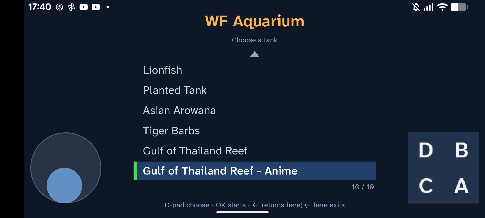
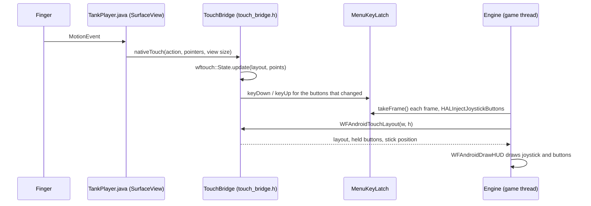

# An on-screen controller for the combined Aquarium and Clocks apps

**Status: decided by Will 2026‑11‑22 ("new app doesn't present joystick interface to me", "newly-installed clocks doesn't have d-pad either"); built, not yet verified on the Pixel.** It reverses one part of decision D3 in [One Aquarium APK](2026-11-22-one-aquarium-apk.md), where Will accepted giving up the Aquarium's phone controller. That recommendation was mine and it was wrong for a phone: I weighed the TV remote's d-pad and not the Pixel, which has none. The diagnostic build stays given up.

## What was lost, and what comes back

The retired standalone Aquarium app drew a joystick (lower left) and four buttons D, B, C and A (lower right) over the tank menu and every tank, on a touchscreen phone. The combined apps share one native host (`android/screensaver/src/main/cpp/dream_host.cc`), and that host answered the engine's touch hook with an empty layout. On the Pixel the menu could be seen and not moved. The Clocks chooser and its hold-A settings form (hold the centre button for a second, then the four directions) need the same keys.

The picture is the target: the engine already draws this controller (`WFAndroidDrawHUD`, geometry in the shared `hal/touch_controls.h`); the host only has to ask for it and feed the touches.

## Design

- **One bridge, no new input path.** Touches become the remote's joystick bits and go through the existing key latch, so a tap shorter than one frame still counts, exactly as the remote's keys do ([menu key latch](2026-11-21-menu-key-latch.md)).
- **Shared by both apps.** The host is in `main`, so Aquarium and Clocks get it from one change; nothing is per flavor.
- **Phones only.** It is on when the device has a touchscreen and no TV (`FEATURE_TOUCHSCREEN` and not `FEATURE_LEANBACK`); a TV draws nothing and takes no touches. It is off in the Dream, which is the screensaver and takes no input.
- **Back** stays the phone's own back gesture, which already reaches `nativeBack`. A is the remote's OK, including the one-second hold.
- **What is not copied from the old app:** touching a menu row directly (the menu is driven by Up, Down and A), the story-card reading layout, and the phone-as-gamepad web page for a TV (`controller.html`), which needs a network permission the apps do not have.

## Verification

1. `task test-touch-bridge`: 28 checks in `wf-linux-test:local` (a tap inside one frame reads once, a hold reads every frame, the stick, two thumbs, cancel, a view and surface of different sizes, off on a TV).
2. `scripts/in-linux-container.sh python3 -m pytest tests/test_one_aquarium_app.py -q` checks the wiring (the host, the JNI entry points, the Java listener, the TV exclusion).
3. The Aquarium APK builds (`BUILD SUCCESSFUL`) and the Clocks APK builds from the same tip.
4. On the Pixel, installed through the coordinator: the controller is drawn over the Aquarium menu; a coordinator `phone-input` tap on A starts the highlighted tank; a swipe from the stick centre to the right moves the fish; the controller is drawn over the Clocks chooser and a tap on A starts a clock; holding A for a second opens the Cuckoo Village settings form.
5. On cast1 (a TV): no controller is drawn and the remote still works (the earlier key checks repeat).
6. The Dream still starts from the lock screen with no controller.

## Open

| # | Question | Recommendation |
|---|---|---|
| Q1 | Touch a menu row directly, as the old app allowed? | Not in this change; the joystick and A cover it. Add it if Will misses it. |
