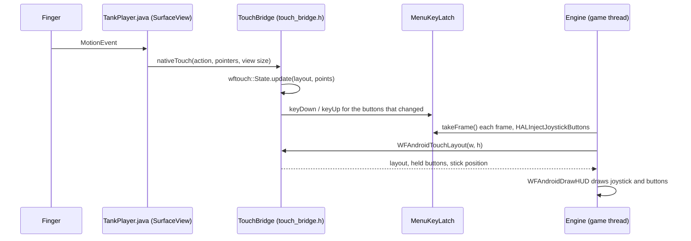
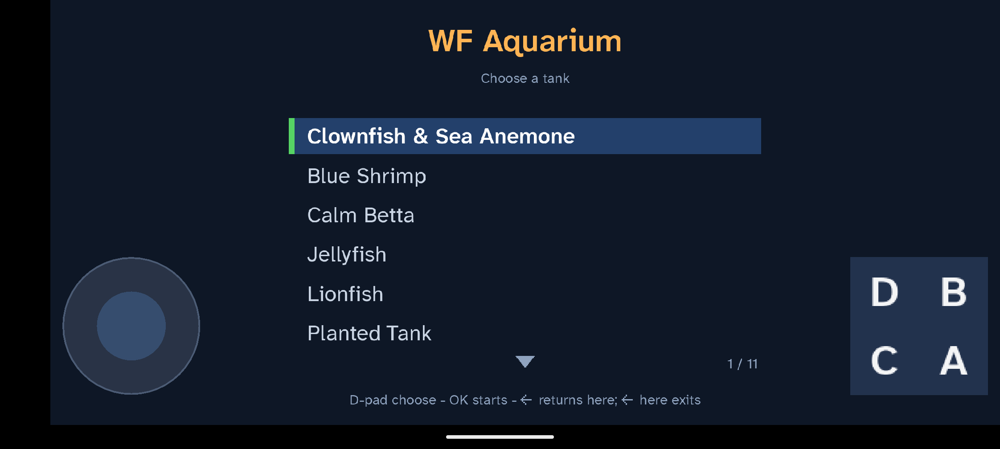

# An on-screen controller for the combined Aquarium and Clocks apps

**Status: decided by Will 2026‑11‑22 ("new app doesn't present joystick interface to me", "newly-installed clocks doesn't have d-pad either"); built; the Aquarium half checked on the Pixel (steps 3 and 4 below), the TV and Clocks halves pending.** It reverses one part of decision D3 in [One Aquarium APK](2026-11-22-one-aquarium-apk.md), where Will accepted giving up the Aquarium's phone controller. That recommendation was mine and it was wrong for a phone: I weighed the TV remote's d-pad and not the Pixel, which has none. The diagnostic build stays given up.

## What was lost, and what comes back

The retired standalone Aquarium app drew a joystick (lower left) and four buttons D, B, C and A (lower right) over the tank menu and every tank, on a touchscreen phone. The combined apps share one native host (`android/screensaver/src/main/cpp/dream_host.cc`), and that host answered the engine's touch hook with an empty layout. On the Pixel the menu could be seen and not moved. The Clocks chooser and its hold-A settings form (hold the centre button for a second, then the four directions) need the same keys.


The picture is the target: the engine already draws this controller (`WFAndroidDrawHUD`, geometry in the shared `hal/touch_controls.h`); the host only has to ask for it and feed the touches.

## Design



- **One bridge, no new input path.** Touches become the remote's joystick bits and go through the existing key latch, so a tap shorter than one frame still counts, exactly as the remote's keys do ([menu key latch](2026-11-21-menu-key-latch.md)).
- **Shared by both apps.** The host is in `main`, so Aquarium and Clocks get it from one change; nothing is per flavor.
- **Phones only.** It is on when the device has a touchscreen and no TV (`FEATURE_TOUCHSCREEN` and not `FEATURE_LEANBACK`); a TV draws nothing and takes no touches. It is off in the Dream, which is the screensaver and takes no input.
- **Back** stays the phone's own back gesture, which already reaches `nativeBack`. A is the remote's OK, including the one-second hold.
- **What is not copied from the old app:** touching a menu row directly (the menu is driven by Up, Down and A), the story-card reading layout, and the phone-as-gamepad web page for a TV (`controller.html`), which needs a network permission the apps do not have.

## What else the standalone host did that the combined host does not

The combined app is not the standard app plus a screensaver entry point. It is the screensaver module's own host (`dream_host.cc` and `TankPlayer.java`, built for the Dream) grown a menu mode. The standalone Aquarium was the NativeActivity host (`wfsource/source/hal/android/native_app_entry.cc`, 899 lines against 470). Retiring it dropped everything that host did and the screensaver host did not. Audited by reading both hosts on 2026‑11‑22; only the first two rows are confirmed on a device.

| Feature of the standalone host | Combined host | Status |
|---|---|---|
| Joystick and D, B, C, A over the menu and tanks | none | **Restored** (this plan), verified on the Pixel |
| The engine's touch settings form (entry button at the top right, then the form) | none, so the form could not be opened or driven by touch | **Restored** in the same plan; verification below |
| Tap a menu row to choose a tank (`levelmenu::TouchRowAt` and `QueueTouchRow`) | `menuRowTouch` in `dream_host.cc` | **Restored**, built; not yet driven on a device |
| Story card reading layout (`androidtouch::reading`: the stick, B and D hide so a card reads) | `TouchBridge::setReading(bitmaptext::ReaderOpen())` each frame | **Restored** (`TouchBridge::setReading`), built; not yet seen on a device |
| Hardware gamepad analog stick and hat (`AINPUT_SOURCE_JOYSTICK`, `AXIS_HAT_X`/`Y`) | `GamepadStick` and `LauncherActivity.dispatchGenericMotionEvent` | **Restored**, built; not yet tried with a gamepad |
| Phone as the TV's gamepad and settings editor (`hal/phonepad`, `PhoneInit`, the message the form sends the phone) | stubbed out (`WFAndroidPhoneOverlayRects` returns nothing) | Open; also needs the network permission the apps do not hold |
| Crash handlers and the diagnostic log (`InstallCrashHandlers`, `OpenDiagnosticLog`) | only the engine log bridge | Open, diagnostics only |
| Back dismissing the phone panel, and the system's own Back on a standalone selector | `applyMenuBack` | Replaced, works |

## Verification

1. `task test-touch-bridge`: 28 checks in `wf-linux-test:local` (a tap inside one frame reads once, a hold reads every frame, the stick, two thumbs, cancel, a view and surface of different sizes, off on a TV).

   ```
   touch_bridge: 28 checks passed
   ```

   **PASS**
2. `scripts/in-linux-container.sh python3 -m pytest tests/test_one_aquarium_app.py tests/test_launcher_parity.py tests/test_dream_host_vram.py -q` checks the wiring (the host, the JNI entry points, the Java listener, the TV exclusion).

   ```
   22 passed, 1 skipped in 0.18s
   ```

   **PASS**
3. The Aquarium APK builds. The first build failed on a C++ typo of mine (a function-style cast read as a function declaration), fixed in b9ae1b3c.

   ```
   BUILD SUCCESSFUL in 3m 43s   (screensaver-aquarium-release.apk, sha256 1919799a97c88f82e1a1a2fe70df9a70ee9babf6c3a3caa9d238cbd68997c797)
   ```

   **PASS.** The Clocks APK built from the same tip by the Clocks session (sha256 151dbf0b1deb…257c): pending its own report.
4. On the Pixel, installed through the coordinator (J‑63af254babac): a `check` job (J‑556c97267316) shows the controller over the Aquarium menu, joystick lower left and D, B, C, A lower right.

   

   Will then used it by hand on the Pixel: "works" (the stick moves the highlight, A starts a tank, the stick steers). **PASS** for the Aquarium app. A coordinator `phone-input` tap was not used: the workflow needs the app already in front, and a `check` job closes it when it ends.
5. The controller over the Clocks chooser, A starting a clock, and a one-second hold on A opening the Cuckoo Village settings form, on the Pixel: **pending** (the Clocks session installs its APK; Will to confirm).
6. On cast1 (a TV): no controller is drawn and the remote still works. The same build is installed (J‑5dbd3caa6f28, completed); the `check` job J‑38ab0ea65cff with the remote-key script is queued behind the Clocks session's profile job. **Pending.**
7. The Dream still starts from the lock screen with no controller: **pending** (the HUD is off outside menu mode by construction; not yet seen on a device).

## Open

| # | Question | Recommendation |
|---|---|---|
| Q1 | Touch a menu row directly, as the old app allowed? | Not in this change; the joystick and A cover it. Add it if Will misses it. |
| Q2 | Restore the rest of the table? | **Decided (Will, 2026‑11‑22): "why wouldn't i want all of it? didn't we develop those things for a reason?" Restore all.** Done above except the phone gamepad (TV) and the crash handler, which are next. |
