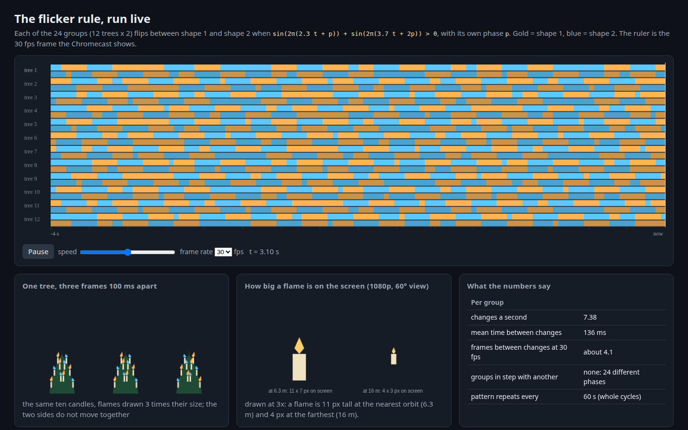
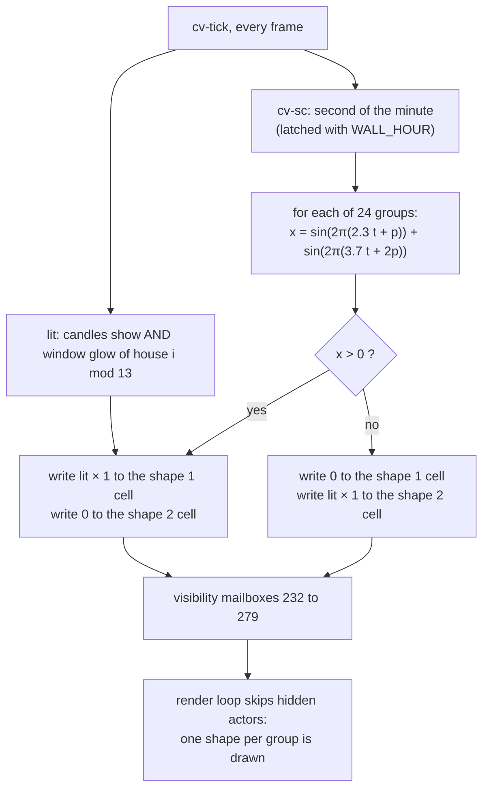
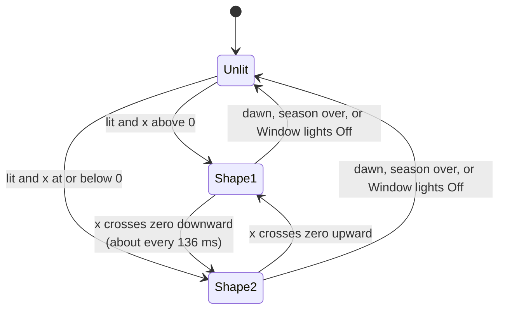
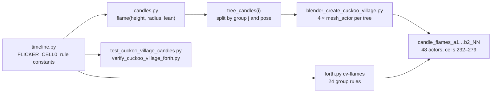
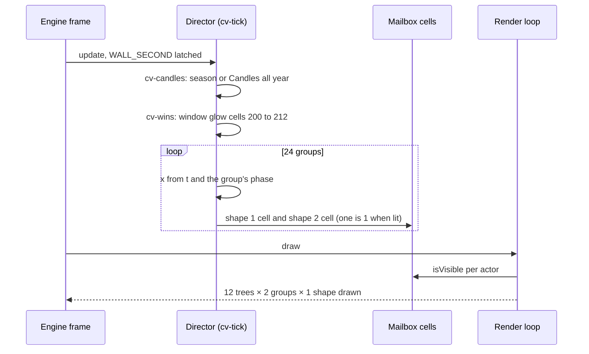
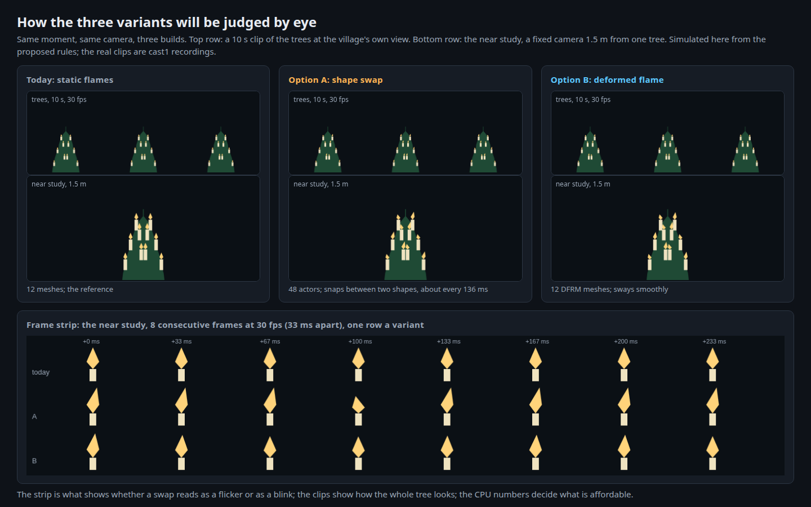
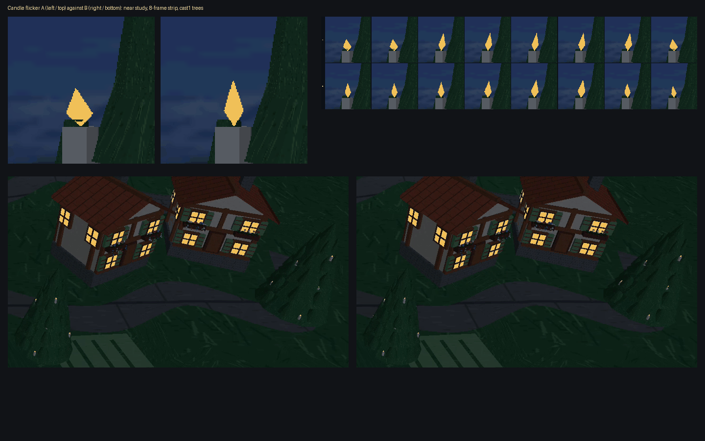
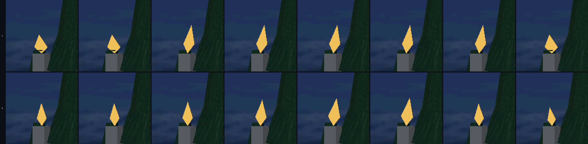

# Cuckoo Village: flickering candle flames

**Status:** Option A built 2026‑11‑22 and shipped in the Cuckoo Village level; Will chose it ("ship A and add measurement to TODO") after the two options looked alike in the mockups. Option B (the deformed flame) is not built into the level: it is on the branch `candle-flicker-spike`, with its cast1 measurement left as a TODO item. **Measured on cast1 on 2026‑11‑27** (verification step 0): B costs **1.39 ms more main-thread CPU a frame than A** (23.58 against 22.19 ms; the gate allowed 0.1 ms). Both hold 30 fps. Near up, B's flame moves visibly more smoothly. A stays shipped until Will decides. The mockups are drawn from the level's real candle positions and the rule, run live; they are not engine captures.

## Context

Will asked how the candle flames flicker (2026-11-22). They do not. Each tree carries ten candles, and today the flames of one tree are **one static mesh** (`candle_flames_NN`, ten diamonds of 8 triangles, 80 triangles) whose only input is a visibility mailbox, cells 215 to 226. The director switches it on at dusk and off at dawn ([`forth.py`](../../wflevels/cuckoo_village/forth.py) `cv-flames`), so a lit flame is the same shape in every frame. A Christmas tree full of candles that never move looks like a string of lamps.

The village already moves a great deal, all of it driven by the director from the wall clock: the clock's hands, the parade figures on the hour, the cuckoo bird and the window lights. The engine can also **deform** a mesh: the `DFRM` chunk bends a rooted curve under script control, and version 2 carries up to 16 curves in one mesh, each with its own scale, clip and flex bias ([`dfrm_deform.h`](../../wfsource/source/renderassets/dfrm_deform.h)). What limits a flickering flame is therefore not that bending is impossible but what each way **costs a frame on cast1**, where the village already runs at 30 fps. Two ways are described below, and the plan's first step is to measure them against each other before building either.

## Approach

### Option A: swap between two built shapes (visibility only)

No new engine machinery: it costs what the village's other switched actors cost, the director writing visibility cells.

**Two shapes, two groups, one rule.** Each flame is built in two shapes: **shape 1**, tall and leaning toward a fixed draught direction (the world +X axis), and **shape 2**, short and leaning the other way. The ten candles of a tree already come in two sets of five, `j = 0` and `j = 1` of [`candle_bases`](../../wflevels/cuckoo_village/candles.py), standing on opposite sides of the trunk; those are **group A** and **group B**. Each tree therefore gets four flame meshes (A1, A2, B1, B2) in place of today's one, and at any moment exactly one of A1 or A2, and one of B1 or B2, is visible when the tree is lit.

[](2026-11-22-cuckoo-village-candle-flicker/flame-shapes.html)

| Pose | Height | Ring radius | Tip leans | Triangles |
|---|---|---|---|---|
| Today (static) | 75 mm | 22 mm | 0 | 8 |
| Shape 1: tall | 90 mm | 20 mm | +14 mm toward the draught | 8 |
| Shape 2: short | 60 mm | 24 mm | −10 mm away from it | 8 |

**The rule.** For tree `i` and group `g`, with the phase `p = frac((2i + g) × 0.618034)` and `t` the director's second of the minute (`cv-sc`, which carries the fraction of a second):

```
shape 1 when  sin(2π(2.3 t + p)) + sin(2π(3.7 t + 2p)) > 0,   otherwise shape 2
```

Two sines of unrelated rates added together cross zero at irregular intervals, so the flicker has no beat. 2.3 and 3.7 revolutions a second are **whole cycles in a minute** (138 and 222), so the pattern is continuous where the second of the minute wraps from 59.99 to 0, the same rule Tide Harbour's glints follow. Measured over 60 s of the real rule for all 24 groups: **7.38 shape changes a second per group, 136 ms between changes on average, about 4 frames at 30 fps**. The 24 phases all differ, so no two groups, and so no two sides of a tree, move together.

[](2026-11-22-cuckoo-village-candle-flicker/flicker-schedule.html)



**Lit stays today's rule.** A group draws only while the candles show (1 December to 6 January, or Candles all year) and the glow of house `i mod 13` is on, so the Window lights setting still puts every flame out, and a tree's flames still come on with its own stagger at dusk. Only the choice *between* the two shapes is new.



**Build.** In [`candles.py`](../../wflevels/cuckoo_village/candles.py) `flame()` takes a height, a ring radius and a lean, and `tree_candles` returns the flames split by group and pose. In [`blender_create_cuckoo_village.py`](../../wflevels/cuckoo_village/blender_create_cuckoo_village.py) each tree makes `candle_flames_a1_NN`, `a2`, `b1`, `b2`, each a static mesh actor with one visibility mailbox: `FLICKER_CELL0 + 4i + k`, with `FLICKER_CELL0 = 232` and `k` = 0 to 3 for A1, A2, B1, B2. The twelve cells 215 to 226 stop being flame cells and are freed. Cells 232 to 279 are free today: the glow is 200 to 213, the candle sticks 214, the flowers 227 and 228, Bavaria 230 and 231, and the director's scratch cells start at 600.



**Director.** `cv-flames` is rewritten: the loop runs over the 24 groups, works out `x`, and writes the pair of cells. Because `timeline.py` is the reference model (it already holds `christmas_season` and the cell numbers), the rule is written there first as `flame_shape(t, tree, group)`, and the director's words are checked against it in the real zForth VM like every other cell.



### Option B: a deformed flame (`DFRM`)

Each tree's ten flames become **one `DFRM` v2 mesh with ten short curves**, one curve per flame (the format allows 16 a mesh). Each flame is a few rooted samples; the director writes each curve's **flex bias** (cell `40 + 4c` of the mesh's control block, degrees added to every sample of that curve) and, if wanted, its **scale** about its root, every frame, from the same kind of two-sine rule. A flame then sways and stretches smoothly instead of snapping between two shapes, and the flicker needs no extra actors: 12 deformed meshes replace 12 static ones, and the 36 extra actors and 36 extra cells of Option A are not needed.

What is **known**: the format and its evaluator exist and are tested (`dfrm_deform.h`); one pose row can drive every curve; a curve's bias and scale are separate script cells. What is **not known**, and is the reason for the first verification step:

- **The frame cost on cast1.** The measured numbers are for much larger meshes: Seahorse Grid reaches 29.6 FPS with 24 deforming meshes, and the six-pair seahorse comparison puts CPU `DFRM` at 47 to 69 ms a presented frame ([reef plan](2026-11-02-gulf-of-thailand-reef-tank.md), [seahorse comparison](2026-10-16-saltwater-seahorses/comparison.md)). A flame mesh is about 60 vertices a tree, far smaller, but the evaluator's per-mesh cost (pose, skin, upload, cull) may not scale down with the vertex count. The village sits at 30 fps (33.4 ms) already, so there is almost no headroom to spend.
- **The authoring path.** The exporter and `dfrm_ref.py` were built for tails and fish. A tree's ten flames as ten curves of one mesh is a new rig to author and to check in `dfrm_ref.py`.
- **The size of the effect.** A flame is 4 to 11 px tall on screen (below), so a smooth sway and a two-shape swap may look much the same at the Chromecast's distance. Smooth only wins if it is visible.

GPU skinning ([plan](2026-10-16-gpu-skinning-chromecast-experiment.md)) would make Option B cheap if it is ever adopted, but it is not built, so it is not counted on here.

**How to choose.** A short spike, on one tree: build the ten-curve flame mesh, drive its biases from the rule, and run the variant benchmark below on cast1 with all 12 trees against Option A's 48 actors. Option B is adopted only if it passes the gate in verification step 0 (CPU total from the engine's frame profile, not present intervals); otherwise Option A is built. The rest of this plan specifies Option A, which needs no new machinery; Option B replaces its Build and Director sections and shares everything else.

## Decisions for Will

1. **A or B?** Recommended: **measure first** (the spike above, about a day), then take B only if it is cheap and visibly better; A is the safe default and is a day of work on its own.
2. **Does the flicker stop under Camera motion Still?** Recommended: **no**. That setting stills the camera path (it exists so a screen is not always moving for burn-in), not candlelight, and a still camera is where a motionless tree would be most noticed. If a still screen should stay still for burn-in's sake, the rule gets one extra factor and the cost is nil.
3. **Does it slow down or stop at a low frame rate?** Recommended: **no**. The rule is a function of the clock, not of frame count, so at 30 fps it is sampled every 33 ms and at 15 fps every 67 ms, still changing about every other sample. Nothing accumulates and nothing needs to catch up.
4. **A new setting?** Recommended: **none** now. The flicker is not luminance: both shapes are the same flat colour, so nothing flashes, and each change is a few pixels (below). If a reduced-motion switch is wanted later it is one more field like Detailed flowers.
5. **Two shapes or three?** (Option A only.) Recommended: **two**. A third, upright and mid-height, makes the flicker softer but costs 24 more actors and another 24 cells; the mockup's schedule shows two shapes already give irregular motion.
6. **The rate.** 7.4 changes a second per group is lively. A calmer pair, 1.3 and 2.1 revolutions a second (78 and 126 a minute), gives about 4 a second. Recommended: start at 2.3 and 3.7, judge it on cast1, and slow it if it reads as nervous. The numbers are constants in `timeline.py`.

## Budgets

| | Today | Option A | Option B (to be measured) |
|---|---|---|---|
| Flame actors | 12 | 48 (+36) | 12 |
| Flame triangles in the level | 960 | 3,840 (every shape of every flame is in the level) | 960 (one shape, bent) |
| Flame triangles drawn | 960 | 960 (one shape per group is visible; hidden actors are skipped) | 960 |
| Flame visibility cells | 12 (215–226) | 48 (232–279) | 12, plus 10 curve cells each in the mesh's control block |
| Level size | | about +40 KB (36 mesh actors); measured at build, see the note below | about the same as today, plus the deformer chunk |
| Director work per frame | 12 cell writes | 48 cell writes and 24 × two sines | 120 curve writes and 120 × two sines |
| Renderer and deformer cost on cast1 | none new | none new (hidden actors are skipped) | **unknown**: 12 more deformed meshes against a village already at 33.4 ms |

**On screen the flames are small.** At 1080p with the 60° view, a flame is 11 px tall and 7 px wide at the village's nearest camera distance (6.3 m) and 4 px by 3 px at the farthest (16 m). The change from shape 1 to shape 2 is a height change of 30 mm and a lean of 24 mm: 4 px at the nearest, 2 px at the farthest. At the far end of the orbit the effect is a **twinkle** of single pixels, not a visible waving flame; at the front of the orbit, and on a tablet held close or a phone, it reads as a flame. That is the cost of a candle being 75 mm tall in a village built at 1:1. If it proves too faint at distance, the lever is the lean and height difference (a larger swing, drawn only for the tall pose), not a faster rate.

**Level size.** The flowers plan's size budget already misses its step by 0.006 MB; this adds about 40 KB. The size gate has to be re-set deliberately when this lands rather than passed by a coincidence, and the figure recorded in the result paragraph.

## Out of scope

- **Light from the flames.** There is no light control in the engine (Will's earlier direction), so the glow on the pine is not a thing.
- **Sparks, smoke, a wind that moves the whole tree.** Not at this size.
- **The date range and other December events.** They have their own TODO items.
- **Level of detail for the flames: by behaviour, not geometry** (corrected 2026‑11‑27 after Will asked what a flame LOD would look like). A flame is about 70 triangles and a few pixels from the village camera, so a coarser mesh saves nothing; [the flowers LOD plan](2026-11-22-cuckoo-village-flowers-lod.md) does not apply. The measured cost of B is the director (+1.76 ms) and the deformer (+0.44 ms), so the useful option is distance-based behaviour: the full B deform near, A's swapped shapes at middle distance, a static or round-robin flame far. Moving B's per-frame rule from Forth into the engine would cut the director cost at any distance.

## Judging them by eye

Will wants to see how the variants **look**, not only what they cost (2026‑11‑22: "profiles but also video clips (on trees) plus a near study in order to compare how they LOOK"). So the spike produces, for each of today, A and B, with the same clock, the same camera and Candles all year On:

- **Clips on the trees.** A 10 s clip, recorded on cast1 (the real Chromecast pixels, 30 fps) of the village's own camera as it passes the pines, one clip per variant. On the desktop engine the same moment is also recorded with `-record_video` at 1920 × 1080 where cast1's 1280 × 720 is too coarse to judge. The clock is frozen at the same wall time (`WF_WALL_CLOCK`) so every variant shows the same sky and the same lit trees.
- **A near study.** The same flames from 1.5 m away, so a flame is about 60 px tall rather than 4 to 11. A study build puts the camera at a fixed spot facing one pine (a camera override in the variant builds only; the shipped level is untouched). Recorded for 10 s per variant, plus **a strip of 8 consecutive frames** (33 ms apart at 30 fps) cut from it, which shows whether a swap reads as a flicker or as a blink.
- **A comparison page.** One HTML page with the three clips of each kind side by side and started together, and the three strips one above another, linked from the report.

[](2026-11-22-cuckoo-village-candle-flicker/look-comparison.html)

The mockup is drawn from the proposed rules, not from the engine: the real clips replace it in the report. The look decides between A and B (the gate's last clause), and Will may reject both on sight even if the numbers pass.

**The real material (2026‑11‑27).** The near study is the desktop engine at 1920&nbsp;×&nbsp;1080, 1.5&nbsp;m from candle 9 of pine 1 (on the tangent through it, so the flame stands against the sky), 16 frames 33&nbsp;ms apart on the level clock, so A and B show the same instants; shown as a 140&nbsp;px crop at 3×. A snaps between a tall flame leaning into the draught and a short squat one; B grows, shrinks and leans smoothly, frame by frame. The tree clips are cast1's own pixels (the benchmark builds, the village's still front view, a native crop of two pines); cast1's screen recorder keeps only about 6 frames a second there, so they show the twinkle, not every frame, and at that distance A and B are hard to tell apart. Clips are 16 frames rather than 10&nbsp;s because the Debug ASan engine takes about 30&nbsp;s a 1080p screenshot. A 0.9&nbsp;m study (cast1 jobs J‑f94d6ce12d63, J‑7868c014860e) put the camera inside the pine's tiers and is not used.

[](2026-11-22-cuckoo-village-candle-flicker/look-real.html)

[](2026-11-22-cuckoo-village-candle-flicker/near-study-strip.png)

Animated: [A](2026-11-22-cuckoo-village-candle-flicker/near-study-a.png), [B](2026-11-22-cuckoo-village-candle-flicker/near-study-b.png); cast1 clips: [A](2026-11-22-cuckoo-village-candle-flicker/cast1-trees-a.mp4), [B](2026-11-22-cuckoo-village-candle-flicker/cast1-trees-b.mp4) (jobs J‑cb9ea5a3f79a and J‑26738f3d4732).

## Verification

0. **The choice, measured and looked at first.** Three frozen cast1 builds of the village in season (Candles all year On), identical but for the flames: **today** (12 static flame meshes), **A** (48 actors, the director's 24 rules) and **B** (12 `DFRM` meshes of ten curves, driven from the same rule). They run through the coordinator's `variant-benchmark` workflow with the engine's `--frame-profile`, as the [seahorse population comparison](../diagnostics/seahorse-population-cast1-20261017/README.md) did: 60 s of the village after a 15 s warm-up, three runs each in varying order, reading the **main-thread CPU total (update plus render)** and the director section. The plain `profile` job is not enough here: it reports present intervals, and the village sits locked at 33.4 ms (30 fps), so a change of a tenth of a millisecond cannot show in it; it is kept as a guard that nothing drops below 30 fps. **Adopt** a variant only if its CPU total rises by less than 0.25 ms over today and the floor stays at 30 fps; **choose B over A** only if B is within 0.1 ms of A (or cheaper) **and** a capture at the nearest view shows a visibly better flame; otherwise build A. **The look is gathered in the same session**: the tree clips, the near study, its 8-frame strip and the comparison page of [Judging them by eye](#judging-them-by-eye), with the cast1 job ids and file hashes in the report. Steps 1 to 8 are written for A and are adapted for B (the cells become curve biases).
   **NOT RUN, by decision.** Will chose Option A on 2026‑11‑22 without the cast1 measurement. Option B and the study tooling stay on the branch `candle-flicker-spike` (the two build switches, the DFRM rig, `scripts/capture-candle-study.py`, `scripts/render-flame-comparison.py`); what is left to measure is a TODO item.

   **Measured 2026‑11‑27, A against B (the TODO item).** How it differs from the step as written: A is shipped, so **today** was not built; one A/B pair, one run each, because the gap is about nine window standard deviations (the brief: a second pair only within noise); night and lit candles held by build switches, since it was 07:20 in Bangkok and out of season (`CANDLE_NIGHT_HOUR=22`, `CANDLE_ALL_YEAR=1`), and the camera held at its far front view (`CANDLE_CAMERA_STILL=1`) so both runs see the same picture. B was ported from the spike onto today's 24‑tree level in a scratch worktree: [the measurement builds' patch](../diagnostics/candle-flicker-ab-cast1-2026-11-27/measurement-builds.patch) (with no `CANDLE_` variables the build's `.lev` and actor map are byte-identical to the committed level). Each variant is one base Clocks APK (`3ac985b1…`, this branch at `23ee74a4`, whose Dream host now passes a `--frame-profile` line of `wf_args.txt`; before it the Clocks flavour silently ignored the line) with `assets/cd.iff` (Cuckoo Village alone, so the engine skips its chooser and cast1 goes into the village unattended), `assets/levels.manifest` and `assets/wf_args.txt` (`--frame-profile` added) swapped by `scripts/swap-apk-assets.py --file`. Coordinator `variant-benchmark` job **J‑83080304e587**, 60 s after a 15 s warm-up, A then B; cast1 restored to `052292fc…` by its automatic cleanup J‑081f26ab5ec9. CPU windows are the engine's 5 s `frame-profile` windows wholly inside the measured presentation span ([analyse.py](../diagnostics/candle-flicker-ab-cast1-2026-11-27/analyse.py), [evidence](../diagnostics/candle-flicker-ab-cast1-2026-11-27/README.md)).
   ```
   == pair1
     install A-swap    install  verified  before 052292fc8093 installed 01635406657a
     install B-deform  install  verified  before 01635406657a installed de55dc586abb
     A-swap    fps 29.84  p50 33.37  p95 50.05  p99 50.05  worst 66.7  missed 94.27 %  span 60.3 s
               cpu-ms mean over 11 windows (1645 frames): update 3.380  actors 1.419  director 1.883  render 18.810  animation 0.000  total 22.190  | total p95 (median window) 23.844
               counts/frame: draws 112.0  triangles 54981.5  actor-mailbox-writes 59.0  fish-deformations 0.0  uploads 0.0  upload-bytes 0.0
     B-deform  fps 29.75  p50 33.37  p95 50.05  p99 50.05  worst 66.7  missed 92.44 %  span 60.0 s
               cpu-ms mean over 11 windows (1641 frames): update 4.803  actors 1.095  director 3.638  render 18.773  animation 0.442  total 23.576  | total p95 (median window) 26.223
               counts/frame: draws 100.0  triangles 54985.6  actor-mailbox-writes 59.0  fish-deformations 12.0  uploads 12.0  upload-bytes 116652.2
   A-swap total per window [22.62, 22.15, 22.17, 22.08, 22.19, 22.1, 22.23, 22.02, 22.23, 22.21, 22.09] sd 0.158 director sd 0.035
   B-deform total per window [23.41, 23.67, 23.58, 23.47, 23.58, 23.61, 23.44, 23.83, 23.52, 23.65, 23.57] sd 0.117 director sd 0.064
   ```
   **FAIL for B** against the gate "B within 0.1 ms of A": B's main-thread CPU total is **+1.39 ms a frame** (22.19 → 23.58 ms, +6 %), almost all of it the director (+1.76 ms: 120 curve records and 12 `dfrm-pose-curves` calls a frame in zForth) and the deformer (+0.44 ms, 12 deformations and 117 KB of vertex uploads a frame); render is unchanged and B draws 12 fewer meshes. Both hold the 30 fps floor (p50 33.37 ms, 29.8 FPS); B's worst 5 s window reaches 23.8 ms of the 33.4 ms frame, so it fits on cast1 today but spends a fifth of the headroom that is left. The look ([Judging them by eye](#judging-them-by-eye)) does not change the verdict: by the gate, A stays. **The decision is Will's** (TODO).
1. **The shapes.** `tests/test_cuckoo_village_candles.py` gains: each tree has four flame meshes; groups A and B hold five candles each, from `j = 0` and `j = 1`; every flame is 8 triangles in both shapes; the heights, radii and leans are the table's; the two shapes of a candle share its foot.
   ```
tests/test_cuckoo_village_flicker.py: 7 passed (4 flame meshes a tree, 5 candles a group, 8 triangles a flame, both shapes on the candle's foot, a zero lean is today's flame)
```
   **PASS.**
2. **The rule in the model.** A test of `timeline.flame_shape` over 60 s at 600 samples a second for all 24 groups: between 7 and 8 changes a second per group, a mean of 120 to 150 ms between changes, the pattern identical one minute apart, no two groups with the same phase.
   ```
tests/test_cuckoo_village_flicker.py: the phases, the whole-cycle repeat, 7 to 8 changes a second a group over 60 s of 24 groups, never all 24 in one shape: passed
```
   **PASS** (measured 7.38 changes a second a group, a mean of 136 ms).
3. **The director, in the real VM.** `tests/verify_cuckoo_village_forth.py` sets `WALL_SECOND` to a spread of values with the candles in season and the glow on: for each group exactly one of its two cells is 1 and the cell equals `timeline.flame_shape`; out of season, with Candles all year Off, both are 0; with Window lights Off, both are 0 for every group; with Candles all year On in July, the pairs follow the rule.
   ```
1100 days x 3 times x 3 settings = 9900 frames, 0 failures
flames: 0 failures in 38080 cells
flowers: 0 failures
poses: 33 frames x 10 actors, 0 failures
```
   **PASS.** Eight state combinations (season, Candles all year, Window lights, dusk, night, day) at 200 seconds each; the cells match `timeline.flame_shape` and the lit rule.
4. **The level.** The rebuilt level has 48 flame actors, each with its cell, and none left on cells 215 to 226; the level-size gate is re-set and its figure recorded.
   ```
candle_flames_[ab][12]_NN actors in actor-map.json: 48; the old candle_flames_NN: 0
wflevels/cuckoo_village-standalone.iff: 5,957,632 B (was 5,910,528 B: +47,104 B)
wflevels/cuckoo_village.iff:            5,953,536 B
audit-level-settings --roster levels: cuckoo_village yes, tide_harbour yes
```
   **PASS** for the actors and their cells. The level-size gate was already over its budget (the flowers plan); this adds 46 KB to it and the gate has still to be re-set deliberately, a TODO item. **Re-set 2026‑11‑27:** 9,437,184 bytes (9 MiB), decided by Will and enforced by `tests/test_cuckoo_village_size.py`; the level is 8,787,968 bytes (see the flowers plan, step 7).
5. **The desktop engine.** With the clock frozen at 10 consecutive frames at one tree's nearest view, a capture sequence shows the flames' pixels differing between frames: the count of changed pixels inside each flame's box is above 0 on at least half of the frame pairs, and 0 anywhere outside the flames.
   **NOT RUN as written.** A near-study camera was never aimed at a candle (the engine holds the pose written, the picture does not match it; unresolved, see the TODO item). The spike's frames (the swap and deformed builds, 1920 × 1080, 33 ms apart) show the flame tip changing by about 7 px at native size where it shows at all.

   **The camera, resolved 2026‑11‑27: it points where it is told; the capture and the choice of candle were wrong, and no engine change was needed.** Three causes, each shown: (1) `scripts/capture-candle-study.py` ended a frame step as soon as any clock reading arrived when it had none to start from, so its 60‑frame warm-up was one frame. The village's `cs_wide` shot moves the camera by easing (`BungeeCameraHandler`, about 10 % of the distance a frame), so the frames were taken with the camera still near its orbit start. A per-frame probe of the Camera actor shows it closing from (15.44, −9.86, 10.16) to the study point (−11.44, 3.15, 3.74) in about 2 s. (2) The spike also wrote the Camera's own position and heading from the director. The director runs after `UpdatePhysics` (`level.cc`, "update director"), where the camera handler has already built the view matrix, so a probe read back the written pose while the picture came from the handler: "holds the pose written, the picture does not". (3) The aimed candle (6) is inside the foliage of its pine, so it is hidden at the image centre (a 73‑pixel sliver of its flame shows at (636, 365) of 1280&nbsp;×&nbsp;720, against (640, 365) projected). The bright flame up and to the right, taken for the target, is candle 9, which projects to (940, 10) to (882, 78) for a 50° to 60° field. Aimed at candle 9, its flame lands at the image centre. Fixed in the measurement builds: the step needs a real start reading (test `tests/test_capture_candle_study.py`; the old rule reports "arrived" for a NaN start), the study writes only the shot and its target, and it aims at candle 9. A desktop Debug run of the village also stops after about 70 frames, because the Player (Physics mobility) falls through the ground and leaves the room at z = −20. The study holds the Player in place; the shipped level is untouched (TODO).
6. **Not in step.** In the same sequence, at least 5 of the 12 trees change shape on a frame where at least 5 others do not.
   **NOT RUN.** The model test of step 2 shows all 24 schedules differ; no engine sequence was captured.
7. **The frame cost.** The step 0 numbers for the chosen variant, plus the coordinator `profile` job as a guard: the floor is unchanged (30 fps, 33.4 ms).
   **NOT RUN.** Option A adds no engine work (hidden actors are skipped; 960 triangles drawn as before) and 48 cell writes a frame in the director. Not measured on cast1: it is in the TODO item with Option B.
8. **The Chromecast and the phone.** A cast1 `record` of the village in season, and a Pixel screenshot pair 100 ms apart: the flames differ, and nothing else in the picture moves.
   **NOT RUN.** To do after the next Clocks APK is on cast1: a `record` of the village in season, and a look at whether the flames flicker.

## Who

The village session owns this: `candles.py`, the build script, `timeline.py` and `forth.py` for Cuckoo Village. It touches no engine file and no other level; Option B would add a `DFRM` rig for the flames and would need `dfrm_ref.py` and the exporter checked for a many-short-curves mesh, which is why it is measured before it is chosen. It lands after the display-mailboxes commits, which are unrelated; whoever builds the next Cuckoo Village level (the Show framerate setting changes `settings.inc` and forces a rebuild) should include it.
