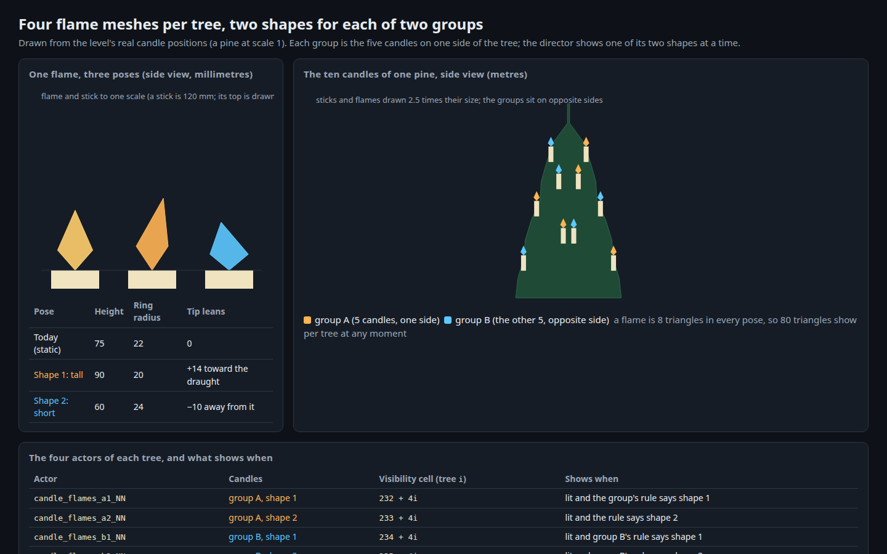
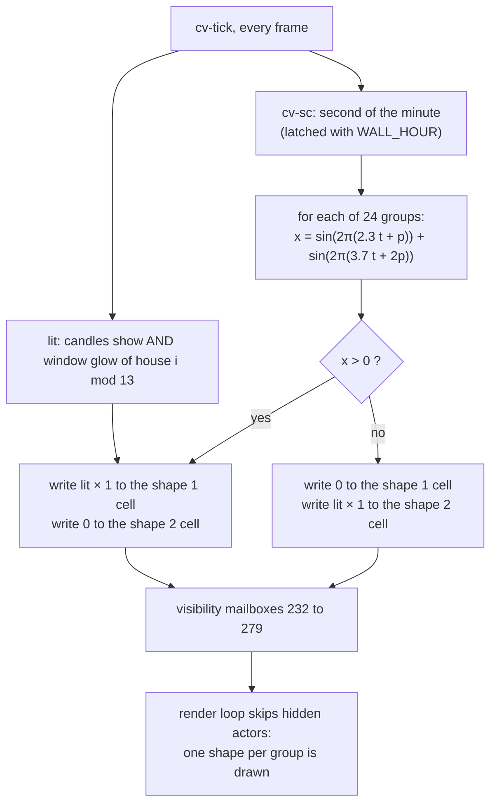
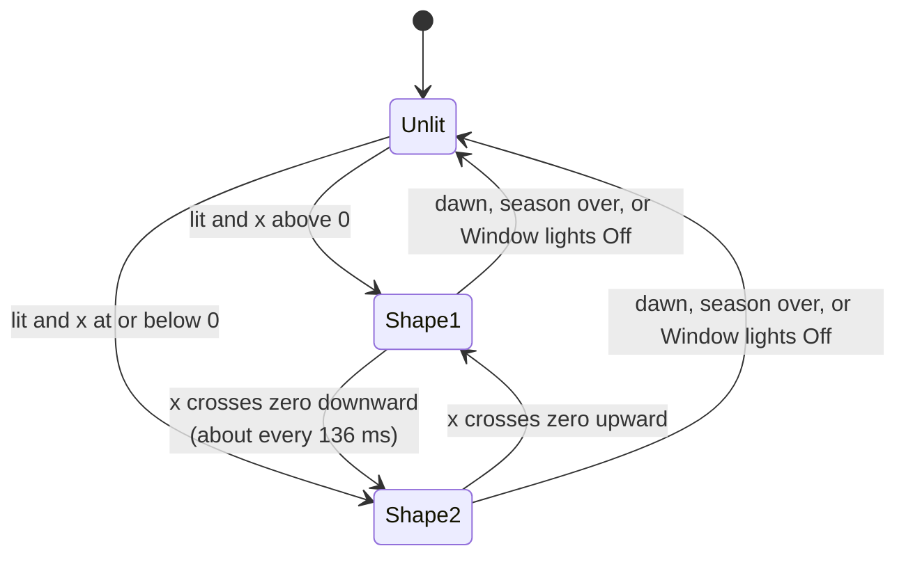
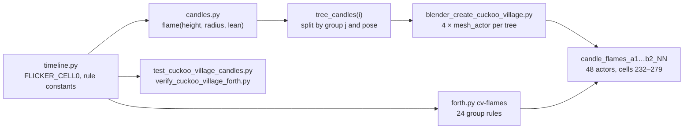
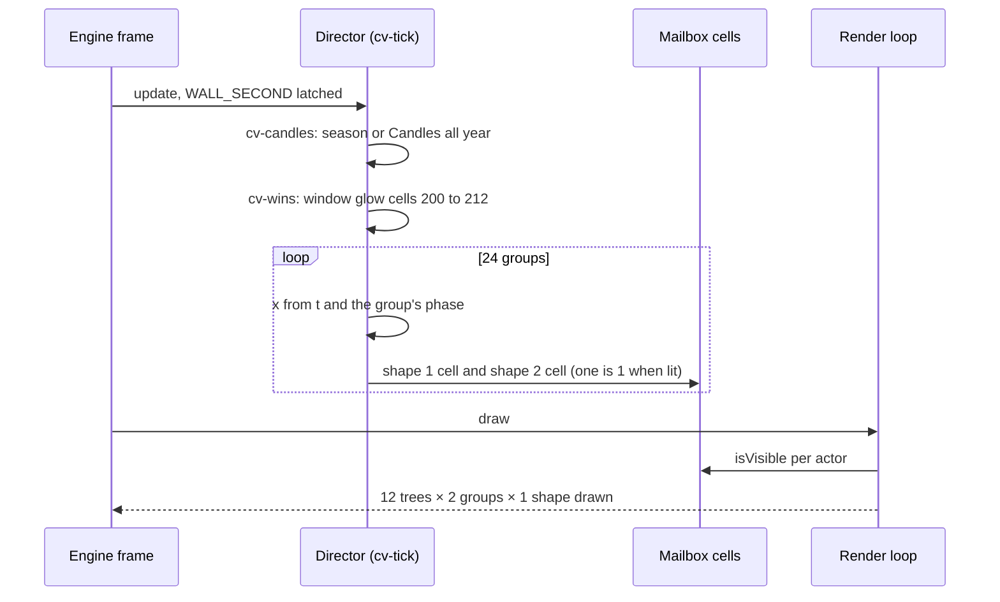

# Cuckoo Village: flickering candle flames

**Status:** proposal for review, 2026-11-22. Nothing is in the level yet. The mockups below are drawn from the level's real candle positions and the proposed rule, run live; they are not engine captures. The flicker rule is measured by the script that draws them, [`scripts/mockup-candle-flicker.py`](../../scripts/mockup-candle-flicker.py).

## Context

Will asked how the candle flames flicker (2026-11-22). They do not. Each tree carries ten candles, and today the flames of one tree are **one static mesh** (`candle_flames_NN`, ten diamonds of 8 triangles, 80 triangles) whose only input is a visibility mailbox, cells 215 to 226. The director switches it on at dusk and off at dawn ([`forth.py`](../../wflevels/cuckoo_village/forth.py) `cv-flames`), so a lit flame is the same shape in every frame. A Christmas tree full of candles that never move looks like a string of lamps.

The engine cannot bend a mesh, and the village is a static scene, so the flicker has to come from what the director already controls: **which actors are visible**, and where they are posed. The plan below uses visibility only.

## Approach

**Two shapes, two groups, one rule.** Each flame is built in two shapes: **shape 1**, tall and leaning toward a fixed draught direction (the world +X axis), and **shape 2**, short and leaning the other way. The ten candles of a tree already come in two sets of five, `j = 0` and `j = 1` of [`candle_bases`](../../wflevels/cuckoo_village/candles.py), standing on opposite sides of the trunk; those are **group A** and **group B**. Each tree therefore gets four flame meshes (A1, A2, B1, B2) in place of today's one, and at any moment exactly one of A1 or A2, and one of B1 or B2, is visible when the tree is lit.

[](2026-11-22-cuckoo-village-candle-flicker/flame-shapes.html)

| Pose | Height | Ring radius | Tip leans | Triangles |
|---|---|---|---|---|
| Today (static) | 75 mm | 22 mm | 0 | 8 |
| Shape 1: tall | 90 mm | 20 mm | +14 mm toward the draught | 8 |
| Shape 2: short | 60 mm | 24 mm | −10 mm away from it | 8 |

**The rule.** For tree `i` and group `g`, with the phase `p = frac((2i + g) × 0.618034)` and `t` the director's second of the minute (`cv-sc`, which carries the fraction of a second):

```
shape 1 when  sin(2π(2.3 t + p)) + sin(2π(3.7 t + 2p)) > 0,   otherwise shape 2
```

Two sines of unrelated rates added together cross zero at irregular intervals, so the flicker has no beat. 2.3 and 3.7 revolutions a second are **whole cycles in a minute** (138 and 222), so the pattern is continuous where the second of the minute wraps from 59.99 to 0, the same rule Tide Harbour's glints follow. Measured over 60 s of the real rule for all 24 groups: **7.38 shape changes a second per group, 136 ms between changes on average, about 4 frames at 30 fps**. The 24 phases all differ, so no two groups, and so no two sides of a tree, move together.

[](2026-11-22-cuckoo-village-candle-flicker/flicker-schedule.html)



**Lit stays today's rule.** A group draws only while the candles show (1 December to 6 January, or Candles all year) and the glow of house `i mod 13` is on, so the Window lights setting still puts every flame out, and a tree's flames still come on with its own stagger at dusk. Only the choice *between* the two shapes is new.



**Build.** In [`candles.py`](../../wflevels/cuckoo_village/candles.py) `flame()` takes a height, a ring radius and a lean, and `tree_candles` returns the flames split by group and pose. In [`blender_create_cuckoo_village.py`](../../wflevels/cuckoo_village/blender_create_cuckoo_village.py) each tree makes `candle_flames_a1_NN`, `a2`, `b1`, `b2`, each a static mesh actor with one visibility mailbox: `FLICKER_CELL0 + 4i + k`, with `FLICKER_CELL0 = 232` and `k` = 0 to 3 for A1, A2, B1, B2. The twelve cells 215 to 226 stop being flame cells and are freed. Cells 232 to 279 are free today: the glow is 200 to 213, the candle sticks 214, the flowers 227 and 228, Bavaria 230 and 231, and the director's scratch cells start at 600.



**Director.** `cv-flames` is rewritten: the loop runs over the 24 groups, works out `x`, and writes the pair of cells. Because `timeline.py` is the reference model (it already holds `christmas_season` and the cell numbers), the rule is written there first as `flame_shape(t, tree, group)`, and the director's words are checked against it in the real zForth VM like every other cell.



## Decisions for Will

1. **Does the flicker stop under Camera motion Still?** Recommended: **no**. That setting stills the camera path (it exists so a screen is not always moving for burn-in), not candlelight, and a still camera is where a motionless tree would be most noticed. If a still screen should stay still for burn-in's sake, the rule gets one extra factor and the cost is nil.
2. **Does it slow down or stop at a low frame rate?** Recommended: **no**. The rule is a function of the clock, not of frame count, so at 30 fps it is sampled every 33 ms and at 15 fps every 67 ms, still changing about every other sample. Nothing accumulates and nothing needs to catch up.
3. **A new setting?** Recommended: **none** now. The flicker is not luminance: both shapes are the same flat colour, so nothing flashes, and each change is a few pixels (below). If a reduced-motion switch is wanted later it is one more field like Detailed flowers.
4. **Two shapes or three?** Recommended: **two**. A third, upright and mid-height, makes the flicker softer but costs 24 more actors and another 24 cells; the mockup's schedule shows two shapes already give irregular motion.
5. **The rate.** 7.4 changes a second per group is lively. A calmer pair, 1.3 and 2.1 revolutions a second (78 and 126 a minute), gives about 4 a second. Recommended: start at 2.3 and 3.7, judge it on cast1, and slow it if it reads as nervous. The numbers are constants in `timeline.py`.

## Budgets

| | Today | Planned |
|---|---|---|
| Flame actors | 12 | 48 (+36) |
| Flame triangles in the level | 960 | 3,840 (every shape of every flame is in the level) |
| Flame triangles drawn | 960 | 960 (one shape per group is visible; hidden actors are skipped) |
| Flame visibility cells | 12 (215–226) | 48 (232–279) |
| Level size | | about +40 KB (36 mesh actors); measured at build, see the note below |
| Director work per frame | 12 cell writes | 48 cell writes and 24 × two sines |

**On screen the flames are small.** At 1080p with the 60° view, a flame is 11 px tall and 7 px wide at the village's nearest camera distance (6.3 m) and 4 px by 3 px at the farthest (16 m). The change from shape 1 to shape 2 is a height change of 30 mm and a lean of 24 mm: 4 px at the nearest, 2 px at the farthest. At the far end of the orbit the effect is a **twinkle** of single pixels, not a visible waving flame; at the front of the orbit, and on a tablet held close or a phone, it reads as a flame. That is the cost of a candle being 75 mm tall in a village built at 1:1. If it proves too faint at distance, the lever is the lean and height difference (a larger swing, drawn only for the tall pose), not a faster rate.

**Level size.** The flowers plan's size budget already misses its step by 0.006 MB; this adds about 40 KB. The size gate has to be re-set deliberately when this lands rather than passed by a coincidence, and the figure recorded in the result paragraph.

## Out of scope

- **Light from the flames.** There is no light control in the engine (Will's earlier direction), so the glow on the pine is not a thing.
- **Sparks, smoke, a wind that moves the whole tree.** Not at this size.
- **The date range and other December events.** They have their own TODO items.
- **A level-of-detail replacement of the flames.** [The flowers LOD plan](2026-11-22-cuckoo-village-flowers-lod.md) covers geometry that is replaced by distance; if it lands, the flames join it.

## Verification

1. **The shapes.** `tests/test_cuckoo_village_candles.py` gains: each tree has four flame meshes; groups A and B hold five candles each, from `j = 0` and `j = 1`; every flame is 8 triangles in both shapes; the heights, radii and leans are the table's; the two shapes of a candle share its foot.
2. **The rule in the model.** A test of `timeline.flame_shape` over 60 s at 600 samples a second for all 24 groups: between 7 and 8 changes a second per group, a mean of 120 to 150 ms between changes, the pattern identical one minute apart, no two groups with the same phase.
3. **The director, in the real VM.** `tests/verify_cuckoo_village_forth.py` sets `WALL_SECOND` to a spread of values with the candles in season and the glow on: for each group exactly one of its two cells is 1 and the cell equals `timeline.flame_shape`; out of season, with Candles all year Off, both are 0; with Window lights Off, both are 0 for every group; with Candles all year On in July, the pairs follow the rule.
4. **The level.** The rebuilt level has 48 flame actors, each with its cell, and none left on cells 215 to 226; the level-size gate is re-set and its figure recorded.
5. **The desktop engine.** With the clock frozen at 10 consecutive frames at one tree's nearest view, a capture sequence shows the flames' pixels differing between frames: the count of changed pixels inside each flame's box is above 0 on at least half of the frame pairs, and 0 anywhere outside the flames.
6. **Not in step.** In the same sequence, at least 5 of the 12 trees change shape on a frame where at least 5 others do not.
7. **The frame cost.** The coordinator `profile` job on cast1 before and after, with Candles all year On: the frame-time floor is unchanged (30 fps, 33.4 ms) and the median frame time rises by less than 0.1 ms.
8. **The Chromecast and the phone.** A cast1 `record` of the village in season, and a Pixel screenshot pair 100 ms apart: the flames differ, and nothing else in the picture moves.

## Who

The village session owns this: `candles.py`, the build script, `timeline.py` and `forth.py` for Cuckoo Village. It touches no engine file and no other level. It lands after the display-mailboxes commits, which are unrelated; whoever builds the next Cuckoo Village level (the Show framerate setting changes `settings.inc` and forces a rebuild) should include it.
