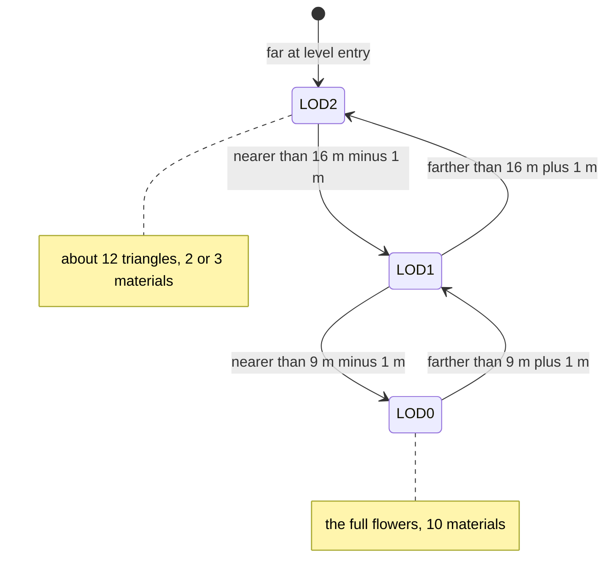

# Cuckoo Village flowers: level-of-detail model replacement

Moved out of the [window boxes plan](2026-11-22-cuckoo-village-flowers.md) on 2026‑11‑22 at Will's request ("move LOD follow-up to its own plan"). The text below is that plan's follow-up section, unchanged except that references to "the plan above" now name the flowers plan and its headings are one level up. It is a **follow-up, not part of that change**.

**Status: proposal, not started.** It starts only after the flowers plan is built and profiled, and its Phase 0 decides whether it is built at all. Rank: T4 (design and a lot of profiling on cast1, where a wrong turn costs hours of device time). Mockups: none yet, because the visible surface is the pop between two levels of detail, and its before-and-after frames are produced in step F6; the flowers themselves are drawn in the flowers plan.

**Status: a follow-up, not part of this change.** It starts only after the flowers plan is built and profiled, and **its first phase decides whether it is built at all**: if the profiling shows the full flowers cost almost nothing, the follow-up closes with its numbers and no code.

## Why it might pay

The flowers are modelled for a close look, and today's Journey camera rarely gives one (Will expects closer camera work in the future, which is the other half of the case: a distance-driven swap is what lets the detail stay affordable when the camera does come in). Measured from `timeline.camera()` over one 225 s lap, with all 13 cottages sampled every second (the distance is from the camera to a point 2 m up a cottage, where its boxes are):

| | Journey camera | Still camera |
|---|---|---|
| Camera to a cottage, nearest | 7.1 m | 16.8 m |
| Nearest cottage, median over the lap | 12.2 m | 22.2 m |
| Camera to a cottage, farthest | 35.3 m | 24.8 m |
| Share of cottage-seconds under 8 m | 5 % | 0 % |
| Share between 8 and 14 m | 25 % | not measured, none under 16.8 m |
| Share over 14 m | 70 % | 100 % |

On the screen: with the shot's default 50° of horizontal field of view on a 1920-pixel-wide frame (the level's own value is read in step F1 below), the frame holds about 290 pixels per metre at 7.1 m, 169 at 12.2 m, 147 at 14 m and 59 at 35 m. A geranium umbel (0.10 m across) is therefore about 29 pixels wide at the closest approach and 15 at 14 m, and one floret (0.034 m) is about 10 pixels and 5. **So today the petals the plan pays for are resolved on a few boxes for a few seconds, while the full set is drawn for all 26 boxes at every moment.** That is the case for swapping the model with distance, and it gets stronger, not weaker, if a later camera moves closer: the near boxes then need the detail and the far ones still do not. The case against is that the full set may cost nothing measurable, in which case the extra machinery is a loss for now. The profiling therefore also measures the cost with the camera pulled in (a closer test lap, described in the profiling below), so the decision does not rest only on today's camera path.

## What exists, and the mechanism

The engine has no level-of-detail support of its own (a search of `wfsource`, `engine` and the docs finds none). The mechanism is the one the setting and the candles already use: **the director sets visibility cells every tick, and a hidden actor draws no triangles.** The Journey camera is a function of the clock, and the director already sets the camera actor's position every tick, so it can take each cottage's squared distance from the camera (13 subtractions and multiplications, no square root) and pick that cottage's detail level.

## The design, if it is built

| Level | What it is | Triangles a box |
|---|---|---|
| LOD0 | the full flowers of the flowers plan | 649 (petunia), 683 (geranium) |
| LOD1 | the lean set | 332, 355 |
| LOD2 | colour only: a few flat quads and a dome in the box's main colours, with no stems or leaves | about 12 (to be modelled) |

Switch distances are set from the pixel sizes above (a first guess: LOD0 inside 9 m, LOD1 to 16 m, LOD2 beyond) and **tuned by the profiling**, with a **hysteresis of 1 m** so that a cottage at the boundary does not flip every frame, and the cottages switch independently.

**The cost that can sink it is draw calls, not triangles.** One actor per cottage and level means 13 × 3 = 39 flower actors. Hidden ones are free, but each visible one is a draw call per material, and the full and lean flowers have ten materials. Four ways to arrange it are measured against each other:

| Variant | Actors | Visible draw calls, worst case | Notes |
|---|---|---|---|
| A. Static full, one actor (the flowers plan) | 1 | 10 | the baseline for everything below |
| B. LOD per cottage | 39 | 13 × 10 = 130 | the finest control, the most draw calls |
| C. LOD per quarter of the village | 12 | 4 × 10 = 40 | four groups switch together by the nearest cottage in the group |
| D. LOD per cottage with one material | 39 | 13 × 1 = 13 | every flower in one palette material with vertex colours (`wf_texture_palette` and `wf_baked_vertex_color`, which the exporter already supports); it is a textured material, not the flat colours you asked for, so it is an experiment to measure and your decision to keep |

## The profiling

"A lot", because the answer depends on the distance and on how many draw calls the GPU tolerates, and a single before-and-after number would hide both. It all runs from **one APK**: the flowers plan's two-way `Detailed flowers` field becomes a four-way **`Flower detail`** field (Blocks, Lean, Full, Auto), so no profile needs its own build.

**Phase 0: is it needed at all, today and with a closer camera?** The flowers plan's own A/B/A profile gives the cost of the full flowers as `On` minus `Off`. **If that cost is under 0.5 ms at p95 and the gate has at least 1 ms of headroom, defer the follow-up**: the flowers plan stays as built, and the numbers wait for the first closer camera. Phase 1 below adds a closer lap to the measurement so the deferral is not made blind.

**Phase 1: the cost against distance.** The profile job records every frame's present time. The lap is a function of the clock, so each frame's lap phase gives its distance to the nearest cottage with no special camera and no test-only setting. Over 5 laps per variant, bucket the frames by the nearest cottage's distance (2 m wide buckets from 6 m to 36 m) and plot the median and the 95th percentile of the frame time per bucket for Blocks, Lean and Full. The gaps between the curves are the cost of the detail at each distance. It also shows whether the cost is spread over the lap or comes in bursts, which is when a switch helps.

**A closer lap.** A test-build-only camera path (never a customer setting, like the test clock) that brings the camera to 3 m from each cottage in turn, along the same lane the Journey follows, so the frame time can also be measured at the distances a future camera might use. It is profiled for Blocks, Lean and Full, 3 laps each, in the same interleaved order.

**Phase 2: static variants.** Blocks, Lean and Full, 5 laps each, interleaved (A B C A B C and so on) so heat and background load spread across all three, with the Blocks run repeated every ninth lap as a drift check.

**Phase 3: dynamic variants.** Auto, built as B, C and D, each with two sets of switch distances, so 6 variants, 5 laps each.

**Totals.** 3 static and 6 dynamic variants at 5 laps is 45 laps, and the closer lap adds 3 variants at 3 laps, so 54 laps of 225 s plus a 15 s warm-up each, about 3.6 hours of cast1, run in the order above with the drift checks. It is the coordinator's `profile` workflow throughout, the field set by the key script in each run (the form is not saved), and the same Journey lap.

**What each run records** (the profile job's evidence, per frame and per run):

| Measure | Source |
|---|---|
| fps, median, p90, p95, p99 and worst frame time, missed refreshes | the profile job's `summary.json` and present times |
| Frame time against distance to the nearest cottage | the present times mapped through `timeline.camera()` (Phase 1) |
| Draw calls and triangles per frame | the engine's frame statistics if the log carries them; otherwise a counter is added to the debug server first (step F2) |
| Memory | `meminfo`, total PSS |
| Heat | the thermal status of each run |
| Director cost | frame time of Blocks against a variant whose director does the distance work but draws nothing (the cost of the 13 distance tests alone) |
| Switches per lap | counted in the director's log, to check the hysteresis holds |
| Visible pop | see below |

**Visible pop.** A swap must not be noticed. At each cottage's switch distance, render the frame just before and just after the switch from the same camera pose (the desktop engine with the test clock, deterministic), and measure how many pixels change in the window round the box. The threshold is **a proposal to be tuned on a reviewed set of pairs, and yours to approve**: at most 0.6 % of the pixels in a 160 × 120 window change by more than 24 of 255.

**The report.** `scripts/flowers-profile-report.py` grows these sections: the cost-against-distance chart (one line per variant), a variants table with each variant's difference from the static Full, the draw-call and triangle counts, the pop table, the switch counts, and the verdict below.

## The decision rule

Adopt a LOD variant only if all of these hold, otherwise keep the static flowers (Full, or Lean if the flowers plan's gate had failed):

1. its p95 frame time is at least **0.5 ms** below the static Full's in the busiest 10 % of the lap;
2. its p50 is not above the static Full's by more than 0.2 ms anywhere in the lap (the director's distance tests and the extra draw calls cost something);
3. no pop pair exceeds the threshold, and no cottage switches more than 4 times a lap;
4. the level file grows by no more than 0.4 MB over the flowers plan's (LOD1 is the lean mesh, 8,839 triangles, about 0.25 MB, and LOD2 is small), and the flowers plan's own gate still passes.

## Verification of the follow-up

F1. **The field of view and the pixel sizes.** Read the level's camera shot FOV and recompute the pixels-per-metre table above; correct the table if it is not 50°.
F2. **The counters.** Confirm the engine's log or debug server reports draw calls and triangles per frame; add them if not, with a test.
F3. **Phase 0.** The A/B/A numbers from the flowers plan, and the decision to continue or stop, written down here.
F4. **Phase 1.** The cost-against-distance chart for Blocks, Lean and Full from 5 laps each.
F5. **Phase 2 and 3, and the closer lap.** The 54 laps, the three job lists, the drift checks, and the variants table.
F6. **The pop pairs.** The before and after frames at every switch distance and the measured change.
F7. **The verdict.** The report's decision against the four rules, and either the chosen variant landed with its tests or the follow-up closed as not worth building.
