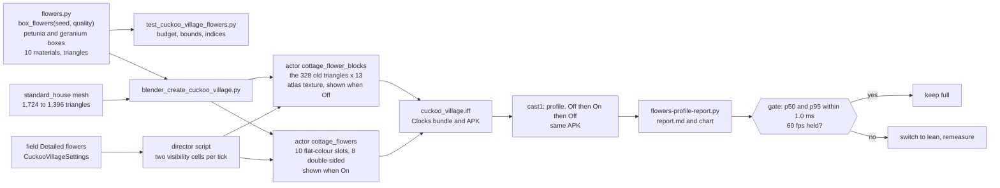
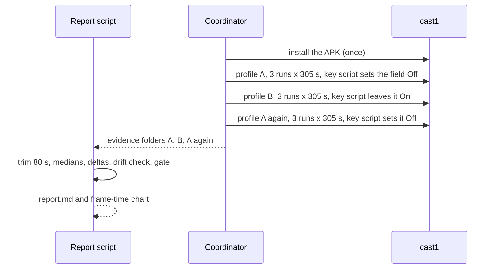
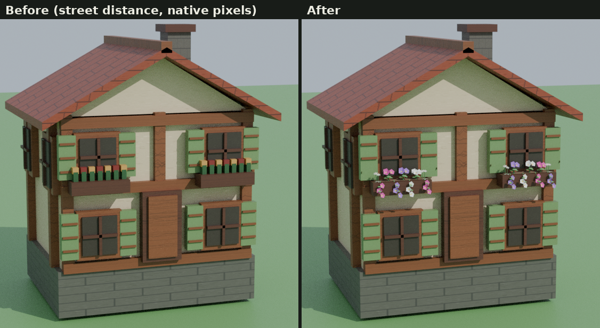
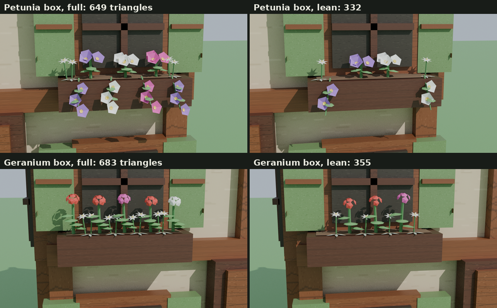

# Cuckoo Village window boxes: trailing petunias and edelweiss

**Status:** proposal for review, 2026‑11‑22. Nothing is in the level yet: the geometry and the renders below are a prototype, and the level build is untouched. Revised 2026‑11‑22: the flowers sit behind a settings toggle, so one APK can be profiled both ways, and a script writes the before-and-after report.

## Context

The cottage window boxes in the Cuckoo Village are two rows of blocks: each box carries seven green posts topped with seven coloured cubes (14 cubes, about 164 triangles), textured from the shared atlas. Close up they read as bricks, not flowers (compare the first picture below). There are 26 boxes: two on the front of each of the 13 cottages.

Will asked for them to be modelled with more polygons, in flat coloured materials instead of textured ones, with a plan showing before and after renderings, budgets, materials and render time. The flowers were chosen in discussion (Will, 2026‑11‑22: "i don't like geraniums", then "Petunias and Edelweiss", then "make 1/3 of the flowerboxes germaniums and edelweiss, so need a new model for germanium after all"). So two kinds of box alternate, two in three petunia and one in three geranium, and every box has edelweiss. Then, on the geranium boxes (Will, 2026‑11‑22): "i don't like the ivy geraniums; get rid of them" and "add more edelweiss in the geranium boxes instead". The ones I considered and set aside: pansies, marigolds and lavender.

Measured today with [`flowers_prototype.py`](../../wflevels/cuckoo_village_assets/flowers_prototype.py): the cottage mesh `standard_house` is 1,724 triangles, of which 328 are the plants of its two window boxes. The whole village layout is 67,364 triangles, and the Christmas candles add about 3,600, so the level is about 71,000 today.

## Approach

**Geometry.** [`flowers.py`](../../wflevels/cuckoo_village_assets/flowers.py) builds one box of flowers as plain triangles per material, in code, so it is unit-tested without Blender ([`test_cuckoo_village_flowers.py`](../../tests/test_cuckoo_village_flowers.py), 12 tests passing). **One box in three is a geranium box** (boxes 0, 3, 6 and so on: 9 of the 26), the other 17 are petunia boxes, and every box has a soil bed and edelweiss. A box holds:

- a **soil bed**, a four-triangle mound just above the box top;
- **edelweiss tufts**: 2 on a petunia box, 4 on a geranium box, each with narrow silver leaves and two stems ending in a star;
- on a **petunia box**, 3 mounded petunias along the middle (three round leaves and three blooms each) and 4 trailing petunia stems that arch over the front rim and hang down the front (two leaves and three blooms each). The hanging stems give the street camera a mass of colour that survives the distance;
- on a **geranium box**, 5 upright (zonal) geraniums along the middle and nothing hanging: a thick stem with four big round leaves spiralling up it, topped by a dense round **umbel**, seven small florets packed on a dome, so from a distance the head is one ball of colour, as a real zonal geranium's is. The four edelweiss tufts are spread across the whole width, one in each gap between the plants and a little forward of them, in place of the hanging stems (Will, 2026‑11‑22: "maybe edelweiss more distributed across the box?").

A **petunia bloom** is a funnel: ten petal triangles round a recessed rim of five lobes, plus five triangles of yellow throat (15 triangles). A **geranium floret** is five petals as a cupped pentagon (5 triangles); a head packs 7 of them on a dome (35 triangles). An **edelweiss head** is a flat star of seven pointed felty bracts (14 triangles) round a five-triangle yellow heart (19 triangles). Petunias rotate through magenta, violet and white; geraniums are mostly red, with pink and white ones among them. Everything is seeded by the box number, so a rebuild gives the same flowers.

**The setting.** A new field, **Detailed flowers** (Off / On, default On), is appended to `CuckooVillageSettings`, a live field like the other six: it shows in the hold-A form on the TV and in the phone's Dream form. On shows the petunias and edelweiss. Off shows today's blocks. It exists so that one APK can be measured both ways: the same build, the same device, the same camera lap, with only this field changed. Whether it stays as a permanent option or is retired once the flowers are accepted is a decision for Will (see Out of scope).

**Build.** In `blender_create_cuckoo_village.py`, after the candles:

1. Take the old plant faces out of the one shared `standard_house` mesh (the 13 cottages share it, so this is one edit), asserting that exactly 328 triangles went, and bake them into a second static actor, **`cottage_flower_blocks`**, one mesh for all 26 boxes, with the village atlas material they have today. With the setting Off the village looks exactly as it does now.
2. For each of the 26 boxes, take its world position, heading and scale from the cottage actor, and place the box's new flowers with `placed()`.
3. Join all 26 into **one static actor, `cottage_flowers`**, with ten flat-coloured material slots. The materials have a Base Color and no texture, which the exporter already writes as a flat colour; the eight thin petal and leaf materials carry `wf_double_sided`, which the engine honours by skipping back-face culling for them.
4. The director script (`forth.py`) reads the field with `property@`, like the six existing ones, and drives two visibility cells every tick: `cottage_flowers` shows when the field is 1 and `cottage_flower_blocks` when it is 0. A hidden actor draws no triangles.

**Why one actor of flowers.** One baked actor costs 10 draw calls for all 26 boxes. One actor per cottage would cost 13 × 10 = 130. Triangles are cheap on this GPU and draw calls are not, so I chose the single actor, which gives up per-cottage culling. If the profiling says that was the wrong call, the fallback is four actors by quarter of the village (40 draw calls).

**Fallback set.** `QUALITY["lean"]` is the same flowers with fewer parts (332 triangles on a petunia box instead of 649, 355 on a geranium box instead of 683: for example 2 mounds of 3 blooms, 2 vines of 2 blooms and 2 tufts of 1 head on a petunia box, and 3 plants of 5 florets and 4 tufts of 1 head on a geranium box, so a geranium box keeps all four of its edelweiss). It is a switch in code, not a setting. It is used only if the profiling gate fails (see Profiling).

Other files that change with the new field: `cuckoovillagesettings.oas` (+ the regenerated `.oad` and `.ht`), `timeline.py` (`SETTINGS_DEFAULTS` and the two cell numbers, 227 and 228, after the flame cells), and `test_cuckoo_village_settings.py and `test_cuckoo_village_settings_effect.py` (seven fields instead of six). The village has no phone capabilities asset (only Tide Harbour has one), so the field does not appear in the phone's Dream form, and the coordinator's persistent `screensaver-setting-set` route does not reach it; the TV form and the profile job's key presses do (see Profiling). Giving the village a capabilities asset is a separate piece of work.

### Build flow

### Quality modes

## Budgets

Counted from the code, not estimated (a test enforces the full set at 700 triangles a box and 18,200 in all).

| | Today | Full (proposal) | Lean (fallback) |
|---|---|---|---|
| Triangles in one box | about 164 (14 cubes) | 649 (petunia), 683 (geranium) | 332 (petunia), 355 (geranium) |
| Triangles in all 26 boxes (17 petunia, 9 geranium) | 4,264 | 17,180 | 8,839 |
| Cottage mesh (shared by 13) | 1,724 | 1,396 | 1,396 |
| Whole level, setting On, about | 70,964 | 83,880 (+18.2 %) | 75,539 (+6.4 %) |
| Whole level, setting Off | 70,964 | 70,964 (same blocks, as a separate actor) | 70,964 |
| Draw calls added, On | 0 (shares the house's) | 10 | 10 |
| Actors added | 0 | 2 (flowers and blocks) | 2 |
| Level file, with the setting | 4.98 MB | 5.74 MB (+0.76 MB, measured) | about 5.49 MB (+0.51 MB, estimated) |
| Level file, after the setting is retired | 4.98 MB | about 5.56 MB (+0.58 MB) | about 5.30 MB (+0.32 MB, estimated) |

The full flowers' file size is measured: the built level is 5,738,496 bytes against 4,982,784, so +755,712 bytes, of which the flowers mesh is 582,072 bytes (34 bytes a triangle) and the blocks mesh 183,544 (43 bytes a triangle). My first estimate used the candles' 27.9 bytes a triangle and so said +0.60 MB, a quarter too low: the flowers share fewer vertices than the candles do. The lean figures use the measured 34 bytes a triangle and are still estimates. The Clocks bundle (8.56 MB, now 9.37 MB) grows by the same amount.

None of these numbers is a frame time; the profiling below is.

## Profiling before and after

The setting makes this a like-for-like measurement: **one APK, one device, only the field changes.**

**Method.** On cast1 (`chromecast-test-01`, the Chromecast HD that is the performance target), with the coordinator's `profile` workflow:

1. Install the one APK.
2. Run `profile` with `warmup` 5 s, `runs` 3, `duration` 305 s, `panel` `require-hidden` and an input script that picks the village in the chooser and, **for an Off run**, opens the settings form (hold A for 1.6 s), moves down six rows to **Detailed flowers**, presses Left, and closes the form with Back, all inside the first 75 s. The key sequence is tested on cast1: the form shows seven rows, the field defaults to On, and Left turns it Off. For an On run the script is the same without the Left press. The form's changes are not saved and every run relaunches the app, so each run sets the field itself. (The village has no phone capabilities asset, so the coordinator's persistent `screensaver-setting-set` route does not reach the field.)
3. **Trim the menu.** A key script has to fit inside the run's duration, so the first 80 s of each run (the chooser, the level load and the form) are inside its window. `scripts/flowers-profile-report.py --trim 80` drops them and recomputes every statistic from the per-frame present times of the rest: the last 225 s, which is exactly one lap because the camera is a function of the wall clock, so the flowers are on screen at their nearest and furthest in every run.
4. Run the same profile with the On script, then with the Off script a third time, so any drift (heat, background load) shows up as the difference between the two Off sets instead of being credited to the flowers.
5. Run `scripts/flowers-profile-report.py` on the three evidence folders.

Each run records, per the profile job: achieved frames per second, the median, 90th, 95th and 99th percentile frame time, the worst frame, the percentage of missed refreshes, the memory (`meminfo`), the thermal status, and the per-frame present times. About 47 minutes of cast1 in all (3 sets × 3 runs × 310 s).

**The gate.** The flowers pass if all of these hold: the median p50 and the median p95 frame time with the field On are each within **1.0 ms** of the median of the two Off sets; the frames per second with it On stay within 0.5 of the Off sets and at least 59 for a 60 fps scene (the refresh is 59.94 Hz), or 29.5 for the village, which the Chromecast HD presents at 30; the missed-refresh percentage rises by no more than 2 points; and the two Off sets agree with each other to within 0.5 ms, otherwise the run is thrown away as drifted. If it fails, step down the ladder in the quality diagram and measure again.

**Result, 2026‑11‑22.** The village in this build runs at **30 fps** on cast1: the Chromecast HD presents every second refresh, so every frame is 33.4 ms. That is the village's normal rate on this device as far as I can tell (there is no earlier village measurement to compare with), and Will's decision is that 30 fps is fine. With the field Off, On and Off again the three runs read 29.97, 29.96 and 29.97 fps, a median frame of 33.37 ms in all three, and a worst frame of 33.4, 50.1 and 33.4 ms; the report's verdict is **PASS** with the fps floor set to 29.5 for a 30 fps scene (`--fps-floor`; the default 59 is for a 60 fps scene). The report is [`docs/diagnostics/cuckoo-village-flowers-2026-11-22/report.md`](../diagnostics/cuckoo-village-flowers-2026-11-22/report.md). **What this result does not show:** a vsync-locked 30 fps scene hides any cost below one refresh (16.7 ms), so it says the flowers do not push the village under 30 fps, not that they are free. Each set is one run of 130 s with the first 85 s (the menu, the level load and the form) trimmed, so the measured window is 45 s of the Journey lap, not a whole 225 s lap, and the Off, On and Off again order was in fact On, Off, Off again. Finer analysis (the engine's own CPU and GPU frame times, a full lap, more runs) is left for when more than 30 fps is wanted.

### The report

`scripts/flowers-profile-report.py` (to be written with the build, modelled on `summarise-plant-resolution-comparison.py`) reads the three evidence folders and writes `docs/diagnostics/cuckoo-village-flowers-<date>/report.md`, with a chart, so the difference after implementation is generated, not typed. It contains:

| Section | What it shows |
|---|---|
| Build facts | Triangles, actors and material slots in each state (read from the built level); the level file size now against the size at the commit before the change (`git show`); the APK checksum. |
| Frame times | A table of fps, p50, p95, p99, worst and missed refreshes: each run, the median of each set, and the On minus Off difference with the percentage. |
| Drift | The two Off sets side by side, and the thermal status of each run. |
| Memory | Total PSS (from `meminfo`) in each state. |
| Chart | A histogram of per-frame present times for Off and On over the same axis. |
| Pictures | A device capture in each state from the same camera moment, so the difference is visible next to the numbers. |
| Verdict | PASS or FAIL against the gate, with each condition and its measured value on its own line. |

The report is written once, after the build, from real evidence. It does not exist yet.

## Materials

All ten are flat colours (Base Color only, no texture). "Per piece" is the triangles in one petal set, leaf or stem, averaged where pieces vary; "Pieces per box" is how many of those a box holds, averaged over the 26 boxes (17 petunia, 9 geranium); "Total" is the whole village (26 boxes, full set).

| Material | Colour | Used for | Double-sided | Per piece | Pieces per box | Total |
|---|---|---|---|---|---|---|
| `bloom_red` | #C7120F | Geranium petals | yes | 5 per floret | 7.3 florets | 945 |
| `bloom_magenta` | #CC1775 | Petunia petals, and the pink geraniums | yes | 10 per petunia bloom, 5 per geranium floret | 3.9 blooms, 2.4 florets | 1,335 |
| `bloom_violet` | #6E30B2 | Petunia petals | yes | 10 per bloom | 5.0 blooms | 1,290 |
| `bloom_white` | #F5F2EB | Petunia petals, and the white geraniums | yes | 10 per petunia bloom, 5 per geranium floret | 4.8 blooms, 2.4 florets | 1,575 |
| `flower_centre` | #F7CC29 | Petunia throats and edelweiss hearts | yes | 5 per throat or heart | 19.1 | 2,485 |
| `edelweiss_felt` | #DBDBC9 | Edelweiss bracts | yes | 14 per head | 5.4 heads | 1,960 |
| `leaf_green` | #2B6E24 | Petunia and geranium leaves | yes | 6.8 on average (6 petunia, 8 geranium) | 18.0 leaves | 3,174 |
| `leaf_silver` | #809978 | Edelweiss leaves | yes | 4 per leaf | 8.1 leaves | 840 |
| `stem_green` | #174517 | Stems | no | 11.4 on average (8 for a mound or edelweiss stem, 16 for a geranium, 18 for a trailing petunia stem) | 11.7 stems | 3,472 |
| `soil` | #331F12 | The soil bed in each box | no | 4 per bed | 1 bed | 104 |

### What one flower costs

A flower is its petals plus its yellow centre; the plant it sits on adds leaves and a stem.

| Piece | Triangles | Made of |
|---|---|---|
| One petunia bloom | 15 | 10 petal + 5 throat |
| One geranium floret | 5 | a cupped pentagon |
| One geranium umbel (a round head) | 35 | 7 florets |
| One edelweiss head | 19 | 14 bract + 5 heart |
| A mounded petunia plant | 71 | stem 8, three leaves 18, three blooms 45 |
| An upright geranium plant | 83 | stem 16, four leaves 32, one umbel 35 |
| A trailing petunia stem | 75 | stem 18, two leaves 12, three blooms 45 |
| An edelweiss tuft | 66 | three silver leaves 12, two stems 16, two heads 38 |
| One petunia box | 649 | 3 mounds 213, 4 trailing stems 300, 2 tufts 132, soil bed 4 |
| One geranium box | 683 | 5 upright plants 415, 4 tufts 264, soil bed 4 |

The lean set uses the same pieces in smaller numbers.

## Renders, before and after

Cycles on the CPU, 48 samples, denoised, 1280 × 720, in the Blender container, from [`flowers_prototype.py`](../../wflevels/cuckoo_village_assets/flowers_prototype.py). The "before" is the committed `village_assets.blend` cottage; the "after" removes the old plant faces and adds the new flowers, with the same camera and lights. Box 0 (the left box) is a geranium box and box 1 (the right box) a petunia box.

**Close-up of a petunia box** (1.5 m away): this and the next picture are the decision this plan asks you to make.

**Close-up of a geranium box.**

**The whole cottage front**, a geranium box on the left and a petunia box on the right.

**Street distance**, in native pixels (about what the TV shows from the tower camera). The flowers read as colour, not as petals, which is the reason for the hanging stems: the colour mass is what survives the distance. The two box kinds are distinguishable by colour: mostly red on a geranium box, violet, magenta and white on a petunia box.

**The lean fallback next to the full set**, both box kinds.

There is no live mockup page here: the surface is a rendered 3D scene, so the five stills are the mockups.

### Render time

The render times come from one sequential run (before, then after, then lean) while other jobs were loading the machine (load average 18 to 31 on 8 cores, falling during the run), so **wall-clock seconds are not comparable between rows**: the first close-up "before" took 162 s and the same view "after" took 84 s with the same scene complexity. The **CPU seconds** (summed over every render thread) are the fair comparison, because another job on the machine barely changes them.

| View | Before: wall / CPU | After, full: wall / CPU | After, lean: wall / CPU |
|---|---|---|---|
| Close-up, petunia box | 162.2 s / 392 s | 83.5 s / 373 s | 79.3 s / 369 s |
| Close-up, geranium box | 151.8 s / 402 s | 110.1 s / 403 s | 94.9 s / 387 s |
| Cottage | 62.9 s / 293 s | 89.2 s / 305 s | not rendered |
| Street | 43.3 s / 222 s | 77.0 s / 234 s | not rendered |
| Total (the four views) | 420.2 s / 1,309 s | 359.8 s / 1,315 s | not comparable |

On CPU seconds the "after" is 0.5 % **more** than the "before" (1,315 s against 1,309 s), for about 1,000 more triangles in a 1,724-triangle scene (2,742 with the flowers). That is no measurable cost in Cycles, and the experiment is too coarse to see a small one, since the load on the machine also moves CPU seconds a little. **This is not the on-device cost.** The on-device cost is the profiling above.

## Follow-up: level-of-detail model replacement

Moved to its own plan: [Cuckoo Village flowers: level-of-detail model replacement](2026-11-22-cuckoo-village-flowers-lod.md) (2026‑11‑22). It starts only after this plan is built and profiled, and its Phase 0 decides whether it is built at all.

## Out of scope

- **Level-of-detail replacement.** Its own plan, [level-of-detail model replacement](2026-11-22-cuckoo-village-flowers-lod.md): a distance-driven swap of the flower models, with Phase 0 deciding whether it is built.
- **Retiring the setting.** Once the flowers are accepted, either keep **Detailed flowers** as a permanent user option (blocks on a slow device), or remove the field and the `cottage_flower_blocks` actor (about 0.12 MB and one more actor). It is Will's call; until then both are in the level. This becomes a TODO item when the plan lands.
- **Seasonal planting.** Pansies in spring, petunias in summer, asters or heather in autumn, fir sprigs with red berries in December, chosen by the date as the candles are. It needs extra meshes and cells and a place in the settings; this plan only makes the summer boxes good.
- **The Bavaria-mode chalet's boxes.** The chalet shares this geometry (the cuckoo-village plan lists flower boxes among its extra meshes). Rebuilding them is a follow-up once the village boxes are accepted.
- **Wind or sway on the trailing stems.** The engine poses actors, not vertices, so a sway needs one actor per stem group and a director word; it is not in this change.
- **A still-camera profile.** The Journey lap covers near and far views. A profile with Camera motion Still at the closest view would give a worst case; add it only if the lap result is close to the gate.
- **Flowers on the Tide Harbour and Aquarium levels.** Not part of this request.

## Verification

1. **The geometry tests pass.** `scripts/in-linux-container.sh python3 -m pytest tests/test_cuckoo_village_flowers.py -q` reports 12 passed. (Green today.)
2. **The prototype reproduces the renders and counts.** `WF_CONTAINER_IMAGE=blender scripts/in-linux-container.sh blender --background --python wflevels/cuckoo_village_assets/flowers_prototype.py -- /src/build-docker/flowers/render-full full` prints `MESH house tris before 1724 removed 328 after 1396` and `MESH flowers tris 1332` (two boxes: a geranium box of 683 and a petunia box of 649).
3. **The setting exists and is live.** `test_cuckoo_village_settings.py` and `test_cuckoo_village_settings_effect.py` pass with seven fields, and `Detailed flowers` is Off / On, default On, live. The regenerated `.oad` equals what `oas2oad` makes, and the phone's capabilities asset lists the field.
4. **The director follows the field.** `tests/verify_cuckoo_village_forth.py` in the real zForth VM: with the field On the flowers cell is 1 and the blocks cell 0, with it Off the reverse, with it unset (default) On, at noon, dusk, night and dawn on dates in and out of the candle season.
5. **The level builds with both versions.** `bash wflevels/cuckoo_village/build.sh` in the Blender container reports 88 actors (86 today plus `cottage_flowers` and `cottage_flower_blocks`) and the removed-triangle assertion holds (328).
6. **The exported materials are as designed.** `cottage_flowers` has ten slots, none naming a texture, eight with flag 8 set; `cottage_flower_blocks` has the one atlas material.
7. **The size is within the estimate.** `cuckoo_village-standalone.iff` is at most 0.75 MB larger than the 4,982,784 bytes it is today.

    **Size gate re-set (proposed 2026‑11‑27), awaiting Will's decision.** The step above stays as written; it is the spec. Its limit is 4,982,784 + 750,000 = 5,732,784 bytes (the Results table reads "MB" as 10⁶ bytes). The committed level is 8,787,968 bytes, so **step 7 fails today by 3,055,184 bytes**, of which the flowers' own build is 5,712. No test enforces a size: `tests/test_clocks_bundle.py` only checks that the bundle's member equals the standalone file, and no other test reads the file's size.

    Sizes read from git (`git show <rev>:wflevels/<file> | wc -c`); the breakdown is from the level's own asset map (`ASMP`) and its per-room `ASS` chunks, compared by asset name. Commits that left the level's size unchanged are folded into the row above them.

    | Commit | Change | Plan | Level bytes | Change in bytes | What grew | Clocks bundle bytes |
    |---|---|---|---|---|---|---|
    | `52074c640` | merged into WF Clocks (then `f822bf99f` hands fix, `0f1d588a8` and `f955673e6` Christmas season: no size change) | [cuckoo village](2026-11-21-cuckoo-village.md) | 4,882,432 | | | 8,128,512 |
    | `80f253ae9` | candles on the pines | [cuckoo village](2026-11-21-cuckoo-village.md) | 4,982,784 | +100,352 | `candle_sticks` 67,500; 12 `candle_flames` 28,560; level chunk +3,584 | 8,564,736 |
    | `33b6d3b8f` | window boxes (**this plan**) | this plan | 5,738,496 | +755,712 | `cottage_flowers` 582,076; `cottage_flower_blocks` 183,548; `standard_house` −12,032 | 9,367,552 |
    | `451d7adb4` | Bavaria mode | [cuckoo village](2026-11-21-cuckoo-village.md) | 5,906,432 | +167,936 | 4 more `tower_figure` 63,656; `bavaria_chalet` 45,860; `bavaria_trim` 24,264; maypole 14,172; two numeral sets 20,760; dome 7,628; `tower_case` −10,080 | 9,535,488 (`4d40f06f6`) |
    | `60a3c5ae0` | Show framerate setting | none named | 5,910,528 | +4,096 | level chunk +2,988 | 9,504,768 |
    | `6af3636d5` | candle flicker, Option A (then `ed0dfa839` checkbox settings: no size change) | [candle flicker](2026-11-22-cuckoo-village-candle-flicker.md) | 5,957,632 | +47,104 | 36 more `candle_flames` 35,760; level chunk +9,688 | 9,553,920 |
    | `1b4f1b6f0` | Alpine hills, day/night sky, Houses and Trees settings (0–24 each), 24‑hour dial | [Alpine hills](2026-11-24-german-cuckoo-village-alpine-hills.md), [day/night](2026-11-24-german-cuckoo-village-day-night.md) | 8,787,968 | **+2,830,336** | permanent texture page 150 → 1,572,886 (+1,572,736, the sky dome's panoramas); flowers split into 24 per-site meshes 582,076 → 1,133,024 (+550,948); 24 per-site `cottage_blocks` 345,504, replacing `cottage_flower_blocks` (−183,548); 24 per-site `candle_sticks` +74,100; 48 more `candle_flames` +64,320; three sky domes 188,452; four 24‑hour dials 115,248; `alpine_foothills` 42,796; level chunk +58,116 | not repacked here; 30,908,416 at `7ed6d60c5`, the first pack holding this level (with 12 new clocks) |
    | `f1a57fb91` | Forth `floor` word | [Forth math words](2026-11-26-forth-math-words.md) | 8,787,968 | 0 | level chunk −112, absorbed by the 2,048‑byte alignment | 30,910,464 (`4876fb206`); 29,929,472 now |

    The [level-of-detail plan](2026-11-22-cuckoo-village-flowers-lod.md) has not started and has added nothing. Today the level is 29% of the Clocks bundle.

    **Proposed figure: 9,437,184 bytes (9 MiB)**, 649,216 bytes (7.4%) above today's 8,787,968. Reason: the gate should pass today's content and catch the next unplanned jump like `1b4f1b6f0`'s, while leaving room for the one planned increase on file, the level-of-detail plan's own budget of 0.4 MB (criterion 4 of its decision rule), plus about 0.25 MB for small changes of the kind in the table (4 to 170 KB each, in 2,048‑byte blocks). Unbudgeted work, such as seasonal planting or the chalet's boxes, would then re-set the gate on purpose.

    **Where it lives (proposed, not added):** a test, `tests/test_cuckoo_village_size.py`, asserting `(ROOT / 'wflevels/cuckoo_village-standalone.iff').stat().st_size <= 9_437_184` with a message naming this note, so a rebuild that crosses it fails `pytest` instead of waiting for someone to read this step. It is not added until Will picks the figure. The level-of-detail plan's criterion 4 ("the flowers plan's own gate still passes") and the [candle flicker](2026-11-22-cuckoo-village-candle-flicker.md) plan's step 4 ("the level-size gate is re-set and its figure recorded") wait on the same decision.

8. **The bundle and launcher tests still pass.** `tests/test_clocks_bundle.py`, `test_launcher_parity.py`, `test_audit_level_settings.py`, `test_cuckoo_village_forth.py`, `test_cuckoo_village_candles.py`.
9. **Both states show on cast1.** Build the Clocks APK, install it, and capture a frame near a cottage with the field Off (the blocks, as today) and On (petunias and edelweiss); the candles and window lights still work in both.
10. **The profile, Off then On then Off.** The three `profile` runs described under Profiling, each 3 runs × 225 s on `chromecast-test-01` with the one APK; the three job numbers are recorded here.
11. **The report is generated.** `python3 scripts/flowers-profile-report.py <the three evidence folders>` writes `docs/diagnostics/cuckoo-village-flowers-<date>/report.md` with every section in the table above filled from the evidence, and exits 0 only when the gate passes.
12. **The gate.** The report's verdict is PASS (or, on FAIL, the next step down the quality ladder is built and steps 10 and 11 are repeated).

### Results, 2026‑11‑22

| Step | Result | Evidence |
|---|---|---|
| 1 | PASS | `tests/test_cuckoo_village_flowers.py`: 12 passed (11 at the first record, 1 added since for the geranium box without trailing stems) |
| 2 | PASS | `MESH house tris before 1724 removed 328 after 1396`; `MESH flowers tris 1346` for the first geranium model, now 1332 (a geranium box of 683 and a petunia box of 649) |
| 3 | PASS | `test_cuckoo_village_settings.py` and `test_cuckoo_village_settings_effect.py` pass with seven fields; the one failing test (`test_the_oad_is_what_the_tool_makes_from_the_oas`) needs `prep`, which the test image lacks, and the `.oad` was made by `oas2oad` itself |
| 4 | PASS | the real-VM check covers four dates and four times with the field unset, On and Off: `flowers: 0 failures` |
| 5 | PASS | the level builds with 88 actors at the time (103 objects once Bavaria mode landed); the 328-triangle assertion holds |
| 6 | PASS | `cottage_flowers.iff`: 10 slots, no texture, 8 with flag 8; `cottage_flower_blocks.iff`: one atlas slot (`tests/test_cuckoo_village_flower_actors.py`) |
| 7 | **FAIL by 0.006 MB** | the level grew by 755,712 bytes (+0.756 MB) against a limit of 0.75 MB; the estimate was low (see Budgets) |
| 8 | PASS | the bundle, launcher, audit, candle, flower and report tests pass (75 in the last run on the rename branch) |
| 9 | PARTLY | cast1 and the Pixel have the build installed; the TV form shows seven rows, the field defaults to On and Left turns it Off, and the Off village shows the old blocks (record job `J‑ac395662ad63`). A close-up capture of the flowers On was not taken |
| 10 | DONE, reduced | three profile jobs on cast1 (`J‑58050a8dee54` On, `J‑5626261ca0cb` Off, `J‑5b8db57fba69` Off), one run each, 130 s, first 85 s trimmed; not the planned 3 runs of 305 s |
| 11 | DONE | `docs/diagnostics/cuckoo-village-flowers-2026-11-22/report.md` and `report.json`, generated by `scripts/flowers-profile-report.py --trim 85 --fps-floor 29.5` |
| 12 | PASS at 30 fps | the verdict is PASS (29.96 fps On against 29.97 Off, identical median and 95th percentile); see the result paragraph under Profiling for what it does and does not show |

The report's level-size line (+923,648 bytes) compares against the commit before the window boxes and so includes the growth from Bavaria mode; step 7's 755,712 bytes is the flowers' own build.

<!--
When the work lands, this section becomes the permanent record: keep each step as written and paste the raw output under it, then PASS or FAIL.
-->
